# Turismo comunitario

Aplicación web monolítica para centralizar las cuentas, las ofertas turísticas y la comunicación en tiempo real de una PYME ecuatoriana **ficticia** de turismo comunitario. Es el proyecto del primer bimestre de Aplicaciones Web Avanzadas (EPN). Todos los datos de demostración son ficticios.

- [Qué resuelve](#la-pyme-y-el-problema) · [Qué incluye y qué no](#alcance-del-primer-bimestre) · [Stack](#stack)
- [Ejecutar en local](#ejecutar-en-local) · [Variables de entorno](#variables-de-entorno) · [Pruebas](#pruebas)
- [HTTPS y WSS en local](#https-y-wss-comprobación-local-con-caddy) · [Diagramas](#diagramas) · [Documentación](#documentación)
- [Integrantes y roles](#integrantes-y-roles) · [Uso de IA](#uso-de-ia) · [Estado y pendientes](#estado-y-pendientes)

## La PYME y el problema

La PYME ficticia coordina experiencias de turismo comunitario en distintas provincias del Ecuador. Necesita registrar la información y la fotografía de cada experiencia, publicarla y atender consultas. Hoy las ofertas y la comunicación están dispersas entre mensajes y documentos: cuesta reconocer la información vigente, encontrar experiencias por provincia, controlar quién modifica cada oferta y conservar las conversaciones.

La aplicación reúne en un solo lugar:

- **Cuentas:** registro, ingreso, cierre de sesión y recuperación de contraseña.
- **Ofertas:** alta, listado con filtro por provincia y paginación, detalle, edición y eliminación con confirmación, con una fotografía por oferta. Cada persona gestiona solo sus ofertas.
- **Catálogo público** (sin cuenta): solo ofertas publicadas, con foto y fecha futura, y un botón para consultar la reserva por WhatsApp.
- **Chat en tiempo real** con historial, usuarios conectados y un aviso de mensaje nuevo en el panel, sobre WebSocket autenticado.

El planteamiento completo (objetivos, cronograma y roles) está en [`docs/mvp/problema-objetivos-cronograma.md`](docs/mvp/problema-objetivos-cronograma.md) y las historias de usuario en [`docs/mvp/historias-de-usuario.md`](docs/mvp/historias-de-usuario.md).

## Alcance del primer bimestre

**WhatsApp es un enlace externo.** En el detalle de una oferta pública, el servidor arma un enlace `https://wa.me/<número>?text=…` y el navegador de la persona abre WhatsApp. El servidor **no llama a WhatsApp**, no usa ninguna API de pago, no guarda reservas y no hay pasarela de pagos. El cupo de cada oferta es solo referencial: la PYME confirma la disponibilidad en la conversación de WhatsApp que inicia el visitante.

- El número lo define `WHATSAPP_BOOKING_NUMBER` y es **opcional**. Si está vacío, el detalle muestra «Contacto por WhatsApp no disponible».
- Usa solo un número **autorizado** por su titular (o el número ficticio de las pruebas). No lo escribas en documentos, capturas ni en `.env.example`.

**No incluye:** registro interno de reservas, pagos, entradas QR, control de ingreso, revisión de ofertas, roles de GAD, operador o administrador, correo real (SMTP) ni más de una sala de chat. El detalle está en [`docs/mvp/arquitectura.md`](docs/mvp/arquitectura.md#fuera-del-mvp).

## Stack

| Capa | Tecnología |
|---|---|
| Entorno de ejecución | Node.js 24 (`.nvmrc` fija 24.22.3; `engines.node` ≥ 24) y npm |
| Servidor y vistas | Express 5.3.0 y EJS 7.0.2, renderizado en servidor; JavaScript (módulos ES) |
| Tiempo real | Socket.IO 4.8.4 en el mismo servidor HTTP y el mismo puerto |
| Base de datos | SQLite mediante `node:sqlite` (integrado en Node, sin compilar nada) con migraciones SQL |
| Seguridad | Argon2id (`argon2` 0.45.2), `helmet` 8.3.0, `cookie` 2.0.2, protección CSRF propia y validación compartida entre cliente y servidor |
| Fotos | `busboy` (multipart) y `sharp` (reencodado) |
| Pruebas y calidad | `node --test`, `supertest`, `socket.io-client`, ESLint 10 |

Un solo proceso Node sirve las páginas, el WebSocket y la base; no hay frontend separado ni microservicios.

## Ejecutar en local

### Requisitos

- Node.js 24 (la versión de `.nvmrc`) y npm. Comprueba con `node -v`.
- Git, disponible en el `PATH` (la prueba `TM-SEG-09` ejecuta `git check-ignore` para comprobar que `.env` está ignorado, así que `npm test` debe correrse dentro de un clon, no de una copia sin `.git`). No hace falta instalar SQLite: viene con Node.
- Windows PowerShell o Bash. En Windows, si PowerShell bloquea `npm.ps1`, usa `npm.cmd` en lugar de `npm`.

### Pasos

Desde la raíz del repositorio clonado. Cada comando debe terminar sin errores.

```powershell
# 1. Dependencias exactas de package-lock.json
npm ci

# 2. Configuración local (el archivo .env no se versiona; .env.example solo trae valores ficticios)
if (-not (Test-Path -LiteralPath '.env')) { Copy-Item -LiteralPath '.env.example' -Destination '.env' }

# 3. Crear la base y aplicar las migraciones (data/app.sqlite)
npm run db:migrate

# 4. Sembrar los datos de demostración ficticios
npm run seed:demo

# 5. Arrancar la aplicación (http://localhost:3000)
npm start
```

En Bash, el paso 2 es `test -f .env || cp .env.example .env`; el resto es igual.

Con npm 11, `npm ci` puede terminar con un aviso `install-scripts … argon2` y código de salida 0: es solo un aviso. Para comprobar que Argon2 y SQLite funcionan, ejecuta `node scripts/check-sqlite-argon2.js` (debe imprimir `Hash verificado: true`).

`npm start` necesita que `.env` exista (por eso el paso 2 va antes). `db:migrate`, `seed:demo` y `npm test` funcionan aunque no exista. Con la configuración por defecto, la base es `./data/app.sqlite` y se crea sola; `data/` no se versiona.

Con el servidor en marcha:

| Qué | Dónde |
|---|---|
| Estado | `http://localhost:3000/salud` responde `{"status":"ok"}` |
| Portada y catálogo público | `http://localhost:3000/` y `/ofertas` (con los datos sembrados, 7 ofertas) |
| Registro, ingreso y recuperación | `/registro`, `/ingreso`, `/recuperar` |
| Panel, ofertas propias y chat | `/panel`, `/panel/ofertas`, `/panel/chat` (requieren sesión) |
| Bandeja de correos simulados | `/dev/bandeja` (ver abajo) |
| Guía visual (solo fuera de producción) | `/dev/diseno` |

Entra siempre por el mismo origen que `APP_ORIGIN` (`http://localhost:3000` por defecto). Si abres `http://127.0.0.1:3000`, los formularios y el WebSocket se rechazan por origen distinto.

### Cuentas y datos de demostración

`npm run seed:demo` crea dos cuentas ficticias, ambas con la clave de `SEED_DEMO_PASSWORD` (con la configuración por defecto, la que figura en `.env.example`), 15 ofertas (7 publicadas con foto) y 5 mensajes de chat. Es repetible: una segunda ejecución no duplica nada.

| Persona | Correo | Nombre visible |
|---|---|---|
| Ana | `ana@demo.test` | Ana Quispe |
| Luis | `luis@demo.test` | Luis Tupiza |

Las fechas de las ofertas se calculan a partir de la **primera** siembra. Si pasan días y vencen, desaparecen del catálogo: para recuperar un catálogo completo, siembra una base nueva con otro `DATABASE_FILE`. Los detalles y la lista de comprobación con dos navegadores están en [`docs/mvp/demo.md`](docs/mvp/demo.md). Las fotos son ilustraciones propias ([créditos](scripts/demo-assets/CREDITOS.md)).

### Bandeja de recuperación de contraseña

No hay correo real. «Recuperar clave» guarda el mensaje con el enlace en una bandeja de pruebas:

1. Con `DEMO_MAILBOX_ENABLED=true` (valor de `.env.example`), pide un enlace en `/recuperar` con el correo de una cuenta registrada.
2. Abre `http://localhost:3000/dev/bandeja`. El navegador pide usuario y clave: el usuario puede ser cualquiera y la clave es `DEMO_MAILBOX_PASSWORD`.
3. Abre el enlace del mensaje (`/restablecer?token=…`) y elige una clave nueva. El enlace sirve una sola vez, vence a los 30 minutos y, al usarlo, se cierran las sesiones anteriores de esa cuenta.

Con la bandeja deshabilitada, `/dev/bandeja` responde 404. Mantenla deshabilitada fuera de la demostración: contiene enlaces de recuperación.

Si cambias la clave de Ana o de Luis (por ejemplo, ensayando la recuperación con ellos), el seed ya no puede volver a entrar con la clave original y falla sin mostrar ninguna clave. Para ensayar usa una cuenta nueva (p. ej. `ensayo@demo.test`) o siembra una base nueva.

## Variables de entorno

La plantilla es [`.env.example`](.env.example): todas sus claves las lee `src/config.js` (verificado) y todos sus valores son ficticios. Copia el archivo a `.env` y ajusta lo que necesites. **Nunca versiones `.env`** (está en `.gitignore`).

| Variable | Valor del ejemplo | Para qué sirve |
|---|---|---|
| `PORT` | `3000` | Puerto de HTTP y WebSocket |
| `BIND_HOST` | vacío | Dirección de escucha de Node. Vacío usa la predeterminada; con Caddy local, `127.0.0.1` |
| `APP_ENV` | `development` | `development`, `test` o `production` (la producción exige HTTPS, cookie segura y secretos propios) |
| `APP_ORIGIN` | `http://localhost:3000` | Origen exacto permitido en formularios y WebSocket; en producción, HTTPS |
| `DATABASE_FILE` | `./data/app.sqlite` | Archivo SQLite (`:memory:` no se admite para migrar ni sembrar) |
| `WHATSAPP_BOOKING_NUMBER` | vacío | Número para la consulta por WhatsApp: 8 a 15 dígitos con prefijo internacional. Opcional y autorizado |
| `SESSION_TTL_HOURS` | `8` | Vigencia de la sesión |
| `COOKIE_SECURE` | `false` | `true` obligatorio en producción (cookie `Secure`, con prefijo `__Host-`) |
| `TRUST_PROXY` | `0` | Cantidad de proxies de confianza (1 detrás de Caddy) |
| `CSRF_SECRET` | marcador ficticio | Secreto de los tokens CSRF; en producción, aleatorio de al menos 32 caracteres |
| `ARGON2_MEMORY_KIB`, `ARGON2_TIME_COST`, `ARGON2_PARALLELISM` | `19456`, `2`, `1` | Costos de Argon2id |
| `DEMO_MAILBOX_ENABLED` | `true` | Activa `/dev/bandeja` |
| `DEMO_MAILBOX_PASSWORD` | marcador ficticio | Clave de la bandeja (mínimo 8 caracteres) |
| `SEED_DEMO_PASSWORD` | marcador ficticio | Clave de las cuentas de `seed:demo` (mínimo 10 caracteres) |

Los valores de `.env.example` solo sirven para desarrollo: la configuración rechaza los secretos ficticios si `APP_ENV=production`.

## Pruebas

```powershell
npm test        # todas las pruebas automatizadas (node --test)
npm run lint    # ESLint
```

- Las pruebas usan bases en memoria o temporales y un puerto efímero: **no leen tu `.env` ni tus bases locales** y no necesitan el servidor encendido.
- La última ejecución registrada está en [`docs/mvp/pruebas.md`](docs/mvp/pruebas.md) (con la matriz de historias y pruebas, y la salida literal en `docs/mvp/evidencias/`). Los resultados de B3.3 están en [`docs/mvp/evidencias/B3.3/`](docs/mvp/evidencias/B3.3/LEEME.md).
- Con el servidor en marcha, `node scripts/check-ws.js http://localhost:3000` intenta un WebSocket **sin sesión**: el servidor lo rechaza y el script imprime `connect_error · código: UNAUTHENTICATED` y sale con código 1. Es el comportamiento correcto (el WebSocket exige sesión), no un fallo; con HTTPS se usa del mismo modo ([despliegue](docs/mvp/despliegue.md)). El chat con sesión se comprueba en el navegador, en `/panel/chat`. `node scripts/check-sqlite-argon2.js` comprueba SQLite y Argon2.
- Medición del listado filtrado: `npm run perf:seed` y `npm run perf:catalog` ([resultado](docs/mvp/evidencias/B2.3/rendimiento.md)).

## HTTPS y WSS: comprobación local con Caddy

El primer bimestre **no exige alojamiento público**; la comprobación de HTTPS y WSS se hace en local con un certificado propio de [Caddy](https://caddyserver.com/docs/install), que termina TLS delante de Node en `https://localhost:8443`. El alojamiento público es **opcional** y sigue pendiente (no hay servicio contratado ni configurado). Los pasos completos, con los comandos y las pruebas `TM-DEP-01` a `TM-DEP-03`, están en [`docs/mvp/despliegue.md`](docs/mvp/despliegue.md); en resumen:

1. Instala Caddy y crea un `.env` propio de despliegue con `APP_ENV=production`, `APP_ORIGIN=https://localhost:8443`, `PORT=3099`, `BIND_HOST=127.0.0.1`, `COOKIE_SECURE=true`, `TRUST_PROXY=1`, un `CSRF_SECRET` aleatorio de al menos 32 caracteres y `DEMO_MAILBOX_ENABLED=false`.
2. `npm ci --omit=dev`, `npm run db:migrate` y `npm start`.
3. En otra terminal: `caddy run --config deploy/Caddyfile --adapter caddyfile` (con `PORT` y `B111_CADDY_DATA` definidos, como indica `despliegue.md`).
4. Comprueba `https://localhost:8443/salud` (cabecera `Strict-Transport-Security`). Para ejecutar `node scripts/check-ws.js https://localhost:8443`, usa otra copia de verificación con `npm ci` completo: el paso 2 omite `socket.io-client`, que es una dependencia de desarrollo necesaria para ese script. En la terminal de comprobación, indica la CA local de Caddy con `NODE_EXTRA_CA_CERTS`. Sin sesión, el servidor rechaza el WebSocket con `UNAUTHENTICATED` (es lo esperado); con la cookie de una sesión válida por `--cookie-stdin` conecta con transporte `websocket`.

Estado verificado: HTTPS y WSS en local con Caddy 2.11.9 y Node 24.22.3 durante el bloque B1.11 ([evidencia](docs/mvp/evidencias/B1.11/verificacion-local.txt)). Con las cuentas, las ofertas y el chat integrados no se repitió la captura de `wss://` en DevTools con una sesión ni la persistencia de una oferta creada desde el panel (`TM-DEP-02` y `TM-DEP-03`, parte pendiente).

## Diagramas



- **Arquitectura del monolito** ([`arquitectura.md`](docs/mvp/arquitectura.md), imagen [PNG](docs/mvp/img/arquitectura.png)): un proceso, un `http.Server`, Express y Socket.IO en el mismo puerto, tres módulos (`accounts`, `offers`, `chat`) y SQLite. Cada ruta y archivo nombrado se comprueba con `test -e` (TM-ARQ-01).
- **Modelo de datos** ([`esquema.md`](docs/mvp/esquema.md)): siete tablas más `schema_migrations`, con diagrama entidad-relación.
- **Protocolo WebSocket** ([`websocket.md`](docs/mvp/websocket.md)) y **seguridad** ([`seguridad.md`](docs/mvp/seguridad.md)).

## Documentación

| Documento | Contenido |
|---|---|
| [`docs/mvp/problema-objetivos-cronograma.md`](docs/mvp/problema-objetivos-cronograma.md) | PYME, problema, objetivos, cronograma y roles |
| [`docs/mvp/historias-de-usuario.md`](docs/mvp/historias-de-usuario.md) | Quince historias con criterios de aceptación y estado final |
| [`docs/mvp/pruebas.md`](docs/mvp/pruebas.md) | Conteo de pruebas y matriz de trazabilidad con la rúbrica |
| [`docs/mvp/demo.md`](docs/mvp/demo.md) | Preparación, datos y lista de comprobación de la demostración |
| [`docs/mvp/despliegue.md`](docs/mvp/despliegue.md) | HTTPS y WSS en local con Caddy; requisitos de un alojamiento público |
| [`docs/mvp/diseno-visual.md`](docs/mvp/diseno-visual.md) | Guía visual y de accesibilidad |
| [`docs/mvp/ia.md`](docs/mvp/ia.md) | Registro del uso de IA por bloque |
| `docs/mvp/evidencias/` | Salidas reales de comandos y capturas por bloque |
| [`mvp-primer-bimestre/`](mvp-primer-bimestre/PLAN-MVP.md) | Plan del MVP, prompts por bloque y reparto del trabajo |
| [`docs/planificacion/`](docs/planificacion/00-indice-y-control.md) | Planificación ampliada anterior (otro stack y pagos): referencia para el segundo bimestre, no describe esta entrega |

## Integrantes y roles

El trabajo se organizó en bloques, cada uno con un responsable y un revisor distinto, y se integró en `main` mediante un pull request por bloque. Los nombres completos de algunos integrantes siguen por confirmar (`PM-08` en el [plan](mvp-primer-bimestre/PLAN-MVP.md)); por eso se usa la numeración del plan y el usuario de GitHub, que sale del historial.

| Integrante | Usuario de GitHub | Rol principal |
|---|---|---|
| Integrante 1 | `Matian542` | Cuentas, sesión y documentación final (núcleo de validación; registro, ingreso, cierre y recuperación; sesión HTTP y WebSocket) |
| Integrante 2 | `Matein0411` | Ofertas, rendimiento y despliegue (historias; CRUD y catálogo; despliegue HTTPS/WSS; medición; matriz final) |
| Integrante 3 · Alexis | `alexisv-275` | Tiempo real, seguridad y presentación (arnés de pruebas; gateway, chat, presencia; pruebas de seguridad) |
| Integrante 4 · Julián | `JuliaanCZ` | Infraestructura, panel e integración (servidor base, SQLite, núcleo web; panel y aviso; recorrido; arquitectura) |

La asignación de usuarios a números sale de quién firmó los commits de cada bloque. Algunos bloques los hizo una persona distinta de la prevista (B2.3 y B3.2, según los commits, y B3.3, que asume Julián en lugar del Integrante 1); el detalle y la tabla bloque por bloque están en [`docs/mvp/evidencias/B3.3/autoria.md`](docs/mvp/evidencias/B3.3/autoria.md).

### Contribuciones y equilibrio

Los cuatro integrantes tienen commits propios en `main`. Sin contar los commits de fusión de GitHub, el historial a 2026-11-18 tiene 59 commits: Integrante 4, 24 (incluye 1 commit de otra identidad de Git, `juliaan-cz2004`, que Julián debe confirmar como propia); Integrante 1, 15; Integrante 3, 13; Integrante 2, 7. La cifra del Integrante 2 es la más baja y se declara tal cual. El reparto de commits no mide el esfuerzo: parte del trabajo se hizo en sesiones compartidas, con revisiones y con asistentes de IA. No se alteraron fechas ni autorías.

## Uso de IA

Se usó IA como apoyo de planificación, generación y revisión de código, texto, diagramas y evidencias. Esta sección resume lo que se puede respaldar con el historial, los informes y las evidencias del repositorio; el detalle por bloque está en [`docs/mvp/ia.md`](docs/mvp/ia.md).

| Herramienta | Propósito declarado | Respaldo |
|---|---|---|
| Claude (Anthropic), con Claude Code | Planificación del MVP (documentos de `docs/planificacion/`, 6 commits del 2026-11-16); documentación, diagramas y evidencias de B3.1 y de B3.3 | Commits con `Co-Authored-By: Claude Opus 5.5`; `docs/mvp/evidencias/B3.1/LEEME.md`; el registro de `B0.2` conserva rutas de trabajo de Claude Code; el informe de B3.3 en `docs/mvp/evidencias/B3.3/` |
| Cursor | Generación y edición de código, pruebas y evidencias en los bloques de `Matian542` (B0.3, B1.1, B1.2, B1.3, B2.1, B3.2) | 16 commits con `Co-authored-by: Cursor` |
| Revisión automática de GitHub Copilot | Comentarios sobre el PR #20 (B2.1); no aprobó ni bloqueó | Revisión visible en el PR #20 |
| Codex (OpenAI) | Plan original y comprobación de fuentes de PayPal en la planificación anterior | `docs/planificacion/referencias/` (`FUENTES-PAYPAL-REVISION.md`, marcas de cita en `PLAN.md`). Su uso en el bloque B1.4 (rama `codex/B1.4-ofertas`) es solo un indicio y está **pendiente de confirmar** por su autor |

**Cómo se revisó.** Cada bloque se integró mediante un pull request con las pruebas del bloque y la salida de `npm test` y `npm run lint` guardadas en `docs/mvp/evidencias/<bloque>/`. La tabla de revisiones reales por bloque (revisor distinto del autor, o «sin revisión registrada») está en [`docs/mvp/ia.md`](docs/mvp/ia.md#revisión-por-bloque).

**Límites de esta declaración** (se completan con el equipo, no se suponen):

- La lista de herramientas y versiones exactas por bloque está **incompleta**: los commits solo registran algunas herramientas y, por configuración del repositorio, `.claude/settings.json` vacía la línea de coautoría en commits hechos con Claude Code. Cada integrante debe confirmar qué herramientas usó en cada bloque.
- La declaración de que cada integrante revisó, entiende y puede explicar y modificar su parte **está pendiente de confirmación individual**, con su propia cuenta, antes de la defensa (casillas en `docs/mvp/ia.md`). No se afirma que ya lo hayan hecho.
- Los textos generados con IA se revisan y se prueban antes de integrarlos; presentar como propio lo no declarado sería una falta de integridad académica.

## Estado y pendientes

- **Implementado y verificado:** cuentas, ofertas con foto, catálogo, chat con presencia y avisos, seguridad web y WebSocket, migraciones y datos de demostración. La matriz completa y la última ejecución de las pruebas están en [`docs/mvp/pruebas.md`](docs/mvp/pruebas.md).
- **Pendientes de interfaz** (se conservan documentados, no se resolvieron en B3.3): las viñetas junto a los enlaces de paginación y la ubicación de la subida de la foto en el formulario de la oferta ([`docs/mvp/demo.md`](docs/mvp/demo.md#8-incompatibilidades-y-observaciones-entre-módulos), filas 6 y 7).
- **Pendiente de entrega:** confirmación de `TM-ENT-01` por una persona distinta del autor del README, presentación, ensayo, etiqueta `v1.0-b1` y comprobante de subida (B3.4 y B3.5). Alojamiento público: opcional y no contratado.
- **Riesgos residuales de seguridad:** sin límite de intentos de ingreso ni de mensajes, sesión de vencimiento fijo y bandeja de pruebas con enlaces de recuperación. No expongas una instancia pública sin una protección adicional del proxy ([`seguridad.md`](docs/mvp/seguridad.md)).

## Secretos y datos personales

No se versionan credenciales, tokens, claves privadas ni `.env` reales; los datos de la PYME y de las cuentas son ficticios (`@demo.test`). Si llegaras a subir un secreto por error, invalídalo y reemplázalo: borrar el archivo después no lo retira del historial. El resultado de la revisión de secretos de B3.3 está en [`docs/mvp/evidencias/B3.3/secretos.md`](docs/mvp/evidencias/B3.3/secretos.md).
