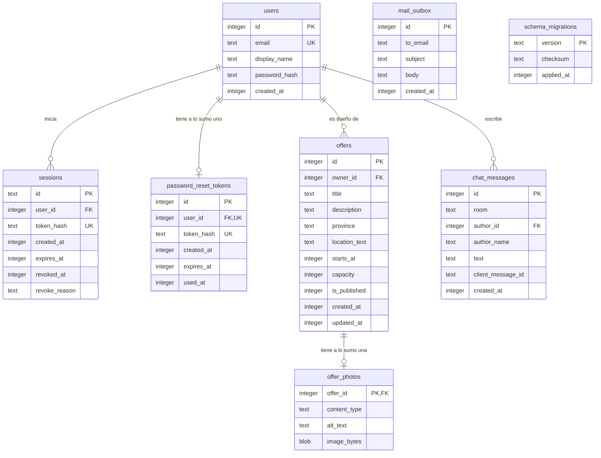

# Esquema de la base de datos (B0.2)

Base SQLite (`node:sqlite`, `DatabaseSync`; DM-03) con **siete tablas del MVP más `schema_migrations`**. El DDL vive en `db/migrations/`; este documento lo describe y es la referencia de campos para los bloques que escriben `modules/*/data`. Si el DDL y este documento difieren, manda el DDL y se corrige el documento.

## Convenciones

- **Tiempos:** `INTEGER` en milisegundos UTC (DM-10). Los servicios pasan `clock.now()` explícito; ninguna columna tiene `DEFAULT` de reloj.
- **Longitudes:** en caracteres Unicode. `length()` de SQLite cuenta puntos de código en `TEXT` (un emoji cuenta 1) y bytes en `BLOB`. Los límites de los servicios usan puntos de código en JavaScript (`[...texto].length`), de modo que la validación nunca es más permisiva que el `CHECK`.
- **Tablas `STRICT`:** SQLite comprueba el tipo declarado (`INTEGER`, `TEXT`, `BLOB`). Una capacidad `1.5` o un texto en la columna del BLOB se rechazan en lugar de convertirse.
- **Claves:** `INTEGER PRIMARY KEY AUTOINCREMENT` (los identificadores no se reutilizan), salvo `sessions.id` (UUID en texto) y `offer_photos.offer_id` (es la clave foránea). Las tablas con identificador entero son `users`, `offers`, `password_reset_tokens`, `mail_outbox` y `chat_messages`.
- **Conexión (`openDb`):** `foreign_keys = ON`, `busy_timeout = 5000` y, en archivo, `journal_mode = WAL`. Todo acceso usa sentencias preparadas y `withTransaction` (`BEGIN IMMEDIATE`).
- **Nombres:** índices normales `idx_<tabla>_<columnas>`; índices únicos `ux_<tabla>_<columnas>`.

## Migraciones

| Archivo | Módulo propietario | Tablas |
|---|---|---|
| `001_base.sql` | base (Integrante 4) | `schema_migrations` |
| `010_accounts.sql` | accounts (rango 010–019) | `users`, `sessions`, `password_reset_tokens`, `mail_outbox` |
| `020_offers.sql` | offers (rango 020–029) | `offers`, `offer_photos` |
| `030_chat.sql` | chat (rango 030–039) | `chat_messages` |

Reglas del migrador (`src/shared/migrate.js`, `npm run db:migrate`):

- Aplica los archivos pendientes en orden lexicográfico, **una transacción por archivo**. Los archivos no llevan `BEGIN`, `COMMIT` ni `PRAGMA`. Un archivo que falla se revierte entero y no se registra.
- Cada migración aplicada queda en `schema_migrations` con su `version` (nombre sin `.sql`), el `checksum` SHA-256 del contenido y `applied_at`. El checksum se calcula sobre el texto sin BOM y con saltos de línea `\n`, para que un clon de Windows y uno de Linux den el mismo valor.
- Reejecutar no cambia nada. Si un archivo ya aplicado cambió, o si una migración aplicada ya no existe en `db/migrations`, el migrador falla con un mensaje que lo nombra, antes de aplicar nada nuevo. **Una migración integrada en `main` no se edita: se añade otra** dentro del rango de su módulo (`011_…`, `021_…`, `031_…`).
- Los nombres siguen `NNN_descripcion.sql` (minúsculas) y el número no se repite. Una migración nueva con un número menor que las ya aplicadas (por ejemplo `011_` cuando `030_` ya se aplicó) se aplica igualmente, porque el criterio es «pendiente», no «mayor que la última».
- `DATABASE_FILE` (de `config`) indica el archivo; `scripts/migrate.js` crea la carpeta si falta y se niega a migrar `:memory:`. Las pruebas abren `:memory:` con `openDb(':memory:')` y llaman a `migrate(db)`.

## Diagrama entidad-relación

`mail_outbox` y `schema_migrations` no tienen relaciones: la bandeja de pruebas guarda la copia del destinatario (DM-15) y el control de migraciones es independiente de los datos.

## Tablas

### `users` — módulo `accounts` (`010_accounts.sql`)

| Columna | Tipo | Nulo | Restricción |
|---|---|---|---|
| `id` | INTEGER | no | PK autoincremental |
| `email` | TEXT | no | 3–254 caracteres; en minúsculas (`email = lower(email)`) |
| `display_name` | TEXT | no | 2–80 caracteres |
| `password_hash` | TEXT | no | no vacío. Que empiece por `$argon2id$` lo comprueba la prueba de B1.1, no el `CHECK` |
| `created_at` | INTEGER | no | ms UTC |

Índices: `ux_users_email (email)` único.

### `sessions` — módulo `accounts`

| Columna | Tipo | Nulo | Restricción |
|---|---|---|---|
| `id` | TEXT | no | PK; el servicio genera un UUID y la base exige una longitud de 36 caracteres |
| `user_id` | INTEGER | no | FK → `users(id)` `ON DELETE CASCADE` |
| `token_hash` | TEXT | no | SHA-256 en hexadecimal minúscula (64 caracteres) |
| `created_at` | INTEGER | no | ms UTC |
| `expires_at` | INTEGER | no | `expires_at > created_at` |
| `revoked_at` | INTEGER | sí | `revoked_at` y `revoke_reason` son ambos nulos o ambos presentes |
| `revoke_reason` | TEXT | sí | `LOGOUT` o `PASSWORD_RESET` |

Índices: `ux_sessions_token_hash (token_hash)` único; `idx_sessions_user (user_id)`.

### `password_reset_tokens` — módulo `accounts`

| Columna | Tipo | Nulo | Restricción |
|---|---|---|---|
| `id` | INTEGER | no | PK autoincremental |
| `user_id` | INTEGER | no | FK → `users(id)` `ON DELETE CASCADE`; único |
| `token_hash` | TEXT | no | SHA-256 hexadecimal minúscula; único |
| `created_at` | INTEGER | no | ms UTC |
| `expires_at` | INTEGER | no | `expires_at > created_at` |
| `used_at` | INTEGER | sí | ms UTC cuando se usó |

Índices: `ux_password_reset_tokens_user (user_id)` único (un token por usuario: el servicio reemplaza la fila al solicitar otro, también tras usarse) y `ux_password_reset_tokens_hash (token_hash)` único.

### `mail_outbox` — módulo `accounts`

| Columna | Tipo | Nulo | Restricción |
|---|---|---|---|
| `id` | INTEGER | no | PK autoincremental |
| `to_email` | TEXT | no | 3–254 caracteres |
| `subject` | TEXT | no | no vacío |
| `body` | TEXT | no | no vacío |
| `created_at` | INTEGER | no | ms UTC |

Bandeja de pruebas (DM-15), sin SMTP. Sin índices adicionales: se lista completa y solo con la bandeja activada.

### `offers` — módulo `offers` (`020_offers.sql`)

| Columna | Tipo | Nulo | Restricción |
|---|---|---|---|
| `id` | INTEGER | no | PK autoincremental |
| `owner_id` | INTEGER | no | FK → `users(id)` `ON DELETE RESTRICT` |
| `title` | TEXT | no | 5–120 caracteres |
| `description` | TEXT | no | 20–2000 caracteres |
| `province` | TEXT | no | uno de los 24 códigos (abajo) |
| `location_text` | TEXT | no | 5–200 caracteres |
| `starts_at` | INTEGER | no | ms UTC |
| `capacity` | INTEGER | no | 1–1000 (cupo referencial) |
| `is_published` | INTEGER | no | `0` por defecto; solo `0` o `1` |
| `created_at` | INTEGER | no | ms UTC |
| `updated_at` | INTEGER | no | ms UTC |

Los 24 códigos de provincia (enum `Province` de `docs/planificacion/03` §3.0): `AZUAY`, `BOLIVAR`, `CANAR`, `CARCHI`, `CHIMBORAZO`, `COTOPAXI`, `EL_ORO`, `ESMERALDAS`, `GALAPAGOS`, `GUAYAS`, `IMBABURA`, `LOJA`, `LOS_RIOS`, `MANABI`, `MORONA_SANTIAGO`, `NAPO`, `ORELLANA`, `PASTAZA`, `PICHINCHA`, `SANTA_ELENA`, `SANTO_DOMINGO_DE_LOS_TSACHILAS`, `SUCUMBIOS`, `TUNGURAHUA`, `ZAMORA_CHINCHIPE`. La constante `PROVINCES` de B1.4 debe contener exactamente estos códigos.

Que una oferta publicada tenga foto y fecha futura lo comprueba el servicio en la misma transacción (C-OFE), no el esquema.

### `offer_photos` — módulo `offers`

| Columna | Tipo | Nulo | Restricción |
|---|---|---|---|
| `offer_id` | INTEGER | no | PK y FK → `offers(id)` `ON DELETE CASCADE` (una foto por oferta) |
| `content_type` | TEXT | no | `image/jpeg`, `image/png` o `image/webp` |
| `alt_text` | TEXT | no | 1–160 caracteres |
| `image_bytes` | BLOB | no | 1 a 2 097 152 bytes (2 MiB); la tabla es `STRICT`, un texto no cabe |

Los listados no leen esta tabla salvo para saber si existe la foto; el BLOB se sirve en una petición aparte.

### `chat_messages` — módulo `chat` (`030_chat.sql`)

| Columna | Tipo | Nulo | Restricción |
|---|---|---|---|
| `id` | INTEGER | no | PK autoincremental (cursor del historial) |
| `room` | TEXT | no | `general` por defecto y única sala admitida |
| `author_id` | INTEGER | no | FK → `users(id)` `ON DELETE RESTRICT` |
| `author_name` | TEXT | no | 2–80 caracteres; copia del nombre al publicar (DM-14) |
| `text` | TEXT | no | 1–500 caracteres y no solo espacios en blanco (incluye espacios Unicode y U+FEFF) |
| `client_message_id` | TEXT | no | 1–64 caracteres; el cliente envía un UUID (C-EVT) |
| `created_at` | INTEGER | no | ms UTC |

Índices: `ux_chat_messages_author_client (author_id, client_message_id)` único; `idx_chat_room_id (room, id)`.

### `schema_migrations` — base (`001_base.sql`)

| Columna | Tipo | Nulo | Restricción |
|---|---|---|---|
| `version` | TEXT | no | PK; nombre del archivo sin `.sql` (por ejemplo `010_accounts`) |
| `checksum` | TEXT | no | SHA-256 hexadecimal minúscula (64 caracteres) |
| `applied_at` | INTEGER | no | ms UTC |

Una fila por migración aplicada.

## `ON DELETE`

| Relación | Acción | Motivo |
|---|---|---|
| `sessions.user_id` → `users` | `CASCADE` | Una sesión no tiene sentido sin su cuenta |
| `password_reset_tokens.user_id` → `users` | `CASCADE` | Ídem |
| `offer_photos.offer_id` → `offers` | `CASCADE` | La foto pertenece a la oferta y se borra con ella |
| `offers.owner_id` → `users` | `RESTRICT` | No se pierden ofertas por borrar una cuenta; el MVP no borra cuentas |
| `chat_messages.author_id` → `users` | `RESTRICT` | El historial no se pierde por borrar una cuenta; el nombre queda copiado en `author_name` |

## Índices y la consulta que justifica cada uno

En `tests/unit/db-migraciones.test.js`, la prueba de planes de consulta usa `EXPLAIN QUERY PLAN` para comprobar que nueve de los índices de la tabla se usan en sus consultas y que no hay ordenamiento aparte (`USE TEMP B-TREE`). Para `ux_password_reset_tokens_user`, la prueba de unicidad comprueba que SQLite rechaza un segundo token del mismo usuario. La prueba de planes se ejecuta sobre una base pequeña con `ANALYZE`. La medición con 20 000 ofertas corresponde a B2.3.

| Índice | Columnas | Consulta a la que sirve | Bloque que la ejecuta |
|---|---|---|---|
| `idx_offers_owner_province_starts` | `owner_id, province, starts_at, id` | Panel con filtro: `WHERE owner_id = ? AND province = ? ORDER BY starts_at, id LIMIT 10 OFFSET ?` | B1.4, B1.5 |
| `idx_offers_owner_starts` | `owner_id, starts_at, id` | Panel sin filtro: `WHERE owner_id = ? ORDER BY starts_at, id LIMIT 10 OFFSET ?` | B1.4, B1.5 |
| `idx_offers_public_starts` | `is_published, starts_at, id` | Catálogo: `WHERE is_published = 1 AND starts_at > ? AND EXISTS (foto) ORDER BY starts_at, id LIMIT 10 OFFSET ?` | B1.4, B1.5 |
| `idx_chat_room_id` | `room, id` | Historial por cursor: `WHERE room = ? AND id < ? ORDER BY id DESC LIMIT ?` (y `id > ?` para recuperar lo perdido) | B1.7 |
| `idx_sessions_user` | `user_id` | Revocar las sesiones de un usuario: `WHERE user_id = ? AND revoked_at IS NULL` | B1.3 (restablecer clave) |
| `ux_users_email` | `email` (único) | Registro e ingreso: `WHERE email = ?`; evita correos repetidos | B1.1, B1.2 |
| `ux_sessions_token_hash` | `token_hash` (único) | Resolver la sesión en cada petición: `WHERE token_hash = ?` | B1.2, B0.4 |
| `ux_password_reset_tokens_user` | `user_id` (único) | Un solo token de recuperación por usuario | B1.3 |
| `ux_password_reset_tokens_hash` | `token_hash` (único) | Validar el enlace: `WHERE token_hash = ?` | B1.3 |
| `ux_chat_messages_author_client` | `author_id, client_message_id` (único) | Idempotencia del envío: un reintento no duplica el mensaje | B1.7 |

Las claves primarias (`id`, `offer_id`, `version`) no necesitan índice aparte.

## Decisiones tomadas en B0.2 que conviene confirmar en la revisión

El plan fija nombres, rangos y restricciones principales; estas elecciones completan lo que dejaba abierto:

1. **Tablas `STRICT`.** El plan no lo pide; evita que SQLite acepte `1.5` como capacidad o texto en un `BLOB`. Todos los bloques deben insertar valores del tipo declarado (por ejemplo, `Buffer` o `Uint8Array` en `image_bytes`).
2. **Identificadores enteros** para `users`, `offers`, `password_reset_tokens` y `mail_outbox` (el plan solo dice «PK»); `sessions.id` es UUID como indica el plan. Las rutas `/panel/ofertas/:id` usan, por tanto, un entero.
3. **`ON DELETE`:** véase la tabla anterior; `offers` y `chat_messages` usan `RESTRICT` (no hay borrado de cuentas en el MVP).
4. **`chat_messages.room`** solo admite `general`, como indica §2.4. Añadir salas exigirá una migración que reconstruya la tabla, porque SQLite no modifica un `CHECK` en su sitio.
5. **`client_message_id`** admite de 1 a 64 caracteres (§2.4 no fija el rango; C-EVT dice «uuid»). B1.7 valida el formato UUID en el servicio.
6. **Correo:** 3–254 caracteres y en minúsculas. `lower()` de SQLite solo convierte ASCII; la normalización completa (NFC, recorte) es del servicio de cuentas.
7. **Sin `CHECK` de coherencia entre `updated_at` y `created_at`, ni de `starts_at` futura:** dependen del reloj y las valida el servicio.
