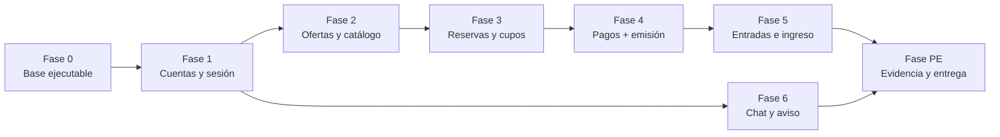

# 00 — Índice y control de la planificación

> **Proyecto:** MVP de turismo comunitario (monolito web, proyecto universitario de Aplicaciones Web Avanzadas + Desarrollo de Software Seguro).
> **Etapa:** planificación técnica. **No existe código de aplicación, ni dependencias instaladas, ni pruebas ejecutadas.**
> **Fuente de alcance:** `PLAN.md` (intacto). **Encargo:** `PROMPT-CLAUDE-PLANIFICACION.md`.
> **Fecha de redacción y de consulta de fuentes externas:** 2026-11-12 (consulta adicional del 2026-11-13: ver §10.3.1). Último punto de avance: 2026-11-13.

---

## 1. Estado de los documentos (progreso real)

Leyenda: ✅ completo · 🟡 provisional (utilizable, con pendientes señalados) · ⛔ bloqueado · ⏳ pendiente de redacción.

| # | Documento | Estado | Motivo / pendientes |
|---|---|---|---|
| 00 | [00-indice-y-control.md](00-indice-y-control.md) | 🟡 | Completo salvo §12 (revisión de consistencia final), que solo puede hacerse al terminar los demás. Actualizado el 2026-11-13 con los hallazgos H-23 a H-34 y las decisiones D-66 a D-68 (documento 03). |
| 01 | [01-alcance-y-trazabilidad.md](01-alcance-y-trazabilidad.md) | ✅ | Completo. Sujeto a la revisión cruzada final. La conformidad académica que describe sigue pendiente de Q-01 y Q-02. |
| 02 | [02-arquitectura-y-decisiones.md](02-arquitectura-y-decisiones.md) | ✅ | Completo. Sujeto a la revisión cruzada final. |
| 03 | [03-datos-estados-e-invariantes.md](03-datos-estados-e-invariantes.md) | ✅ | Completo como planificación (guardado el 2026-11-13): diagrama ER, diccionario por campo de las 16 entidades, catálogo de auditoría, política de eliminación, transiciones ampliadas, SQL complementario, migraciones y semillas. Sujeto a la revisión cruzada final. **El SQL y los esquemas Prisma no se han ejecutado ni validado**; se comprueban en P0-06 a P4-02 con T-DB-01 (§8.7 y §10.2 de 03). |
| 04 | [04-reglas-transacciones-y-concurrencia.md](04-reglas-transacciones-y-concurrencia.md) | ✅ | **Completo como planificación (lote 5, 2026-11-13).** Desarrollado con secuencia, pseudocódigo, escrituras por rama, errores y pruebas: §1 principios, §2 orden de bloqueos, **reglas compartidas de ofertas (OFF.1–OFF.5)**, **TX-01, TX-02, TX-03, TX-04 y TX-16** (lote 4), **TX-05**, **TX-07**, **TX-08**, **TX-09**, **TX-10** y **TX-11**. **TX-06 y TX-12 a TX-15** en forma breve (precondiciones, escritura atómica, errores, pruebas clave). Sujeto a la revisión cruzada final. Todo el pseudocódigo y el SQL son documentales (no ejecutados); fuentes de PayPal con su grado y dudas en 04 §5. |
| 05 | [05-contratos-http-websocket-y-pagos.md](05-contratos-http-websocket-y-pagos.md) | ✅ | **Completo (2026-11-13).** Sujeto a la revisión cruzada final. Páginas, esquemas de las Server Actions (§3.1–3.5, con D-79 en `/panel/ingresos`), *handlers*, Socket.IO (§5, verificado contra TX-14 y TX-15), puerto de pagos, datos de PayPal, QR y ejemplos de pagos (§6.6). Quedan **pendientes de Sandbox** (no de redacción) las conductas de PayPal listadas en 04 §5.2. |
| 06 | [06-seguridad-y-privacidad.md](06-seguridad-y-privacidad.md) | 🟡 | **Parcial.** Guardado: controles decididos con parámetros, cabeceras y CSP, retención. **Modelo de amenazas (§1) y matriz de 48 amenazas (§2) hechos el 2026-11-14.** Falta: §4 anonimización y borrado. **⛔ La matriz Common Criteria está bloqueada por Q-02.** |
| 07 | [07-pantallas-y-experiencia.md](07-pantallas-y-experiencia.md) | 🟡 | **Parcial.** Guardado: principios, mapa de navegación, decisiones por flujo, accesibilidad. Falta: *wireframes* textuales y estados por pantalla. |
| 08 | [08-pruebas-y-evidencias.md](08-pruebas-y-evidencias.md) | 🟡 | **Parcial.** Guardado: estrategia, técnica de concurrencia, catálogo de 150 identificadores, matriz de fallos de pago, método de rendimiento, evidencias. Falta: preparación, pasos y aserciones por prueba; CI detallado. |
| 09 | [09-entorno-despliegue-y-operacion.md](09-entorno-despliegue-y-operacion.md) | 🟡 | **Parcial.** Guardado: variables de entorno, scripts previstos, servicios locales, alojamiento con límites verificados, lista de *runbooks*. Falta: pasos por sistema operativo, `.env.example` comentado, copias y restauración, contenido de los *runbooks*. Decisión de alojamiento pendiente de Q-04. |
| 10 | [10-fases-y-paquetes-implementables.md](10-fases-y-paquetes-implementables.md) | 🟡 | **Parcial.** Guardado: lista definitiva de 38 paquetes con dependencias, requisitos, pruebas y esfuerzo; encaje de pruebas; dependencia entre fases 4 y 5. Falta: la ficha de 13 puntos de cada paquete. |
| 11 | [11-prompts-para-la-ia-implementadora.md](11-prompts-para-la-ia-implementadora.md) | 🟡 | **Parcial.** Guardado: prompt maestro, plantilla de informe y formato de `ESTADO-IMPLEMENTACION.md`. Falta: los 38 prompts por paquete. |
| 12 | [12-demo-y-entrega-academica.md](12-demo-y-entrega-academica.md) | 🟡 | **Parcial.** Guardado: esqueleto del guion, cuentas y datos de demostración, entregables, criterios de contingencia, pendientes de cumplimiento. Falta: guion detallado, plan de commits. Reparto bloqueado por Q-03. |

### 1.1 Punto de avance — guardado el 2026-11-13

**Situación.** Los trece archivos existen en `docs/planificacion/`. Cinco están completos (00 salvo §12, 01, 02, 03 y 04) y ocho son parciales (05 a 12). Los parciales contienen todas las decisiones ya tomadas en forma condensada, de modo que nada del diseño depende de la memoria de la conversación. **No se ha realizado la revisión global de consistencia (§12).** El 2026-11-13 se completó 03 y se desarrolló el **lote 1 de 04** (principios, orden de bloqueos, TX-05 y TX-09); 04 sigue parcial. Al hacerlo se detectaron seis hallazgos más (H-35 a H-40) y se ajustaron referencias puntuales en 02 (reloj), 03 (reloj, `PaymentEvent`, `Ticket.id`) y 08 (tabla de barreras, niveles de T-RES-10 y T-PAG-07/13/15); el resto de los pendientes de esos documentos no se tocó. **Lote 2 de 04** (también 2026-11-13): se desarrollaron **TX-07** (iniciar el pago y crear la orden) y **TX-08** (solicitar la captura y manejar su resultado); se consultó la documentación de PayPal sobre idempotencia y errores de captura (resúmenes de búsqueda; no páginas completas) y se detectaron cinco hallazgos más (H-41 a H-45). Se ajustaron referencias en 03 (§4.4 P-1, P-2, P-5, nueva P-5b y el campo `captureAttemptedAt`), 05 (§3, §6.1 `GatewayError`, §6.2 claves, captura y ventana, §6.3 compuerta del `fake`), 08 (filas T-PAG-01, 02, 03, 06, 12, 18, 23 y tabla de barreras) y 10 (pruebas de P4-04). TX-10 y TX-11 no se tocaron. **Lote 3 de 04** (también 2026-11-13): se desarrollaron **TX-10** y **TX-11** y se **revisó** la afirmación del lote 2 de que «un arrendamiento vencido y una consulta sin captura equivalen a un caso resuelto sin cargo»: era falsa. Se corrigieron TX-08 (estados del intento, `captureAttemptKey`, misma clave para reanudar, clave nueva solo tras un rechazo definitivo), TX-09 (regla L-02 de 60 s retirada; clases `K0a`/`K0b`; evidencia) y 03 (nueva columna `Payment.captureAttemptKey`, `ck_pay_attempt`, P-5, P-5b, R-7). Se leyó `FUENTES-PAYPAL-REVISION.md` (páginas leídas) y se corrigió el rotulado de los resúmenes de búsqueda del lote 2 (H-51). Seis hallazgos más (H-46 a H-51) y tres decisiones más (D-74 a D-76); D-71 y D-72 reescritas. Referencias ajustadas en 01, 02 (J2), 03, 05, 08 y 10. **Lote 5 de 04** (2026-11-13): se cerró 04 con **TX-06 y TX-12 a TX-15** en forma breve; decisión **D-79**: las entradas emitidas siguen válidas con la oferta `SUSPENDED` o `ARCHIVED` (el ingreso depende solo de rol, actividad, ventana, reserva `CONFIRMED` y entrada `VALID`); la selección de actividad de `/panel/ingresos` debe listar esas ofertas si tienen entradas emitidas (a recoger en 05 y 07; **05 ya lo recoge**, §2 y §3.5). **Lote 4 de 04** (también 2026-11-13): se desarrollaron los flujos de **ofertas y versiones** (TX-01, TX-02, TX-03, TX-04 y TX-16) con sus reglas compartidas (autorización por identidad con varios roles, bloqueos de la oferta, validación del contenido, inventario). No se volvió a investigar ni a cambiar nada de pagos; el calendario de conciliación sigue como **propuesta pendiente**. Hallazgos H-52 a H-54 y decisiones D-77 y D-78; se alinearon 03 (V-3, V-4, V-7, O-7) y 08 (filas T-OFE y T-RES-17/18 y tabla de barreras). **05 §3** (2026-11-13): se redactaron los esquemas de entrada, salida y errores de las 23 Server Actions (corregido el 2026-11-14: antes decía 25; el inventario de §3 tiene 23) (§3.1 convenciones, §3.2 cuentas, §3.3 ofertas, §3.4 reservas y pagos, §3.5 entradas), reutilizando de 04 solo OFF.1/OFF.3/OFF.5, TX-05.1, TX-07.1, TX-08.1/.6, TX-11 (`checkGateway`), TX-12, TX-13, TX-14 y TX-16.1 y de 02 §10; y se aplicó **D-79** en 05 §2: `/panel/ingresos` lista las ofertas `SUSPENDED` o `ARCHIVED` con entradas emitidas y conserva las demás condiciones de ingreso. No se tocaron 03, 04 ni 08. Los formatos de correo (minúsculas, ≤ 254), `passwordConfirm`, `confirm: true` al eliminar y el indicador `replayed` de la reserva son **precisiones propias de 05**, sin cambio de reglas. 07 aún debe recoger D-79 en la pantalla de ingresos. **05 §5 y §6** (2026-11-13): se redactaron las cargas, confirmaciones y errores de Socket.IO (§5) y los ejemplos de pagos (§6.6: crear orden, captura confirmada o en revisión, webhook aplicado, duplicado, ignorado o pendiente, y «Consultar pasarela»), separando respuestas de la aplicación y de PayPal. Se corrigió en 05 §3.4 una discrepancia con 04 TX-07 (E2/E3: `GATEWAY_UNAVAILABLE` con `retryable` true o false, no `INTERNAL_ERROR`). **05 queda completo**; los cuerpos de PayPal de §6.6 son ilustrativos y las verificaciones de Sandbox siguen pendientes. Los valores de `reason` y `availability` en el ejemplo de «Consultar pasarela» son ilustrativos: la lista definitiva está en 04 TX-09. **06 §1 y §2** (2026-11-14): se redactaron el modelo de amenazas (9 activos, 8 actores, 8 límites de confianza) y la matriz de **48 amenazas `A-nn`** (cuentas y sesiones, permisos entre organizaciones, cupos, pagos y webhooks, entradas QR, chat, datos sensibles y plataforma), reutilizando decisiones D-nn, RS-nn y los IDs de prueba de 08 y 04; cada fila marca el control como decidido o propuesto y la evidencia que falta (§2.8). No se creó un catálogo `C-nn` aparte. Se consultó 00 §8–9, 01 (RS), 02 §1, 04 (TX-10, TX-12, TX-14, TX-15) y 08; no se modificó ningún otro documento. El mapeo Common Criteria (06 §5) sigue pendiente de Q-02. Ninguna prueba se ha ejecutado.

**Decisiones ya tomadas y guardadas**

| Qué | Dónde |
|---|---|
| 54 hallazgos de coherencia (22 del plan + 32 detectados al ampliar 03 y 04) con su resolución | 00 §3.2 |
| 79 decisiones técnicas (D-01 a D-79) con alternativas y razón | 00 §8 |
| 18 supuestos, 11 preguntas, 18 riesgos | 00 §6, §7, §9 |
| Requisitos (RF, RS, RA, RO, RE), casos de uso, pertenencias y matriz de permisos | 01 |
| Arquitectura, árbol de carpetas, versiones verificadas, punto de entrada, errores y códigos | 02 |
| 20 invariantes, diagrama ER, diccionario por campo de 16 entidades, catálogo de auditoría, cinco máquinas de estado con tablas de transición, SQL complementario, migraciones y semillas | 03 |
| Aislamiento, orden global de bloqueos y algoritmo de 16 flujos; **TX-01 a TX-16 desarrollados** (secuencia, pseudocódigo, escrituras por rama, pruebas; reglas compartidas de ofertas OFF.1–OFF.5; tabla de decisión L-01…L-18; estados del intento de captura; calendario de conciliación) | 04 |
| Rutas, Server Actions, eventos Socket.IO, puerto de pagos, formato del QR | 05 |
| Parámetros de sesión, límites, CSP, retención de datos | 06 |
| Catálogo de 150 identificadores de prueba y técnica de barrera | 08 |
| Variables de entorno, scripts, alojamiento, lista de *runbooks* | 09 |
| 38 paquetes con dependencias | 10 §4 |
| Prompt maestro, plantilla de informe, formato de estado | 11 |

**Siguiente apartado exacto que desarrollar**

`06-seguridad-y-privacidad.md` — §4 procedimiento de anonimización compatible con auditoría y tratamiento de solicitudes de borrado (§1 y §2 ya están hechos). Pendiente de alinear en §3.2: el umbral del límite de frecuencia por origen de firmas de webhook inválidas (04 TX-10.1; en la matriz es A-25, propuesto). §5 sigue bloqueado por Q-02.

Orden del trabajo restante, sin cambiar identificadores:

1. ~~**03**~~ → **hecho el 2026-11-13** (sin revisión cruzada final).
2. **04** → ~~TX-05, TX-09~~ (lote 1), ~~TX-07, TX-08~~ (lote 2), ~~TX-10, TX-11~~ (lote 3) y ~~TX-01, TX-02, TX-03, TX-04, TX-16~~ (lote 4), hechos el 2026-11-13 y ~~TX-06, TX-12 a TX-15~~ (lote 5), hechos el 2026-11-13.
3. **05** → ~~§3 esquemas, §5 Socket.IO y §6 ejemplos~~ (hechos el 2026-11-13; 05 completo).
4. **06** → ~~§1 modelo de amenazas, §2 matriz~~ (hechos el 2026-11-14); §4 anonimización y borrado; §5 queda como plantilla hasta responder Q-02.
5. **07** → §4 *wireframes* (desde las pantallas de cuenta), §6 estados por pantalla.
6. **08** → §3 preparación, pasos y aserciones (desde `T-CTA-01`), §6 CI.
7. **09** → §2 preparación por sistema operativo, `.env.example`, §5 copias, §8 *runbooks*.
8. **10** → §5 fichas de paquete (desde `P0-01`).
9. **11** → §4 prompts por paquete (desde `P0-01`).
10. **12** → §2 guion detallado, §6 plan de commits, §7 contingencia.
11. **00** → §12 revisión de consistencia entre documentos.

**Pendientes y bloqueos**

| Tipo | Detalle | Impide |
|---|---|---|
| ⛔ Bloqueo externo | Q-01: guía académica no disponible. | Afirmar cumplimiento académico; formato de entrega (12). |
| ⛔ Bloqueo externo | Q-02: objetivos Common Criteria no disponibles. | La matriz de 06 §5 y RS-26. |
| ⛔ Bloqueo externo | Q-03: integrantes y fechas. | Reparto del guion y de commits (12). |
| ⛔ Bloqueo externo | Q-04: alojamiento y presupuesto. | Cerrar 09 §6 y el paquete PE-02. |
| ⛔ Bloqueo externo | Q-08: credenciales de PayPal Sandbox. | La verificación real T-PAG-24 (no la planificación). |
| ⏳ Redacción | Apartados marcados ⏳ en los documentos 04 a 12. | Completar la planificación. |
| ⏳ Verificación PayPal | Conductas de PayPal sin confirmar (04 §5.2): retención real de la clave para estos endpoints (la cifra de 6 h **no** está confirmada) y su conducta ante repetición simultánea o con otro cuerpo; si Orders v2 devuelve la misma orden al reintentar la creación; consistencia de `getOrder` tras una captura; vida útil de una orden; API para localizar una orden por `invoice_id`; códigos HTTP de los errores de captura; plazo real de respuesta del webhook; verificación de un webhook **real** por *postback* (el simulador no la admite). | Verificación manual real T-PAG-24 y P4-06 (Q-08); hasta entonces el diseño no depende de ellas. |
| ⏳ Alineación | 09 §3: añadir la variable `DB_LOCK_TIMEOUT_MS` (defecto 5000; las pruebas de `BUSY_TRY_AGAIN` la reducen) y validarla en 02 §9. | Cerrar 09. |
| ⏳ Alineación | 06: límite de frecuencia por origen para firmas de webhook inválidas (04 TX-10.1). 07: la vista del administrador debe mostrar los casos **agotados** («conciliación automática agotada», 04 TX-11.2) y los avisos `REFUND_AFTER_CONFIRMATION` (lectura de `AuditEvent`). 09: RB-05 (webhooks repetidos o que fallan) y RB-09 (dinero capturado sin entradas; caso agotado) deben seguir 04 TX-10.3 y TX-11.2. Confirmar con el equipo los parámetros del calendario de conciliación (`RECONCILE_DELAYS_MIN`, `MAX_CHECKS`), que son una **propuesta** de esta planificación. | Cerrar esos documentos sin contradecir 04. |
| ⏳ Alineación | 09: roles y privilegios de [03 §8.5](03-datos-estados-e-invariantes.md), base `_demo` y utilidad `db:reset-demo` (D-67). 06: riesgo residual del rol migrador (puede alterar la auditoría y desactivar disparadores). 08: pasos y aserciones de los subcasos T-DB-01a–i. | Cerrar esos documentos sin contradecir 03. |
| ⏳ Verificación al implementar | SQL y esquemas Prisma de 03 no ejecutados; lista en [03 §10.2](03-datos-estados-e-invariantes.md). | Afirmar que el modelo funciona en PostgreSQL 18 con Prisma 7. |
| ⏳ Redacción | Fichas de paquete (10 §5) y prompts por paquete (11 §4). | **Empezar a implementar:** todavía no debe encargarse código; el primer paquete aún no tiene ficha ni prompt. |
| ⏳ Revisión | Revisión de consistencia final (§12). | Dar la planificación por cerrada. |

Ningún bloqueo externo impide continuar la redacción de los documentos 03 a 12.

**Para reanudar** en esta u otra conversación: usar el mensaje de §11 indicando «continúa desde el punto de avance de 00 §1.1».

---

## 2. Orden de lectura y orden de ejecución

**Lectura (para entender el sistema):** 00 → 01 → 02 → 03 → 04 → 05 → 06 → 07 → 08 → 09 → 10 → 11 → 12.

**Lectura mínima antes de implementar cualquier paquete:** 00 (§4–§8), 02 (§3 árbol y §4 dependencias), el apartado de 03/04/05 que cite el paquete, y la ficha del paquete en 10.

**Ejecución (implementación):** los paquetes de `10-fases-y-paquetes-implementables.md` en el orden de su grafo de dependencias, usando el prompt homónimo de `11-prompts-para-la-ia-implementadora.md`. Las fases 0 a 6 del plan se conservan; se añade una fase de entrega (`PE`) derivada de `PLAN.md §4`.



La fase 6 solo depende de la fase 1 (sesiones), por lo que puede desarrollarse en paralelo a las fases 2–5 si el equipo se divide.

---

## 3. Evaluación del plan original

### 3.1 Fortalezas

- Recorrido principal único y demostrable, con criterios de cierre por fase verificables.
- Invariantes críticos ya enunciados: versiones aprobadas inmutables con puntero público, retención de 15 minutos que caduca por fecha y no por temporizador, bloqueo de la fila de la oferta, claves de idempotencia en reserva/pago/webhook/chat, función única de confirmación, consumo condicional del QR.
- Buenas prácticas de seguridad explícitas: Argon2id, sesión opaca con hash en base, token QR opaco con hash y copia cifrada, respuesta uniforme en recuperación, registros sin secretos.
- Alcance acotado con exclusiones claras (reembolsos, descuentos, sustituciones, validación sin conexión).

### 3.2 Hallazgos de coherencia y su resolución

Cada hallazgo indica el problema, la resolución adoptada y las decisiones y paquetes afectados. Ninguno cambia el stack ni las reglas comerciales del plan; donde se añade un refinamiento, se marca como tal.

| ID | Problema detectado en `PLAN.md` | Resolución | Decisiones | Paquetes |
|---|---|---|---|---|
| H-01 | Las dos fuentes citadas (guía de Web Avanzadas y propuesta de Software Seguro) apuntan a rutas de otro equipo y no están disponibles. | Los requisitos académicos se registran como «afirmados por el plan», no «comprobados». La conformidad académica y el mapeo Common Criteria quedan **pendientes** (Q-01, Q-02). | — | PE-03, PE-04 |
| H-02 | La fase 0 pide sembrar «ofertas ficticias», pero el modelo de ofertas se define en la fase 2. | Semilla incremental: fase 0 siembra GAD, atracciones y cuentas; las ofertas se añaden en P2-01; reservas y entradas de demostración en PE-04. El cierre de fase 0 del plan no exige ofertas. | — (03 §9) | P0-06, P2-01, PE-04 |
| H-03 | La fase 4 debe emitir entradas en la misma transacción de confirmación, pero las entradas son de la fase 5. | El modelo `Ticket`, el llavero de cifrado y el servicio de emisión (sin interfaz) se adelantan a la fase 4 (P4-02) como prerrequisito de la liquidación (P4-03). La fase 5 solo añade descarga e ingreso. | D-41, D-46 | P4-02, P4-03, P5-01 |
| H-04 | La capacidad vive en `OfferVersion` (versionada), pero el inventario es de la oferta y lo comparten todas las versiones. | Capacidad efectiva = capacidad de la versión pública. Las reservas cuentan por `offerId`. Al aprobar una versión nueva se exige capacidad ≥ confirmados + retenciones vigentes, bajo el bloqueo de la oferta. | D-27, D-32 | P3-01, P3-03 |
| H-05 | «Fecha y atracción fijas desde la primera reserva», pero la fecha está en la versión y la atracción en la oferta. | La fecha (inicio/fin) no puede cambiar al aprobar si existe cualquier reserva de la oferta. La atracción es inmutable desde la **primera publicación** (más estricto que el plan y compatible con él). | D-28 | P2-03, P3-03 |
| H-06 | No se enumeran los estados comerciales de `Offer` ni qué ocurre con las versiones aprobadas anteriores. | `Offer`: `UNPUBLISHED`, `OPEN`, `SUSPENDED`, `ARCHIVED`. `OfferVersion`: `DRAFT`, `IN_REVIEW`, `CHANGES_REQUESTED`, `APPROVED`. «Histórica» es un estado **derivado** (aprobada y no apuntada). | D-24, D-25 | P2-01 |
| H-07 | `REVIEW_REQUIRED` es ambiguo: el plan lo aplica a «la reserva» pero el motivo procede del pago. | `REVIEW_REQUIRED` es estado de `Reservation` con `reviewReason`. `Payment` tiene estados propios (`CREATED`, `ORDER_CREATED`, `CAPTURED`, `DISCREPANT`). | D-31, D-39 | P3-01, P4-01, P4-03 |
| H-08 | El ingreso solo vale «entre inicio y fin» y solo se reserva una actividad «futura»: una demostración continua (comprar y entrar) es imposible sin esperar. | Parámetro `CHECKIN_EARLY_MINUTES` (por defecto **0**, que reproduce el plan). El entorno de demostración puede abrir el ingreso antes del inicio. Además la semilla incluye una actividad en curso con entradas emitidas. | D-48, S-16 | P5-02, PE-04 |
| H-09 | Una retención de 15 minutos puede extenderse más allá del inicio de la actividad. | La retención vence en `min(ahora + 15 min, inicio)`. Así «retención vigente» implica «actividad futura». | D-33 | P3-01 |
| H-10 | Suspender o archivar «bloquea nuevas retenciones», pero no se define el efecto sobre retenciones vigentes con pago en curso. | Se honra la retención vigente (literal de F4: «si la retención sigue vigente, convertirla en confirmación»). Un pago verificado **después** del vencimiento sí exige oferta abierta, actividad futura y cupo. | D-42 | P4-03 |
| H-11 | Puede existir dinero capturado sin entradas y los reembolsos están fuera del MVP. | El sistema lo **detecta** (`REVIEW_REQUIRED` + motivo), lo lista al administrador, permite «Consultar pasarela» y lo **escala** a un procedimiento manual documentado. No se añaden estados de reembolso. | D-44 | P4-07, 09 §RB-09 |
| H-12 | Cerrar WebSocket al revocar la sesión exige comunicar el código de Next.js con el servidor de Socket.IO, que viven en grafos de módulos distintos del mismo proceso. | Puente de proceso (`globalThis`) para el cierre inmediato + barrido periódico + revalidación por evento. El invariante no depende del puente. | D-05, D-55 | P0-02, P6-01 |
| H-13 | F5 prohíbe tokens en URL, pero el enlace de recuperación de F1 lleva un token en la URL por necesidad. | La prohibición se aplica al token QR. Para el de recuperación: un solo uso, 30 minutos, hash en base, `Referrer-Policy: no-referrer`, registro de acceso sin *query string*. | D-19 | P1-05 |
| H-14 | La recuperación responde igual para correos existentes e inexistentes, pero el registro con unicidad revela si un correo existe. | Se acepta como riesgo residual del MVP (sin verificación de correo), mitigado con límite por IP. | D-23 | P1-03 |
| H-15 | «El autor nunca puede aprobar esa versión», pero varios miembros del GAD podrían editar la misma versión. | Autor único por versión: solo quien la creó la edita y la envía. La prohibición se comprueba por identidad (servicio) y con una restricción `CHECK` en base. | D-22 | P2-02, P2-03 |
| H-16 | El plan habla de «captura tardía», pero la captura siempre la inicia el servidor con retención vigente. | Se precisan los escenarios reales: respuesta perdida, carrera con el vencimiento y caída tras capturar. El webhook **no** captura. Se añade un margen mínimo de retención para capturar. | D-40, D-43, D-65 | P4-03, P4-04, P4-05 |
| H-17 | El stack no fija versiones y el ecosistema cambió: `prisma@latest` es una *release candidate* 8.x con otra API; TypeScript 7 no es compatible con `typescript-eslint`; `create-next-app` activa Cache Components. | Se fijan versiones exactas verificadas (02 §5): Prisma 7.10.1, TypeScript 5.9.3, Node 24 LTS, Next 16.4 con `cacheComponents` desactivado. | D-02, D-03 | P0-01, P0-03 |
| H-18 | El plan pide «instancia Node persistente detrás de HTTPS con WSS» sin alojamiento. El plan gratuito del proveedor evaluado bloquea SMTP 25/465/587, suspende por inactividad y su PostgreSQL gratuito caduca a los 30 días. | Alojamiento propuesto con limitaciones documentadas y alternativa. Decisión final pendiente (Q-04). | D-59 | PE-02 |
| H-19 | «Presencia de usuarios únicos» y «notificación adicional» no definen alcance ni ubicación. | Presencia = usuarios distintos con al menos un socket en la sala `chat:general`. Notificación adicional = aviso de mensaje nuevo en el panel para quien no está en el chat. | D-53, D-54 | P6-03 |
| H-20 | «Filtrar por provincia indexada», pero la provincia está en la versión, no en la oferta. | Índice `OfferVersion(province, startsAt)` y unión por el puntero público. Sin desnormalización. | D-30 | P2-01, P2-05, PE-01 |
| H-21 | La sesión solo define expiración absoluta de ocho horas; no hay tiempo de inactividad. | Se implementa lo que pide el plan. La ausencia de expiración por inactividad queda como riesgo residual documentado. | D-15 | P1-02 |
| H-22 | Las horas se muestran en `America/Guayaquil`, pero Galápagos usa otra zona. | Se muestra siempre hora de Ecuador continental con etiqueta explícita (S-15). | D-10 | P2-02 |
| H-23 | *(Detectado el 2026-11-13 al ampliar 03.)* Los punteros `publicVersionId`/`workingVersionId` eran claves foráneas simples: podían apuntar a una versión de otra oferta o con el estado equivocado, y un `CHECK` no puede verlo. | Clave foránea compuesta `(puntero, id) → OfferVersion(id, offerId)` + disparador de estado + `CHECK` «`UNPUBLISHED` ⇔ sin versión pública» + orden de inserción que rompe el ciclo sin claves diferidas. Refina D-25. | D-25, D-68 | P2-01 (03 §3.2, §8) |
| H-24 | `Reservation.offerVersionId` y `offerId` eran independientes: una reserva podía contratar una versión de otra oferta. | Clave foránea compuesta `(offerVersionId, offerId)`; versión `APPROVED` al insertar (disparador). | D-68 | P3-01 |
| H-25 | Nada vinculaba `Payment.amountCents` con `Reservation.totalCents`. | Clave foránea compuesta `(reservationId, amountCents) → Reservation(id, totalCents)`. | D-68 | P4-01 |
| H-26 | El único de `RoleAssignment` no cubría los nulos (`TOURIST`/`ADMIN` duplicables) y Prisma no expresa `NULLS NOT DISTINCT`: riesgo de deriva (R-12). | Índice manual `NULLS NOT DISTINCT`, esquema sin `@@unique` para esa tupla, sonda de deriva y T-DB-01a/g/i. | D-58 | P0-06 |
| H-27 | El límite de 3 retenciones por comprador se comprobaba bajo el bloqueo de **una** oferta: dos solicitudes simultáneas a ofertas distintas lo superaban. | Bloqueo asesor por comprador antes del de la oferta; 04 §2 y TX-05 ajustados; T-RES-15 ampliada. | D-35, D-66 | P3-01 (04, 08) |
| H-28 | «Un token de recuperación activo por usuario» por borrar-e-insertar no es atómico ante dos solicitudes. | `userId` único + `INSERT … ON CONFLICT DO UPDATE`. | D-19 | P1-05 |
| H-29 | «Semilla idempotente con fechas relativas» choca con la inmutabilidad de versiones y reservas: repetir la semilla no puede refrescar fechas. | Semilla = crear lo que falta sin modificar; ids deterministas; refresco con `db:reset` local (y `db:reset-demo` solo como propuesta pendiente de 09 §5). | D-67 | P0-06, P2-01, PE-04 (03 §9, 09, 12 §4) |
| H-30 | Los límites de longitud de JavaScript (UTF-16) y de PostgreSQL (`char_length`, puntos de código) difieren con emojis y similares. | Todo límite se mide en puntos de código con un ayudante compartido. | — | P0-04 (03 §3.0) |
| H-31 | El cursor del chat por `autoincrement` puede perder mensajes si dos transacciones confirman desordenadas. | Se documenta que «sin pérdida» depende de la cola por sala y del proceso único. | D-52 | P6-02 (03 §3.4, 02 §13) |
| H-32 | INV-03, INV-05 y la coherencia pago–reserva–entradas solo dependían del servicio; no eran expresables con `CHECK`. | INV-18; comprobación diferida por disparador de restricción; privilegios sin `DELETE` en `Attendee`, `Payment`, `Ticket`, `Reservation`. | D-57, D-58, D-68 | P3-01, P4-01, P4-02 |
| H-33 | La semilla de P2-01 pedía «una oferta con un solo cupo libre», imposible sin reservas (fase 3). El orden de migraciones etiquetaba P1-04 como «recuperación». | En P2-01 será una oferta de capacidad 1; el caso con reservas es de PE-04. Orden de migraciones corregido (P1-04 límites, P1-05 recuperación). | — (03 §9) | P2-01, PE-04 |
| H-34 | Descartar la única versión de una oferta inédita la dejaba sin versiones; enviar a revisión no comprobaba la oferta archivada. | Descartar prohibido en `UNPUBLISHED` y `ARCHIVED` (se usa «eliminar oferta»); TX-02 comprueba `OFFER_ARCHIVED`; 04 ajustado. | D-29 | P2-02 (03 §4.2, 04) |
| H-35 | *(Detectado el 2026-11-13 al desarrollar 04.)* El principio 5 de 04 («`now` al comenzar la transacción») es incorrecto: una transacción puede esperar hasta 5 s por cada bloqueo y decidiría vigencia y cupos con una hora obsoleta; la monotonía entre transacciones solo se cumplía si PostgreSQL atiende a los que esperan en orden de llegada, y no lo promete. Ejemplo: liquidación que empieza en T+30 s con retención que vence en T+60 s, y una reserva posterior que obtiene el bloqueo antes y reserva la última plaza ⇒ sobreventa. | `now` se toma **una vez, después del último bloqueo del que depende la decisión**; reloj monótono no decreciente; pruebas que avanzan el reloj falso mientras la llamada espera. | D-10, D-69 | P0-04, P3-01, P4-03 (02 §11, 03 §7, 04 §1.5) |
| H-36 | TX-05 consultaba la clave idempotente **fuera** de la transacción y evaluaba límites y cupo **antes** de cualquier reconsulta dentro: un reintento ya procesado (respuesta perdida, doble clic) podía recibir `HOLD_LIMIT_REACHED` o `INSUFFICIENT_CAPACITY` aunque la reserva existiera. | La reconsulta va dentro de la transacción, justo tras el bloqueo asesor del comprador y antes de oferta, límites y cupo; se elimina la consulta previa. | D-34, D-66, D-70 | P3-01 (04 TX-05) |
| H-37 | TX-09 salía en el paso 2 si la reserva ya estaba `CONFIRMED` sin registrar el `PaymentEvent` del webhook, y no comprobaba dentro de la transacción si el evento ya estaba registrado. | El evento se registra en **todas** las ramas que terminan (`APPLIED` o `NO_CHANGE`); la duplicidad se detecta bajo los tres bloqueos. | D-41, D-43 | P4-03, P4-05 (04 TX-09, 03 §3.3) |
| H-38 | TX-09 no definía qué hacer con pagos ya terminales (`CAPTURED`, `DISCREPANT`), instantáneas obsoletas o contradictorias, el estado `SAVED`, una orden `COMPLETED` sin captura, el motivo cuando hay varias discrepancias, dónde guardar una referencia distinta ni cómo llegar a `UNCERTAIN_RESULT` sin captura `PENDING`; reclasificar un pago terminal habría intentado reescribir campos que `tg_payment_guard` protege. | Tabla de decisión L-01 a L-18 con monotonía; nunca se escribe `amountCents` ni `currency` (importe esperado); `providerCaptureId` no se guarda si la referencia no coincide; prioridad `REFERENCE > CURRENCY > AMOUNT`; `snapshot` nula (solo captura) equivale a resultado incierto. | D-39, D-41, D-44 | P4-03 (04 TX-09) |
| H-39 | El texto anterior decía «un fallo de unicidad se traduce a su código de dominio» y «releer» (TX-05) o «revertir y responder 200» (TX-09) sin precisar que tras un error de PostgreSQL la transacción queda abortada (`25P02`). | Regla 8 de 04 §1: sin `catch` que continúe la transacción; recuperación tras la reversión con consulta nueva; sin `ON CONFLICT`/`skipDuplicates` que oculten otras violaciones; pruebas con fila de control sin confirmar. | D-70 | P0-03, P3-01, P4-03 (04 §1.8) |
| H-40 | `Ticket.id` tenía valor por defecto de la base, pero el cifrado del token usa ese `id` como dato asociado (AAD, D-46) y debe conocerse antes de cifrar. | El `id` lo genera la aplicación (`crypto.randomUUID()`) y se inserta explícitamente. | D-46 | P4-02 (03 §3.3, 04 TX-09) |
| H-41 | *(Detectado el 2026-11-13 al desarrollar 04 TX-07/TX-08.)* Las claves de idempotencia previstas (`tc-create-<paymentId>`, 46 caracteres; `tc-capture-<paymentId>`) superan el límite de 38 caracteres que la documentación de PayPal da como motivo para recomendar UUID; sus especificaciones de endpoint indican 1–10 000, así que la discrepancia no se resolvió. | Claves en formato UUID de 36 caracteres: de creación, derivada del pago; de captura, aleatoria por intento. *(La de captura se corrigió en el lote 3: persistida por intento y reutilizada para reanudar; H-47.)* | D-40, D-72 | P4-04, P4-06 (04 §1.10, 05 §6.2) |
| H-42 | `captureAttemptedAt` se usaba como candado permanente («si ya hubo un intento sin resultado, no volver a capturar»): bloqueaba indefinidamente un reintento legítimo tras un rechazo, y la clave de captura única por pago podía devolver el rechazo guardado por PayPal. No quedaba definido qué respondía la segunda solicitud simultánea. | Arrendamiento de 60 s con reclamo atómico bajo bloqueo; cierre explícito («comparar y limpiar» el propio reclamo) tras un resultado definitivo sin captura; clave de captura nueva por intento; resultado `IN_PROGRESS` para la solicitud que llega con un arrendamiento vigente. Refina D-40 y D-65. **Corregido en el lote 3 (H-46, H-47, D-74):** el arrendamiento solo excluye, el cierre exige evidencia y la clave del intento se persiste y se reutiliza para reanudar. | D-40, D-65, D-71 | P4-04 (04 TX-08, 03 §4.4) |
| H-43 | Dos llamadas simultáneas a `createOrder` con la misma clave: PayPal procesa la primera y **puede** fallar la segunda (no se halló el código HTTP ni el nombre del error); y no se halló una API para localizar una orden creada pero no guardada. El texto anterior solo cubría «la misma clave devuelve la misma orden». | Ante cualquier fallo se relee el pago (otra solicitud pudo guardar); se entrega siempre la orden guardada y solo tras guardarla; política de abandono si la orden no puede recuperarse (sin cargo: nadie recibió su URL). Sin columna nueva. | D-40, D-73 | P4-04, P4-06 (04 TX-07) |
| H-44 | TX-07 y TX-08 no definían qué hora decide la vigencia (la retención se comprobaba sin bloqueo ni hora posterior a la espera) ni verificaban la vigencia antes de entregar la URL de aprobación. | Bloqueo de la reserva en TX-07 y de reserva y pago en TX-08; `now` tras ellos (D-69); el margen de 30 s se aplica también antes de entregar la URL. | D-65, D-69 | P4-04 (04 TX-07, TX-08) |
| H-45 | 05 §6.2 daba por «verificada el 2026-11-12» una ventana de 6 h para redirigir, aprobar y capturar. El 2026-11-13 la única cifra de 6 h documentada hallada es la de la **clave de idempotencia**; no se halló fuente sobre la vida de una orden. | La cifra queda marcada como no reconfirmada en 05 §6.2; el diseño no depende de ella. | — | P4-06 (05 §6.2, 04 §5.2) |
| H-46 | *(Detectado el 2026-11-13 al desarrollar 04 TX-10/TX-11.)* El lote 2 afirmó que «un arrendamiento vencido y una consulta sin captura equivalen a un caso resuelto sin cargo», y el lote 1 liberaba una reserva en revisión «pasados 60 s sin captura visible» (regla L-02): ambas **cierran una incertidumbre por un plazo local**. El arrendamiento mide cuándo enviamos, no qué hizo PayPal; una orden `APPROVED` sin captura es lo que se ve antes de que una captura en curso termine o si nunca llegó. | Estados explícitos del intento (ninguno, posiblemente en curso, desconocido, rechazo definitivo, captura visible, pendiente); evidencia concluyente = rechazo definitivo en la **respuesta a nuestra solicitud** (una captura `DECLINED`/`FAILED` vista después en una consulta **no** lo es: puede ser de un intento anterior); clases `K0a`/`K0b`; L-02 solo con `K0a`; `VOIDED` pasa a «no soportado»; un caso agotado **se escala**, no se cierra. | D-71, D-74 | P4-03, P4-04, P4-05 (04 TX-08.0, TX-09, TX-11; 03 §4.3) |
| H-47 | El lote 2 generaba una **clave de captura nueva** tras vencer el arrendamiento, y «cerraba» el intento comparando por fecha: dos intentos podían compartir clave (mismo milisegundo) o repetir una operación incierta con otra clave, justo lo que FUENTES-PAYPAL-REVISION.md advierte. Faltaba representar la **identidad** del intento. | Columna `Payment.captureAttemptKey` (UUID anulable) y `ck_pay_attempt` (la única novedad de modelo, justificada); misma clave para reanudar un intento desconocido; clave nueva solo con la anterior cerrada por rechazo definitivo; el cierre lo escribe `settlePayment` comparando la clave. | D-72, D-74 | P4-01, P4-04 (03 §3.3, §4.4, §8.3; 04 TX-08) |
| H-48 | TX-10 no definía cuándo responder 2xx: responder error para forzar la reentrega **depende de las 25 reentregas finitas** de PayPal, y registrar un evento contradictorio como procesado podía **descartar** la única señal de una captura. | Criterio: 2xx solo si el evento quedó registrado o el trabajo pendiente quedó escrito (`nextCheckAt` adelantado); los eventos contradictorios no se registran, no cambian estados y adelantan el calendario; el calendario de TX-11 cubre ≈ 76 h sin webhook. | D-43, D-75 | P4-05 (04 TX-10) |
| H-49 | `verifyWebhook` solo distinguía válido/inválido: un fallo del verificador respondería 400 y haría desaparecer un evento real. Los eventos del simulador no admiten el *postback* y no deben presentarse como prueba de la verificación. | `INVALID` ⇒ 400; `UNAVAILABLE` ⇒ 503 (no 400); pruebas con HMAC del `fake` separadas de T-PAG-24 (Sandbox real). | D-43 | P4-05, P4-06 (04 TX-10.1, TX-10.9; 05 §6.1) |
| H-50 | TX-11 no tenía calendario, máximo de intentos, recuperación tras reinicio ni destino de los casos que siguen inciertos; un 4xx no reconocido en una captura podía tratarse como rechazo definitivo; una respuesta antigua podía regresar un estado. | Calendario de 13 comprobaciones en ≈ 76 h (propuesta); intento consumido al reclamar; agotamiento: señalar primero (`REVIEW_REQUIRED`) y cerrar el calendario después, con el intento abierto; un 4xx no reconocido es `UNCERTAIN`; tabla de respuestas antiguas (monotonía, evidencia por clave, CAS por `checkAttempts`). | D-76 | P4-05 (04 TX-11) |
| H-51 | El lote 2 llamó «dato verificado» a resúmenes de búsqueda y presentó la retención de 6 h de la clave como documentada; la lectura de las páginas **no la confirma** (la retención depende de la API) y la «ventana de 6 h para aprobar y capturar» tampoco. | Convención de grados (*leída* frente a *resumen de búsqueda*) en 04 §5; 6 h y vida de la orden quedan como verificaciones separadas; correcciones en 04 principio 10, TX-07 R3, D-72, 05 §6.2 y 00 §10.3.2. | D-72 | P4-06 (04 §5, 05 §6.2) |
| H-52 | *(Detectado el 2026-11-13 al desarrollar 04 TX-01 a TX-04.)* Editar la versión de trabajo (TX-01b) y enviarla a revisión (TX-02) estaban «sin bloqueo de oferta»: leían que la oferta no estaba archivada y escribían con un `UPDATE` condicionado **solo** por la fila de la versión. Un archivo o una eliminación confirmados entre la lectura y la escritura no pueden detectarse con una condición sobre otra tabla, de modo que se podía enviar a revisión o editar una versión de una oferta ya archivada o ya descartada. | Bloqueo **compartido** de `Offer` (`FOR KEY SHARE`) en edición y envío: no se bloquean entre sí y solo esperan a quien tome `FOR UPDATE`; orden global ampliado a `Offer` → `OfferVersion` → `Reservation`; las lecturas previas al bloqueo solo usan columnas inmutables (`offerId`, `authorId`). | D-26, D-77 | P2-02, P2-03 (04 §1.2, §2, OFF.2; 03 V-3, V-4) |
| H-53 | TX-16 borraba la oferta confiando en `ON DELETE CASCADE` hacia las versiones mientras `Offer.workingVersionId` apunta de vuelta con una clave foránea compuesta `NO ACTION`: que no choquen depende del orden de las acciones referenciales de PostgreSQL, **no verificado**. | Orden explícito y válido sentencia a sentencia: anular el puntero, borrar las versiones, borrar la oferta; el `Cascade` queda como red de seguridad. Se retiran comprobaciones redundantes (sin versión aprobada, sin reservas), que ya garantizan `ck_offer_pointers`, `tg_offerversion_guard` y la clave foránea `Restrict`. | D-29, D-78 | P2-02, P2-04 (04 TX-16; 03 O-7, V-7) |
| H-54 | El orden de las comprobaciones de TX-01 a TX-04 no estaba fijado: no se decía si la identidad (autor/no autor) va antes que el estado, qué código recibe un miembro del GAD que no es el autor, ni sobre qué lectura se evalúa el alcance (la `attractionId` es mutable antes de publicar). Tampoco se anticipaba al autor el rechazo de fechas que TX-03 impondría. | Orden fijo en OFF.1 (rol → alcance → identidad → estado → `rev` → reglas): miembro no autor ⇒ `FORBIDDEN`, fuera del alcance ⇒ `NOT_FOUND`, autor que decide ⇒ `SELF_REVIEW_FORBIDDEN`; el alcance se evalúa sobre la fila leída **bajo el bloqueo**; comprobación de `SCHEDULE_LOCKED` como **cortesía no autoritativa** en edición y envío (la autoritativa es TX-03). | D-14, D-22, D-28 | P2-02, P2-03 (04 OFF.1, OFF.4) |

### 3.3 Decisiones que el plan dejaba abiertas y esta planificación cierra

Modelo de pertenencias y roles múltiples (D-20 a D-22), máquinas de estado (D-24, D-31, D-39, D-47), ubicación de la capacidad (D-27), orden global de bloqueos y nivel de aislamiento (D-32, 04 §2), coordinación recuperable con PayPal (D-40, D-41), custodia y rotación de la clave de QR (D-46), cierre de WebSocket (D-55), estructura de carpetas y punto de entrada (D-01, D-04, D-08), versiones (D-02) y estrategia de pruebas concurrentes reproducibles (D-60).

---

## 4. Convenciones de identificadores

| Prefijo | Significado | Ejemplo | Dónde se define |
|---|---|---|---|
| `RF-nn` | Requisito funcional | RF-15 | 01 §5 |
| `RS-nn` | Requisito de seguridad | RS-10 | 01 §5 |
| `RA-nn` | Requisito de accesibilidad y experiencia | RA-02 | 01 §5 |
| `RO-nn` | Requisito de operación | RO-01 | 01 §5 |
| `RE-nn` | Requisito de entrega académica | RE-03 | 01 §5 |
| `CU-nn` | Caso de uso | CU-07 | 01 §4 |
| `H-nn` | Hallazgo de coherencia del plan | H-04 | 00 §3.2 |
| `D-nn` | Decisión técnica | D-32 | 00 §8 |
| `S-nn` | Supuesto reversible | S-01 | 00 §6 |
| `Q-nn` | Pregunta pendiente | Q-04 | 00 §7 |
| `R-nn` | Riesgo | R-05 | 00 §9 |
| `INV-nn` | Invariante del sistema | INV-01 | 03 §2 |
| `TX-nn` | Flujo transaccional | TX-09 | 04 |
| `A-nn` | Amenaza | A-07 | 06 §2 |
| `C-nn` | Control de seguridad | C-12 | 06 §3 |
| `T-ÁREA-nn` | Prueba. Áreas: `CTA`, `OFE`, `RES`, `PAG`, `ENT`, `CHAT`, `SEG`, `OPS`, `A11Y`, `PERF`, `E2E`, `DB` | T-RES-09 | 08 §3 |
| `EV-nn` | Evidencia de entrega | EV-05 | 08 §9 |
| `RB-nn` | *Runbook* operativo | RB-04 | 09 §8 |
| `Pf-nn` | Paquete de implementación de la fase *f* (`P0`…`P6`, `PE`) | P4-03 | 10 |

**Origen de un requisito** (columna «Origen» en 01):
`PLAN §n` = explícito en el plan · `GUÍA?` = el plan lo atribuye a la guía académica, **no comprobado** · `PROMPT` = pedido en el encargo de planificación · `PROPUESTO` = decisión técnica de esta planificación.

**Nomenclatura técnica:** entidades en inglés `PascalCase` (`OfferVersion`); estados y códigos de error en `MAYÚSCULAS_CON_GUION_BAJO`; eventos Socket.IO `ámbito:evento` (`chat:send`); rutas visibles en español (`/panel/reservas`); identificadores de código en inglés.

---

## 5. Glosario

| Término | Definición |
|---|---|
| GAD | Gobierno Autónomo Descentralizado. Institución que crea ofertas. Entidad `Gad`. |
| Atracción | Lugar o servicio turístico operado por uno o más operadores. Entidad `Attraction`. |
| Operador | Usuario asignado a una atracción; revisa versiones, suspende ventas y registra ingresos. |
| Oferta | Experiencia con **una fecha**. Entidad `Offer`: identidad, estado comercial e inventario. |
| Versión | Contenido de una oferta (`OfferVersion`): título, fechas, precio, capacidad, condiciones. |
| Versión pública | La versión `APPROVED` a la que apunta `Offer.publicVersionId`; es la que se vende. |
| Versión de trabajo | La única versión no aprobada de una oferta (`DRAFT`, `IN_REVIEW` o `CHANGES_REQUESTED`). |
| Versión contratada | La versión pública en el instante de reservar; queda fija en `Reservation.offerVersionId`. |
| Retención (*hold*) | Reserva `HELD` que ocupa cupos hasta `expiresAt`. |
| Retención vigente | Reserva en `HELD` o `REVIEW_REQUIRED` con `expiresAt` posterior al instante actual. |
| Comprometido | Asistentes confirmados + asistentes de retenciones vigentes de una oferta. |
| Disponibilidad | Capacidad de la versión pública − comprometido. |
| Asistente | Persona nominal de una reserva (`Attendee`). |
| Entrada | Derecho de acceso individual de un asistente (`Ticket`) con un token QR. |
| Ingreso | Registro del uso de una entrada por un operador (*check-in*). |
| Pasarela | Proveedor de pagos externo (PayPal Sandbox) o su sustituto de pruebas. |
| Adaptador | Implementación del puerto `PaymentGateway` (`paypal` o `fake`). |
| Liquidación (*settle*) | Función única que aplica el estado de la pasarela a pago, reserva y entradas. |
| Conciliación | Consulta a la pasarela para resolver un estado local incierto. |
| Principal | Usuario autenticado con sus asignaciones de rol, tal como lo reciben los servicios. |
| Alcance (*scope*) | GAD o atracción a los que se limita una asignación de rol. |
| Puente de runtime | Registro en `globalThis` que comunica el código de Next.js con el servidor propio. |
| Paquete | Unidad de implementación pensada para una sesión de trabajo con IA. |

---

## 6. Supuestos (reversibles)

Todo supuesto puede revertirse sin rediseñar; se indica qué cambiaría.

| ID | Supuesto | Si resulta falso | Afecta |
|---|---|---|---|
| S-01 | Una atracción pertenece a un único GAD; un GAD solo ofrece experiencias en sus atracciones. | Quitar la clave foránea compuesta `Offer(attractionId, gadId)` y la comprobación del servicio. | 03, P0-06, P2-01 |
| S-02 | El operador que suspende ventas puede reanudarlas; archivar es terminal. | Añadir o quitar transiciones en `Offer.status`. | 03 §4, P2-04 |
| S-03 | Límites de dominio: precio USD 1,00–10 000,00; capacidad 1–1000; duración máxima 72 h; edad mínima 1–99. | Cambiar constantes y restricciones `CHECK`. | 03 §6 |
| S-04 | La «notificación adicional en tiempo real» de la guía se satisface con el aviso de mensaje nuevo en el panel (F6). | Implementar otro aviso; el canal `user:<id>` ya lo permite. | P6-03 |
| S-05 | Todos los usuarios autenticados participan en la sala `general`, sin distinción de rol. | Añadir control de sala en el *gateway*. | P6-02 |
| S-06 | No se exige verificación de correo al registrarse. | Añadir flujo de verificación (reutiliza el patrón de token de un solo uso). | P1-03 |
| S-07 | Política de contraseña: 10–128 caracteres, sin reglas de composición, con lista corta de contraseñas comunes prohibidas. | Cambiar el esquema de validación. | P1-03 |
| S-08 | Alojamiento en un servicio web administrado con PostgreSQL administrado (propuesta D-59). | Usar la alternativa VPS + Docker Compose de 09 §6.4. | PE-02 |
| S-09 | SMTP de pruebas: Mailpit en local; en el despliegue, un buzón de pruebas accesible por un puerto no bloqueado. | Ajustar variables `SMTP_*`. | P1-05, PE-02 |
| S-10 | Repositorio público en GitHub; integración continua con GitHub Actions. | Adaptar el flujo de CI. | P0-05, PE-04 |
| S-11 | El equipo trabaja en Windows 11 con Docker Desktop. El equipo donde se redactó esto tiene Node 24.22.3, npm 11.19.1, Docker 28.5.1 y Git 2.45.1. | Usar los comandos Bash equivalentes de 09. | 09 |
| S-12 | Un comprador puede tener varias reservas confirmadas de la misma oferta. | Añadir una restricción de unicidad. | P3-01 |
| S-13 | El operador ve conteos de su actividad y el nombre de un asistente solo al consultar su entrada. | Ampliar o reducir la consulta de ingreso. | P5-02 |
| S-14 | Todos los datos son ficticios; no se tratan datos personales reales. Las obligaciones legales concretas **no se verificaron**. | Revisar retención, consentimiento y avisos con asesoría. | 06 §9 |
| S-15 | Todas las horas se muestran como hora de Ecuador continental, también para Galápagos. | Añadir zona horaria por oferta. | 03 §7 |
| S-16 | El entorno de demostración puede abrir el ingreso antes del inicio con `CHECKIN_EARLY_MINUTES`. | Mantener 0 y demostrar el ingreso con la actividad sembrada en curso. | P5-02, 12 |
| S-17 | La guía no impone herramienta ni umbral para la medición de rendimiento. | Adaptar el método de 08 §7. | PE-01 |
| S-18 | Idioma único: español (`es-EC`). | Añadir internacionalización. | 07 |

---

## 7. Preguntas pendientes

Ninguna bloquea el inicio de la implementación (P0-01). Se indica qué queda detenido hasta responder.

| ID | Pregunta | Bloquea | Mientras tanto |
|---|---|---|---|
| Q-01 | ¿Pueden aportar la guía de Aplicaciones Web Avanzadas? | Afirmar cumplimiento académico (PE-04, documento 12). No bloquea código. | Requisitos tratados como «afirmados por el plan». |
| Q-02 | ¿Pueden aportar la propuesta de Software Seguro con sus objetivos Common Criteria? | La columna «objetivo CC» de la matriz de seguridad (06 §11, PE-03). | Matriz con controles e identificador de objetivo `PENDIENTE`. |
| Q-03 | ¿Fecha de entrega, integrantes y reparto de trabajo? | Calendario, responsables y reparto del guion (12). | Paquetes sin fechas ni responsables. |
| Q-04 | ¿Qué alojamiento y presupuesto hay (plan gratuito, de pago o servidor de la universidad)? | PE-02 (despliegue). | Desarrollo local completo; propuesta D-59. |
| Q-05 | ¿Una atracción pertenece a un único GAD? | Nada (S-01). | Se asume que sí. |
| Q-06 | ¿Debe poder registrarse el ingreso antes de la hora de inicio? ¿Con cuánta antelación? | Nada (D-48). | 0 minutos por defecto; configurable. |
| Q-07 | ¿Qué entiende exactamente la guía por «notificación adicional en tiempo real»? | Afirmar cumplimiento de RF-36. | S-04. |
| Q-08 | ¿Ya existen credenciales de PayPal Sandbox (aplicación REST, cuentas *business* y *personal*, webhook)? | Verificación real T-PAG-24 y cierre de P4-06. | Adaptador `fake`; evidencia real marcada pendiente. |
| Q-09 | ¿La guía fija herramienta, volumen o umbral para la medición de rendimiento? | Nada (S-17). | Método propuesto en 08 §7. |
| Q-10 | ¿Se exige verificación de correo o una política de contraseñas concreta? | Nada (S-06, S-07). | Supuestos indicados. |
| Q-11 | ¿Dónde se publicará el repositorio y con qué visibilidad durante el desarrollo? | PE-04. | S-10. |

---

## 8. Registro de decisiones

Formato: decisión · alternativas consideradas · razón. El detalle y las pruebas están en el documento indicado.

### 8.1 Arquitectura y stack

| ID | Decisión | Alternativas descartadas | Razón | Doc. |
|---|---|---|---|---|
| D-01 | Monolito de un proceso: `server.ts` crea el `http.Server`, monta Next.js y Socket.IO en el mismo puerto. | `next start` + servidor WebSocket aparte; NestJS. | Lo fija el plan; un solo despliegue y un solo origen para cookies y WSS. | 02 §2 |
| D-02 | Versiones fijadas: Node 24 LTS, Next 16.4.x, React 19.3.x, TypeScript 5.9.3, Prisma **7.10.1 exacto**, PostgreSQL 18, Socket.IO 4.8.x. | Prisma 8 (RC, API distinta); TypeScript 7 (fuera del rango de `typescript-eslint`); Node 26. | Estabilidad y compatibilidad verificada en el registro el 2026-11-12. | 02 §5 |
| D-03 | `cacheComponents` desactivado; páginas con datos en render dinámico; sin caché de datos. | Cache Components / PPR. | La CSP con *nonce* exige render dinámico y es incompatible con PPR; precio y cupos no deben servirse caducados. | 02 §6 |
| D-04 | Código por módulos (`accounts`, `offers`, `reservations`, `payments`, `tickets`, `chat`, `audit`) con capas `domain` / `application` / `infra`; `src/app` y `src/realtime` son adaptadores. | Lógica en Server Actions; arquitectura hexagonal completa con contenedor de dependencias. | Una sola implementación de cada regla para tres transportes, sin sobreingeniería. | 02 §3 |
| D-05 | Puente de proceso en `globalThis[Symbol.for('tc.runtime')]` entre el grafo de Next.js y el del servidor propio; cliente Prisma único global. | Compartir módulos (no es posible: se instancian dos veces); bus externo. | El servidor propio no pasa por el compilador de Next.js. | 02 §7 |
| D-06 | La autorización vive en los servicios de aplicación. `proxy.ts` solo genera *nonce* y CSP. | Proteger rutas en `proxy.ts`/`middleware`. | La documentación de Next.js pide verificar en cada Server Action y no depender del proxy. | 02 §8, 06 |
| D-07 | Server Actions para formularios; Route Handlers solo para webhook, historial de chat, imagen QR y salud. | API REST completa. | Lo fija el plan (se añade salud). | 05 §2 |
| D-08 | Producción: `next build` + empaquetado de `server.ts` con esbuild a `dist/server.mjs`. Desarrollo: `tsx server.ts`. | `output: 'standalone'` (incompatible con servidor propio); ejecutar TypeScript nativo de Node (ignora alias de `tsconfig`). | Un mismo punto de entrada en desarrollo y producción. | 02 §9 |
| D-09 | Trabajos periódicos dentro del proceso (`setInterval`), idempotentes y ejecutados también al arrancar. Ningún invariante depende de ellos. | Cola externa; `cron` del sistema. | Sin infraestructura adicional; recuperación tras reinicio. | 02 §11 |
| D-10 | Reloj de aplicación inyectable (`Clock`) como única fuente de tiempo de las reglas; base de datos en UTC (`timestamptz`); presentación en `America/Guayaquil`. | `now()` de PostgreSQL en cada consulta. | Pruebas deterministas de vencimiento sin esperas; un solo proceso = un solo reloj. | 02 §11, 03 §7 |
| D-11 | npm con `package-lock.json`; proyecto ESM (`"type": "module"`). | pnpm, yarn. | Requisito de dependencias bloqueadas; Prisma 7 se distribuye como módulo ES. | 02 §5 |
| D-12 | Claves primarias UUID v4 (`@db.Uuid`), salvo `ChatMessage` (entero autoincremental, que sirve de cursor). | Enteros secuenciales; CUID. | No enumerables; cursor de chat estable y ordenado. | 03 §3 |
| D-13 | Nombres de tablas y columnas por defecto de Prisma (`"Offer"`, `"expiresAt"`); el SQL manual usa comillas dobles. | `@@map` a *snake_case*. | Menos mapeo que mantener; el SQL manual es poco. | 03 §8 |
| D-14 | Errores unificados (`AppError` con código estable, `ActionResult`), y **404** para recursos fuera del alcance del usuario. | 403 para todo acceso denegado. | No revelar existencia de recursos ajenos. | 02 §10, 05 §3 |

### 8.2 Cuentas, sesión y autorización

| ID | Decisión | Alternativas descartadas | Razón | Doc. |
|---|---|---|---|---|
| D-15 | Sesión opaca de 256 bits; SHA-256 en base; cookie `__Host-tc_session` en despliegue y `tc_session` en local; 8 h absolutas, sin renovación deslizante ni tiempo de inactividad. | JWT sin estado; expiración por inactividad. | Lo fija el plan; la revocación inmediata exige estado en servidor. | 06 §4 |
| D-16 | Argon2id (19 MiB, 2 pasadas, 1 hilo) con el paquete `argon2`, tras el puerto `PasswordHasher`. | `crypto.argon2` nativo de Node ≥ 24.7 (devuelve bytes crudos; queda como alternativa); bcrypt. | Parámetros mínimos de OWASP; formato PHC y verificación ya resueltos. | 06 §4 |
| D-17 | Defensa CSRF: comprobación propia de `Origin` (obligatorio y exacto) en toda mutación + `SameSite=Lax` + solo `POST`. Sin token sincronizado. | Token CSRF por formulario. | Next.js deja pasar peticiones sin `Origin`; la comprobación propia lo cierra con menos estado. | 06 §6 |
| D-18 | Límites persistidos en `LoginThrottle` (ventana fija y bloqueo temporal) por cuenta y por IP; claves con HMAC; IP derivada con `TRUST_PROXY_HOPS`. | Límite en memoria; servicio externo. | Sobrevive a reinicios; el plan nombra la entidad. | 06 §5 |
| D-19 | Recuperación: token de 256 bits en la *query string* del enlace, hash en base, consumo por `UPDATE` condicional, 30 min, un token activo por usuario, `Referrer-Policy: no-referrer` y correo de aviso tras el cambio. | Token en el fragmento (`#`); código numérico. | Funciona sin JavaScript; mitigaciones suficientes para un token de un solo uso. | 04 TX-13, 06 §4 |
| D-20 | `RoleAssignment(userId, role, gadId?, attractionId?)`; un usuario acumula asignaciones; no existe «rol activo». | Un rol por usuario; tablas separadas por rol. | Lo nombra el plan; la autorización se decide por acción y recurso. | 01 §7, 03 |
| D-21 | `Attraction.gadId` obligatorio y `Offer(gadId, attractionId)` con clave foránea compuesta. | Atracción independiente del GAD. | Supuesto S-01; refuerza el aislamiento horizontal. | 03 |
| D-22 | Autor único por versión: solo el autor edita y envía; ningún autor decide la revisión de su versión (servicio + `CHECK`). | Conjunto de contribuyentes; prohibir por rol. | La prohibición debe ser por identidad aunque la persona tenga varios roles. | 01 §7, 04 TX-03 |
| D-23 | El registro revela si un correo ya existe; ingreso y recuperación no. | Registro con verificación de correo. | Fuera del alcance del plan; riesgo residual documentado. | 06 §5 |

### 8.3 Ofertas y catálogo

| ID | Decisión | Alternativas descartadas | Razón | Doc. |
|---|---|---|---|---|
| D-24 | Estados: oferta `UNPUBLISHED`/`OPEN`/`SUSPENDED`/`ARCHIVED`; versión `DRAFT`/`IN_REVIEW`/`CHANGES_REQUESTED`/`APPROVED`. | Estado `SUPERSEDED` persistido. | Menos estados que sincronizar; «histórica» se deriva del puntero. | 03 §4 |
| D-25 | Punteros `publicVersionId` y `workingVersionId` en `Offer`; contador `lastVersionNumber` sin reutilización. | Buscar la versión de trabajo por estado con índice parcial. | Unicidad por construcción y consultas simples. | 03 §3 |
| D-26 | Concurrencia optimista con `rev` en `OfferVersion` + bloqueo de la fila `Offer` en publicación, suspensión y archivo. | Solo bloqueo pesimista. | El plan pide escrituras condicionales; el bloqueo protege el inventario. | 04 TX-01–04 |
| D-27 | Capacidad efectiva = capacidad de la versión pública, validada al aprobar. | Capacidad en `Offer`. | Respeta el modelo del plan (H-04). | 03 §5 |
| D-28 | Fecha fija si existe cualquier reserva de la oferta; atracción inmutable desde la primera publicación. | Atracción versionada. | H-05. | 03 §5 |
| D-29 | Eliminación física solo de ofertas nunca publicadas; archivar es terminal; la versión de trabajo puede descartarse. | Borrado lógico universal. | El plan distingue borrador inédito y oferta publicada. | 03 §4 |
| D-30 | Catálogo: solo `OPEN` con inicio futuro; 10 por página con desplazamiento; orden `(startsAt, id)`; detalle visible en `OPEN` y `SUSPENDED`. | Paginación por cursor. | Suficiente para el volumen; orden determinista. | 05, 07 |

### 8.4 Reservas e inventario

| ID | Decisión | Alternativas descartadas | Razón | Doc. |
|---|---|---|---|---|
| D-31 | Estados de reserva `HELD`/`CONFIRMED`/`EXPIRED`/`REVIEW_REQUIRED` (+ `reviewReason`). «Vencida» es **calculado**; `EXPIRED` persistido es limpieza. | Depender de `EXPIRED` para liberar cupos. | El plan exige liberar por fecha aunque la limpieza se retrase. | 03 §4 |
| D-32 | Disponibilidad calculada bajo `SELECT … FOR UPDATE` de la fila `Offer`, en `READ COMMITTED`. | `SERIALIZABLE` con reintentos; contador desnormalizado. | Simple y correcto; `REPEATABLE READ` daría lecturas obsoletas tras esperar el bloqueo. | 04 §2 |
| D-33 | Vencimiento de la retención = `min(ahora + 15 min, inicio de la actividad)`. | 15 minutos fijos. | H-09. | 03 §5 |
| D-34 | Idempotencia de reserva: único `(buyerId, requestKey)` + `requestHash` SHA-256 del contenido canónico. | Deduplicar por contenido. | Distingue repetición idéntica de conflicto. | 04 TX-05 |
| D-35 | Antiabuso: una retención vigente por comprador y oferta; tres por comprador en total. | Sin límite. | Evita acaparar inventario sin pagar. | 06 §2 |
| D-36 | Edad = años cumplidos en la fecha local de inicio; nacidos el 29 de febrero cumplen el 1 de marzo en años no bisiestos; `birthDate` solo si la versión exige edad. | Guardar siempre la fecha de nacimiento. | Minimización pedida por el plan. | 03 §7 |
| D-66 | *(2026-11-13)* El límite de retenciones por comprador (D-35) se protege con un bloqueo asesor transaccional por comprador, tomado **antes** del bloqueo de `Offer` y solo en TX-05. | Contar solo bajo el bloqueo de la oferta (superable entre ofertas distintas); bloquear la fila `User` (la mezcla con los flujos de cuentas); dejarlo como límite blando. | Es la forma barata de serializar al mismo comprador sin ciclos de bloqueo. Refina D-35 y 04 §2. | 03 §8.6, 04 §2, TX-05 |
| D-67 | *(2026-11-13)* Semilla = crear lo que falta y no modificar nunca lo existente, con ids deterministas. La parte «semilla que no modifica» es decisión firme. Refrescar la demostración con `db:reset-demo` (`TRUNCATE` por el rol migrador, bases `_dev`/`_demo`, confirmación explícita) es **solo una propuesta pendiente de aprobación**: relaja la regla de 09 §5 (`APP_ENV` ≠ `production`, nombres `_test`/`_e2e`/`_perf`). Mientras tanto se usa `db:reset` local. | Actualizar filas inmutables (imposible); semilla que borra con `DELETE` (los disparadores lo impiden). | Respeta INV-02 e INV-07 y responde a R-15. | 03 §9 |
| D-68 | *(2026-11-13)* Defensa en profundidad del modelo: claves foráneas compuestas para la pertenencia de referencias (INV-19), disparadores de restricción diferidos para la coherencia pago–reserva–entradas (INV-18) y privilegios por tabla (sin `DELETE` en `Reservation`, `Attendee`, `Payment`, `Ticket`). Cada garantía se documenta con el alcance real de su mecanismo. Amplía D-57 y D-58. | Solo validación en el servicio; `CHECK` entre tablas (no existe). | Detectan errores de código antes de confirmar, sin afirmar más de lo que cada mecanismo cubre. | 03 §8 |
| D-69 | *(2026-11-13)* Reloj efectivo: `now` se toma una vez, **inmediatamente después de adquirir el último bloqueo** del que depende la decisión (no al empezar la transacción), y se usa en todas las comparaciones y campos `…At` de esa transacción. `SystemClock` monótono no decreciente dentro del proceso. Sustituye al principio 5 de 04 («`now` al comenzar»). | Hora al empezar (obsoleta tras esperar y dependiente del orden en que PostgreSQL atienda las esperas); `now()` de PostgreSQL (rompe las pruebas con reloj falso). | Monotonía por construcción entre transacciones que se turnan un bloqueo; vigencia y cupo decididos con datos actuales. Refina D-10. | 04 §1.5, 02 §11, 03 §7 |
| D-70 | *(2026-11-13)* Idempotencia de la reserva resuelta **dentro** de la transacción, tras el bloqueo asesor del comprador y antes de oferta, límites y cupo; sin consulta previa fuera. Un choque de unicidad se recupera **tras revertir**, con una consulta nueva y una sola vez; nunca se continúa con una transacción abortada; no se usa `ON CONFLICT` sin objetivo ni `skipDuplicates` para absorberlo. Refina D-34. | Consulta rápida fuera de la transacción; `ON CONFLICT DO NOTHING` genérico; savepoints. | El resultado es definitivo bajo el bloqueo asesor; un reintento legítimo nunca ve un error de límites o cupo; un `23505` no esperado no queda oculto. | 04 §1.8, TX-05, TX-09 |
| D-71 | *(2026-11-13; refinada el 2026-11-13 en el lote 3)* El intento de captura se reclama de forma atómica bajo bloqueo de reserva y pago; un **arrendamiento de 60 s solo excluye** otro envío concurrente (la solicitud que llega recibe `IN_PROGRESS` sin llamar a la pasarela) y **no concluye nada**; el cierre exige evidencia concluyente (D-74). Refina D-40 y D-65. | Candado permanente hasta conciliar; cerrar o liberar por vencimiento del arrendamiento (retirado: H-46); columna de intento distinta. | No bloquea indefinidamente un intento legítimo ni permite dos envíos a la vez; el doble cargo lo impide PayPal (estado de la orden), no la clave. | 04 TX-08, 03 §4.4 |
| D-72 | *(2026-11-13; corregida el 2026-11-13 en el lote 3)* Claves de idempotencia hacia PayPal: UUID de 36 caracteres (la guía recomienda UUID y menciona 38; la referencia de creación muestra 1–10 000); la clave distingue el tipo de operación. **Creación**: derivada del pago (reutilizable). **Captura**: UUID aleatorio al reclamar un intento nuevo, **persistido** (`captureAttemptKey`) y **reutilizado** para reanudar un intento desconocido; clave nueva solo tras un rechazo definitivo. **No se presupone deduplicación indefinida**: la retención depende de la API y **no está confirmada** (la cifra de 6 h salió de un resumen de búsqueda, no de una página leída). La seguridad del dinero se basa en el estado de la orden y en `settlePayment`, no en las claves. | Claves legibles `tc-…-<id>`; una clave de captura nueva tras cada vencimiento (retirado: H-47); confiar en la clave para impedir el doble cargo. | Respeta ambos límites documentados; no reproduce un rechazo antiguo; no duplica una operación incierta. | 04 §1.10, TX-07, TX-08 |
| D-73 | *(2026-11-13)* Una orden creada en PayPal que no pudo guardarse se recupera **solo** reintentando la creación con la misma clave; si no es posible (por ejemplo `DUPLICATE_INVOICE_ID`) se **abandona**: el pago sigue `CREATED`, la retención vence y el comprador reserva de nuevo. Sin cargo, porque la URL de aprobación solo se entrega tras guardar la orden. `invoice_id = paymentId` se mantiene. | Buscar la orden por `invoice_id` (no se halló una API); `invoice_id` por intento; entregar la URL antes de guardar. | No se halló forma de localizar una orden huérfana; el abandono es seguro y acotado por la retención de 15 min. | 04 TX-07 |
| D-74 | *(2026-11-13)* **Modelo del intento de captura:** una columna anulable `Payment.captureAttemptKey` (UUID) con `ck_pay_attempt`; *intento abierto ⇔ clave no nula*. Estados: ninguno, posiblemente en curso, resultado desconocido, rechazo definitivo, captura visible, pendiente. **Evidencia concluyente de ausencia de captura** (única vía para cerrar sin captura): rechazo definitivo como **respuesta a nuestra solicitud** (`ORDER_NOT_APPROVED`, `PAYER_ACTION_REQUIRED`, `INSTRUMENT_DECLINED`, o una captura `DECLINED`/`FAILED` **en esa respuesta**); **no** lo son una captura rechazada vista después en `getOrder` o un webhook (puede ser de un intento anterior), el vencimiento del arrendamiento, una orden `APPROVED` sin captura, una captura `PENDING` ni un 4xx no reconocido (incierto). Una clave nueva solo con el intento cerrado. El conciliador **reanuda** pero **nunca inicia** un intento. | Derivar la clave de `captureAttemptedAt` (colisiona, no distingue cerrado de desconocido); reutilizar `lastErrorCode` (lo sobrescribe la liquidación); tabla de intentos (no hace falta); cerrar por plazo (retirado). | Representa lo imprescindible sin tabla nueva, sobrevive a reinicios y permite la misma operación en el reintento. | 03 §3.3, §4.4; 04 TX-08.0, TX-09, TX-11 |
| D-75 | *(2026-11-13)* **Webhook:** se responde 2xx solo cuando el trabajo es nuestro (evento registrado, o `nextCheckAt` adelantado de forma durable); error solo si no se pudo escribir nada. Los eventos **contradictorios** (la instantánea muestra menos progreso que el evento) **no se registran, no cambian estados y adelantan el calendario**. Una verificación no disponible es 503, no 400. Reembolsos o reversiones sobre una reserva confirmada: sin degradación, con aviso por `AuditEvent` `REFUND_AFTER_CONFIRMATION`. | Responder 5xx para forzar la reentrega (depende de 25 reentregas finitas); registrar `NO_CHANGE` (descarta la señal); marcar `REVIEW_REQUIRED` de inmediato (decidir con evidencia inconsistente); procesar en segundo plano (infraestructura que la propiedad durable hace innecesaria). | El webhook acelera, no es la fuente de verdad (D-43); ningún trabajo depende de reentregas. | 04 TX-10 |
| D-76 | *(2026-11-13)* **Conciliación:** calendario de **13 comprobaciones en ≈ 76 h** (`RECONCILE_DELAYS_MIN = [2, 5, 10, 20, 30, 60, 120, 240, 480, 720, 1440, 1440]`, `MAX_CHECKS = 13`; **propuesta**); `checkAttempts` se cuenta al reclamar; recuperación por `nextCheckAt` persistido; la reanudación con la misma clave solo mientras la retención esté vigente con margen; al agotarse, **señalar primero** (`REVIEW_REQUIRED`/`UNCERTAIN_RESULT`) y **cerrar el calendario después**, con el intento abierto: el caso se **escala al administrador** («Consultar pasarela» solo consulta) y se resuelve fuera del sistema. Nunca se afirma «sin cargo» por plazo. | Reintentos ilimitados; cerrar tras un plazo; cola externa. | Cubre el modo de fallo dominante (respuesta perdida) y el tiempo de PayPal sin depender de sus reentregas; volumen despreciable. | 04 TX-11 |
| D-77 | *(2026-11-13)* Editar la versión de trabajo y enviarla a revisión toman el bloqueo **compartido** `FOR KEY SHARE` de la fila `Offer` (`lockOfferShared`); abrir versión, aprobar o devolver, suspender, reanudar, archivar, eliminar y descartar toman `FOR UPDATE`. Orden de bloqueos: `Offer` → `OfferVersion` → `Reservation`. Las lecturas previas al bloqueo solo usan columnas inmutables. Refina D-26. | Sin bloqueo (la carrera con archivo o eliminación es invisible para el `UPDATE`); `FOR UPDATE` también en edición (serializa las ediciones con reservas y liquidaciones sin necesidad); `SERIALIZABLE` (reintentos y excepciones al principio 1). | Estado y autorización siguen siendo válidos al escribir con el menor coste: las ediciones no se bloquean entre sí y la que pierde recibe `STALE_VERSION`. | 04 §1.2, §2, OFF.2 |
| D-78 | *(2026-11-13)* Eliminar una oferta inédita se hace con **orden explícito**: anular `workingVersionId`, borrar sus versiones, borrar la oferta (y descartar una versión: anular el puntero y borrarla). No se confía en el orden de `ON DELETE CASCADE` frente a la clave foránea de los punteros; el `Cascade` se conserva como red de seguridad. | Un solo `DELETE Offer` con cascada (depende de un orden no verificado); claves foráneas diferidas (Prisma no las declara). | Cada sentencia es válida por sí sola; costo: dos sentencias más en una operación infrecuente. | 04 TX-16, 03 O-7, V-7 |
| D-79 | *(2026-11-13)* El **estado de la oferta no es condición de ingreso**: con la oferta `SUSPENDED` o `ARCHIVED` las entradas emitidas se consultan y registran igual (rol OPERATOR, actividad seleccionada, ventana horaria, reserva `CONFIRMED`, entrada `VALID`). Suspender o archivar solo impide nuevas retenciones. Alternativa descartada: bloquear el ingreso al suspender (castigaría a quien ya pagó; contradice 03 §5). | TX-12 |

### 8.5 Pagos

| ID | Decisión | Alternativas descartadas | Razón | Doc. |
|---|---|---|---|---|
| D-37 | PayPal por redirección: `intent=CAPTURE`, `payment_source.paypal.experience_context`, `custom_id` = reserva, `invoice_id` = pago. | Botones del SDK de JavaScript. | Sin scripts de terceros (CSP estricta); el plan describe ida y retorno. | 05 §6 |
| D-38 | Adaptador HTTP propio con `fetch` tras el puerto `PaymentGateway`. | SDK oficial `@paypal/paypal-server-sdk`. | Cuatro llamadas; control de tiempos de espera e idempotencia; menos dependencias. | 05 §6 |
| D-39 | Estados de pago `CREATED`/`ORDER_CREATED`/`CAPTURED`/`DISCREPANT`; un `Payment` por reserva. | Un pago por intento. | El plan exige una fila por reserva. | 03 §4 |
| D-40 | Coordinación recuperable: intención persistida antes de cada llamada externa, claves de idempotencia estables y conciliación con `getOrder`. Sin transacción distribuida. | Mantener la transacción abierta durante la llamada. | Lo exige el encargo; la base nunca espera a la red. | 04 TX-07–11 |
| D-41 | Función única `settlePayment` para captura, webhook, conciliador y administrador. | Lógicas separadas. | Lo fija el plan; elimina divergencias. | 04 TX-09 |
| D-42 | Retención vigente ⇒ se confirma aunque la oferta se haya suspendido o archivado después. Pago tardío ⇒ exige `OPEN`, actividad futura y cupo. | Bloquear también los pagos en curso. | H-10. | 04 TX-09 |
| D-43 | El webhook nunca captura ni es fuente de verdad: verifica firma por *postback* y consulta `getOrder`. | Confiar en el cuerpo del webhook; verificación local con CRC32. | El contenido falsificado no puede alterar estados. | 05 §6.5 |
| D-44 | Dinero capturado sin entradas ⇒ `REVIEW_REQUIRED` permanente hasta resolución manual fuera del sistema. | Estados de reembolso. | Fuera del MVP (H-11). | 05 §6.7, RB-09 |
| D-45 | Adaptador `fake` determinista con pantalla de aprobación simulada; prohibido con `APP_ENV=production`. | Simular PayPal con *mocks* de red. | El plan lo exige; permite demostrar sin credenciales. | 05 §6.3 |
| D-65 | No se inicia una captura si quedan menos de 30 s de retención. | Sin margen. | Reduce los casos de dinero capturado sin cupo (refinamiento). | 04 TX-08 |

### 8.6 Entradas e ingreso

| ID | Decisión | Alternativas descartadas | Razón | Doc. |
|---|---|---|---|---|
| D-46 | Token QR de 32 bytes aleatorios, texto `TC1.<base64url>`; SHA-256 para buscar; copia AES-256-GCM con AAD = id de la entrada y llavero versionado. | JWT firmado; token derivado. | Lo fija el plan; permite rotar claves. | 05 §7 |
| D-47 | Estados de entrada `VALID`/`USED`; consumo por `UPDATE` condicional de una fila. | Bloqueo pesimista. | Lo fija el plan. | 04 TX-12 |
| D-48 | Ingreso en dos pasos (consultar, registrar) mediante Server Actions con el token en el cuerpo; ventana `[inicio − CHECKIN_EARLY_MINUTES, fin]`. | Consumir al escanear. | Lo fija el plan; H-08. | 05 §7 |
| D-49 | Lector: `BarcodeDetector` nativo con respaldo `jsqr`; alternativa manual siempre visible. | Biblioteca con WebAssembly. | Compatible con CSP estricta. | 07 §9 |
| D-50 | QR servido como PNG por un Route Handler autenticado con `no-store`. | QR generado en el cliente; token en la URL. | El token nunca viaja en una URL. | 05 §7 |

### 8.7 Tiempo real

| ID | Decisión | Alternativas descartadas | Razón | Doc. |
|---|---|---|---|---|
| D-51 | Un espacio de nombres; salas `user:<id>`, `session:<id>` y `chat:general`; autenticación en el *handshake* con cookie y `Origin`. | Token en `auth` del cliente. | La cookie `HttpOnly` no es legible por JavaScript. | 05 §5 |
| D-52 | Cursor = id entero del mensaje; cola en proceso por sala para persistir y emitir en orden; recuperación por historial `after`. | *Connection state recovery* de Socket.IO. | Sobrevive a reinicios y no depende del transporte. | 05 §5 |
| D-53 | Presencia en memoria: usuarios distintos con algún socket en `chat:general`. | Presencia persistida. | Un solo proceso; se reconstruye al reconectar. | 05 §5 |
| D-54 | Notificación adicional = `notification:new-message` a sockets fuera de `chat:general` y que no son del autor. | Notificaciones de negocio. | Lo define el plan (S-04). | 05 §5 |
| D-55 | Cierre de sockets por tres vías: puente inmediato, barrido periódico y revalidación en cada evento. | Solo el puente. | El invariante no debe depender de un único mecanismo. | 04 TX-14 |

### 8.8 Operación, datos y entrega

| ID | Decisión | Alternativas descartadas | Razón | Doc. |
|---|---|---|---|---|
| D-56 | Auditoría de solo inserción; se escribe en la transacción del cambio cuando hay éxito. | Solo registros de aplicación. | Evidencia consistente con el dato. | 03, 06 |
| D-57 | Dos roles de base: migrador (DDL) y aplicación (DML mínimo; sin `UPDATE`/`DELETE` sobre `AuditEvent`). | Un único rol propietario. | Privilegio mínimo. | 06 §8 |
| D-58 | Disparadores de defensa en profundidad: versión aprobada inmutable; términos de reserva y `CONFIRMED` terminal; `USED` terminal. | Solo validación en servicio. | Protegen los invariantes ante errores de código. | 03 §8 |
| D-59 | Alojamiento propuesto: servicio web administrado con WebSocket + PostgreSQL 18 administrado. | Vercel (sin servidor propio ni WebSocket); VPS (alternativa). | Menor operación para estudiantes. **Pendiente Q-04.** | 09 §6 |
| D-60 | Pruebas: Vitest (unidad, integración con PostgreSQL real, concurrencia con barreras de bloqueo) y Playwright (extremo a extremo sobre el *build* de producción con el adaptador `fake`). | *Mocks* de base; esperas arbitrarias. | Lo fija el plan; simultaneidad reproducible. | 08 |
| D-61 | Rendimiento medido con un script propio que calcula mediana y p95 exactos. | Herramienta externa. | Reproducible y sin dependencias. | 08 §7 |
| D-62 | Minimización: purga de sesiones y tokens; anulación de `birthDate` tras la actividad (propuesta). | Conservar indefinidamente. | Minimización de datos de asistentes. | 06 §9 |
| D-63 | La ruta `/` es una portada que conduce al catálogo y al panel. | Redirigir `/` a `/ofertas`. | Pedido en el encargo; sin funciones nuevas. | 07 §2 |
| D-64 | Interfaz con Tailwind CSS 4 y componentes propios accesibles. | Biblioteca de componentes. | Menos dependencias; control de accesibilidad. | 07 |

---

## 9. Registro de riesgos

| ID | Riesgo | Prob. | Impacto | Mitigación | Disparador / señal |
|---|---|---|---|---|---|
| R-01 | Requisitos académicos no verificados: se entrega algo que la guía no pide o falta algo que pide. | Media | Alto | Q-01; matriz que distingue «afirmado» de «comprobado». | La guía sigue sin aportarse al iniciar la fase PE. |
| R-02 | Matriz de seguridad sin objetivos Common Criteria. | Alta | Medio | Q-02; inventario de controles listo para mapear. | Igual que R-01. |
| R-03 | Instalar Prisma 8 RC por accidente o seguir documentación sin versión (describe la 8). | Alta | Alto | Versión exacta en `package.json`; usar `/docs/orm/v7/`; comprobación en P0-03. | `npm ls prisma` muestra 8.x. |
| R-04 | El doble grafo de módulos rompe instancias únicas (`io`, almacenes en memoria). | Media | Alto | Puente D-05 con prueba en P0-02. | Un evento emitido desde una Server Action no llega. |
| R-05 | Dinero capturado sin entradas y sin reembolso automático. | Baja | Alto | Margen D-65, liquidación única, detección y RB-09. | Aparece un caso `NO_CAPACITY`. |
| R-06 | Pérdida de la clave de cifrado de QR. | Baja | Medio | Copia de la clave fuera del servidor; RB-10 de reemisión; el hash sigue validando lo ya descargado. | Error de descifrado al abrir una entrada. |
| R-07 | Alojamiento gratuito: suspensión por inactividad, SMTP bloqueado, base que caduca. | Alta | Medio | 09 §6.3; despertar antes de la demostración; contingencia local. | Primera petición tarda cerca de un minuto. |
| R-08 | El webhook no es alcanzable en local. | Alta | Bajo | La captura y el conciliador cubren el flujo; el webhook real se prueba en el despliegue. | — |
| R-09 | La CSP estricta rompe recarga en caliente, estilos o cámara. | Media | Medio | CSP por entorno; prueba extremo a extremo con la CSP activa. | Errores de CSP en la consola. |
| R-10 | Versiones mayores recientes (Vitest 5, Zod 4, Next 16.4, nodemailer 10, ESLint 10) con API distinta a la que conoce la IA. | Alta | Medio | Los prompts obligan a leer la documentación de la versión instalada. | Errores de API inexistente. |
| R-11 | Carrera entre vencimiento y captura. | Media | Alto | TX-09 y pruebas T-PAG-13 a 15. | — |
| R-12 | Una migración posterior elimina restricciones SQL que Prisma no representa. | Media | Alto | Prueba T-DB-01 que comprueba su existencia. | La prueba falla tras `migrate dev`. |
| R-13 | El equipo no comprende código generado por IA. | Media | Alto | Punto de revisión humana en cada paquete; 12 §7. | No se puede explicar un módulo. |
| R-14 | Credenciales de Sandbox no disponibles a tiempo. | Media | Medio | Adaptador `fake`; evidencia real marcada pendiente. | Q-08 sin respuesta al llegar a P4-06. |
| R-15 | Los datos semilla dependen de la fecha de siembra y la demostración se hace días después. | Alta | Medio | Volver a sembrar antes de la demostración (12 §4). | Ofertas ya pasadas en el catálogo. |
| R-16 | Bloqueo de cuenta usado para impedir el ingreso de otra persona. | Baja | Bajo | Bloqueo breve y límite por IP. | Bloqueos repetidos de una cuenta. |
| R-17 | Fuga del token de recuperación por URL o registros. | Baja | Medio | D-19. | — |
| R-18 | Alcance amplio para un plazo desconocido. | Media | Alto | Paquetes con prioridad y ruta mínima demostrable (10 §2). | Retraso al terminar la fase 3. |

---

## 10. Fuentes consultadas y faltantes

### 10.1 Documentos del proyecto realmente leídos

| Documento | Lectura | Uso |
|---|---|---|
| `PLAN.md` | Completa (106 líneas) | Fuente de alcance. |
| `PROMPT-CLAUDE-PLANIFICACION.md` | Completa (217 líneas) | Encargo y estructura de entregables. |
| `README.md` | Completa (36 líneas) | Contexto y puntos a resolver. |

### 10.2 Documentos citados por el plan y **no disponibles**

| Documento | Cita en el plan | Consecuencia |
|---|---|---|
| Guía del Proyecto de Aplicaciones Web Avanzadas (`.docx`) | `PLAN.md §1` (ruta de otro equipo) | No leída. Los requisitos que el plan le atribuye no están comprobados. |
| «Propuesta refinada.md» (Software Seguro, objetivos Common Criteria) | `PLAN.md §1` y `§4` | No leída. El mapeo Common Criteria queda pendiente. |

### 10.3 Fuentes externas consultadas el 2026-11-12

Método: registro de npm y Docker Hub consultados directamente; documentación leída con una herramienta de lectura web. Las páginas muy largas se leyeron parcialmente; se indica.

| Tema | Fuente | Dato verificado |
|---|---|---|
| Versiones publicadas | `registry.npmjs.org` | `next` 16.4.6 · `react` 19.3.1 · `typescript` 7.0.2 (`latest`), 6.0.3 y 5.9.3 disponibles · `prisma` `latest` = **8.0.0-rc.33**, `@prisma/client` `latest` = 7.10.1 · `socket.io` 4.8.4 · `vitest` 5.1.0 · `@playwright/test` 1.65.0 · `zod` 4.6.7 · `argon2` 0.45.2 · `nodemailer` 10.5.0 · `qrcode` 1.5.4 · `jsqr` 1.4.0 · `pino` 10.4.0 · `tailwindcss` 4.3.5 · `eslint` 10.14.0 · `typescript-eslint` 8.72.2 (admite TypeScript `<6.1.0`) · `tsx` 4.23.15 · `esbuild` 0.28.2 · `pg` 8.23.1 · `dotenv` 18.0.10 · `@axe-core/playwright` 4.14.0. |
| Node.js | `nodejs.org/dist/index.json` | v24.22.3 LTS «Krypton»; v26.13.1 LTS «Lithium»; v22 LTS «Jod». |
| Servidor propio de Next.js | [nextjs.org/docs/app/guides/custom-server](https://nextjs.org/docs/app/guides/custom-server) (act. 2026-08-24) | Ejemplo `next({ dev })` + `getRequestHandler()`; opciones `hostname`, `port`, `httpServer`, `turbopack`, `webpack`; incompatibilidad con `output: 'standalone'`; el archivo del servidor no pasa por el compilador; fijar cabeceras antes de `handle`. No menciona WebSocket. |
| Next.js 16 | [guía de actualización a v16](https://nextjs.org/docs/app/guides/upgrading/version-16), [instalación](https://nextjs.org/docs/app/getting-started/installation), [TypeScript](https://nextjs.org/docs/app/api-reference/config/typescript), [blog 16.4](https://nextjs.org/blog/next-16-4) | Node ≥ 20.9; TypeScript ≥ 5.1; Turbopack por defecto; API de petición asíncronas; `middleware` → `proxy` (runtime Node.js); `next lint` eliminado; `create-next-app` 16.4 activa Cache Components; 16.4 incluye React 19.3. |
| Seguridad en Next.js | [CSP](https://nextjs.org/docs/app/guides/content-security-policy), [seguridad de datos](https://nextjs.org/docs/app/guides/data-security), [`serverActions`](https://nextjs.org/docs/app/api-reference/config/next-config-js/serverActions), [`proxy`](https://nextjs.org/docs/app/api-reference/file-conventions/proxy), [autenticación](https://nextjs.org/docs/app/guides/authentication) | *Nonce* en `proxy.ts` y render dinámico obligatorio; PPR incompatible con *nonce*; Server Actions solo `POST`, comparan `Origin` con `Host`/`X-Forwarded-Host` y **dejan pasar peticiones sin `Origin`**; son accesibles por `POST` directo y deben reautorizar; límite de cuerpo 1 MB. |
| Socket.IO | [uso con Next.js](https://socket.io/how-to/use-with-nextjs), [opciones del servidor](https://socket.io/docs/v4/server-options/) (act. 2026-10-09), [API del servidor](https://socket.io/docs/v4/server-api/) (lectura parcial) | `new Server(httpServer)` sobre el servidor propio; cliente con `"use client"`; `pingInterval` 25 s, `pingTimeout` 20 s, `maxHttpBufferSize` 1 MB; `allowRequest`; `io.except()`, `disconnectSockets()`, `fetchSockets()`. |
| PayPal Orders v2 | [referencia](https://developer.paypal.com/docs/api/orders/v2/), [errores](https://developer.paypal.com/api/rest/reference/orders/v2/errors/), esquema OpenAPI público v2.36 | Rutas de crear, consultar y capturar; base Sandbox `https://api-m.sandbox.paypal.com`; estados de orden y de captura; `custom_id` (≤ 255), `invoice_id` (≤ 127, único por comercio); enlace `payer-action` cuando se envía `payment_source`; ventana por defecto de 6 h; `Prefer: return=representation`. |
| Webhooks de PayPal | [visión general](https://developer.paypal.com/api/rest/webhooks/), [integración](https://developer.paypal.com/api/rest/webhooks/rest), [nombres de eventos](https://developer.paypal.com/api/rest/webhooks/event-names/), [simulador](https://developer.paypal.com/api/rest/webhooks/simulator) (act. 2026-10-02) | Cabeceras `paypal-transmission-*`; *postback* a `/v1/notifications/verify-webhook-signature` con el cuerpo **sin alterar**; hasta 25 reintentos en 3 días; HTTPS puerto 443; los eventos del simulador no admiten *postback*. |
| Prisma ORM | [guía de v7](https://www.prisma.io/docs/orm/more/upgrade-guides/upgrading-versions/upgrading-to-prisma-7), [configuración](https://www.prisma.io/docs/orm/reference/prisma-config-reference), [transacciones v7](https://www.prisma.io/docs/orm/v7/prisma-client/queries/transactions), [estado de versiones](https://www.prisma.io/docs/orm/release-status) | v7: generador `prisma-client` con `output` obligatorio, módulo ES, adaptador `@prisma/adapter-pg`, `prisma.config.ts`, sin carga automática de `.env`, sin `generate` ni semilla automáticos; `$transaction` interactiva con `isolationLevel`. v8 es RC, sin `$transaction` ni `schema.prisma`. **Las URL sin versión describen la v8.** |
| Node.js | [crypto v24](https://nodejs.org/docs/latest-v24.x/api/crypto.html) (lectura parcial), [TypeScript v24](https://nodejs.org/docs/latest-v24.x/api/typescript.html) | `crypto.argon2` desde v24.7.0 (bytes crudos); ejecución de TypeScript estable desde v24.12, sin alias de `tsconfig`. |
| OWASP | Hojas de [almacenamiento de contraseñas](https://cheatsheetseries.owasp.org/cheatsheets/Password_Storage_Cheat_Sheet.html), [sesiones](https://cheatsheetseries.owasp.org/cheatsheets/Session_Management_Cheat_Sheet.html) y [recuperación](https://cheatsheetseries.owasp.org/cheatsheets/Forgot_Password_Cheat_Sheet.html) | Argon2id mínimo 19 MiB, 2 pasadas, 1 hilo; identificadores ≥ 128 bits; prefijo `__Host-`; renovación al ingresar; mensaje y tiempo uniformes; `Referrer-Policy: no-referrer`. |
| Alojamiento | Documentación de Render: [plan gratuito](https://render.com/docs/free), [WebSocket](https://render.com/docs/websocket), [servicios web](https://render.com/docs/web-services), [salud](https://render.com/docs/health-checks), [despliegues](https://render.com/docs/deploys) | WebSocket admitido; suspensión tras 15 min sin tráfico; sin SMTP saliente por 25/465/587 en plan gratuito; PostgreSQL gratuito caduca a los 30 días; `SIGTERM` con 30 s; versiones de PostgreSQL 13–18. |
| Imágenes Docker | Docker Hub | `postgres:18` y `postgres:17` existen (`19` no); `axllent/mailpit:v1.33`. |

### 10.3.1 Consultas adicionales del 2026-11-13

Las del apartado anterior siguen fechadas el 2026-11-12. El 2026-11-13, al completar 03, se consultó con una herramienta de búsqueda web:

| Tema | Fuente | Dato verificado |
|---|---|---|
| Objetos de base de datos que Prisma no modela | [Unsupported database features (v7)](https://www.prisma.io/docs/orm/v7/prisma-migrate/workflows/unsupported-database-features), [matriz de funciones (v7)](https://www.prisma.io/docs/orm/v7/reference/database-features), [introspección (v7)](https://www.prisma.io/docs/orm/v7/prisma-schema/introspection) | Disparadores y funciones se añaden editando la migración creada con `--create-only`; `CHECK` no se soporta en esquema ni en Migrate; índices parciales solo en vista previa. **No se halló** documentación sobre la deriva de índices o claves foráneas manuales (ver 03 §10.2). La lectura se hizo a partir de los resultados de búsqueda, no de las páginas completas. |

### 10.3.2 Consultas de PayPal del 2026-11-13 (lote 2 de 04)

Búsquedas web restringidas a `developer.paypal.com`; se leyeron **resúmenes de resultados**, no las páginas completas (no hay herramienta de lectura de páginas en la sesión y no se usaron subagentes). **Corrección del lote 3 (H-51):** lo que esos resúmenes afirman **no es «verificado»**; el único material *leído* en página completa es el de `FUENTES-PAYPAL-REVISION.md` (§10.3.3). La retención de seis horas de la clave y la «ventana de 6 h para aprobar y capturar» **no están confirmadas**. Detalle, grados y lo no verificado en [04 §5](04-reglas-transacciones-y-concurrencia.md).

### 10.3.3 Material de PayPal leído y búsqueda del lote 3 (2026-11-13)

**Leído en página completa** por el navegador de investigación de Codex y registrado en [FUENTES-PAYPAL-REVISION.md](../../FUENTES-PAYPAL-REVISION.md): la guía de [idempotencia](https://developer.paypal.com/api/rest/reference/idempotency/) (retención según la API; la repetición devuelve el estado más reciente de la petición anterior; dos solicitudes simultáneas con la misma clave pueden fallar la segunda sin código único; la clave debe distinguir el tipo de operación; UUID y límite de 38 caracteres), la referencia de [creación de órdenes](https://developer.paypal.com/api/orders/v2/orders-create) (clave de longitud 1–10 000: discrepancia no reconciliada) y la guía de [webhooks](https://developer.paypal.com/api/rest/webhooks/rest/) (2xx reconoce; hasta 25 intentos en 3 días; verificación criptográfica local o *postback*; el simulador no admite el *postback*; cuerpo original para el CRC32). Esto verifica **documentación**, no el comportamiento de una integración ejecutada, y **no confirma** la retención de seis horas ni la vida de una orden.

**Resumen de búsqueda (no leído; no se llama «verificado»):** entrega de webhooks *al menos una vez* y orden no garantizado; plazo de respuesta de 30 s según una página y de 5–10 s según otra (contradictorio). **En este lote no se pudo abrir ninguna fuente adicional:** no hay herramienta de lectura de páginas y no se usaron subagentes. Detalle y grados en [04 §5.1](04-reglas-transacciones-y-concurrencia.md).
### 10.4 Aspectos **no verificados** que deben confirmarse al implementar

*(Las dudas del lote 1 de 04 —opciones `maxWait`/`timeout` de `$transaction`, errores `23505`/`55P03` con el adaptador `pg`, `SET LOCAL` y bloqueos asesores con `$executeRaw`, nombres de los índices únicos— están en [04 §5](04-reglas-transacciones-y-concurrencia.md); no se consultó documentación oficial para ellas.)*

| Aspecto | Dónde se confirma |
|---|---|
| API concreta de Vitest 5, Zod 4.6, nodemailer 10, pino 10, ESLint 10 y Tailwind 4.3. | P0-01, P0-04, P0-05 |
| Opciones de agrupación de conexiones de `PrismaPg` y comportamiento de `$queryRaw` con `FOR UPDATE` dentro de `$transaction`. | P0-03, P3-01 |
| Convivencia de la recarga en caliente de Next.js y Socket.IO sobre el mismo `http.Server` (opción `httpServer`). | P0-02 |
| Que `argon2`, `pino` y el cliente Prisma queden fuera del empaquetado del servidor de Next.js (`serverExternalPackages`). | P0-06 |
| Que Prisma Migrate no elimine índices (`NULLS NOT DISTINCT`) ni claves foráneas compuestas añadidos a mano (para `CHECK` y disparadores la documentación v7 indica que van en migraciones manuales; no se halló nada sobre la deriva de índices). Además: SQL de 03 §8, `prisma validate` con relaciones compuestas que incluyen la clave primaria, y `$executeRaw` con bloqueos asesores (lista completa en 03 §10.2). | P0-06, P2-01 |
| Cabeceras de proxy del alojamiento (`X-Forwarded-For`) y número de saltos de confianza. | PE-02 |
| Texto exacto de errores de captura de PayPal y forma real de las respuestas de Sandbox. | P4-06 |
| Disponibilidad de `BarcodeDetector` en los dispositivos de la demostración y rendimiento de `jsqr`. | P5-03 |
| Criterios WCAG 2.2: se citan de memoria, sin consulta a W3C en esta sesión. | PE-03 |
| Existencia y condiciones de un buzón SMTP de pruebas alcanzable desde el alojamiento. | PE-02 |

---

## 11. Cómo reanudar la planificación en otra conversación

1. Abrir la carpeta del proyecto y leer **este índice completo**; contiene todos los identificadores vigentes.
2. Leer `PLAN.md` solo si hace falta contrastar el alcance. No modificarlo.
3. Para cambiar una decisión: editar su fila en §8 (no reutilizar el identificador para otra cosa; si se sustituye, marcarla «reemplazada por D-nn»), actualizar los documentos que la citan (columna «Doc.») y la ficha de los paquetes afectados en 10 y 11.
4. Para añadir requisitos, pruebas o paquetes: continuar la numeración existente; nunca renumerar.
5. Al responder una pregunta de §7: mover el resultado a §6 o §8 y revisar la columna «Bloquea».
6. Actualizar la tabla de §1 y la revisión de §12.

**Mensaje de continuación listo para copiar:**

```text
Lee completo docs/planificacion/00-indice-y-control.md y úsalo como registro vigente de
decisiones (D-nn), supuestos (S-nn), preguntas (Q-nn) y hallazgos (H-nn). PLAN.md es la fuente
de alcance y no debe modificarse. Estamos en etapa de planificación: no implementes la
aplicación ni instales dependencias. Tarea: <describe el cambio o el documento a continuar>.
Conserva los identificadores existentes, continúa la numeración y actualiza el índice (§1 y §12)
con el estado real al terminar.
```

Para **implementar**, no usar este mensaje: usar el prompt maestro y el prompt del paquete en `11-prompts-para-la-ia-implementadora.md`.

---

## 12. Revisión de consistencia

**No realizada.** Solo puede hacerse cuando los documentos 03 a 12 estén completos (ver §1.1). Hasta entonces no se afirma que los documentos sean coherentes entre sí.

Comprobaciones que deberá cubrir, según el encargo:

- Cada requisito tiene paquete y prueba, o un pendiente explícito.
- Nombres de entidades, estados, roles, eventos y errores coinciden en todos los documentos.
- El modelo permite los flujos y rechaza los accesos indebidos.
- No hay sobreventa por vencimiento, cambio de versión, pago tardío o concurrencia.
- Ningún retorno del navegador confirma pagos, ningún evento repetido emite entradas de nuevo y ningún escaneo consume antes de la acción explícita.
- Las sesiones revocadas pierden también el WebSocket abierto.
- Las reservas conservan sus condiciones y los asistentes sus entradas individuales.
- Los límites del MVP y los documentos académicos faltantes son visibles.
- Cada paquete tiene sus prerrequisitos y su prompt.
- Nada depende de servicios añadidos sin justificar.

Puntos ya detectados que la revisión debe cerrar:

- Varias referencias cruzadas apuntan a apartados aún no redactados (por ejemplo 01 §4 → 07 §4; 00 §3.2 → *runbooks* de 09 §8).
- El catálogo de acciones de auditoría ya está escrito (03 §3.4.2, 2026-11-13); 04 y 06 deben usar esos nombres y la lista cerrada de `metadata`.
- Las pruebas citadas en 01 y 10 existen como identificador en 08 §3, pero sin pasos ni aserciones.
