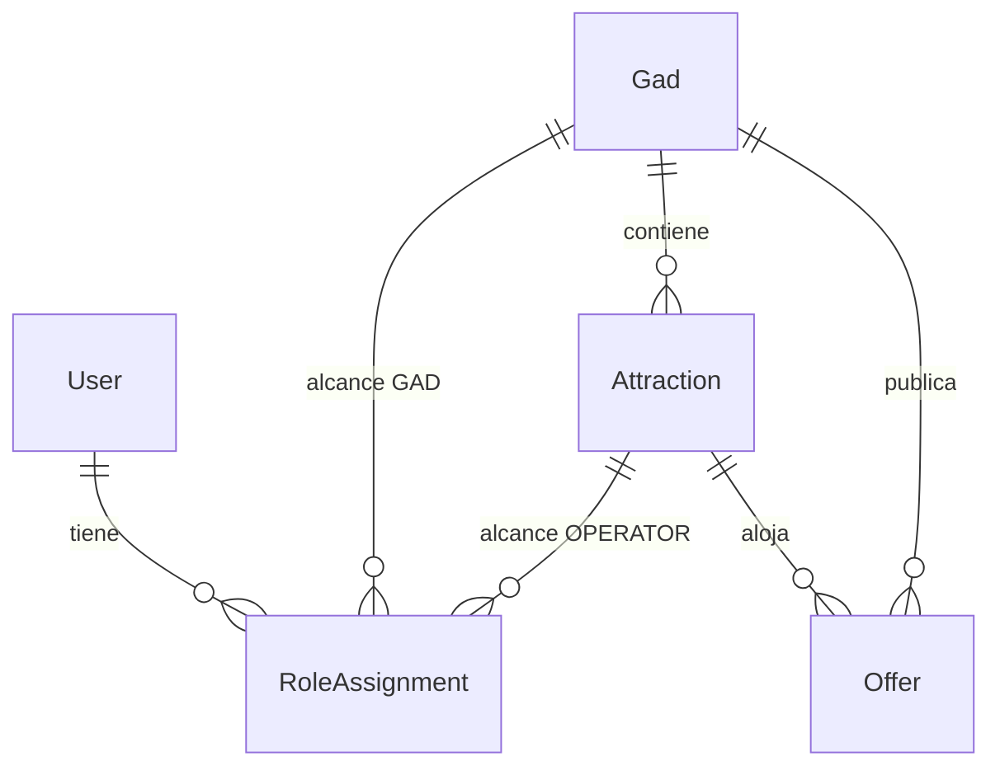

# 01 — Alcance y trazabilidad

> Identificadores y convenciones: [00 §4](00-indice-y-control.md). Estados y entidades: [03](03-datos-estados-e-invariantes.md). Pruebas: [08](08-pruebas-y-evidencias.md). Paquetes: [10](10-fases-y-paquetes-implementables.md).
> **Aviso:** la guía académica y la propuesta de seguridad citadas por `PLAN.md` no están disponibles (H-01). Ningún requisito de este documento se presenta como comprobado en ellas.

---

## 1. Objetivo

Construir un **monolito web desplegable** para una PYME ecuatoriana ficticia que coordina experiencias de turismo comunitario, cuyo recorrido principal es:

**GAD crea una oferta → operador revisa y aprueba → turista reserva para 1 a 10 asistentes → paga en PayPal Sandbox → recibe un QR nominal por asistente → operador comprueba y registra cada ingreso por separado.**

El mismo despliegue incluye registro, ingreso y cierre de sesión, recuperación de contraseña, panel protegido, CRUD de ofertas (entidad principal del CRUD académico), chat con historial y presencia, una notificación adicional en tiempo real, esquema de base de datos, pruebas y una medición de rendimiento (`PLAN §1`).

**Resultado esperado de esta etapa:** documentación suficiente para que una IA implemente el primer paquete (P0-01) sin rediseñar el sistema.

---

## 2. Actores y responsabilidades

| Actor | Cómo obtiene la cuenta | Responsabilidades | Alcance de datos |
|---|---|---|---|
| **Visitante** (anónimo) | — | Consultar portada, catálogo y detalle; registrarse; ingresar; pedir recuperación de contraseña. | Solo ofertas publicadas (`OPEN`, o `SUSPENDED` en el detalle). |
| **Turista** (`TOURIST`) | Registro público | Reservar para un grupo, pagar, ver sus reservas, abrir o descargar sus entradas, usar el chat. | Sus reservas, asistentes, pagos y entradas. |
| **GAD** (`GAD`, con `gadId`) | Semilla | Crear y mantener ofertas de su institución, enviar versiones a revisión, eliminar borradores inéditos, archivar ofertas, ver agregados. | Ofertas de su GAD; **solo agregados** de reservas. |
| **Operador** (`OPERATOR`, con `attractionId`) | Semilla | Revisar versiones de su atracción (aprobar o devolver), suspender y reanudar ventas, consultar entradas y registrar ingresos. | Ofertas de su atracción; nombre de un asistente únicamente al consultar su entrada. |
| **Administrador** (`ADMIN`) | Semilla | Archivar ofertas por moderación con motivo; revisar pagos en `REVIEW_REQUIRED` y «Consultar pasarela»; (opcional) leer auditoría. | Todas las ofertas; casos de pago sin datos de asistentes. |
| **Pasarela** (PayPal Sandbox o adaptador `fake`) | Credenciales en variables de entorno | Crear, consultar y capturar órdenes; notificar por webhook. | Importe, moneda y referencias opacas. |
| **Sistema** (trabajos internos) | — | Vencer retenciones, conciliar pagos, cerrar sockets de sesiones inválidas, purgar datos caducados. | Según cada trabajo. |

Una persona puede acumular varias asignaciones (por ejemplo `GAD` de un GAD y `OPERATOR` de una atracción). Ver §7.

---

## 3. Límites del MVP

### 3.1 Dentro del alcance

Una fecha por oferta · reservas de 1 a 10 asistentes · tarifa general en USD (centavos enteros) · pago de prueba con PayPal Sandbox · entradas nominales con QR · validación de ingreso en línea · retención de 15 minutos · cuentas y asistentes ficticios · roles `GAD`, `OPERATOR` y `ADMIN` provisionados por semilla.

### 3.2 Fuera del alcance y cómo se detecta y escala

No se implementa ninguna de estas funciones. Cuando una situación las necesitaría, el sistema la **detecta** y la **escala** así:

| Exclusión (`PLAN §1`) | Situación que la requeriría | Detección en el MVP | Escalamiento |
|---|---|---|---|
| Reembolsos | Captura verificada sin cupo, con oferta cerrada o con importe discordante. | Reserva `REVIEW_REQUIRED` con `reviewReason`; lista del administrador. | Procedimiento manual RB-09 fuera del sistema; el caso queda abierto. |
| Cancelación posterior al pago | El comprador quiere anular una reserva `CONFIRMED`. | No existe la acción; la interfaz lo indica en la reserva. | Contacto con el administrador (texto informativo); sin cambio de estado. |
| Reembolso o reversión externa | PayPal notifica `PAYMENT.CAPTURE.REFUNDED` o `REVERSED` sobre una reserva confirmada. | `PaymentEvent` registrado (`NO_CHANGE`) y auditado (`AuditEvent` `payment.reconcile`, `CONFLICT`, `REFUND_AFTER_CONFIRMATION`; el «aviso» es la lectura de esos eventos en la vista del administrador, sin estado nuevo). La reserva **no** se degrada. | RB-09. |
| Sustitución de asistentes | Un asistente no puede acudir. | Asistentes inmutables tras crear la reserva. | Sin acción; documentado en la reserva. |
| Descuentos | Tarifas por edad o grupo. | Precio único por asistente. | — |
| Acreditación documental | Verificar identidad o edad con documento. | La edad se declara; la comprobación presencial la hace el operador antes de «Registrar ingreso». | El operador puede no registrar el ingreso; la entrada queda sin consumir. |
| Validación sin conexión | Operador sin red. | La consulta falla con error de red; no hay modo sin conexión. | Reintentar con red; alternativa manual de pegado de código. |
| Varias fechas por oferta | Repetir la experiencia otro día. | — | Se publica otra oferta (`PLAN F3`). |
| Administración de usuarios y roles | Alta de un nuevo GAD u operador. | — | Semilla o script de mantenimiento; sin interfaz. |

---

## 4. Casos de uso

| ID | Caso de uso | Actor | Requisitos | Flujo detallado |
|---|---|---|---|---|
| CU-01 | Registrarse | Visitante | RF-01, RS-01, RS-05 | 07 §4.1 |
| CU-02 | Ingresar | Visitante | RF-02, RS-02, RS-03 | 04 TX-14 |
| CU-03 | Cerrar sesión | Autenticado | RF-03, RS-18 | 04 TX-14 |
| CU-04 | Recuperar contraseña | Visitante | RF-04, RS-04 | 04 TX-13 |
| CU-05 | Usar el panel según el rol | Autenticado | RF-05 | 07 §3 |
| CU-06 | Crear una oferta | GAD | RF-07, RF-14 | 04 TX-01 |
| CU-07 | Editar la versión de trabajo | GAD (autor) | RF-07, RS-09 | 04 TX-01 |
| CU-08 | Enviar una versión a revisión | GAD (autor) | RF-09 | 04 TX-02 |
| CU-09 | Aprobar o devolver una versión | Operador | RF-09, RS-08 | 04 TX-03 |
| CU-10 | Abrir una versión nueva de una oferta publicada | GAD | RF-10 | 04 TX-01 |
| CU-11 | Eliminar oferta inédita, descartar versión o archivar | GAD | RF-11 | 04 TX-16, TX-04 |
| CU-12 | Suspender o reanudar ventas | Operador | RF-12 | 04 TX-04 |
| CU-13 | Archivar por moderación con motivo | Administrador | RF-12 | 04 TX-04 |
| CU-14 | Consultar portada, catálogo y detalle | Cualquiera | RF-13, RF-39 | 07 §5 |
| CU-15 | Reservar para un grupo | Turista | RF-15 a RF-20 | 04 TX-05 |
| CU-16 | Pagar una reserva | Turista | RF-24, RF-26, RS-13 | 04 TX-07, TX-08 |
| CU-17 | Ver reservas, estado y vencimiento | Turista | RF-21 | 07 §7 |
| CU-18 | Abrir o descargar entradas | Turista | RF-31 | 05 §7 |
| CU-19 | Consultar una entrada y registrar el ingreso | Operador | RF-32, RF-33 | 04 TX-12 |
| CU-20 | Revisar casos de pago y consultar la pasarela | Administrador | RF-29 | 04 TX-11 |
| CU-21 | Conversar en el chat con historial y presencia | Autenticado | RF-34, RF-35, RF-37 | 04 TX-15 |
| CU-22 | Recibir el aviso de mensaje nuevo en el panel | Autenticado | RF-36 | 05 §5 |
| CU-23 | Consultar agregados de una oferta | GAD, Operador | RF-22 | 05 §2 |
| CU-24 | Vencer retenciones y conciliar pagos | Sistema | RO-07, RO-11 | 04 TX-06, TX-11 |
| CU-25 | Procesar un webhook | Pasarela | RF-27, RS-12 | 04 TX-10 |

---

## 5. Matriz de requisitos

**Columnas.** *Origen*: `PLAN §n`/`Fn` explícito en el plan · `GUÍA?` atribuido por el plan a la guía, sin comprobar · `PROMPT` pedido en el encargo · `PROP` propuesto aquí. *Ob.*: **O** obligatorio para el MVP · **R** recomendado · **P** opcional. Los paquetes y pruebas se detallan en 10 y 08.

### 5.1 Funcionales

| ID | Requisito | Origen | Ob. | Módulo | Paquetes | Criterio de aceptación | Pruebas |
|---|---|---|---|---|---|---|---|
| RF-01 | Registro público que crea una cuenta con rol `TOURIST`. | PLAN §2, F1 · GUÍA? | O | accounts | P1-03 | Datos válidos crean usuario y asignación `TOURIST`; ninguna entrada permite otro rol. | T-CTA-01, 02, 03 |
| RF-02 | Inicio de sesión con correo y contraseña. | PLAN F1 · GUÍA? | O | accounts | P1-02 | Credenciales válidas crean sesión y cookie; inválidas dan mensaje genérico. | T-CTA-04, 05 |
| RF-03 | Cierre de sesión. | PLAN F1 · GUÍA? | O | accounts | P1-02 | Tras salir, la cookie anterior no da acceso por HTTP ni por WebSocket. | T-CTA-08, T-CHAT-11 |
| RF-04 | Recuperación de contraseña por enlace de correo (30 min). | PLAN F1 · GUÍA? | O | accounts | P1-05 | El enlace recibido permite fijar una contraseña nueva una sola vez. | T-CTA-10 a 14, 18 |
| RF-05 | Panel principal protegido con accesos según el rol. | PLAN F1 · GUÍA? | O | accounts | P1-02 | Sin sesión redirige a `/ingreso`; con sesión muestra solo las funciones del usuario. | T-CTA-16, 19 |
| RF-06 | Roles `GAD`, `OPERATOR`, `ADMIN` y sus vínculos creados por semilla. | PLAN §2, F0 | O | accounts | P0-06 | Tras sembrar existen cuentas de los cuatro roles con sus alcances. | T-CTA-20 |
| RF-07 | CRUD de ofertas del GAD: alta, listado, detalle, edición y eliminación con confirmación. | PLAN F2 · GUÍA? | O | offers | P2-02 | El GAD completa las cinco operaciones sobre ofertas de su institución. | T-OFE-01, 02, 14, 20 |
| RF-08 | Listado de 10 en 10, ordenado por fecha e id, con filtro por provincia. | PLAN F2 | O | offers | P2-02, P2-05 | Orden estable entre páginas; el filtro devuelve solo la provincia pedida. | T-OFE-02, 17 |
| RF-09 | Revisión: `DRAFT` → `IN_REVIEW` → `APPROVED` o `CHANGES_REQUESTED` con motivo. | PLAN F2 | O | offers | P2-03 | El operador asignado decide; devolver exige motivo. | T-OFE-05, 06, 09 |
| RF-10 | Versiones aprobadas inmutables; editar abre otra versión y conserva la publicación anterior hasta aprobar. | PLAN F2 | O | offers | P2-03 | La versión pública no cambia hasta que se aprueba la nueva. | T-OFE-11, 12, 13, 18 |
| RF-11 | Eliminar un borrador inédito; archivar una oferta publicada conservando su historial. | PLAN F2 | O | offers | P2-02, P2-04 | Eliminar es físico solo si nunca se publicó; archivar conserva versiones y reservas. | T-OFE-14, 16 |
| RF-12 | El operador suspende ventas; el administrador archiva por moderación con motivo. | PLAN F2 | O | offers | P2-04 | Suspender o archivar impide nuevas retenciones y mantiene las entradas emitidas. | T-OFE-15, 16, T-RES-13 |
| RF-13 | Catálogo público `/ofertas` y detalle `/ofertas/[id]`. | PLAN F2 | O | offers | P2-05 | Muestra las condiciones de la versión aprobada vigente. | T-OFE-17, 20 |
| RF-14 | Validación de campos en cliente y servidor con errores por campo. | PLAN F2 | O | offers | P2-02 | Cada regla incumplida devuelve el error junto a su campo. | T-OFE-01, 24 |
| RF-15 | Reserva grupal de 1 a 10 asistentes nominales. | PLAN §1, F3 | O | reservations | P3-01, P3-02 | Se crea una reserva `HELD` con sus asistentes en una transacción. | T-RES-01, 02, 19 |
| RF-16 | Validación de edad mínima en la fecha local de la actividad. | PLAN F3 | O | reservations | P3-01 | El límite se evalúa en `America/Guayaquil` en la fecha de inicio. | T-RES-05, 06 |
| RF-17 | Registro de la aceptación de las condiciones y de la versión contratada. | PLAN F3 | O | reservations | P3-01 | La reserva guarda `offerVersionId` y `termsAcceptedAt`; no cambian. | T-RES-01, 12 |
| RF-18 | Retención de 15 minutos que se libera al vencer. | PLAN §1, F3 | O | reservations | P3-01, P3-03 | Tras `expiresAt` los cupos vuelven a estar disponibles sin intervención. | T-RES-10, 11, 16 |
| RF-19 | Conflicto si la versión vista ya no es la publicada. | PLAN F3 | O | reservations | P3-01, P3-02 | Respuesta `VERSION_CHANGED` con las condiciones nuevas para revisar. | T-RES-04, 19 |
| RF-20 | Clave de solicitud idempotente por comprador. | PLAN §2, F3 | O | reservations | P3-01 | Repetición idéntica devuelve la misma reserva; contenido distinto da conflicto. | T-RES-07, 08 |
| RF-21 | `/panel/reservas` y `/panel/reservas/[id]` con estado y hora de vencimiento. | PLAN F3 | O | reservations | P3-02 | El comprador ve estado, total, asistentes y vencimiento de sus reservas. | T-RES-14, 19 |
| RF-22 | El GAD consulta únicamente datos agregados de sus ofertas. | PLAN F3 | O | reservations | P3-03 | Solo conteos; ningún nombre ni fecha de nacimiento. | T-RES-14 |
| RF-23 | Fecha y atracción fijas desde la primera reserva; capacidad nunca inferior a lo comprometido. | PLAN F3 | O | offers | P3-03 | Aprobar una versión que lo incumpla se rechaza. | T-OFE-21, 22, 23, T-RES-17 |
| RF-24 | Pago con PayPal Sandbox Orders v2 tras un adaptador `createOrder` / `captureOrder` / `getOrder`. | PLAN F4 | O | payments | P4-01, P4-04, P4-06 | Una compra se completa en Sandbox con el total persistido. | T-PAG-01, 21, 24 |
| RF-25 | Adaptador determinista para pruebas automatizadas. | PLAN F4 | O | payments | P4-01 | Reproduce todos los fallos de la matriz de 08 §6. | T-PAG-01 a 23 |
| RF-26 | La pantalla de retorno muestra el estado local; la captura la pide el servidor. | PLAN F4 | O | payments | P4-04 | Volver del navegador no cambia el estado por sí mismo. | T-PAG-04, 05, 18 |
| RF-27 | Webhook en `/api/pagos/paypal/webhook` verificado e idempotente. | PLAN F4 | O | payments | P4-05 | Firma inválida no produce cambios; repetición no duplica efectos. | T-PAG-07, 08, 22, 26 |
| RF-28 | Captura y webhook usan la misma función de confirmación. | PLAN F4 | O | payments | P4-03 | Una sola confirmación aunque lleguen a la vez. | T-PAG-05, 06 |
| RF-29 | `REVIEW_REQUIRED` con motivo; vista del administrador con «Consultar pasarela». | PLAN F4 | O | payments | P4-03, P4-07 | El administrador ve el caso y puede reintentar sin duplicar efectos. | T-PAG-09 a 15, 19 |
| RF-30 | Una entrada por asistente emitida en la transacción de confirmación. | PLAN F5 | O | tickets | P4-02, P4-03 | N asistentes producen exactamente N entradas, una sola vez. | T-ENT-01, 02, T-PAG-05 |
| RF-31 | El comprador abre o descarga cada QR de su reserva confirmada. | PLAN F5 | O | tickets | P5-01 | Solo el comprador obtiene la imagen; nunca se guarda en caché. | T-ENT-03, 04 |
| RF-32 | El operador consulta una entrada (cámara o código pegado) y, en un segundo paso, registra el ingreso. | PLAN F5 | O | tickets | P5-02, P5-03 | Consultar no consume; registrar consume una vez. | T-ENT-05, 06, 13, 14 |
| RF-33 | El ingreso valida rol, atracción, actividad seleccionada, ventana horaria y reserva confirmada. | PLAN F5 | O | tickets | P5-02 | Cada condición incumplida se rechaza con su código. | T-ENT-08, 09, 10 |
| RF-34 | Chat en la sala `general` con historial paginado y persistente. | PLAN F6 · GUÍA? | O | chat | P6-02 | Dos usuarios conversan; el historial sobrevive al reinicio. | T-CHAT-03, 07, 13 |
| RF-35 | Presencia de usuarios únicos. | PLAN F6 · GUÍA? | O | chat | P6-03 | Varias pestañas de un usuario cuentan como una presencia. | T-CHAT-09 |
| RF-36 | Notificación adicional en tiempo real en el panel. | PLAN §1, F6 · GUÍA? | O | chat | P6-03 | Quien está en el panel fuera del chat recibe el aviso; el autor no. | T-CHAT-10 |
| RF-37 | Al reconectar se recupera el historial faltante por cursor. | PLAN F6 | O | chat | P6-03 | Sin pérdidas ni duplicados visibles. | T-CHAT-08 |
| RF-38 | Auditoría de acciones, decisiones y resultados. | PLAN §2, F2, F5 | O | audit | P1-01 y siguientes | Cada cambio de estado relevante deja un `AuditEvent` sin datos sensibles. | T-SEG-11 |
| RF-39 | Ruta inicial `/` que conduce al catálogo y a los paneles. | PROMPT | R | offers | P2-05 | La portada enlaza catálogo, ingreso, registro y panel. | T-OFE-20 |

### 5.2 Seguridad

| ID | Requisito | Origen | Ob. | Módulo | Paquetes | Criterio de aceptación | Pruebas |
|---|---|---|---|---|---|---|---|
| RS-01 | Contraseñas con Argon2id y sal. | PLAN F1 | O | accounts | P0-06 | El hash guardado tiene formato `$argon2id$…` con parámetros mínimos. | T-CTA-01 |
| RS-02 | Sesión opaca: hash en base; cookie `HttpOnly`, `SameSite=Lax`, `Secure` en despliegue; 8 horas. | PLAN F1 | O | accounts | P1-02 | Atributos correctos; el token no existe en claro en la base. | T-CTA-04, 09, 15, T-SEG-12 |
| RS-03 | Límites temporales por cuenta y por origen en ingreso y recuperación. | PLAN F1 | O | accounts | P1-04 | Superar el umbral bloquea temporalmente y se libera con el tiempo. | T-CTA-06, 07, 17 |
| RS-04 | Token de recuperación de un solo uso, 30 minutos; consumo y revocación de sesiones en la misma transacción; respuesta uniforme. | PLAN F1 | O | accounts | P1-05 | Dos consumos simultáneos producen un solo cambio. | T-CTA-10 a 14 |
| RS-05 | Correos normalizados y únicos. | PLAN F1 | O | accounts | P1-03 | Variantes de mayúsculas o espacios no crean otra cuenta. | T-CTA-02 |
| RS-06 | Toda mutación valida sesión, origen, datos y permisos en el servidor. | PLAN §2 | O | todos | P1-02 y siguientes | Petición con `Origin` ajeno o ausente se rechaza. | T-SEG-01, 04 |
| RS-07 | Autorización por recurso y alcance (GAD, atracción, comprador). | PLAN F2, F3, F5 | O | todos | P1-02, P2-02, P3-02, P5-01 | Consultas directas a recursos ajenos devuelven 404. | T-SEG-04, T-OFE-03, 07, T-RES-14, T-ENT-03, 08 |
| RS-08 | El autor de una versión no puede decidir su revisión, aunque tenga otros roles. | PLAN F2 · PROMPT | O | offers | P2-03 | Rechazo en el servicio y en la base. | T-OFE-08 |
| RS-09 | Escrituras condicionales ante ediciones o decisiones concurrentes. | PLAN F2 | O | offers | P2-02, P2-03 | La segunda escritura recibe conflicto. | T-OFE-04, 10 |
| RS-10 | Sin sobreventa bajo concurrencia. | PLAN F3 | O | reservations | P3-01 | Confirmados + retenciones vigentes ≤ capacidad en todo momento. | T-RES-09, 17, T-PAG-14 |
| RS-11 | Precio y total calculados en el servidor a partir de la versión publicada. | PLAN F3, §4 | O | reservations | P3-01 | Un importe enviado por el cliente no influye. | T-RES-03 |
| RS-12 | Webhook con verificación de firma. | PLAN §2, F4 | O | payments | P4-05, P4-06 | Sin firma válida no hay efectos. | T-PAG-08 |
| RS-13 | Ninguna redirección del navegador confirma un pago. | PLAN F4 · PROMPT | O | payments | P4-04 | Abrir la URL de retorno sin captura deja la reserva en `HELD`. | T-PAG-04 |
| RS-14 | Idempotencia de eventos de pago y de emisión de entradas. | PLAN F4, F5 | O | payments, tickets | P4-03, P4-05 | Repeticiones no emiten ni confirman de nuevo. | T-PAG-06, 07, T-ENT-02 |
| RS-15 | Token QR opaco de 32 bytes; hash para buscar y copia cifrada autenticada. | PLAN F5 | O | tickets | P4-02 | Ni la base ni los registros contienen el token en claro. | T-ENT-01, 12 |
| RS-16 | El token QR no llega a URL ni a registros. | PLAN F5 | O | tickets | P5-01, P5-02 | Búsqueda del token centinela en registros y rutas: sin resultados. | T-ENT-04, T-SEG-05 |
| RS-17 | Consumo atómico de la entrada. | PLAN F5 | O | tickets | P5-02 | Dos intentos simultáneos producen un solo ingreso. | T-ENT-06, 07 |
| RS-18 | WebSocket autenticado por cookie, con `Origin` verificado y cierre al expirar o revocarse la sesión. | PLAN F6 | O | chat | P6-01 | Visitante no conecta; sesión revocada pierde la conexión abierta. | T-CHAT-01, 02, 11, 12 |
| RS-19 | Chat: texto plano de 1 a 500 caracteres, límite de frecuencia y deduplicación. | PLAN F6 | O | chat | P6-02 | Entradas inválidas no se persisten ni se emiten. | T-CHAT-04, 05, 06, 14 |
| RS-20 | Registros y auditoría sin contraseñas, tokens, QR ni datos de pago sensibles. | PLAN §2 | O | audit | P0-04, P1-01 | Valores centinela no aparecen en la salida. | T-SEG-05, 11 |
| RS-21 | `Cache-Control: no-store` en pantallas privadas y descargas. | PLAN §2 | O | todos | P1-06, P5-01 | Cabecera presente en `/panel/**` y en el QR. | T-SEG-03 |
| RS-22 | Cabeceras de seguridad y CSP compatibles con la integración real. | PROMPT | O | plataforma | P1-06 | CSP con *nonce* activa sin errores en los recorridos. | T-SEG-02 |
| RS-23 | Secretos solo en servidor y entorno validado al arrancar. | PROMPT | O | plataforma | P0-04 | Configuración inválida impide arrancar; ningún secreto en el paquete cliente. | T-SEG-08 |
| RS-24 | Cuenta de base de datos con privilegios mínimos. | PROMPT | R | plataforma | P0-03 | El rol de aplicación no puede ejecutar DDL ni alterar auditoría. | T-SEG-07 |
| RS-25 | Minimización de datos de asistentes. | PLAN §2 · PROMPT | O | reservations | P3-01, PE-03 | `birthDate` es nulo salvo que la versión exija edad. | T-RES-06, 14 |
| RS-26 | Matriz de controles frente a objetivos Common Criteria de la propuesta, sin declarar certificación. | PLAN §4 | O | entrega | PE-03 | **Pendiente:** objetivos no disponibles (Q-02). | — |
| RS-27 | Protección frente a XSS e inyección SQL. | PROMPT | O | todos | P1-06, P6-02 | Cargas maliciosas se muestran como texto y no alteran consultas. | T-SEG-06, T-CHAT-14 |
| RS-28 | Dependencias revisadas. | PROMPT | R | plataforma | P0-05, PE-03 | Sin vulnerabilidades altas o críticas sin justificar. | T-SEG-09 |
| RS-29 | Límite de retenciones vigentes por comprador. | PROP | R | reservations | P3-01 | Superarlo devuelve `HOLD_LIMIT_REACHED`. | T-RES-15 |
| RS-30 | Límite de consultas del lector de entradas. | PROMPT | R | tickets | P5-02 | Exceso devuelve `RATE_LIMITED` y queda auditado. | T-ENT-11 |

### 5.3 Accesibilidad y experiencia

| ID | Requisito | Origen | Ob. | Paquetes | Criterio de aceptación | Pruebas |
|---|---|---|---|---|---|---|
| RA-01 | Interfaz en español, importes en USD y fechas locales claras. | PLAN §2 · PROMPT | O | P0-04 y todos los de interfaz | Importes con formato único; fechas con la etiqueta «hora de Ecuador». | T-OFE-24, revisión manual |
| RA-02 | WCAG 2.2 nivel AA como **objetivo propuesto**. | PROMPT | R | Todos los de interfaz, PE-03 | Sin infracciones graves o críticas en el análisis automático; lista manual cumplida. | T-A11Y-01 a 07 |
| RA-03 | Errores por campo asociados y anunciados. | PLAN F2 · PROMPT | O | P1-03 (componentes) | Lector de pantalla anuncia el error; el foco va al resumen. | T-A11Y-03 |
| RA-04 | Alternativa manual a cámara y QR. | PLAN F5 · PROMPT | O | P5-02 | El ingreso puede completarse solo con teclado pegando el código. | T-A11Y-05, T-ENT-14 |
| RA-05 | Separación visual y funcional entre consultar una entrada y registrar el ingreso. | PLAN F5 · PROMPT | O | P5-02 | Escanear nunca consume; registrar requiere una acción explícita. | T-ENT-05, 13 |
| RA-06 | Estados de interfaz definidos: vacío, carga, éxito, validación, conflicto, acceso denegado, sesión vencida y fallo de red. | PROMPT | O | Todos los de interfaz | Cada pantalla de 07 implementa sus estados. | Recorridos E2E y revisión |
| RA-07 | Actualizaciones en vivo accesibles (chat, avisos, cuenta atrás). | PROMPT | R | P6-02, P6-03, P3-02 | Regiones `aria-live` sin robar el foco. | T-A11Y-04 |
| RA-08 | Ninguna decisión de negocio depende del reloj del navegador. | PROMPT | O | P3-02 | La cuenta atrás es informativa; el servidor decide. | T-RES-10 |

### 5.4 Operación

| ID | Requisito | Origen | Ob. | Paquetes | Criterio de aceptación | Pruebas |
|---|---|---|---|---|---|---|
| RO-01 | Un clon limpio instala, migra, siembra y arranca. | PLAN F0 | O | P0-01 a P0-06 | Los comandos del README funcionan en una máquina sin estado previo. | T-OPS-01 |
| RO-02 | Un único punto de entrada sirve HTTP y WebSocket en desarrollo y producción. | PLAN §2, F0 | O | P0-02 | `server.ts` atiende ambas cosas en el mismo puerto. | T-OPS-01, 02 |
| RO-03 | PostgreSQL local y base de pruebas separada. | PLAN F0 | O | P0-03, P0-05 | Las pruebas se niegan a ejecutarse contra una base que no sea de pruebas. | T-OPS-04 |
| RO-04 | `.env.example`, dependencias bloqueadas y scripts de instalación, compilación, arranque, semilla y pruebas. | PLAN F0 | O | P0-01, P0-04 | Scripts presentes y documentados. | T-OPS-01, T-SEG-08 |
| RO-05 | Despliegue como instancia Node persistente detrás de HTTPS con WSS. | PLAN §2 | O | PE-02 | Recorrido principal y chat funcionan en la URL pública. | T-OPS-02 y verificación manual |
| RO-06 | Instantes en UTC e importes en centavos enteros. | PLAN §2 | O | P0-04 | Sin coma flotante en importes; columnas `timestamptz`. | T-DB-01, T-RES-05 |
| RO-07 | La limpieza de retenciones no es necesaria para la corrección. | PLAN F3 | O | P3-03 | Con el trabajo detenido, los cupos se liberan igualmente. | T-RES-10, 11 |
| RO-08 | Bandeja SMTP de pruebas. | PLAN F1 | O | P0-03, P1-05 | El correo de recuperación llega a la bandeja local. | T-CTA-18 |
| RO-09 | Registros estructurados, comprobación de salud, apagado ordenado y *runbooks*. | PROMPT | R | P0-02, P0-04, PE-02 | `SIGTERM` cierra sin cortar peticiones; `/api/salud` responde. | T-OPS-02, 03 |
| RO-10 | Git desde la fase 0, con commits propios de cada integrante. | PLAN F0 | O | P0-01 | Historial con autoría real (12 §7). | Revisión |
| RO-11 | Recuperación tras reinicio en mitad de una operación. | PROMPT | O | P4-05 | Un pago capturado antes de la caída se confirma después. | T-PAG-20, T-OPS-06 |

### 5.5 Entrega académica

Todos proceden de `PLAN §4` y el plan los atribuye a la guía: **no comprobados** (H-01).

| ID | Requisito | Ob. | Paquete | Evidencia prevista |
|---|---|---|---|---|
| RE-01 | Esquema de base de datos y diagrama del modelo relacional. | O | PE-04 | EV-02 |
| RE-02 | Pruebas con Vitest y Playwright ejecutadas por fase. | O | Todos | EV-04 |
| RE-03 | Medición de rendimiento del catálogo filtrado: mediana, p95, volumen y comando. | O | PE-01 | EV-06 |
| RE-04 | Diagrama del monolito. | O | PE-04 | EV-01 |
| RE-05 | Matriz de requisitos con pruebas. | O | PE-04 | EV-03 |
| RE-06 | README con pasos de ejecución y declaración de uso de IA. | O | P0-01, PE-04 | EV-08 |
| RE-07 | Repositorio público con commits de todo el equipo y etiqueta `v1.0-b1`. | O | PE-04 | EV-09 |
| RE-08 | Matriz de seguridad con los objetivos Common Criteria de la propuesta y pendientes, sin declarar certificación. | O | PE-03 | EV-05 (**bloqueada en parte por Q-02**) |
| RE-09 | Presentación de 15 minutos y 5 de preguntas con todos los integrantes. | O | PE-04 | EV-10 |
| RE-10 | Subir enlace o ZIP y presentación según la guía. | O | PE-04 | EV-11 (**formato pendiente de Q-01**) |
| RE-11 | Prueba real en Sandbox registrada como pendiente hasta ejecutarse. | O | P4-06 | EV-07 |
| RE-12 | Demostración final: compra grupal, ingreso por QR, recuperación de clave, CRUD, chat y evidencias de seguridad. | O | PE-04 | 12 §2 |

---

## 6. Estado de comprobación académica

| Afirmación del plan | Fuente que la respaldaría | Estado |
|---|---|---|
| La guía exige registro, ingreso, cierre, recuperación, pantalla principal protegida, chat WebSocket con historial y presencia, una notificación adicional, esquema de base, pruebas y medición de rendimiento. | Guía de Web Avanzadas | **No comprobado** |
| La oferta turística es la entidad principal del CRUD académico. | Guía de Web Avanzadas | **No comprobado** |
| Paginación de 10 y filtro por campo indexado. | Guía de Web Avanzadas (presumible) | **No comprobado** |
| Entrega: diagramas, matriz, README con declaración de IA, repositorio público, etiqueta `v1.0-b1`, 15 + 5 minutos. | Guía de Web Avanzadas | **No comprobado** |
| La matriz de seguridad debe relacionar controles con objetivos Common Criteria. | Propuesta de Software Seguro | **No comprobado**; objetivos desconocidos |

Mientras Q-01 y Q-02 sigan abiertas, la entrega debe decir «conforme al plan del equipo» y no «conforme a la guía».

---

## 7. Modelo de pertenencias

### 7.1 Estructura

| Rol | `gadId` | `attractionId` | Significado |
|---|---|---|---|
| `TOURIST` | nulo | nulo | Puede reservar y pagar. Se asigna en el registro. |
| `GAD` | obligatorio | nulo | Miembro de ese GAD. |
| `OPERATOR` | nulo | obligatorio | Operador de esa atracción. |
| `ADMIN` | nulo | nulo | Administrador de la plataforma. |

Reglas:

1. Un usuario puede tener **varias** asignaciones, incluso de distinto rol (por ejemplo `GAD` de un GAD y `OPERATOR` de una atracción). No hay «rol activo»: el panel muestra la unión de funciones y cada acción se autoriza por separado.
2. La combinación `(userId, role, gadId, attractionId)` es única. Una restricción `CHECK` impide alcances incoherentes con el rol (03 §3.2).
3. Una atracción pertenece a un único GAD (S-01). Una oferta se crea para una atracción del mismo GAD (clave foránea compuesta).
4. Las asignaciones `GAD`, `OPERATOR` y `ADMIN` solo se crean por semilla. Ninguna pantalla ni acción las modifica.
5. El **Principal** que reciben los servicios contiene `userId`, `displayName` y la lista de asignaciones leída de la base **en cada petición** (no se guarda en la cookie): un cambio de asignaciones surte efecto de inmediato.

### 7.2 Prohibición de autoaprobación por identidad

- Cada `OfferVersion` tiene un único `authorId` (D-22). Solo el autor la edita y la envía a revisión.
- Decidir la revisión (aprobar o devolver) exige: asignación `OPERATOR` sobre `offer.attractionId` **y** `principal.userId ≠ version.authorId`.
- La comprobación es por identidad, no por rol: quien tenga `GAD` y `OPERATOR` puede revisar versiones de **otros** autores, nunca las propias.
- Refuerzo en base: `CHECK ("reviewerId" IS NULL OR "reviewerId" <> "authorId")`.
- Demostración: la cuenta sembrada `dual@demo.test` (roles `GAD` y `OPERATOR`) crea una versión e intenta aprobarla → `SELF_REVIEW_FORBIDDEN` (T-OFE-08).

---

## 8. Matriz de permisos

**Lectura.** ✔ permitido · ✖ prohibido · `—` no aplica. «Alcance» es la condición adicional que el servicio comprueba **en el servidor** con datos leídos de la base. Un recurso fuera del alcance responde **404** (`NOT_FOUND`); una acción que el rol nunca puede hacer responde **403** (`FORBIDDEN`).

### 8.1 Cuentas y sesión

| Acción | Visitante | Autenticado | Comprobación en servidor |
|---|---|---|---|
| Registrarse | ✔ | ✖ (redirige al panel) | Solo crea `TOURIST`; el esquema no admite campos de rol. |
| Ingresar | ✔ | — | Límites por cuenta e IP; mensaje genérico. |
| Cerrar sesión | — | ✔ (su sesión) | Revoca la sesión de la cookie presentada. |
| Solicitar recuperación | ✔ | ✔ | Respuesta idéntica exista o no el correo. |
| Restablecer contraseña | ✔ (con token válido) | ✔ | Consumo condicional del token. |

### 8.2 Ofertas

| Acción | Recurso | Visit. | `TOURIST` | `GAD` | `OPERATOR` | `ADMIN` | Alcance y comprobaciones |
|---|---|---|---|---|---|---|---|
| Ver catálogo y detalle público | Oferta `OPEN` (o `SUSPENDED` en detalle) | ✔ | ✔ | ✔ | ✔ | ✔ | Solo la versión pública; nunca borradores. |
| Listar ofertas propias | `Offer` | ✖ | ✖ | ✔ | ✖ | ✖ | `offer.gadId` ∈ GAD del principal. |
| Crear oferta | `Offer` + versión 1 | ✖ | ✖ | ✔ | ✖ | ✖ | `gadId` del principal; `attraction.gadId = gadId`. |
| Ver detalle privado (versiones, estado) | `Offer` | ✖ | ✖ | ✔ | ✔ | ✔ | GAD: su institución. Operador: su atracción. Administrador: todas. |
| Editar versión de trabajo | `OfferVersion` `DRAFT`/`CHANGES_REQUESTED` | ✖ | ✖ | ✔ | ✖ | ✖ | Alcance GAD **y** `authorId = principal`; `rev` esperado. |
| Enviar a revisión | `OfferVersion` | ✖ | ✖ | ✔ | ✖ | ✖ | Igual que editar. |
| Abrir versión nueva | `Offer` publicada sin versión de trabajo | ✖ | ✖ | ✔ | ✖ | ✖ | Alcance GAD; oferta no archivada. |
| Descartar versión de trabajo | `OfferVersion` no aprobada | ✖ | ✖ | ✔ | ✖ | ✖ | Alcance GAD (cualquier miembro). |
| Eliminar oferta | `Offer` nunca publicada | ✖ | ✖ | ✔ | ✖ | ✖ | Alcance GAD; sin versiones aprobadas. |
| Aprobar o devolver | `OfferVersion` `IN_REVIEW` | ✖ | ✖ | ✖ | ✔ | ✖ | Atracción del operador **y** no ser el autor. |
| Suspender o reanudar ventas | `Offer` `OPEN`/`SUSPENDED` | ✖ | ✖ | ✖ | ✔ | ✖ | Atracción del operador. |
| Archivar | `Offer` publicada | ✖ | ✖ | ✔ | ✖ | ✔ | GAD: su institución. Administrador: cualquiera, **con motivo**. |
| Ver agregados de una oferta | Conteos | ✖ | ✖ | ✔ | ✔ | ✔ | Mismo alcance que el detalle privado; sin datos nominales. |

### 8.3 Reservas, pagos y entradas

| Acción | Recurso | Visit. | `TOURIST` | `GAD` | `OPERATOR` | `ADMIN` | Alcance y comprobaciones |
|---|---|---|---|---|---|---|---|
| Crear reserva | `Reservation` | ✖ | ✔ | ✖ | ✖ | ✖ | Rol `TOURIST`; oferta `OPEN` y futura; total calculado en servidor. |
| Listar y ver reservas | `Reservation` | ✖ | ✔ | ✖ | ✖ | ✖ | `buyerId = principal`. |
| Iniciar pago y capturar | `Payment` | ✖ | ✔ | ✖ | ✖ | ✖ | Reserva propia con retención vigente. |
| Ver y descargar entradas | `Ticket` | ✖ | ✔ | ✖ | ✖ | ✖ | Reserva propia y `CONFIRMED`. |
| Mostrar el código de una entrada | `Ticket` | ✖ | ✔ | ✖ | ✖ | ✖ | Igual; queda auditado. |
| Consultar entrada | `Ticket` | ✖ | ✖ | ✖ | ✔ | ✖ | Atracción del operador y actividad seleccionada. |
| Registrar ingreso | `Ticket` | ✖ | ✖ | ✖ | ✔ | ✖ | Igual, más ventana horaria y reserva `CONFIRMED`. |
| Listar casos en revisión | `Reservation` `REVIEW_REQUIRED` | ✖ | ✖ | ✖ | ✖ | ✔ | Sin nombres ni fechas de nacimiento. |
| Consultar pasarela | `Payment` | ✖ | ✖ | ✖ | ✖ | ✔ | Ejecuta `settlePayment`; idempotente. |
| Recibir webhook | `PaymentEvent` | Pasarela | — | — | — | — | Sin cookie; firma verificada. |

### 8.4 Chat y auditoría

| Acción | Visit. | Autenticado | `ADMIN` | Comprobaciones |
|---|---|---|---|---|
| Conectar por WebSocket | ✖ | ✔ | ✔ | Cookie válida y `Origin` exacto en el *handshake*. |
| Leer historial y enviar mensajes en `general` | ✖ | ✔ | ✔ | Sesión revalidada en cada evento; límite de frecuencia. |
| Leer auditoría (opcional, PE-05) | ✖ | ✖ | ✔ | Solo lectura. |

### 8.5 Prohibiciones explícitas

- Nadie edita una versión `APPROVED` ni una reserva ya creada (importe, cantidad, versión o asistentes).
- Nadie degrada una reserva `CONFIRMED` ni una entrada `USED`.
- Ningún rol, incluido `ADMIN`, lee contraseñas, tokens de sesión, tokens QR en claro ni datos de tarjeta (no se almacenan).
- `ADMIN` no aprueba versiones, no registra ingresos y no ve nombres ni fechas de nacimiento de asistentes.
- `GAD` no ve reservas individuales; `OPERATOR` no ve listados de asistentes.
- Ninguna interfaz concede roles.

---

## 9. Abuso de acceso

### 9.1 Acceso horizontal (entre usuarios del mismo nivel)

| Intento | Control | Prueba |
|---|---|---|
| GAD A abre `/panel/ofertas/<id de GAD B>` o envía una acción con ese id. | Toda consulta de oferta filtra por los GAD del principal; fuera de alcance → 404. | T-OFE-03 |
| GAD crea una oferta sobre una atracción de otro GAD. | Comprobación `attraction.gadId = gadId` y clave foránea compuesta. | T-OFE-23 |
| Operador X decide o suspende una oferta de la atracción Y. | Alcance por `attractionId`. | T-OFE-07, 15 |
| Turista abre la reserva, el QR o inicia el pago de otro comprador. | `buyerId = principal` en la propia consulta. | T-RES-14, T-ENT-03, T-PAG-18 |
| Operador consulta una entrada de otra atracción. | Respuesta genérica sin datos del asistente. | T-ENT-08 |
| Manipular identificadores en campos ocultos del formulario. | Los identificadores del cliente solo seleccionan; el alcance se recalcula en el servidor. | T-SEG-04 |

### 9.2 Escalamiento de privilegios (vertical)

| Intento | Control | Prueba |
|---|---|---|
| Añadir `role` o `gadId` al cuerpo del registro. | El esquema del registro no admite esos campos; el rol es una constante del servicio. | T-CTA-03 |
| Invocar directamente una Server Action de otro rol. | Cada acción reautoriza; las Server Actions son accesibles por `POST` directo. | T-SEG-04, T-CTA-19 |
| Autor con rol `OPERATOR` aprueba su propia versión. | D-22 y `CHECK`. | T-OFE-08 |
| Usar la pantalla de aprobación simulada o el adaptador `fake` en producción. | El arranque falla con `APP_ENV=production` y `PAYMENT_PROVIDER=fake`. | T-SEG-08 |
| Confirmar un pago visitando la URL de retorno. | El retorno no modifica nada; solo la captura verificada confirma. | T-PAG-04 |
| Falsificar un webhook para confirmar. | Firma verificada y, además, el estado se lee siempre de la pasarela. | T-PAG-08 |
| Mantener una sesión tras cambiar la contraseña o salir. | Revocación en base; sockets cerrados. | T-CTA-08, 14, T-CHAT-11 |

### 9.3 Mínimo acceso a datos de asistentes

| Dato | Quién lo ve | Cuándo | Nunca |
|---|---|---|---|
| Nombre del asistente | Comprador | En su reserva. | — |
| Nombre del asistente | Operador de la atracción | Solo al **consultar** esa entrada con el código, para la comprobación presencial. | En listados; para otras actividades. |
| Fecha de nacimiento | Comprador | En su reserva, solo si la versión exige edad mínima. | Operador, GAD, administrador, registros, auditoría. |
| Conteos (confirmados, retenidos, ingresos) | GAD, operador, administrador | En el detalle privado de la oferta. | Datos nominales. |
| Token QR | Comprador | Imagen o código bajo demanda. | URL, registros, auditoría, otros roles. |

La fecha de nacimiento no se guarda si la versión contratada no exige edad mínima (RS-25) y se propone anularla tras la actividad (D-62, 06 §9).
