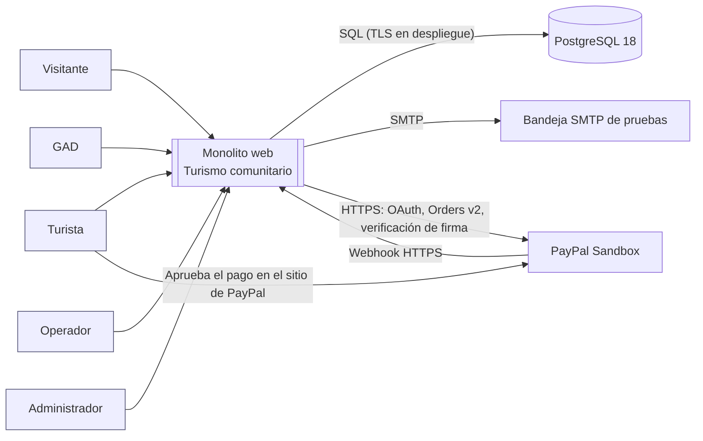
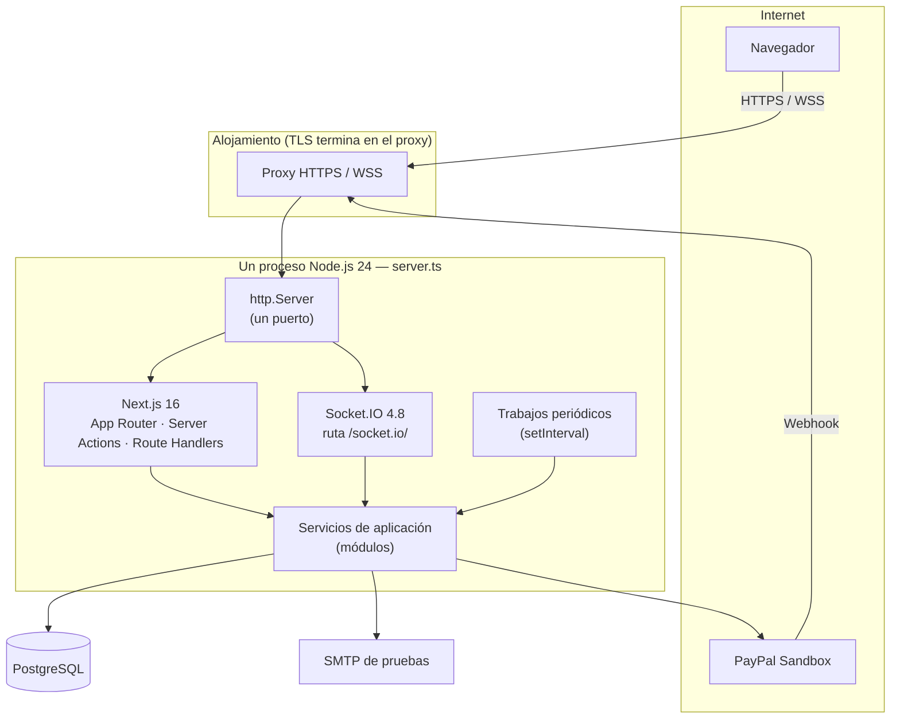
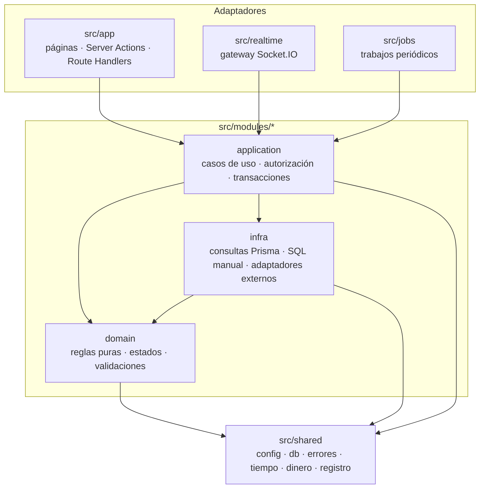
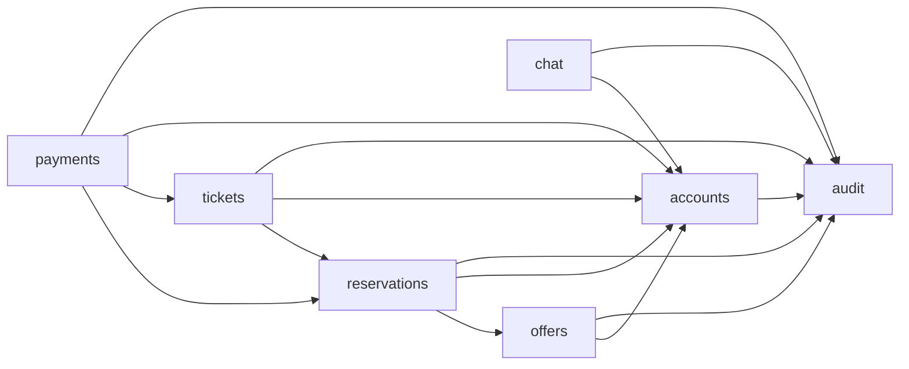
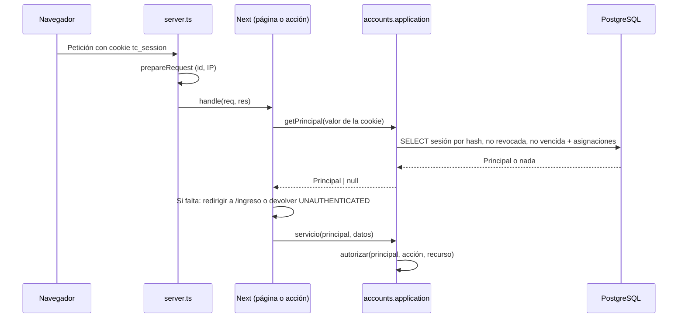

# 02 — Arquitectura y decisiones

> Registro de decisiones: [00 §8](00-indice-y-control.md). Datos: [03](03-datos-estados-e-invariantes.md). Transacciones: [04](04-reglas-transacciones-y-concurrencia.md). Contratos: [05](05-contratos-http-websocket-y-pagos.md). Operación: [09](09-entorno-despliegue-y-operacion.md).
> Nada de lo descrito existe todavía. Las rutas de archivos son las previstas y se verifican al implementar.

---

## 1. Contexto



**Límites de confianza:** navegador ↔ aplicación (todo lo que llega es hostil), aplicación ↔ base de datos (credenciales de privilegio mínimo), aplicación ↔ PayPal (salida autenticada con credenciales; entrada verificada por firma y contrastada con `getOrder`), aplicación ↔ SMTP.

---

## 2. Contenedores: un solo proceso



**Por qué un solo proceso (D-01).** El plan lo fija. Además:

- Un único origen: la cookie de sesión `HttpOnly` sirve tanto para HTTP como para el *handshake* de WebSocket, sin CORS ni tokens adicionales.
- Un único despliegue con HTTPS y WSS en el mismo puerto.
- Las garantías de corrección no dependen de memoria compartida entre procesos: se apoyan en PostgreSQL (bloqueos de fila, restricciones de unicidad, escrituras condicionales).

**Qué vive solo en memoria** y por tanto se pierde al reiniciar o impediría escalar a varias instancias: presencia del chat, cubos de límite de frecuencia del chat y del lector, cola de orden por sala, caché del token OAuth de PayPal y los temporizadores de trabajos. Nada de ello afecta a la corrección de dinero, cupos o entradas. Ver §13.

---

## 3. Árbol de carpetas previsto

```text
turismo-comunitario/
├─ server.ts                      # Punto de entrada único: http.Server + Next + Socket.IO + trabajos
├─ proxy.ts                       # Convención de Next 16: genera nonce y CSP. No autoriza.
├─ next.config.ts                 # cacheComponents:false, cabeceras, serverExternalPackages
├─ prisma.config.ts               # Prisma 7: esquema, migraciones, semilla, URL de migración
├─ package.json / package-lock.json / tsconfig.json / eslint.config.mjs
├─ vitest.config.ts / playwright.config.ts
├─ docker-compose.yml             # PostgreSQL 18 + Mailpit (solo desarrollo y pruebas)
├─ Dockerfile / .dockerignore     # Imagen de producción (PE-02)
├─ .env.example / .gitignore / .nvmrc / .editorconfig
├─ README.md / ESTADO-IMPLEMENTACION.md
├─ prisma/
│  ├─ schema.prisma
│  ├─ migrations/                 # Incluye SQL manual: CHECK, disparadores, índices especiales
│  ├─ sql/00-roles.sql            # Roles de base (migrador y aplicación) para Docker local
│  └─ seed/                       # index.ts, accounts.ts, offers.ts, demo.ts, perf.ts
├─ scripts/
│  ├─ build-server.mjs            # esbuild: server.ts → dist/server.mjs
│  ├─ perf-catalog.ts             # Medición de rendimiento (PE-01)
│  ├─ rotate-ticket-key.ts        # Recifrado de tokens QR con la clave activa
│  ├─ reissue-tickets.ts          # Reemisión ante pérdida de clave (RB-10)
│  └─ purge-data.ts               # Purga y minimización manual
├─ src/
│  ├─ app/                        # ADAPTADOR HTTP (Next.js). Sin reglas de negocio.
│  │  ├─ layout.tsx · page.tsx                    # Portada "/"
│  │  ├─ ofertas/…                               # Catálogo, detalle, formulario de reserva
│  │  ├─ (cuenta)/registro · ingreso · recuperar · restablecer
│  │  ├─ panel/…                                 # Zona privada (layout con navegación por rol)
│  │  ├─ pasarela-simulada/[orderId]/            # Solo con PAYMENT_PROVIDER=fake
│  │  └─ api/
│  │     ├─ salud/route.ts
│  │     ├─ chat/mensajes/route.ts
│  │     ├─ entradas/[ticketId]/qr/route.ts
│  │     └─ pagos/paypal/webhook/route.ts
│  ├─ realtime/                   # ADAPTADOR WEBSOCKET (se carga desde server.ts)
│  │  ├─ gateway.ts · handshake.ts · chat.handlers.ts · presence.ts · session-sweep.ts
│  ├─ jobs/                       # ADAPTADOR DE TIEMPO (se carga desde server.ts)
│  │  ├─ scheduler.ts · expire-holds.ts · reconcile-payments.ts · purge.ts
│  ├─ modules/                    # NÚCLEO: una carpeta por módulo del plan
│  │  ├─ accounts/      { domain/ · application/ · infra/ · index.ts }
│  │  ├─ offers/        { domain/ · application/ · infra/ · index.ts }   # incluye inventory.ts
│  │  ├─ reservations/  { … }
│  │  ├─ payments/      { … }     # puerto PaymentGateway + adaptadores paypal/ y fake/
│  │  ├─ tickets/       { … }     # token, llavero, emisión, ingreso
│  │  ├─ chat/          { … }
│  │  └─ audit/         { … }
│  ├─ shared/                     # Sin dependencias de módulos
│  │  ├─ config/env.ts            # Validación de variables de entorno
│  │  ├─ db/prisma.ts · db/tx.ts  # Cliente único y ayudante de transacciones
│  │  ├─ errors/                  # AppError, códigos, ActionResult
│  │  ├─ http/                    # action(), origin, client-ip, request-id, no-store
│  │  ├─ security/                # hash de tokens, HMAC, comparación en tiempo constante
│  │  ├─ time/                    # Clock, zona America/Guayaquil, edad
│  │  ├─ money/                   # centavos ⇄ texto
│  │  ├─ validation/              # esquemas Zod compartidos por formularios y servicios
│  │  ├─ logging/                 # pino + redacción
│  │  └─ runtime/registry.ts      # Puente de proceso (globalThis)
│  ├─ ui/                         # Componentes de interfaz reutilizables (formularios, avisos)
│  └─ generated/prisma/           # Cliente generado por Prisma 7 (no se versiona)
├─ tests/
│  ├─ helpers/                    # db, fábricas, reloj falso, barrera, pasarela programable, ws
│  ├─ unit/ · integration/ · concurrency/ · contract/paypal/ · e2e/ · perf/
└─ docs/
   ├─ planificacion/              # Estos trece documentos
   │  └─ referencias/             # Plan original, prompts y notas de investigación
   ├─ evidencias/                 # Resultados reales generados al implementar
   └─ diagramas/
```

Notas:

- `create-next-app` 16.4 propone por defecto **no** usar `src/` y **sí** Cache Components. Aquí se elige `src/` y se desactiva Cache Components (D-03). Ver P0-01.
- `proxy.ts` es el nombre que sustituye a `middleware.ts` desde Next.js 16 y se ejecuta en el runtime de Node.js. Su ubicación exacta (raíz o `src/`) se confirma al implementar.

---

## 4. Responsabilidades y dirección de dependencias



| Capa | Hace | No hace |
|---|---|---|
| `src/app` (páginas, acciones, *handlers*) | Leer cookie y cabeceras, comprobar `Origin`, convertir `FormData`/JSON a un objeto, llamar **un** servicio, traducir el resultado a respuesta, redirección o `ActionResult`. | Consultar Prisma, decidir permisos, calcular precios o cupos, abrir transacciones. |
| `src/realtime` | Autenticar el *handshake*, gestionar salas y presencia en memoria, aplicar límite de frecuencia, llamar al servicio de chat, emitir. | Validar reglas de negocio, persistir directamente. |
| `src/jobs` | Programar y llamar servicios idempotentes. | Contener lógica propia. |
| `modules/*/application` | Autorizar (principal + recurso), validar con el esquema del dominio, abrir la transacción, orquestar, auditar. Única capa que decide. | Conocer HTTP, cookies o Socket.IO. |
| `modules/*/domain` | Tipos, máquinas de estado, cálculos puros (edad, total, disponibilidad), esquemas Zod. | Entrada o salida de datos. |
| `modules/*/infra` | Consultas Prisma, SQL manual (`FOR UPDATE`), clientes HTTP de PayPal, SMTP, cifrado. | Decidir permisos. |
| `shared` | Utilidades transversales. | Importar de `modules`. |

**Reglas de dependencia (comprobables con ESLint `no-restricted-imports`):**

1. `modules/**` nunca importa de `src/app`, `src/realtime`, `src/jobs` ni `next/*`.
2. Un módulo solo importa de otro a través de su `index.ts`.
3. Grafo entre módulos, sin ciclos:



4. **Inventario.** `offers` necesita saber cuántos asientos están comprometidos (para aprobar una reducción de capacidad) y `reservations` necesita bloquear la oferta. Para evitar el ciclo, `modules/offers/infra/inventory.ts` expone `lockOffer(tx, offerId)` y `countCommitted(tx, offerId, now)`; esta última **lee** la tabla `Reservation` con SQL. Es un acoplamiento de datos de solo lectura, deliberado y único.

**Cómo se evita duplicar lógica entre los tres transportes.** Cada regla tiene una sola implementación en un servicio que recibe un `Principal` y datos ya deserializados. Ejemplos: `settlePayment` la invocan la acción de captura, el webhook, el conciliador y la acción del administrador; `postMessage` la invoca el *gateway*; `validateSession` la usan HTTP y WebSocket.

**Firma tipo de un servicio:**

```ts
// modules/reservations/application/create-reservation.ts
export async function createReservation(
  principal: Principal,
  input: CreateReservationInput,     // ya validado con el esquema del dominio
  deps: { clock: Clock } = defaultDeps,
): Promise<ReservationSummary>;      // lanza AppError con código estable
```

Las funciones que deben ejecutarse dentro de una transacción ajena reciben el cliente transaccional como primer argumento y llevan el sufijo `InTx` (por ejemplo `issueTicketsInTx(tx, reservation, attendees, now)`).

---

## 5. Versiones propuestas y estado de verificación

Consulta realizada el **2026-11-12** (registro de npm, `nodejs.org`, Docker Hub). «Verificada» significa que la versión existe y que los rangos `engines` y `peerDependencies` publicados son compatibles entre sí. La API concreta de cada biblioteca se confirma al instalar (00 §10.4).

### 5.1 Plataforma

| Componente | Versión propuesta | Estado | Notas |
|---|---|---|---|
| Node.js | **24 LTS** («Krypton»), ≥ 24.12 | Verificada (24.22.3 instalada en el equipo de redacción) | Cumple los mínimos de Next (≥ 20.9), Prisma 7 (≥ 24.0), Vitest 5 (^24) y ESLint 10 (≥ 24). Node 26 LTS existe; no se adopta para no añadir incertidumbre. |
| PostgreSQL | **18** | Verificada (imagen `postgres:18`; el alojamiento evaluado admite 13–18) | Se usa `NULLS NOT DISTINCT` (≥ 15). |
| npm | 11.x | Verificada | `package-lock.json` versionado. |
| Docker | 28.x | Verificada en el equipo | Solo para PostgreSQL y Mailpit locales. |
| Mailpit | `axllent/mailpit:v1.33` | Verificada | SMTP 1025, interfaz 8025. |

### 5.2 Dependencias de ejecución

| Paquete | Versión | Para qué | Estado y advertencias |
|---|---|---|---|
| `next` | 16.4.x (16.4.6) | Aplicación web | Verificada. Turbopack por defecto; API de petición asíncronas (`await cookies()`); `proxy.ts`. |
| `react`, `react-dom` | 19.3.x | Interfaz | Verificada (Next 16.4 se publica con React 19.3). |
| `prisma`, `@prisma/client`, `@prisma/adapter-pg` | **7.10.1 exacta** | ORM y migraciones | **Fijar sin `^`.** La etiqueta `latest` del paquete `prisma` es `8.0.0-rc.33`. Documentación vigente para esta versión: `prisma.io/docs/orm/v7/…`. |
| `pg` | 8.23.x | Controlador PostgreSQL | Verificada. |
| `socket.io`, `socket.io-client` | 4.8.x (misma versión) | WebSocket | Verificada. |
| `zod` | 4.6.x | Validación | Verificada. API de Zod 4 (difiere de la 3). |
| `argon2` | 0.45.x | Hash de contraseñas | Verificada. Módulo nativo con binarios precompilados; confirmar en Windows y en la imagen de despliegue. |
| `nodemailer` | 10.5.x | SMTP | Verificada la existencia; API de la versión 10 por confirmar. |
| `qrcode` | 1.5.x | Generar PNG del QR en servidor | Verificada. |
| `jsqr` | 1.4.x | Respaldo de lectura de QR en navegador | Verificada. Sin WebAssembly ni *workers*. |
| `pino` | 10.4.x | Registros estructurados | Verificada. |
| `dotenv` | 18.x | Cargar `.env` (Prisma 7 no lo hace) | Verificada. |
| `server-only` | 0.0.1 | Impedir importar código de servidor en cliente | Verificada. |
| `tailwindcss`, `@tailwindcss/postcss` | 4.3.x | Estilos | Verificada (opción por defecto de `create-next-app`). |

### 5.3 Dependencias de desarrollo

| Paquete | Versión | Estado y advertencias |
|---|---|---|
| `typescript` | **5.9.3** | Verificada. **No usar 7.x:** `typescript-eslint` 8.72 exige `<6.1.0` y TypeScript 7 no ofrece la API de compilador en JavaScript. La 6.0.x es aceptable; se prefiere 5.9.x por ser la recomendada por Prisma 7. Next.js exige ≥ 5.1. |
| `tsx` | 4.23.x | Ejecutar `server.ts` y scripts en desarrollo. |
| `esbuild` | 0.28.x | Empaquetar `server.ts` para producción. |
| `eslint`, `eslint-config-next`, `typescript-eslint` | 10.x / 16.4.x / 8.72.x | Verificadas por rangos. `next lint` ya no existe: se ejecuta `eslint` directamente. Usar la configuración que genere `create-next-app`. |
| `vitest`, `@vitest/coverage-v8` | 5.1.x | Verificada la existencia; configuración de la versión 5 por confirmar. |
| `@playwright/test` | 1.65.x | Verificada. |
| `@axe-core/playwright` | 4.14.x | Verificada (exige Node ≥ 22.12). |
| `pino-pretty` | 13.x | Solo desarrollo. |

### 5.4 Dependencias evaluadas y descartadas

| Opción | Motivo del descarte |
|---|---|
| Prisma 8 (*release candidate*) | API distinta (sin `schema.prisma`, sin `$transaction`, sin opción de aislamiento); aún no es versión general. |
| TypeScript 7 | Incompatible con `typescript-eslint` en la fecha de consulta. |
| `@paypal/paypal-server-sdk` 2.5 | Cuatro llamadas no justifican un SDK; se prefiere controlar tiempos de espera, idempotencia y cabeceras (D-38). Queda como alternativa. |
| SDK de JavaScript de PayPal en el navegador | Obligaría a abrir la CSP a scripts de terceros (D-37). |
| NextAuth / Auth.js, iron-session | El plan fija sesión opaca propia con hash en base. |
| Redis, colas, adaptadores de Socket.IO | Infraestructura que un solo proceso no necesita. |
| NestJS | El plan lo reserva para una evolución posterior. |
| Bibliotecas de fechas | Una sola zona sin horario de verano; basta `Intl` con utilidades probadas. |
| `html5-qrcode`, `qr-scanner`, `@zxing/browser` | Sin mantenimiento reciente o con *workers*/WebAssembly que complican la CSP. |
| Biblioteca de componentes de interfaz | Más dependencias y menos control de accesibilidad (D-64). |

---

## 6. Configuración de Next.js

| Ajuste | Valor | Razón |
|---|---|---|
| `cacheComponents` | `false` | D-03. La guía de CSP indica que el *nonce* exige render dinámico y que el prerenderizado parcial es incompatible. |
| Render de páginas con datos | Dinámico (usan `cookies()`/`headers()` o `await connection()`) | Sesión por petición; precio y cupos siempre actuales. |
| `serverExternalPackages` | Confirmar que `argon2`, `pino` y `pg` no se empaquetan | Módulos nativos o con carga dinámica. |
| `serverActions.bodySizeLimit` | Valor por defecto (1 MB) | Suficiente; los formularios son pequeños. |
| `serverActions.allowedOrigins` | No se configura | Un único origen. La comprobación propia de `Origin` es más estricta (D-17). |
| `poweredByHeader` | `false` | No revelar tecnología. |
| `typedRoutes` | `true` (recomendado) | Detecta enlaces rotos al compilar. |
| Salida | Por defecto (no `standalone`) | `standalone` no rastrea el servidor propio; no pueden usarse juntos. |
| Empaquetador | Turbopack (por defecto en 16) | Sin configuración de webpack. |

---

## 7. Punto de entrada único

### 7.1 `server.ts` (esqueleto orientativo)

```ts
import { createServer } from 'node:http';
import next from 'next';
import { env } from '@/shared/config/env';            // valida y falla pronto
import { logger } from '@/shared/logging/logger';
import { attachRealtime } from '@/realtime/gateway';
import { startJobs } from '@/jobs/scheduler';
import { registerRuntime } from '@/shared/runtime/registry';
import { prepareRequest } from '@/shared/http/prepare-request';

const dev = env.NODE_ENV !== 'production';
const httpServer = createServer();
const app = next({ dev, hostname: env.HOST, port: env.PORT, httpServer });
const handle = app.getRequestHandler();

await app.prepare();

httpServer.on('request', (req, res) => {
  prepareRequest(req, res);          // id de petición, IP de confianza, registro de acceso
  void handle(req, res);
});

const realtime = attachRealtime(httpServer);    // Socket.IO en /socket.io/
registerRuntime({ realtime });                  // puente para el código de Next
const jobs = startJobs();

httpServer.listen(env.PORT, env.HOST, () => logger.info({ port: env.PORT }, 'listening'));
installGracefulShutdown({ httpServer, realtime, jobs });
```

Puntos que este esqueleto fija y que deben respetarse:

- **Mismo archivo en desarrollo y producción.** Solo cambia `dev`.
- **`hostname` y `port` se pasan a `next()`**: la guía de Socket.IO lo exige cuando existe `proxy`/`middleware`.
- **`httpServer` se pasa a `next()`** para que Next.js conozca el servidor sobre el que corre (recarga en caliente en desarrollo). Su convivencia con Socket.IO debe comprobarse en P0-02; si surgiera un conflicto con las peticiones de *upgrade*, se documenta la alternativa adoptada.
- **Las cabeceras propias se fijan antes de `handle`**: después, `res.headersSent` ya es verdadero.
- **`prepareRequest`** elimina cualquier cabecera entrante `x-request-id` y `x-tc-client-ip` y las vuelve a fijar con valores propios. Así el código de Next.js lee con `headers()` datos que solo el servidor propio pudo escribir. La IP se obtiene de `X-Forwarded-For` tomando el salto indicado por `TRUST_PROXY_HOPS`, o del socket si es 0.
- **El registro de acceso** anota método, **ruta sin cadena de consulta**, estado, duración e id de petición. Nunca cuerpos, cookies ni cabeceras de autorización.

### 7.2 Dos grafos de módulos en un proceso (D-05)

`server.ts` no pasa por el compilador de Next.js. Por eso los módulos que importa (`src/realtime`, `src/jobs` y, a través de ellos, `src/modules/*`) se cargan **una vez** en el grafo del servidor propio y **otra vez** dentro del paquete que Next.js construye para páginas y acciones. Consecuencias:

| Elemento | Problema | Solución |
|---|---|---|
| Instancia `io` | Una Server Action no puede importar el `io` creado en `server.ts`. | `registerRuntime({ realtime })` guarda en `globalThis[Symbol.for('tc.runtime')]` un objeto con `disconnectSession(sessionId)` y `disconnectUser(userId)`. El código de Next llama a `getRuntime()` en el momento de usarlo. Si no hay registro (compilación, pruebas unitarias), devuelve una implementación nula. |
| Cliente Prisma | Dos grafos crearían dos agrupaciones de conexiones. | Instancia única en `globalThis.__tcPrisma`. |
| Almacén del adaptador `fake` | El conciliador (grafo del servidor) y las acciones (grafo de Next) deben ver las mismas órdenes simuladas. | Instancia única en el registro global. |
| Presencia, límites del chat, cola por sala | Solo los usa el *gateway*. | Viven únicamente en el grafo del servidor. |
| Reloj | En producción ambos usan el reloj del sistema. | Sin estado compartido. |

Contrato del puente:

```ts
// shared/runtime/registry.ts
export interface RealtimePort {
  disconnectSession(sessionId: string, reason: 'logout' | 'revoked' | 'expired'): void;
  disconnectUser(userId: string, reason: 'password-reset'): void;
}
export function registerRuntime(r: { realtime: RealtimePort }): void;
export function getRuntime(): { realtime: RealtimePort };   // nunca lanza
```

**El puente es una optimización de latencia, no la garantía.** La garantía de que una sesión revocada pierde su WebSocket es el barrido periódico y la revalidación por evento (04 TX-14).

### 7.3 Compilación y arranque (D-08)

| Etapa | Comando previsto | Qué hace |
|---|---|---|
| Desarrollo | `npm run dev` → `tsx server.ts` | Next en modo desarrollo con recarga en caliente + Socket.IO. Cambios en `server.ts`, `src/realtime` o `src/jobs` requieren reiniciar. |
| Generar cliente | `npm run db:generate` → `prisma generate` | Prisma 7 ya no lo hace automáticamente. |
| Compilar | `npm run build` → `prisma generate && next build && node scripts/build-server.mjs` | `next build` produce `.next/`; esbuild empaqueta `server.ts` en `dist/server.mjs` (ESM, `platform=node`, dependencias de `node_modules` externas, alias `@/` resueltos). |
| Producción | `npm run start` → `node dist/server.mjs` con `NODE_ENV=production` | El mismo punto de entrada. |

Se descarta ejecutar TypeScript directamente con Node en producción: la ejecución nativa ignora `tsconfig.json`, no resuelve alias y exige extensiones en las importaciones.

### 7.4 Apagado ordenado

Al recibir `SIGTERM` o `SIGINT`:

1. Marcar el estado como «cerrando»: `/api/salud` responde 503.
2. Detener los temporizadores de trabajos; esperar al que esté en curso (máximo 5 s).
3. `io.close()`: desconecta sockets (los clientes reconectan a la instancia nueva y recuperan mensajes por cursor).
4. `httpServer.close()`: deja de aceptar conexiones y espera las peticiones en curso.
5. Límite total de 20 s (por debajo de los 30 s que da el alojamiento evaluado); después, `prisma.$disconnect()` y `process.exit(0)`.

Una operación interrumpida no deja estados inválidos: cada transacción se confirma o se revierte, y los pasos externos son recuperables (04 §4).

### 7.5 Limitaciones del servidor propio

| Limitación | Efecto | Tratamiento |
|---|---|---|
| No es desplegable en plataformas sin servidor ni admite `output: 'standalone'`. | Hace falta un proceso Node persistente. | Alojamiento de 09 §6. |
| El archivo del servidor no lo compila Next.js. | Sintaxis y alias propios. | Empaquetado con esbuild. |
| Doble grafo de módulos. | Instancias duplicadas. | §7.2. |
| La documentación de Next.js no cubre WebSocket. | Comportamiento con la recarga en caliente sin garantía documentada. | Prueba de humo en P0-02. |
| Una sola instancia. | Sin alta disponibilidad; reinicio = corte breve. | Aceptado para el MVP; §13. |

---

## 8. Sesión y autorización en la arquitectura



- `getPrincipal()` se envuelve con `cache()` de React para resolverla **una vez por petición** de render. Las Server Actions y Route Handlers la llaman de nuevo: no heredan comprobaciones de la página.
- No se confía en *layouts* para proteger: un *layout* no se vuelve a ejecutar en cada navegación. Cada página y cada acción privada llama a `requirePrincipal()`.
- `proxy.ts` **no** consulta la base ni decide acceso (D-06).
- La sesión se valida contra la base en cada petición. No hay caché de sesiones: la revocación es inmediata por HTTP.

---

## 9. Configuración, secretos y validación del entorno

- `shared/config/env.ts` valida `process.env` con Zod **al importar** y detiene el arranque con un mensaje que nombra la variable inválida, sin imprimir su valor.
- Reglas cruzadas: `APP_ENV=production` exige `PAYMENT_PROVIDER=paypal`, `APP_ORIGIN` con `https://`, llavero de entradas presente y parámetros de Argon2 no inferiores al mínimo. `PAYPAL_API_BASE` solo admite el anfitrión de Sandbox en el MVP. `DB_LOCK_TIMEOUT_MS` es un entero en milisegundos (defecto 5000; rango 100–30 000 **propuesto**, 09 §3).
- **Ninguna variable `NEXT_PUBLIC_*`**: el cliente no necesita configuración (mismo origen para HTTP y WebSocket). Los módulos con secretos importan `server-only`.
- Los secretos solo están en variables de entorno del proceso. `.env` no se versiona; `.env.example` contiene valores ficticios (09 §3).
- Prisma 7 no carga `.env`: `prisma.config.ts` importa `dotenv/config`; la aplicación carga `.env` solo en desarrollo.

---

## 10. Errores, códigos de conflicto y registros

### 10.1 Modelo de errores

```ts
class AppError extends Error {
  code: ErrorCode;            // estable; lo usan pruebas y cliente
  status: number;             // HTTP equivalente
  fieldErrors?: Record<string, string[]>;
  details?: Record<string, unknown>;   // datos seguros para el cliente (p. ej. versión nueva)
}

type ActionResult<T> =
  | { ok: true; data: T }
  | { ok: false; error: { code: ErrorCode; message: string;
                          fieldErrors?: Record<string, string[]>;
                          details?: Record<string, unknown>; requestId: string } };
```

- Los servicios lanzan `AppError`. Los adaptadores lo convierten: Server Action → `ActionResult`; Route Handler → JSON `{ error }` con el estado HTTP; Socket.IO → confirmación `{ ok: false, error }`.
- Un error no previsto se registra con el id de petición y se devuelve como `INTERNAL_ERROR` con un mensaje genérico. Nunca se envían trazas ni mensajes de la base al cliente.
- `redirect()` y `notFound()` de Next.js funcionan lanzando excepciones: deben invocarse **fuera** de bloques `try/catch`.

### 10.2 Catálogo de códigos

| Código | HTTP | Significado |
|---|---|---|
| `VALIDATION_ERROR` | 422 | Datos inválidos; incluye `fieldErrors`. |
| `UNAUTHENTICATED` | 401 | Sin sesión válida. |
| `FORBIDDEN` | 403 | El rol nunca puede hacer la acción. |
| `NOT_FOUND` | 404 | No existe **o** está fuera del alcance del usuario. |
| `ORIGIN_MISMATCH` | 403 | `Origin` ausente o distinto de `APP_ORIGIN`. |
| `RATE_LIMITED` | 429 | Límite de frecuencia; incluye `retryAfterSeconds`. |
| `EMAIL_TAKEN` | 409 | Correo ya registrado. |
| `INVALID_CREDENTIALS` | 401 | Correo o contraseña incorrectos (mensaje único). |
| `TOKEN_INVALID` | 400 | Token de recuperación inexistente, usado o vencido (mensaje único). |
| `STALE_VERSION` | 409 | La versión cambió desde que se leyó (`rev` distinto). |
| `INVALID_STATE` | 409 | La transición no es válida en el estado actual. |
| `WORKING_VERSION_EXISTS` | 409 | Ya existe una versión de trabajo. |
| `SELF_REVIEW_FORBIDDEN` | 403 | El autor no puede decidir su versión. |
| `OFFER_ARCHIVED` | 409 | La oferta está archivada. |
| `SCHEDULE_LOCKED` | 409 | No puede cambiarse la fecha: ya hay reservas. |
| `CAPACITY_BELOW_COMMITTED` | 409 | La capacidad propuesta es menor que lo comprometido. |
| `ACTIVITY_NOT_FUTURE` | 409 | La actividad ya comenzó o su fecha no es futura. |
| `OFFER_NOT_OPEN` | 409 | La oferta no admite nuevas reservas. |
| `VERSION_CHANGED` | 409 | La versión vista ya no es la publicada; `details` trae la vigente. |
| `INSUFFICIENT_CAPACITY` | 409 | No hay cupos suficientes; `details.available`. |
| `IDEMPOTENCY_KEY_REUSED` | 409 | Misma clave de solicitud con contenido distinto. |
| `HOLD_LIMIT_REACHED` | 409 | Demasiadas retenciones vigentes del comprador. |
| `HOLD_EXPIRED` | 409 | La retención venció (o le queda menos del margen de captura). |
| `PAYMENT_NOT_APPROVED` | 409 | La orden aún no fue aprobada por el comprador. |
| `PAYMENT_DECLINED` | 409 | La pasarela rechazó el medio de pago; puede reintentarse. |
| `PAYMENT_UNDER_REVIEW` | 409 | El pago está en verificación (`REVIEW_REQUIRED`). |
| `GATEWAY_UNAVAILABLE` | 503 | La pasarela no respondió; puede reintentarse. |
| `TICKET_NOT_FOUND` | 404 | Código no reconocido o no válido para esta actividad (mensaje único). |
| `WRONG_ACTIVITY` | 409 | La entrada es de otra actividad de la misma atracción. |
| `OUTSIDE_CHECKIN_WINDOW` | 409 | Fuera de la ventana de ingreso. |
| `TICKET_ALREADY_USED` | 409 | La entrada ya registró ingreso; `details.usedAt`. |
| `BUSY_TRY_AGAIN` | 503 | Tiempo de espera de bloqueo agotado. |
| `INTERNAL_ERROR` | 500 | Error no previsto. |

### 10.3 Registros

- `pino` en JSON, una línea por evento, a la salida estándar. Campos fijos: `time`, `level`, `msg`, `requestId`, `module`.
- **Redacción obligatoria** por lista de rutas: `password`, `passwordHash`, `token`, `tokenHash`, `cookie`, `authorization`, `set-cookie`, `clientSecret`, `access_token`, `qr`, `code`, `birthDate`, `email` (se registra un hash corto en su lugar).
- Regla de código: nunca registrar objetos de petición completos, cuerpos de formularios ni respuestas de PayPal sin pasar por un selector de campos permitidos.
- Los registros de aplicación sirven para diagnóstico; la **auditoría** (`AuditEvent`) es el registro de negocio y seguridad y vive en la base (03 §3.4 y 06 §4.6).

---

## 11. Sesiones, base de datos, correo, trabajos y recuperación

| Aspecto | Estrategia |
|---|---|
| **Sesiones** | Fila `Session` por inicio de sesión; cookie con token opaco; validación en base por petición; revocación por `revokedAt` (D-15). |
| **Base de datos** | Un cliente Prisma con adaptador `pg`; transacciones interactivas en `READ COMMITTED` con `lock_timeout` = `DB_LOCK_TIMEOUT_MS` (5000 por defecto, 09 §3; las pruebas de `BUSY_TRY_AGAIN` lo reducen por llamada con `opts.lockTimeoutMs`, 04 §5); ayudante `withTx()` en `shared/db/tx.ts`. Tamaño de la agrupación configurable (`DB_POOL_MAX`, 10 por defecto; las pruebas de concurrencia lo elevan). |
| **Correo** | `nodemailer` contra SMTP de pruebas. Se envía **después** de confirmar la transacción que crea el token. Si el envío falla se registra y la respuesta al usuario es la misma; puede pedir otro enlace. |
| **Reloj** | `Clock` inyectable (D-10), monótono no decreciente dentro del proceso. Cada transacción toma `now` **una vez, inmediatamente después de adquirir el último bloqueo del que depende la decisión** (no al empezar: una espera de bloqueo dejaría la hora obsoleta) y lo usa en todas sus comparaciones (D-69, [04 §1](04-reglas-transacciones-y-concurrencia.md)). |

### 11.1 Trabajos periódicos

| ID | Trabajo | Frecuencia | Qué hace | Si no se ejecuta |
|---|---|---|---|---|
| J1 | `expire-holds` | 60 s y al arrancar | Marca `EXPIRED` las reservas `HELD` con `expiresAt ≤ ahora`; audita. | Los cupos se liberan igual (se calculan por fecha); solo la pantalla muestra «vencida» por cálculo. |
| J2 | `reconcile-payments` | 60 s y al arrancar | Consulta `getOrder` de pagos `ORDER_CREATED` con `nextCheckAt ≤ ahora` y llama a `settlePayment`; **calendario de 13 comprobaciones en ≈ 76 h** (2, 4, 9, 19, 39, 69 min, 2 h 09, 4 h 09, 8 h 09, 16 h 09, 28 h 09, 52 h 09, 76 h 09 desde el reclamo; [04 TX-11.2](04-reglas-transacciones-y-concurrencia.md), propuesta). Puede **reanudar con la misma clave** un intento de captura desconocido mientras la retención esté vigente con margen; **nunca inicia** uno ni cierra incertidumbres por plazo. Agotado el calendario el caso pasa a revisión del administrador. | Los casos con captura iniciada siguen en el calendario aunque no llegue ningún webhook; sin J2 quedan en revisión hasta que llegue el webhook o el administrador pulse «Consultar pasarela». |
| J3 | `ws-session-sweep` | 30 s | Desconecta sockets cuya sesión ya no es válida. | Cada evento entrante revalida la sesión igualmente. |
| J4 | `purge` — **propuesta sin paquete** (`P3-04`, 10 §5; no se implementa hasta que el equipo la adopte, D7-6) | 6 h y al arrancar | Borra sesiones y tokens caducados y filas de límite antiguas; anula `birthDate` tras la actividad (D-62). | Solo crece el almacenamiento. |

Todos son idempotentes, toleran ejecutarse a la vez que las peticiones y se desactivan con `JOBS_ENABLED=false` (pruebas).

### 11.2 Invariantes que **no** dependen de un temporizador

| Invariante | Mecanismo real |
|---|---|
| Una retención vencida no ocupa cupo. | La disponibilidad filtra por `expiresAt > ahora` en cada cálculo. |
| Una sesión vencida o revocada no da acceso. | Cada petición y cada evento de socket consulta `expiresAt` y `revokedAt`. |
| Un token de recuperación vencido no sirve. | El `UPDATE` condicional exige `expiresAt > ahora`. |
| No hay captura con retención vencida. | La acción de captura lo comprueba antes de llamar a la pasarela. |
| El ingreso solo vale en su ventana. | Se compara con `startsAt`/`endsAt` en cada registro. |
| Un pago capturado acaba aplicándose. | Lo aplica el primero que llegue: respuesta de captura, webhook, conciliador o administrador; todos llaman a la misma función. |

### 11.3 Recuperación tras reinicio

Al arrancar: validar entorno → comprobar conexión a la base → ejecutar J1 y J2 una vez (y J4 solo si se adopta `P3-04`) → aceptar tráfico. Los clientes del chat reconectan y piden los mensajes posteriores a su último id. No hay estado en memoria que restaurar.

---

## 12. Decisiones imprescindibles frente a evoluciones futuras

| Imprescindible en el MVP | Evolución posterior (no hacer ahora) |
|---|---|
| Servicios de aplicación como única sede de reglas. | Migración a NestJS reutilizando `modules/*`. |
| Bloqueo de fila y restricciones en PostgreSQL. | Inventario desnormalizado o colas de reserva. |
| Función única de liquidación y conciliación por `getOrder`. | Reembolsos, cancelaciones y estados de devolución. |
| Sesión en base y cierre de sockets. | Expiración por inactividad; segundo factor. |
| Llavero de cifrado con identificador de clave. | Gestor de secretos o HSM. |
| Trabajos en proceso. | Planificador externo. |
| Presencia y límites en memoria. | Adaptador Redis para varias instancias. |
| Auditoría en tabla de solo inserción. | Exportación a un sistema de registros inmutable. |
| Paginación por desplazamiento. | Paginación por cursor y búsqueda de texto. |
| Verificación de webhook por *postback*. | Verificación local con caché de certificados. |

---

## 13. Limitaciones para escalar a varias instancias

El MVP está diseñado para **una** instancia. Para ejecutar varias haría falta:

1. Adaptador de Socket.IO compartido (por ejemplo Redis) y sesiones persistentes en el balanceador; presencia en un almacén común.
2. Límites de frecuencia del chat y del lector en un almacén común (los de ingreso y recuperación ya están en la base).
3. Bloqueo consultivo de PostgreSQL para que cada trabajo lo ejecute una sola instancia a la vez.
4. Orden de mensajes del chat por sala garantizado en la base (bloqueo consultivo por sala) en lugar de la cola en memoria.
5. `NEXT_SERVER_ACTIONS_ENCRYPTION_KEY` fija para que todas las instancias compartan la clave de las Server Actions.
6. Relojes sincronizados o reglas basadas en la hora de la base.

Lo que **ya** es correcto con varias instancias: cupos, idempotencia de reservas, liquidación de pagos, emisión y consumo de entradas, consumo de tokens de recuperación y validación de sesiones, porque dependen solo de PostgreSQL.
