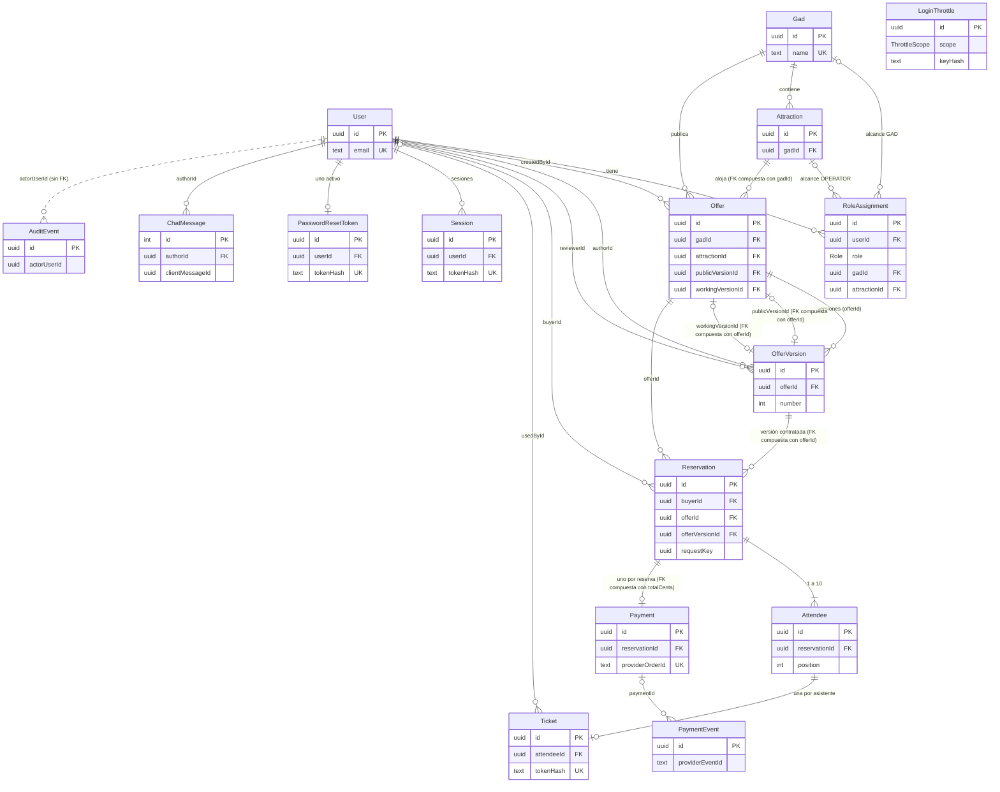

# 03 — Datos, estados e invariantes

> **ESTADO: COMPLETO como planificación — guardado el 2026-11-13.** Sujeto a la revisión cruzada final (00 §12).
> **Qué NO está verificado:** ningún SQL ni esquema Prisma de este documento se ha ejecutado, validado con `prisma validate` ni probado contra PostgreSQL. Son especificaciones documentales; la validación ejecutable ocurre en P0-06, P2-01, P3-01, P4-01, P4-02 y con T-DB-01/T-DB-02 (ver §8.7 y §10.2).
> Decisiones de referencia: [00 §8](00-indice-y-control.md) (D-12, D-13, D-20 a D-36, D-39, D-46, D-47, D-56 a D-58, D-62 y las nuevas D-66 a D-68). Hallazgos nuevos de este documento: H-23 a H-34 ([00 §3.2](00-indice-y-control.md)).
> Flujos que consumen este modelo: [04](04-reglas-transacciones-y-concurrencia.md) (TX-01 a TX-16). Códigos de error: [02 §10.2](02-arquitectura-y-decisiones.md). Permisos: [01 §8](01-alcance-y-trazabilidad.md).

---

## 1. Diagrama entidad-relación

El inventario real es de **16 entidades** (coincide con el texto previo; no se añadió ni se quitó ninguna). Los atributos del diagrama son solo claves y los campos que explican una relación; el detalle por campo está en §3.



**Relaciones que necesitan atención al implementar** (no se ven en el diagrama):

| Relación | Particularidad | Dónde se resuelve |
|---|---|---|
| `Offer ↔ OfferVersion` | **Ciclo**: la versión referencia a la oferta (`offerId`) y la oferta referencia a dos versiones (punteros). Ambas claves foráneas de los punteros son opcionales. | Orden de inserción fijo (§3.2.1) y claves foráneas compuestas (§8.2). Sin claves diferidas. |
| `Offer.publicVersionId` / `workingVersionId` | Sin más, una clave foránea simple aceptaría una versión de **otra** oferta. | FK compuesta `(puntero, id) → OfferVersion(id, offerId)` (H-23). |
| `Reservation.offerVersionId` | Igual: sin vínculo con `offerId`, una reserva podría apuntar a una versión de otra oferta. | FK compuesta `(offerVersionId, offerId) → OfferVersion(id, offerId)` (H-24). |
| `Payment.amountCents` | Nada impedía que el importe del pago difiriera del total de la reserva. | FK compuesta `(reservationId, amountCents) → Reservation(id, totalCents)` (H-25). |
| `AuditEvent.actorUserId` | **Sin clave foránea** a propósito: la auditoría debe sobrevivir a cualquier cambio de cuentas. | §3.4. |
| `LoginThrottle` | Sin relaciones: sus claves son HMAC, no ids. | §3.1. |

---

## 2. Invariantes del sistema (definitivos)

Los INV-01 a INV-17 se conservan. Se **precisa el mecanismo** de varios (columna «Dónde se garantiza») y se añaden INV-18 a INV-20 (H-23 a H-27, H-32). La tabla de §8.1 indica, por invariante, qué garantiza realmente la base de datos, qué el servicio y qué solo una prueba.

| ID | Invariante | Dónde se garantiza |
|---|---|---|
| INV-01 | Sin sobreventa: para cada oferta, asistentes confirmados + asistentes de retenciones vigentes ≤ capacidad de la versión pública, tras cada confirmación de transacción. | Bloqueo de fila `Offer` + cálculo en la misma transacción (04 TX-05, TX-09, TX-03). **No hay restricción SQL equivalente** (§8.1). |
| INV-02 | Las condiciones de una reserva (oferta, versión, cantidad, precio unitario, total, comprador) no cambian tras crearla. Tampoco sus asistentes (salvo anular `birthDate`). | Servicio sin ruta de escritura + disparadores `tg_reservation_guard` y `tg_attendee_guard`. |
| INV-03 | Reserva `CONFIRMED` ⇒ pago `CAPTURED` y exactamente `quantity` entradas (una por asistente). | Transacción única de liquidación (TX-09) **y** comprobación diferida `fn_check_reservation` al confirmar la transacción (§8.4). |
| INV-04 | Una reserva `CONFIRMED` no cambia de estado ni de ningún campo. | Servicio + disparador `tg_reservation_guard`. |
| INV-05 | Como máximo una entrada por asistente, emitida solo dentro de la liquidación. | Único `Ticket.attendeeId`; comprobación diferida (entrada ⇒ reserva `CONFIRMED`). |
| INV-06 | Una entrada pasa de `VALID` a `USED` como máximo una vez; `usedAt` y `usedById` se fijan juntos. | `UPDATE` condicional + `CHECK` local + disparador `tg_ticket_guard`. |
| INV-07 | Una versión `APPROVED` es inmutable; hay como máximo una versión de trabajo por oferta; la numeración es única y creciente. | Puntero `workingVersionId` único, único `(offerId, number)`, contador `lastVersionNumber`, disparador `tg_offerversion_guard`. |
| INV-08 | `Offer.publicVersionId` apunta a una versión **de la misma oferta** y de estado `APPROVED`; solo cambia en la transacción de aprobación. `workingVersionId` apunta a una versión de la misma oferta **no** `APPROVED`. | FK compuesta (misma oferta) + disparador `tg_offer_pointer_status` (estado) + servicio (TX-03). |
| INV-09 | El autor de una versión nunca decide su revisión. | Servicio + `CHECK ("reviewerId" <> "authorId")`. Que el revisor sea operador de la atracción **solo** lo garantiza el servicio. |
| INV-10 | Desde la primera reserva, la fecha de la oferta no cambia; la atracción no cambia desde la primera publicación. | TX-03 bajo bloqueo de `Offer`; refuerzo en `tg_offer_guard` (§8.4). La inmutabilidad de `gadId`/`attractionId` sí es de base; la de fechas depende del bloqueo (§8.1). |
| INV-11 | Un evento de webhook se procesa como máximo una vez y su registro se confirma junto con su efecto. | Único `(provider, providerEventId)` insertado en la transacción de liquidación. |
| INV-12 | Un `Payment` por reserva; `providerOrderId` y `providerCaptureId` únicos. | Restricciones de unicidad. |
| INV-13 | Un token de recuperación se consume una vez; consumo, cambio de contraseña y revocación de sesiones son atómicos. Solo hay un token por usuario. | `UPDATE` condicional en una transacción (TX-13); único `userId` (H-28). |
| INV-14 | Una sesión vencida o revocada no da acceso: inmediato por HTTP; por WebSocket, ningún evento se procesa y el socket se cierra como máximo en el intervalo de barrido. | Validación por petición y por evento (TX-14). |
| INV-15 | Un mensaje de chat se persiste antes de emitirse; `(authorId, clientMessageId)` es único. | TX-15. El **orden** del cursor depende de un solo proceso (H-31). |
| INV-16 | Contraseñas, tokens de sesión, tokens QR, tokens de recuperación y credenciales de pago no aparecen en registros, auditoría ni URL (salvo el token de recuperación en su enlace). | Redacción de registros y lista cerrada de claves de `AuditEvent.metadata` (§3.4.2). |
| INV-17 | Importes en centavos enteros; `totalCents = unitPriceCents × quantity`. | `CHECK` local + cálculo en servidor. |
| **INV-18** | **Coherencia pago–reserva–entradas:** pago `CAPTURED` ⇒ reserva `CONFIRMED` o `REVIEW_REQUIRED`; pago `DISCREPANT` ⇒ reserva `REVIEW_REQUIRED`; reserva distinta de `CONFIRMED` ⇒ cero entradas; `Attendee` por reserva = `quantity`. | TX-09 + comprobación diferida `fn_check_reservation` (§8.4). Sin borrado de `Attendee`/`Ticket`/`Payment` (privilegios + disparadores). |
| **INV-19** | **Pertenencia de referencias:** `Reservation.offerVersionId` y los dos punteros de `Offer` pertenecen a la misma oferta; `Payment.amountCents = Reservation.totalCents`; `Offer.attractionId` pertenece al GAD de la oferta. | Claves foráneas compuestas (§8.2): garantía **estructural** de la base. |
| **INV-20** | **Límite de retenciones vigentes del comprador (D-35):** una por oferta y tres en total, también ante solicitudes simultáneas a ofertas distintas. | Bloqueo asesor por comprador antes del de la oferta (D-66) + conteo en TX-05. Es un control antiabuso del servicio; la base no lo expresa (§8.1). |

---

## 3. Diccionario de datos

### 3.0 Convenciones y enumeraciones

**Representación en Prisma (Prisma 7.10.1) y PostgreSQL 18.** Las abreviaturas de las tablas son:

| Abreviatura | PostgreSQL | Prisma |
|---|---|---|
| `UUID_PK` | `uuid NOT NULL DEFAULT gen_random_uuid()` | `String @id @default(dbgenerated("gen_random_uuid()")) @db.Uuid` |
| `UUID` | `uuid` | `String @db.Uuid` |
| `TS` | `timestamptz(3)` | `DateTime @db.Timestamptz(3)` |
| `DATE` | `date` | `DateTime @db.Date` |
| `TEXT` | `text` (la longitud se limita con `CHECK`, no con `varchar`) | `String` |
| `JSONB` | `jsonb` | `Json` |
| `BYTEA` | `bytea` | `Bytes` |
| `INT` | `integer` | `Int` |

Reglas generales:

1. **`DateTime` sin `@db.Timestamptz` es `timestamp` sin zona** en Prisma: todos los instantes llevan `@db.Timestamptz(3)` (D-10). `DATE` se usa solo para `Attendee.birthDate`; el valor se construye con `Date.UTC(año, mes, día)` y nunca se convierte con la zona local.
2. **Claves.** El valor por defecto lo genera la base (`gen_random_uuid()`, UUID v4, D-12), de modo que el SQL manual y la semilla funcionan sin ayuda del cliente; Prisma recupera el id con `RETURNING`. `ChatMessage.id` es `Int @id @default(autoincrement())`.
3. **Marcas de tiempo.** Prisma deja `@default(now())` como respaldo, pero **los servicios siempre pasan `clock.now()` explícito** en todo campo `…At` que participe en una regla (D-10), para que las pruebas con reloj falso no mezclen el reloj de la base con el de la aplicación. `updatedAt` usa `@updatedAt` (lo escribe el cliente Prisma; un `UPDATE` en SQL manual debe fijarlo a mano).
4. **Longitudes en caracteres.** `char_length()` de PostgreSQL cuenta **puntos de código Unicode**; `String.length` de JavaScript (y `z.string().max()`) cuenta unidades UTF-16. Un emoji ocupa 1 en la base y 2 en JavaScript. Regla (H-30): toda validación de longitud usa el ayudante compartido `codePointLength(s)` (`[...s].length`) y los límites de este documento son **en puntos de código**. Así la validación del servicio nunca es más permisiva que el `CHECK`.
5. **Normalización de texto** (servicio): recorte; NFC para nombres y textos; espacios múltiples colapsados en nombres de asistente; el correo sigue la regla de §3.1.
6. **Relaciones opcionales.** Prisma aplica `onDelete: SetNull` por defecto a las relaciones opcionales: **está prohibido el valor por defecto**; cada `@relation` declara `onDelete` y `onUpdate` explícitos según §3.6. En los punteros compuestos `SetNull` intentaría poner a nulo `Offer.id` (clave primaria) y fallaría.
7. **Nombres.** Tablas y columnas con el nombre por defecto de Prisma (D-13: `"Offer"`, `"expiresAt"`). `"User"` es palabra reservada de PostgreSQL: el SQL manual siempre lleva comillas dobles. Restricciones manuales: `ck_*` (CHECK), `fk_*` (clave foránea compuesta), `ux_*` (índice único manual), `tg_*` (disparador) y `fn_*` (función).

**Enumeraciones** (tipos `enum` de PostgreSQL generados por Prisma; añadir un valor exige una migración):

| Enum | Valores |
|---|---|
| `Role` | `TOURIST`, `GAD`, `OPERATOR`, `ADMIN` |
| `Province` | `AZUAY`, `BOLIVAR`, `CANAR`, `CARCHI`, `CHIMBORAZO`, `COTOPAXI`, `EL_ORO`, `ESMERALDAS`, `GALAPAGOS`, `GUAYAS`, `IMBABURA`, `LOJA`, `LOS_RIOS`, `MANABI`, `MORONA_SANTIAGO`, `NAPO`, `ORELLANA`, `PASTAZA`, `PICHINCHA`, `SANTA_ELENA`, `SANTO_DOMINGO_DE_LOS_TSACHILAS`, `SUCUMBIOS`, `TUNGURAHUA`, `ZAMORA_CHINCHIPE` (24) |
| `SessionRevokeReason` | `LOGOUT`, `PASSWORD_RESET` |
| `ThrottleScope` | `LOGIN_ACCOUNT`, `LOGIN_IP`, `RECOVERY_ACCOUNT`, `RECOVERY_IP`, `REGISTER_IP` |
| `OfferStatus` | `UNPUBLISHED`, `OPEN`, `SUSPENDED`, `ARCHIVED` |
| `OfferVersionStatus` | `DRAFT`, `IN_REVIEW`, `CHANGES_REQUESTED`, `APPROVED` |
| `ReservationStatus` | `HELD`, `CONFIRMED`, `EXPIRED`, `REVIEW_REQUIRED` |
| `ReviewReason` | `UNCERTAIN_RESULT`, `AMOUNT_MISMATCH`, `CURRENCY_MISMATCH`, `REFERENCE_MISMATCH`, `NO_CAPACITY`, `OFFER_NOT_OPEN`, `ACTIVITY_STARTED`, `UNSUPPORTED_GATEWAY_STATE` |
| `PaymentProvider` | `PAYPAL`, `FAKE` |
| `PaymentStatus` | `CREATED`, `ORDER_CREATED`, `CAPTURED`, `DISCREPANT` |
| `PaymentEventOutcome` | `APPLIED`, `NO_CHANGE`, `IGNORED_UNKNOWN_ORDER`, `IGNORED_EVENT_TYPE` |
| `TicketStatus` | `VALID`, `USED` |
| `AuditActorType` | `USER`, `SYSTEM`, `WEBHOOK`, `ANONYMOUS` |
| `AuditResult` | `SUCCESS`, `DENIED`, `FAILED`, `CONFLICT` |

`Reservation.currency` y `Payment.currency` son `text` con `CHECK = 'USD'` (no enum): ampliar monedas sería un cambio de alcance.

Formato de las tablas de campos: **Campo · PostgreSQL / Prisma · Nulo · Defecto · Validación y restricción.** «Servicio» significa que solo lo valida el código; «CHECK ck_…» está en el SQL de §8.

### 3.1 Cuentas

#### `User` — migración P0-06

| Campo | PostgreSQL / Prisma | Nulo | Defecto | Validación y restricción |
|---|---|---|---|---|
| `id` | `UUID_PK` | no | `gen_random_uuid()` | — |
| `email` | `TEXT` | no | — | Único. Normalizado por el servicio: recorte → NFKC → minúsculas. `CHECK ck_user_email`: 3–254 caracteres, sin espacios en los extremos, `IS NFKC NORMALIZED`, contiene `@` no inicial. **La minúscula la impone solo el servicio** (la función `lower()` de PostgreSQL depende de la localización y podría discrepar de `toLowerCase()` de JavaScript con caracteres especiales; un `CHECK` así rechazaría correos legítimos). Formato completo: Zod. |
| `displayName` | `TEXT` | no | — | 2–80 caracteres (`ck_user_displayname`), recortado, NFC. |
| `passwordHash` | `TEXT` | no | — | `CHECK ck_user_passwordhash`: empieza por `$argon2id$` (cadena PHC). Nunca se devuelve ni se registra. |
| `passwordChangedAt` | `TS` | no | `now()` | Lo fija el servicio al registrar y al restablecer. |
| `createdAt` | `TS` | no | `now()` | — |
| `updatedAt` | `TS` `@updatedAt` | no | — | — |

Relaciones: `roles RoleAssignment[]`, `sessions Session[]`, `passwordReset PasswordResetToken?`, y las relaciones nombradas de otras entidades (`Offer.createdBy`, `Offer.statusChangedBy`, `OfferVersion.author`, `OfferVersion.reviewer`, `Reservation.buyer`, `Ticket.usedBy`, `ChatMessage.author`). Índices: el único de `email`. **Eliminación:** no hay borrado de usuarios en el MVP; todas las relaciones de negocio son `Restrict` (§3.6).

#### `RoleAssignment` — P0-06

| Campo | PostgreSQL / Prisma | Nulo | Defecto | Validación y restricción |
|---|---|---|---|---|
| `id` | `UUID_PK` | no | `gen_random_uuid()` | — |
| `userId` | `UUID` | no | — | FK → `User.id`, `onDelete: Cascade`. |
| `role` | `Role` | no | — | — |
| `gadId` | `UUID` | **sí** | — | FK → `Gad.id`, `Restrict`. |
| `attractionId` | `UUID` | **sí** | — | FK → `Attraction.id`, `Restrict`. |
| `createdAt` | `TS` | no | `now()` | — |

- `CHECK ck_roleassignment_scope`: `GAD` ⇒ `gadId` no nulo y `attractionId` nulo; `OPERATOR` ⇒ lo contrario; `TOURIST`/`ADMIN` ⇒ ambos nulos. Es un `CHECK` **local a la fila** (compara columnas de la misma fila): es válido.
- **Unicidad con nulos.** En PostgreSQL un índice único normal trata los `NULL` como distintos: `(u, TOURIST, NULL, NULL)` podría insertarse dos veces. Se necesita `CREATE UNIQUE INDEX ux_roleassignment_scope … NULLS NOT DISTINCT` (PostgreSQL ≥ 15; el proyecto usa 18). **Prisma no expresa `NULLS NOT DISTINCT`**: el índice se crea a mano en la migración y el esquema Prisma **no** declara `@@unique` sobre esa tupla (declararlo crearía un índice normal además del manual). Consecuencia: la semilla no puede usar `upsert` de Prisma sobre esa clave; usa búsqueda previa + inserción, o `INSERT … ON CONFLICT ON CONSTRAINT`/`DO NOTHING` en SQL (H-26).
- Riesgo de deriva: no se verificó cómo trata `prisma migrate dev` un índice presente en la base y ausente del esquema (§10.2). T-DB-01a lo detecta; P0-06 incluye una sonda (`prisma migrate diff` tras aplicar la migración manual).
- Índices Prisma: `@@index([userId])`, `@@index([gadId])`, `@@index([attractionId])`.
- Solo escriben la semilla (GAD, OPERATOR, ADMIN) y el registro (TOURIST): el rol de aplicación recibe `INSERT` pero no `UPDATE`/`DELETE` (§8.5).

#### `Gad` — P0-06

| Campo | PostgreSQL / Prisma | Nulo | Defecto | Validación y restricción |
|---|---|---|---|---|
| `id` | `UUID_PK` | no | `gen_random_uuid()` | — |
| `name` | `TEXT` | no | — | Único. 3–120 caracteres (`ck_gad_name`). |
| `province` | `Province` | no | — | — |
| `createdAt` | `TS` | no | `now()` | — |

Solo la semilla escribe (la aplicación tiene solo `SELECT`). Relaciones: `attractions`, `offers`, `roles`. Eliminación: `Restrict` desde todas.

#### `Attraction` — P0-06

| Campo | PostgreSQL / Prisma | Nulo | Defecto | Validación y restricción |
|---|---|---|---|---|
| `id` | `UUID_PK` | no | `gen_random_uuid()` | — |
| `gadId` | `UUID` | no | — | FK → `Gad.id`, `Restrict`. |
| `name` | `TEXT` | no | — | 3–120 caracteres (`ck_attraction_name`). |
| `province` | `Province` | no | — | — |
| `createdAt` | `TS` | no | `now()` | — |

Únicos: `@@unique([gadId, name])` y **`@@unique([id, gadId])`** (redundante con la clave primaria, pero imprescindible como destino de la clave foránea compuesta de `Offer`, S-01). Solo la semilla escribe.

#### `Session` — P1-02

| Campo | PostgreSQL / Prisma | Nulo | Defecto | Validación y restricción |
|---|---|---|---|---|
| `id` | `UUID_PK` | no | `gen_random_uuid()` | Es el identificador usado por `session:<id>` en Socket.IO; no es secreto ni sirve para autenticar. |
| `userId` | `UUID` | no | — | FK → `User.id`, `Cascade`. |
| `tokenHash` | `TEXT` | no | — | Único. SHA-256 en hexadecimal minúscula: `CHECK ck_session_tokenhash` (`~ '^[0-9a-f]{64}$'`). El token en claro nunca se guarda. |
| `createdAt` | `TS` | no | — | — |
| `expiresAt` | `TS` | no | — | `createdAt + 8 h` calculado por el servicio; `CHECK ck_session_times`: `expiresAt > createdAt`. |
| `revokedAt` | `TS` | sí | — | — |
| `revokeReason` | `SessionRevokeReason` | sí | — | `CHECK`: `("revokedAt" IS NULL) = ("revokeReason" IS NULL)`. |

Índices: único `tokenHash`; `@@index([userId])`; `@@index([expiresAt])` (purga J4). Validez de una sesión: `revokedAt IS NULL AND expiresAt > now` (calculado, no persistido).

#### `PasswordResetToken` — P1-05

| Campo | PostgreSQL / Prisma | Nulo | Defecto | Validación y restricción |
|---|---|---|---|---|
| `id` | `UUID_PK` | no | `gen_random_uuid()` | — |
| `userId` | `UUID` | no | — | FK → `User.id`, `Cascade`. **Único** (H-28). |
| `tokenHash` | `TEXT` | no | — | Único; SHA-256 hexadecimal (`ck_prt_tokenhash`). |
| `createdAt` | `TS` | no | — | — |
| `expiresAt` | `TS` | no | — | `createdAt + 30 min`; `ck_prt_times`: `expiresAt > createdAt`. |
| `usedAt` | `TS` | sí | — | Fijado por el `UPDATE` condicional de TX-13. |

**Corrección H-28.** El texto anterior decía «un token activo por usuario (los anteriores se borran al crear otro)» con índice no único. Dos solicitudes simultáneas ejecutarían «borrar + insertar» a la vez y, en `READ COMMITTED`, ambas inserciones sobrevivirían. Ahora `userId` es **único** y solicitar recuperación es un `INSERT … ON CONFLICT ("userId") DO UPDATE SET "tokenHash" = …, "createdAt" = …, "expiresAt" = …, "usedAt" = NULL`: el segundo solicitante sustituye al primero de forma atómica y solo queda un enlace utilizable (el último enviado). Prisma: `upsert` con `where: { userId }` (que usa la unicidad) o `$executeRaw`. Purga J4: tokens usados o vencidos hace más de 24 h (06 §4).

#### `LoginThrottle` — P1-04

| Campo | PostgreSQL / Prisma | Nulo | Defecto | Validación y restricción |
|---|---|---|---|---|
| `id` | `UUID_PK` | no | `gen_random_uuid()` | — |
| `scope` | `ThrottleScope` | no | — | — |
| `keyHash` | `TEXT` | no | — | HMAC-SHA-256 hexadecimal del correo normalizado o de la IP con `RATE_LIMIT_SECRET` (`ck_throttle_keyhash`, 64 hex). Nunca el dato en claro. |
| `windowStartedAt` | `TS` | no | — | Inicio de la ventana fija. |
| `attempts` | `INT` | no | `0` | `CHECK ≥ 0`. |
| `blockedUntil` | `TS` | sí | — | Mientras sea posterior a `now`, el ámbito está bloqueado. |
| `updatedAt` | `TS` `@updatedAt` | no | — | Base de la purga a las 24 h. |

Único `@@unique([scope, keyHash])`. Incremento atómico con `INSERT … ON CONFLICT ("scope","keyHash") DO UPDATE SET attempts = …` (ventana vencida ⇒ reinicia contador). Sin relaciones. Los umbrales están en 06 §3.2.

### 3.2 Ofertas

#### 3.2.1 Orden de inserción del ciclo `Offer` ↔ `OfferVersion` (H-23)

Los dos punteros de `Offer` son opcionales precisamente para romper el ciclo sin claves diferidas (que Prisma no puede declarar). **Orden obligatorio** en una sola transacción (TX-01, crear oferta):

1. `INSERT Offer` (`status = UNPUBLISHED`, `publicVersionId = NULL`, `workingVersionId = NULL`, `lastVersionNumber = 0`).
2. `INSERT OfferVersion` (`offerId`, `number = 1`, `status = DRAFT`, `rev = 1`, `authorId`).
3. `UPDATE Offer SET "workingVersionId" = <versión>, "lastVersionNumber" = 1`.

Abrir una versión nueva (TX-01) sigue el mismo patrón con `number = lastVersionNumber + 1`. Descartar (TX-16): primero `UPDATE Offer SET "workingVersionId" = NULL`, después `DELETE` de la versión (la clave foránea es `NoAction`/`Restrict`). Aprobar (TX-03): primero la versión pasa a `APPROVED`, después se mueven los punteros. Eliminar una oferta inédita: `DELETE Offer` y la cascada `offerId → OfferVersion` borra sus versiones.

#### `Offer` — P2-01

| Campo | PostgreSQL / Prisma | Nulo | Defecto | Validación y restricción |
|---|---|---|---|---|
| `id` | `UUID_PK` | no | `gen_random_uuid()` | — |
| `gadId` | `UUID` | no | — | Parte de la FK compuesta con `attractionId`. Inmutable (`tg_offer_guard`). |
| `attractionId` | `UUID` | no | — | **FK compuesta** `(attractionId, gadId) → Attraction(id, gadId)`, `Restrict` (S-01, D-21). Editable solo mientras `publicVersionId IS NULL` (`tg_offer_guard`). |
| `status` | `OfferStatus` | no | `UNPUBLISHED` | Ver §4.1. |
| `publicVersionId` | `UUID` | sí | — | Único. **FK compuesta** `(publicVersionId, id) → OfferVersion(id, offerId)`, `NoAction`. Apunta a una versión `APPROVED` (`tg_offer_pointer_status`). |
| `workingVersionId` | `UUID` | sí | — | Único. **FK compuesta** `(workingVersionId, id) → OfferVersion(id, offerId)`, `NoAction`. Apunta a una versión no `APPROVED`. |
| `lastVersionNumber` | `INT` | no | `0` | Contador sin reutilización; nunca decrece (`tg_offer_guard`). |
| `createdById` | `UUID` | no | — | FK → `User`, `Restrict` (relación `OfferCreatedBy`). |
| `statusReason` | `TEXT` | sí | — | 1–500 caracteres cuando existe. Motivo de suspensión o de archivo; **obligatorio** (servicio) si archiva el administrador. Se pone a nulo al reanudar. |
| `statusChangedAt` | `TS` | sí | — | — |
| `statusChangedById` | `UUID` | sí | — | FK → `User`, `Restrict` (relación `OfferStatusChangedBy`). |
| `createdAt`, `updatedAt` | `TS`, `TS @updatedAt` | no | `now()` | — |

Restricciones y comprobaciones:

- `ck_offer_pointers`: `(status = 'UNPUBLISHED') = (publicVersionId IS NULL)` — una oferta tiene versión pública si y solo si ha sido publicada (más estricto que el texto anterior, que solo exigía `OPEN`/`SUSPENDED` ⇒ puntero no nulo; `ARCHIVED` solo se alcanza desde un estado publicado, §4.1) —, `lastVersionNumber >= 0` y `workingVersionId` no nulo ⇒ `lastVersionNumber >= 1`.
- `ck_offer_statusmeta`: `SUSPENDED` o `ARCHIVED` ⇒ `statusChangedAt` y `statusChangedById` no nulos.
- Disparadores: `tg_offer_guard` (BEFORE UPDATE OR DELETE) y `tg_offer_pointer_status` (AFTER INSERT OR UPDATE); ver §8.4.
- Índices Prisma: `@@index([gadId, createdAt])` (listado del GAD), `@@index([attractionId])`, `@@index([status])`, y los dos únicos de los punteros.
- **Eliminación:** física solo si nunca fue publicada (TX-16); `tg_offer_guard` rechaza el `DELETE` si `publicVersionId IS NOT NULL`. Archivar no borra nada.
- Prisma: `publicVersion OfferVersion? @relation("OfferPublicVersion", fields: [publicVersionId, id], references: [id, offerId], onDelete: NoAction, onUpdate: Restrict)`; análogo `workingVersion`. En `OfferVersion` las relaciones inversas son listas (`publicFor Offer[]`, `workingFor Offer[]`; la unicidad de cada puntero ya la da su `@unique`). **No verificado:** que `prisma validate` acepte un campo de clave primaria (`id`) dentro de `fields`. Alternativa documentada si falla: dejar los punteros como escalares sin `@relation` y mantener las dos claves foráneas compuestas solo en SQL **con** el disparador de §8.4 como control de pertenencia; la sonda de deriva de P2-01 decide cuál se usa (H-23).

#### `OfferVersion` — P2-01

| Campo | PostgreSQL / Prisma | Nulo | Defecto | Validación y restricción |
|---|---|---|---|---|
| `id` | `UUID_PK` | no | `gen_random_uuid()` | — |
| `offerId` | `UUID` | no | — | FK → `Offer.id`, `Cascade` (solo ocurre con ofertas inéditas). |
| `number` | `INT` | no | — | ≥ 1. Único `(offerId, number)`. |
| `status` | `OfferVersionStatus` | no | `DRAFT` | Ver §4.2. |
| `rev` | `INT` | no | `1` | ≥ 1; `rev + 1` en cada edición (concurrencia optimista, D-26). |
| `title` | `TEXT` | no | — | 5–120. |
| `description` | `TEXT` | no | — | 20–5000. |
| `province` | `Province` | no | — | — |
| `locationText` | `TEXT` | no | — | 5–200. |
| `startsAt` | `TS` | no | — | Que sea futuro lo valida **solo el servicio** (depende del reloj; un `CHECK` no puede usar `now()` con sentido). |
| `endsAt` | `TS` | no | — | `endsAt > startsAt` y duración ≤ 72 h (`ck_ov_ranges`). |
| `priceCents` | `INT` | no | — | 100–1 000 000. |
| `capacity` | `INT` | no | — | 1–1000. |
| `minAge` | `INT` | sí | — | Nulo o 1–99. |
| `servicesText` | `TEXT` | no | `''` | 0–2000 (puede estar vacío). |
| `conditionsText` | `TEXT` | no | — | 1–5000 (obligatorio: es lo que el comprador acepta; propuesta de esta planificación, la guía no se consultó). |
| `authorId` | `UUID` | no | — | FK → `User`, `Restrict` (relación `OfferVersionAuthor`). Inmutable. |
| `submittedAt` | `TS` | sí | — | Fijado al enviar a revisión. |
| `reviewerId` | `UUID` | sí | — | FK → `User`, `Restrict` (relación `OfferVersionReviewer`). |
| `decidedAt` | `TS` | sí | — | — |
| `decisionReason` | `TEXT` | sí | — | 1–1000 cuando existe; obligatorio al devolver. |
| `createdAt`, `updatedAt` | `TS`, `TS @updatedAt` | no | `now()` | — |

Restricciones:

- `@@unique([offerId, number])` y **`@@unique([id, offerId])`** (destino de las claves compuestas de `Offer.publicVersionId`, `Offer.workingVersionId` y `Reservation`).
- `ck_ov_ranges` (rangos numéricos y fechas), `ck_ov_lengths` (longitudes en puntos de código).
- `ck_ov_review`: `reviewerId IS NULL OR reviewerId <> authorId` (INV-09) y coherencia de campos de decisión: `DRAFT` ⇒ `submittedAt`, `reviewerId`, `decidedAt` y `decisionReason` nulos; `IN_REVIEW` ⇒ `submittedAt` no nulo y los tres campos de decisión **todos nulos o todos presentes** (tras una devolución se conservan visibles para el operador hasta la nueva decisión); `CHANGES_REQUESTED` ⇒ los cuatro no nulos; `APPROVED` ⇒ `submittedAt`, `reviewerId` y `decidedAt` no nulos y `decisionReason` nulo.
- Disparador `tg_offerversion_guard`: una fila `APPROVED` no admite `UPDATE` ni `DELETE` (INV-07); en versiones no aprobadas, `offerId`, `number`, `authorId` y `createdAt` son inmutables.
- Índices: `@@index([province, startsAt])` (filtro del catálogo, H-20), `@@index([startsAt])`, `@@index([authorId])`.
- **Eliminación:** una versión no aprobada se borra al descartarla (TX-16) o por cascada con una oferta inédita; una `APPROVED` jamás (disparador + `Restrict` desde `Reservation` y `Offer`).
- La capacidad efectiva es la de la versión pública (§5); `capacity` de versiones de trabajo no cuenta para ningún cupo.

### 3.3 Reservas, pagos y entradas

#### `Reservation` — P3-01

| Campo | PostgreSQL / Prisma | Nulo | Defecto | Validación y restricción |
|---|---|---|---|---|
| `id` | `UUID_PK` | no | `gen_random_uuid()` | — |
| `buyerId` | `UUID` | no | — | FK → `User`, `Restrict` (`ReservationBuyer`). Que tenga rol `TOURIST` lo valida el servicio. |
| `offerId` | `UUID` | no | — | FK → `Offer.id`, `Restrict`. |
| `offerVersionId` | `UUID` | no | — | **FK compuesta** `(offerVersionId, offerId) → OfferVersion(id, offerId)`, `Restrict` (H-24). Que la versión esté `APPROVED` al insertar lo comprueba `tg_reservation_guard`; que sea la **pública** en ese instante lo comprueba el servicio bajo el bloqueo de la oferta. |
| `status` | `ReservationStatus` | no | `HELD` | Ver §4.3. |
| `quantity` | `INT` | no | — | 1–10 (`ck_res_ranges`). |
| `unitPriceCents` | `INT` | no | — | Copia de `priceCents` de la versión contratada; 100–1 000 000. |
| `totalCents` | `INT` | no | — | `= unitPriceCents * quantity` (`ck_res_ranges`, INV-17); máximo 10 000 000. |
| `currency` | `TEXT` | no | `'USD'` | `CHECK = 'USD'`. |
| `expiresAt` | `TS` | no | — | `min(now + 15 min, startsAt)` (D-33). `CHECK expiresAt > createdAt`. |
| `requestKey` | `UUID` | no | — | Clave de idempotencia enviada por el cliente (UUID). |
| `requestHash` | `TEXT` | no | — | SHA-256 hexadecimal del contenido canónico (04 TX-05); 64 hex. |
| `termsAcceptedAt` | `TS` | no | — | Instante en que el comprador aceptó las condiciones **de la versión contratada**. |
| `confirmedAt` | `TS` | sí | — | `CHECK`: `(status = 'CONFIRMED') = (confirmedAt IS NOT NULL)`. |
| `reviewReason` | `ReviewReason` | sí | — | `CHECK`: `(status = 'REVIEW_REQUIRED') = (reviewReason IS NOT NULL)`; el servicio lo limpia al salir de revisión. |
| `reviewDetail` | `TEXT` | sí | — | ≤ 500; texto generado por el sistema, no por el usuario. |
| `reviewFlaggedAt` | `TS` | sí | — | Fijado con `reviewReason`; mismo `CHECK` iff. |
| `createdAt`, `updatedAt` | `TS`, `TS @updatedAt` | no | `now()` | — |

Restricciones:

- Único `@@unique([buyerId, requestKey])` (D-34). **`@@unique([id, totalCents])`**: destino de la clave compuesta de `Payment` (H-25).
- Índices: `@@index([offerId, status, expiresAt])` (cálculo de lo comprometido), `@@index([buyerId, status, expiresAt])` (conteo de retenciones del comprador, **añadido**), `@@index([buyerId, createdAt])` (listado), `@@index([status, expiresAt])` (J1), `@@index([status, reviewFlaggedAt])` (vista del administrador).
- Disparadores: `tg_reservation_guard` (términos inmutables, `CONFIRMED` terminal, sin `DELETE`, versión `APPROVED` al insertar) y la comprobación diferida `fn_check_reservation` (§8.4).
- **Eliminación:** ninguna (sin `DELETE` para el rol de aplicación ni para nadie por la vía normal). Las filas `EXPIRED` se conservan: son historial de lo que el comprador intentó.

#### `Attendee` — P3-01

| Campo | PostgreSQL / Prisma | Nulo | Defecto | Validación y restricción |
|---|---|---|---|---|
| `id` | `UUID_PK` | no | `gen_random_uuid()` | — |
| `reservationId` | `UUID` | no | — | FK → `Reservation.id`, `Restrict`. |
| `position` | `INT` | no | — | 1–10 (`ck_att_ranges`). Único `(reservationId, position)`. |
| `fullName` | `TEXT` | no | — | 2–120, recortado, NFC, espacios simples. |
| `birthDate` | `DATE` | **sí** | — | Solo se guarda si la versión contratada tiene `minAge` (RS-25); ≥ `1900-01-01` (`ck_att_ranges`); que no sea futura y que cumpla la edad lo valida el servicio. Que sea nulo cuando la versión no exige edad es **regla de servicio** (cruza dos tablas). Se anula 30 días después de `endsAt` (D-62, J4). |
| `createdAt` | `TS` | no | `now()` | — |

Disparador `tg_attendee_guard`: sin `DELETE`; el único `UPDATE` permitido deja todo igual salvo `birthDate` pasando a nulo (INV-02: no hay sustitución de asistentes). Que haya exactamente `quantity` asistentes por reserva lo comprueba `fn_check_reservation` al confirmar la transacción de creación. Índice: el único `(reservationId, position)`. Orden de presentación: por `position`.

#### `Payment` — P4-01

| Campo | PostgreSQL / Prisma | Nulo | Defecto | Validación y restricción |
|---|---|---|---|---|
| `id` | `UUID_PK` | no | `gen_random_uuid()` | — |
| `reservationId` | `UUID` | no | — | Único (INV-12). Parte de la FK compuesta. |
| `provider` | `PaymentProvider` | no | — | — |
| `status` | `PaymentStatus` | no | `CREATED` | Ver §4.4. |
| `amountCents` | `INT` | no | — | **FK compuesta** `(reservationId, amountCents) → Reservation(id, totalCents)`, `Restrict`: el importe esperado **es** el total de la reserva (H-25). `CHECK > 0`. |
| `currency` | `TEXT` | no | `'USD'` | `CHECK = 'USD'`. |
| `providerOrderId` | `TEXT` | sí | — | Único (los nulos no chocan: no se necesita `NULLS NOT DISTINCT`). Los ids del adaptador `fake` llevan prefijo `FAKE-`. |
| `providerCaptureId` | `TEXT` | sí | — | Único. Solo se guarda con una captura `COMPLETED`. |
| `approvalUrl` | `TEXT` | sí | — | ≤ 2048. No es un secreto, pero tampoco se registra en logs. |
| `capturedAmountCents` | `INT` | sí | — | Importe observado en la captura. Si no es interpretable o excede el rango de `INT`, queda nulo y el pago es `DISCREPANT`. |
| `capturedCurrency` | `TEXT` | sí | — | — |
| `orderCreatedAt`, `captureAttemptedAt`, `capturedAt` | `TS` | sí | — | `capturedAt` es el instante (reloj de aplicación) en que se **aplicó** una captura observada, no el de PayPal. `captureAttemptedAt` es el instante del **último envío** (o reanudación) del intento de captura abierto: un arrendamiento de 60 s que **solo excluye** otro envío concurrente y **nunca concluye** nada; vuelve a `NULL` cuando el intento se cierra por evidencia concluyente (P-5 y P-5b; [04 TX-08.0](04-reglas-transacciones-y-concurrencia.md)). |
| `captureAttemptKey` | `UUID` | sí | — | **Identidad del intento de captura abierto** (añadida el 2026-11-13, D-74, H-47): *intento abierto ⇔ clave no nula*. La genera la aplicación al reclamar un intento **nuevo** y es la `PayPal-Request-Id` de la captura; se **reutiliza** para reanudar un intento de resultado desconocido y solo se renueva tras un rechazo definitivo. `CHECK ck_pay_attempt`. Necesaria porque ningún campo previo distingue de forma segura «cerrado» de «desconocido» ni sobrevive a un reinicio. Sin tabla nueva. |
| `nextCheckAt` | `TS` | sí | — | Próxima conciliación (J2). |
| `checkAttempts` | `INT` | no | `0` | `CHECK ≥ 0`. |
| `lastCheckedAt` | `TS` | sí | — | — |
| `lastGatewayStatus` | `TEXT` | sí | — | ≤ 60. |
| `lastErrorCode` | `TEXT` | sí | — | ≤ 60. |
| `createdAt`, `updatedAt` | `TS`, `TS @updatedAt` | no | `now()` | — |

`ck_pay_attempt`: `captureAttemptKey` no nula ⇒ `status = 'ORDER_CREATED'` y `captureAttemptedAt` no nulo (un pago terminal o sin orden no puede tener un intento abierto). `ck_pay_state` liga estado y campos: `CREATED` ⇒ sin orden, sin `approvalUrl`, sin captura; `ORDER_CREATED` ⇒ `providerOrderId` y `approvalUrl` no nulos, sin captura ni `capturedAt`; `CAPTURED` ⇒ orden, captura y `capturedAt` no nulos, `capturedAmountCents = amountCents` y `capturedCurrency = currency`; `DISCREPANT` ⇒ orden y `capturedAt` no nulos. Un `CHECK` de fila **sí** puede comparar `capturedAmountCents` con `amountCents` porque son columnas de la misma fila. Disparador `tg_payment_guard`: sin `DELETE`; `reservationId`, `provider`, `amountCents` y `currency` inmutables; en `CAPTURED`/`DISCREPANT` no cambian estado, ids ni importes capturados. Índices: únicos citados, `@@index([nextCheckAt])`. Prisma: `reservation Reservation @relation(fields: [reservationId, amountCents], references: [id, totalCents], onDelete: Restrict, onUpdate: Restrict)`.

#### `PaymentEvent` — P4-01

| Campo | PostgreSQL / Prisma | Nulo | Defecto | Validación y restricción |
|---|---|---|---|---|
| `id` | `UUID_PK` | no | `gen_random_uuid()` | — |
| `provider` | `PaymentProvider` | no | — | — |
| `providerEventId` | `TEXT` | no | — | 1–128. Único con `provider` (INV-11). |
| `eventType` | `TEXT` | no | — | ≤ 80. |
| `paymentId` | `UUID` | sí | — | FK → `Payment.id`, **`Restrict`** explícito (relación opcional). |
| `providerOrderId` | `TEXT` | sí | — | Orden relacionada, tal como la dio el evento (puede no existir localmente). |
| `outcome` | `PaymentEventOutcome` | no | — | — |
| `payloadDigest` | `TEXT` | no | — | SHA-256 hexadecimal del cuerpo recibido. **No se guarda el cuerpo.** |
| `summary` | `JSONB` | no | `'{}'` | Solo claves permitidas (`eventType`, `orderStatus`, `captureStatus`, `amountCents`, `currency`). |
| `receivedAt`, `processedAt` | `TS` | no | — | — |

Único `@@unique([provider, providerEventId])`; `@@index([paymentId])`. Solo `SELECT` e `INSERT` para el rol de aplicación. Una fila se inserta **en la misma transacción** que aplica su efecto (`APPLIED`) o que comprueba que no hay efecto que aplicar, incluida una reserva ya `CONFIRMED` (`NO_CHANGE`) ([04 TX-09](04-reglas-transacciones-y-concurrencia.md)); si el evento ya estaba registrado no se inserta otra. Para `IGNORED_*`, sola (TX-10).

#### `Ticket` — P4-02

| Campo | PostgreSQL / Prisma | Nulo | Defecto | Validación y restricción |
|---|---|---|---|---|
| `id` | `UUID_PK` | no | `gen_random_uuid()` (solo respaldo) | Es el dato asociado (AAD) del cifrado: **no puede cambiar** y debe conocerse **antes** de cifrar. Por eso la aplicación lo genera (`crypto.randomUUID()`) y lo inserta explícitamente (H-40); no se deja a la base. |
| `attendeeId` | `UUID` | no | — | Único (INV-05). FK → `Attendee.id`, `Restrict`. |
| `tokenHash` | `TEXT` | no | — | Único. SHA-256 hexadecimal de los 32 bytes del token (`ck_ticket_token`). |
| `tokenCiphertext` | `BYTEA` | no | — | AES-256-GCM, cifrado + etiqueta. `CHECK octet_length = 48` **si se cifran los 32 bytes brutos del token** (05 §7 no lo fija; si P4-02 decide cifrar el texto `TC1.…`, serán 63 y debe ajustarse este `CHECK`). |
| `tokenNonce` | `BYTEA` | no | — | `CHECK octet_length = 12`. |
| `tokenKeyId` | `TEXT` | no | — | 1–16, identificador de clave del llavero. |
| `status` | `TicketStatus` | no | `VALID` | Ver §4.5. |
| `issuedAt` | `TS` | no | — | — |
| `usedAt` | `TS` | sí | — | — |
| `usedById` | `UUID` | sí | — | FK → `User`, **`Restrict`** explícito. |

`ck_ticket_state`: `VALID` ⇒ `usedAt` y `usedById` nulos; `USED` ⇒ ambos no nulos (INV-06). `tg_ticket_guard`: sin `DELETE`; una fila `USED` no admite ningún `UPDATE`; el paso `VALID → USED` solo puede cambiar `status`, `usedAt` y `usedById`; mientras siga `VALID` solo pueden cambiar `tokenHash`, `tokenCiphertext`, `tokenNonce`, `tokenKeyId` (rotación de clave y reemisión, RB-10), nunca `id`, `attendeeId` ni `issuedAt`. La comprobación diferida `fn_check_reservation` exige que la reserva del asistente sea `CONFIRMED` al insertar una entrada. Índice: los dos únicos; `@@index([usedById])`.

### 3.4 Chat y auditoría

#### `ChatMessage` — P6-02

| Campo | PostgreSQL / Prisma | Nulo | Defecto | Validación y restricción |
|---|---|---|---|---|
| `id` | `INT` (`serial`) / `Int @id @default(autoincrement())` | no | secuencia | Es el cursor (D-12, D-52). |
| `room` | `TEXT` | no | `'general'` | `CHECK` 1–40 caracteres. |
| `authorId` | `UUID` | no | — | FK → `User`, `Restrict`. |
| `text` | `TEXT` | no | — | `ck_chat_text`: 1–500 caracteres y no solo espacios (`btrim(text) <> ''`). Texto plano, sin HTML. |
| `clientMessageId` | `UUID` | no | — | Único con `authorId`. |
| `createdAt` | `TS` | no | `now()` | — |

Índices: único `@@unique([authorId, clientMessageId])`; `@@index([room, id])`. Sin `UPDATE` ni `DELETE` para el rol de aplicación. **Limitación del cursor (H-31):** los valores de una secuencia se asignan al insertar, no al confirmar; si dos transacciones tomasen ids 10 y 11 y la 11 confirmase primero, un cliente que lea «después de 10» recibiría 11 y nunca vería el 10. La garantía de «sin pérdida» depende de que el servidor persista **un mensaje a la vez por sala** (la cola en proceso de 04 TX-15) y por tanto de que haya **un solo proceso** (02 §13). Los huecos por inserciones revertidas (duplicados) son inocuos. Con varias instancias habría que cambiar el esquema de cursor.

#### `AuditEvent` — P1-01

| Campo | PostgreSQL / Prisma | Nulo | Defecto | Validación y restricción |
|---|---|---|---|---|
| `id` | `UUID_PK` | no | `gen_random_uuid()` | — |
| `occurredAt` | `TS` | no | — | Reloj de aplicación. |
| `actorType` | `AuditActorType` | no | — | — |
| `actorUserId` | `UUID` | sí | — | **Sin clave foránea.** Obligatorio si `actorType = USER` (`ck_audit_actor`). |
| `action` | `TEXT` | no | — | 1–60; valor del catálogo de §3.4.2. |
| `resourceType` | `TEXT` | no | — | 1–40. |
| `resourceId` | `TEXT` | sí | — | ≤ 64. |
| `result` | `AuditResult` | no | — | — |
| `reasonCode` | `TEXT` | sí | — | ≤ 60; código de error de 02 §10.2 u otro del catálogo. |
| `requestId` | `TEXT` | sí | — | ≤ 64. |
| `ipHash` | `TEXT` | sí | — | HMAC-SHA-256 de la IP con `RATE_LIMIT_SECRET`, truncado a 32 caracteres hexadecimales. Nunca la IP. |
| `metadata` | `JSONB` | sí | — | Solo las claves de la lista cerrada de §3.4.2. |

Índices: `@@index([occurredAt])`, `@@index([resourceType, resourceId])`, `@@index([actorUserId, occurredAt])`, `@@index([action, occurredAt])`. Solo `SELECT` e `INSERT` para el rol de aplicación (D-57): la protección de «solo inserción» es **de privilegios**, no de un `CHECK`; el propietario (rol migrador) podría alterar la tabla, y eso es riesgo residual para 06.

##### 3.4.1 Reglas de escritura de la auditoría

- Éxito: la fila se inserta **en la misma transacción** que el cambio (D-56, 04 §1.7); si la transacción se revierte, la fila también.
- Rechazo, conflicto o fallo: escritura aparte, después de revertir. Reutiliza el **mismo `action`** del intento con `result ≠ SUCCESS` y `reasonCode` = código de error.
- La repetición idempotente que devuelve la reserva existente (reconsulta de TX-05, rama A0) **no** se audita de nuevo.
- Fallar al auditar un éxito aborta la operación (la fila va en la transacción). Fallar al auditar un rechazo no cambia la respuesta al usuario y se registra en el log de aplicación.

##### 3.4.2 Catálogo de acciones y lista cerrada de `metadata`

`result` posibles: `S` = `SUCCESS`, `D` = `DENIED` (permiso, límite o validación de acceso), `C` = `CONFLICT` (estado o concurrencia), `F` = `FAILED` (error técnico). Actor: `U` usuario, `A` anónimo, `S` sistema, `W` webhook.

| Acción | Recurso | Actor | Resultados | Cuándo y `reasonCode` típicos | Claves de `metadata` |
|---|---|---|---|---|---|
| `account.register` | `User` | A→U | S, C | Alta (`EMAIL_TAKEN` en C). En S el actor pasa a ser el nuevo usuario. | — |
| `session.login` | `Session` | A→U | S, D | `INVALID_CREDENTIALS`, `RATE_LIMITED` (con `ipHash`; **sin** el correo). | `scope` |
| `session.logout` | `Session` | U | S | — | — |
| `password.reset_request` | `User` | A | S, D | Siempre S para el visitante; `reasonCode` interno `NO_ACCOUNT` o `THROTTLED`; D por `RATE_LIMITED` de IP. | `scope` |
| `password.reset` | `User` | A→U | S, D | S: `resourceId` = usuario. D: `TOKEN_INVALID`. | `sessionsRevoked` |
| `offer.create` | `Offer` | U | S, D | — | `gadId`, `attractionId` |
| `offer.version.update` | `OfferVersion` | U | S, C, D | `STALE_VERSION`, `INVALID_STATE`, `FORBIDDEN`. | `offerId`, `versionNumber`, `rev`, `changedFields` (nombres de campo) |
| `offer.version.submit` | `OfferVersion` | U | S, C, D | — | `offerId`, `versionNumber` |
| `offer.version.open` | `OfferVersion` | U | S, C | `WORKING_VERSION_EXISTS`, `OFFER_ARCHIVED`. | `offerId`, `versionNumber` |
| `offer.version.discard` | `OfferVersion` | U | S, C | — | `offerId`, `versionNumber` |
| `offer.version.approve` | `OfferVersion` | U | S, C, D | `SELF_REVIEW_FORBIDDEN`, `STALE_VERSION`, `ACTIVITY_NOT_FUTURE`, `SCHEDULE_LOCKED`, `CAPACITY_BELOW_COMMITTED`, `OFFER_ARCHIVED`. | `offerId`, `versionNumber`, `from`, `to` |
| `offer.version.request_changes` | `OfferVersion` | U | S, C, D | — | `offerId`, `versionNumber`, `reasonLength` |
| `offer.suspend`, `offer.resume` | `Offer` | U | S, C, D | `INVALID_STATE`. | `from`, `to`, `reasonLength` |
| `offer.archive` | `Offer` | U | S, C, D | Administrador exige motivo. | `from`, `reasonLength` |
| `offer.delete` | `Offer` | U | S, C | `INVALID_STATE` si ya publicada. | `gadId` |
| `reservation.create` | `Reservation` | U | S, C, D | `INSUFFICIENT_CAPACITY`, `VERSION_CHANGED`, `OFFER_NOT_OPEN`, `ACTIVITY_NOT_FUTURE`, `HOLD_LIMIT_REACHED`, `IDEMPOTENCY_KEY_REUSED`. | `offerId`, `versionId`, `quantity`, `totalCents`, `expiresAt` |
| `reservation.expire_batch` | `Job` | S | S | J1; solo si afectó filas. | `job`, `count` |
| `reservation.confirm` | `Reservation` | U, S, W | S | Incluye la emisión de entradas. | `origin`, `paymentId`, `ticketsIssued`, `late` (booleano) |
| `reservation.flag_review` | `Reservation` | U, S, W | S | `reasonCode` = `ReviewReason`. | `origin`, `paymentId` |
| `reservation.release_review` | `Reservation` | S, U | S | Vuelta a `HELD` tras `UNCERTAIN_RESULT`. | `origin` |
| `payment.order_create` | `Payment` | U | S, F | `GATEWAY_UNAVAILABLE`. | `paymentId`, `provider` |
| `payment.capture` | `Payment` | U | S, C, D, F | `HOLD_EXPIRED`, `PAYMENT_NOT_APPROVED`, `PAYMENT_DECLINED`, `PAYMENT_UNDER_REVIEW`, `GATEWAY_UNAVAILABLE`. | `paymentId`, `outcome` |
| `payment.reconcile` | `Payment` | S, U | S, C, F | J2 o «Consultar pasarela»; `reasonCode` `EXHAUSTED` (conciliación agotada, F) o `REFUND_AFTER_CONFIRMATION` (reembolso o reversión sobre una reserva confirmada, C; aviso para el administrador, 01 §3.2). | `origin`, `paymentId`, `outcome` |
| `webhook.receive` | `PaymentEvent` | W | S, C, D, F | S: `outcome` del evento; D: firma inválida (`BAD_SIGNATURE`); C: evento contradictorio con la instantánea (`EVENT_SNAPSHOT_MISMATCH`) o sin orden (`UNMAPPED_EVENT`); F: `GATEWAY_UNAVAILABLE` o `BUSY` (el trabajo quedó escrito en `nextCheckAt`, [04 TX-10](04-reglas-transacciones-y-concurrencia.md)). | `provider`, `outcome` |
| `ticket.reveal_code` | `Ticket` | U | S | El comprador muestra el código de texto (01 §8.3). | `reservationId` |
| `ticket.lookup` | `Ticket` | U | S, D | `TICKET_NOT_FOUND`, `WRONG_ACTIVITY`, `RATE_LIMITED`. `resourceId` solo si la entrada existe y es de su ámbito. | `offerId` |
| `ticket.check_in` | `Ticket` | U | S, C, D | `TICKET_ALREADY_USED`, `OUTSIDE_CHECKIN_WINDOW`, `WRONG_ACTIVITY`, `TICKET_NOT_FOUND`. | `offerId` |
| `realtime.handshake` | `Realtime` | A, U | D | `UNAUTHENTICATED`, `ORIGIN_MISMATCH`. Volumen acotado por 06. | — |
| `security.origin_mismatch` | `Request` | A, U | D | Mutación HTTP con `Origin` ausente o ajeno. | — |
| `job.run` | `Job` | S | S, F | J3 y J4, solo si afectaron filas. | `job`, `count` |
| `audit.read` | `AuditEvent` | U | S | Lectura de auditoría por el administrador (opcional, PE-05). | — |

**Lista cerrada de claves de `metadata`:** `scope`, `gadId`, `attractionId`, `offerId`, `versionId`, `versionNumber`, `rev`, `changedFields`, `from`, `to`, `reasonLength`, `quantity`, `totalCents`, `expiresAt`, `origin`, `paymentId`, `provider`, `outcome`, `ticketsIssued`, `late`, `reservationId`, `sessionsRevoked`, `job`, `count`. Cualquier otra clave se descarta antes de insertar (selector en `audit/`; prueba T-SEG-11). **Nunca** entran: correos, nombres, fechas de nacimiento, textos libres (títulos, motivos, mensajes), tokens, códigos QR, URL de aprobación ni identificadores de orden o captura de la pasarela.

### 3.5 Resumen de índices y restricciones únicas

| Entidad | Únicas | Índices no únicos |
|---|---|---|
| `User` | `email` | — |
| `RoleAssignment` | `ux_roleassignment_scope` (**manual**, `NULLS NOT DISTINCT`) | `userId`, `gadId`, `attractionId` |
| `Gad` | `name` | — |
| `Attraction` | `(gadId, name)`, `(id, gadId)` | — |
| `Session` | `tokenHash` | `userId`, `expiresAt` |
| `PasswordResetToken` | `userId`, `tokenHash` | — |
| `LoginThrottle` | `(scope, keyHash)` | — |
| `Offer` | `publicVersionId`, `workingVersionId` | `(gadId, createdAt)`, `attractionId`, `status` |
| `OfferVersion` | `(offerId, number)`, `(id, offerId)` | `(province, startsAt)`, `startsAt`, `authorId` |
| `Reservation` | `(buyerId, requestKey)`, `(id, totalCents)` | `(offerId, status, expiresAt)`, `(buyerId, status, expiresAt)`, `(buyerId, createdAt)`, `(status, expiresAt)`, `(status, reviewFlaggedAt)` |
| `Attendee` | `(reservationId, position)` | — |
| `Payment` | `reservationId`, `providerOrderId`, `providerCaptureId` | `nextCheckAt` |
| `PaymentEvent` | `(provider, providerEventId)` | `paymentId` |
| `Ticket` | `attendeeId`, `tokenHash` | `usedById` |
| `ChatMessage` | `(authorId, clientMessageId)` | `(room, id)` |
| `AuditEvent` | — | `occurredAt`, `(resourceType, resourceId)`, `(actorUserId, occurredAt)`, `(action, occurredAt)` |

### 3.6 Política de eliminación

Principio: **no se borra nada que sea historial de negocio**. Solo se borra lo que es (a) una versión o una oferta que nunca llegó a publicarse, (b) un secreto o un contador temporal, o (c) se anula un dato por minimización.

| Relación (hijo → padre) | `onDelete` | `onUpdate` | Razón |
|---|---|---|---|
| `RoleAssignment.userId` → `User` | `Cascade` | `Restrict` | Dato dependiente de la cuenta; la cuenta no se borra en el MVP. |
| `RoleAssignment.gadId` / `.attractionId` | `Restrict` | `Restrict` | Opcionales: se declara explícito para evitar `SetNull`. |
| `Session.userId`, `PasswordResetToken.userId` | `Cascade` | `Restrict` | Credenciales dependientes. |
| `Attraction.gadId` | `Restrict` | `Restrict` | — |
| `Offer.(attractionId, gadId)` | `Restrict` | `Restrict` | — |
| `Offer.createdById`, `.statusChangedById` | `Restrict` | `Restrict` | — |
| `Offer.publicVersionId`, `.workingVersionId` | `NoAction` | `Restrict` | Compuestas: `SetNull` pondría a nulo `Offer.id`. El código anula el puntero antes de borrar (§3.2.1). |
| `OfferVersion.offerId` → `Offer` | `Cascade` | `Restrict` | Solo se dispara con ofertas inéditas (`tg_offer_guard` rechaza el borrado de una publicada). |
| `OfferVersion.authorId`, `.reviewerId` | `Restrict` | `Restrict` | — |
| `Reservation.*` | `Restrict` | `Restrict` | Historial contractual. |
| `Attendee.reservationId` | `Restrict` | `Restrict` | — |
| `Payment.(reservationId, amountCents)` | `Restrict` | `Restrict` | — |
| `PaymentEvent.paymentId` | `Restrict` | `Restrict` | Opcional: explícito. |
| `Ticket.attendeeId`, `.usedById` | `Restrict` | `Restrict` | Opcional (`usedById`): explícito. |
| `ChatMessage.authorId` | `Restrict` | `Restrict` | — |

**Borrados permitidos y quién los hace** (el rol de aplicación solo tiene `DELETE` donde aparece aquí; §8.5):

| Qué | Quién | Cuándo | Salvaguarda |
|---|---|---|---|
| `Offer` + sus versiones | Servicio (TX-16) | Oferta `UNPUBLISHED` sin versión aprobada | `tg_offer_guard`, `Restrict` desde `Reservation`. |
| Versión de trabajo | Servicio (TX-16) | Descartar | `tg_offerversion_guard` (no `APPROVED`). |
| `Session` | J4 | Revocada o vencida hace > 7 días | — |
| `PasswordResetToken` | J4 | Usado o vencido hace > 24 h | — |
| `LoginThrottle` | J4 | Sin actividad > 24 h | — |
| `Attendee.birthDate` | J4 (`UPDATE` a nulo) | 30 días después de `endsAt` | `tg_attendee_guard`. |
| Todo lo demás | Nadie | — | Sin `DELETE` para `tc_app`. |

Las solicitudes de borrado de cuentas y la anonimización de nombres de asistentes quedan **fuera del MVP**; el tratamiento propuesto lo desarrolla 06 §4. Las copias de seguridad conservan lo anulado hasta que rotan (06 §4).

---

## 4. Estados y tablas de transición

**Cómo leer las tablas.** Cada fila es una transición permitida; **toda transición no listada está prohibida** (el servicio la rechaza con `INVALID_STATE` y, donde se indica, un disparador la rechaza también). «Actor» remite a los permisos de [01 §8](01-alcance-y-trazabilidad.md). «Escritura atómica» es lo que ocurre en **una** transacción (con los bloqueos del orden global de [04 §2](04-reglas-transacciones-y-concurrencia.md)); si cualquier paso falla, no se aplica nada. «Repetición / conflicto» dice qué devuelve una segunda ejecución idéntica o concurrente. Todas las transiciones con éxito insertan su `AuditEvent` (§3.4.2) en la misma transacción.

### 4.1 `Offer.status`

Estados persistidos: `UNPUBLISHED`, `OPEN`, `SUSPENDED`, `ARCHIVED`. Calculados, no persistidos: «ventas cerradas» (`startsAt ≤ ahora`), «finalizada» (`endsAt < ahora`), «agotada» (disponibilidad 0).

| ID | De → A | Actor | Flujo | Precondiciones | Escritura atómica | Efectos | Repetición / conflicto |
|---|---|---|---|---|---|---|---|
| O-1 | — → `UNPUBLISHED` | `GAD` del GAD propietario de la atracción | TX-01 (alta) | La atracción pertenece al GAD del principal; campos válidos. | Insertar `Offer`, `OfferVersion` n.º 1 (`DRAFT`, `rev 1`, autor = principal) y fijar `workingVersionId`, `lastVersionNumber = 1`, en el orden de §3.2.1. | La oferta aparece en `/panel/ofertas` del GAD; no en el catálogo. | No hay clave de idempotencia en el alta: un doble envío crea **dos borradores** (inocuos; se descartan con O-7). La interfaz deshabilita el botón al enviar. |
| O-2 | `UNPUBLISHED` → `OPEN` | `OPERATOR` de la atracción, distinto del autor | TX-03 (aprobar) | Versión `IN_REVIEW` con el `rev` visto; oferta no archivada; `startsAt > ahora`; no existen reservas ni comprometido (oferta inédita). | Bloquear `Offer`; versión → `APPROVED` (V-5); `publicVersionId = versión`; `workingVersionId = NULL`; `status = OPEN`; `statusChangedAt/ById`. | Catálogo y detalle públicos muestran la versión aprobada. | Segunda decisión simultánea: espera el bloqueo, ve la versión ya `APPROVED` ⇒ `INVALID_STATE`. |
| O-3 | `OPEN` → `SUSPENDED` | `OPERATOR` de la atracción | TX-04 | Estado `OPEN`. | Bloquear `Offer`; `status`, `statusReason?`, `statusChangedAt/ById`. | Sin retenciones nuevas (`OFFER_NOT_OPEN`). Retenciones vigentes y pagos en curso **se honran** (D-42). Entradas emitidas siguen accesibles. El detalle sigue visible, sin botón de reserva; sale del listado del catálogo. | Repetir ⇒ `INVALID_STATE` con `details.currentStatus`. Frente a una reserva simultánea decide quién tome antes el bloqueo (T-RES-18). |
| O-4 | `SUSPENDED` → `OPEN` | `OPERATOR` de la atracción | TX-04 | Estado `SUSPENDED` (S-02). | Bloquear `Offer`; `status = OPEN`; `statusReason = NULL`; `statusChangedAt/ById`. | Vuelve al catálogo si `startsAt > ahora`; si no, queda «ventas cerradas» por cálculo. | Repetir ⇒ `INVALID_STATE`. |
| O-5 | `OPEN`/`SUSPENDED` → `ARCHIVED` | `GAD` de su institución | TX-04 | Estado `OPEN` o `SUSPENDED`. | Bloquear `Offer`; `status = ARCHIVED`; `statusReason?`; `statusChangedAt/ById`. | Sale del catálogo; sin retenciones nuevas; nuevas versiones y aprobaciones rechazadas (`OFFER_ARCHIVED`); **conserva** versiones, reservas, pagos y entradas (siguen accesibles); una versión de trabajo existente queda **inerte** (no se borra, no avanza). Retenciones vigentes se honran. | Terminal. Repetir ⇒ `OFFER_ARCHIVED`. `tg_offer_guard` rechaza cualquier `UPDATE` de una fila `ARCHIVED`. |
| O-6 | `OPEN`/`SUSPENDED` → `ARCHIVED` | `ADMIN` (moderación) | TX-04 | Igual que O-5 **y** motivo obligatorio (`VALIDATION_ERROR`, campo `reason`). | Igual que O-5 con `statusReason` no nulo. | Igual que O-5. | Igual que O-5. |
| O-7 | `UNPUBLISHED` → (eliminada) | `GAD` de su institución | TX-16 | `status = UNPUBLISHED` (sin versión `APPROVED` ni reservas: lo implican `ck_offer_pointers` y TX-03; no se comprueba por separado). | Bloquear `Offer` (exclusivo); en este orden: `UPDATE Offer SET workingVersionId = NULL`, `DELETE` de sus versiones, `DELETE Offer` ([04 TX-16](04-reglas-transacciones-y-concurrencia.md), D-78; el `Cascade` queda como red de seguridad). | Desaparece por completo; no hay historial que conservar. | Repetir ⇒ `NOT_FOUND`. Si ya se publicó ⇒ `INVALID_STATE` (debe archivarse). |
| O-8 | `OPEN`/`SUSPENDED` → mismo estado | `OPERATOR` | TX-03 (aprobar versión nueva) | Además de V-5: `capacity ≥ comprometido`, fechas iguales si hay reservas. | Versión → `APPROVED`; `publicVersionId` pasa a la nueva; `workingVersionId = NULL`. **El estado no cambia** (una oferta `SUSPENDED` puede recibir versión nueva y sigue suspendida). | La nueva versión es la que se vende; las reservas existentes conservan su versión. | Ver V-5. |

### 4.2 `OfferVersion.status`

Estados persistidos: `DRAFT`, `IN_REVIEW`, `CHANGES_REQUESTED`, `APPROVED`. Derivado: «histórica» = `APPROVED` y no apuntada por `publicVersionId`.

| ID | De → A | Actor | Flujo | Precondiciones | Escritura atómica | Efectos | Repetición / conflicto |
|---|---|---|---|---|---|---|---|
| V-1 | — → `DRAFT` (n.º 1) | `GAD` | TX-01 | Ver O-1. | Parte de O-1. | — | Ver O-1. |
| V-2 | — → `DRAFT` (versión nueva) | `GAD` de su institución | TX-01 | Oferta `OPEN` o `SUSPENDED` (no archivada); `workingVersionId IS NULL`. | Bloquear `Offer`; `number = lastVersionNumber + 1`; copiar el contenido de la versión pública; `authorId = principal`; fijar `workingVersionId` y `lastVersionNumber`. | La versión pública anterior sigue vendiéndose. | Con versión de trabajo existente ⇒ `WORKING_VERSION_EXISTS`; archivada ⇒ `OFFER_ARCHIVED`. Dos aperturas simultáneas: la segunda ⇒ `WORKING_VERSION_EXISTS`. |
| V-3 | `DRAFT`/`CHANGES_REQUESTED` → mismo | Autor de la versión (con rol `GAD`) | TX-01 (editar) | `authorId = principal`; `rev` esperado; validación completa de campos; si la oferta es inédita puede cambiar `attractionId` (mismo GAD) en la misma transacción. | Bloqueo **compartido** de `Offer` (`FOR KEY SHARE`, D-77): estado y alcance siguen siendo válidos al escribir; después `UPDATE … SET …, rev = rev + 1 WHERE id AND rev = $esperado AND status IN (…) AND authorId = $principal`. | Los datos de decisión previos (`CHANGES_REQUESTED`) se conservan. | `rev` obsoleto ⇒ `STALE_VERSION`; estado no editable ⇒ `INVALID_STATE`; **miembro del GAD que no es el autor ⇒ `FORBIDDEN`**; fuera del GAD ⇒ `NOT_FOUND`; oferta archivada ⇒ `OFFER_ARCHIVED`; versión descartada mientras se esperaba ⇒ `NOT_FOUND`. Cero filas ⇒ se relee y se devuelve el error que corresponde ([04 TX-01](04-reglas-transacciones-y-concurrencia.md)). |
| V-4 | `DRAFT`/`CHANGES_REQUESTED` → `IN_REVIEW` | Autor | TX-02 | Misma comprobación que V-3; validación completa; `startsAt > ahora`; oferta no `ARCHIVED`, comprobado bajo el bloqueo **compartido** de `Offer` (D-77; la aprobación lo vuelve a comprobar bajo bloqueo exclusivo). | `UPDATE` condicional por `rev`, autor y estado: `status = IN_REVIEW`, `submittedAt = now`; `rev` y los campos de decisión previos no cambian. | El operador de la atracción la ve pendiente. La versión deja de ser editable. | Segundo envío o doble clic: 0 filas ⇒ `INVALID_STATE` (la relectura muestra `IN_REVIEW`). |
| V-5 | `IN_REVIEW` → `APPROVED` | `OPERATOR` de `offer.attractionId`, **≠ autor** | TX-03 | Ver 04 TX-03: `rev` esperado; oferta no archivada; `startsAt > ahora` (`ACTIVITY_NOT_FUTURE`); si hay cualquier reserva de la oferta, mismas fechas que la versión pública (`SCHEDULE_LOCKED`); `capacity ≥ comprometido` (`CAPACITY_BELOW_COMMITTED`); `principal ≠ authorId` (`SELF_REVIEW_FORBIDDEN`). | Bloquear `Offer`; `UPDATE` de la versión (`APPROVED`, `reviewerId`, `decidedAt`, `decisionReason = NULL`); después mover punteros (O-2 u O-8). | Terminal e **inmutable** (`tg_offerversion_guard`). Pasa a ser la versión contratable. | Dos decisiones simultáneas: la segunda ⇒ `INVALID_STATE`. Decisión con `rev` distinto del visto ⇒ `STALE_VERSION`. |
| V-6 | `IN_REVIEW` → `CHANGES_REQUESTED` | `OPERATOR` de la atracción, ≠ autor | TX-03 | Igual que V-5 salvo las comprobaciones de aprobación; **motivo obligatorio** (1–1000). | Bloquear `Offer`; `status`, `reviewerId`, `decidedAt`, `decisionReason`. No cambia `rev`. | El autor ve el motivo y puede editar (V-3) y reenviar (V-4). | `INVALID_STATE` si ya no está `IN_REVIEW`. |
| V-7 | `DRAFT`/`IN_REVIEW`/`CHANGES_REQUESTED` → (eliminada) | Cualquier miembro `GAD` del GAD | TX-16 | La versión es el `workingVersionId` de la oferta; la oferta **no** es `UNPUBLISHED` ni `ARCHIVED` (H-34: descartar la única versión de una oferta inédita la dejaría sin versiones; se usa O-7). | Bloquear `Offer` (exclusivo); `workingVersionId = NULL` **primero** y después `DELETE` de la versión (solo si no es `APPROVED`). `lastVersionNumber` no se toca (el número no se reutiliza). | La publicación vigente no cambia. | Versión inexistente ⇒ `NOT_FOUND`; ya `APPROVED` ⇒ `INVALID_STATE`; oferta `UNPUBLISHED` ⇒ `INVALID_STATE`. |

### 4.3 `Reservation.status`

**Persistido frente a calculado.** *Vigente* = `status ∈ {HELD, REVIEW_REQUIRED}` **y** `expiresAt > ahora`. *Vencida* (para mostrar) = `status = HELD` y `expiresAt ≤ ahora`. **Ninguna regla usa `EXPIRED` para decidir cupos**: toda consulta de inventario filtra por `expiresAt` (el trabajo J1 solo normaliza el estado). La interfaz muestra «vencida» aunque J1 no haya corrido.

| ID | De → A | Actor | Flujo | Precondiciones | Escritura atómica | Efectos | Repetición / conflicto |
|---|---|---|---|---|---|---|---|
| R-1 | — → `HELD` | `TOURIST` | TX-05 | Ver 04 TX-05 (oferta `OPEN`, versión pública vista, actividad futura, edad, límites, cupo). | Bloqueo asesor del comprador, bloqueo de `Offer`; insertar `Reservation` (`expiresAt = min(now + 15 min, startsAt)`) y sus `Attendee` (la comprobación diferida de §8.4 exige que `quantity` = número de asistentes). | Ocupa `quantity` cupos hasta `expiresAt`. | Misma clave y mismo hash ⇒ la reserva existente. Misma clave con otro contenido ⇒ `IDEMPOTENCY_KEY_REUSED`. Choque de unicidad simultáneo ⇒ se relee y se aplica la misma regla. |
| R-2 | `HELD` → `CONFIRMED` | Captura propia (`TOURIST`), webhook, conciliador J2 o `ADMIN` | TX-09 | Instantánea con captura `COMPLETED` cuyos orden, referencia, importe y moneda coinciden; `expiresAt > ahora`. | Bloquear `Offer` → `Reservation` → `Payment`; `Payment` → `CAPTURED`; reserva → `CONFIRMED`, `confirmedAt`, campos de revisión a nulo; **insertar una `Ticket` por asistente**; (si es webhook) insertar `PaymentEvent`; auditar. Al confirmar la transacción corre `fn_check_reservation`. | Las entradas quedan disponibles para el comprador. No cambia lo comprometido (ya contaba como retención vigente). | Reserva ya `CONFIRMED` ⇒ sin cambios: ni degrada ni reemite. Captura y webhook simultáneos: el segundo espera, ve `CONFIRMED` y no hace nada. |
| R-3 | `HELD` → `EXPIRED` | Sistema (J1) | TX-06 | `status = HELD` y `expiresAt ≤ ahora` (en el propio `WHERE`). | `UPDATE … SET status = 'EXPIRED'`; auditoría por lote. Sin bloqueo de oferta: no cambia el inventario. | Solo normaliza el estado; la pantalla ya mostraba «vencida». | Idempotente (0 filas). Si coincide con una liquidación, el bloqueo de fila de la reserva los ordena: J1 reevalúa `status = 'HELD'` tras esperar y no actúa sobre una `CONFIRMED`. |
| R-4 | `HELD`/`EXPIRED` → `REVIEW_REQUIRED` | Captura, webhook, J2 o `ADMIN` | TX-08, TX-09 | Captura `PENDING`, resultado incierto, discrepancia (importe, moneda o referencia), estado de pasarela no soportado, o **captura tardía** sin cupo (`NO_CAPACITY`), con oferta no abierta (`OFFER_NOT_OPEN`) o actividad iniciada (`ACTIVITY_STARTED`; prioridad en ese orden, 04 TX-09). | Bloquear `Offer` → `Reservation` → `Payment`; `reviewReason`, `reviewDetail`, `reviewFlaggedAt`; si hay discrepancia, `Payment` → `DISCREPANT`; si la captura fue tardía y válida, `Payment` → `CAPTURED`; **sin** entradas; auditar. `expiresAt` **no** cambia: la retención solo dura hasta el vencimiento original. | Aparece en la vista del administrador. Mientras `expiresAt > ahora` sigue contando como retención vigente; una vez vencida deja de contar. | Repetir con la misma instantánea ⇒ sin cambios. Con dinero capturado el caso permanece abierto hasta resolución manual (D-44, RB-09). |
| R-5 | `EXPIRED` → `CONFIRMED` | Captura, webhook, J2 o `ADMIN` | TX-09 (rama tardía) | Captura verificada coincidente; oferta `OPEN`; `startsAt > ahora`; disponibilidad **sin contar esta reserva** ≥ `quantity`. | Como R-2, tras recalcular el cupo bajo el bloqueo de `Offer`. | **Sí aumenta lo comprometido** en `quantity` (por eso exige el bloqueo y la comprobación). | Si falla alguna condición ⇒ R-4. |
| R-6 | `REVIEW_REQUIRED` → `CONFIRMED` | Webhook, J2 o `ADMIN` («Consultar pasarela») | TX-09 | `Payment` en `ORDER_CREATED` con captura ahora verificada, o ya `CAPTURED` (casos `NO_CAPACITY`, `OFFER_NOT_OPEN`, `ACTIVITY_STARTED`). Con retención vencida exige las condiciones de R-5 (se reevalúan: pudo liberarse cupo o reanudarse la oferta). **Nunca** desde un pago `DISCREPANT`. | Como R-2/R-5. | Si venía de una retención vencida, aumenta lo comprometido (bajo bloqueo). | Sin cambios si las condiciones siguen sin cumplirse. |
| R-7 | `REVIEW_REQUIRED` (`UNCERTAIN_RESULT`) → `HELD` | J2 o `ADMIN` | TX-09 | Hay **evidencia concluyente** de que la solicitud de captura no capturó (rechazo definitivo como **respuesta a nuestra solicitud**, o un objeto de captura `DECLINED`/`FAILED` **en esa respuesta**; no basta una captura rechazada vista después en una consulta: [04 TX-08.0](04-reglas-transacciones-y-concurrencia.md)); `Payment` sigue `ORDER_CREATED`. **No** basta un plazo (el texto anterior pedía «≥ 60 s sin captura visible»: se retiró, H-46). | `status = HELD`; limpiar campos de revisión; cerrar el intento (`captureAttemptKey = NULL`); auditar (`release_review`). | El comprador puede reintentar mientras dure `expiresAt`. Si ya venció, la reserva queda `HELD` vencida y J1 la pasa a `EXPIRED`. | Repetir ⇒ sin cambios. |
| R-8 | `CONFIRMED` → — | — | — | Terminal. | `tg_reservation_guard` rechaza cualquier `UPDATE`. | — | — |

**Lo que nunca ocurre:** `EXPIRED → HELD`, ampliar `expiresAt`, cambiar cantidad o precio, cancelar tras el pago (fuera del MVP).

### 4.4 `Payment.status`

| ID | De → A | Actor | Flujo | Precondiciones | Escritura atómica | Efectos | Repetición / conflicto |
|---|---|---|---|---|---|---|---|
| P-1 | — → `CREATED` | `TOURIST` propietario | TX-07 (A) | Reserva propia `HELD` con ≥ 30 s restantes (el margen de D-65), bajo el bloqueo de la reserva. | `INSERT Payment (amountCents = totalCents) … ON CONFLICT ("reservationId") DO NOTHING` y relectura. La FK compuesta impide un importe distinto del total. | Ninguna llamada externa todavía. | Doble clic: una sola fila (INV-12). Si ya existe con `ORDER_CREATED`, se devuelve su `approvalUrl`. |
| P-2 | `CREATED` → `ORDER_CREATED` | `TOURIST` propietario (tras `createOrder`, fuera de transacción) | TX-07 (B) | `providerOrderId` y `approvalUrl` obtenidos de la pasarela. | `UPDATE … WHERE id = $id AND status = 'CREATED' RETURNING`: fija `providerOrderId`, `approvalUrl`, `orderCreatedAt`. | Solo entonces se redirige al comprador. | Si dos solicitudes crearon dos órdenes, solo una `UPDATE` afecta fila; la otra orden se descarta y se audita como huérfana (la clave de idempotencia, un UUID derivado del pago, hace que normalmente sea **la misma** orden; PayPal puede además rechazar la segunda llamada simultánea). Solo se entrega al comprador la URL de la orden guardada, y solo después de guardarla ([04 TX-07](04-reglas-transacciones-y-concurrencia.md)). |
| P-3 | `ORDER_CREATED` → `CAPTURED` | Captura, webhook, J2 o `ADMIN` | TX-09 | Captura `COMPLETED` con orden, referencia (`custom_id`), importe y moneda coincidentes. | Dentro de R-2, R-5 o R-6 (o de R-4 cuando la captura es válida pero no se puede confirmar). Fija `providerCaptureId`, `capturedAmountCents`, `capturedCurrency`, `capturedAt`. | Terminal. | Repetir ⇒ sin cambios (`tg_payment_guard` rechaza alterar estado o ids). |
| P-4 | `ORDER_CREATED` → `DISCREPANT` | Igual | TX-09 | Captura `COMPLETED` con importe, moneda o referencia distintos, o importe ilegible. | Dentro de R-4: guarda lo observado (nulo si no es interpretable); reserva `REVIEW_REQUIRED` con `AMOUNT_MISMATCH`, `CURRENCY_MISMATCH` o `REFERENCE_MISMATCH`. | Terminal en el MVP: se resuelve fuera del sistema (RB-09). | Repetir ⇒ sin cambios. |
| P-5 | `ORDER_CREATED` → mismo (reclamo del intento de captura) | `TOURIST` propietario (TX-08) o J2 en modo reanudación (TX-11) | TX-08 (A) | Reserva propia `HELD` con ≥ 30 s restantes (D-65) y no en revisión (J2 también reanuda con `REVIEW_REQUIRED` por `UNCERTAIN_RESULT`), bajo los bloqueos de reserva y pago, y **sin intento posiblemente en curso** (`captureAttemptKey` nula, o con `captureAttemptedAt` de hace ≥ 60 s). | **Intento nuevo** (`captureAttemptKey` nula): `captureAttemptKey = <UUID nueva>`, `captureAttemptedAt = now`, `nextCheckAt = now + 2 min`, `checkAttempts = 0`, `lastErrorCode = NULL`. **Reanudación** (clave no nula con arrendamiento vencido): solo `captureAttemptedAt = now`; la clave y el calendario no cambian. Se confirma **antes** de llamar a la pasarela. | Si el proceso cae después, J2 retoma por `nextCheckAt`. | Con un intento posiblemente en curso la solicitud devuelve `IN_PROGRESS` sin llamar a la pasarela. Un intento desconocido **se reanuda con la misma clave**; nunca se genera otra clave sobre un intento abierto. El conciliador solo reanuda: **nunca inicia** un intento. |
| P-5b | `ORDER_CREATED` → mismo (cierre del intento) | Sistema, dentro de `settlePayment` (TX-09) | TX-09 (K0a) | **Evidencia concluyente** de que esa solicitud no capturó: rechazo definitivo (`ORDER_NOT_APPROVED`, `PAYER_ACTION_REQUIRED`, `INSTRUMENT_DECLINED`, o un objeto de captura `DECLINED`/`FAILED`) **en la respuesta a nuestra solicitud**; y `captureAttemptKey` igual a la de la evidencia. | `UPDATE … SET captureAttemptKey = NULL, captureAttemptedAt = NULL, nextCheckAt = NULL WHERE id = $id AND status = 'ORDER_CREATED' AND captureAttemptKey = $laclave`, bajo los tres bloqueos de TX-09 (y reserva liberada si estaba en revisión). | El comprador puede reintentar de inmediato con una **clave nueva**. | Clave distinta ⇒ hay un intento más nuevo: no se toca. **No** se cierra por plazo, por una consulta sin captura ni por agotar la conciliación (TX-08.0). || P-6 | cualquier → mismo (seguimiento) | Sistema o `ADMIN` | TX-11 | — | `lastCheckedAt`, `checkAttempts`, `nextCheckAt`, `lastGatewayStatus`, `lastErrorCode`. | Reprograma la conciliación. Permitido también en `CAPTURED`/`DISCREPANT` (solo estos campos). | Idempotente. |

**Combinaciones válidas pago–reserva** (INV-18, comprobadas de forma diferida):

| `Payment.status` | `Reservation.status` admitido |
|---|---|
| (sin pago), `CREATED`, `ORDER_CREATED` | `HELD`, `EXPIRED`, `REVIEW_REQUIRED` (`UNCERTAIN_RESULT`/`UNSUPPORTED_GATEWAY_STATE`) |
| `CAPTURED` | `CONFIRMED` (con N entradas) o `REVIEW_REQUIRED` (`NO_CAPACITY`, `OFFER_NOT_OPEN`, `ACTIVITY_STARTED`; sin entradas) |
| `DISCREPANT` | `REVIEW_REQUIRED` (`AMOUNT_MISMATCH`, `CURRENCY_MISMATCH`, `REFERENCE_MISMATCH`) |

### 4.5 `Ticket.status`

| ID | De → A | Actor | Flujo | Precondiciones | Escritura atómica | Efectos | Repetición / conflicto |
|---|---|---|---|---|---|---|---|
| T-1 | — → `VALID` | Sistema, dentro de la liquidación | TX-09 (`issueTicketsInTx`) | Reserva que pasa a `CONFIRMED` en esa misma transacción. | Una `Ticket` por `Attendee`: token de 32 bytes aleatorios, `tokenHash`, copia cifrada, `issuedAt`; inserción en lote **sin** ignorar duplicados. | El comprador puede ver y descargar cada QR. | Una liquidación sobre una reserva ya `CONFIRMED` no emite. Un choque de unicidad (`attendeeId` o `tokenHash`) es un **defecto**: revierte la liquidación entera, no se oculta. |
| T-2 | `VALID` → `USED` | `OPERATOR` de la atracción | TX-12 (registrar ingreso) | Rol y atracción; actividad seleccionada; ventana `[startsAt − CHECKIN_EARLY_MINUTES, endsAt]`; reserva `CONFIRMED`; acción explícita tras consultar. | `UPDATE "Ticket" SET status='USED', "usedAt"=$now, "usedById"=$op WHERE id = $id AND status = 'VALID'`; auditar en la misma transacción. | Hora y operador de ingreso fijados juntos (INV-06). Las demás entradas de la reserva no cambian. | 0 filas ⇒ `TICKET_ALREADY_USED` con `details.usedAt`. Dos dispositivos: el segundo espera y reevalúa `status = 'VALID'`. Rechazo presencial: no se llama a T-2. |
| T-3 | `VALID` → `VALID` (rotación) | Script de operación | RB-10, `rotate-ticket-key` | — | Cambia solo `tokenHash`/`tokenCiphertext`/`tokenNonce`/`tokenKeyId`. | Reemisión o recifrado. | `tg_ticket_guard` impide tocarlo si ya está `USED`. |

`USED` es terminal; no hay anulación en el MVP.

### 4.6 Estados calculados y reglas contra la inconsistencia

| Concepto | Definición calculada | Dónde se evalúa |
|---|---|---|
| Retención vigente | `status IN (HELD, REVIEW_REQUIRED) AND expiresAt > now` | Cálculo de lo comprometido; límites de retenciones; liquidación. |
| Reserva vencida | `status = HELD AND expiresAt ≤ now` | Pantallas; captura (`HOLD_EXPIRED`). |
| Sesión válida | `revokedAt IS NULL AND expiresAt > now` | Cada petición y cada evento de socket. |
| Token de recuperación activo | `usedAt IS NULL AND expiresAt > now` | `UPDATE` condicional de TX-13. |
| Entrada utilizable ahora | `VALID` ∧ reserva `CONFIRMED` ∧ `now ∈ [startsAt − CHECKIN_EARLY_MINUTES, endsAt]` ∧ actividad seleccionada | Consulta y registro de ingreso. |
| Pago pendiente de conciliar | `nextCheckAt ≤ now` | J2. |
| Versión histórica, ventas cerradas, finalizada, agotada | Ver §4.1 y §4.2 | Catálogo y paneles. |

**Regla de coherencia:** los predicados anteriores existen **una sola vez** en el dominio (`isHoldActive(reservation, now)`, `isSessionValid(…)`, …) y, cuando deben ir en SQL, en un fragmento constante reutilizado por todas las consultas (p. ej. `ACTIVE_HOLD_SQL` en §8.6). Ninguna consulta reescribe la condición a mano.

---

## 5. Capacidad, inventario y versión contratada (decidido; verificado al ampliar)

- **Dónde vive la capacidad:** en `OfferVersion.capacity`. La capacidad efectiva es la de la versión pública (D-27).
- **Dónde vive el inventario:** en las reservas, agrupadas por `offerId`. Todas las versiones comparten cupos; el inventario no se copia ni se duplica por versión.
- **Comprometido** = Σ `quantity` de `CONFIRMED` + Σ `quantity` de (`HELD` o `REVIEW_REQUIRED`) con `expiresAt > ahora`. Consulta en §8.6.
- **Disponibilidad** = capacidad de la versión pública − comprometido. Se calcula dentro de la transacción, **después** de bloquear la fila `Offer`.
- **Versión contratada:** `Reservation.offerVersionId` = versión pública en el instante de reservar (la FK compuesta garantiza que es de la misma oferta; el servicio, que era la pública). El cliente envía la versión que vio; si difiere ⇒ `VERSION_CHANGED`. Las condiciones aceptadas son las de esa versión, inmutable.
- **Aprobación de una versión nueva (bajo bloqueo):** `capacity ≥ comprometido` (`CAPACITY_BELOW_COMMITTED`); si existe **cualquier** reserva de la oferta, `startsAt`/`endsAt` iguales a los de la versión pública (`SCHEDULE_LOCKED`; la reserva no distingue si está vencida: basta que exista, decisión de D-28); actividad futura (`ACTIVITY_NOT_FUTURE`).
- **Atracción:** `Offer.attractionId` editable solo mientras la oferta nunca se haya publicado y su versión esté en `DRAFT` o `CHANGES_REQUESTED` (servicio); inmutable desde la primera publicación (servicio **y** `tg_offer_guard`). `gadId` es inmutable siempre.
- **Retención:** `expiresAt = min(ahora + 15 min, startsAt)` (D-33).

**Qué permite cada estado de oferta:**

| Estado | Editar versión de trabajo | Enviar / revisar | Reservar | Nueva versión | Suspender / reanudar | Archivar | Eliminar | Entradas emitidas |
|---|---|---|---|---|---|---|---|---|
| `UNPUBLISHED` | sí (y cambiar atracción) | sí | no | — (ya tiene versión de trabajo) | no | no | sí (O-7) | — |
| `OPEN` | solo si hay versión de trabajo | sí | **sí** | sí | suspender | sí | no | accesibles |
| `SUSPENDED` | solo si hay versión de trabajo | sí | no | sí | reanudar | sí | no | accesibles |
| `ARCHIVED` | no | no (`OFFER_ARCHIVED`) | no | no | no | — | no | accesibles |

**Comprobación de INV-01 transición por transición** (qué cambia lo comprometido, y por tanto qué exige el bloqueo de `Offer`):

| Transición | ¿Cambia lo comprometido? | Protegida por |
|---|---|---|
| R-1 reservar | `+quantity` | Bloqueo de `Offer` + comprobación de cupo. |
| R-2 `HELD` vigente → `CONFIRMED` | No (ya contaba) | — |
| R-5 `EXPIRED` → `CONFIRMED`, R-6 desde retención vencida | `+quantity` | Bloqueo de `Offer` + disponibilidad sin contar la propia reserva. |
| R-3 `HELD` → `EXPIRED` | No (ya no contaba al vencer `expiresAt`) | — |
| R-4 / R-7 | No (el estado cambia, no el hecho de contar: lo decide `expiresAt`) | — |
| V-5 aprobar con menos capacidad | Reduce el techo | Bloqueo de `Offer` + `capacity ≥ comprometido`. |
| Ningún otro cambio | — | — |

Un `UPDATE` de `expiresAt` o de `quantity` no existe (inmutables), así que **no hay otra vía** para aumentar lo comprometido.

---

## 6. Cantidades, límites e importes (decidido)

| Concepto | Regla | Se valida en |
|---|---|---|
| Asistentes por reserva | 1 a 10 | Zod + `ck_res_ranges` + `ck_att_ranges` + comprobación diferida (número de `Attendee` = `quantity`) |
| Precio | Entero en centavos, 100 a 1 000 000. Entrada de formulario `^\d{1,5}([.,]\d{1,2})?$`, convertida por manipulación de texto, sin coma flotante. | Zod + `ck_ov_ranges` |
| Total | `unitPriceCents × quantity`, calculado en servidor; máximo 10 000 000 centavos | Servicio + `ck_res_ranges` |
| Moneda | `USD` fija | `ck_res_currency`, `ck_pay_amounts` |
| Capacidad | 1 a 1000 | Zod + `ck_ov_ranges` |
| Duración | `endsAt − startsAt` ≤ 72 h | Zod + `ck_ov_ranges` |
| Edad mínima | Nula o 1 a 99 | Zod + `ck_ov_ranges` |
| Retenciones vigentes | 1 por comprador y oferta; 3 por comprador (D-35, INV-20) | Servicio bajo bloqueo asesor |
| Longitudes de texto | En **puntos de código** Unicode (§3.0, regla 4) | `codePointLength` + `ck_*_lengths` |
| Importe hacia PayPal | Texto `"<entero>.<dos dígitos>"` construido con operaciones enteras | Adaptador |
| Importe desde PayPal | Texto validado con `^\d+\.\d{2}$` y convertido a centavos; fuera del rango de `INT` o con otro formato ⇒ discrepancia | `settlePayment` |

---

## 7. Fechas, edad y minimización (decidido)

- Almacenamiento en UTC (`timestamptz(3)`); presentación en `America/Guayaquil` con la etiqueta «hora de Ecuador continental» (S-15). Ecuador continental usa UTC−5 sin horario de verano; aun así la conversión se hace con la zona IANA mediante un ayudante compartido (`localToUtc`, `utcToLocalParts`) y **no** con un desfase fijo, ni con la zona del navegador o del servidor.
- Los formularios de fecha y hora se interpretan como hora de `America/Guayaquil`.
- **Edad** = años cumplidos en la **fecha local de inicio** de la actividad. Los nacidos el 29 de febrero cumplen el 1 de marzo en años no bisiestos:

```ts
// birth y on son fechas de calendario {y, m, d}; on = fecha local de startsAt en America/Guayaquil
function ageOn(birth: Ymd, on: Ymd): number {
  const [bm, bd] = birth.m === 2 && birth.d === 29 && !isLeapYear(on.y) ? [3, 1] : [birth.m, birth.d];
  let age = on.y - birth.y;
  if (on.m < bm || (on.m === bm && on.d < bd)) age -= 1;
  return age;
}
```

- `birthDate` debe ser una fecha real, ≥ 1900-01-01 y no posterior a la fecha local de la actividad; si la edad resultante es menor que `minAge`, `VALIDATION_ERROR` por asistente.
- `birthDate` solo se pide y se guarda si la versión contratada tiene `minAge`. En otro caso se rechaza el campo y queda nulo (regla de servicio: cruza dos tablas).
- Minimización (D-62): J4 anula `birthDate` 30 días después de `endsAt`:

```sql
UPDATE "Attendee" a SET "birthDate" = NULL
  FROM "Reservation" r JOIN "OfferVersion" v ON v."id" = r."offerVersionId"
 WHERE a."reservationId" = r."id" AND a."birthDate" IS NOT NULL
   AND v."endsAt" < $1::timestamptz - interval '30 days';   -- $1 = clock.now()
```

- Reloj único de aplicación (D-10). Cada transacción toma `now` una vez, **después de adquirir el último bloqueo del que depende la decisión** (no al empezar; D-69, [04 §1](04-reglas-transacciones-y-concurrencia.md)): la hora tomada antes de esperar un bloqueo decidiría vigencia y cupos con datos obsoletos.

---

## 8. Restricciones en PostgreSQL frente a validaciones del servicio

> **Todo el SQL de esta sección es documental: no se ejecutó.** Se escribe para que P0-06, P2-01, P3-01, P4-01 y P4-02 lo copien a las migraciones (`migrate dev --create-only`) y se verifique con T-DB-01. Funciones de PostgreSQL usadas y **no consultadas hoy** en documentación oficial (conocidas por el redactor): `NULLS NOT DISTINCT` (≥ 15), `IS NFKC NORMALIZED` (≥ 13), `CREATE CONSTRAINT TRIGGER … DEFERRABLE INITIALLY DEFERRED`, `pg_advisory_xact_lock`, `hashtextextended`, `pg_index.indnullsnotdistinct`. La documentación de Prisma sí se consultó (§10.1).

### 8.1 Qué garantiza realmente cada mecanismo

Un `CHECK` ve **una sola fila**: puede comparar columnas de esa fila (`capturedAmountCents = amountCents`, `reviewerId <> authorId`) pero **no** consultar otra fila ni otra tabla. Lo que cruza filas o tablas se resuelve con (a) clave foránea compuesta (estructural), (b) disparador, (c) bloqueo de fila + servicio, o (d) solo prueba. Ninguna fila de la tabla siguiente se debe leer como «garantía superior a su mecanismo».

| Regla | Mecanismo en base | Mecanismo en servicio | Qué garantiza realmente la base | Qué NO garantiza (queda en servicio/prueba) |
|---|---|---|---|---|
| Unicidad (correo, claves de idempotencia, orden, captura, evento, entrada por asistente, `(offerId, number)`, punteros, token por usuario) | Índices únicos | Traducir el error a código de dominio | Total, incluso ante concurrencia | — |
| Unicidad de `RoleAssignment` con nulos | Índice manual `NULLS NOT DISTINCT` | Solo escriben semilla y registro | Total una vez creado el índice | Que Prisma no lo elimine (T-DB-01a/i) |
| Rangos, longitudes y coherencia estado–campos **dentro de la fila** (INV-17, INV-06 parcial, `ck_*`) | `CHECK` | Validación previa con mensajes por campo | Total para esas columnas | Reglas con el reloj (`startsAt` futuro) y reglas entre tablas |
| Autor ≠ revisor (INV-09) | `CHECK` de fila | Comprobación por identidad | Que los dos campos de **esa fila** difieran | Que el revisor sea operador de la atracción (cambian las asignaciones) |
| Punteros y versión contratada de la misma oferta; pago = total de la reserva; atracción del GAD (INV-19) | **Clave foránea compuesta** | Servicio | Total: la base rechaza la fila incoherente en la inserción y en la actualización | Que la versión sea la *pública* al reservar (servicio bajo bloqueo) |
| Puntero público → `APPROVED`; de trabajo → no `APPROVED` (INV-08) | Disparador `tg_offer_pointer_status` | TX-01/03/16 | Al escribir `Offer`, el puntero apunta a una versión con ese estado | Que una versión pase a `APPROVED` sin mover el puntero de trabajo (solo TX-03 + T-OFE-06) |
| Versión aprobada inmutable (INV-07); términos de reserva inmutables y `CONFIRMED` terminal (INV-02/04); `USED` terminal (INV-06); asistentes sin cambio | Disparadores `tg_*_guard` | Sin ruta de escritura | Que ninguna sentencia ejecutada **con triggers activos** altere esas filas | No protegen contra `TRUNCATE`, `ALTER TABLE … DISABLE TRIGGER` ni contra el propietario; los cubren los privilegios (§8.5) |
| Reserva `CONFIRMED` ⇒ pago `CAPTURED` y N entradas; reserva no confirmada ⇒ 0 entradas; asistentes = `quantity` (INV-03/05/18) | Disparadores **diferidos** `fn_check_reservation` | Transacción única TX-09 | Que **al confirmar cada transacción** que toca esas filas, el conjunto sea coherente | No revisa filas que no se tocaron; por eso `Attendee`, `Ticket` y `Payment` no tienen `DELETE` |
| Sin sobreventa (INV-01) | — (no expresable como restricción) | Bloqueo de `Offer` + cálculo bajo bloqueo | Nada: **solo** lo garantiza que todo flujo que aumenta lo comprometido tome el bloqueo | Un `INSERT` directo que se salte el servicio sobrevende; lo cubren privilegios, pruebas T-RES-09/17 y revisión de código |
| Fecha fija si hay reservas; capacidad ≥ comprometido (INV-10) | `tg_offer_guard` comprueba **fechas** (defensa) | TX-03 bajo bloqueo | Que, al mover el puntero público, las fechas coincidan **con las reservas visibles en ese instante** | La carrera con una reserva que no tome el bloqueo de `Offer`; la capacidad ≥ comprometido solo la comprueba el servicio |
| Límite de retenciones por comprador (INV-20) | — | Bloqueo asesor + conteo | Nada | Solo servicio + T-RES-15 |
| Auditoría de solo inserción | **Privilegios** del rol `tc_app` | Solo `INSERT` | Que `tc_app` no pueda alterarla | No protege frente al rol migrador (riesgo residual, 06) |
| Redacción de secretos en auditoría y logs (INV-16) | — | Lista cerrada de claves + redacción | Nada | Solo servicio + T-SEG-05/11 |

### 8.2 Claves foráneas compuestas

Prisma las genera si el esquema declara las relaciones de §3 (nombres propios de Prisma, `<Tabla>_<columnas>_fkey`). T-DB-01b las compara por **definición** (`pg_get_constraintdef`), no por nombre. Si `prisma validate` rechazara alguna (ver §3.2), se crean a mano con estas sentencias:

```sql
-- P0-06 / P2-01
ALTER TABLE "Offer" ADD CONSTRAINT fk_offer_attraction_gad
  FOREIGN KEY ("attractionId","gadId") REFERENCES "Attraction" ("id","gadId")
  ON DELETE RESTRICT ON UPDATE RESTRICT;

-- P2-01: MATCH SIMPLE (por defecto): si el puntero es NULL, la FK no se evalúa.
ALTER TABLE "Offer" ADD CONSTRAINT fk_offer_public_version
  FOREIGN KEY ("publicVersionId","id") REFERENCES "OfferVersion" ("id","offerId")
  ON DELETE NO ACTION ON UPDATE RESTRICT;
ALTER TABLE "Offer" ADD CONSTRAINT fk_offer_working_version
  FOREIGN KEY ("workingVersionId","id") REFERENCES "OfferVersion" ("id","offerId")
  ON DELETE NO ACTION ON UPDATE RESTRICT;

-- P3-01
ALTER TABLE "Reservation" ADD CONSTRAINT fk_reservation_version_offer
  FOREIGN KEY ("offerVersionId","offerId") REFERENCES "OfferVersion" ("id","offerId")
  ON DELETE RESTRICT ON UPDATE RESTRICT;

-- P4-01
ALTER TABLE "Payment" ADD CONSTRAINT fk_payment_reservation_total
  FOREIGN KEY ("reservationId","amountCents") REFERENCES "Reservation" ("id","totalCents")
  ON DELETE RESTRICT ON UPDATE RESTRICT;
```

Requisito: los destinos `(id, gadId)` en `Attraction`, `(id, offerId)` en `OfferVersion` y `(id, totalCents)` en `Reservation` deben tener **índice único** (§3). Si se crean a mano las FK, el esquema Prisma debe declararlas igualmente o `migrate dev` las tratará como deriva (riesgo no verificado, §10.2).

### 8.3 Restricciones `CHECK`

Todas son de fila. Convención: `char_length` cuenta puntos de código (§3.0, regla 4).

```sql
-- ===== P0-06 =====
ALTER TABLE "User"
  ADD CONSTRAINT ck_user_email CHECK (
    char_length("email") BETWEEN 3 AND 254
    AND "email" = btrim("email")
    AND "email" IS NFKC NORMALIZED
    AND position('@' IN "email") > 1),
  ADD CONSTRAINT ck_user_displayname CHECK (char_length("displayName") BETWEEN 2 AND 80),
  ADD CONSTRAINT ck_user_passwordhash CHECK ("passwordHash" LIKE '$argon2id$%');

ALTER TABLE "Gad"        ADD CONSTRAINT ck_gad_name CHECK (char_length("name") BETWEEN 3 AND 120);
ALTER TABLE "Attraction" ADD CONSTRAINT ck_attraction_name CHECK (char_length("name") BETWEEN 3 AND 120);

ALTER TABLE "RoleAssignment" ADD CONSTRAINT ck_roleassignment_scope CHECK (
     ("role" = 'GAD'      AND "gadId" IS NOT NULL AND "attractionId" IS NULL)
  OR ("role" = 'OPERATOR' AND "gadId" IS NULL     AND "attractionId" IS NOT NULL)
  OR ("role" IN ('TOURIST','ADMIN') AND "gadId" IS NULL AND "attractionId" IS NULL));
CREATE UNIQUE INDEX ux_roleassignment_scope
  ON "RoleAssignment" ("userId","role","gadId","attractionId") NULLS NOT DISTINCT;

-- ===== P1-01 =====
ALTER TABLE "AuditEvent"
  ADD CONSTRAINT ck_audit_lengths CHECK (
    char_length("action") BETWEEN 1 AND 60
    AND char_length("resourceType") BETWEEN 1 AND 40
    AND ("resourceId" IS NULL OR char_length("resourceId") <= 64)
    AND ("reasonCode" IS NULL OR char_length("reasonCode") <= 60)
    AND ("requestId"  IS NULL OR char_length("requestId")  <= 64)
    AND ("ipHash"     IS NULL OR "ipHash" ~ '^[0-9a-f]{32}$')),
  ADD CONSTRAINT ck_audit_actor CHECK ("actorType" <> 'USER' OR "actorUserId" IS NOT NULL);

-- ===== P1-02 =====
ALTER TABLE "Session"
  ADD CONSTRAINT ck_session_tokenhash CHECK ("tokenHash" ~ '^[0-9a-f]{64}$'),
  ADD CONSTRAINT ck_session_times CHECK ("expiresAt" > "createdAt"),
  ADD CONSTRAINT ck_session_revoke CHECK (("revokedAt" IS NULL) = ("revokeReason" IS NULL));

-- ===== P1-04 / P1-05 =====
ALTER TABLE "LoginThrottle"
  ADD CONSTRAINT ck_throttle_keyhash CHECK ("keyHash" ~ '^[0-9a-f]{64}$'),
  ADD CONSTRAINT ck_throttle_attempts CHECK ("attempts" >= 0);
ALTER TABLE "PasswordResetToken"
  ADD CONSTRAINT ck_prt_tokenhash CHECK ("tokenHash" ~ '^[0-9a-f]{64}$'),
  ADD CONSTRAINT ck_prt_times CHECK ("expiresAt" > "createdAt");

-- ===== P2-01 =====
ALTER TABLE "Offer"
  ADD CONSTRAINT ck_offer_pointers CHECK (
    (("status" = 'UNPUBLISHED') = ("publicVersionId" IS NULL))
    AND "lastVersionNumber" >= 0
    AND ("workingVersionId" IS NULL OR "lastVersionNumber" >= 1)),
  ADD CONSTRAINT ck_offer_statusmeta CHECK (
    "status" NOT IN ('SUSPENDED','ARCHIVED')
    OR ("statusChangedAt" IS NOT NULL AND "statusChangedById" IS NOT NULL)),
  ADD CONSTRAINT ck_offer_reason CHECK (
    "statusReason" IS NULL OR char_length("statusReason") BETWEEN 1 AND 500);

ALTER TABLE "OfferVersion"
  ADD CONSTRAINT ck_ov_ranges CHECK (
    "number" >= 1 AND "rev" >= 1
    AND "endsAt" > "startsAt" AND ("endsAt" - "startsAt") <= interval '72 hours'
    AND "priceCents" BETWEEN 100 AND 1000000
    AND "capacity" BETWEEN 1 AND 1000
    AND ("minAge" IS NULL OR "minAge" BETWEEN 1 AND 99)),
  ADD CONSTRAINT ck_ov_lengths CHECK (
    char_length("title") BETWEEN 5 AND 120
    AND char_length("description") BETWEEN 20 AND 5000
    AND char_length("locationText") BETWEEN 5 AND 200
    AND char_length("servicesText") <= 2000
    AND char_length("conditionsText") BETWEEN 1 AND 5000
    AND ("decisionReason" IS NULL OR char_length("decisionReason") BETWEEN 1 AND 1000)),
  ADD CONSTRAINT ck_ov_review CHECK (
    ("reviewerId" IS NULL OR "reviewerId" <> "authorId")
    AND (
         ("status" = 'DRAFT' AND "submittedAt" IS NULL AND "reviewerId" IS NULL
              AND "decidedAt" IS NULL AND "decisionReason" IS NULL)
      OR ("status" = 'IN_REVIEW' AND "submittedAt" IS NOT NULL
              AND (("reviewerId" IS NULL) = ("decidedAt" IS NULL))
              AND (("decidedAt"  IS NULL) = ("decisionReason" IS NULL)))
      OR ("status" = 'CHANGES_REQUESTED' AND "submittedAt" IS NOT NULL AND "reviewerId" IS NOT NULL
              AND "decidedAt" IS NOT NULL AND "decisionReason" IS NOT NULL)
      OR ("status" = 'APPROVED' AND "submittedAt" IS NOT NULL AND "reviewerId" IS NOT NULL
              AND "decidedAt" IS NOT NULL AND "decisionReason" IS NULL)));

-- ===== P3-01 =====
ALTER TABLE "Reservation"
  ADD CONSTRAINT ck_res_ranges CHECK (
    "quantity" BETWEEN 1 AND 10
    AND "unitPriceCents" BETWEEN 100 AND 1000000
    AND "totalCents" = "unitPriceCents" * "quantity"
    AND "totalCents" <= 10000000
    AND "expiresAt" > "createdAt"
    AND "requestHash" ~ '^[0-9a-f]{64}$'),
  ADD CONSTRAINT ck_res_currency CHECK ("currency" = 'USD'),
  ADD CONSTRAINT ck_res_state CHECK (
    (("status" = 'CONFIRMED') = ("confirmedAt" IS NOT NULL))
    AND (("status" = 'REVIEW_REQUIRED') = ("reviewReason" IS NOT NULL))
    AND (("reviewReason" IS NULL) = ("reviewFlaggedAt" IS NULL))
    AND ("reviewDetail" IS NULL OR ("reviewReason" IS NOT NULL AND char_length("reviewDetail") <= 500)));
ALTER TABLE "Attendee"
  ADD CONSTRAINT ck_att_ranges CHECK (
    "position" BETWEEN 1 AND 10
    AND char_length("fullName") BETWEEN 2 AND 120
    AND ("birthDate" IS NULL OR "birthDate" >= DATE '1900-01-01'));

-- ===== P4-01 =====
ALTER TABLE "Payment"
  ADD CONSTRAINT ck_pay_amounts CHECK (
    "amountCents" > 0 AND "currency" = 'USD' AND "checkAttempts" >= 0
    AND ("capturedAmountCents" IS NULL OR "capturedAmountCents" >= 0)
    AND ("approvalUrl" IS NULL OR char_length("approvalUrl") <= 2048)
    AND ("lastGatewayStatus" IS NULL OR char_length("lastGatewayStatus") <= 60)
    AND ("lastErrorCode" IS NULL OR char_length("lastErrorCode") <= 60)),
  ADD CONSTRAINT ck_pay_state CHECK (
       ("status" = 'CREATED' AND "providerOrderId" IS NULL AND "approvalUrl" IS NULL
            AND "providerCaptureId" IS NULL AND "capturedAt" IS NULL)
    OR ("status" = 'ORDER_CREATED' AND "providerOrderId" IS NOT NULL AND "approvalUrl" IS NOT NULL
            AND "providerCaptureId" IS NULL AND "capturedAt" IS NULL)
    OR ("status" = 'CAPTURED' AND "providerOrderId" IS NOT NULL AND "providerCaptureId" IS NOT NULL
            AND "capturedAt" IS NOT NULL AND "capturedAmountCents" = "amountCents"
            AND "capturedCurrency" = "currency")
    OR ("status" = 'DISCREPANT' AND "providerOrderId" IS NOT NULL AND "capturedAt" IS NOT NULL)),
  ADD CONSTRAINT ck_pay_attempt CHECK (
    "captureAttemptKey" IS NULL OR ("status" = 'ORDER_CREATED' AND "captureAttemptedAt" IS NOT NULL));
ALTER TABLE "PaymentEvent"
  ADD CONSTRAINT ck_pe_fields CHECK (
    char_length("providerEventId") BETWEEN 1 AND 128
    AND char_length("eventType") BETWEEN 1 AND 80
    AND "payloadDigest" ~ '^[0-9a-f]{64}$');

-- ===== P4-02 =====
ALTER TABLE "Ticket"
  ADD CONSTRAINT ck_ticket_token CHECK (
    "tokenHash" ~ '^[0-9a-f]{64}$'
    AND octet_length("tokenNonce") = 12
    AND octet_length("tokenCiphertext") = 48      -- 32 bytes cifrados + etiqueta de 16; ajustar si P4-02 cifra otra cosa
    AND char_length("tokenKeyId") BETWEEN 1 AND 16),
  ADD CONSTRAINT ck_ticket_state CHECK (
       ("status" = 'VALID' AND "usedAt" IS NULL AND "usedById" IS NULL)
    OR ("status" = 'USED'  AND "usedAt" IS NOT NULL AND "usedById" IS NOT NULL));

-- ===== P6-02 =====
ALTER TABLE "ChatMessage" ADD CONSTRAINT ck_chat_text CHECK (
  char_length("text") BETWEEN 1 AND 500 AND btrim("text") <> ''
  AND char_length("room") BETWEEN 1 AND 40);
```

### 8.4 Funciones y disparadores

**Convención de errores.** Cada `RAISE EXCEPTION` empieza por `TC_` y un nombre (`TC_APPROVED_IMMUTABLE`). Si el servicio recibe uno, **es un defecto del código** (la regla debió impedirlo antes): lo registra y responde `INTERNAL_ERROR`; nunca lo muestra al usuario. Las pruebas T-DB-01 comprueban estos mensajes.

**Disparadores incrementales.** Las funciones que consultan tablas posteriores no pueden ejecutarse antes de que existan. Por eso `fn_offer_guard` (bloque `-- [P3-01]`) y `fn_check_reservation` (bloques `-- [P4-01]` y `-- [P4-02]`) se crean sin esos bloques en su primer paquete y se **redefinen con `CREATE OR REPLACE FUNCTION`** en los siguientes. La versión de abajo es la **final**; cada migración incluye solo los bloques ya disponibles.

```sql
-- ===== P2-01: ofertas y versiones =====
CREATE FUNCTION fn_offerversion_guard() RETURNS trigger LANGUAGE plpgsql AS $$
BEGIN
  IF TG_OP = 'DELETE' THEN
    IF OLD."status" = 'APPROVED' THEN RAISE EXCEPTION 'TC_APPROVED_IMMUTABLE'; END IF;
    RETURN OLD;
  END IF;
  IF OLD."status" = 'APPROVED' THEN RAISE EXCEPTION 'TC_APPROVED_IMMUTABLE'; END IF;
  IF NEW."offerId" <> OLD."offerId" OR NEW."number" <> OLD."number"
     OR NEW."authorId" <> OLD."authorId" OR NEW."createdAt" <> OLD."createdAt" THEN
    RAISE EXCEPTION 'TC_VERSION_KEYS_IMMUTABLE';
  END IF;
  RETURN NEW;
END $$;
CREATE TRIGGER tg_offerversion_guard BEFORE UPDATE OR DELETE ON "OfferVersion"
  FOR EACH ROW EXECUTE FUNCTION fn_offerversion_guard();

CREATE FUNCTION fn_offer_guard() RETURNS trigger LANGUAGE plpgsql AS $$
BEGIN
  IF TG_OP = 'DELETE' THEN
    IF OLD."publicVersionId" IS NOT NULL THEN RAISE EXCEPTION 'TC_OFFER_PUBLISHED_NOT_DELETABLE'; END IF;
    RETURN OLD;
  END IF;
  IF OLD."status" = 'ARCHIVED' THEN RAISE EXCEPTION 'TC_OFFER_ARCHIVED_READONLY'; END IF;
  IF NEW."gadId" <> OLD."gadId" THEN RAISE EXCEPTION 'TC_OFFER_GAD_IMMUTABLE'; END IF;
  IF NEW."lastVersionNumber" < OLD."lastVersionNumber" THEN RAISE EXCEPTION 'TC_OFFER_COUNTER_DECREASED'; END IF;
  IF OLD."publicVersionId" IS NOT NULL THEN
    IF NEW."attractionId" <> OLD."attractionId" THEN RAISE EXCEPTION 'TC_OFFER_ATTRACTION_LOCKED'; END IF;
    IF NEW."publicVersionId" IS NULL THEN RAISE EXCEPTION 'TC_OFFER_PUBLIC_POINTER_CLEARED'; END IF;
    -- [P3-01] la tabla "Reservation" aún no existe en P2-01: omitir este bloque en esa migración
    IF NEW."publicVersionId" <> OLD."publicVersionId"
       AND EXISTS (SELECT 1 FROM "Reservation" WHERE "offerId" = OLD."id")
       AND EXISTS (SELECT 1 FROM "OfferVersion" o, "OfferVersion" n
                    WHERE o."id" = OLD."publicVersionId" AND n."id" = NEW."publicVersionId"
                      AND (o."startsAt" <> n."startsAt" OR o."endsAt" <> n."endsAt")) THEN
      RAISE EXCEPTION 'TC_OFFER_SCHEDULE_LOCKED';
    END IF;
  END IF;
  RETURN NEW;
END $$;
CREATE TRIGGER tg_offer_guard BEFORE UPDATE OR DELETE ON "Offer"
  FOR EACH ROW EXECUTE FUNCTION fn_offer_guard();

CREATE FUNCTION fn_offer_pointer_status() RETURNS trigger LANGUAGE plpgsql AS $$
BEGIN
  IF NEW."publicVersionId" IS NOT NULL AND NOT EXISTS (
       SELECT 1 FROM "OfferVersion" v WHERE v."id" = NEW."publicVersionId" AND v."status" = 'APPROVED') THEN
    RAISE EXCEPTION 'TC_PUBLIC_POINTER_NOT_APPROVED';
  END IF;
  IF NEW."workingVersionId" IS NOT NULL AND NOT EXISTS (
       SELECT 1 FROM "OfferVersion" v WHERE v."id" = NEW."workingVersionId" AND v."status" <> 'APPROVED') THEN
    RAISE EXCEPTION 'TC_WORKING_POINTER_APPROVED';
  END IF;
  RETURN NULL;
END $$;
CREATE TRIGGER tg_offer_pointer_status
  AFTER INSERT OR UPDATE OF "publicVersionId","workingVersionId" ON "Offer"
  FOR EACH ROW EXECUTE FUNCTION fn_offer_pointer_status();
```

El cambio de fechas que `fn_offer_guard` detecta solo ve las reservas **ya visibles en la sentencia** (confirmadas por otras transacciones, más las propias), sea cual sea su estado. Como las reservas se insertan bajo el bloqueo de `Offer` y la aprobación también lo toma, el servicio las serializa; el disparador no toma ese bloqueo por sí mismo (una `FOR KEY SHARE` de la clave foránea de `Reservation` no conflicta con la actualización de columnas no clave de `Offer`), por eso se presenta como **defensa**, no como garantía total (§8.1).

```sql
-- ===== P3-01: reservas y asistentes =====
CREATE FUNCTION fn_reservation_guard() RETURNS trigger LANGUAGE plpgsql AS $$
BEGIN
  IF TG_OP = 'INSERT' THEN
    IF NOT EXISTS (SELECT 1 FROM "OfferVersion" v
                    WHERE v."id" = NEW."offerVersionId" AND v."status" = 'APPROVED') THEN
      RAISE EXCEPTION 'TC_RESERVATION_VERSION_NOT_APPROVED';
    END IF;
    RETURN NEW;
  ELSIF TG_OP = 'DELETE' THEN
    RAISE EXCEPTION 'TC_RESERVATION_NOT_DELETABLE';
  END IF;
  IF OLD."status" = 'CONFIRMED' THEN RAISE EXCEPTION 'TC_RESERVATION_CONFIRMED_IMMUTABLE'; END IF;
  IF (NEW."buyerId", NEW."offerId", NEW."offerVersionId", NEW."quantity", NEW."unitPriceCents",
      NEW."totalCents", NEW."currency", NEW."expiresAt", NEW."requestKey", NEW."requestHash",
      NEW."termsAcceptedAt", NEW."createdAt")
     IS DISTINCT FROM
     (OLD."buyerId", OLD."offerId", OLD."offerVersionId", OLD."quantity", OLD."unitPriceCents",
      OLD."totalCents", OLD."currency", OLD."expiresAt", OLD."requestKey", OLD."requestHash",
      OLD."termsAcceptedAt", OLD."createdAt") THEN
    RAISE EXCEPTION 'TC_RESERVATION_TERMS_IMMUTABLE';
  END IF;
  RETURN NEW;
END $$;
CREATE TRIGGER tg_reservation_guard BEFORE INSERT OR UPDATE OR DELETE ON "Reservation"
  FOR EACH ROW EXECUTE FUNCTION fn_reservation_guard();

CREATE FUNCTION fn_attendee_guard() RETURNS trigger LANGUAGE plpgsql AS $$
BEGIN
  IF TG_OP = 'DELETE' THEN RAISE EXCEPTION 'TC_ATTENDEE_NOT_DELETABLE'; END IF;
  IF (NEW."id", NEW."reservationId", NEW."position", NEW."fullName", NEW."createdAt")
     IS DISTINCT FROM (OLD."id", OLD."reservationId", OLD."position", OLD."fullName", OLD."createdAt")
     OR NEW."birthDate" IS NOT NULL THEN
    RAISE EXCEPTION 'TC_ATTENDEE_IMMUTABLE';   -- solo se permite anular birthDate (J4)
  END IF;
  RETURN NEW;
END $$;
CREATE TRIGGER tg_attendee_guard BEFORE UPDATE OR DELETE ON "Attendee"
  FOR EACH ROW EXECUTE FUNCTION fn_attendee_guard();

-- ===== P4-01: pagos =====
CREATE FUNCTION fn_payment_guard() RETURNS trigger LANGUAGE plpgsql AS $$
BEGIN
  IF TG_OP = 'DELETE' THEN RAISE EXCEPTION 'TC_PAYMENT_NOT_DELETABLE'; END IF;
  IF (NEW."reservationId", NEW."provider", NEW."amountCents", NEW."currency")
     IS DISTINCT FROM (OLD."reservationId", OLD."provider", OLD."amountCents", OLD."currency") THEN
    RAISE EXCEPTION 'TC_PAYMENT_KEYS_IMMUTABLE';
  END IF;
  IF OLD."status" IN ('CAPTURED','DISCREPANT')
     AND (NEW."status", NEW."providerOrderId", NEW."providerCaptureId",
          NEW."capturedAmountCents", NEW."capturedCurrency", NEW."capturedAt")
         IS DISTINCT FROM
         (OLD."status", OLD."providerOrderId", OLD."providerCaptureId",
          OLD."capturedAmountCents", OLD."capturedCurrency", OLD."capturedAt") THEN
    RAISE EXCEPTION 'TC_PAYMENT_TERMINAL';
  END IF;
  RETURN NEW;
END $$;
CREATE TRIGGER tg_payment_guard BEFORE UPDATE OR DELETE ON "Payment"
  FOR EACH ROW EXECUTE FUNCTION fn_payment_guard();

-- ===== P4-02: entradas =====
CREATE FUNCTION fn_ticket_guard() RETURNS trigger LANGUAGE plpgsql AS $$
BEGIN
  IF TG_OP = 'DELETE' THEN RAISE EXCEPTION 'TC_TICKET_NOT_DELETABLE'; END IF;
  IF OLD."status" = 'USED' THEN RAISE EXCEPTION 'TC_TICKET_USED_TERMINAL'; END IF;
  IF NEW."id" <> OLD."id" OR NEW."attendeeId" <> OLD."attendeeId" OR NEW."issuedAt" <> OLD."issuedAt" THEN
    RAISE EXCEPTION 'TC_TICKET_KEYS_IMMUTABLE';
  END IF;
  IF NEW."status" = 'USED'
     AND (NEW."tokenHash", NEW."tokenCiphertext", NEW."tokenNonce", NEW."tokenKeyId")
         IS DISTINCT FROM
         (OLD."tokenHash", OLD."tokenCiphertext", OLD."tokenNonce", OLD."tokenKeyId") THEN
    RAISE EXCEPTION 'TC_TICKET_TOKEN_FROZEN_ON_USE';
  END IF;
  RETURN NEW;
END $$;
CREATE TRIGGER tg_ticket_guard BEFORE UPDATE OR DELETE ON "Ticket"
  FOR EACH ROW EXECUTE FUNCTION fn_ticket_guard();
```

**Comprobación diferida de coherencia (INV-03, INV-05, INV-18).** Se evalúa **al confirmar** la transacción (el `CONSTRAINT TRIGGER` diferido), de modo que el orden de las inserciones dentro de TX-05 y TX-09 no importa.

```sql
CREATE OR REPLACE FUNCTION fn_check_reservation(p_id uuid) RETURNS void LANGUAGE plpgsql AS $$
DECLARE
  r_status text; r_qty int; n_att int; n_tix int; pay_status text;
BEGIN
  SELECT "status"::text, "quantity" INTO r_status, r_qty FROM "Reservation" WHERE "id" = p_id;
  IF NOT FOUND THEN RETURN; END IF;

  SELECT count(*) INTO n_att FROM "Attendee" WHERE "reservationId" = p_id;
  IF n_att <> r_qty THEN RAISE EXCEPTION 'TC_ATTENDEE_COUNT'; END IF;

  -- [P4-01] estado del pago
  SELECT "status"::text INTO pay_status FROM "Payment" WHERE "reservationId" = p_id;
  IF pay_status = 'DISCREPANT' AND r_status <> 'REVIEW_REQUIRED' THEN
    RAISE EXCEPTION 'TC_DISCREPANT_NOT_REVIEWED';
  END IF;
  IF pay_status = 'CAPTURED' AND r_status NOT IN ('CONFIRMED','REVIEW_REQUIRED') THEN
    RAISE EXCEPTION 'TC_CAPTURED_NOT_SETTLED';
  END IF;
  IF r_status = 'CONFIRMED' AND pay_status IS DISTINCT FROM 'CAPTURED' THEN
    RAISE EXCEPTION 'TC_CONFIRMED_WITHOUT_CAPTURE';
  END IF;

  -- [P4-02] entradas
  SELECT count(*) INTO n_tix FROM "Ticket" t JOIN "Attendee" a ON a."id" = t."attendeeId"
   WHERE a."reservationId" = p_id;
  IF r_status = 'CONFIRMED' AND n_tix <> r_qty THEN RAISE EXCEPTION 'TC_CONFIRMED_TICKET_COUNT'; END IF;
  IF r_status <> 'CONFIRMED' AND n_tix <> 0 THEN RAISE EXCEPTION 'TC_TICKETS_WITHOUT_CONFIRMATION'; END IF;
END $$;

CREATE FUNCTION fn_check_reservation_from_reservation() RETURNS trigger LANGUAGE plpgsql AS $$
BEGIN PERFORM fn_check_reservation(NEW."id"); RETURN NULL; END $$;
CREATE FUNCTION fn_check_reservation_from_attendee() RETURNS trigger LANGUAGE plpgsql AS $$
BEGIN PERFORM fn_check_reservation(NEW."reservationId"); RETURN NULL; END $$;
CREATE FUNCTION fn_check_reservation_from_payment() RETURNS trigger LANGUAGE plpgsql AS $$
BEGIN PERFORM fn_check_reservation(NEW."reservationId"); RETURN NULL; END $$;
CREATE FUNCTION fn_check_reservation_from_ticket() RETURNS trigger LANGUAGE plpgsql AS $$
DECLARE rid uuid;
BEGIN
  SELECT "reservationId" INTO rid FROM "Attendee" WHERE "id" = NEW."attendeeId";
  PERFORM fn_check_reservation(rid);
  RETURN NULL;
END $$;

-- P3-01 (reserva, asistente), P4-01 (pago), P4-02 (entrada)
CREATE CONSTRAINT TRIGGER tg_check_reservation_r AFTER INSERT OR UPDATE OF "status" ON "Reservation"
  DEFERRABLE INITIALLY DEFERRED FOR EACH ROW EXECUTE FUNCTION fn_check_reservation_from_reservation();
CREATE CONSTRAINT TRIGGER tg_check_reservation_a AFTER INSERT ON "Attendee"
  DEFERRABLE INITIALLY DEFERRED FOR EACH ROW EXECUTE FUNCTION fn_check_reservation_from_attendee();
CREATE CONSTRAINT TRIGGER tg_check_reservation_p AFTER INSERT OR UPDATE OF "status" ON "Payment"
  DEFERRABLE INITIALLY DEFERRED FOR EACH ROW EXECUTE FUNCTION fn_check_reservation_from_payment();
CREATE CONSTRAINT TRIGGER tg_check_reservation_t AFTER INSERT ON "Ticket"
  DEFERRABLE INITIALLY DEFERRED FOR EACH ROW EXECUTE FUNCTION fn_check_reservation_from_ticket();
```

Límites de este control: usa la instantánea de la transacción que confirma; con los bloqueos de TX-09 las filas de una misma reserva no las modifican dos transacciones a la vez. No sustituye al servicio (que debe producir el estado correcto), solo hace que un error de código **no se confirme en silencio**. Costo: cuatro consultas pequeñas por cada reserva tocada; J1 las dispara por lote (`UPDATE OF "status"`).

### 8.5 Privilegios por tabla (refina D-57)

Roles de [09 §2](09-entorno-despliegue-y-operacion.md): `tc_migrator` (propietario, DDL, semilla) y `tc_app` (aplicación). Cada migración incluye sus `GRANT`. La aplicación **no** recibe `DELETE` salvo donde se indica; ninguna tabla otorga `TRUNCATE` ni `REFERENCES`.

| Tabla | `tc_app` | Observación |
|---|---|---|
| `User` | S, I, U | Sin borrado. |
| `RoleAssignment` | S, I | El registro inserta `TOURIST`; no hay `UPDATE`/`DELETE`. |
| `Gad`, `Attraction` | S | Solo la semilla escribe. |
| `Session`, `PasswordResetToken`, `LoginThrottle` | S, I, U, D | `DELETE` para J4. |
| `Offer`, `OfferVersion` | S, I, U, D | `DELETE` solo efectivo sobre filas no publicadas (disparadores). |
| `Reservation`, `Attendee`, `Payment`, `Ticket` | S, I, U | **Sin `DELETE`.** |
| `PaymentEvent`, `ChatMessage`, `AuditEvent` | S, I | Solo inserción. |
| Secuencia `"ChatMessage_id_seq"` | `USAGE` | Necesaria para el `INSERT`. |

```sql
GRANT SELECT, INSERT, UPDATE ON "Reservation", "Attendee", "Payment", "Ticket" TO tc_app;
GRANT SELECT, INSERT ON "PaymentEvent", "ChatMessage", "AuditEvent" TO tc_app;
GRANT USAGE ON SEQUENCE "ChatMessage_id_seq" TO tc_app;
```

### 8.6 Consultas con bloqueo y de inventario

```sql
-- 0. (TX-05, D-66) Bloqueo asesor por comprador; se toma ANTES del de la oferta
--    (con $executeRaw: la función devuelve void y $queryRaw no sabe deserializarlo).
SELECT pg_advisory_xact_lock(hashtextextended('hold-buyer:' || $1::text, 0));

-- 1. Mutex del inventario (04 §1.2)
SELECT "id","status","publicVersionId","gadId","attractionId"
  FROM "Offer" WHERE "id" = $1 FOR UPDATE;

-- 2. Comprometido ($2 = now; $3 = reserva a excluir, o NULL)
--    ACTIVE_HOLD_SQL = status IN ('HELD','REVIEW_REQUIRED') AND "expiresAt" > $2
SELECT COALESCE(SUM("quantity"), 0)::int AS committed
  FROM "Reservation"
 WHERE "offerId" = $1
   AND ("status" = 'CONFIRMED' OR ("status" IN ('HELD','REVIEW_REQUIRED') AND "expiresAt" > $2))
   AND ($3::uuid IS NULL OR "id" <> $3);

-- 3. Retenciones vigentes del comprador (límites 1 por oferta y 3 en total)
SELECT count(*) FILTER (WHERE "offerId" = $2)::int AS on_offer, count(*)::int AS total
  FROM "Reservation"
 WHERE "buyerId" = $1 AND "status" IN ('HELD','REVIEW_REQUIRED') AND "expiresAt" > $3;
```

Orden global de bloqueos con D-66: **bloqueo asesor del comprador → `Offer` → `Reservation` → `Payment` → `Ticket` → `PaymentEvent`**; solo TX-05 toma el primero, por lo que no puede formar ciclo con los demás. La función `hashtextextended` colisiona rara vez; una colisión solo serializa a dos compradores de más. Si el uso de `$queryRaw`/`$executeRaw` con `FOR UPDATE` y bloqueos asesores dentro de `$transaction` interactiva de Prisma 7 se comporta como se espera **no está verificado** (00 §10.4; se confirma en P0-03/P3-01).

### 8.7 Prueba T-DB-01: subcasos

08 mantiene un solo identificador `T-DB-01` (que cubre INV-02, 04, 06, 07, 09). Aquí se fijan **subcasos** que 08 desarrollará sin crear IDs nuevos. Todos se ejecutan en `turismo_test` aplicando las migraciones desde cero y, salvo los de catálogo, con el rol `tc_app`.

| Subcaso | Comprueba | Resultado esperado |
|---|---|---|
| T-DB-01a | Catálogo: existencia de `ux_roleassignment_scope` (`pg_index.indnullsnotdistinct = true`), de cada `ck_*`, `tg_*` y `fn_*` listados en §8.3–§8.4 (por nombre) | Ninguno falta. Se repite **después de** una segunda `migrate dev`/`migrate deploy` (anti-deriva, R-12). |
| T-DB-01b | Claves foráneas compuestas de §8.2 por definición (`pg_get_constraintdef`) | Las cinco existen con las columnas y acciones indicadas. |
| T-DB-01c | Un `INSERT`/`UPDATE` que viole cada `ck_*` (incluido `ck_pay_attempt`: clave no nula en un pago `CAPTURED`, o sin `captureAttemptedAt`) | Se rechaza (`23514`). |
| T-DB-01d | Disparadores de inmutabilidad: `UPDATE` de `OfferVersion` `APPROVED`; `UPDATE` de términos de `Reservation` o de una `CONFIRMED`; `UPDATE` de `Ticket` `USED`; `DELETE` de cada tabla sin borrado | Se rechaza con el mensaje `TC_…` correspondiente. |
| T-DB-01e | Comprobación diferida: confirmar una reserva sin pago `CAPTURED` o sin N entradas; crear una `Ticket` para una reserva no `CONFIRMED`; crear una reserva con distinto número de `Attendee` | `COMMIT` falla con `TC_…`; la transacción queda revertida. |
| T-DB-01f | Pertenencia (INV-19): puntero a versión de otra oferta; reserva con versión de otra oferta; `Payment` con importe distinto del total; oferta con atracción de otro GAD | Se rechaza (`23503`). |
| T-DB-01g | Unicidad con nulos: segunda asignación `TOURIST` igual; dos `Payment` sin `providerOrderId` (deben **coexistir**) | La primera se rechaza (`23505`); las segundas se aceptan. |
| T-DB-01h | Privilegios de `tc_app` (comparte caso con T-SEG-07): sin DDL; sin `DELETE` en las tablas de §8.5; sin `UPDATE`/`DELETE` en `AuditEvent`, `PaymentEvent`, `ChatMessage` | `42501` (permiso denegado). |
| T-DB-01i | Sonda de deriva: tras aplicar las migraciones, `prisma migrate diff` entre la base y el esquema (sintaxis de Prisma 7 por confirmar) | No propone `DROP` de ningún objeto manual ni de las claves compuestas. |
| T-DB-02 | (sin cambio) Las migraciones se aplican desde cero y las semillas son repetibles (§9.3) | — |

---

## 9. Migraciones, semillas y base de pruebas

### 9.1 Reglas de migración

1. **Solo hacia adelante.** Prisma Migrate no genera migraciones «hacia atrás». Una migración aplicada **no se edita**; un error se corrige con otra migración. Reversión: en local y pruebas, recrear la base (`db:reset`, protegido, §9.4); en un despliegue, restaurar la copia de seguridad previa o aplicar una migración correctiva. Cada ficha de paquete (10 §5) indicará cómo deshacer su migración si se queda a medias.
2. **Una migración por paquete** (o dos si el paquete añade tablas y luego datos). Nombre: `<marca de tiempo>_p<fase>_<nn>_<descripcion>` (p. ej. `…_p2_01_ofertas`).
3. **Procedimiento por paquete** (documental; no ejecutado):
   1. Editar `prisma/schema.prisma`.
   2. `prisma migrate dev --create-only --name p2_01_ofertas` (genera el SQL sin aplicarlo). Prisma 7 no carga `.env` ni ejecuta `generate` solo: la URL sale de `prisma.config.ts` (rol migrador).
   3. Editar el archivo SQL: al final, bajo la cabecera `-- MANUAL (no modelado por Prisma)`, pegar los objetos de §8 que corresponden al paquete (`CHECK`, índices manuales, funciones, disparadores) **y** sus `GRANT` (§8.5).
   4. `prisma migrate dev` (la aplica en `turismo_dev`), luego `npm run db:generate`.
   5. Ejecutar T-DB-01 y T-DB-02 (aplicar desde cero en `turismo_test`).
   6. Comprobar la deriva (T-DB-01i): una segunda `migrate dev` **no** debe proponer cambios.
4. **Despliegue:** `prisma migrate deploy` (no genera ni resetea). El rol migrador aplica; la aplicación arranca con `tc_app`.
5. **Orden de migraciones** (corrige el texto anterior, que etiquetaba P1-04 como «recuperación»; P1-04 es *límites* y P1-05 *recuperación*, según 10):

| N.º | Paquete | Tablas y tipos que crea | Objetos manuales (§8) |
|---|---|---|---|
| M1 | P0-06 | `Role`, `Province`; `User`, `RoleAssignment`, `Gad`, `Attraction` | `ck_user_*`, `ck_gad_name`, `ck_attraction_name`, `ck_roleassignment_scope`, `ux_roleassignment_scope`; grants |
| M2 | P1-01 | `AuditActorType`, `AuditResult`; `AuditEvent` | `ck_audit_*`; grants (solo `S`,`I`) |
| M3 | P1-02 | `SessionRevokeReason`; `Session` | `ck_session_*` |
| M4 | P1-04 | `ThrottleScope`; `LoginThrottle` | `ck_throttle_*` |
| M5 | P1-05 | `PasswordResetToken` | `ck_prt_*` |
| M6 | P2-01 | `OfferStatus`, `OfferVersionStatus`; `Offer`, `OfferVersion` | `ck_offer_*`, `ck_ov_*`, FK compuestas (§8.2) si no las genera Prisma, `tg_offerversion_guard`, `tg_offer_guard` (**sin** bloque `[P3-01]`), `tg_offer_pointer_status` |
| M7 | P3-01 | `ReservationStatus`, `ReviewReason`; `Reservation`, `Attendee` | `ck_res_*`, `ck_att_ranges`, FK de versión, `tg_reservation_guard`, `tg_attendee_guard`, `fn_check_reservation` (solo asistentes) y sus disparadores `_r`, `_a`; **`CREATE OR REPLACE fn_offer_guard`** con el bloque `[P3-01]` |
| M8 | P4-01 | `PaymentProvider`, `PaymentStatus`, `PaymentEventOutcome`; `Payment`, `PaymentEvent` | `ck_pay_*` (incluye `ck_pay_attempt` y la columna `captureAttemptKey`), `ck_pe_fields`, FK compuesta de pago, `tg_payment_guard`, `fn_check_reservation` + bloque `[P4-01]`, disparador `_p` |
| M9 | P4-02 | `TicketStatus`; `Ticket` | `ck_ticket_*`, `tg_ticket_guard`, `fn_check_reservation` + bloque `[P4-02]`, disparador `_t` |
| M10 | P6-02 | `ChatMessage` | `ck_chat_text`; `USAGE` de la secuencia |

### 9.2 Roles y semillas

- La semilla se ejecuta con **`MIGRATION_DATABASE_URL`** (rol `tc_migrator`): inserta cuentas con asignaciones `GAD`/`OPERATOR`/`ADMIN` que la aplicación no puede crear. No usa `AuditEvent`.
- Los disparadores y `CHECK` **siguen activos** durante la semilla; si algo viola una regla, la semilla falla (es una prueba más del modelo). Las filas se insertan en el orden de §3.2.1 y la comprobación diferida exige que una reserva `CONFIRMED` sembrada traiga su pago y sus entradas completos.
- **Ofertas publicadas** (`OPEN`, `SUSPENDED`, `ARCHIVED`): como una `Offer` publicada exige una versión existente y la versión exige la oferta, se crean siempre con el patrón de tres pasos: `INSERT Offer` como `UNPUBLISHED` sin punteros → `INSERT OfferVersion` (la pública, directamente `APPROVED` con revisor ≠ autor; la de trabajo, `DRAFT`) → **un solo** `UPDATE Offer` que fija a la vez `status` final, `publicVersionId`, `workingVersionId`, `lastVersionNumber` y los campos de cambio de estado (lo exigen `ck_offer_pointers` y `ck_offer_statusmeta`). Una vez `ARCHIVED`, `tg_offer_guard` impide cualquier otro `UPDATE`.
- La semilla recibe el instante base como parámetro (`seedBase({ now })`): las pruebas pasan un instante fijo y el reloj falso; el desarrollo usa la hora real.

### 9.3 Semilla incremental, determinista y no destructiva (H-29, H-33)

**Qué significa «idempotente» aquí.** *Crear lo que falta y no modificar jamás lo que existe.* El texto anterior decía «idempotente con fechas relativas al momento de sembrar», pero repetir la semilla otro día **no puede** actualizar esas fechas: las versiones `APPROVED` son inmutables (INV-07) y las reservas también (INV-02). La semilla repetida el mismo día no cambia nada; para **refrescar** las fechas de demostración se reinicia la base y se vuelve a sembrar (`db:reset` local, o `db:reset-demo` si 09 §5 lo aprueba; §9.4, D-67), no se edita.

**Identificadores deterministas.** Toda fila sembrada usa `seedUuid(slug)` = los 16 primeros bytes de `SHA-256("tc-seed:" + slug)` con los bits de versión y variante de UUID fijados. Así la semilla puede hacer `INSERT … ON CONFLICT ("id") DO NOTHING` (o buscar por clave natural) sin necesidad de claves naturales en `Offer`. Para `RoleAssignment` usa `ON CONFLICT DO NOTHING` sin objetivo (cubre `ux_roleassignment_scope`).

| Etapa | Paquete | Contenido exacto |
|---|---|---|
| **Base** | P0-06 | 2 GAD: «GAD Parroquial San Isidro del Lago» (`IMBABURA`) y «GAD Parroquial Valle de los Colibríes» (`NAPO`). 2 atracciones: «Laguna Espejo del Cóndor» (GAD 1, `IMBABURA`) y «Sendero Cascada Yaku Sisa» (GAD 2, `NAPO`). 8 cuentas `@demo.test`, contraseña `SEED_DEMO_PASSWORD`: `admin` (`ADMIN`), `gad.sanisidro` (`GAD` del GAD 1), `gad.colibries` (`GAD` del GAD 2), `operador.laguna` (`OPERATOR` de la atracción 1), `operador.cascada` (`OPERATOR` de la atracción 2), `dual` (`GAD` del GAD 1 **y** `OPERATOR` de la atracción 1: sirve para T-OFE-08 y T-OFE-19), `turista.ana` y `turista.luis` (`TOURIST`). |
| **Ofertas** | P2-01 | ≥ 25 ofertas en ≥ 10 provincias distintas. Fechas relativas (`now + n días` a las 09:00 de `America/Guayaquil`, duración 4 h). Las ofertas de GAD 1 usan la atracción 1; las de GAD 2, la 2. Autor = el usuario `GAD` del GAD; revisor de las aprobadas = el operador de la atracción (≠ autor). Casos con nombre fijo: una oferta por cada estado (`DRAFT`, `IN_REVIEW`, `CHANGES_REQUESTED` con motivo, `OPEN`, `SUSPENDED` con `statusChangedBy`, `ARCHIVED`); una `OPEN` con `minAge = 12`; una `OPEN` con **`capacity = 1`** (competencia por el último cupo, T-RES-09); una `OPEN` con dos versiones (la pública `APPROVED` n.º 1 y una de trabajo n.º 2 `DRAFT`, para el catálogo-conserva-la-anterior, T-OFE-12). El resto, `OPEN` de capacidad 10–40 y precios variados. |
| **Demostración** | PE-04 | Requiere P4-02 (la emisión de entradas genera tokens reales con el llavero). (1) Oferta **en curso** (`startsAt = now − 1 h`, `endsAt = now + 3 h`) con una reserva `CONFIRMED` de 5 asistentes ficticios, `Payment` `CAPTURED` (ids `FAKE-SEED-…`) y 5 entradas `VALID`, con `createdAt` anterior al inicio; es válida para la base aunque el servicio no permitiría crearla hoy. (2) Una reserva `HELD` vencida (`createdAt = now − 3 h`, `expiresAt = createdAt + 15 min`) sin pago. (3) Una oferta de capacidad 2 con una reserva `CONFIRMED` de 2 y otra `REVIEW_REQUIRED` (`NO_CAPACITY`, `expiresAt` pasado) con `Payment` `CAPTURED` y sin entradas. (4) Una oferta con **un solo cupo libre** (capacidad 6, reserva `CONFIRMED` de 5). (5) ~10 mensajes de chat entre `turista.ana` y `turista.luis`. Las entradas se descargan después desde la cuenta de la compradora (la semilla no imprime tokens). |
| **Rendimiento** | PE-01 | Script aparte (`perf:seed`) para `turismo_perf`: 20 000 ofertas `OPEN` con la misma técnica en tres pasos, en SQL por lotes: `INSERT "Offer"` como `UNPUBLISHED` sin punteros; `INSERT "OfferVersion"` directamente `APPROVED` (con revisor ≠ autor); un único `UPDATE "Offer"` que fija `status = 'OPEN'` y `publicVersionId` a la vez (lo exige `ck_offer_pointers`). |

### 9.4 Bases, utilidades y reinicio de demostración (D-67)

- Bases separadas: `turismo_dev`, `turismo_test` (Vitest), `turismo_e2e` (Playwright), `turismo_perf`; una base de demostración desplegada llevaría el sufijo `_demo` (**propuesta**: [09 §5](09-entorno-despliegue-y-operacion.md) hoy solo nombra las cuatro primeras y exige `APP_ENV` distinto de `production` para truncar; ver el punto sobre `db:reset-demo`).
- **Utilidades de pruebas** (limpieza entre pruebas, `TRUNCATE` de tablas de negocio): se niegan a actuar si el nombre de la base no termina en `_test`, `_e2e` o `_perf` (T-OPS-04). La limpieza usa el rol migrador (que puede `TRUNCATE`); `tc_app` no.
- **`db:reset`:** local; recrea la base por completo; mismas guardas más confirmación.
- **`db:reset-demo`** (nuevo): refresca los datos de demostración. Solo actúa sobre bases cuyo nombre termine en `_dev` o `_demo`, exige `--confirm=<nombre de la base>`, usa el rol migrador, ejecuta `TRUNCATE … RESTART IDENTITY CASCADE` sobre las tablas de negocio (**nunca** sobre `_prisma_migrations`) y vuelve a sembrar las tres etapas con el instante actual. `TRUNCATE` no activa los disparadores de borrado: la protección es el nombre de la base, la confirmación explícita y que los datos son ficticios (S-14). Esto responde a R-15 sin editar filas inmutables. **Estado: propuesta pendiente de aprobación en 09 §5.** Esa sección exige hoy `APP_ENV` distinto de `production` y nombres `_test`/`_e2e`/`_perf` para cualquier utilidad que trunque; permitir `_dev` y `_demo` (y un despliegue con `APP_ENV=production`) es un cambio de esa regla que **no se da por aprobado**. Hasta que se decida, el refresco de la demostración se hace en local con `db:reset` + semilla, y la base desplegada no se reinicia con esta utilidad. Se desaconseja usarlo con datos reales (no existen en el MVP).
- Las bases de pruebas se crean con las mismas migraciones (`migrate deploy`) para que los disparadores y `CHECK` estén presentes en las pruebas (T-DB-02).

---

## 10. Verificaciones y registro de cambios de este documento

### 10.1 Consultado el 2026-11-13

| Tema | Fuente | Dato verificado |
|---|---|---|
| Objetos que Prisma no modela | [Prisma Migrate: Unsupported database features (v7)](https://www.prisma.io/docs/orm/v7/prisma-migrate/workflows/unsupported-database-features) y [matriz de funciones (v7)](https://www.prisma.io/docs/orm/v7/reference/database-features) | Los disparadores, funciones y vistas no se declaran en el esquema y se añaden editando la migración creada con `--create-only`; `CHECK` consta como «no soportado» en el esquema y en Migrate. Los índices parciales existen como función en vista previa (`partialIndexes`); **no se usan** aquí. |
| Introspección | [Introspección (v7)](https://www.prisma.io/docs/orm/v7/prisma-schema/introspection) | La CLI advierte del uso de funciones no soportadas (`CHECK`, índices por expresión). |

### 10.2 No verificado (a comprobar al implementar)

| Aspecto | Dónde se confirma |
|---|---|
| Que `prisma migrate dev` no proponga eliminar el índice `ux_roleassignment_scope` ni claves foráneas o índices declarados a mano (no se halló documentación explícita sobre la deriva de objetos manuales). | P0-06 (sonda), T-DB-01a/i |
| Que `prisma validate` acepte la clave primaria `id` dentro de `fields` de una relación compuesta (`Offer.publicVersion`). | P2-01 |
| Sintaxis exacta de `prisma migrate diff` en Prisma 7. | P0-06 |
| Comportamiento de `$queryRaw`/`$executeRaw` con `FOR UPDATE` y `pg_advisory_xact_lock` dentro de `$transaction`. | P0-03, P3-01 |
| SQL de §8: sintaxis y comportamiento en PostgreSQL 18 (no se ejecutó). | P0-06 a P4-02, T-DB-01 |
| Longitud del texto cifrado de `Ticket` (48 supone cifrar los 32 bytes brutos). | P4-02 |

### 10.3 Contradicciones y refuerzos detectados al ampliar (registrados en 00 §3.2 y §8)

| ID | Hallazgo | Corrección en 03 | Documentos afectados |
|---|---|---|---|
| H-23 | Los punteros `publicVersionId`/`workingVersionId` eran claves foráneas simples: podían apuntar a una versión de **otra** oferta o con el estado equivocado; `CHECK` no puede verlo. Además `ARCHIVED` con puntero nulo no estaba excluido. | FK compuesta `(puntero, id) → OfferVersion(id, offerId)`; disparador de estado; `ck_offer_pointers` ⇔ `UNPUBLISHED`; orden de inserción del ciclo (§3.2.1). | 03; 04 TX-01 (orden); P2-01 |
| H-24 | `Reservation.offerVersionId` y `offerId` eran independientes. | FK compuesta `(offerVersionId, offerId)`. | 03; P3-01 |
| H-25 | Nada ligaba `Payment.amountCents` al total de la reserva. | FK compuesta `(reservationId, amountCents) → Reservation(id, totalCents)`. | 03; P4-01 |
| H-26 | El único de `RoleAssignment` con nulos no protegía a `TOURIST`/`ADMIN` y Prisma no expresa `NULLS NOT DISTINCT`. | Índice manual + sonda de deriva + semilla sin `upsert` de Prisma. | 03; P0-06 |
| H-27 | El límite de 3 retenciones por comprador se comprobaba bajo el bloqueo de **una** oferta; dos solicitudes simultáneas a ofertas distintas lo superaban. | Bloqueo asesor por comprador antes del de la oferta (D-66, INV-20). | 03; 04 §2 y TX-05; 08 T-RES-15; P3-01 |
| H-28 | «Un token activo por usuario» por borrar-e-insertar no es atómico. | `userId` único + `ON CONFLICT DO UPDATE`. | 03; P1-05 |
| H-29 | «Semilla idempotente con fechas relativas» choca con la inmutabilidad de versiones y reservas. | Semilla = crear lo que falta, sin modificar; refresco con `db:reset-demo` (D-67). | 03; 09; 12 §4; P0-06, P2-01, PE-04 |
| H-30 | Los límites de longitud: `String.length` (UTF-16) ≠ `char_length` (puntos de código). | Regla y ayudante `codePointLength` (§3.0). | 03; P0-04 |
| H-31 | El cursor del chat basado en `autoincrement` puede perder mensajes si hay inserciones concurrentes que confirmen desordenadas. | Se documenta la dependencia de la cola por sala y del proceso único. | 03; 04 TX-15; 02 §13; P6-02 |
| H-32 | INV-03/05 y la coherencia pago–reserva–entradas no eran expresables con `CHECK`; solo existía el servicio. | Comprobación diferida por disparador + privilegios sin `DELETE` + INV-18 (D-68). | 03; 04 TX-09; P3-01, P4-01, P4-02 |
| H-33 | La semilla de P2-01 pedía «una oferta con un solo cupo libre», imposible sin reservas (fase 3). | En P2-01 es una oferta de **capacidad 1**; el caso de «un cupo libre tras reservas» es de PE-04. Corrección del orden de migraciones (P1-04 límites, P1-05 recuperación). | 03 §9; 12 §4; P2-01, PE-04 |
| H-34 | Descartar la única versión de una oferta inédita la deja sin versiones; enviar a revisión no comprobaba la oferta archivada. | V-7 prohíbe descartar en `UNPUBLISHED` (usar O-7) y en `ARCHIVED`; V-4 comprueba `OFFER_ARCHIVED`. | 03 §4.2; 04 TX-02, TX-16; P2-02 |
| H-40 | *(Detectado el 2026-11-13 al desarrollar 04 TX-09.)* `Ticket.id` tenía valor por defecto de la base, pero el cifrado del token usa ese `id` como dato asociado (AAD, D-46) y debe conocerse antes de cifrar. | El `id` lo genera la aplicación y se inserta explícitamente (§3.3). | 03 §3.3; 04 TX-09; P4-02 |
| H-46, H-47 | *(Detectados el 2026-11-13 al desarrollar 04 TX-10/TX-11.)* El texto anterior cerraba una incertidumbre por un plazo local (regla R-7: «≥ 60 s sin captura visible») y no permitía reanudar un intento desconocido con la misma clave: faltaba representar la **identidad** del intento. | Columna Payment.captureAttemptKey (UUID, anulable) y `ck_pay_attempt`; R-7 solo con evidencia concluyente; P-5 y P-5b reescritas (§3.3, §4.3, §4.4, §8.3). | 03 §3.3, §4.3, §4.4, §8.3, §9.1; 04 TX-08, TX-09, TX-11; P4-01, P4-04 |

### 10.4 Pendientes de otros documentos que este documento deja anotados (no desarrollados aquí)

- **04:** el flujo de TX-05 con el paso 0 (bloqueo asesor) fue **ajustado en una línea**; el pseudocódigo, errores y pruebas completas siguen en su turno.
- **08:** T-RES-15 se amplía al caso simultáneo; el desarrollo de pasos y aserciones de T-DB-01a–i es de 08 §3.
- **09:** alinear `prisma/sql/00-roles.sql` con los privilegios de §8.5, la base `_demo` y la utilidad `db:reset-demo`.
- **06:** documentar como riesgo residual que el rol migrador puede alterar la auditoría y desactivar disparadores.


