# 04 — Reglas, transacciones y concurrencia

> **ESTADO: COMPLETO como planificación — actualizado el 2026-11-13 (lote 5).** Los 16 flujos (TX-01 a TX-16) están desarrollados. **Pendiente de revisión cruzada final (00 §12)** y de la verificación en ejecución de todo el pseudocódigo y el SQL.
> **Desarrollado en detalle:** §1 principios, §2 orden de bloqueos, reglas compartidas de ofertas (OFF.1–OFF.5), TX-01 a TX-05, TX-07 a TX-11 y TX-16 con secuencia, pseudocódigo, escrituras por rama, errores y pruebas; **TX-06 y TX-12 a TX-15** (lote 5) en forma breve: precondiciones, escritura atómica, errores y pruebas clave. Decisión nueva: ingreso con oferta suspendida o archivada (TX-12, D-79).
> **Siguiente paso exacto:** documento 05 (contratos HTTP, WebSocket y pagos).
> **Todo el pseudocódigo y el SQL de este documento son documentales: no se ejecutaron.** Las dudas de implementación y las fuentes de PayPal, con su grado, están en §5.
> Datos y estados: [03](03-datos-estados-e-invariantes.md). Códigos de error: [02 §10.2](02-arquitectura-y-decisiones.md). Técnica de pruebas concurrentes: [08 §2](08-pruebas-y-evidencias.md).

---
## 1. Principios transversales (definitivos; precisados el 2026-11-13)

1. **Aislamiento `READ COMMITTED`** en todas las transacciones (el valor por defecto de PostgreSQL), con bloqueos de fila explícitos. **No subir a `REPEATABLE READ`:** una transacción que espera el bloqueo de la oferta conservaría una instantánea anterior a la reserva del competidor y contaría cupos obsoletos. En `READ COMMITTED`, cada **sentencia** posterior a obtener el bloqueo ve lo ya confirmado.
   *Precisión:* la sentencia que toma un bloqueo (`SELECT … FOR UPDATE`) es **de una sola tabla y sin uniones**. Tras esperar, PostgreSQL relee la fila bloqueada en su versión más reciente, pero las demás tablas de una misma sentencia se leen con la instantánea tomada al empezar esa sentencia. Todo dato que dependa de lo que confirmó el titular anterior del bloqueo se lee en sentencias **posteriores** al bloqueo.
2. **El bloqueo de la fila `Offer` es el mutex del inventario.** Lo toman en modo **exclusivo**: crear reserva, liquidar un pago, aprobar o devolver una versión, abrir una versión nueva, suspender, reanudar, archivar, eliminar la oferta y descartar una versión. Siempre con la misma función (`lockOffer(tx, offerId)` de `modules/offers/infra/inventory.ts`, 02 §4):
   `SELECT "id","status","gadId","attractionId","publicVersionId","workingVersionId","lastVersionNumber" FROM "Offer" WHERE "id" = $1 FOR UPDATE`
   *Modo compartido (D-77):* **editar** la versión de trabajo y **enviarla a revisión** toman `SELECT … FROM "Offer" WHERE "id" = $1 FOR KEY SHARE` (`lockOfferShared`): no se bloquean entre sí y solo esperan a (y hacen esperar a) quien tome `FOR UPDATE`, de modo que el estado y la autorización de la oferta siguen siendo válidos al escribir (OFF.2).
   *Precisión:* es `FOR UPDATE`, no `FOR NO KEY UPDATE`, a propósito. Un `INSERT` en `Reservation` toma `FOR KEY SHARE` sobre la fila `Offer` (clave foránea) y ese modo **solo** choca con `FOR UPDATE`: mientras un titular conserva el bloqueo, hasta un `INSERT` que se saltara el servicio espera. Eso **no** convierte al servicio en prescindible (un `INSERT` que llegue antes del bloqueo no lo ve); es solo una capa adicional.
3. **Ninguna transacción espera a la red.** Las llamadas a PayPal y a SMTP ocurren fuera de transacciones. No existe transacción distribuida: la consistencia entre PayPal y la base se alcanza por intención persistida + idempotencia + conciliación (§4). Tampoco se calculan hashes de contraseña ni se hace trabajo pesado con una transacción abierta (la generación de tokens QR y su cifrado AES-GCM dentro de TX-09 son operaciones de microsegundos, sin entrada/salida).
4. **Límites de transacción.** Todas las transacciones se abren con el ayudante `withTx(fn)` (`shared/db/tx.ts`): `READ COMMITTED`, espera de conexión máxima 5 s y duración máxima 10 s (opciones `maxWait` y `timeout` de `prisma.$transaction`; **nombres no verificados en Prisma 7.10.1**, §5), y como **primera sentencia** `SET LOCAL lock_timeout = '5s'`. `lock_timeout` rige **cada espera de bloqueo por separado** (incluidos los asesores); una transacción con tres bloqueos puede superar 5 s en total y la corta el máximo de 10 s. Un bloqueo no obtenido (`55P03`) o una transacción agotada ⇒ `BUSY_TRY_AGAIN` (503): **no se aplicó nada**. Si la conexión se pierde durante el `COMMIT`, el invocador no sabe si se aplicó: por eso toda operación crítica es idempotente (clave de solicitud en TX-05, estado en TX-09) y el reintento lo resuelve.
5. **Reloj efectivo (D-69; sustituye a «`now` al comenzar la transacción»).** `now = clock.now()` se toma **una sola vez, inmediatamente después de adquirir el último bloqueo del que depende la decisión**, y se usa para todas las comparaciones y para todo campo `…At` que esa transacción escriba. TX-05: tras `Offer`. TX-09: tras `Offer`, `Reservation` y `Payment`. Flujo con un solo bloqueo: tras ese bloqueo. Flujo sin bloqueos: al comenzar. Antes de los bloqueos solo se hacen cálculos que no dependen del tiempo (formato, normalización, hash).
   *Por qué:* (a) una transacción puede esperar hasta 5 s por cada bloqueo; una hora tomada antes de esperar decide «vigente» o «hay cupo» con datos viejos; (b) con la hora tomada **después** del bloqueo se cumple por construcción que, si P libera el bloqueo antes de que Q lo adquiera, `nowP ≤ nowQ`. Con la hora tomada al empezar, esa monotonía solo se cumple si PostgreSQL atiende a los que esperan en orden de llegada, y **no lo promete**. Un caso peligroso con hora obsoleta: Q (liquidación de una retención que vence en T+60 s) empieza en T+30 s y espera; P (reserva) empieza después, obtiene el bloqueo primero, toma «ahora» = T+61 s, ve la retención de Q como vencida y reserva la última plaza; Q obtiene el bloqueo, decide con T+30 s que su retención sigue vigente y confirma **sin** recomprobar cupo ⇒ sobreventa.
   *Requisitos del reloj:* `SystemClock` debe ser **monótono no decreciente dentro del proceso** (p. ej. `max(último valor entregado, Date.now())`, para que un ajuste hacia atrás del reloj del sistema no rompa la monotonía); `FakeClock` solo avanza por orden explícita de la prueba. Con varias instancias las horas de procesos distintos no son comparables (02 §13: fuera del MVP). La hora `now()` de PostgreSQL no se usa en reglas.
6. **Reintentos.** Las operaciones son idempotentes por diseño. Solo se reintenta **automáticamente** el interbloqueo (`40P01`, máximo 2 reintentos de la transacción completa, que vuelve a tomar bloqueos y hora). Resumen de SQLSTATE:

   | SQLSTATE | Significado | Acción |
   |---|---|---|
   | `55P03` | Bloqueo no obtenido a tiempo | `BUSY_TRY_AGAIN`; sin reintento automático; el cliente puede repetir con la misma clave. |
   | `40P01` | Interbloqueo | Reintentar la transacción completa (≤ 2 veces). |
   | `23505` | Violación de unicidad | **Regla 8.** Nunca se sigue usando la transacción. |
   | `23503`, `23514`, `P0001` con mensaje `TC_…`, `25P02` | Clave foránea, `CHECK`, disparador de 03 §8.4 o uso de una transacción abortada | **Defecto del código**: se revierte, se registra y se responde `INTERNAL_ERROR`; nunca se muestra al usuario ni se oculta con un reintento. Los `TC_…` de las comprobaciones diferidas (03 §8.4) aparecen **al `COMMIT`**: la transacción no se aplica. |
   | Tiempo agotado de Prisma | La transacción duró más de 10 s | `BUSY_TRY_AGAIN`; Prisma revierte. |

7. **Auditoría.** El `AuditEvent` de un cambio exitoso se inserta en la misma transacción. Los rechazos se auditan en una escritura **aparte, posterior a la reversión**; si esa escritura falla, la respuesta al usuario no cambia (se registra en el log de aplicación). Una repetición idempotente que no cambia nada no se audita (TX-05 respuesta repetida; TX-09 sin cambios).
8. **Errores de unicidad y transacciones abortadas.** Tras cualquier error de PostgreSQL, **la transacción queda abortada**: toda sentencia posterior falla con `25P02`. Reglas:
   1. Ningún `try/catch` dentro del callback de `withTx` puede **continuar** usando `tx` después de un error de base de datos. Un error **de dominio** (`AppError` lanzado por el propio código, sin error previo de PostgreSQL) sí se lanza para revertir.
   2. La recuperación ocurre **fuera**: `withTx` revierte; el invocador captura el error; identifica la violación por SQLSTATE `23505` **y** nombre de la restricción (nunca por el texto del mensaje); y ejecuta una **consulta o transacción nueva**. Máximo **una** recuperación por llamada.
   3. No se usan `INSERT … ON CONFLICT DO NOTHING` ni `createMany({ skipDuplicates: true })` para absorber un choque, porque ocultarían también violaciones de **otras** restricciones únicas. Solo se admite `ON CONFLICT` con **objetivo explícito** donde repetir la fila es una operación normal y esperada (p. ej. `Payment` en TX-07, `LoginThrottle`).
   4. Una violación de unicidad de una restricción que ese flujo no espera es un defecto: `INTERNAL_ERROR`.
   5. Cada flujo con recuperación tiene una prueba que la provoca de forma determinista (fila de control sin confirmar; TX-05 y TX-09).
9. **Forma de una transacción.** `withTx(fn)` (1) abre la transacción con los límites del principio 4; (2) ejecuta `SET LOCAL lock_timeout`; (3) ejecuta `fn`; (4) si `fn` devuelve un valor, hace `COMMIT` (aquí corren los disparadores diferidos de 03 §8.4); (5) si `fn` lanza, revierte y relanza. Los efectos posteriores a la confirmación (sockets, correo) los ejecuta el **invocador** después de que `withTx` devuelva. `runWithDeadlockRetry(fn)` envuelve a `withTx` para el principio 6. `withTx` acepta `opts.lockTimeoutMs` (defecto 5000, variable `DB_LOCK_TIMEOUT_MS`): las pruebas de `BUSY_TRY_AGAIN` lo reducen (p. ej. 500 ms) para no esperar 5 s reales; es la única razón de existir del parámetro.
10. **Efectos externos (PayPal) — intención, reclamo y clave (D-71, D-72, D-73, D-74; TX-07, TX-08, TX-11).**
    1. **Intención persistida y confirmada antes de la llamada.** TX-07: la fila `Payment` en `CREATED`. TX-08: el reclamo del intento (`captureAttemptKey`, `captureAttemptedAt`, `nextCheckAt`). Si el proceso cae durante la llamada, la base ya sabe que pudo haber un efecto externo.
    2. **Reclamo atómico; el arrendamiento solo excluye, no concluye.** El reclamo se hace bajo bloqueo de fila. Un arrendamiento (TX-08: 60 s) evita que se **envíe** una segunda solicitud mientras la primera está posiblemente en curso; **su vencimiento no significa que la solicitud terminó ni que no hubo cargo**: el intento pasa a «resultado desconocido» y se resuelve con evidencia (TX-08.0). Nunca se retiene una transacción ni un bloqueo durante la llamada.
    3. **Claves de idempotencia hacia PayPal.** Son UUID de 36 caracteres: la guía de idempotencia de PayPal recomienda UUID y menciona un límite de 38 caracteres de un byte, mientras que la referencia de creación de órdenes muestra longitud 1–10 000 (discrepancia no reconciliada; 36 cabe en ambas; [FUENTES-PAYPAL-REVISION.md](../../FUENTES-PAYPAL-REVISION.md)). La clave **debe distinguir el tipo de operación** (creación y captura nunca comparten clave). **Creación:** derivada del pago (`SHA-256("tc-create:" + paymentId)` formateado como UUID); reutilizable, porque un reintento de creación debe devolver la misma orden. **Captura:** UUID aleatorio generado **al reclamar un intento nuevo** y **persistido** (`Payment.captureAttemptKey`); **se reutiliza** para reintentar un intento cuyo resultado se desconoce (PayPal documenta que una repetición con la misma clave devuelve el estado más reciente de la petición anterior) y **solo se genera una clave nueva cuando el intento anterior terminó con un rechazo definitivo** (reutilizarla podría devolver el rechazo guardado). **No se presupone deduplicación indefinida:** la retención de la clave **depende de la API** y no está confirmada para estos endpoints (la cifra de 6 h de un resumen de búsqueda **no** se confirmó al leer las páginas; §5.1); los reusos ocurren mientras la retención de 15 min está vigente.
    4. **El dinero no depende de las claves.** Depende de (a) el estado de la orden en PayPal (una orden se captura una sola vez: un segundo intento recibe `ORDER_ALREADY_CAPTURED`; resumen de búsqueda, no confirmado en página completa) y (b) `settlePayment`, idempotente y monótono por estado. Las claves hacen que el reintento sea **la misma operación**, no la garantía contra el doble cargo.
    5. **Conclusión en una transacción nueva.** Tras la llamada se escribe el resultado; si esa escritura falla, la recuperación es la conciliación (TX-11, webhook, reintento del comprador), posible porque `nextCheckAt` ya estaba persistido.
    6. **Cerrar solo con evidencia y solo lo propio.** Un intento sin captura solo se cierra con evidencia concluyente de ausencia de captura (TX-08.0) y comparando la **clave** del intento (`captureAttemptKey = <la mía>`), nunca por plazo ni por fecha: un cierre tardío de un intento antiguo no toca a uno más nuevo.
    7. **Un caso incierto se escala, no se cierra por tiempo.** Agotada la conciliación (TX-11.2) el caso pasa a revisión del administrador con el intento abierto.

## 2. Orden global de bloqueos (definitivo)

(bloqueo asesor del comprador, solo TX-05) → `Offer` (exclusivo, o compartido en TX-01b y TX-02) → `OfferVersion` (fila actualizada o borrada; flujos de ofertas) → `Reservation` → `Payment` → `Ticket` → `PaymentEvent` (inserción al final).
Cuentas: `User` → `PasswordResetToken` → `Session`.

El bloqueo asesor `pg_advisory_xact_lock(hashtextextended('hold-buyer:' || buyerId, 0))` serializa las reservas de un mismo comprador. Cumple dos funciones: que el límite de retenciones vigentes (D-35, INV-20) no se supere con solicitudes simultáneas a ofertas distintas (D-66, [03 §8.6](03-datos-estados-e-invariantes.md)), y que la **reconsulta de la clave idempotente sea definitiva** (D-70): una vez tomado, ninguna otra TX-05 del mismo comprador puede insertar. Solo lo toma TX-05 y siempre antes que el de `Offer`, por lo que no forma ciclos.

Reglas: nunca se bloquea una `Offer` después de una `Reservation`. Cuando solo se conoce la reserva o el pago, se leen primero **sin bloqueo** las columnas inmutables (`Payment.reservationId`, `Reservation.offerId`) para obtener `offerId`, se bloquea la oferta y después se bloquean y releen la reserva y el pago. Los flujos de cuentas y los de inventario no comparten filas.

| Flujo | Bloqueos, en orden | Filas nuevas con posible espera de unicidad |
|---|---|---|
| TX-05 | L0 asesor del comprador → L1 `Offer` | `Reservation` (`buyerId`, `requestKey`) |
| TX-09 | L1 `Offer` → L2 `Reservation` → L3 `Payment` | `Ticket` (`attendeeId`, `tokenHash`), `PaymentEvent` (`provider`, `providerEventId`) |
| TX-07, fase A | L2 `Reservation` (luego lee `Payment` sin bloqueo) | `Payment` (`reservationId`) |
| TX-07, fase B | L3 `Payment` | — |
| TX-08, fase A (reclamo) | L2 `Reservation` → L3 `Payment` | — |
| TX-08, cierre del intento | L3 `Payment` (una sola sentencia condicionada) | — |
| TX-09 (liquidación) llamada desde TX-08, TX-10 y TX-11 | Ídem TX-09 | — |
| TX-10, `markPending` | L3 `Payment` (una sentencia condicionada que solo adelanta `nextCheckAt`); `recordIgnored` solo inserta en `PaymentEvent` | `PaymentEvent` (`provider`, `providerEventId`), con `ON CONFLICT` de objetivo explícito |
| TX-11, reclamo de la comprobación | L3 `Payment` (una sentencia condicionada); la reanudación de la captura usa el reclamo de TX-08 (L2 → L3) | — |
| TX-01a crear | Ninguno (la oferta aún no existe) | `Offer`, `OfferVersion` (`(offerId, number)`) |
| TX-01b editar, TX-02 | L1 `Offer` **compartido** → fila `OfferVersion` (`UPDATE` condicionado) | — |
| TX-01c, TX-03, TX-04, TX-16 | L1 `Offer` **exclusivo** → `OfferVersion` (insertar, actualizar o borrar) | `OfferVersion` `(offerId, number)` en TX-01c |
| TX-06 | ninguno de `Offer` (solo `Reservation` con `SKIP LOCKED`) | `Reservation` |
| TX-12 | ninguno (lectura de datos inmutables; `Ticket` por `UPDATE` condicional) | `Ticket` |
| TX-13 a TX-14 | `User → PasswordResetToken → Session` | `Session` |
| TX-15 | ninguno (cola por sala; `INSERT` único) | `ChatMessage` |

TX-07 y TX-08 **nunca bloquean `Offer`**: no deciden inventario (la vigencia de la retención se comprueba contra la propia reserva y la confirmación la hace TX-09 con los tres bloqueos). Su orden `Reservation` → `Payment` es un subconjunto del orden global, de modo que no pueden formar ciclo con TX-09 (`Offer` → `Reservation` → `Payment`): quien espera la reserva no retiene nada.

---

## 3. Flujos

### Reglas compartidas de TX-01, TX-02, TX-03, TX-04 y TX-16 (ofertas y versiones)

Los cinco flujos escriben las mismas tablas (`Offer`, `OfferVersion`) y comparten estas reglas; cada flujo las **referencia** sin repetirlas. Lote 4: H-52, H-53, H-54; D-77, D-78.

#### OFF.1 Autorización

El **principal** (`userId` y la lista de asignaciones, leída de la base al empezar la petición; 01 §7.1) llega a los servicios ya cargado. No existe «rol activo»: cada acción exige la asignación que le corresponde y, donde se indica, una **regla de identidad** que se comprueba con `principal.userId`, nunca con el rol (una persona con `GAD` y `OPERATOR` puede ser autora o revisora, pero no ambas de la misma versión).

| Acción (servicio) | Rol exigido | Alcance (sobre la fila de `Offer` **leída bajo el bloqueo**) | Regla de identidad |
|---|---|---|---|
| Crear oferta (`createOffer`) | `GAD` | `attraction.gadId` ∈ GAD del principal | — |
| Editar versión de trabajo (`updateWorkingVersion`) | `GAD` | `offer.gadId` | Autor: `version.authorId = principal.userId` |
| Abrir versión nueva (`startNewVersion`) | `GAD` | `offer.gadId` | — |
| Enviar a revisión (`submitVersion`) | `GAD` | `offer.gadId` | Autor |
| Aprobar o devolver (`decideVersion`) | `OPERATOR` | `offer.attractionId` | **No** autor: `principal.userId ≠ version.authorId` |
| Suspender o reanudar (`changeOfferStatus`) | `OPERATOR` | `offer.attractionId` | — |
| Archivar (`changeOfferStatus`) | `GAD` (su institución) o `ADMIN` (cualquiera, **con motivo**) | `offer.gadId` / ninguno | — |
| Descartar versión de trabajo (`discardWorkingVersion`) | `GAD` | `offer.gadId` | **Ninguna**: cualquier miembro del GAD |
| Eliminar oferta inédita (`deleteOffer`) | `GAD` | `offer.gadId` | — |

**Orden fijo de las comprobaciones** (los permisos no dependen del estado): (1) el principal tiene el rol ⇒ si no, `FORBIDDEN` (403); (2) el recurso existe y está en su alcance ⇒ si no, `NOT_FOUND` (404; D-14, indistinguible de «no existe»); (3) regla de identidad ⇒ `FORBIDDEN` si no es el autor, `SELF_REVIEW_FORBIDDEN` (403) si es el autor y decide; (4) estado de la oferta y de la versión; (5) `rev`; (6) reglas de negocio. Una persona del GAD que **no** es la autora recibe `FORBIDDEN` al editar o enviar (está en el alcance, la acción no le corresponde por identidad).

**Por qué el alcance se evalúa bajo el bloqueo y no con una lectura previa.** `gadId` es inmutable, pero `attractionId` puede cambiar mientras la oferta no se haya publicado (03 §3.2). Evaluarlo sobre la fila leída **después** de bloquear garantiza que autorización y estado son los vigentes **al escribir**. Las **asignaciones** del principal no se vuelven a leer: la aplicación no puede modificarlas (el rol `tc_app` solo inserta `TOURIST`, 03 §8.5) y un cambio de la semilla surte efecto en la petición siguiente (01 §7.1); releerlas costaría una consulta sin cerrar ninguna ventana real.

#### OFF.2 Bloqueos de la oferta (D-77)

| Modo | Sentencia (una sola tabla, sin uniones; principio 1) | Lo toman |
|---|---|---|
| **Exclusivo** | `SELECT … FROM "Offer" WHERE "id" = $1 FOR UPDATE` (`lockOffer`) | TX-01 abrir versión, TX-03, TX-04, TX-16 (y TX-05, TX-09) |
| **Compartido** | `SELECT … FROM "Offer" WHERE "id" = $1 FOR KEY SHARE` (`lockOfferShared`) | TX-01 editar, TX-02 |
| Ninguno | — | TX-01 crear (la oferta aún no existe) |

Ambas devuelven `id, status, gadId, attractionId, publicVersionId, workingVersionId, lastVersionNumber`. `FOR KEY SHARE` es compatible con otro `FOR KEY SHARE` (las ediciones concurrentes **no** se bloquean entre sí; la que pierde recibe `STALE_VERSION`) y **solo choca con `FOR UPDATE`**: una edición o un envío espera a que termine una aprobación, suspensión, archivo, eliminación, descarte, reserva o liquidación en curso, y viceversa.

**Por qué hace falta (H-52).** El texto anterior dejaba TX-01 (editar) y TX-02 «sin bloqueo de oferta»: leían que la oferta no estaba archivada y luego hacían un `UPDATE` condicionado **solo** por la fila de la versión. Un archivo o una eliminación que se confirmase **entre** la lectura y la escritura no puede detectarse con una condición sobre otra tabla (el `UPDATE` no ve ni espera cambios de `Offer`), así que se enviaba a revisión una versión de una oferta ya archivada o se editaba una versión ya descartada. El bloqueo compartido cierra esa ventana con el menor coste: mientras dura la transacción nadie puede archivar, eliminar, descartar ni aprobar. Se descartó `FOR UPDATE` en edición/envío porque serializaría las ediciones con las reservas sin necesidad.

**Orden global** (§2): `Offer` → `OfferVersion` → `Reservation` → …; ningún flujo bloquea una versión antes que su oferta. Cuando la entrada es una `versionId`, se lee **sin bloqueo** `OfferVersion.offerId` (y `authorId`), columnas **inmutables** (`tg_offerversion_guard`), para saber qué oferta bloquear; después se relee la versión.

#### OFF.3 Contenido de una versión (validación común, `offerVersionContentSchema`)

La usan TX-01 (crear y editar) y TX-02 (revalida). Una sola implementación en `offers/domain`; errores por campo (`VALIDATION_ERROR`, `fieldErrors` por nombre de campo). Longitudes en **puntos de código** y textos normalizados (NFC, recorte; 03 §3.0). Los rangos coinciden con los `CHECK` de 03 §8.3, de modo que la validación nunca es más permisiva que la base.

| Campo | Regla |
|---|---|
| `title` / `description` / `locationText` | 5–120 / 20–5000 / 5–200 |
| `province` | uno de los 24 valores de `Province` |
| `startsAt`, `endsAt` | Fecha y hora **locales de `America/Guayaquil`** convertidas a UTC (03 §7); `endsAt > startsAt`; duración ≤ 72 h |
| `priceCents` | Texto `^\d{1,5}([.,]\d{1,2})?$` convertido a centavos sin coma flotante; 100–1 000 000 |
| `capacity` | Entero 1–1000 |
| `minAge` | Vacío o entero 1–99 |
| `servicesText` / `conditionsText` | 0–2000 / 1–5000 |
| `attractionId` | Solo en la **primera versión de una oferta inédita**; ver TX-01 |

**Que `startsAt` sea futuro NO se valida al crear ni al editar** (un borrador puede estar a medias; 03 §3.2): se exige en TX-02 y en TX-03, siempre con `now` posterior al bloqueo. Cualquier campo no listado se descarta (`strip`). `changedFields` (para la auditoría) son los **nombres** de los campos modificados.

#### OFF.4 Comprobaciones de inventario compartidas

`countCommitted(tx, offerId, now, excludeId)` y `reservationsExist(tx, offerId)` (`modules/offers/infra/inventory.ts`; 03 §8.6 y 02 §4; único acoplamiento de solo lectura con `Reservation`). *Hay reservas* = existe **cualquier** `Reservation` de la oferta, en cualquier estado, también `EXPIRED` (D-28). `assertScheduleUnchanged(candidate, publicVersion)` compara `startsAt` y `endsAt` por **igualdad** de instante. En TX-03 son **autoritativas** (bajo `FOR UPDATE`; ninguna reserva puede insertarse mientras dura). En TX-01 editar y TX-02 son una **cortesía** (H-54): bajo el bloqueo compartido una reserva tampoco puede insertarse, así que el resultado es estable **hasta el `COMMIT`**, pero después pueden aparecer reservas; la comprobación evita enviar a revisión un cambio de fecha que TX-03 rechazaría seguro, y **no sustituye** a TX-03.

#### OFF.5 Errores, auditoría, reintentos e idempotencia comunes

| Código | HTTP | Cuándo en estos flujos |
|---|---|---|
| `VALIDATION_ERROR` | 422 | Contenido o motivo inválido (`fieldErrors`) |
| `FORBIDDEN` / `NOT_FOUND` | 403 / 404 | OFF.1 |
| `SELF_REVIEW_FORBIDDEN` | 403 | El autor decide su propia versión |
| `STALE_VERSION` | 409 | `rev` distinto del esperado (`details.currentRev`) |
| `INVALID_STATE` | 409 | La transición no es válida en el estado actual (`details.currentStatus`) |
| `WORKING_VERSION_EXISTS` | 409 | Ya hay versión de trabajo |
| `OFFER_ARCHIVED` | 409 | La oferta está archivada |
| `SCHEDULE_LOCKED`, `CAPACITY_BELOW_COMMITTED`, `ACTIVITY_NOT_FUTURE` | 409 | Reglas de TX-02 y TX-03 |
| `BUSY_TRY_AGAIN` | 503 | `55P03` o tiempo agotado: **no se aplicó nada** |
| `INTERNAL_ERROR` | 500 | Defecto (`TC_…`, `23503`, filas afectadas ≠ 1) |

- **Auditoría:** el `AuditEvent` del éxito se inserta **en la misma transacción** (principio 7; catálogo y claves permitidas en 03 §3.4.2: `offerId`, `versionNumber`, `rev`, `changedFields`, `from`, `to`, `reasonLength`, `gadId`, `attractionId`). Los rechazos (`DENIED`/`CONFLICT`) se escriben aparte tras revertir. Nunca entran títulos, textos ni motivos: solo longitudes y nombres de campo.
- **Reintentos:** solo el interbloqueo (`40P01`, principio 6); el orden de bloqueos de OFF.2 lo hace improbable. `BUSY_TRY_AGAIN` lo repite el usuario.
- **Idempotencia:** las transiciones **no** llevan clave de solicitud: son idempotentes **por estado** (una segunda ejecución encuentra el estado ya cambiado y recibe `INVALID_STATE` o `STALE_VERSION`, que la interfaz muestra como «ya hecho»). La única excepción conocida es el **alta de oferta**, que puede duplicarse con un doble clic (se acepta: el resultado son dos borradores descartables, 03 O-1).
- **Historial:** ninguno de estos flujos borra versiones aprobadas, reservas, pagos ni entradas; solo TX-16 borra, y únicamente lo **nunca publicado** (versiones no aprobadas de ofertas inéditas, o la versión de trabajo no aprobada). Los `AuditEvent` jamás se borran (no tienen clave foránea).

**Notación de pruebas** (la de TX-05.7, más): `barrera.offerCompartida(offerId)` (`ctrl`: `BEGIN; SELECT … FROM "Offer" WHERE id = $1 FOR KEY SHARE`; hace de «edición en curso»); `barrera.version(versionId)` (`ctrl`: `FOR UPDATE` sobre la fila `OfferVersion`; alinea dos escrituras sobre la misma versión); fábricas `crearOfertaInedita({autor})`, `crearOfertaPublicada({capacidad, inicio, estado})`, `crearVersionEnRevision(oferta, autor)`. Cuentas sembradas (03 §9.3): `gad.sanisidro` (`GAD` del GAD 1), `dual` (`GAD` del GAD 1 **y** `OPERATOR` de la atracción 1), `operador.laguna` (`OPERATOR` de la atracción 1), `operador.cascada`, `gad.colibries`, `admin`, `turista.ana`. Los subcasos con letra amplían un identificador existente de 08 §3.

### TX-01 — Crear oferta, editar la versión de trabajo y abrir una versión nueva

Tres operaciones: **TX-01a** crear (`createOffer`), **TX-01b** editar (`updateWorkingVersion`), **TX-01c** abrir una versión nueva de una oferta publicada (`startNewVersion`). Autorización: OFF.1; bloqueos: OFF.2; validación: OFF.3.

#### TX-01.1 Entradas

| Operación | Entrada | Notas |
|---|---|---|
| a. Crear | contenido de la versión (OFF.3) + `attractionId` | El GAD **no** se envía: se deduce de la atracción y se comprueba que el principal pertenezca a él. |
| b. Editar | `versionId`, `expectedRev`, contenido (OFF.3), `attractionId` opcional | `attractionId` solo si la oferta es inédita; en una publicada debe omitirse o ser el actual (si difiere: `VALIDATION_ERROR` en `attractionId`). |
| c. Abrir versión | `offerId` | Copia el contenido de la versión pública. |

#### TX-01.2 Secuencias

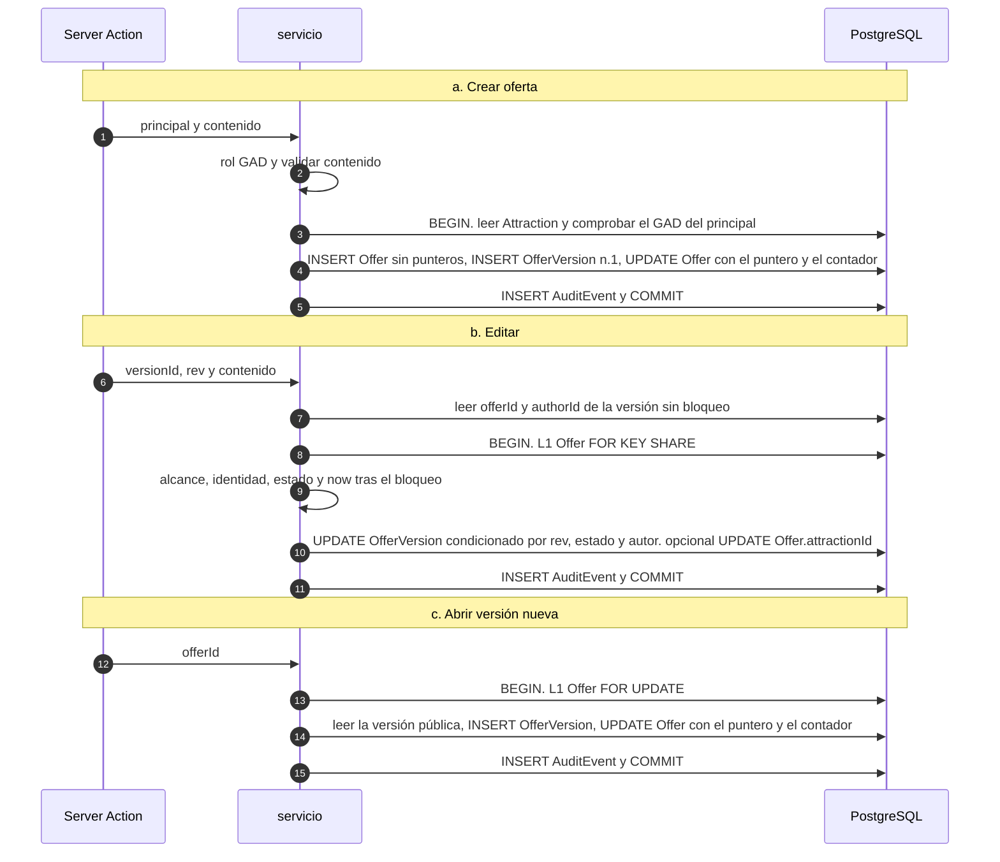

#### TX-01.3 Pseudocódigo

```ts
// ── a. Crear ──
async function createOffer(principal, input, { clock }) {
  requireRole(principal, 'GAD');                                         // FORBIDDEN
  const c = parseVersionContent(input);                                  // OFF.3: lanza VALIDATION_ERROR con fieldErrors
  return runWithDeadlockRetry(() => withTx(async (tx) => {
    const att = await tx.attraction.findUnique({ where: { id: input.attractionId } });      // datos de semilla: inmutables
    if (!att || !isGadMember(principal, att.gadId)) throw new AppError('NOT_FOUND');         // la atracción de otro GAD no existe para este principal
    const now = clock.now();                                             // sin bloqueos: solo informa createdAt y auditoría
    // Orden de inserción que rompe el ciclo sin claves diferidas (03 §3.2.1)
    const offer = await tx.offer.create({ data: { gadId: att.gadId, attractionId: att.id, status: 'UNPUBLISHED',
        lastVersionNumber: 0, createdById: principal.userId, createdAt: now, updatedAt: now } });
    const v = await tx.offerVersion.create({ data: { offerId: offer.id, number: 1, status: 'DRAFT', rev: 1,
        authorId: principal.userId, ...c, createdAt: now, updatedAt: now } });
    await tx.offer.update({ where: { id: offer.id }, data: { workingVersionId: v.id, lastVersionNumber: 1, updatedAt: now } });
    await auditInTx(tx, now, { action: 'offer.create', resourceType: 'Offer', resourceId: offer.id, result: 'SUCCESS', actor: principal,
                               metadata: { gadId: att.gadId, attractionId: att.id } });
    return { offerId: offer.id, versionId: v.id };
  }));                                                                   // COMMIT
}

// ── b. Editar ──
async function updateWorkingVersion(principal, input, { clock }) {
  requireRole(principal, 'GAD');
  const c = parseVersionContent(input);
  const v0 = await db.offerVersion.findUnique({ where: { id: input.versionId }, select: { offerId: true, authorId: true } });   // inmutables
  if (!v0) throw new AppError('NOT_FOUND');
  try { return await runWithDeadlockRetry(() => withTx(async (tx) => {
    const offer = await lockOfferShared(tx, v0.offerId);                 // L1 compartido
    if (!offer || !isGadMember(principal, offer.gadId)) throw new AppError('NOT_FOUND');
    if (v0.authorId !== principal.userId) throw new AppError('FORBIDDEN');                  // en el alcance, pero no es el autor
    const now = clock.now();                                             // tras el bloqueo
    if (offer.status === 'ARCHIVED') throw new AppError('OFFER_ARCHIVED');
    const v = await tx.offerVersion.findUnique({ where: { id: input.versionId } });          // relectura bajo bloqueo
    if (!v) throw new AppError('NOT_FOUND');                             // descartada o eliminada mientras esperábamos
    if (v.status !== 'DRAFT' && v.status !== 'CHANGES_REQUESTED') throw new AppError('INVALID_STATE', { details: { currentStatus: v.status } });
    if (v.rev !== input.expectedRev) throw new AppError('STALE_VERSION', { details: { currentRev: v.rev } });

    // Atracción: editable solo en una oferta nunca publicada; el GAD de la nueva atracción debe ser el mismo
    let attractionChange = false;
    if (input.attractionId !== undefined && input.attractionId !== offer.attractionId) {
      if (offer.publicVersionId !== null) throw new AppError('VALIDATION_ERROR', { fieldErrors: { attractionId: ['ATTRACTION_LOCKED'] } });
      const att = await tx.attraction.findUnique({ where: { id: input.attractionId } });
      if (!att || att.gadId !== offer.gadId) throw new AppError('NOT_FOUND');
      attractionChange = true;
    }
    // Cortesía (OFF.4): no enviar a revisión un cambio de fecha que TX-03 rechazaría
    if (offer.publicVersionId !== null && await reservationsExist(tx, offer.id)) {
      const pub = await tx.offerVersion.findUniqueOrThrow({ where: { id: offer.publicVersionId } });
      if (!sameSchedule(c, pub)) throw new AppError('SCHEDULE_LOCKED');
    }
    const upd = await tx.offerVersion.updateMany({
      where: { id: v.id, rev: input.expectedRev, status: { in: ['DRAFT', 'CHANGES_REQUESTED'] }, authorId: principal.userId },
      data: { ...c, rev: { increment: 1 }, updatedAt: now } });          // NO toca estado, autor ni campos de decisión
    if (upd.count !== 1) throw await reread(tx, v.id);                    // otra edición ganó entre la lectura y el UPDATE: STALE_VERSION (o INVALID_STATE / NOT_FOUND)
    if (attractionChange) await tx.offer.update({ where: { id: offer.id }, data: { attractionId: input.attractionId, updatedAt: now } });
    await auditInTx(tx, now, { action: 'offer.version.update', resourceType: 'OfferVersion', resourceId: v.id, result: 'SUCCESS', actor: principal,
                               metadata: { offerId: offer.id, versionNumber: v.number, rev: v.rev + 1, changedFields: diffNames(v, c, attractionChange) } });
    return { rev: v.rev + 1 };
  })); } catch (e) { await auditRejectionBestEffort(e, principal, input); throw toAppError(e); }
}

// ── c. Abrir una versión nueva ──
async function startNewVersion(principal, input, { clock }) {
  requireRole(principal, 'GAD');
  try { return await runWithDeadlockRetry(() => withTx(async (tx) => {
    const offer = await lockOffer(tx, input.offerId);                    // L1 exclusivo
    if (!offer || !isGadMember(principal, offer.gadId)) throw new AppError('NOT_FOUND');
    const now = clock.now();
    if (offer.status === 'ARCHIVED') throw new AppError('OFFER_ARCHIVED');
    if (offer.status === 'UNPUBLISHED') throw new AppError('INVALID_STATE', { details: { currentStatus: 'UNPUBLISHED' } });   // ya tiene su versión de trabajo
    if (offer.workingVersionId !== null) throw new AppError('WORKING_VERSION_EXISTS');
    const pub = await tx.offerVersion.findUniqueOrThrow({ where: { id: offer.publicVersionId! } });   // APPROVED: inmutable
    const number = offer.lastVersionNumber + 1;                          // el contador nunca se reutiliza
    const v = await tx.offerVersion.create({ data: { offerId: offer.id, number, status: 'DRAFT', rev: 1, authorId: principal.userId,
        ...copyContent(pub), createdAt: now, updatedAt: now } });
    await tx.offer.update({ where: { id: offer.id }, data: { workingVersionId: v.id, lastVersionNumber: number, updatedAt: now } });
    await auditInTx(tx, now, { action: 'offer.version.open', resourceType: 'OfferVersion', resourceId: v.id, result: 'SUCCESS', actor: principal,
                               metadata: { offerId: offer.id, versionNumber: number } });
    return { versionId: v.id, number };
  })); } catch (e) { await auditRejectionBestEffort(e, principal, input); throw toAppError(e); }
}
```

Notas de lectura:
- **Edición concurrente.** Dos ediciones con el mismo `rev` toman ambas el bloqueo compartido y ambas leen `rev = 1`; la primera en actualizar lo sube a 2; la segunda espera la fila de la versión y, al despertar, su `UPDATE` ya no cumple `rev = $esperado` y afecta **cero filas**. Ese resultado es **esperado, no un defecto**: `reread(tx, versionId)` vuelve a leer la versión (la transacción no está abortada: un `UPDATE` sin filas no es un error de PostgreSQL) y devuelve el `AppError` que corresponde (`STALE_VERSION` con `currentRev`; `INVALID_STATE` si cambió de estado; `NOT_FOUND` si la borraron). El resto de comprobaciones sobre `v` (estado, `rev`) existen para dar el error **sin** escribir en el caso habitual; el `UPDATE` condicionado es el que decide.
- La edición **no cambia el estado**: una versión `CHANGES_REQUESTED` sigue así con su motivo y revisor visibles hasta reenviarse (03 V-3).
- El `UPDATE Offer.attractionId` ocurre bajo el bloqueo compartido: no entra en conflicto con otra edición (no hay `FOR UPDATE`), y `tg_offer_guard` lo permite porque `publicVersionId` es nulo.
- Abrir versión copia **siempre** la versión pública (no la de trabajo anterior, que ya no existe).

#### TX-01.4 Escrituras y resultado de cada rama

| Rama | Condición | Escrituras | Resultado | Auditoría |
|---|---|---|---|---|
| a1 | Éxito | `INSERT Offer` (`UNPUBLISHED`), `INSERT OfferVersion` n.º 1 (`DRAFT`, `rev 1`), `UPDATE Offer` (puntero de trabajo y contador), `AuditEvent` | `{ offerId, versionId }` | `offer.create` `SUCCESS` |
| a2 | Atracción ausente o de otro GAD | Ninguna | `NOT_FOUND` | `DENIED` aparte |
| a3 | Sin rol `GAD` | Ninguna | `FORBIDDEN` | `DENIED` aparte |
| a4 | Contenido inválido | Ninguna | `VALIDATION_ERROR` por campo | No (error de formulario) |
| b1 | Éxito | `UPDATE OfferVersion` (campos, `rev + 1`); si cambia la atracción, `UPDATE Offer`; `AuditEvent` | `{ rev }` | `offer.version.update` `SUCCESS` |
| b2 | Fuera del alcance / no es del GAD | Ninguna | `NOT_FOUND` | `DENIED` |
| b3 | En el alcance pero no es el autor | Ninguna | `FORBIDDEN` | `DENIED` |
| b4 | Oferta archivada | Ninguna | `OFFER_ARCHIVED` | `CONFLICT` |
| b5 | Versión no editable (`IN_REVIEW`, `APPROVED`) | Ninguna | `INVALID_STATE` (`currentStatus`) | `CONFLICT` |
| b6 | `rev` distinto | Ninguna | `STALE_VERSION` (`currentRev`) | `CONFLICT` |
| b7 | Versión borrada mientras se esperaba | Ninguna | `NOT_FOUND` | No |
| b8 | Atracción en oferta publicada o de otro GAD | Ninguna | `VALIDATION_ERROR` (`attractionId`) / `NOT_FOUND` | `DENIED` |
| b9 | Cambio de fechas con reservas | Ninguna | `SCHEDULE_LOCKED` (cortesía) | `CONFLICT` |
| c1 | Éxito | `INSERT OfferVersion` n.º `lastVersionNumber + 1` (`DRAFT`, copia de la pública), `UPDATE Offer` (puntero y contador), `AuditEvent` | `{ versionId, number }` | `offer.version.open` `SUCCESS` |
| c2 | `workingVersionId` no nulo | Ninguna | `WORKING_VERSION_EXISTS` | `CONFLICT` |
| c3 | `ARCHIVED` / `UNPUBLISHED` | Ninguna | `OFFER_ARCHIVED` / `INVALID_STATE` | `CONFLICT` |

#### TX-01.5 Compatibilidad con 03 y con el orden de inserción

| Objeto de 03 | Cómo se cumple |
|---|---|
| Ciclo `Offer` ↔ `OfferVersion` (§3.2.1) | Alta: `Offer` sin punteros → `OfferVersion` → `UPDATE` del puntero. Abrir versión: `INSERT` de la versión **antes** de fijar el puntero. Nunca se necesitan claves diferidas. |
| FK compuesta `(workingVersionId, id) → OfferVersion(id, offerId)` | La versión se inserta con `offerId = offer.id`: la pertenencia queda garantizada por la base (INV-19). |
| `fn_offer_pointer_status` (puntero de trabajo ⇒ versión no `APPROVED`) | La versión insertada es `DRAFT`. |
| `ck_offer_pointers` | `UNPUBLISHED` con `publicVersionId` nulo; `workingVersionId` no nulo ⇒ `lastVersionNumber ≥ 1` (el `UPDATE` fija ambos a la vez). |
| `tg_offerversion_guard` | La edición solo toca versiones no aprobadas y no cambia `offerId`, `number`, `authorId` ni `createdAt`. |
| `ck_ov_review` | La edición no toca campos de decisión; el estado no cambia. |
| `tg_offer_guard` | Con `publicVersionId` nulo permite cambiar `attractionId`; con `publicVersionId` no nulo lo impediría (el servicio ya lo rechaza antes). `lastVersionNumber` solo crece. |
| Único `(offerId, number)` | `lastVersionNumber + 1` bajo `FOR UPDATE`: no puede repetirse; un `23505` aquí es un defecto (regla 8). |

#### TX-01.6 Errores, idempotencia y recuperación

Errores: OFF.5. **Idempotencia:** el alta no es idempotente (acepta el doble envío; se descarta con TX-16); la edición lo es por `rev`; abrir versión lo es por estado (`WORKING_VERSION_EXISTS`). **Recuperación:** ninguna escritura queda a medias (una sola transacción); `BUSY_TRY_AGAIN` se repite sin riesgo. **Carrera con archivo o eliminación:** el bloqueo compartido hace que, si el archivo se confirma primero, la edición vea `ARCHIVED` y no escriba; si la eliminación se confirma primero, la versión ya no existe (b7).

#### TX-01.7 Pruebas

| ID | Nivel | Preparación | Acciones | Aserciones |
|---|---|---|---|---|
| T-OFE-01a | I | `gad.sanisidro`. | `createOffer` sobre la atracción 1 con contenido válido. | `Offer` `UNPUBLISHED`, `gadId` = GAD 1, `workingVersionId` = v1, `lastVersionNumber = 1`, `publicVersionId` nulo; v1 `DRAFT`, `rev 1`, `authorId = gad.sanisidro`, sin `submittedAt` ni campos de decisión; 1 `AuditEvent offer.create` `SUCCESS` con `gadId` y `attractionId` y **sin** título; todo visible en una sola transacción. |
| T-OFE-01b | I | — | Alta con: título de 4 caracteres; título de 4 emojis más 1 letra (cuenta 5 puntos de código: **válido**); `endsAt ≤ startsAt`; duración de 73 h; precio `0,99`, `100000,00`, `12.345`; capacidad 0 y 1001; `minAge` 0 y 100. | Cada caso inválido devuelve `VALIDATION_ERROR` con el error en **su** campo; 0 filas creadas; el título de emojis se acepta. |
| T-OFE-23a | I | `gad.sanisidro`, `turista.ana`. | Alta con la atracción 2 (otro GAD); alta como turista. | `NOT_FOUND` y `FORBIDDEN`; 0 filas. |
| T-OFE-01c | I | — | Dos altas idénticas seguidas. | Dos ofertas distintas (comportamiento aceptado, OFF.5). |
| T-OFE-04a | I | Oferta inédita con v1 `DRAFT`. | Editar con `expectedRev = 1`. | `rev = 2`; estado, autor y `number` sin cambio; `updatedAt` avanzó; auditoría con `changedFields` (solo nombres) y `rev = 2`. Con v1 `CHANGES_REQUESTED`: los campos de decisión **no** cambian. |
| T-OFE-04b | I | Igual. | Editar con `expectedRev = 1` cuando ya es 2. | `STALE_VERSION` con `details.currentRev = 2`; sin cambios; `AuditEvent` `CONFLICT`. |
| T-OFE-04c | C | v1 `DRAFT` `rev 1`; `ctrl` toma `barrera.version(v1)`. | Dos ediciones con `expectedRev = 1` y contenidos distintos; `esperarBloqueadas(2)`; `liberar()`. | Exactamente una tiene éxito (`rev 2`); la otra `STALE_VERSION`; el contenido final es el del ganador; 1 `AuditEvent` `SUCCESS` y 1 `CONFLICT`. |
| T-OFE-19a | I | v1 de `gad.sanisidro`. | Editar y enviar como `dual` (miembro del mismo GAD, no autor); como `gad.colibries`; como `operador.laguna`. | `FORBIDDEN`; `NOT_FOUND`; `FORBIDDEN`. Sin cambios. |
| T-OFE-11a | I | v1 `IN_REVIEW`; v2 `APPROVED`. | Editar ambas. | `INVALID_STATE` con `currentStatus`; sin cambios. (El rechazo en la base lo prueba T-DB-01d.) |
| T-OFE-23b | I | Oferta inédita y otra publicada del GAD 1. | Editar la atracción: de la inédita a otra del mismo GAD; de la inédita a una del GAD 2; de la publicada a otra. | Permitido y `attractionId` actualizado (con `changedFields`); `NOT_FOUND`; `VALIDATION_ERROR` en `attractionId`. En la publicada, repetir el valor actual se acepta. |
| T-OFE-22a | I | Oferta publicada con una reserva (probar con `HELD`, `CONFIRMED` y `EXPIRED`) y otra sin reservas. | Editar `startsAt` de la versión nueva. | Con reservas: `SCHEDULE_LOCKED` en los tres estados; con las mismas fechas: éxito. Sin reservas: el cambio se acepta. |
| T-OFE-16b | C | v1 `DRAFT`. `ctrl` toma `FOR UPDATE` sobre `Offer` y, en su transacción, archiva la oferta (publicada). | `lanzar(updateWorkingVersion)`; `esperarBloqueadas(1)`; `liberar()` (confirma el archivo). | La edición devuelve `OFFER_ARCHIVED`; la versión conserva su `rev` y contenido. *(Sin el bloqueo compartido la edición habría escrito sobre una oferta ya archivada.)* |
| T-OFE-16b′ | C | `ctrl` toma `barrera.offerCompartida(offerId)` (hace de edición en curso). | `lanzar(changeOfferStatus ARCHIVE)`; `esperarBloqueadas(1)`; `liberar()`. | El archivo espera y se aplica al liberar; una edición posterior devuelve `OFFER_ARCHIVED`. |
| T-OFE-14c | C | Oferta inédita con v1 `DRAFT`. `ctrl` toma `FOR UPDATE` sobre `Offer`. | Lanzar a la vez `updateWorkingVersion` y `deleteOffer`; `esperarBloqueadas(2)`; `liberar()`. | **En ambos órdenes**: no quedan filas de la oferta ni de sus versiones; si la eliminación fue primera, la edición devuelve `NOT_FOUND`; si fue primera la edición, ambas tienen éxito; exactamente 1 `offer.delete` `SUCCESS`. |
| T-OFE-13a | C | Oferta publicada sin versión de trabajo (`lastVersionNumber = 1`). `ctrl` toma `barrera.offer`. | Dos `startNewVersion` simultáneos de `gad.sanisidro` y `dual`; `esperarBloqueadas(2)`; `liberar()`. | Una tiene éxito (n.º 2) y la otra `WORKING_VERSION_EXISTS`; `lastVersionNumber = 2`; una sola versión de trabajo; 1 `offer.version.open` `SUCCESS`. |
| T-OFE-12a | I | Oferta `OPEN` con versión pública v1 (precio y capacidad concretos); otra `SUSPENDED`; una `ARCHIVED`; una inédita. | `startNewVersion` en cada una. | `OPEN` y `SUSPENDED`: v2 `DRAFT`, `rev 1`, `authorId = principal`, contenido **igual** al de v1; `publicVersionId` y `status` de la oferta sin cambio (la publicada sigue vendiéndose). `ARCHIVED`: `OFFER_ARCHIVED`. Inédita: `INVALID_STATE`. |
| T-OFE-18a | I | Oferta publicada. | Abrir v2; descartarla; abrir otra. | La nueva tiene número 3 (no se reutiliza el 2); `lastVersionNumber = 3`. |

### TX-02 — Enviar a revisión

#### TX-02.1 Entradas, autorización y validaciones

Servicio `submitVersion(principal, { versionId, expectedRev }, { clock })`. Autorización: OFF.1 (rol `GAD`, alcance `offer.gadId`, **autor**). Bloqueo: **compartido** (OFF.2). Validaciones, en este orden:

| # | Comprobación | Error |
|---|---|---|
| 1 | Rol, alcance e identidad (OFF.1) | `FORBIDDEN` / `NOT_FOUND` |
| 2 | Oferta no `ARCHIVED` | `OFFER_ARCHIVED` |
| 3 | La versión existe y su estado es `DRAFT` o `CHANGES_REQUESTED` | `NOT_FOUND` / `INVALID_STATE` |
| 4 | `rev = expectedRev` | `STALE_VERSION` |
| 5 | Contenido completo válido (OFF.3, **otra vez**: lo guardado puede estar a medias) | `VALIDATION_ERROR` |
| 6 | `startsAt > now` (con `now` posterior al bloqueo) | `ACTIVITY_NOT_FUTURE` |
| 7 | Cortesía (OFF.4): si hay reservas y la oferta tiene versión pública, las fechas coinciden con las de ésta | `SCHEDULE_LOCKED` |

No se comprueba capacidad frente a lo comprometido aquí: es una regla **autoritativa de TX-03** (el comprometido cambia entre el envío y la decisión).

#### TX-02.2 Secuencia

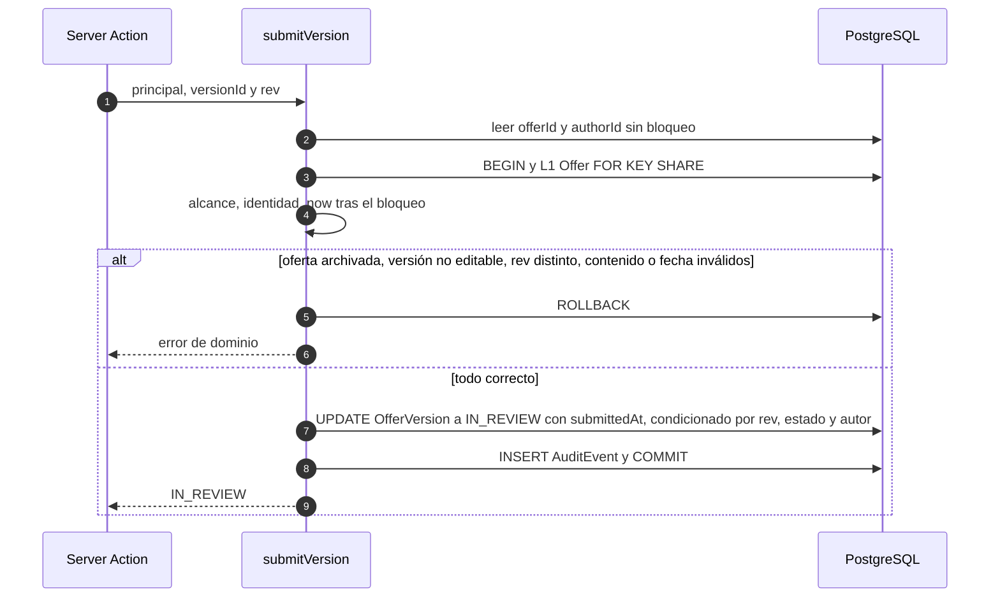

#### TX-02.3 Pseudocódigo

```ts
async function submitVersion(principal, input, { clock }) {
  requireRole(principal, 'GAD');
  const v0 = await db.offerVersion.findUnique({ where: { id: input.versionId }, select: { offerId: true, authorId: true } });
  if (!v0) throw new AppError('NOT_FOUND');
  try { return await runWithDeadlockRetry(() => withTx(async (tx) => {
    const offer = await lockOfferShared(tx, v0.offerId);                             // L1 compartido: archivo, eliminación y descarte esperan
    if (!offer || !isGadMember(principal, offer.gadId)) throw new AppError('NOT_FOUND');
    if (v0.authorId !== principal.userId) throw new AppError('FORBIDDEN');
    const now = clock.now();                                                         // tras el bloqueo
    if (offer.status === 'ARCHIVED') throw new AppError('OFFER_ARCHIVED');
    const v = await tx.offerVersion.findUnique({ where: { id: input.versionId } });
    if (!v) throw new AppError('NOT_FOUND');
    if (v.status !== 'DRAFT' && v.status !== 'CHANGES_REQUESTED') throw new AppError('INVALID_STATE', { details: { currentStatus: v.status } });
    if (v.rev !== input.expectedRev) throw new AppError('STALE_VERSION', { details: { currentRev: v.rev } });
    parseVersionContent(storedContent(v));                                           // OFF.3 sobre lo guardado
    if (!(v.startsAt > now)) throw new AppError('ACTIVITY_NOT_FUTURE');
    if (offer.publicVersionId !== null && await reservationsExist(tx, offer.id)) {   // cortesía (OFF.4)
      const pub = await tx.offerVersion.findUniqueOrThrow({ where: { id: offer.publicVersionId } });
      if (!sameSchedule(v, pub)) throw new AppError('SCHEDULE_LOCKED');
    }
    const upd = await tx.offerVersion.updateMany({
      where: { id: v.id, rev: input.expectedRev, status: { in: ['DRAFT', 'CHANGES_REQUESTED'] }, authorId: principal.userId },
      data: { status: 'IN_REVIEW', submittedAt: now, updatedAt: now } });            // conserva reviewerId/decidedAt/decisionReason de la devolución previa; NO cambia rev
    if (upd.count !== 1) throw await reread(tx, v.id);                                // otra solicitud ganó: STALE_VERSION o INVALID_STATE
    await auditInTx(tx, now, { action: 'offer.version.submit', resourceType: 'OfferVersion', resourceId: v.id, result: 'SUCCESS', actor: principal,
                               metadata: { offerId: offer.id, versionNumber: v.number } });
    return { status: 'IN_REVIEW' };
  })); } catch (e) { await auditRejectionBestEffort(e, principal, input); throw toAppError(e); }
}
```

#### TX-02.4 Escrituras y resultado de cada rama

| Rama | Condición | Escrituras | Resultado | Auditoría |
|---|---|---|---|---|
| 1 | Éxito | `UPDATE OfferVersion` (`IN_REVIEW`, `submittedAt = now`; `rev` y campos de decisión intactos), `AuditEvent` | `{ status: 'IN_REVIEW' }` | `offer.version.submit` `SUCCESS` |
| 2 | Fuera del alcance / no es del GAD | Ninguna | `NOT_FOUND` | `DENIED` |
| 3 | En el alcance, no es el autor | Ninguna | `FORBIDDEN` | `DENIED` |
| 4 | Oferta archivada | Ninguna | `OFFER_ARCHIVED` | `CONFLICT` |
| 5 | Versión no `DRAFT`/`CHANGES_REQUESTED` (ya enviada, aprobada) o inexistente | Ninguna | `INVALID_STATE` / `NOT_FOUND` | `CONFLICT` |
| 6 | `rev` distinto | Ninguna | `STALE_VERSION` | `CONFLICT` |
| 7 | Contenido inválido / inicio no futuro / fechas bloqueadas | Ninguna | `VALIDATION_ERROR` / `ACTIVITY_NOT_FUTURE` / `SCHEDULE_LOCKED` | No / `CONFLICT` / `CONFLICT` |
| 8 | Una solicitud simultánea del mismo autor ganó | Ninguna | `INVALID_STATE` (`IN_REVIEW`) o `STALE_VERSION` | `CONFLICT` |

#### TX-02.5 Compatibilidad con 03, errores, idempotencia y recuperación

- **`ck_ov_review`:** `IN_REVIEW` exige `submittedAt` no nulo y los tres campos de decisión **todos nulos o todos presentes**: se cumple desde `DRAFT` (todos nulos) y desde `CHANGES_REQUESTED` (todos presentes, se conservan para que el operador vea la devolución anterior). `tg_offerversion_guard` permite el cambio (la versión no es `APPROVED`).
- **Idempotencia:** por estado. Un segundo envío (doble clic) recibe `INVALID_STATE` con `currentStatus = IN_REVIEW`, que la interfaz muestra como «ya enviada». No se convierte en éxito silencioso para no ocultar un envío fallido a otra persona.
- **Recuperación:** una sola transacción; nada queda a medias. El estado `IN_REVIEW` impide la edición (TX-01b) hasta que el operador decida o un miembro del GAD descarte la versión (TX-16).
- **Carrera con archivo o eliminación:** el bloqueo compartido garantiza que, si el archivo se confirma primero, el envío vea `ARCHIVED` y falle (`OFFER_ARCHIVED`); si el envío se confirma primero, el archivo espera y la versión queda `IN_REVIEW` en una oferta archivada, **inerte** (TX-04). La eliminación (TX-16) espera igualmente.

#### TX-02.6 Pruebas

| ID | Nivel | Preparación | Acciones | Aserciones |
|---|---|---|---|---|
| T-OFE-05a | I | v1 `DRAFT` completa y con inicio futuro (también con v1 `CHANGES_REQUESTED`). | `submitVersion`. | `IN_REVIEW`, `submittedAt = now`; `rev` sin cambio; en el caso devuelto, `reviewerId`, `decidedAt` y `decisionReason` **conservados**; 1 `AuditEvent offer.version.submit`. Después `updateWorkingVersion` ⇒ `INVALID_STATE` (T-OFE-05: una versión `IN_REVIEW` no se edita). |
| T-OFE-05c | I | Varias versiones `DRAFT`. | Envío con: `startsAt` pasado; `rev` obsoleto; contenido incompleto (borrador a medias); otro miembro del GAD; oferta archivada; segundo envío. | `ACTIVITY_NOT_FUTURE`; `STALE_VERSION`; `VALIDATION_ERROR` por campo; `FORBIDDEN`; `OFFER_ARCHIVED`; `INVALID_STATE`. Ningún cambio de estado en los rechazos. |
| T-OFE-05d | C | v1 `DRAFT`. `ctrl` toma `barrera.version(v1)`. | Dos `submitVersion` del mismo autor; `esperarBloqueadas(2)`; `liberar()`. | Una tiene éxito; la otra `INVALID_STATE` (`IN_REVIEW`) o `STALE_VERSION`; 1 solo `AuditEvent` `SUCCESS`; v1 `IN_REVIEW` una vez. |
| T-OFE-05e | C | v1 `DRAFT` de una oferta publicada. `ctrl` toma `FOR UPDATE` sobre `Offer` y archiva dentro de su transacción. | `lanzar(submitVersion)`; `esperarBloqueadas(1)`; `liberar()`. | `OFFER_ARCHIVED`; v1 sigue `DRAFT`, `submittedAt` nulo. |
| T-OFE-05f | C | v1 `DRAFT` de una oferta publicada. `ctrl` toma `FOR UPDATE` sobre `Offer`. | A la vez `submitVersion` y `discardWorkingVersion`; `esperarBloqueadas(2)`; `liberar()`. | **En ambos órdenes**: la oferta queda con `workingVersionId` nulo y la versión **no existe** (si el descarte fue primero, el envío da `NOT_FOUND`; si el envío fue primero, el descarte borra la versión ya `IN_REVIEW`); nunca queda una fila `IN_REVIEW` sin puntero ni un puntero a una fila borrada. |
| T-OFE-05g | C | v1 `DRAFT` con `startsAt = T0 + 30 s`. `ctrl` toma `FOR UPDATE` sobre `Offer` (hace de reserva en curso). | `lanzar(submitVersion)`; `esperarBloqueadas(1)`; `reloj.advance(31 s)`; `liberar()`. | `ACTIVITY_NOT_FUTURE`: `now` se tomó **después** de la espera (principio 5). |
| T-OFE-22b | I | Oferta publicada con una reserva; v2 `DRAFT` con otras fechas. | `submitVersion`. | `SCHEDULE_LOCKED`; v2 sigue `DRAFT`. (La regla autoritativa se prueba en T-OFE-22c.) |

### TX-03 — Aprobar o devolver una versión y actualizar el puntero público

#### TX-03.1 Entradas, autorización y validaciones

Servicio `decideVersion(principal, input, { clock })` con `input = { versionId, expectedRev, decision: 'APPROVE' | 'REQUEST_CHANGES', reason? }` (acciones `approveVersionAction` y `requestChangesAction`). Rol `OPERATOR`; alcance `offer.attractionId`; **identidad: `principal.userId ≠ version.authorId`** (OFF.1). Bloqueo **exclusivo** (OFF.2): aprobar cambia inventario y punteros; devolver comparte la misma ruta para simplificar y por ser poco frecuente.

**Autoaprobación por identidad.** La comprobación usa el `userId`, no el rol: `dual` (con `GAD` y `OPERATOR`) que creó la versión **no** puede decidirla ni aprobar ni devolver (`SELF_REVIEW_FORBIDDEN`), pero **sí** puede decidir una versión de `gad.sanisidro`. Se comprueba con la columna inmutable `authorId` (leída antes del bloqueo y releída bajo él), y la base la refuerza con `CHECK ("reviewerId" <> "authorId")` (INV-09). Lo que **solo** garantiza el servicio es que el revisor sea operador de la atracción (las asignaciones cambian; un `CHECK` de fila no puede verlo).

| # | Comprobación (orden fijo de OFF.1) | Error |
|---|---|---|
| 1 | Rol `OPERATOR` | `FORBIDDEN` |
| 2 | La oferta existe y `isOperatorOf(principal, offer.attractionId)` (sobre la fila bloqueada) | `NOT_FOUND` |
| 3 | `principal.userId ≠ authorId` | `SELF_REVIEW_FORBIDDEN` |
| 4 | La versión existe, es el `workingVersionId` y está `IN_REVIEW` | `NOT_FOUND` / `INVALID_STATE` (`currentStatus`) |
| 5 | `rev = expectedRev` | `STALE_VERSION` |
| 6 | Oferta no `ARCHIVED` | `OFFER_ARCHIVED` |
| 7 | **Devolver:** `reason` de 1 a 1000 puntos de código (se valida **antes** de la transacción) | `VALIDATION_ERROR` (`reason`) |
| 8 | **Aprobar:** `startsAt > now` | `ACTIVITY_NOT_FUTURE` |
| 9 | **Aprobar:** si existe **cualquier** reserva de la oferta y hay versión pública, `startsAt` y `endsAt` iguales a las de ésta | `SCHEDULE_LOCKED` |
| 10 | **Aprobar:** `capacity ≥ comprometido` (confirmadas + retenciones vigentes, sin contar vencidas, con `now` de tras el bloqueo) | `CAPACITY_BELOW_COMMITTED` (`details.committed`) |

El orden pone la autorización (1 a 3) **antes** que el estado: un permiso no depende de si la versión ya fue decidida. Una segunda decisión simultánea de otro operador pasa 1 a 3, espera el bloqueo y recibe `INVALID_STATE` en el paso 4 (la versión ya no está `IN_REVIEW`).

#### TX-03.2 Secuencia

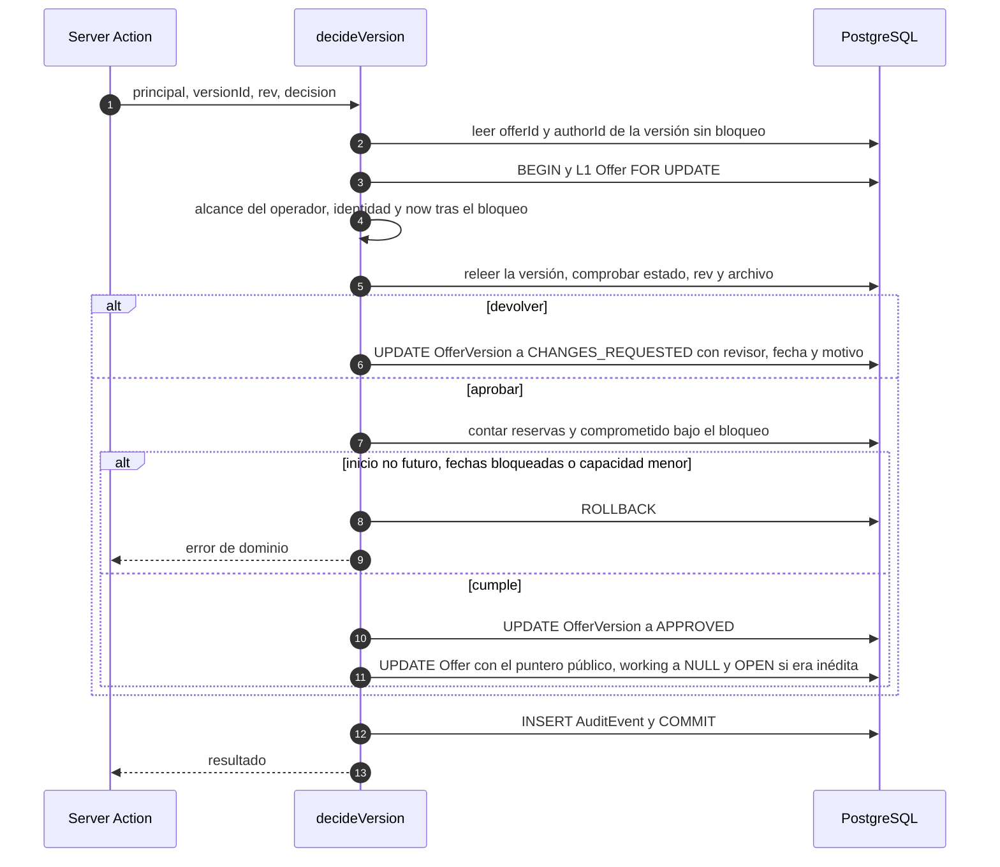

#### TX-03.3 Pseudocódigo

```ts
async function decideVersion(principal, input, { clock }) {
  requireRole(principal, 'OPERATOR');
  if (input.decision === 'REQUEST_CHANGES') validateReason(input.reason, 1, 1000);   // VALIDATION_ERROR antes de abrir la transacción
  const v0 = await db.offerVersion.findUnique({ where: { id: input.versionId }, select: { offerId: true, authorId: true } });   // inmutables
  if (!v0) throw new AppError('NOT_FOUND');
  try { return await runWithDeadlockRetry(() => withTx(async (tx) => {
    const offer = await lockOffer(tx, v0.offerId);                                   // L1 exclusivo
    if (!offer || !isOperatorOf(principal, offer.attractionId)) throw new AppError('NOT_FOUND');   // alcance sobre la fila bloqueada
    if (principal.userId === v0.authorId) throw new AppError('SELF_REVIEW_FORBIDDEN');             // por identidad, con cualquier combinación de roles
    const now = clock.now();                                                         // tras el bloqueo
    const v = await tx.offerVersion.findUnique({ where: { id: input.versionId } });
    if (!v) throw new AppError('NOT_FOUND');
    if (v.status !== 'IN_REVIEW' || offer.workingVersionId !== v.id) throw new AppError('INVALID_STATE', { details: { currentStatus: v.status } });
    if (v.rev !== input.expectedRev) throw new AppError('STALE_VERSION', { details: { currentRev: v.rev } });
    if (offer.status === 'ARCHIVED') throw new AppError('OFFER_ARCHIVED');

    if (input.decision === 'REQUEST_CHANGES') {
      const upd = await tx.offerVersion.updateMany({ where: { id: v.id, status: 'IN_REVIEW', rev: input.expectedRev },
        data: { status: 'CHANGES_REQUESTED', reviewerId: principal.userId, decidedAt: now, decisionReason: input.reason, updatedAt: now } });   // no cambia rev
      if (upd.count !== 1) throw new DefectError('devolución sin fila');
      await auditInTx(tx, now, { action: 'offer.version.request_changes', resourceType: 'OfferVersion', resourceId: v.id, result: 'SUCCESS', actor: principal,
                                 metadata: { offerId: offer.id, versionNumber: v.number, reasonLength: codePointLength(input.reason) } });
      return { status: 'CHANGES_REQUESTED' };
    }

    // ── Aprobar: reglas de inventario, TODAS bajo el bloqueo exclusivo ──
    if (!(v.startsAt > now)) throw new AppError('ACTIVITY_NOT_FUTURE');
    if (offer.publicVersionId !== null && await reservationsExist(tx, offer.id)) {   // cualquier reserva, en cualquier estado (D-28)
      const pub = await tx.offerVersion.findUniqueOrThrow({ where: { id: offer.publicVersionId } });
      if (!sameSchedule(v, pub)) throw new AppError('SCHEDULE_LOCKED');
    }
    const committed = await countCommitted(tx, offer.id, now, null);                 // 03 §8.6, consulta 2
    if (v.capacity < committed) throw new AppError('CAPACITY_BELOW_COMMITTED', { details: { committed } });

    // Orden: la versión pasa a APPROVED PRIMERO; después se mueven los punteros (fn_offer_pointer_status exige APPROVED al fijar el público)
    const upd = await tx.offerVersion.updateMany({ where: { id: v.id, status: 'IN_REVIEW', rev: input.expectedRev },
      data: { status: 'APPROVED', reviewerId: principal.userId, decidedAt: now, decisionReason: null, updatedAt: now } });
    if (upd.count !== 1) throw new DefectError('aprobación sin fila');
    const first = offer.status === 'UNPUBLISHED';
    await tx.offer.update({ where: { id: offer.id }, data: {                          // UN solo UPDATE (ck_offer_pointers: status y puntero van juntos)
      publicVersionId: v.id, workingVersionId: null,
      ...(first ? { status: 'OPEN', statusReason: null, statusChangedAt: now, statusChangedById: principal.userId } : {}),   // OPEN/SUSPENDED conservan su estado (O-8)
      updatedAt: now } });
    await auditInTx(tx, now, { action: 'offer.version.approve', resourceType: 'OfferVersion', resourceId: v.id, result: 'SUCCESS', actor: principal,
                               metadata: { offerId: offer.id, versionNumber: v.number, from: offer.status, to: first ? 'OPEN' : offer.status } });
    return { status: 'APPROVED', offerStatus: first ? 'OPEN' : offer.status };
  })); } catch (e) { await auditRejectionBestEffort(e, principal, input); throw toAppError(e); }
}
```

Notas de lectura:
- **Todo ocurre bajo `FOR UPDATE`**: ninguna reserva ni liquidación puede confirmarse entre el cálculo de lo comprometido y el cambio del puntero (INV-01); una edición o un envío esperan (bloqueo compartido).
- `now` se toma **tras** el bloqueo, así que «inicio futuro» y «retención vigente» se deciden con la hora de después de esperar (principio 5; T-OFE-21b).
- La aprobación **no** toca `rev` (la decisión no cambia el contenido); `expectedRev` protege contra editar-y-reenviar entre medias.
- Aprobar una versión nueva de una oferta `SUSPENDED` **no** la reanuda (O-8).

#### TX-03.4 Escrituras y resultado de cada rama

| Rama | Condición | Escrituras | Resultado | Auditoría |
|---|---|---|---|---|
| 1 | **Devolver** con motivo válido | `UPDATE OfferVersion` (`CHANGES_REQUESTED`, `reviewerId`, `decidedAt`, `decisionReason`), `AuditEvent` | `CHANGES_REQUESTED` | `offer.version.request_changes` `SUCCESS` (`reasonLength`) |
| 2 | **Aprobar**, primera publicación | `UPDATE OfferVersion` (`APPROVED`, `decisionReason = NULL`), **un** `UPDATE Offer` (`publicVersionId`, `workingVersionId = NULL`, `OPEN`, `statusChanged*`), `AuditEvent` | `APPROVED`, oferta `OPEN` | `offer.version.approve` `SUCCESS` (`from UNPUBLISHED`, `to OPEN`) |
| 3 | **Aprobar** versión nueva de oferta `OPEN`/`SUSPENDED` | `UPDATE OfferVersion`, `UPDATE Offer` (puntero público y de trabajo; **estado intacto**), `AuditEvent` | `APPROVED`; la versión anterior queda «histórica» | ídem (`from` = `to` = estado actual) |
| 4 | Sin rol / otra atracción | Ninguna | `FORBIDDEN` / `NOT_FOUND` | `DENIED` |
| 5 | Es el autor | Ninguna | `SELF_REVIEW_FORBIDDEN` | `DENIED` |
| 6 | La versión ya no está `IN_REVIEW` (otra decisión primero) | Ninguna | `INVALID_STATE` | `CONFLICT` |
| 7 | `rev` distinto | Ninguna | `STALE_VERSION` | `CONFLICT` |
| 8 | Oferta archivada | Ninguna | `OFFER_ARCHIVED` | `CONFLICT` |
| 9 | Devolver sin motivo válido | Ninguna | `VALIDATION_ERROR` | No |
| 10 | Aprobar: inicio no futuro / fechas bloqueadas / capacidad menor | Ninguna | `ACTIVITY_NOT_FUTURE` / `SCHEDULE_LOCKED` / `CAPACITY_BELOW_COMMITTED` | `CONFLICT` |
| 11 | `55P03` o tiempo agotado | Ninguna | `BUSY_TRY_AGAIN` | No (log) |

#### TX-03.5 Compatibilidad con 03 y orden de escritura

| Objeto de 03 | Qué exige a la rama 2 o 3 | Cómo se cumple |
|---|---|---|
| `tg_offerversion_guard` | Una `APPROVED` no admite `UPDATE`; la transición desde `IN_REVIEW` sí | El `UPDATE` parte de `IN_REVIEW`; no cambia `offerId`, `number`, `authorId`, `createdAt`. Después de este `UPDATE` la fila es **inmutable** (T-OFE-11). |
| `ck_ov_review` | `APPROVED` ⇒ `submittedAt`, `reviewerId`, `decidedAt` no nulos, `decisionReason` nulo; `reviewerId ≠ authorId` | Se fijan en el mismo `UPDATE`; el segundo término lo garantiza el paso 3 y lo refuerza la base. |
| FK compuesta `(publicVersionId, id) → OfferVersion(id, offerId)` | La versión pública es de **esta** oferta | `v` es la `workingVersionId` de `offer`; la base rechaza un puntero a una versión de otra oferta (`23503`, defecto). |
| `fn_offer_pointer_status` | Puntero público ⇒ versión `APPROVED`; puntero de trabajo ⇒ no `APPROVED` | La versión se aprueba **antes** del `UPDATE` de `Offer`; el puntero de trabajo pasa a `NULL` en el mismo `UPDATE`. |
| `ck_offer_pointers`, `ck_offer_statusmeta` | `UNPUBLISHED ⇔ publicVersionId` nulo | En la primera publicación, estado y puntero cambian en **un** `UPDATE`. |
| `tg_offer_guard` | Con `publicVersionId` previo, `attractionId` intacto y fechas iguales si hay reservas | El servicio ya lo comprobó (pasos 9); el disparador es la defensa, no el control principal. |
| Único `publicVersionId` / `workingVersionId` | Una versión es pública o de trabajo de una sola oferta | Al mover el puntero la versión anterior pierde el suyo; un `23505` sería un defecto (regla 8). |

#### TX-03.6 Errores, idempotencia, recuperación y concurrencia con inventario

- **Idempotencia:** por estado: la segunda aprobación recibe `INVALID_STATE` (la versión ya está `APPROVED`); con una versión nueva ya abierta, el `workingVersionId` es otro y también `INVALID_STATE`/`NOT_FOUND`.
- **Recuperación:** una sola transacción; ningún estado intermedio es visible (el catálogo no ve una versión `APPROVED` sin puntero ni un puntero a una `IN_REVIEW`).
- **Interacciones** (todas se serializan por el bloqueo exclusivo de `Offer`; gana quien lo obtenga primero y el otro lee el resultado confirmado):

| Pareja simultánea | Si gana la aprobación | Si gana la otra operación |
|---|---|---|
| Aprobar × reservar (TX-05) | La reserva espera, ve el puntero nuevo y, si había visto la versión anterior, recibe `VERSION_CHANGED`; con capacidad reducida, la disponibilidad se calcula contra la nueva (`INSUFFICIENT_CAPACITY` si hace falta). | La aprobación ve la retención o confirmación ya insertada: con capacidad menor, `CAPACITY_BELOW_COMMITTED`; con fechas distintas, `SCHEDULE_LOCKED`. **Nunca** comprometido > capacidad pública (INV-01). |
| Aprobar × liquidar (TX-09) | Una captura tardía comprueba la capacidad **vigente** (la nueva). Las retenciones vigentes se confirman sin recomprobar cupo: ya estaban dentro de lo comprometido al aprobar. | La confirmación inserta entradas antes; la aprobación cuenta lo confirmado. |
| Aprobar × suspender (TX-04) | Si la oferta estaba `SUSPENDED`, la aprobación no la reanuda; luego la suspensión (si procede) es `INVALID_STATE`. | Aprobar sobre `SUSPENDED` conserva el estado (rama 3). |
| Aprobar × archivar (TX-04) | El archivo después archiva la oferta con su nueva versión pública; el historial se conserva. | La aprobación recibe `OFFER_ARCHIVED`; la versión sigue `IN_REVIEW`, **inerte**, sin cambio. |
| Aprobar × aprobar/devolver | La segunda recibe `INVALID_STATE`. | Ídem simétrico. |
| Aprobar × editar/enviar/descartar | La edición o el envío esperan el bloqueo y encuentran la versión `APPROVED` (`INVALID_STATE`). | Un descarte previo borra la versión: la aprobación recibe `NOT_FOUND`. |

#### TX-03.7 Pruebas

| ID | Nivel | Preparación | Acciones | Aserciones |
|---|---|---|---|---|
| T-OFE-06a | I | Oferta inédita; v1 `IN_REVIEW` de `gad.sanisidro`. | `decideVersion APPROVE` como `operador.laguna`. | v1 `APPROVED` con `reviewerId = operador.laguna`, `decidedAt = now`, `decisionReason` nulo; `Offer.publicVersionId = v1`, `workingVersionId` nulo, `status = OPEN`, `statusChangedAt/ById` fijados; 1 `AuditEvent offer.version.approve` (`from UNPUBLISHED`, `to OPEN`); todo en una transacción; el catálogo la muestra (T-OFE-17). |
| T-OFE-06b | I | Oferta `OPEN` (público v1) y otra `SUSPENDED`, cada una con v2 `IN_REVIEW`. | Aprobar v2. | `publicVersionId = v2`; v1 sigue `APPROVED` («histórica», sin puntero); `status` **sin cambio** (la `SUSPENDED` sigue suspendida); `workingVersionId` nulo. |
| T-OFE-08a | I | `dual` crea (como `GAD`) v1 y la envía. | `decideVersion` como `dual` con `APPROVE` y con `REQUEST_CHANGES`. | `SELF_REVIEW_FORBIDDEN` en ambos; v1 `IN_REVIEW` intacta; `AuditEvent` `DENIED`. |
| T-OFE-08b | I | v1 de `gad.sanisidro` `IN_REVIEW`. | Aprobar como `operador.laguna`; en otro caso, como `dual`. | Ambos tienen éxito (`reviewerId` = quien decidió): la prohibición es por **identidad**, no por rol. |
| T-OFE-08c | I | v1 `IN_REVIEW`. | Decidir como `gad.sanisidro` (solo `GAD`) y como `operador.cascada`. | `FORBIDDEN` y `NOT_FOUND` (T-OFE-07). |
| T-OFE-08d | I | v1 `DRAFT` de `dual`. | `UPDATE` directo en la base que fija `reviewerId = authorId`. | La base lo rechaza (`ck_ov_review`, `23514`; T-DB-01c). |
| T-OFE-09a | I | v1 `IN_REVIEW`. | Devolver sin motivo, con 1001 caracteres, y con motivo válido; el autor edita (`rev 2`) y reenvía; el operador aprueba. | `VALIDATION_ERROR` ×2 sin cambios; devolución ⇒ `CHANGES_REQUESTED` con revisor, fecha y motivo, `rev` intacta; tras reenviar: `IN_REVIEW` conserva el motivo previo; al aprobar, `decisionReason` pasa a nulo. |
| T-OFE-10a | C | v1 `IN_REVIEW`. `ctrl` toma `barrera.offer`. | `decideVersion APPROVE` por `operador.laguna` y por `dual` a la vez; `esperarBloqueadas(2)`; `liberar()`. | Una `APPROVED` y la otra `INVALID_STATE`; **un** movimiento de puntero; 1 `AuditEvent offer.version.approve` `SUCCESS`. |
| T-OFE-10b | C | Igual. | `APPROVE` (`operador.laguna`) frente a `REQUEST_CHANGES` (`dual`) a la vez. | **En ambos órdenes**: si ganó la aprobación, v1 `APPROVED` y puntero movido, y la devolución dio `INVALID_STATE`; si ganó la devolución, v1 `CHANGES_REQUESTED` sin puntero y la aprobación dio `INVALID_STATE`. Nunca estado mixto. |
| T-OFE-10c | I | v1 `IN_REVIEW` (`rev 1`); el operador la devuelve; el autor edita (`rev 2`) y reenvía. | El operador, con la pantalla antigua, aprueba con `expectedRev = 1`. | `STALE_VERSION` (`currentRev = 2`); sin cambios. |
| T-OFE-21a | I | Oferta con capacidad 10: 4 plazas `CONFIRMED` y una retención vigente de 3; v2 `IN_REVIEW`. | Aprobar con capacidad 6; con capacidad 7; con una retención **vencida** de 2 y capacidad 4. | `CAPACITY_BELOW_COMMITTED` con `details.committed = 7`; éxito; éxito (lo vencido no cuenta). |
| T-OFE-21b | C | Retención de 3 con `expiresAt = T0 + 60 s`; confirmadas 4; v2 con capacidad 4. `ctrl` toma `barrera.offer`. | `lanzar(decideVersion APPROVE)`; `esperarBloqueadas(1)`; `reloj.advance(61 s)`; `liberar()`. | Éxito: al decidir con la hora de **después** de la espera, la retención ya no cuenta. Con `advance(30 s)`: `CAPACITY_BELOW_COMMITTED`. |
| T-RES-17 | C | Capacidad 8, comprometido 6; v2 con capacidad 7 `IN_REVIEW`. `ctrl` toma `barrera.offer`. | A la vez: aprobar v2 y una reserva de 2 por otro comprador; `esperarBloqueadas(2)`; `liberar()`. | **En ambos órdenes**, lo comprometido nunca supera la capacidad pública final: si ganó la aprobación, la reserva recibe `INSUFFICIENT_CAPACITY` (disponible 1); si ganó la reserva, la aprobación `CAPACITY_BELOW_COMMITTED`. |
| T-OFE-22c | C | Oferta publicada sin reservas, v2 `IN_REVIEW` con otras fechas. `ctrl` toma `barrera.offer` e inserta una reserva `HELD` en su transacción. | `lanzar(decideVersion APPROVE)`; `esperarBloqueadas(1)`; `liberar()`. | `SCHEDULE_LOCKED` (la aprobación vio la reserva confirmada por `ctrl`); sin cambios. Con reserva `EXPIRED` y con fechas iguales: éxito solo en el segundo caso. |
| T-OFE-22d | I | v2 con otro `startsAt` en una oferta **sin** reservas. | Aprobar. | Éxito: las fechas pueden cambiar mientras no haya reservas. |
| T-OFE-11b | I | v1 `APPROVED`. | Cualquier operación del servicio sobre v1 (editar, enviar, descartar, decidir); `UPDATE` y `DELETE` directos en la base. | `INVALID_STATE` en el servicio; en la base `TC_APPROVED_IMMUTABLE` (T-DB-01d). |
| T-OFE-03b | I | Oferta archivada con v2 `IN_REVIEW`. | Aprobar y devolver. | `OFFER_ARCHIVED` ambos; v2 sigue `IN_REVIEW`. |
| T-OFE-03c | I | v2 `IN_REVIEW` con `startsAt` pasado. | Aprobar; devolver. | `ACTIVITY_NOT_FUTURE` al aprobar; la devolución sí es posible (no exige fecha futura). |

### TX-04 — Suspender, reanudar y archivar

#### TX-04.1 Entradas, autorización y validaciones

Servicio `changeOfferStatus(principal, { offerId, action, reason? }, { clock })` con `action ∈ { SUSPEND, RESUME, ARCHIVE }` (acciones `suspendOfferAction`, `resumeOfferAction`, `archiveOfferAction`). Bloqueo **exclusivo** (OFF.2). Autorización (OFF.1): `SUSPEND`/`RESUME` ⇒ `OPERATOR` de `offer.attractionId`; `ARCHIVE` ⇒ `GAD` de `offer.gadId` **o** `ADMIN`; un `ADMIN` que archiva sin ser miembro del GAD de la oferta **debe** dar motivo (se comprueba con la fila bloqueada).

| Acción | Estado de origen válido | Estado nuevo | Motivo | Regla |
|---|---|---|---|---|
| `SUSPEND` | `OPEN` | `SUSPENDED` | opcional, 1–500 | S-02 |
| `RESUME` | `SUSPENDED` | `OPEN`; `statusReason = NULL` | no aplica | S-02 |
| `ARCHIVE` | `OPEN`, `SUSPENDED` | `ARCHIVED` (terminal) | 1–500; **obligatorio** si lo hace el `ADMIN` | D-29 |

Comprobaciones: rol y alcance (OFF.1); si la oferta está `ARCHIVED` ⇒ `OFFER_ARCHIVED`; si el estado de origen no es el válido (incluye `UNPUBLISHED`, que no se suspende ni se archiva: se elimina, TX-16) ⇒ `INVALID_STATE` con `currentStatus`; motivo (longitud máxima: `VALIDATION_ERROR` en `reason` antes de la transacción; obligatoriedad para el `ADMIN`: dentro, tras el alcance). Las retenciones vigentes **se honran** (D-42): ninguna de estas acciones toca reservas, pagos ni entradas.

#### TX-04.2 Secuencia

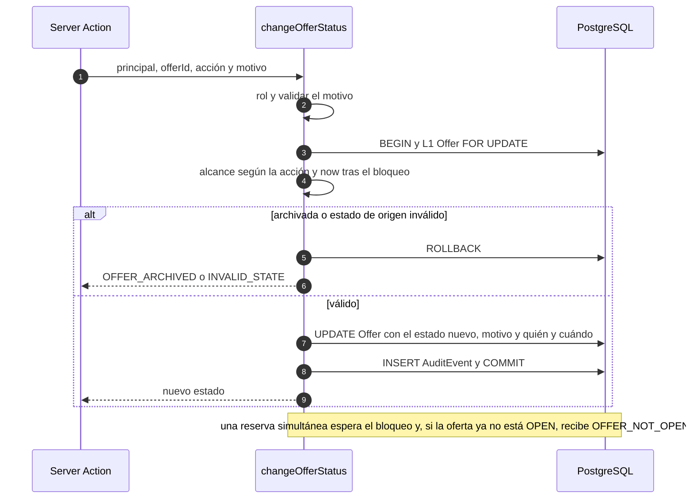

#### TX-04.3 Pseudocódigo

```ts
async function changeOfferStatus(principal, input, { clock }) {
  const need = input.action === 'ARCHIVE' ? 'GAD_OR_ADMIN' : 'OPERATOR';
  requireRoleFor(principal, need);                                                    // FORBIDDEN
  validateReason(input.reason, { min: 0, max: 500 });                                 // longitud máxima: VALIDATION_ERROR (reason) antes de la transacción
  try { return await runWithDeadlockRetry(() => withTx(async (tx) => {
    const offer = await lockOffer(tx, input.offerId);                                 // L1 exclusivo
    if (!offer || !inScope(principal, input.action, offer)) throw new AppError('NOT_FOUND');
    // inScope: SUSPEND/RESUME ⇒ isOperatorOf(attractionId); ARCHIVE ⇒ isGadMember(gadId) || isAdmin
    const now = clock.now();                                                          // tras el bloqueo
    // Motivo obligatorio cuando archiva el ADMIN (no es miembro del GAD de la oferta): se decide con el alcance de la fila bloqueada
    if (input.action === 'ARCHIVE' && !isGadMember(principal, offer.gadId) && !input.reason) throw new AppError('VALIDATION_ERROR', { fieldErrors: { reason: ['REQUIRED'] } });
    if (offer.status === 'ARCHIVED') throw new AppError('OFFER_ARCHIVED');
    const from = ORIGIN[input.action];                                                // SUSPEND: ['OPEN'], RESUME: ['SUSPENDED'], ARCHIVE: ['OPEN','SUSPENDED']
    if (!from.includes(offer.status)) throw new AppError('INVALID_STATE', { details: { currentStatus: offer.status } });
    const to = TARGET[input.action];
    const upd = await tx.offer.updateMany({ where: { id: offer.id, status: { in: from } },
      data: { status: to, statusReason: input.action === 'RESUME' ? null : (input.reason ?? null),
              statusChangedAt: now, statusChangedById: principal.userId, updatedAt: now } });
    if (upd.count !== 1) throw new DefectError('cambio de estado sin fila');          // con L1 exclusivo no puede ocurrir
    await auditInTx(tx, now, { action: AUDIT[input.action], resourceType: 'Offer', resourceId: offer.id, result: 'SUCCESS', actor: principal,
                               metadata: { from: offer.status, to, ...(input.reason ? { reasonLength: codePointLength(input.reason) } : {}) } });
    return { status: to };
  })); } catch (e) { await auditRejectionBestEffort(e, principal, input); throw toAppError(e); }
}
```

Nota: la **versión de trabajo** (si existe) **no** se toca al archivar: queda `DRAFT`/`IN_REVIEW`/`CHANGES_REQUESTED`, **inerte**, porque TX-01, TX-02 y TX-03 rechazan una oferta `ARCHIVED` (`OFFER_ARCHIVED`). Se conserva como historial.

#### TX-04.4 Escrituras y resultado de cada rama

| Rama | Condición | Escrituras | Resultado | Auditoría |
|---|---|---|---|---|
| 1 | `SUSPEND` desde `OPEN` | `UPDATE Offer` (`SUSPENDED`, `statusReason?`, `statusChangedAt/ById`), `AuditEvent` | `SUSPENDED` | `offer.suspend` `SUCCESS` |
| 2 | `RESUME` desde `SUSPENDED` | `UPDATE Offer` (`OPEN`, `statusReason = NULL`, `statusChanged*`) | `OPEN` | `offer.resume` `SUCCESS` |
| 3 | `ARCHIVE` desde `OPEN`/`SUSPENDED` (GAD o ADMIN con motivo) | `UPDATE Offer` (`ARCHIVED`, `statusReason`, `statusChanged*`) | `ARCHIVED` (terminal) | `offer.archive` `SUCCESS` |
| 4 | Sin rol / fuera de alcance | Ninguna | `FORBIDDEN` / `NOT_FOUND` | `DENIED` |
| 5 | Oferta `ARCHIVED` | Ninguna | `OFFER_ARCHIVED` | `CONFLICT` |
| 6 | Estado de origen inválido (repetir la acción, `UNPUBLISHED`, reanudar una `OPEN`) | Ninguna | `INVALID_STATE` (`currentStatus`) | `CONFLICT` |
| 7 | Motivo inválido o ausente para `ADMIN` | Ninguna | `VALIDATION_ERROR` (`reason`) | No |

#### TX-04.5 Compatibilidad con 03, idempotencia y concurrencia

- **Objetos de 03:** `ck_offer_statusmeta` (`SUSPENDED`/`ARCHIVED` ⇒ `statusChangedAt` y `statusChangedById` no nulos) se cumple en el mismo `UPDATE`; `ck_offer_reason` (1–500); `ck_offer_pointers` no se ve afectado (el puntero público ya existe; estos estados exigen `publicVersionId` no nulo); `tg_offer_guard` rechaza cualquier `UPDATE` sobre una fila `ARCHIVED` (terminal).
- **Idempotencia:** por estado; repetir la acción da `INVALID_STATE`/`OFFER_ARCHIVED` y no duplica auditoría. No hay estado intermedio.
- **Concurrencia con reservas y liquidaciones:** se serializa por el bloqueo exclusivo. *Reservar × suspender/archivar* (T-RES-18): si gana la acción, la reserva posterior ve la oferta no `OPEN` ⇒ `OFFER_NOT_OPEN`; si gana la reserva, queda `HELD` y la suspensión/archivo se aplica después **sin** tocarla. Un pago de una retención vigente **sigue confirmándose** (D-42); una captura tardía exige oferta `OPEN` (TX-09, L-11).
- **Entradas emitidas:** nada aquí las modifica (el comprador conserva el acceso, 01 §8.3). Si el operador puede registrar ingresos de una oferta suspendida o archivada lo decide TX-12: sí puede, porque el estado de la oferta no es condición de ingreso (D-79).
- **Con edición/envío/aprobación:** ver OFF.2 y TX-03.6.

#### TX-04.6 Pruebas

| ID | Nivel | Preparación | Acciones | Aserciones |
|---|---|---|---|---|
| T-OFE-15a | I | Oferta `OPEN` con una retención vigente y una reserva confirmada con entradas. | `operador.laguna` suspende (con y sin motivo); después reanuda. | `SUSPENDED` con `statusChangedAt = now` y `statusChangedById`; fuera del listado del catálogo y visible en el detalle; una reserva nueva ⇒ `OFFER_NOT_OPEN`; la retención y la reserva existentes **sin cambio** y las entradas legibles; al reanudar: `OPEN`, `statusReason` nulo. 1 `AuditEvent` por cambio. |
| T-OFE-15b | I | Ofertas `OPEN`, `SUSPENDED` y `UNPUBLISHED`. | Suspender dos veces; reanudar una `OPEN`; suspender la inédita; suspender como `operador.cascada`, `gad.sanisidro` y `admin`. | `INVALID_STATE` (con `currentStatus`); `INVALID_STATE`; `INVALID_STATE`; `NOT_FOUND`; `FORBIDDEN`; `FORBIDDEN` (el administrador no suspende). Sin cambios ni auditorías de éxito. |
| T-OFE-16a | I | Ofertas `OPEN` y `SUSPENDED` con reservas, pagos y entradas, y v2 `IN_REVIEW` en una de ellas. | Archivar como `gad.sanisidro`; como `admin` sin y con motivo; como `gad.colibries`. | GAD: `ARCHIVED`; `admin` sin motivo ⇒ `VALIDATION_ERROR` (`reason`), con motivo ⇒ `ARCHIVED`; otro GAD ⇒ `NOT_FOUND`. Tras archivar: reservas, pagos y entradas **idénticos** (misma fila, mismo `updatedAt`); la v2 sigue `IN_REVIEW` y **inerte** (editar, enviar, decidir ⇒ `OFFER_ARCHIVED`); la oferta sale del catálogo; nueva reserva ⇒ `OFFER_NOT_OPEN`; ninguna otra transición (T-OFE-16 y D-29). |
| T-RES-18 | C | Oferta `OPEN` con cupo. `ctrl` toma `barrera.offer`. | A la vez: suspender y una reserva de otro comprador; `esperarBloqueadas(2)`; `liberar()`. | **En ambos órdenes**: si la reserva existe, su `createdAt ≤ Offer.statusChangedAt` (se hizo antes de la suspensión) y sigue `HELD`; si no, `OFFER_NOT_OPEN`. Nunca una reserva creada **después** de la suspensión. |
| T-OFE-16c | C | v2 `IN_REVIEW` de una oferta publicada. `ctrl` toma `barrera.offer`. | A la vez: aprobar v2 y archivar la oferta; `esperarBloqueadas(2)`; `liberar()`. | **En ambos órdenes**: si ganó la aprobación, `publicVersionId = v2` y la oferta termina `ARCHIVED`; si ganó el archivo, la aprobación da `OFFER_ARCHIVED` y v2 sigue `IN_REVIEW`, `publicVersionId` **sin cambio**. Nunca una versión `APPROVED` apuntada en una oferta que se aprobó después de archivarse. |
| T-OFE-16d | C | Oferta `OPEN`. `ctrl` toma `barrera.offer`. | A la vez: archivar y una reserva. | Igual que T-RES-18 con `ARCHIVED`. |
| T-OFE-15c | I | Oferta `SUSPENDED` con v2 `IN_REVIEW`. | Aprobar v2. | `APPROVED`, puntero movido, la oferta **sigue** `SUSPENDED`. |

### TX-05 — Reserva grupal con idempotencia

**Qué cambia respecto al texto condensado anterior** (H-35, H-36, H-39): (1) desaparece la consulta rápida de la clave **fuera** de la transacción; la reconsulta ocurre dentro, **justo después del bloqueo asesor y antes** de mirar la oferta, los límites o los cupos; (2) `now` se toma después del bloqueo de `Offer`; (3) la recuperación ante un choque de unicidad se hace tras revertir, nunca dentro de la transacción abortada.

#### TX-05.1 Entradas, autorización y validaciones

Servicio: `createReservation(principal, input, deps: { clock })` en `modules/reservations/application/`. `input` ya viene deserializado por la Server Action `createReservationAction` (el esquema campo a campo de la acción es de 05 §3).

| Campo | Tipo | Validación (antes de la transacción) |
|---|---|---|
| `offerId` | UUID | Formato. |
| `offerVersionId` | UUID | Formato. Es la versión que el comprador vio. |
| `requestKey` | UUID | Formato. La genera el cliente al abrir el formulario y la conserva en los reenvíos. |
| `attendees` | arreglo de 1 a 10 | Cada elemento: `fullName` normalizado (NFC, recorte, espacios simples) de 2–120 puntos de código; `birthDate` opcional con formato `YYYY-MM-DD` y fecha real. `quantity = attendees.length`. |
| `termsAccepted` | `true` | Debe ser exactamente `true` (si no, `VALIDATION_ERROR` en el campo). |

Cualquier otro campo (precio, total, cantidad, estado) se **descarta** (`strip`) y no se lee jamás (T-RES-03). El comprador es siempre `principal.userId`, nunca un dato del cuerpo.

**Autorización.** Principal autenticado (`UNAUTHENTICATED` lo resuelve el envoltorio) con asignación `TOURIST` (`FORBIDDEN`). No hay otro permiso: un recurso ajeno no existe aquí, porque la clave de solicitud está acotada **al comprador**.

**Hash de la solicitud** (cálculo puro, fuera de la transacción):

```ts
const attendees = input.attendees.map(a => ({ fullName: normalizeName(a.fullName), birthDate: a.birthDate ?? null }));
const requestHash = sha256Hex(JSON.stringify({            // orden de claves fijo
  v: 1, offerId: input.offerId, offerVersionId: input.offerVersionId, attendees }));
```

Incluye la oferta, la versión vista y los asistentes normalizados **en el orden del formulario**; no incluye `requestKey` ni `termsAccepted`. La etiqueta `v` permite cambiar el formato en el futuro sin colisionar con hashes anteriores.

**Validaciones que dependen del estado** (dentro de la transacción, en este orden; el orden decide qué error ve el usuario cuando fallan varias a la vez):

| # | Comprobación | Error |
|---|---|---|
| 1 | Reconsulta de `(buyerId, requestKey)`: existe y hash igual ⇒ **devolver la reserva existente**; hash distinto ⇒ conflicto | `IDEMPOTENCY_KEY_REUSED` |
| 2 | La oferta existe y no es `UNPUBLISHED` (nunca fue pública: no se revela su existencia) | `NOT_FOUND` |
| 3 | `offer.status = OPEN` (suspendida o archivada) | `OFFER_NOT_OPEN` |
| 4 | `offer.publicVersionId = offerVersionId` | `VERSION_CHANGED` (`details.currentVersionId`) |
| 5 | `version.startsAt > now` | `ACTIVITY_NOT_FUTURE` |
| 6 | Edad de cada asistente en la fecha local de inicio si la versión tiene `minAge`; `birthDate` presente sin `minAge` ⇒ error del campo | `VALIDATION_ERROR` con `fieldErrors` (p. ej. `attendees.2.birthDate`) |
| 7 | Retenciones vigentes del comprador: ya hay 1 en esta oferta, o ya hay 3 en total | `HOLD_LIMIT_REACHED` (`details.scope`: `OFFER` o `BUYER`) |
| 8 | `capacity − comprometido ≥ quantity` | `INSUFFICIENT_CAPACITY` (`details.available`, nunca negativo) |

*Por qué la comprobación 1 va antes que 7 y 8.* Un reintento de una solicitud **ya procesada** (respuesta perdida, doble clic, `COMMIT` ambiguo) ve ahora al propio comprador con una retención vigente en esta oferta y, quizá, con la última plaza ocupada por él mismo. Si evaluara límites o cupo primero, un reintento legítimo devolvería `HOLD_LIMIT_REACHED` o `INSUFFICIENT_CAPACITY` aunque la reserva exista. La comprobación 1 va además **antes** del bloqueo de `Offer`: tras el bloqueo asesor el resultado es definitivo (ninguna otra TX-05 del mismo comprador puede estar insertando) y un reintento no tiene por qué esperar a la oferta.

*Por qué no hay consulta previa fuera de la transacción.* Duplicaría la ruta de código sin cerrar la carrera (el reintento puede entrar entre la consulta y la transacción) y la reconsulta dentro de la transacción es suficiente y barata.

#### TX-05.2 Secuencia

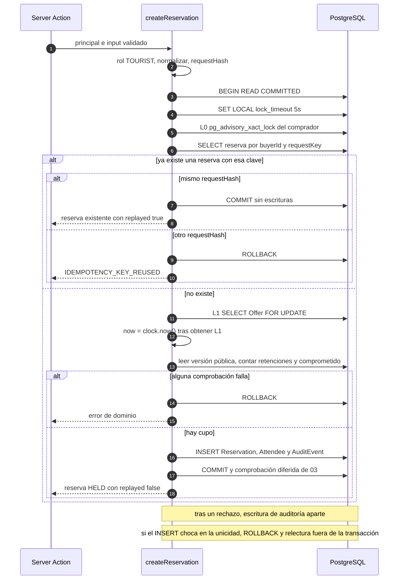

#### TX-05.3 Pseudocódigo con límites de transacción y bloqueos

Pseudocódigo en TypeScript: no es código verificado ni usa la API exacta de Prisma 7.

```ts
async function createReservation(principal, input, { clock } = defaultDeps): Promise<ReservationSummary> {
  requireRole(principal, 'TOURIST');                               // FORBIDDEN
  const buyerId = principal.userId;
  const attendees = input.attendees.map(normalizeAttendee);
  const requestHash = hashRequest(input.offerId, input.offerVersionId, attendees);

  try {
    return await runWithDeadlockRetry(() => withTx(async (tx) => {
      // ═════════ TRANSACCIÓN: comienza (READ COMMITTED, maxWait 5 s, timeout 10 s) ═════════
      // 1.ª sentencia dentro de withTx:  SET LOCAL lock_timeout = '5s'

      await advisoryLockBuyer(tx, buyerId);                        // L0

      // (R) Reconsulta idempotente: antes de oferta, límites y cupo
      const prior = await tx.reservation.findUnique({ where: { buyerId_requestKey: { buyerId, requestKey: input.requestKey } } });
      if (prior) return resolveReplay(prior, requestHash);         // devuelve resumen replayed:true o lanza IDEMPOTENCY_KEY_REUSED

      const offer = await lockOffer(tx, input.offerId);            // L1  (sentencia de una sola tabla)
      if (!offer || offer.status === 'UNPUBLISHED') throw new AppError('NOT_FOUND');

      const now = clock.now();                                     // ← UNA vez, DESPUÉS de L0 y L1 (principio 5)

      if (offer.status !== 'OPEN') throw new AppError('OFFER_NOT_OPEN');
      if (offer.publicVersionId !== input.offerVersionId)
        throw new AppError('VERSION_CHANGED', { details: { currentVersionId: offer.publicVersionId } });

      const v = await tx.offerVersion.findUniqueOrThrow({ where: { id: offer.publicVersionId } });  // APPROVED: inmutable
      if (!(v.startsAt > now)) throw new AppError('ACTIVITY_NOT_FUTURE');

      const fieldErrors = validateAttendees(attendees, v.minAge, v.startsAt);   // edad en fecha local de startsAt (03 §7)
      if (fieldErrors) throw new AppError('VALIDATION_ERROR', { fieldErrors });

      const holds = await countBuyerHolds(tx, buyerId, offer.id, now);          // 03 §8.6, consulta 3
      if (holds.onOffer >= 1) throw new AppError('HOLD_LIMIT_REACHED', { details: { scope: 'OFFER' } });
      if (holds.total   >= 3) throw new AppError('HOLD_LIMIT_REACHED', { details: { scope: 'BUYER' } });

      const committed = await countCommitted(tx, offer.id, now, null);          // 03 §8.6, consulta 2
      const available = v.capacity - committed;
      if (attendees.length > available)
        throw new AppError('INSUFFICIENT_CAPACITY', { details: { available: Math.max(0, available) } });

      const quantity = attendees.length;
      const reservation = await tx.reservation.create({ data: {
        buyerId, offerId: offer.id, offerVersionId: v.id, status: 'HELD',
        quantity, unitPriceCents: v.priceCents, totalCents: v.priceCents * quantity, currency: 'USD',
        expiresAt: minDate(addMinutes(now, 15), v.startsAt),                    // D-33
        requestKey: input.requestKey, requestHash,
        termsAcceptedAt: now, createdAt: now, updatedAt: now,                   // explícitos: ck_res_ranges exige expiresAt > createdAt
        attendees: { create: attendees.map((a, i) => ({ position: i + 1, fullName: a.fullName, birthDate: a.birthDate, createdAt: now })) },
      }});
      await auditInTx(tx, now, { action: 'reservation.create', resourceType: 'Reservation', resourceId: reservation.id,
        result: 'SUCCESS', actor: principal, metadata: { offerId: offer.id, versionId: v.id, quantity, totalCents: reservation.totalCents, expiresAt: reservation.expiresAt } });

      return toSummary(reservation, { replayed: false });
      // ═════════ TRANSACCIÓN: COMMIT al devolver. Aquí corre fn_check_reservation (03 §8.4). ═════════
    }));
  } catch (e) {
    // La transacción ya está revertida: nada de lo siguiente usa `tx`.
    if (isUniqueViolation(e, 'Reservation_buyerId_requestKey_key')) {          // SQLSTATE 23505 + nombre de la restricción
      const prior = await db.reservation.findUnique({ where: { buyerId_requestKey: { buyerId, requestKey: input.requestKey } } });   // consulta NUEVA
      if (prior) return resolveReplay(prior, requestHash);                     // una sola recuperación; sin reintentar la inserción
    }
    await auditRejectionBestEffort(e, principal, input);                       // escritura aparte (principio 7)
    throw toAppError(e);                                                       // 55P03/timeout → BUSY_TRY_AGAIN; el resto no previsto → INTERNAL_ERROR
  }
}

function resolveReplay(prior, requestHash) {
  if (prior.requestHash !== requestHash) throw new AppError('IDEMPOTENCY_KEY_REUSED');
  return toSummary(prior, { replayed: true });
}
```

Notas de lectura:
- `replayed: true` devuelve la reserva **tal como está ahora** (puede ser `HELD`, `EXPIRED`, `CONFIRMED`…): repetir una solicitud no vuelve a evaluar nada.
- El nombre `Reservation_buyerId_requestKey_key` sigue la convención de Prisma para `@@unique([buyerId, requestKey])` y **no se verificó**; la comprobación real se hace con el nombre que genere la migración (§5).
- El `catch` solo contiene lógica de **después** de la reversión. Un `AppError` lanzado dentro del callback atraviesa `withTx` (que revierte) y llega aquí; no hay nada que deshacer porque las ramas de rechazo no escriben.

#### TX-05.4 Escrituras y resultado de cada rama

| Rama | Condición | Escrituras en la transacción | Resultado | Auditoría |
|---|---|---|---|---|
| A0 | Existe `(buyerId, requestKey)` con el mismo hash | Ninguna (`COMMIT` vacío) | Resumen con `replayed: true` | No |
| A1 | Existe con otro hash | Ninguna | `IDEMPOTENCY_KEY_REUSED` | `CONFLICT`, aparte |
| A2 | Oferta inexistente o `UNPUBLISHED` | Ninguna | `NOT_FOUND` | No |
| A3 | Oferta no `OPEN` | Ninguna | `OFFER_NOT_OPEN` | `CONFLICT`, aparte |
| A4 | Versión vista distinta de la pública | Ninguna | `VERSION_CHANGED` + versión vigente | `CONFLICT`, aparte |
| A5 | `startsAt ≤ now` | Ninguna | `ACTIVITY_NOT_FUTURE` | `CONFLICT`, aparte |
| A6 | Edad o `birthDate` inválidos | Ninguna | `VALIDATION_ERROR` con campos | No (error de formulario) |
| A7 | Límite de retenciones | Ninguna | `HOLD_LIMIT_REACHED` + `scope` | `CONFLICT`, aparte |
| A8 | Cupo insuficiente | Ninguna | `INSUFFICIENT_CAPACITY` + `available` | `CONFLICT`, aparte |
| A9 | Todo correcto | `INSERT Reservation` (`HELD`), `INSERT Attendee` × `quantity`, `INSERT AuditEvent` (`SUCCESS`) | Resumen con `replayed: false` | Sí, en la transacción |
| A10 | `55P03` o tiempo agotado | Ninguna (revertida) | `BUSY_TRY_AGAIN` | No (solo log) |
| A11 | `23505` en `(buyerId, requestKey)` al insertar | Ninguna (revertida) | Relectura fuera de la transacción: mismo hash ⇒ `replayed: true`; otro ⇒ `IDEMPOTENCY_KEY_REUSED`; no existe ⇒ `INTERNAL_ERROR` | Como A0/A1 |
| A12 | Cualquier otro error de base de datos (`23503`, `23514`, `TC_…`, `25P02`, `23505` de otra restricción) | Ninguna (revertida) | `INTERNAL_ERROR` | No (log con `requestId`) |

Todas las ramas de rechazo ocurren **antes** de escribir: no hay nada que revertir salvo la propia transacción vacía.

#### TX-05.5 Compatibilidad con los objetos de 03 §8

| Objeto de 03 | Qué exige a la rama A9 | Cómo se cumple |
|---|---|---|
| FK compuesta `(offerVersionId, offerId) → OfferVersion` | La versión es de esa oferta | Es la versión apuntada por `offer.publicVersionId`, que a su vez es FK compuesta del mismo `offerId`. |
| `tg_reservation_guard` (INSERT) | La versión contratada está `APPROVED` | Lo está: es la versión pública. |
| `ck_res_ranges` | `quantity` 1–10; `totalCents = unitPriceCents × quantity`; `expiresAt > createdAt` | Totales del servidor; `createdAt = now` **explícito** y `startsAt > now` ⇒ `expiresAt > now`. |
| `ck_res_state`, `ck_res_currency` | `HELD`: sin `confirmedAt` ni campos de revisión; `USD` | Valores por defecto de la inserción. |
| Único `(buyerId, requestKey)` | — | A11 (regla 8). |
| Comprobación diferida `fn_check_reservation` | Al `COMMIT`: `Attendee` = `quantity`; sin pago ni entradas | Los `Attendee` se insertan **en la misma transacción** (creación anidada); el orden de las inserciones es indiferente. |
| Privilegios de `tc_app` | `INSERT` en `Reservation`, `Attendee`, `AuditEvent` | Concedido (03 §8.5). |

#### TX-05.6 Errores, reintentos e idempotencia

| Situación | Qué ocurre |
|---|---|
| Respuesta perdida o `COMMIT` ambiguo; el cliente repite con la **misma** clave y contenido | A0: recibe la reserva original, sin duplicar ni reevaluar límites o cupos (T-RES-07a a c). |
| Doble clic simultáneo | Las dos llamadas se serializan en L0; la segunda ve a la primera en la reconsulta (T-RES-08a). |
| Misma clave, contenido distinto (otro nombre, otro orden, otra oferta) | `IDEMPOTENCY_KEY_REUSED`; nunca crea una reserva nueva (T-RES-07d, 08b). |
| Misma clave de **otro** comprador | Independiente: la unicidad es por comprador (T-RES-07e). |
| `BUSY_TRY_AGAIN` | No se aplicó nada; el cliente puede repetir con la misma clave sin riesgo. |
| Interbloqueo `40P01` | Reintento automático de la transacción completa (hora y bloqueos nuevos). El orden de bloqueos (§2) lo hace improbable. |
| Oferta cambió de versión entre que el cliente la vio y reservó | `VERSION_CHANGED`; el cliente debe mostrar las nuevas condiciones y **generar una `requestKey` nueva** (las condiciones cambian el contenido). |
| La retención venció y el cliente repite la misma clave | A0: la reserva (`HELD` vencida o `EXPIRED`) se devuelve tal cual; no se crea otra. Para reservar de nuevo se necesita una clave nueva (el formulario genera una al abrirse). |

#### TX-05.7 Pruebas concurrentes

**Notación** (técnica de barrera de [08 §2](08-pruebas-y-evidencias.md); ayudantes de `tests/helpers/`):

| Ayudante | Qué hace |
|---|---|
| `ctrl` | Conexión de control **distinta del *pool* del servicio**, con privilegios de propietario. |
| `barrera.offer(offerId)` | `ctrl`: `BEGIN; SELECT … FROM "Offer" WHERE "id" = $1 FOR UPDATE`. |
| `barrera.comprador(buyerId)` | `ctrl`: `SELECT pg_advisory_lock(hashtextextended('hold-buyer:' \|\| $1, 0))` (de sesión) y, al liberar, `pg_advisory_unlock`. |
| `esperarBloqueadas(n)` | Sondea `pg_stat_activity` (misma base, `application_name` de la aplicación de pruebas) hasta contar `n` sesiones con `wait_event_type = 'Lock'`; tope de 10 s, tras el cual **la prueba falla**. Es una condición observable, no una espera fija. |
| `lanzar(llamada)` | Inicia la promesa **sin** esperar su resultado. Cuando importa el orden, se lanza una por una llamando `esperarBloqueadas(k)` entre cada lanzamiento. |
| `reloj` | `FakeClock` fijado en `T0`; `reloj.advance(ms)`. Con `JOBS_ENABLED=false`. |
| `liberar()` | `COMMIT` (o `ROLLBACK`) de `ctrl`; si es barrera de sesión, la libera. |
| Fábricas | `crearOfertaAbierta({capacidad, inicio, precio, minAge?})` (patrón de tres pasos de 03 §9.2, versión pública `APPROVED`), `crearTurista()`, `crearReservaRetenida({comprador, oferta, cantidad, creadaEn, venceEn})`, `crearPagoConOrden(reserva)`. |

Las aserciones leen la base con `ctrl` **después** de `liberar()` y de resolver todas las promesas. Los subcasos con letra amplían un identificador existente de 08 §3 sin crear identificadores nuevos.

| ID | Nivel | Preparación | Acciones | Aserciones |
|---|---|---|---|---|
| T-RES-07a | I | Comprador B con 3 retenciones vigentes; la tercera la creó con la clave `K1`. | B repite `K1` con el mismo contenido. | Devuelve la reserva de `K1` con `replayed = true`; **no** `HOLD_LIMIT_REACHED`; B sigue con exactamente 3 reservas. |
| T-RES-07b | I | Oferta de capacidad 1; B reservó la última plaza con `K1`. | B repite `K1`. | Misma reserva; **no** `INSUFFICIENT_CAPACITY`; disponibilidad sigue 0. |
| T-RES-07c | I | B reservó con `K1`; después la oferta se suspende y se publica otra versión. | B repite `K1` con el contenido original (`offerVersionId` antiguo). | Misma reserva; **no** `OFFER_NOT_OPEN` ni `VERSION_CHANGED`. |
| T-RES-07d | I | Los tres escenarios anteriores. | Repetir `K1` cambiando un nombre. | `IDEMPOTENCY_KEY_REUSED`; ninguna fila nueva. |
| T-RES-07e | I | B ya usó `K1`. | Otro comprador B2 envía `K1` con el mismo contenido. | B2 crea su propia reserva (id distinto); la de B no cambia. |
| T-RES-08a1 | C | Oferta de capacidad 3; B con 2 retenciones vigentes en otras ofertas. | `barrera.offer(O)`; `lanzar` dos llamadas idénticas `(P, K)`; `esperarBloqueadas(2)` (una en `Offer`, otra en el bloqueo asesor); `liberar()`. | Ambas devuelven éxito con el **mismo** `reservationId`; exactamente una con `replayed = false`; 1 fila `Reservation` para `(B, K)` y 1 `Attendee`; 1 `AuditEvent reservation.create` `SUCCESS`; B tiene 3 vigentes; **ninguna** devuelve `HOLD_LIMIT_REACHED` (lo haría si la segunda evaluase límites antes de reconsultar). |
| T-RES-08a2 | C | Oferta de capacidad 1, B sin retenciones. | Igual que 08a1. | Igual, y **ninguna** devuelve `INSUFFICIENT_CAPACITY`; disponibilidad 0. |
| T-RES-08b | C | Oferta con cupo. | Como 08a1 pero la segunda llamada con otro nombre de asistente (misma `K`). | Exactamente una éxito y otra `IDEMPOTENCY_KEY_REUSED` (la afortunada no es predecible: la aserción es simétrica); 1 fila `(B, K)`; su `requestHash` coincide con el de la llamada que tuvo éxito. |
| T-RES-08c | C | Ofertas `O1` y `O2`; comprador B. `ctrl`: `BEGIN` + `INSERT Reservation(B, O2, clave K, hash H2, 1 asistente)` + su `Attendee`, **sin `COMMIT`** (toma `FOR KEY SHARE` en `O2`, no en `O1`). | `lanzar(createReservation(B, K, contenido sobre O1))`; `esperarBloqueadas(1)` (bloqueada en el índice único); `liberar()` (`COMMIT` de `ctrl`). | Resultado `IDEMPOTENCY_KEY_REUSED` (el hash de `ctrl` es otro), **no** `INTERNAL_ERROR` ni `25P02`; no existe reserva `(B, O1)`; la fila `(B, K)` es la de `ctrl`; 1 `AuditEvent reservation.create` `CONFLICT`; una consulta posterior por el mismo *pool* funciona y no quedan sesiones `idle in transaction (aborted)`. *(La rama «mismo hash ⇒ replay» tras un choque no se puede provocar de forma determinista sin alterar el código: se cubre con la prueba unitaria de `resolveReplay`.)* |
| T-RES-09a | C | Oferta de capacidad 5; 6 compradores distintos sin retenciones. | `barrera.offer`; 6 llamadas con `quantity = 2`; `esperarBloqueadas(6)`; `liberar()`. | 2 éxitos y 4 `INSUFFICIENT_CAPACITY` con `details.available = 1` (el resultado no depende del orden); 2 filas `HELD`; comprometido = 4 ≤ 5. |
| T-RES-09b | C | Oferta de capacidad 1; 8 compradores. | 8 llamadas con `quantity = 1`. | 1 éxito y 7 `INSUFFICIENT_CAPACITY` con `available = 0`; comprometido = 1. |
| T-RES-10a | C | Capacidad 1. A tiene una retención `HELD` de 1 con `expiresAt = T0 + 60 s`. Comprador B. | `barrera.offer`; `lanzar` B; `esperarBloqueadas(1)`; `reloj.advance(61 s)`; `liberar()`. | B tiene éxito (la retención de A ya no cuenta); `B.createdAt = T0 + 61 s` **exacto** y `B.expiresAt = T0 + 61 s + 15 min`; A sigue `HELD` (J1 desactivado) y el comprometido vigente es 1. *Una implementación que tomara `now` antes de esperar daría `INSUFFICIENT_CAPACITY`.* |
| T-RES-10a′ | C | Igual. | Igual pero `reloj.advance(30 s)`. | B recibe `INSUFFICIENT_CAPACITY` con `available = 0` (la retención de A sigue vigente). |
| T-RES-10b | C | Oferta con `startsAt = T0 + 30 s`. | `barrera.offer`; `lanzar` B; `esperarBloqueadas(1)`; `reloj.advance(31 s)`; `liberar()`. | `ACTIVITY_NOT_FUTURE`; no se crea reserva. Con `advance(10 s)`: éxito y `expiresAt = startsAt` (D-33). |
| T-RES-15a | C | B tiene 2 retenciones vigentes (ofertas `O1`, `O2`); ofertas abiertas `O3`, `O4`, `O5`. | `barrera.comprador(B)`; 3 llamadas con claves y ofertas distintas; `esperarBloqueadas(3)`; `liberar()`. | Exactamente 1 éxito y 2 `HOLD_LIMIT_REACHED` con `details.scope = 'BUYER'`; B tiene 3 vigentes (nunca 4). |
| T-RES-15b | C | B sin retenciones; una oferta `O`. | `barrera.comprador(B)`; 2 llamadas con claves distintas sobre `O`. | 1 éxito y 1 `HOLD_LIMIT_REACHED` con `scope = 'OFFER'`. |
| T-RES-15c | C | `barrera.comprador(B)` tomada. | Una solicitud de **otro** comprador B2 sobre otra oferta. | Se completa **mientras la barrera sigue tomada**: el bloqueo es por comprador, no global. |

Cobertura de las demás ramas con pruebas que ya existen en 08 §3 (sin concurrencia): A2 y A3 `T-RES-13`; A4 `T-RES-04`; A5 `T-RES-13` y `T-RES-16`; A6 `T-RES-05`, `T-RES-06`; A9 `T-RES-01`, `T-RES-02`, `T-RES-03`; A10 y A12, pruebas de infraestructura de `withTx` (P0-03). La reserva frente a la aprobación o la suspensión (`T-RES-17`, `T-RES-18`) se especifica con TX-03 y TX-04.

### TX-06 — Vencimiento de retenciones (J1 `expire-holds`)

**Precondiciones y escritura.** Sin autorización de usuario (trabajo interno, 60 s y al arrancar). Una sentencia por lote, sin bloqueo de `Offer` (no altera el inventario: lo vencido ya no contaba, D-31):

```sql
UPDATE "Reservation" SET "status" = 'EXPIRED', "updatedAt" = $now
 WHERE "id" IN (SELECT "id" FROM "Reservation" WHERE "status" = 'HELD' AND "expiresAt" <= $now
                ORDER BY "expiresAt" LIMIT 500 FOR UPDATE SKIP LOCKED);
```

`SKIP LOCKED` evita esperar filas que una liquidación o captura tiene bloqueadas (TX-07/08/09): se recogen en la pasada siguiente. Se repite por lotes hasta que afecte menos de 500 filas. Si afectó filas, **un** `AuditEvent` `reservation.expire_batch` (`job`, `count`) en la misma transacción; con 0 filas no se audita. `now` se toma justo antes de la sentencia (no hay decisión que dependa de bloqueos: solo marca lo ya vencido).

| Caso | Resultado |
|---|---|
| Idempotencia / J1 detenido | Repetir da 0 filas; con J1 detenido los cupos se liberan igual (`expiresAt`, RO-07). |
| Liquidación simultánea (TX-09) | Si TX-09 tiene la fila, J1 la salta; si J1 va primero, TX-09 trata `EXPIRED` como no vigente (L-10/L-11). Una `CONFIRMED` nunca coincide con `status = 'HELD'`. |
| Comprobación diferida de 03 | `UPDATE OF status` dispara `fn_check_reservation`: una `HELD` no tiene pago capturado ni entradas, pasa. |
| Error | `55P03`/tiempo agotado ⇒ el lote se reintenta en la pasada siguiente; nunca se notifica al usuario. |

**Pruebas clave:** T-RES-10 (cupos liberados sin J1), T-RES-11 (marca `EXPIRED`, idempotente, un solo `AuditEvent` por lote, 0 filas sin auditoría); `HELD` con pago `ORDER_CREATED` pasa a `EXPIRED` sin tocar el pago; fila bloqueada por `ctrl` se salta y se recoge después de liberar.
### TX-07 — Iniciar el pago y crear la orden

**Qué cambia respecto al texto condensado anterior** (H-41, H-43, H-44; D-72, D-73): (1) la fase A **bloquea la reserva** y toma `now` después, y exige el margen de 30 s; (2) las claves hacia PayPal pasan a UUID de 36 caracteres (el límite documentado es 38); (3) se define qué ocurre cuando PayPal falla o duplica una llamada simultánea con la misma clave y cuando la orden existe pero no se guardó; (4) la URL solo se entrega si, tras guardar la orden, la retención sigue vigente.

#### TX-07.1 Entradas, autorización y validaciones

Servicio `startPayment(principal, input, deps: { clock, gateway })` en `modules/payments/application/`; lo invoca `startPaymentAction`, que **redirige fuera de `try/catch`**. Salida: `{ paymentId, approvalUrl }`.

| Campo | Tipo | Validación |
|---|---|---|
| `reservationId` | UUID | Formato. |

No hay importes ni estados del cliente: el importe es siempre `Payment.amountCents`, igual por construcción a `Reservation.totalCents` (FK compuesta de 03 §8.2).

**Autorización.** Principal con asignación `TOURIST` (`FORBIDDEN`) y `reservation.buyerId = principal.userId`; una reserva ajena o inexistente responde `NOT_FOUND` (indistinguibles, D-14).

**Validaciones de estado** (fase A, bajo el bloqueo de la reserva y con `now` posterior; en este orden):

| # | Comprobación | Resultado |
|---|---|---|
| 1 | La reserva existe y es del comprador | `NOT_FOUND` |
| 2 | `CONFIRMED` (ya pagada) | `INVALID_STATE` con `details.reservationStatus`; la interfaz lleva a la reserva |
| 3 | `REVIEW_REQUIRED` | `PAYMENT_UNDER_REVIEW` |
| 4 | `EXPIRED`, o `HELD` con `expiresAt − now < 30 s` (`PAYMENT_MIN_REMAINING_MS`, el mismo margen de D-65) | `HOLD_EXPIRED` |
| 5 | Pago: ninguno ⇒ se crea `CREATED`; `CREATED` ⇒ reintento de la creación; `ORDER_CREATED` ⇒ se devuelve su `approvalUrl` **sin llamar a la pasarela**; `CAPTURED`/`DISCREPANT` con la reserva `HELD` ⇒ defecto (`INVALID_STATE`) | — |

**Contenido de `createOrder`** (determinista, idéntico en todos los reintentos): `idempotencyKey = createKey(paymentId)`; `amountCents` y `currency` del pago persistido; `custom_id = reservationId`; `invoice_id = paymentId`; `description` constante (`«Reserva de turismo comunitario»`, sin datos personales); `returnUrl`/`cancelUrl` = `APP_ORIGIN` + `/panel/reservas/<id>/pago/retorno` y `…/pago/cancelado` (05 §2). `createKey(paymentId)` = los 16 primeros bytes de `SHA-256("tc-create:" + paymentId)` con los bits de versión y variante de UUID fijados (36 caracteres, mismo procedimiento que `seedUuid` de 03 §9.3).

**Errores del puerto.** `createOrder` lanza `GatewayError` con `kind`: `UNAVAILABLE` (tiempo agotado, red o 5xx: se puede reintentar con la misma clave), `DUPLICATE_INVOICE` (`issue` `DUPLICATE_INVOICE_ID` de PayPal), o `REJECTED` (cualquier otro 4xx, incluido un posible rechazo por clave duplicada simultánea: PayPal documenta que ante dos solicitudes simultáneas con la misma clave procesa la primera y **puede** fallar la segunda, y **no** se halló el código HTTP ni el nombre del error). El servicio no distingue «duplicado simultáneo» de otros rechazos: ante cualquier fallo relee el pago (TX-07.3).

#### TX-07.2 Secuencia

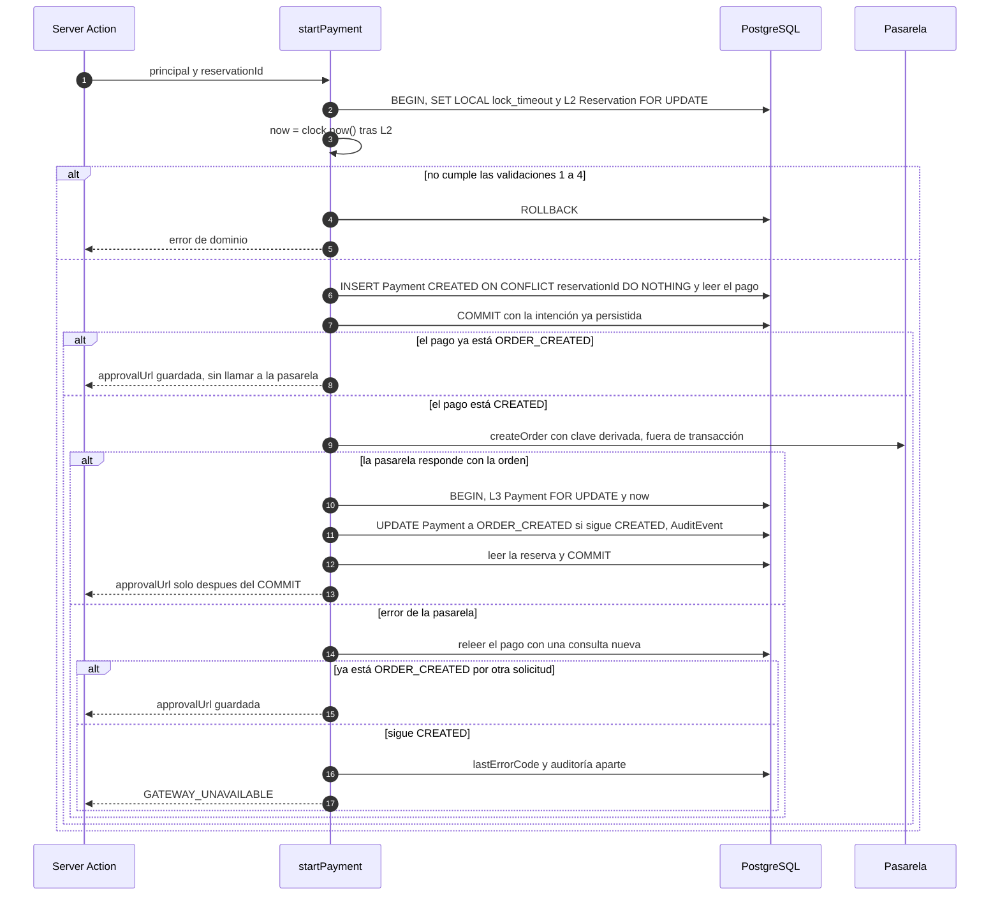

#### TX-07.3 Pseudocódigo con límites de transacción y bloqueos

```ts
async function startPayment(principal, input, { clock, gateway } = defaultDeps) {
  requireRole(principal, 'TOURIST');

  // ═════════ FASE A — transacción corta, sin red ═════════
  const a = await runWithDeadlockRetry(() => withTx(async (tx) => {
    const res = await lockReservation(tx, input.reservationId);                // L2: SELECT … FROM "Reservation" WHERE id = $1 FOR UPDATE
    if (!res || res.buyerId !== principal.userId) throw new AppError('NOT_FOUND');
    const now = clock.now();                                                   // ← DESPUÉS de L2 (principio 5)
    if (res.status === 'CONFIRMED')       throw new AppError('INVALID_STATE', { details: { reservationStatus: 'CONFIRMED' } });
    if (res.status === 'REVIEW_REQUIRED') throw new AppError('PAYMENT_UNDER_REVIEW');
    if (res.status !== 'HELD' || res.expiresAt.getTime() - now.getTime() < PAYMENT_MIN_REMAINING_MS) throw new AppError('HOLD_EXPIRED');

    // Intención: ON CONFLICT con objetivo explícito (principio 8.3): repetir la fila es lo normal en un doble clic
    await tx.$executeRaw`INSERT INTO "Payment" ("id","reservationId","provider","status","amountCents","currency","createdAt","updatedAt")
                         VALUES (gen_random_uuid(), ${res.id}, ${cfg.paymentProvider}, 'CREATED', ${res.totalCents}, 'USD', ${now}, ${now})
                         ON CONFLICT ("reservationId") DO NOTHING`;
    const pay = await tx.payment.findUniqueOrThrow({ where: { reservationId: res.id } });   // lectura simple: con L2 tomado nadie más escribe el pago salvo TX-07 fase B y TX-08 (condicionadas)
    if (pay.status === 'ORDER_CREATED') return { kind: 'ALREADY' as const, pay };
    if (pay.status !== 'CREATED') throw new AppError('INVALID_STATE', { details: { paymentStatus: pay.status } });
    return { kind: 'NEEDS_ORDER' as const, pay };
  }));
  // COMMIT: la fila Payment CREATED (la intención) ya es durable. No hay transacción ni bloqueo abiertos.
  if (a.kind === 'ALREADY') return { paymentId: a.pay.id, approvalUrl: a.pay.approvalUrl! };

  // ═════════ FASE N — red, SIN transacción ═════════
  let created: { orderId: string; approvalUrl: string };
  try {
    created = await gateway.createOrder({ idempotencyKey: createKey(a.pay.id), paymentId: a.pay.id, reservationId: a.pay.reservationId,
      amountCents: a.pay.amountCents, currency: 'USD', description: ORDER_DESCRIPTION, returnUrl: returnUrlOf(a.pay.reservationId), cancelUrl: cancelUrlOf(a.pay.reservationId) });
  } catch (e) {
    return await recoverFromCreateFailure(a.pay, e);                           // la transacción A ya terminó; esto usa consultas nuevas
  }

  // ═════════ FASE B — transacción corta ═════════
  const b = await runWithDeadlockRetry(() => withTx(async (tx) => {
    await lockPayment(tx, a.pay.id);                                           // L3
    const now = clock.now();                                                   // ← DESPUÉS de L3
    const upd = await tx.payment.updateMany({ where: { id: a.pay.id, status: 'CREATED' },
      data: { providerOrderId: created.orderId, approvalUrl: created.approvalUrl, status: 'ORDER_CREATED', orderCreatedAt: now, lastErrorCode: null, updatedAt: now } });
    let url = created.approvalUrl;
    if (upd.count === 1) {
      await auditInTx(tx, now, { action: 'payment.order_create', resourceType: 'Payment', resourceId: a.pay.id, result: 'SUCCESS', actor: principal, metadata: { paymentId: a.pay.id, provider: a.pay.provider } });
    } else {                                                                    // otra solicitud guardó antes
      const cur = await tx.payment.findUniqueOrThrow({ where: { id: a.pay.id } });
      if (cur.status !== 'ORDER_CREATED') throw new AppError('INVALID_STATE');  // defecto: el pago no pudo avanzar a otro estado desde CREATED sin pasar por aquí
      url = cur.approvalUrl!;                                                   // se entrega SIEMPRE la orden guardada, no la recién creada
      if (cur.providerOrderId !== created.orderId)                              // dos órdenes: la segunda queda huérfana (nunca se entrega su URL)
        await auditInTx(tx, now, { action: 'payment.order_create', result: 'CONFLICT', reasonCode: 'ORPHAN_ORDER', resourceType: 'Payment', resourceId: a.pay.id, actor: principal, metadata: { paymentId: a.pay.id, provider: a.pay.provider } });
    }
    const res = await tx.reservation.findUniqueOrThrow({ where: { id: a.pay.reservationId } });   // lectura sin bloqueo: solo informa la entrega
    return { url, res, now };
  }));
  // COMMIT: la orden queda guardada. SOLO a partir de aquí puede entregarse la URL.

  if (b.res.status === 'CONFIRMED')       throw new AppError('INVALID_STATE', { details: { reservationStatus: 'CONFIRMED' } });
  if (b.res.status === 'REVIEW_REQUIRED') throw new AppError('PAYMENT_UNDER_REVIEW');
  if (b.res.status !== 'HELD' || b.res.expiresAt.getTime() - b.now.getTime() < PAYMENT_MIN_REMAINING_MS)
    throw new AppError('HOLD_EXPIRED');          // la orden queda guardada; sin tiempo para aprobarla no se redirige
  return { paymentId: a.pay.id, approvalUrl: b.url };
}

async function recoverFromCreateFailure(pay, e: GatewayError) {
  const cur = await db.payment.findUnique({ where: { id: pay.id } });          // consulta NUEVA, sin transacción
  if (cur?.status === 'ORDER_CREATED') return { paymentId: pay.id, approvalUrl: cur.approvalUrl! };   // el doble clic ganó
  await bestEffort(() => db.payment.updateMany({ where: { id: pay.id, status: 'CREATED' }, data: { lastErrorCode: gatewayErrorCode(e) } }));
  await auditRejectionBestEffort('payment.order_create', 'FAILED', e.kind, pay);
  throw new AppError('GATEWAY_UNAVAILABLE', { details: { retryable: e.kind !== 'DUPLICATE_INVOICE' } });
}
```

Notas de lectura:
- La **fase A** no lleva la llamada de red dentro: termina (`COMMIT`) antes de llamar. La **fase B** abre otra transacción distinta; entre ambas no hay ninguna abierta.
- Al reintentar tras un fallo la fase A encuentra el pago en `CREATED` y vuelve a la fase N con **la misma clave** (`createKey` depende solo de `paymentId`).
- El bloqueo `L3` de la fase B solo sirve para que `now` sea posterior a cualquier espera y para serializar con la fase A de otra solicitud; la condición `status = 'CREATED'` del `UPDATE` es la que decide quién guarda.
- `redirect()` lo ejecuta la Server Action tras recibir el valor, fuera de `try/catch`.

#### TX-07.4 Escrituras y resultado de cada rama

| Rama | Condición | Escrituras | Resultado | Auditoría |
|---|---|---|---|---|
| A1 | Reserva ajena o inexistente | Ninguna | `NOT_FOUND` | No |
| A2 | `CONFIRMED` | Ninguna | `INVALID_STATE` | No |
| A3 | `REVIEW_REQUIRED` | Ninguna | `PAYMENT_UNDER_REVIEW` | No |
| A4 | `EXPIRED`, o menos de 30 s | Ninguna | `HOLD_EXPIRED` | `CONFLICT`, aparte |
| A5 | Pago ya `ORDER_CREATED` | Ninguna | `{ approvalUrl }` guardada; **sin llamada a la pasarela** | No |
| A6 | Pago inexistente | `INSERT Payment` (`CREATED`), commit | Continúa en la fase N | No |
| A7 | Pago ya `CREATED` (reintento o doble clic) | Ninguna | Continúa en la fase N | No |
| N1 | La orden se obtuvo y el `UPDATE` afecta 1 fila | `Payment` → `ORDER_CREATED` (`providerOrderId`, `approvalUrl`, `orderCreatedAt`), `AuditEvent` `SUCCESS` | `{ approvalUrl }` | Sí, en la transacción |
| N2 | La orden se obtuvo, 0 filas y es **la misma** orden | Ninguna | `{ approvalUrl }` de la guardada | No |
| N3 | La orden se obtuvo, 0 filas y es **otra** orden (huérfana) | `AuditEvent` `CONFLICT` (`ORPHAN_ORDER`) | `{ approvalUrl }` de la guardada; la huérfana nunca se entrega | Sí |
| N4 | N1/N2/N3 pero la retención ya no cumple el margen | (las de N1) | `HOLD_EXPIRED` o `PAYMENT_UNDER_REVIEW` o `INVALID_STATE` **sin** URL | Según N1 |
| E1 | `createOrder` falla y al releer el pago ya está `ORDER_CREATED` | Ninguna | `{ approvalUrl }` | No |
| E2 | `UNAVAILABLE` o `REJECTED` y sigue `CREATED` | `lastErrorCode` (mejor esfuerzo) | `GATEWAY_UNAVAILABLE` (`retryable: true`) | `FAILED`, aparte |
| E3 | `DUPLICATE_INVOICE` y sigue `CREATED` | `lastErrorCode = 'DUPLICATE_INVOICE'` | `GATEWAY_UNAVAILABLE` (`retryable: false`) | `FAILED`, aparte |
| E4 | `55P03` o tiempo agotado en A o B | Ninguna (revertida) | `BUSY_TRY_AGAIN` | No (log) |
| E5 | Otro error de base de datos | Ninguna | `INTERNAL_ERROR` | No (log) |

#### TX-07.5 Compatibilidad con los objetos de 03 §8

| Objeto | Qué exige | Cómo se cumple |
|---|---|---|
| FK compuesta `(reservationId, amountCents) → Reservation(id, totalCents)` | El importe del pago es el total de la reserva | `amountCents = res.totalCents`, leído bajo `L2`; el total es inmutable. |
| `ck_pay_state` (`CREATED`) | Sin orden, sin `approvalUrl`, sin captura | La inserción no los fija. |
| `ck_pay_state` (`ORDER_CREATED`) | `providerOrderId` y `approvalUrl` no nulos; sin captura ni `capturedAt` | Se fijan juntos en un solo `UPDATE`. |
| `ck_pay_amounts` | `approvalUrl` ≤ 2048 | El adaptador rechaza (`REJECTED`) una URL más larga. |
| Únicos `reservationId`, `providerOrderId` | Una fila por reserva; orden única | `ON CONFLICT ("reservationId")` solo absorbe el doble clic; un `23505` de `providerOrderId` es un defecto (`INTERNAL_ERROR`, regla 8). |
| `tg_payment_guard` | Claves del pago inmutables; terminal protegido | El `UPDATE` de la fase B solo cambia estado `CREATED → ORDER_CREATED` y columnas de orden. |
| Comprobación diferida `fn_check_reservation` | `CAPTURED`/`DISCREPANT`/entradas coherentes con la reserva | Se dispara por el `INSERT` y por `UPDATE OF status` del pago; con `CREATED` y `ORDER_CREATED` y reserva `HELD` no hay nada que rechazar. |
| Privilegios de `tc_app` | `INSERT` y `UPDATE` sobre `Payment` | Concedidos (03 §8.5). |

#### TX-07.6 Errores, idempotencia y recuperación

**Idempotencia.** Repetir `startPayment` es seguro: una vez guardada la orden devuelve la misma URL sin llamar a la pasarela (A5); antes de guardarla reintenta la creación con la misma clave. Nunca se crea más de un `Payment` por reserva ni se entrega más de una orden.

**Dos solicitudes simultáneas** (doble clic): se serializan en `L2`; la primera inserta el pago, la segunda lo encuentra `CREATED`. **Ambas** llaman a `createOrder` con la **misma** clave (no se añade un reclamo local: costaría una columna nueva y el peor caso es una orden huérfana sin aprobar, ver R7). Según cómo responda PayPal: (a) devuelve la misma orden a las dos ⇒ N1 y N2; (b) falla la segunda ⇒ E1 o E2 según si la primera ya guardó; (c) crea dos órdenes ⇒ N1 y N3 (gana el `UPDATE`; se entrega siempre la guardada).

**Persistencia de la intención antes de llamar.** El `Payment` en `CREATED` está confirmado antes de la llamada (fase A); la orden en PayPal no puede existir sin una fila local que la espere.

**Recuperación por punto de fallo:**

| # | Fallo | Estado local → externo | Recuperación |
|---|---|---|---|
| R1 | Antes del `COMMIT` de A | Nada → nada | Reintento normal. |
| R2 | Tras A, antes de llamar | `CREATED` → sin orden | La fila se reutiliza; no hay nada que limpiar. |
| R3 | `createOrder` agota el tiempo, falla la red o da 5xx | `CREATED` → quizá exista la orden | El comprador no recibe URL. Reintento con **la misma clave**: la guía de idempotencia (leída) dice que una repetición con la misma clave devuelve el estado más reciente de la petición anterior dentro de las garantías de retención, **que depende de la API y no está confirmada para este endpoint** (§5.2); no se presupone deduplicación indefinida. El reuso ocurre mientras la retención de 15 min está vigente. Si PayPal tratara el reintento como una creación nueva, el `invoice_id` repetido daría `DUPLICATE_INVOICE_ID` y se aplicaría R6. |
| R4 | **La orden existe pero no se guardó** (respuesta perdida, proceso caído antes de B) | `CREATED` → orden creada y sin aprobar | Igual que R3: el reintento recupera la misma orden por la clave y la guarda (B). Mientras tanto nadie puede aprobarla: la URL solo se entrega tras guardarla. |
| R5 | `createOrder` bien, pero B falla (`BUSY_TRY_AGAIN`, caída de la base) | `CREATED` → orden creada | La URL queda en memoria y **no se entrega**; el reintento actúa como en R4. |
| R6 | La clave ya no se reconoce (hipótesis: reintento tras la ventana) o la respuesta es otra | `CREATED` → posible orden huérfana | Se crearía otra orden con el mismo `invoice_id`: PayPal puede rechazarla con `DUPLICATE_INVOICE_ID` (único por cuenta de comercio por defecto). **No se halló una API para localizar una orden por `invoice_id` o `custom_id`**: no se intenta recuperar. Política de abandono (E3): el pago sigue `CREATED`, la retención vence y el comprador reserva de nuevo (otro `Payment`, otro `invoice_id`). **No hay cargo**: esa orden nunca fue aprobada porque nadie recibió su URL. Dentro de una retención de 15 min no puede ocurrir. |
| R7 | PayPal crea dos órdenes para dos solicitudes simultáneas | Ambas sin aprobar | N3: se entrega la guardada; la otra caduca sin ser aprobada. |

#### TX-07.7 Pruebas

**Extensión del adaptador `fake`** (solo para pruebas; generaliza la «latencia programable» de 05 §6.3): `fake.gate('createOrder' | 'captureOrder')` hace que cada llamada **espere** hasta que la prueba la libere; `fake.waitInFlight(n)` espera la condición «hay `n` llamadas esperando en la compuerta» (observable, no un tiempo fijo); `fake.release(k)` libera `k`; `fake.mode` fija cómo trata la clave repetida: `RETURN_SAME` (devuelve la misma orden), `FAIL_SECOND` (falla la segunda llamada simultánea con `REJECTED`), `CREATE_TWO` (ignora la clave y crea otra orden), `DUPLICATE_INVOICE` (rechaza una segunda creación para el mismo `invoice_id`); `fake.calls(op)` devuelve los argumentos recibidos. Notación de barreras y reloj: la de TX-05.7.

| ID | Nivel | Preparación | Acciones | Aserciones |
|---|---|---|---|---|
| T-PAG-01a | I | Reserva `HELD` vigente (total 12 345 centavos). | `startPayment`. En el instante de la llamada de `createOrder` la prueba lee la base con `ctrl`. | **Antes** de la llamada: `Payment` existe en `CREATED` con `amountCents = 12345` y sin `providerOrderId` (intención persistida). Argumentos de `createOrder`: importe 12345, `USD`, `custom_id = reservationId`, `invoice_id = paymentId`, clave de 36 caracteres. Al terminar: `ORDER_CREATED`, `providerOrderId` y `approvalUrl` guardados; devuelve esa URL. |
| T-PAG-01b | C | Como 01a. `ctrl` toma `FOR UPDATE` sobre la fila `Payment` **después** de que la fase A confirme (se espera a `fake.waitInFlight(1)` con compuerta en `createOrder`, se toma el bloqueo y se libera la compuerta). | `lanzar(startPayment)`; `esperarBloqueadas(1)` (la fase B espera); comprobar que la promesa **no** se ha resuelto; `liberar()`. | La promesa solo se resuelve después de liberar y, cuando lo hace, `Payment` ya está `ORDER_CREATED`: **la URL no se entrega antes de guardar**. |
| T-PAG-01c | I | Pago ya `ORDER_CREATED`. | `startPayment` dos veces. | Ambas devuelven la misma URL; `fake.calls('createOrder')` no crece. |
| T-PAG-02a | I | `fake` programado para fallar `UNAVAILABLE` la primera vez. | `startPayment` (falla) y de nuevo (éxito). | La primera: `GATEWAY_UNAVAILABLE` con `retryable = true`; `Payment` sigue `CREATED` con `lastErrorCode` y 1 `AuditEvent payment.order_create` `FAILED`; la segunda: `ORDER_CREATED`. Las dos llamadas recibieron **la misma** `idempotencyKey`; 1 sola fila `Payment`. |
| T-PAG-02b | C | `fake.mode = RETURN_SAME`; compuerta en `createOrder`; `lockTimeoutMs` reducido (500 ms). | `lanzar(startPayment)`; `fake.waitInFlight(1)`; `ctrl` toma `FOR UPDATE` en `Payment`; `fake.release(1)`; la fase B agota el bloqueo. Después `liberar()` y `startPayment` otra vez. | La primera devuelve `BUSY_TRY_AGAIN`; `Payment` sigue `CREATED` aunque el `fake` ya creó la orden `O1`. La segunda llamada recibe la **misma clave**, el `fake` devuelve `O1` (1 orden creada en total) y `Payment.providerOrderId = O1`. |
| T-PAG-02c | I | `fake.mode = DUPLICATE_INVOICE` tras una creación cuya respuesta se perdió. | `startPayment`. | `GATEWAY_UNAVAILABLE` con `retryable = false`; `Payment` sigue `CREATED`; `AuditEvent` `FAILED` con `reasonCode = DUPLICATE_INVOICE`. Con `reloj.advance` pasada la retención: `HOLD_EXPIRED` y 0 llamadas nuevas. Una reserva nueva del mismo comprador sí obtiene su orden. |
| T-PAG-03a | C | `fake.mode = RETURN_SAME`; compuerta en `createOrder`. | Dos `lanzar(startPayment)`; `fake.waitInFlight(2)`; `fake.release(2)`. | Ambas devuelven **la misma** URL; 1 `Payment`; 2 llamadas con la misma clave y 1 orden distinta. |
| T-PAG-03b | C | `fake.mode = FAIL_SECOND`; compuerta. | Dos llamadas; `waitInFlight(2)`; se libera **primero** la de la primera y se espera su resolución; después la segunda. Se repite liberando antes la que fallará. | Caso 1: la segunda recibe `REJECTED`, relee, encuentra `ORDER_CREATED` y devuelve **la misma** URL. Caso 2: la que falla relee y aún está `CREATED` ⇒ `GATEWAY_UNAVAILABLE`; la otra termina bien; al final 1 sola orden guardada. |
| T-PAG-03c | C | `fake.mode = CREATE_TWO`; compuerta. | Dos llamadas; se liberan una tras otra. | Ambas devuelven la URL de la orden **guardada**; `Payment.providerOrderId` es la primera; 1 `AuditEvent` `CONFLICT` con `ORPHAN_ORDER`; la segunda orden nunca se entrega. |
| T-PAG-18a | I | Reserva de otro comprador; reserva inexistente. | `startPayment`. | `NOT_FOUND` en ambos casos; `fake.calls('createOrder')` = 0. |
| T-PAG-18b | I | Reservas `CONFIRMED`, `REVIEW_REQUIRED`, `EXPIRED` y `HELD` con 29 s restantes. | `startPayment` en cada una. | `INVALID_STATE`, `PAYMENT_UNDER_REVIEW`, `HOLD_EXPIRED` y `HOLD_EXPIRED`; 0 llamadas a la pasarela. |
| T-PAG-18c | C | Reserva `HELD` con `expiresAt = T0 + 60 s`. `ctrl` toma `FOR UPDATE` en la fila `Reservation`. | `lanzar(startPayment)`; `esperarBloqueadas(1)`; `reloj.advance(45 s)`; `liberar()`. Repetir con `advance(10 s)`. | Con 45 s: `HOLD_EXPIRED` y 0 llamadas a la pasarela (quedaban 15 s). Con 10 s: sigue (quedaban 50 s). *Una implementación que tomara la hora antes de esperar daría éxito en el primer caso.* |
| T-PAG-18d | C | Compuerta en `createOrder`; reserva `HELD` con 40 s restantes. | `lanzar(startPayment)`; `waitInFlight(1)`; `reloj.advance(20 s)`; `fake.release(1)`. | La orden **se guarda** (`ORDER_CREATED`) pero la respuesta es `HOLD_EXPIRED` (quedan 20 s < 30 s) y **no** se devuelve la URL. |

Unitarias (U): `createKey` es determinista, de 36 caracteres y distinta para pagos distintos; el contenido de `createOrder` no incluye datos personales y es idéntico entre reintentos.

### TX-08 — Solicitar la captura y manejar su resultado

**Qué cambia respecto al lote 2** (revisado en el lote 3; H-46, H-47; D-71 refinada y D-74): el lote 2 dio por bueno que *un arrendamiento vencido y una consulta sin captura equivalen a «sin cargo»* y que tras el arrendamiento bastaba **otra clave** para volver a capturar. Ambas afirmaciones eran **incorrectas** (§TX-08.0). Ahora: (1) el intento se representa con una **clave persistida** (`Payment.captureAttemptKey`, modelo de 03 §3.3) y un arrendamiento solo de **exclusión**, nunca de conclusión; (2) un resultado desconocido se reanuda con **la misma clave**; una clave nueva solo existe tras un rechazo **definitivo**; (3) el cierre de un intento lo decide `settlePayment` con **evidencia** y se compara por **clave**, no por fecha; (4) el resto (`IN_PROGRESS`, `snapshot = null`, hora tras los bloqueos, reintento de `BUSY`) se conserva.

#### TX-08.0 Revisión: un plazo local no demuestra la ausencia de cargo

**Por qué la afirmación del lote 2 era falsa.** El arrendamiento de 60 s es un reloj **local**: dice cuánto tiempo hace que *nosotros* enviamos una solicitud, no qué hizo PayPal con ella. Tras vencer el arrendamiento la solicitud pudo (a) no haber llegado a PayPal, (b) estar aún en proceso, (c) haberse ejecutado y haberse perdido la respuesta. Una consulta `getOrder` **sin captura** tampoco distingue (a) de (b): una orden `APPROVED` sin captura es exactamente lo que se ve antes de que la captura en curso termine, y la documentación consultada no establece qué consistencia tiene esa lectura respecto de una captura recién enviada (la guía de idempotencia de PayPal, leída por el navegador de investigación, solo dice que una repetición con la misma clave «devuelve el estado más reciente de la petición anterior»; [FUENTES-PAYPAL-REVISION.md](../../FUENTES-PAYPAL-REVISION.md)). Por tanto **ni el plazo ni una consulta aislada cierran una incertidumbre**. El lote 1 contenía la misma suposición en la regla L-02 de TX-09 (liberar tras 60 s sin captura visible): se corrige en TX-09.

**Estados de un intento de captura** (la columna `Payment.captureAttemptKey` es la fuente de verdad: *intento abierto ⇔ clave no nula*):

| Estado | Cómo se representa | Qué se sabe | Qué se puede hacer | Cómo se sale |
|---|---|---|---|---|
| **Ninguno** | `captureAttemptKey = NULL` | No hay solicitud pendiente. | Reclamar un intento **nuevo** (clave nueva). | — |
| **Posiblemente en curso** | Clave no nula y `now − captureAttemptedAt < 60 s` | Nosotros enviamos (o vamos a enviar) la solicitud hace poco. | **Nada** que envíe otra solicitud; solo observar (`getOrder`) o responder `IN_PROGRESS`. | Al vencer el arrendamiento pasa a «desconocido»; antes, por un resultado. |
| **Resultado desconocido** | Clave no nula y arrendamiento vencido, o respuesta perdida, o `UNCERTAIN`, o proceso caído | La solicitud pudo no haberse recibido, estar en curso o haberse ejecutado. **No se sabe.** | Observar; y **reintentar la misma operación con la misma clave** (PayPal devuelve el estado más reciente de la petición anterior) mientras la retención esté vigente con margen. **Nunca una clave nueva.** | Evidencia concluyente (abajo), o una captura visible, o el agotamiento de la conciliación (→ revisión del administrador). |
| **Rechazo definitivo** | Pasa a `NULL` | PayPal respondió **a nuestra solicitud** que no captura: `ORDER_NOT_APPROVED`, `PAYER_ACTION_REQUIRED`, `INSTRUMENT_DECLINED`, o la respuesta trae un objeto de captura `DECLINED`/`FAILED`. | Reclamar un intento nuevo con **clave nueva** (la antigua podría devolver el rechazo guardado). | — |
| **Captura visible** | El pago pasa a `CAPTURED`/`DISCREPANT` y la clave a `NULL` | Hay una captura `COMPLETED`. | Nada: lo decide `settlePayment`. | — |
| **Pendiente** | Clave no nula; captura `PENDING` | PayPal aceptó la captura y no la ha completado. | Observar (J2, webhook). | Captura `COMPLETED` o `DECLINED`/`FAILED`. |

**Evidencia concluyente de «esta solicitud no capturó»** (único modo de cerrar un intento sin captura): (a) la **respuesta** de PayPal a nuestra solicitud es un rechazo definitivo de la lista anterior; (b) la **respuesta de `captureOrder` a nuestra solicitud** trae un objeto de captura `DECLINED` o `FAILED`; (c) la repetición con la **misma clave** devuelve un rechazo definitivo. **No son evidencia:** una captura `DECLINED`/`FAILED` que aparece **después** en `getOrder`, en un webhook o en una consulta del administrador (puede pertenecer a un intento **anterior** y no hay vínculo con la clave del intento abierto; revisión del diseño del lote 3), el vencimiento del arrendamiento, una orden `CREATED`/`SAVED`/`APPROVED`/`PAYER_ACTION_REQUIRED` sin captura, una captura `PENDING`, un 4xx que no se reconoce por su `issue` (se trata como **incierto**), ni el paso del tiempo local (ni siquiera el agotamiento de la conciliación: ese caso **se escala**, no se cierra).

**Cuándo es seguro generar otra clave de captura.** Solo cuando `captureAttemptKey` es nulo: no hubo intento, o el anterior terminó con rechazo definitivo (la solicitud antigua tiene una respuesta final y no existe captura). Mientras el intento esté abierto —en curso, desconocido o pendiente— cualquier nueva solicitud usa **la misma** clave. Se añade que el doble cargo no depende de ello: una orden se captura una sola vez en PayPal (`ORDER_ALREADY_CAPTURED`; [errores de Orders, resumen de búsqueda](https://developer.paypal.com/api/rest/integration/orders-api/troubleshooting)), pero la clave hace que el reintento sea **la misma operación** y que la recuperación del intento previo sea coherente.

**Por qué hace falta una columna nueva (D-74).** Se necesita que la identidad del intento sobreviva a un reinicio y distinga «cerrado» de «desconocido». Con los campos que ya existían: `captureAttemptedAt` solo no distingue los dos estados tras limpiarse; derivar la clave de esa fecha choca si se reclama dos veces en el mismo milisegundo (el reloj falso de las pruebas, y teóricamente el real) y no permite *renovar* el arrendamiento sin cambiar la clave; `lastErrorCode` lo sobrescribe `settlePayment`. Una columna anulable (`captureAttemptKey`, UUID) y un `CHECK` bastan; **no hay tabla nueva**.

#### TX-08.1 Entradas, autorización y validaciones

Servicio `capturePayment(principal, input, deps: { clock, gateway, settle })` (`settle` = `settlePayment` por defecto; inyectable para probar el reintento por `BUSY`). Lo invoca `capturePaymentAction` (05 §3): la página de retorno **no captura** al cargarse; un componente de cliente envía la acción por `POST` al montarse y existe un botón «Confirmar pago». Una redirección del navegador nunca es prueba de pago.

| Campo | Tipo | Validación |
|---|---|---|
| `reservationId` | UUID | Formato. |

```ts
type CaptureResult = { status: 'CONFIRMED' } | { status: 'IN_PROGRESS' };   // el resto son errores (02 §10.2)
```

`IN_PROGRESS` **no es un error**: «otra solicitud propia está posiblemente en curso» o «hay un intento desconocido en conciliación»; la pantalla muestra «Confirmando tu pago…» y consulta el estado local (05 §3).

**Autorización.** `TOURIST` y `reservation.buyerId = principal.userId`; si no, `NOT_FOUND`.

**Constantes:** `CAPTURE_LEASE_MS = 60 000` (**solo exclusión**: cuánto tiempo se considera «posiblemente en curso»; no concluye nada); `PAYMENT_MIN_REMAINING_MS = 30 000` (D-65); `CHECK_DELAY_MS = 120 000` (primera comprobación de J2); `getOrder` hasta 2 veces con 1 s de pausa; tiempo máximo de cada llamada a PayPal 10 s (05 §6.2). Peor caso de una solicitud ≈ 31 s (captura 10 s + `getOrder` 10 s + pausa 1 s + `getOrder` 10 s), todo **fuera** de transacciones.

**Validaciones de estado** (fase A, bajo `L2` y `L3`, con `now` posterior; en este orden):

| # | Comprobación | Resultado |
|---|---|---|
| 1 | La reserva existe y es del comprador | `NOT_FOUND` |
| 2 | `CONFIRMED` | `{ status: 'CONFIRMED' }` **sin llamada a la pasarela** |
| 3 | `REVIEW_REQUIRED` | `PAYMENT_UNDER_REVIEW` (el comprador no reanuda un intento en revisión: lo resuelve TX-11) |
| 4 | No hay pago o no está `ORDER_CREATED` | `INVALID_STATE` con `details.paymentStatus` |
| 5 | **Intento posiblemente en curso:** clave no nula y `now − captureAttemptedAt < 60 s` | `{ status: 'IN_PROGRESS' }` **sin llamada a la pasarela** |
| 6 | `EXPIRED`, o `HELD` con `expiresAt − now < 30 s` | `HOLD_EXPIRED` (**no** se reanuda ni se inicia nada con tan poco margen; un intento desconocido sigue en conciliación) |
| 7 | Todo correcto | **Reclamo**: clave nula ⇒ intento **nuevo** (clave nueva); clave no nula con arrendamiento vencido ⇒ **reanudación con la misma clave** |

La comprobación 5 va **antes** que la 6: si hay un intento propio en curso, la segunda solicitud recibe «en curso» y no un `HOLD_EXPIRED` engañoso.

#### TX-08.2 Secuencia

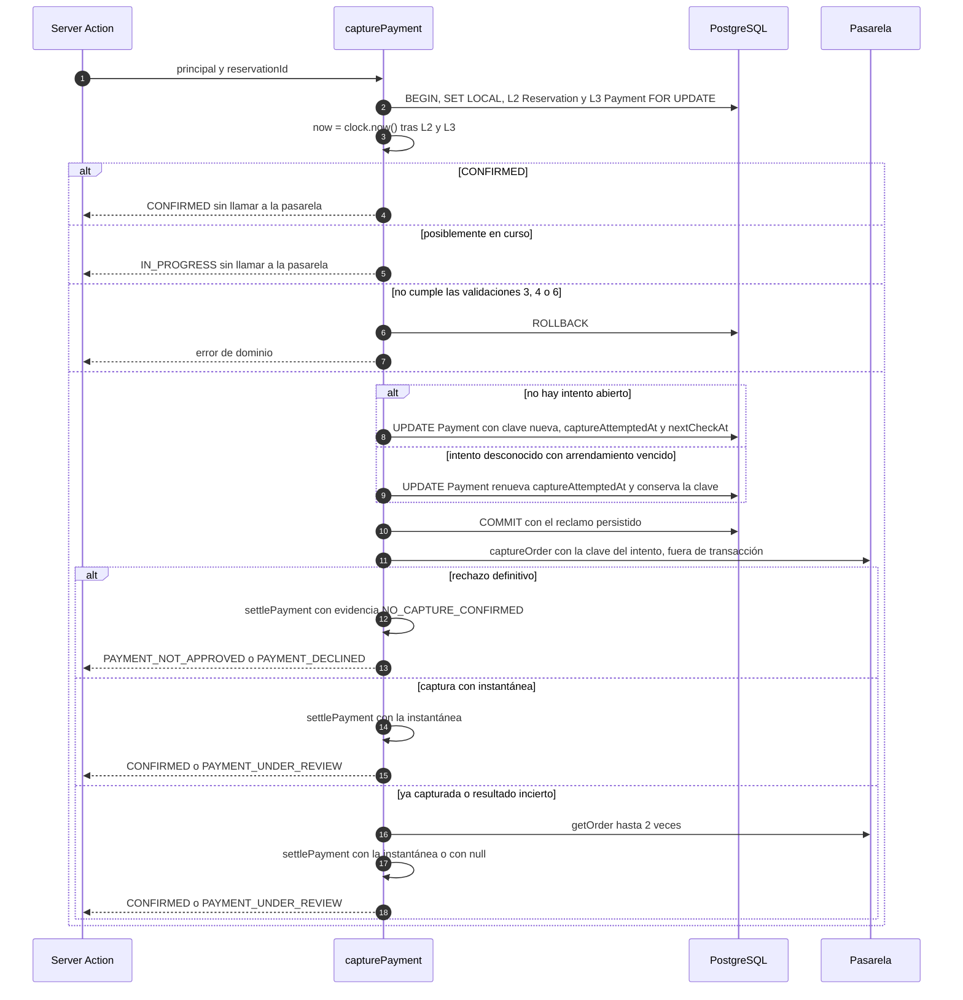

#### TX-08.3 Pseudocódigo con límites de transacción y bloqueos

```ts
async function capturePayment(principal, input, { clock, gateway, settle = settlePayment } = defaultDeps): Promise<CaptureResult> {
  requireRole(principal, 'TOURIST');
  const a = await claimCaptureAttempt({ reservationId: input.reservationId, mode: 'BUYER', buyerId: principal.userId }, { clock });
  if (a.kind === 'CONFIRMED')   return { status: 'CONFIRMED' };
  if (a.kind === 'IN_PROGRESS') return { status: 'IN_PROGRESS' };
  const d = await driveCapture(a, { origin: 'CAPTURE', actor: { type: 'USER', userId: principal.userId } }, { gateway, settle });
  return mapDrive(d);
}

// ═════════ FASE A — reclamo: transacción corta, sin red. Compartida con TX-11 (modo RECONCILER) ═════════
async function claimCaptureAttempt(p: { reservationId: string; mode: 'BUYER' | 'RECONCILER'; buyerId?: string }, { clock }) {
  return runWithDeadlockRetry(() => withTx(async (tx) => {
    const res = await lockReservation(tx, p.reservationId);                           // L2
    if (!res || (p.mode === 'BUYER' && res.buyerId !== p.buyerId)) throw new AppError('NOT_FOUND');
    const pay = await lockPaymentByReservation(tx, res.id);                           // L3: SELECT … FOR UPDATE por "reservationId" (puede no existir)
    const now = clock.now();                                                          // ← DESPUÉS de L2 y L3 (principio 5)

    if (res.status === 'CONFIRMED') return { kind: 'CONFIRMED' as const };
    const reviewOk = p.mode === 'RECONCILER' && res.status === 'REVIEW_REQUIRED' && res.reviewReason === 'UNCERTAIN_RESULT';
    if (res.status === 'REVIEW_REQUIRED' && !reviewOk) {
      if (p.mode === 'BUYER') throw new AppError('PAYMENT_UNDER_REVIEW');
      return { kind: 'NOT_ELIGIBLE' as const };
    }
    if (!pay || pay.status !== 'ORDER_CREATED') {
      if (p.mode === 'BUYER') throw new AppError('INVALID_STATE', { details: { paymentStatus: pay?.status ?? 'NONE' } });
      return { kind: 'NOT_ELIGIBLE' as const };
    }
    const open = pay.captureAttemptKey !== null;
    if (open && now.getTime() - pay.captureAttemptedAt!.getTime() < CAPTURE_LEASE_MS) return { kind: 'IN_PROGRESS' as const };   // posiblemente en curso
    if (!(res.status === 'HELD' || reviewOk) || res.expiresAt.getTime() - now.getTime() < PAYMENT_MIN_REMAINING_MS) {
      if (p.mode === 'BUYER') throw new AppError('HOLD_EXPIRED');
      return { kind: 'NOT_ELIGIBLE' as const };                                       // el intento desconocido sigue en conciliación
    }
    if (p.mode === 'RECONCILER' && !open) return { kind: 'NOT_ELIGIBLE' as const };    // el conciliador NUNCA inicia un intento: solo reanuda el de una compra ya solicitada por el comprador

    if (open) {                                                                       // REANUDACIÓN: resultado desconocido ⇒ MISMA clave
      const upd = await tx.payment.updateMany({ where: { id: pay.id, status: 'ORDER_CREATED', captureAttemptKey: pay.captureAttemptKey },
        data: { captureAttemptedAt: now, updatedAt: now } });                         // renueva el arrendamiento; no toca calendario ni checkAttempts
      if (upd.count !== 1) throw new DefectError('reanudación sin fila');
      return { kind: 'CLAIMED' as const, paymentId: pay.id, orderId: pay.providerOrderId!, key: pay.captureAttemptKey!, resumed: true };
    }
    const key = randomUUID();                                                         // INTENTO NUEVO: solo si no hay ninguno abierto
    const upd = await tx.payment.updateMany({ where: { id: pay.id, status: 'ORDER_CREATED', captureAttemptKey: null },
      data: { captureAttemptKey: key, captureAttemptedAt: now, nextCheckAt: addMs(now, CHECK_DELAY_MS), checkAttempts: 0, lastErrorCode: null, updatedAt: now } });
    if (upd.count !== 1) throw new DefectError('reclamo sin fila');                   // con L3 tomado no puede ocurrir
    return { kind: 'CLAIMED' as const, paymentId: pay.id, orderId: pay.providerOrderId!, key, resumed: false };
  }));
  // COMMIT: el reclamo (identidad del intento) es durable. No queda ninguna transacción ni bloqueo abierto.
}

// ═════════ FASE N — red, SIN transacción. Compartida con TX-11 ═════════
async function driveCapture(a: Claimed, ctx: { origin: 'CAPTURE' | 'RECONCILER'; actor }, { gateway, settle }): Promise<Drive> {
  const outcome = await gateway.captureOrder({ orderId: a.orderId, idempotencyKey: a.key });   // la clave del intento (nueva o reanudada)

  switch (outcome.kind) {
    case 'DECLINED':     return await refused(a, ctx, 'INSTRUMENT_DECLINED', 'PAYMENT_DECLINED');
    case 'NOT_APPROVED': return await refused(a, ctx, 'ORDER_NOT_APPROVED',  'PAYMENT_NOT_APPROVED');   // incluye PAYER_ACTION_REQUIRED
    case 'SNAPSHOT': {
      const cap = outcome.snapshot.capture;
      if (cap && (cap.status === 'DECLINED' || cap.status === 'FAILED')) return await refused(a, ctx, 'CAPTURE_' + cap.status, 'PAYMENT_DECLINED');
      if (cap) return await settled(a, ctx, outcome.snapshot);                         // COMPLETED, PENDING, REFUNDED…: lo decide TX-09
      return await uncertain(a, ctx);                                                  // respuesta sin captura: anómala ⇒ incierta
    }
    case 'ALREADY_CAPTURED': return await alreadyCaptured(a, ctx);
    case 'UNCERTAIN':        return await uncertain(a, ctx);                           // TIMEOUT, SERVER_ERROR, NETWORK y un 4xx NO reconocido por su issue
  }
}

// Rechazo DEFINITIVO de nuestra solicitud: TX-09 cierra el intento (compara la clave) y, si la reserva estaba en revisión, la libera
async function refused(a, ctx, code, error) {
  const input = { paymentId: a.paymentId, snapshot: null, evidence: { kind: 'NO_CAPTURE_CONFIRMED' as const, attemptKey: a.key, code }, origin: ctx.origin, actor: ctx.actor };
  try { await settleWithOneRetry(input); } catch (e) { log.warn('rechazo definitivo no cerrado; el intento sigue abierto con arrendamiento y la misma clave'); }
  return { kind: 'REFUSED' as const, error };                                          // el comprador recibe el rechazo aunque el cierre no se haya escrito
}
async function uncertain(a, ctx) {
  const snap = await getOrderWithRetries(a.orderId, 2, 1000);                          // null si las dos fallan
  if (snap?.capture) return await settled(a, ctx, snap);                               // hay captura visible (COMPLETED, PENDING…); una DECLINED/FAILED vista aquí NO cierra el intento (K0b)
  return await settled(a, ctx, null);                                                  // sin captura visible o sin respuesta: NO concluyente ⇒ L-04/L-05; el intento sigue DESCONOCIDO
}
async function alreadyCaptured(a, ctx) {
  const snap = await getOrderWithRetries(a.orderId, 2, 1000);
  return await settled(a, ctx, snap?.capture ? snap : null);                           // la captura existe: si no puede leerse, queda incierta y la concilia TX-11
}
async function settled(a, ctx, snapshot) {
  const input = { paymentId: a.paymentId, snapshot, origin: ctx.origin, actor: ctx.actor };
  return { kind: 'SETTLED' as const, result: await settleWithOneRetry(input) };
}
async function settleWithOneRetry(input) {                                              // UN reintento con la MISMA entrada (ya en memoria)
  try { return await settle(input); } catch (e) { if (isBusyTryAgain(e)) return await settle(input); throw e; }
}

function mapDrive(d: Drive): CaptureResult {                                            // solo para el comprador
  if (d.kind === 'REFUSED') throw new AppError(d.error, { details: { canRetry: true } });
  const r = d.result;
  if (r.reservationStatus === 'CONFIRMED') return { status: 'CONFIRMED' };
  if (r.reservationStatus === 'REVIEW_REQUIRED') throw new AppError('PAYMENT_UNDER_REVIEW', { details: { reviewReason: r.reviewReason } });
  log.warn('liquidación sin resolver tras captura');                                    // HELD/EXPIRED sin cierre: no se espera desde este flujo
  return { status: 'IN_PROGRESS' };
}
```

Notas de lectura:
- **Quien cierra un intento es siempre `settlePayment`**, bajo los tres bloqueos y comparando `captureAttemptKey = evidence.attemptKey`: así un cierre tardío de un intento antiguo no toca a uno más nuevo (ya no existe el «comparar por fecha» del lote 2) y una reserva que otro origen haya puesto en revisión se libera con el mismo cierre.
- La clave **no se genera** al enviar: nace en el reclamo, queda persistida y es la que se envía y la que se reenvía. Una caída entre el reclamo y el envío deja un intento **desconocido** con clave conocida; la reanudación la reutiliza.
- `settled(a, ctx, null)` en `uncertain` no cierra nada: el intento queda **desconocido** y TX-11 lo resuelve.
- Las ramas `NOT_ELIGIBLE` solo existen para el modo `RECONCILER` (TX-11): el conciliador **reanuda** intentos que el comprador ya inició y **nunca inicia uno** (no cobra por su cuenta).
- En las pruebas el reloj falso ya no necesita separar reclamos para distinguir intentos: la identidad es la clave, no la fecha.

#### TX-08.4 Escrituras y resultado de cada rama

| Rama | Condición | Pago | Reserva | Entradas | Resultado |
|---|---|---|---|---|---|
| A1 | Ajena o inexistente | — | — | — | `NOT_FOUND` |
| A2 | `CONFIRMED` | — | — | — | `{ status: 'CONFIRMED' }`, sin red |
| A3 | `REVIEW_REQUIRED` | — | — | — | `PAYMENT_UNDER_REVIEW` |
| A4 | Pago ausente o no `ORDER_CREATED` | — | — | — | `INVALID_STATE` |
| A5 | Intento posiblemente en curso | — | — | — | `{ status: 'IN_PROGRESS' }`, sin red |
| A6 | `EXPIRED` o menos de 30 s | — | — | — | `HOLD_EXPIRED` |
| A7 | Sin intento abierto: reclamo **nuevo** | `captureAttemptKey = <nueva>`, `captureAttemptedAt = now`, `nextCheckAt = now + 2 min`, `checkAttempts = 0` | — | — | Continúa en la fase N |
| A8 | Intento desconocido con arrendamiento vencido: **reanudación** | `captureAttemptedAt = now` (la clave y el calendario no cambian) | — | — | Continúa en la fase N con **la misma clave** |
| N1 | Captura `COMPLETED` coincidente | por TX-09 (`CAPTURED`, clave a `NULL`) | por TX-09 | por TX-09 | `CONFIRMED`, o `PAYMENT_UNDER_REVIEW` (`NO_CAPACITY`, `OFFER_NOT_OPEN`, `ACTIVITY_STARTED`) |
| N2 | Captura `COMPLETED` no coincidente | por TX-09 (`DISCREPANT`) | `REVIEW_REQUIRED` | 0 | `PAYMENT_UNDER_REVIEW` |
| N3 | Captura `PENDING`, o estado no soportado | sin cambio de estado; **intento abierto** | `REVIEW_REQUIRED` (`UNCERTAIN_RESULT`/`UNSUPPORTED_GATEWAY_STATE`) | 0 | `PAYMENT_UNDER_REVIEW` |
| N4 | `DECLINED`, o la **respuesta de `captureOrder`** trae una captura `DECLINED`/`FAILED` | **cierre por `settlePayment`**: clave, `captureAttemptedAt` y `nextCheckAt` a `NULL` | sin cambio | — | `PAYMENT_DECLINED` (reintento inmediato con **clave nueva**) |
| N5 | `NOT_APPROVED` (incluye «acción del pagador requerida») | **cierre**, igual | sin cambio | — | `PAYMENT_NOT_APPROVED` (reintento inmediato con clave nueva) |
| N6 | `ALREADY_CAPTURED` | según `getOrder` + TX-09 | según TX-09 | según TX-09 | como N1/N2 si se lee la captura; si no, como N7 |
| N7 | Incierto y `getOrder` no concluye (sin captura visible o sin respuesta) | sin cambio; **intento desconocido** (clave y `nextCheckAt` conservados) | `REVIEW_REQUIRED` (`UNCERTAIN_RESULT`, regla L-04) | 0 | `PAYMENT_UNDER_REVIEW` |
| N8 | Incierto y `getOrder` muestra una captura | según TX-09 | según TX-09 | según TX-09 | como N1 a N4 |
| N9 | `settlePayment` da `BUSY_TRY_AGAIN` dos veces (captura vista) | sin cambio; intento abierto | sin cambio | — | `BUSY_TRY_AGAIN` (503); TX-11 recoge el caso |
| N10 | `settlePayment` da `BUSY_TRY_AGAIN` dos veces (rechazo definitivo) | sin cambio; intento abierto | sin cambio | — | **El rechazo igualmente** (`PAYMENT_DECLINED`/`PAYMENT_NOT_APPROVED`); el cierre queda para la reanudación (misma clave, PayPal repite el rechazo) |

#### TX-08.5 Compatibilidad con `SettleResult` y las ramas de TX-09

| Llamada de TX-08 a `settlePayment` | Reglas de TX-09 que se activan | `SettleResult` | Respuesta de TX-08 |
|---|---|---|---|
| Instantánea con captura `COMPLETED` coincidente | L-09, L-10, L-11, L-17 | `CONFIRMED`, `FLAGGED` o `ALREADY_CONFIRMED` | `CONFIRMED`, `PAYMENT_UNDER_REVIEW` o `CONFIRMED` |
| Captura `COMPLETED` no coincidente | L-08 | `FLAGGED` (`*_MISMATCH`) | `PAYMENT_UNDER_REVIEW` con `details.reviewReason` |
| Captura `PENDING` | L-04, L-05 | `FLAGGED` o `NO_CHANGE` con reserva en revisión | `PAYMENT_UNDER_REVIEW` |
| Captura reembolsada o parcialmente reembolsada | L-06, L-07 | `FLAGGED` o `NO_CHANGE` | `PAYMENT_UNDER_REVIEW` |
| `snapshot = null` (resultado desconocido) | L-04 (reserva `HELD`/`EXPIRED` con **intento abierto**), L-05, L-15 | `FLAGGED` o `NO_CHANGE` | `PAYMENT_UNDER_REVIEW` |
| `evidence = NO_CAPTURE_CONFIRMED` (rechazo definitivo) | L-01a, L-02 | `NO_CHANGE` con `attemptClosed` (o `RELEASED` si la reserva estaba en revisión) | el rechazo (`PAYMENT_DECLINED`/`PAYMENT_NOT_APPROVED`) |
| Instantánea de `getOrder` con captura `DECLINED`/`FAILED` (no es evidencia) | L-01, L-03 (`K0b`) | `NO_CHANGE`, intento abierto | `IN_PROGRESS` (TX-11 lo resuelve reanudando con la misma clave) |
| Cualquiera con la reserva ya `CONFIRMED` | L-17 | `ALREADY_CONFIRMED` | `CONFIRMED` |

Compatibilidad con los objetos de 03: el **reclamo** solo cambia `captureAttemptKey`, `captureAttemptedAt`, `nextCheckAt`, `checkAttempts`, `lastErrorCode` y `updatedAt` de un pago `ORDER_CREATED`; no incluye `status`, por lo que **no dispara** la comprobación diferida (`UPDATE OF status`); `tg_payment_guard` solo protege claves y pagos terminales; `ck_pay_attempt` (03 §8.3: clave no nula ⇒ `ORDER_CREATED` y `captureAttemptedAt` no nulo) se cumple porque ambos se escriben en el mismo `UPDATE`. El **cierre** y la **resolución** los escribe `settlePayment` (TX-09), que deja `captureAttemptKey = NULL` en los pagos terminales.

#### TX-08.6 Errores, idempotencia y recuperación

| Código | HTTP | Cuándo | ¿Reintentar? |
|---|---|---|---|
| `NOT_FOUND` | 404 | Reserva ajena o inexistente | No |
| `INVALID_STATE` | 409 | Pago ausente o no `ORDER_CREATED` | No (iniciar el pago, TX-07) |
| `HOLD_EXPIRED` | 409 | Retención vencida o con menos de 30 s | No (reservar de nuevo) |
| `PAYMENT_NOT_APPROVED` | 409 | PayPal rechazó la captura porque el comprador no aprobó (o pide una acción más) | Sí, tras volver a `approvalUrl`; el intento queda cerrado y el siguiente usa clave nueva |
| `PAYMENT_DECLINED` | 409 | El medio de pago fue rechazado | Sí, de inmediato, tras volver a `approvalUrl`; clave nueva |
| `PAYMENT_UNDER_REVIEW` | 409 | `REVIEW_REQUIRED` (incierto, discrepancia, sin cupo…) | No: lo resuelven TX-11, el webhook o el administrador |
| `BUSY_TRY_AGAIN` | 503 | Bloqueo no obtenido en el reclamo, o en la liquidación dos veces | Sí |
| `INTERNAL_ERROR` | 500 | Defecto (`TC_…`, filas ≠ 1…) | No |

**Idempotencia.** Con la reserva confirmada devuelve `CONFIRMED` sin llamar a PayPal; con un intento posiblemente en curso, `IN_PROGRESS`; con un intento desconocido y la retención vigente con margen, **reanuda con la misma clave**; tras un rechazo definitivo permite el siguiente intento de inmediato con clave nueva; tras un resultado incierto la reserva queda en revisión.

**Dos solicitudes simultáneas.** Se serializan en `L2`/`L3`; la primera reclama; la segunda ve el arrendamiento y devuelve `IN_PROGRESS` **sin** llamar a PayPal. Dentro de los 60 s del arrendamiento nunca salen dos solicitudes de captura.

**Reintento tras un rechazo o una orden no aprobada.** Los cierra `settlePayment` con evidencia: el intento queda sin clave y el comprador, tras volver a aprobar, captura con una **clave nueva** sin esperar. Si el cierre no pudo escribirse (`BUSY`, caída), el intento sigue abierto: la siguiente solicitud recibe `IN_PROGRESS` hasta que venza el arrendamiento y después **reanuda con la misma clave**, de modo que PayPal repite el rechazo y el cierre se completa. Por eso **no hay bloqueo indefinido** y tampoco se crea una segunda operación sobre un intento que no se sabe cerrado.

**Recuperación por punto de fallo:**

| # | Fallo | Estado local → externo | Recuperación |
|---|---|---|---|
| F1 | Antes del `COMMIT` del reclamo | Nada → nada | Reintento normal. |
| F2 | Tras el reclamo, antes de enviar (caída del proceso) | Intento **desconocido** → la solicitud pudo no enviarse | **No** se concluye «sin cargo». TX-11 observa con `getOrder` y, mientras la retención esté vigente con margen, **reanuda con la misma clave**; si la solicitud nunca llegó, esa reanudación es la que la ejecuta y devuelve un resultado definitivo. Si la retención ya venció, el caso sigue en el calendario de TX-11 y, de no resolverse, pasa a revisión del administrador. |
| F3 | La llamada agota el tiempo o da 5xx | Intento desconocido → capturada o no | `getOrder` ×2 en la misma solicitud; si no concluye ⇒ `settlePayment(null)` ⇒ `REVIEW_REQUIRED` (`UNCERTAIN_RESULT`); TX-11 la concilia. «Sin captura visible» **no** es «no hubo captura». |
| F4 | PayPal respondió y el proceso cae antes de `settlePayment` | Intento abierto → `COMPLETED` | TX-11 (por `nextCheckAt`) o el webhook: `getOrder` ⇒ `settlePayment` (puede ser tardía: L-10 o L-11). |
| F5 | `settlePayment` da `BUSY_TRY_AGAIN` | Intento abierto → capturada | Un reintento inmediato con la misma entrada; si falla, `BUSY_TRY_AGAIN` y TX-11. |
| F6 | El cierre tras un rechazo no se escribe | Intento abierto → sin captura | Reanudación con la misma clave tras el arrendamiento: PayPal devuelve el rechazo y el cierre se completa. |
| F7 | La retención vence mientras la captura está en vuelo | Intento abierto → `COMPLETED` | `settlePayment` por la rama tardía (L-10/L-11). |
| F8 | `captureOrder` devuelve `ORDER_ALREADY_CAPTURED` | — → `COMPLETED` | `getOrder` ⇒ `settlePayment`. |
| F9 | Un 4xx que no se reconoce por su `issue` (por ejemplo, un posible rechazo por clave duplicada simultánea) | Intento abierto → desconocido | Se trata como **`UNCERTAIN`** (nunca como rechazo definitivo) y sigue el camino de F3. |

#### TX-08.7 Pruebas

Notación y extensión del `fake`: las de TX-05.7 y TX-07.7, más: `fake.program('captureOrder', resultado)` y `fake.program('getOrder', secuencia)`; `fake.mode` para la clave repetida de captura: `RETURN_SAME` (una repetición con la misma clave devuelve el resultado de la primera petición, también si fue un rechazo), `FAIL_SECOND` (la segunda llamada simultánea con la misma clave devuelve `UNCERTAIN` por un 4xx no reconocido); el `fake` aplica además la regla de PayPal **a nivel de orden** (la primera captura efectiva tiene éxito; otra con **otra** clave recibe `ALREADY_CAPTURED`). Esto es una **aproximación** de las pruebas, no una verificación de PayPal.

| ID | Nivel | Preparación | Acciones | Aserciones |
|---|---|---|---|---|
| T-PAG-06c1 | C | Reserva `HELD` (5 asistentes) con `expiresAt = T0 + 10 min`; pago `ORDER_CREATED`; `fake` programado con captura `COMPLETED` coincidente. `ctrl` toma `FOR UPDATE` sobre la fila `Reservation`. | Dos `lanzar(capturePayment)`; `esperarBloqueadas(2)`; `liberar()`. | Una llega a la pasarela y la otra recibe `IN_PROGRESS`; `fake.calls('captureOrder')` = 1; tras resolverse, reserva `CONFIRMED` y 5 entradas. |
| T-PAG-06c2 | C | Igual, con compuerta en `captureOrder`. | `lanzar(capturePayment)#1`; `fake.waitInFlight(1)`; `capturePayment#2`; `fake.release(1)`; `capturePayment#3`. | #2 devuelve `IN_PROGRESS` **sin esperar** la compuerta y sin llamar a la pasarela; mientras tanto `captureAttemptKey` es un UUID, `captureAttemptedAt = T0`, `nextCheckAt = T0 + 2 min`; al liberar, #1 devuelve `CONFIRMED`; #3 devuelve `CONFIRMED` **sin** llamada; 5 entradas; `captureAttemptKey = NULL` y `nextCheckAt = NULL`. |
| T-PAG-06d | C | Compuerta en `captureOrder`; `fake.mode = RETURN_SAME`; `expiresAt = T0 + 10 min`. | `#1` en vuelo (clave `k1`); `reloj.advance(61 s)`; `#2` **reanuda**; se liberan las dos llamadas. | `#2` envía **la misma clave** `k1` (`fake.calls` muestra `k1` dos veces; `captureAttemptKey` sigue siendo `k1`, `captureAttemptedAt = T0 + 61 s`); una sola captura efectiva; reserva `CONFIRMED` una vez, 5 entradas, 1 `AuditEvent reservation.confirm`. |
| T-PAG-06d′ | C | Igual con `fake.mode = FAIL_SECOND`. | `#1` en vuelo; `advance(61 s)`; `#2` reanuda y recibe `UNCERTAIN`; se libera `#1` (`COMPLETED`). | `#2` termina en `PAYMENT_UNDER_REVIEW` (`UNCERTAIN_RESULT`; `getOrder` aún sin captura) y **no** libera ni abre otro intento; al completarse `#1`, `settlePayment` la lleva a `CONFIRMED` (R-6); 5 entradas; una sola captura efectiva. |
| T-PAG-06e | C | Compuerta; `fake.mode = RETURN_SAME`; el `fake` devuelve `DECLINED` a las llamadas con `k1`. | `#1` reclama `k1` y espera; `advance(61 s)`; `#2` reanuda `k1` y espera; se libera `#1` (rechazo ⇒ cierre ⇒ clave `NULL`); el comprador envía `#3` (reclama **`k2` nueva** y espera); se libera `#2` (rechazo tardío de `k1`); se libera `#3` (`COMPLETED`). | El cierre tardío de `k1` **no** toca a `k2`: `captureAttemptKey = k2` y `captureAttemptedAt` intactos tras liberar `#2`; `k2 ≠ k1`; `#3` devuelve `CONFIRMED`. |
| T-PAG-23a | I | Reserva `HELD` vigente, pago `ORDER_CREATED`. `fake`: primera captura `DECLINED`, segunda `COMPLETED`. | `capturePayment`; de inmediato `capturePayment` otra vez. | La primera: `PAYMENT_DECLINED` (`canRetry`); `captureAttemptKey = NULL`, `captureAttemptedAt = NULL`, `nextCheckAt = NULL`; reserva `HELD` y pago `ORDER_CREATED`. La segunda reclama con una **clave distinta** de la primera y termina en `CONFIRMED`. |
| T-PAG-23b | I | Igual, con `NOT_APPROVED` en el primer intento. | Igual. | `PAYMENT_NOT_APPROVED`; cierre; el reintento inmediato usa clave nueva y confirma. |
| T-PAG-23c | C | Como 23a, con `fake.mode = RETURN_SAME`. `lockTimeoutMs = 500`; `ctrl` toma `FOR UPDATE` sobre `Offer` **antes** de que se cierre el rechazo (compuerta en `captureOrder`). | `lanzar(capturePayment)`; `waitInFlight(1)`; `ctrl` toma el bloqueo; `fake.release(1)` con `DECLINED`; el cierre (`settlePayment`) agota el bloqueo dos veces; `liberar()`. Reintentar en `T0 + 10 s` y en `T0 + 61 s`. | La solicitud devuelve igualmente `PAYMENT_DECLINED`; el intento sigue abierto con `k1`; el reintento a los 10 s devuelve `IN_PROGRESS` con **0** llamadas nuevas; el de los 61 s **reanuda con `k1`**, el `fake` repite el rechazo, el cierre se escribe y devuelve `PAYMENT_DECLINED`; un reintento posterior reclama `k2 ≠ k1` y confirma. Nunca hay bloqueo indefinido ni una segunda clave sobre un intento sin cerrar. |
| T-PAG-12a | I | `fake`: captura ⇒ `UNCERTAIN(TIMEOUT)`; `getOrder` ⇒ `COMPLETED` coincidente. | `capturePayment`. | `CONFIRMED`; `fake.calls('getOrder')` = 1; 5 entradas; `captureAttemptKey = NULL`. |
| T-PAG-12b | I | `fake`: captura ⇒ `UNCERTAIN`; `getOrder` ⇒ `UNAVAILABLE` las dos veces. | `capturePayment`. | `PAYMENT_UNDER_REVIEW` con `details.reviewReason = 'UNCERTAIN_RESULT'`; reserva `REVIEW_REQUIRED`; pago `ORDER_CREATED`, `captureAttemptKey = k1`, `nextCheckAt = T0 + 2 min`; llamadas: 1 captura y 2 `getOrder`; 0 entradas. |
| T-PAG-12c | I | `fake`: captura ⇒ `UNCERTAIN`; `getOrder` ⇒ orden `APPROVED` **sin captura** las dos veces. | `capturePayment`. | Igual que 12b: un «sin captura visible» tras un tiempo agotado **no** cierra el intento. |
| T-PAG-12d | I | Continuación de 12b. | (1) `reloj.advance(7 días)` y `settlePayment` (`RECONCILER`) con una instantánea `APPROVED` sin captura; (2) `settlePayment` (`RECONCILER`) con una instantánea que trae una captura `DECLINED` (no es evidencia); (2b) `settlePayment` (`RECONCILER`) con `evidence` de la clave `k1`; (3) `capturePayment`. | (1) `NO_CHANGE`: reserva sigue en `REVIEW_REQUIRED`, `captureAttemptKey = k1` (**el paso del tiempo no cierra la incertidumbre**). (2) `RELEASED`: reserva `HELD`, revisión a nulo, `captureAttemptKey = NULL`. (3) reclama `k2 ≠ k1`; con `COMPLETED` termina en `CONFIRMED`. |
| T-PAG-12e | I | `fake`: captura ⇒ `ALREADY_CAPTURED`; `getOrder` ⇒ `UNAVAILABLE` ×2. | `capturePayment`; después `settlePayment` (`RECONCILER`) con la captura `COMPLETED`. | La primera: `PAYMENT_UNDER_REVIEW` (el dinero ya está capturado en PayPal); la segunda: `CONFIRMED` (R-6) con 5 entradas. |
| T-PAG-12f | I | `fake`: captura ⇒ respuesta con captura `PENDING`. | `capturePayment`. | `PAYMENT_UNDER_REVIEW`; sin `getOrder`; **intento abierto** (`captureAttemptKey` no nulo). |
| T-PAG-12g | C | Captura `COMPLETED`. `lockTimeoutMs = 500`; `ctrl` toma `FOR UPDATE` sobre `Offer` antes de que empiece la liquidación (compuerta en `captureOrder`). | `lanzar(capturePayment)`; `waitInFlight(1)`; `ctrl` toma el bloqueo; `fake.release(1)`; la liquidación agota el bloqueo dos veces. Después `liberar()` y `settlePayment` (`RECONCILER`) con `COMPLETED`. | `BUSY_TRY_AGAIN`; reserva `HELD`, pago `ORDER_CREATED`, intento abierto y `nextCheckAt` fijado; `fake.calls('captureOrder')` = 1; la liquidación posterior confirma con 5 entradas. |
| T-PAG-12h | U | `settle` simulado: `BUSY_TRY_AGAIN` la primera vez y `CONFIRMED` la segunda. | `capturePayment`. | `CONFIRMED`; `settle` recibió **la misma** entrada dos veces; 1 llamada a la pasarela. Con dos `BUSY`: `BUSY_TRY_AGAIN`. |
| T-PAG-12i | I | `fake` lanza un error no recuperable **después** del reclamo (hace de caída del proceso). | `capturePayment` (falla con `INTERNAL_ERROR`); `reloj.advance(61 s)`; `settlePayment` (`RECONCILER`) con una instantánea `APPROVED` sin captura; `capturePayment` otra vez. | Tras la caída: `captureAttemptKey = k1`, reserva `HELD`. La liquidación con «sin captura visible» ⇒ `NO_CHANGE` (**no** se libera, **no** se concluye «sin cargo»). El segundo `capturePayment` **reanuda con `k1`** (la misma clave; `fake.calls` lo muestra), no crea una nueva. |
| T-PAG-18e | I | Reservas ajena, `REVIEW_REQUIRED`, pago `CREATED` o ausente, `EXPIRED`, `HELD` con 29 s. | `capturePayment` en cada una. | `NOT_FOUND`, `PAYMENT_UNDER_REVIEW`, `INVALID_STATE`, `INVALID_STATE`, `HOLD_EXPIRED`, `HOLD_EXPIRED`; `fake.calls('captureOrder')` = 0 en todas. |
| T-PAG-18f | C | Reserva `HELD` con `expiresAt = T0 + 60 s`, pago `ORDER_CREATED`. `ctrl` toma `FOR UPDATE` sobre la fila `Reservation`. | `lanzar(capturePayment)`; `esperarBloqueadas(1)`; `reloj.advance(31 s)`; `liberar()`. Repetir con `advance(29 s)`. | Con 31 s: `HOLD_EXPIRED` y 0 llamadas a la pasarela. Con 29 s: reclama y captura. |
| T-PAG-18g | C | Reserva `HELD` con 40 s restantes; compuerta en `captureOrder`; `COMPLETED` coincidente. | `lanzar(capturePayment)`; `waitInFlight(1)`; `reloj.advance(41 s)`; `fake.release(1)`. | La retención venció **durante** la llamada: rama tardía; `CONFIRMED` con `late = true` (hay cupo) o `PAYMENT_UNDER_REVIEW` (`NO_CAPACITY`) si otro tomó la plaza. |

Unitarias (U): `mapDrive` (tabla de TX-08.5, incluida la rama inesperada ⇒ `IN_PROGRESS`); `claimCaptureAttempt` en modo `RECONCILER` devuelve `NOT_ELIGIBLE` si no hay intento abierto (nunca inicia uno); el 4xx no reconocido se traduce a `UNCERTAIN` y **no** a rechazo; `getOrderWithRetries` hace como máximo 2 intentos con la pausa configurada.

**Pendientes para otros flujos:** TX-11 (lote 3) reutiliza `claimCaptureAttempt` (modo `RECONCILER`) y `driveCapture`. 05 §3: `capturePaymentAction` devuelve `CaptureResult` y los errores de TX-08.6.

### TX-09 — Liquidación: confirmar y emitir, o marcar para revisión

**Qué cambia respecto al texto condensado anterior** (H-35 a H-39): (1) `now` se toma tras los tres bloqueos; (2) el `PaymentEvent` se registra en **todas** las ramas que terminan, incluida «la reserva ya estaba `CONFIRMED`»; (3) se comprueba dentro de la transacción si el evento ya estaba registrado; (4) se define qué hacer con pagos **ya terminales** (`CAPTURED`, `DISCREPANT`) e instantáneas obsoletas o contradictorias; (5) se separan «importe esperado» (`Payment.amountCents`, inmutable) e «importe capturado» (`capturedAmountCents`); (6) la recuperación de un choque de unicidad se hace tras revertir.

**Corregido en el lote 3** (H-46, H-47; D-74): el texto del lote 1 liberaba una reserva en revisión «pasados 60 s sin captura visible» (regla L-02). Eso **cerraba una incertidumbre por un plazo local**, lo que no es admisible: «sin captura visible» no demuestra que la captura no ocurrió (TX-08.0). Ahora solo se libera con **evidencia concluyente** de ausencia de captura; la clase `K0` se divide en `K0a` (concluyente) y `K0b` (no concluyente); `settlePayment` es quien **cierra el intento** (`captureAttemptKey`) y lo hace comparando la clave; se admite `snapshot = null` también para el conciliador (agotamiento); `VOIDED` pasa a «estado no soportado»; y las reglas L-04, L-15 y L-17 se precisan.

#### TX-09.1 Entradas, autorización y validaciones

`settlePayment(input, deps: { clock })` en `modules/payments/application/`. La invocan: la captura propia (TX-08), el webhook (TX-10), el conciliador J2 y «Consultar pasarela» del administrador (TX-11). **No está expuesta por ningún adaptador y no autoriza**: cada invocador lo hace antes (propietario de la reserva; firma del webhook; sistema; `ADMIN`).

```ts
type SettleInput = {
  paymentId: string;
  snapshot: OrderSnapshot | null; // 05 §6.1; ya traducida por el adaptador; solo un dato, nunca se persiste en bruto.
                                  // null = «sin información»: solo origin = 'CAPTURE' (TX-08 agotó sus consultas sin saber el resultado)
                                  // o 'RECONCILER' (agotamiento de la conciliación, TX-11). Se trata como K1.
  evidence?: { kind: 'NO_CAPTURE_CONFIRMED'; attemptKey: string; code: string };
                                  // SOLO origin = 'CAPTURE' o 'RECONCILER', y SOLO cuando la RESPUESTA de PayPal a nuestra solicitud
                                  // fue un rechazo definitivo (ORDER_NOT_APPROVED, PAYER_ACTION_REQUIRED, INSTRUMENT_DECLINED). Se trata como K0a.
  context?: 'RECONCILIATION_EXHAUSTED';                                   // solo texto de reviewDetail y auditoría
  origin: 'CAPTURE' | 'WEBHOOK' | 'RECONCILER' | 'ADMIN';
  actor: { type: 'USER' | 'SYSTEM' | 'WEBHOOK'; userId?: string };      // para la auditoría
  event?: { provider: PaymentProvider; providerEventId: string; eventType: string;
            orderId?: string; payloadDigest: string; receivedAt: Date; summary: Json };   // solo origin = WEBHOOK
};
type SettleResult = {
  outcome: 'CONFIRMED' | 'ALREADY_CONFIRMED' | 'FLAGGED' | 'RELEASED' | 'NO_CHANGE' | 'DUPLICATE_EVENT';
  reservationStatus: ReservationStatus;
  reviewReason?: ReviewReason;
  late?: boolean;                 // true si se confirmó con la retención ya vencida
  resolved: boolean;              // pago terminal (CAPTURED o DISCREPANT) o reserva confirmada: el invocador deja de conciliar
  attemptClosed?: boolean;        // el intento de captura se cerró por evidencia concluyente (clave a NULL)
};
```

**Validaciones previas.** `paymentId` existe (si no, `NOT_FOUND`); `payment.status ≠ CREATED` (un pago sin orden no puede recibir una instantánea: `INVALID_STATE`, defecto del invocador); `event` solo con `origin = 'WEBHOOK'`; `snapshot = null` solo con `origin ∈ {CAPTURE, RECONCILER}`; `evidence` solo con `origin ∈ {CAPTURE, RECONCILER}`; `snapshot` no nulo con `origin ∈ {WEBHOOK, ADMIN}`. Estas comprobaciones, salvo la primera, se repiten bajo bloqueo con los datos frescos.

**Lecturas sin bloqueo** (solo columnas **inmutables**, por eso son seguras): `Payment.reservationId` y `Reservation.offerId`. Con ellas se toma `Offer` primero (§2).

#### TX-09.2 Clasificación de la instantánea y tabla de decisión

**Clases de instantánea** (cálculo puro, `classify(snapshot, payment, reservation)`):

| Clase | Condición |
|---|---|
| `K2` Estado no soportado | `snapshot.orderId ≠ payment.providerOrderId`; o captura `REFUNDED`/`PARTIALLY_REFUNDED`; o orden `COMPLETED` **sin** objeto de captura (anomalía: 05 §6.2 exige comprobar la captura); o orden `VOIDED` (una orden anulada no puede capturarse y este flujo no la anula ni la reutiliza: se escala, no se concluye). |
| `K0a` Sin captura, **concluyente** | `evidence = NO_CAPTURE_CONFIRMED` (el rechazo definitivo —o una captura `DECLINED`/`FAILED` en la respuesta— es la respuesta a **nuestra** solicitud). **Una captura `DECLINED`/`FAILED` que aparece en una instantánea de `getOrder` o de un webhook es `K0b`**: puede ser de un intento anterior y no se puede vincular a la clave del intento abierto. Es el único modo de «cerrar» un intento sin captura. |
| `K0b` Sin captura, **no concluyente** | Sin objeto de captura y orden `CREATED`, `SAVED`, `APPROVED` o `PAYER_ACTION_REQUIRED`. Es exactamente lo que se ve antes de que una captura en curso termine, o si la solicitud nunca llegó: **no prueba nada** (TX-08.0). |
| `K1` Pendiente o desconocido | Captura `PENDING`; o `snapshot = null` sin evidencia («sin información»: tras agotar las consultas de TX-08 o la conciliación de TX-11; es el único modo de llegar a `UNCERTAIN_RESULT` sin una captura `PENDING`). |
| `K3` Completa y coincide | Captura `COMPLETED`, y `customId = reservationId`, `currency = payment.currency`, `amountCents = payment.amountCents`. |
| `K4(r)` Completa y no coincide | Captura `COMPLETED` con alguna diferencia. El motivo `r` se elige con esta prioridad: `REFERENCE_MISMATCH` (referencia distinta) > `CURRENCY_MISMATCH` > `AMOUNT_MISMATCH` (también si el importe no es interpretable: `amountCents = null`). Todas las diferencias observadas se anotan en `reviewDetail`. |

**Definiciones.** *Retención vigente* = `reservation.status ∈ {HELD, REVIEW_REQUIRED}` y `reservation.expiresAt > now` (con el `now` de tras los bloqueos). *Condiciones de confirmación tardía* (se evalúan en este orden y la primera que falla da el motivo): oferta `OPEN` (`OFFER_NOT_OPEN`); `startsAt` de la versión contratada `> now` (`ACTIVITY_STARTED`); `capacidad de la versión pública − comprometido (sin contar esta reserva) ≥ quantity` (`NO_CAPACITY`). La consulta de lo comprometido (03 §8.6, consulta 2 con `$3 = reservationId`) solo se ejecuta si la decisión la necesita.

**Tabla de decisión** (cada fila es una regla `L-nn` y se prueba por separado; ver TX-09.8). *Una reserva `CONFIRMED` tiene prioridad sobre todo lo demás* (nunca se degrada; ver L-17).

| Regla | Pago | Reserva | Clase | Decisión |
|---|---|---|---|---|
| L-01 | `ORDER_CREATED` | `HELD`/`EXPIRED` | `K0b` | `NO_CHANGE` (el intento, si lo hay, **sigue abierto**). |
| L-01a | `ORDER_CREATED` | `HELD`/`EXPIRED` | `K0a`, con `captureAttemptKey` = `evidence.attemptKey`  | `NO_CHANGE` en la reserva; **cierre del intento** (clave, `captureAttemptedAt` y `nextCheckAt` a `NULL`). Si la clave ya no coincide (hay un intento más nuevo): sin cambios. |
| L-02 | `ORDER_CREATED` | `REVIEW_REQUIRED` por `UNCERTAIN_RESULT` | `K0a` (misma comprobación de clave que L-01a) | `RELEASE`: reserva → `HELD`, campos de revisión a nulo (R-7), **y cierre del intento**. **Ya no depende de ningún plazo.** |
| L-03 | `ORDER_CREATED` | `REVIEW_REQUIRED` en cualquier otra condición (incluida `K0b`, **a cualquier distancia en el tiempo**) | `K0a` con otro motivo, o `K0b` | `NO_CHANGE` (con `K0a` se cierra además el intento si la clave coincide). |
| L-04 | `ORDER_CREATED` | `HELD`/`EXPIRED`, con **intento abierto** (`captureAttemptKey` no nula) | `K1` | `FLAG(UNCERTAIN_RESULT)` (con `context = RECONCILIATION_EXHAUSTED`, el detalle lo dice). Con el intento **cerrado** (clave nula): `NO_CHANGE` (la instantánea es de un intento ya cerrado). |
| L-05 | `ORDER_CREATED` | `REVIEW_REQUIRED` | `K1` | `NO_CHANGE` (se conserva el motivo vigente; sin vaivenes). |
| L-06 | `ORDER_CREATED` | `HELD`/`EXPIRED` | `K2` | `FLAG(UNSUPPORTED_GATEWAY_STATE)`. |
| L-07 | `ORDER_CREATED` | `REVIEW_REQUIRED` | `K2` | `NO_CHANGE`. |
| L-08 | `ORDER_CREATED` | `HELD`/`EXPIRED`/`REVIEW_REQUIRED` | `K4(r)` | Pago → `DISCREPANT`; reserva → `REVIEW_REQUIRED` con `r` (si ya estaba en revisión, se actualiza el motivo). |
| L-09 | `ORDER_CREATED` | retención vigente | `K3` | Pago → `CAPTURED`; **`CONFIRM`** (`late = false`). Se confirma aunque la oferta se haya suspendido o archivado (D-42). |
| L-10 | `ORDER_CREATED` | **no** vigente (`EXPIRED`, o `HELD`/`REVIEW_REQUIRED` con `expiresAt ≤ now`) y se cumplen las tres condiciones tardías | `K3` | Pago → `CAPTURED`; **`CONFIRM`** (`late = true`). |
| L-11 | `ORDER_CREATED` | no vigente y falla alguna condición tardía | `K3` | Pago → `CAPTURED` (el dinero **sí** se recibió); reserva → `REVIEW_REQUIRED` con `OFFER_NOT_OPEN`, `ACTIVITY_STARTED` o `NO_CAPACITY`; **sin entradas**. |
| L-12 | `CAPTURED` | `REVIEW_REQUIRED` | `K3` y `capture.id = payment.providerCaptureId` | Se reevalúa como L-09/L-10/L-11 **sin tocar el pago** (ya `CAPTURED`): `CONFIRM`, o `FLAG` si el motivo cambió, o `NO_CHANGE` si es el mismo. |
| L-13 | `CAPTURED` | `REVIEW_REQUIRED` | `K3` con otra captura, o `K4` | `FLAG(UNSUPPORTED_GATEWAY_STATE)` con detalle «captura distinta de la registrada»; el pago no se toca. |
| L-14 | `CAPTURED` | `REVIEW_REQUIRED` | `K2` | `FLAG(UNSUPPORTED_GATEWAY_STATE)` (si el motivo ya era ese: `NO_CHANGE`). |
| L-15 | `CAPTURED` | `REVIEW_REQUIRED` | `K0a`, `K0b`, `K1` | `NO_CHANGE`: una captura registrada no «desaparece»; la instantánea es obsoleta o contradictoria (**monotonía**). |
| L-16 | `DISCREPANT` | `REVIEW_REQUIRED` | cualquiera | `NO_CHANGE`: terminal en el MVP; se resuelve fuera del sistema (RB-09). |
| L-17 | cualquiera | `CONFIRMED` | cualquiera | `ALREADY_CONFIRMED`: sin escrituras salvo el registro del evento. Una notificación tardía nunca degrada una reserva confirmada ni reemite entradas. **Aviso de reembolso:** si el origen es `WEBHOOK` con evento `…REFUNDED`/`…REVERSED`, o `ADMIN` con una captura `REFUNDED`/`PARTIALLY_REFUNDED`, se inserta además un `AuditEvent` `payment.reconcile` `CONFLICT` con `reasonCode = REFUND_AFTER_CONFIRMATION` (01 §3.2; sin estado nuevo). |
| L-18 | `CREATED` | cualquiera | cualquiera | Error `INVALID_STATE` (defecto del invocador). |

Combinaciones imposibles (`HELD` o `EXPIRED` con pago `CAPTURED` o `DISCREPANT`; `CONFIRMED` sin `CAPTURED`) no se prevén: las impide INV-18 y, si aparecieran, la comprobación diferida de 03 las rechazaría al `COMMIT`.

**Tratamiento de importes (esperado frente a capturado).** `Payment.amountCents` y `Payment.currency` son el **importe esperado**: inmutables (FK compuesta con `Reservation.totalCents` y `tg_payment_guard`); `settlePayment` **nunca** los escribe. Lo observado se guarda en `capturedAmountCents` y `capturedCurrency` (nulos si no son interpretables o `amountCents` excede el rango de `INT`). En `CAPTURED` los `CHECK` de 03 exigen que lo capturado sea igual a lo esperado; en `DISCREPANT` no se exige nada más que la fecha. En `K4(REFERENCE_MISMATCH)` **no** se guarda `providerCaptureId`: la captura podría pertenecer a otra compra y chocaría con el índice único `providerCaptureId`; queda anotada en `reviewDetail` (el valor recibido de `custom_id` truncado a 64 caracteres). `reviewDetail` (≤ 500) es texto generado por el sistema.

#### TX-09.3 Secuencias

Flujo normal (captura, o cualquier otro origen), con las llamadas de red **antes** de entrar:

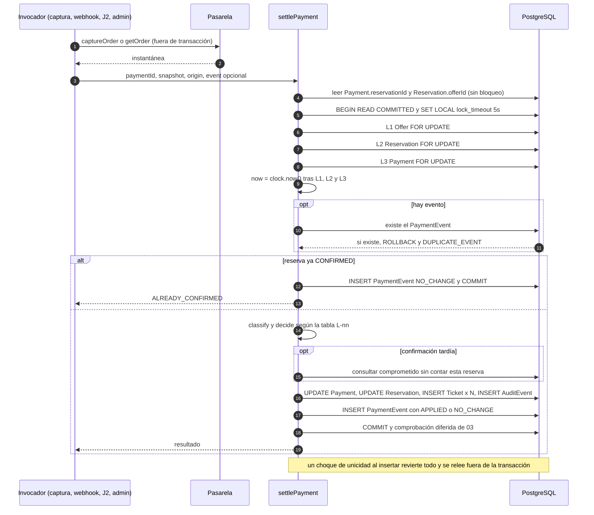

Captura y webhook simultáneos de la misma reserva:

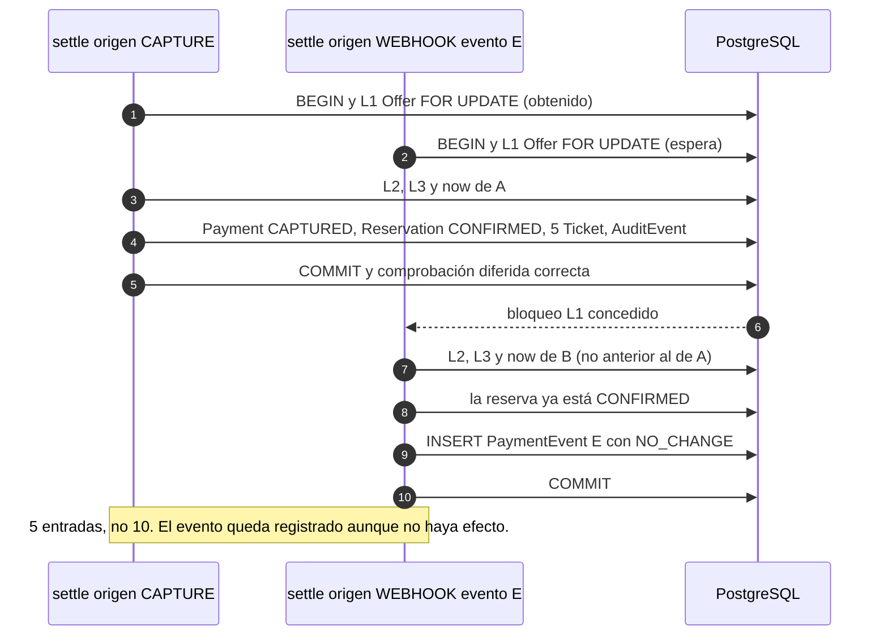

#### TX-09.4 Pseudocódigo con límites de transacción y bloqueos

```ts
async function settlePayment(input: SettleInput, { clock } = defaultDeps): Promise<SettleResult> {
  // (0) FUERA de transacción: solo columnas inmutables, sin bloqueo
  const pay0 = await db.payment.findUnique({ where: { id: input.paymentId }, select: { reservationId: true } });
  if (!pay0) throw new AppError('NOT_FOUND');
  const res0 = await db.reservation.findUniqueOrThrow({ where: { id: pay0.reservationId }, select: { offerId: true } });

  try {
    return await runWithDeadlockRetry(() => withTx(async (tx) => {
      // ═════════ TRANSACCIÓN: comienza (SET LOCAL lock_timeout = '5s' como 1.ª sentencia) ═════════
      const offer = await lockOffer(tx, res0.offerId);                 // L1
      const res   = await lockReservation(tx, pay0.reservationId);     // L2  SELECT … FROM "Reservation" WHERE id = $1 FOR UPDATE
      const pay   = await lockPayment(tx, input.paymentId);            // L3  SELECT … FROM "Payment" WHERE id = $1 FOR UPDATE
      const now   = clock.now();                                       // ← UNA vez, DESPUÉS de L1, L2 y L3 (principio 5)

      if (pay.status === 'CREATED') throw new AppError('INVALID_STATE');                          // L-18

      // Evento ya registrado por otra transacción (la TX anterior confirmó antes de soltar los bloqueos)
      if (input.event && await paymentEventExists(tx, input.event)) return result('DUPLICATE_EVENT', res, pay);

      // L-17: nunca se degrada; el evento SÍ se registra aunque no haya efecto
      if (res.status === 'CONFIRMED') {
        if (input.event) await recordEvent(tx, input.event, pay.id, 'NO_CHANGE', now);
        return result('ALREADY_CONFIRMED', res, pay);
      }

      const kind = classify(input, pay, res);                           // K0a, K0b, K1, K2, K3, K4 (usa snapshot, evidence y captureAttemptKey)
      // La evidencia solo vale para el intento al que se refiere: si la clave ya no coincide, hay un intento más nuevo y se ignora
      const late = needsLateEvaluation(kind, res, pay, now)             // solo K3 con retención no vigente
        ? await readLateInputs(tx, offer, res, now)                     // oferta, startsAt contratada, capacidad pública, comprometido SIN esta reserva
        : null;
      const decision = decideSettlement({ kind, res, pay, offer, now, late });   // PURA: tabla L-01…L-16

      let outcome: SettleResult['outcome'] = 'NO_CHANGE';
      let attemptClosed = false;
      switch (decision.kind) {
        case 'NO_CHANGE':
          if (decision.closeAttempt) {                                  // L-01a, L-03 con K0a: evidencia concluyente de que ESTA solicitud no capturó
            await closeAttemptInTx(tx, pay.id, pay.captureAttemptKey);  // UPDATE … SET captureAttemptKey = NULL, captureAttemptedAt = NULL, nextCheckAt = NULL WHERE id AND captureAttemptKey = $clave
            attemptClosed = true;
          }
          break;

        case 'RELEASE':                                                 // L-02 (R-7), solo con K0a: ya no depende de ningún plazo
          await updateReservation(tx, res.id, { status: 'HELD', reviewReason: null, reviewDetail: null, reviewFlaggedAt: null, updatedAt: now },
                                  /* solo si status = 'REVIEW_REQUIRED' */);
          await closeAttemptInTx(tx, pay.id, pay.captureAttemptKey); attemptClosed = true;
          await auditInTx(tx, now, { action: 'reservation.release_review', /* … metadata { origin } */ });
          outcome = 'RELEASED'; break;

        case 'FLAG': {                                                  // L-04, L-06, L-08, L-11, L-12 a L-14
          if (decision.payment) await applyPaymentPatch(tx, pay, decision.payment, now);   // DISCREPANT o CAPTURED (ver abajo)
          await flagReservation(tx, res, decision.reason, decision.detail, now);           // fija reviewReason/Detail/FlaggedAt y, si venía de HELD/EXPIRED, status
          await auditInTx(tx, now, { action: 'reservation.flag_review', reasonCode: decision.reason, /* metadata { origin, paymentId } */ });
          outcome = 'FLAGGED'; break;
        }

        case 'CONFIRM': {                                               // L-09, L-10, L-12
          if (decision.payment) await applyPaymentPatch(tx, pay, decision.payment, now);   // pago → CAPTURED (si aún no lo estaba)
          await updateReservation(tx, res.id, { status: 'CONFIRMED', confirmedAt: now, reviewReason: null, reviewDetail: null,
                                                reviewFlaggedAt: null, updatedAt: now }, /* WHERE status IN ('HELD','EXPIRED','REVIEW_REQUIRED') */);
          const attendees = await tx.attendee.findMany({ where: { reservationId: res.id }, orderBy: { position: 'asc' } });
          if (attendees.length !== res.quantity) throw new DefectError('attendee count');           // el COMMIT también lo rechazaría
          await issueTicketsInTx(tx, res, attendees, now);              // una por asistente; createMany SIN skipDuplicates
          await auditInTx(tx, now, { action: 'reservation.confirm', /* metadata { origin, paymentId, ticketsIssued, late } */ });
          outcome = 'CONFIRMED'; break;
        }
      }

      // Seguimiento del pago (P-6) y cierre de la conciliación cuando el caso queda resuelto
      await touchPayment(tx, pay.id, { lastCheckedAt: now, lastGatewayStatus: gatewayStatusText(input.snapshot) /* 'UNKNOWN' si es null */,
                                       lastErrorCode: null, ...(isResolved(outcome, decision) ? { nextCheckAt: null } : {}) });
      // El reprogramado del calendario de lo que SIGUE abierto es de TX-11; aquí solo se limpia lo resuelto o cerrado.

      // El evento va el último (orden de bloqueos de §2) y SIEMPRE, con el resultado real
      if (input.event) await recordEvent(tx, input.event, pay.id, outcome === 'NO_CHANGE' ? 'NO_CHANGE' : 'APPLIED', now);

      return result(outcome, /* reserva y pago tras las escrituras */, { late: decision.late });
      // ═════════ TRANSACCIÓN: COMMIT al devolver. Corre fn_check_reservation (03 §8.4). ═════════
    }));
  } catch (e) {
    // La transacción ya está revertida: nada de lo siguiente usa `tx`.
    if (input.event && isUniqueViolation(e, 'PaymentEvent_provider_providerEventId_key')) {
      if (await db.paymentEvent.findUnique({ where: { provider_providerEventId: { provider: input.event.provider, providerEventId: input.event.providerEventId } } }))
        return duplicateEventResult(input.paymentId);                   // otro proceso lo registró: ya se procesó
    }
    throw toAppError(e);       // 55P03/timeout → BUSY_TRY_AGAIN; TC_…/23xxx no previstos → INTERNAL_ERROR (se registra con requestId)
  }
}

// Parches de pago: NUNCA incluyen amountCents ni currency (importe esperado; inmutables)
function paymentPatchCaptured(pay, snap, now)    // ORDER_CREATED → CAPTURED
  = { status: 'CAPTURED', providerCaptureId: snap.capture.id, capturedAmountCents: snap.capture.amountCents,
      capturedCurrency: snap.capture.currency, capturedAt: now, nextCheckAt: null, captureAttemptKey: null };   // el intento deja de existir: hay captura
function paymentPatchDiscrepant(pay, snap, reason, now)   // ORDER_CREATED → DISCREPANT
  = { status: 'DISCREPANT', capturedAmountCents: snap.capture.amountCents /* o null */, capturedCurrency: snap.capture.currency /* o null */,
      providerCaptureId: reason === 'REFERENCE_MISMATCH' ? null : snap.capture.id, capturedAt: now, nextCheckAt: null, captureAttemptKey: null };
// applyPaymentPatch ejecuta UPDATE … WHERE id = $1 AND status = 'ORDER_CREATED' y exige 1 fila afectada (ya hay bloqueo: 0 filas = defecto)
```

Notas de lectura:
- `updateReservation` y `applyPaymentPatch` usan `UPDATE` con el estado esperado en el `WHERE` y exigen **exactamente una fila**: con los tres bloqueos tomados, otra cifra es un defecto.
- La reserva solo se actualiza con las columnas de revisión, estado y `confirmedAt`; **no** se reescriben los términos (`tg_reservation_guard` de 03 los vigila).
- `isResolved` = pago `CAPTURED` o `DISCREPANT` tras esta transacción, o reserva `CONFIRMED`. El **reprogramado** de las comprobaciones inciertas (`nextCheckAt` con espaciado creciente, `checkAttempts`, tope) es de TX-11: `settlePayment` solo lo pone a `NULL` cuando el caso queda resuelto; mientras no lo esté, una captura iniciada por TX-08 conserva su `nextCheckAt` y J2 es la **red de seguridad** (§TX-09.6).
- La instantánea `K0b` no escribe nada salvo el seguimiento del pago (`lastCheckedAt`, `lastGatewayStatus`); `K0a` además **cierra** el intento (y solo si `captureAttemptKey` coincide con la evidencia). El `result(…)` incluye `attemptClosed`.
- **Ningún plazo cierra nada aquí.** `settlePayment` no compara la hora con `captureAttemptedAt`; el único uso del reloj en las ramas de revisión es `expiresAt` frente a `now` (retención vigente o no).

#### TX-09.5 Escrituras y resultado de cada rama

| Rama (reglas) | Pago | Reserva | Entradas | `PaymentEvent` | Auditoría (`action`) | Resultado |
|---|---|---|---|---|---|---|
| Evento ya registrado | — | — | — | No se inserta | No | `DUPLICATE_EVENT` (webhook responde 200) |
| Reserva ya `CONFIRMED` (L-17) | — | — | — | `NO_CHANGE` (si hay evento) | No | `ALREADY_CONFIRMED` |
| Sin cambio (L-01, 03 con `K0b`, 05, 07, 15, 16) | solo seguimiento | — | — | `NO_CHANGE` | No | `NO_CHANGE` |
| Cierre del intento sin liberar (L-01a, L-03 con `K0a`) | seguimiento; `captureAttemptKey`, `captureAttemptedAt` y `nextCheckAt` a `NULL` | — | — | `NO_CHANGE` | No | `NO_CHANGE` con `attemptClosed` |
| Liberar (L-02) | seguimiento y **cierre del intento** (`nextCheckAt = NULL`) | `HELD`, revisión a nulo | — | `APPLIED` | `reservation.release_review` | `RELEASED` con `attemptClosed` |
| Marcar (L-04, 06) | solo seguimiento | `REVIEW_REQUIRED` + motivo | — | `APPLIED` | `reservation.flag_review` | `FLAGGED` |
| Discrepancia (L-08) | `DISCREPANT` + capturado observado; `nextCheckAt = NULL` | `REVIEW_REQUIRED` + `r` | — | `APPLIED` | `reservation.flag_review` | `FLAGGED` |
| Captura válida, no confirmable (L-11) | `CAPTURED` | `REVIEW_REQUIRED` + `OFFER_NOT_OPEN`/`ACTIVITY_STARTED`/`NO_CAPACITY` | — | `APPLIED` | `reservation.flag_review` | `FLAGGED` |
| Confirmar con retención vigente (L-09) | `CAPTURED` | `CONFIRMED` | `quantity` | `APPLIED` | `reservation.confirm` (`late: false`) | `CONFIRMED` |
| Confirmar tardía (L-10) | `CAPTURED` | `CONFIRMED` | `quantity` | `APPLIED` | `reservation.confirm` (`late: true`) | `CONFIRMED` |
| Pago ya `CAPTURED` (L-12 a L-14) | solo seguimiento | `CONFIRMED`, o motivo actualizado, o igual | `quantity` solo si confirma | `APPLIED` o `NO_CHANGE` | según la rama | según la rama |

#### TX-09.6 Compatibilidad con los disparadores y restricciones de 03

Todas las escrituras de cada rama deben respetar `ck_pay_state`, `ck_res_state`, `tg_payment_guard`, `tg_reservation_guard`, `tg_ticket_guard` y la comprobación diferida `fn_check_reservation` (03 §8.4), que se evalúa al `COMMIT` y se dispara por `INSERT` o `UPDATE OF status` de `Reservation` y `Payment` y por `INSERT` de `Attendee` y `Ticket`.

| Rama | Estado final (pago, reserva, entradas) | Reglas de 03 que se cumplen | Observación |
|---|---|---|---|
| L-08 discrepancia | `DISCREPANT`, `REVIEW_REQUIRED`, 0 | `DISCREPANT ⇒ REVIEW_REQUIRED`; `ck_pay_state` (`capturedAt` no nulo, `providerOrderId` no nulo); `ck_res_state` (motivo y `flaggedAt` presentes, sin `confirmedAt`). | Si la reserva ya estaba en revisión y solo cambia el motivo, la actualización de `Reservation` no incluye `status` y no dispara la comprobación; el `UPDATE OF status` de `Payment` sí, y pasa. |
| L-09, L-10 confirmar | `CAPTURED`, `CONFIRMED`, N | `ck_pay_state` (`capturedAmountCents = amountCents`, `capturedCurrency = currency`); `CONFIRMED ⇒ CAPTURED` y N entradas; `ck_res_state` (revisión a nulo, `confirmedAt` presente). | El `UPDATE` de `Payment` va **antes** que el de `Reservation` solo por claridad: la comprobación es diferida y el orden es indiferente. Las `Ticket` se insertan con la reserva ya `CONFIRMED` o en la misma transacción. |
| L-11 no confirmable | `CAPTURED`, `REVIEW_REQUIRED`, 0 | `CAPTURED ⇒ {CONFIRMED, REVIEW_REQUIRED}`; reserva sin entradas. | Combinación explícitamente válida en 03 §4.4. |
| L-04, L-06 | `ORDER_CREATED`, `REVIEW_REQUIRED`, 0 | `ck_res_state`; el pago no cambia. | — |
| L-02 liberar | `ORDER_CREATED`, `HELD`, 0 | `ck_res_state` (revisión a nulo); `ck_pay_attempt` (clave a `NULL` junto con `captureAttemptedAt`). | Solo si el pago sigue `ORDER_CREATED`: con pago `CAPTURED` o `DISCREPANT` esta rama no existe (L-12 a L-16). |
| Pago terminal (L-09 a L-11, L-08) | `CAPTURED`/`DISCREPANT` con `captureAttemptKey = NULL` | `ck_pay_attempt`: clave no nula ⇒ `ORDER_CREATED`; por eso el mismo `UPDATE` que cambia el estado también anula la clave. | Los parches de `paymentPatch*` incluyen `captureAttemptKey: null`; olvidarlo sería rechazado por el `CHECK` (defecto). |
| L-12 a L-14 con pago `CAPTURED` | `CAPTURED`, `CONFIRMED` o `REVIEW_REQUIRED`, N o 0 | `tg_payment_guard`: no se toca estado, ids ni capturado (solo seguimiento). | Se **evita** intentar reescribir un pago terminal: el disparador lo rechazaría como defecto. |
| L-17 ya confirmada | sin cambios | — | Solo `INSERT PaymentEvent`; no dispara ninguna comprobación diferida. |
| `Ticket` insertada | — | `tg_ticket_guard` no interviene en `INSERT`; `fn_check_reservation_from_ticket` exige reserva `CONFIRMED` y N entradas al `COMMIT`. | El `id` de la entrada lo **genera la aplicación** (`crypto.randomUUID()`) antes de cifrar, porque es el dato asociado (AAD) del cifrado (D-46); ver H-40 y 03 §3.3. |

Si el `COMMIT` falla por un `TC_…` (defecto), **nada de la transacción se aplica**: no hay confirmación a medias, el invocador recibe `INTERNAL_ERROR` y los mecanismos de recuperación (J2, webhook posterior, «Consultar pasarela») reintentan. El **respaldo** de esta comprobación se prueba en la base con T-DB-01e (no se inyecta un defecto en el servicio solo para probarlo).

*Red de seguridad frente a un resultado perdido.* La captura iniciada por TX-08 fija `nextCheckAt` **antes** de llamar a la pasarela y `settlePayment` solo lo limpia cuando el caso queda resuelto; por eso, aunque una liquidación se pierda (reversión por unicidad, `BUSY_TRY_AGAIN`, caída), J2 vuelve a consultar la pasarela y aplica el resultado. Esta propiedad depende de que TX-08 y TX-11 la respeten.

#### TX-09.7 Errores, reintentos e idempotencia

| Situación | Resultado |
|---|---|
| Repetir `settlePayment` con la misma instantánea | Idempotente: la segunda vez es `ALREADY_CONFIRMED` o `NO_CHANGE`; nunca reemite entradas ni degrada estados. |
| Dos liquidaciones simultáneas (captura, webhook, J2, administrador) | Se serializan por `Offer`; la primera aplica y las demás ven el estado final. |
| Instantáneas obsoletas o fuera de orden (L-15, L-17) | No tienen efecto; una captura registrada es monótona. |
| `BUSY_TRY_AGAIN` | No se aplicó nada. Captura propia: un reintento inmediato con la misma entrada y, si falla, TX-11 lo recoge. Webhook: **no** registra el evento, adelanta `nextCheckAt` y responde 200 (si no puede escribirlo, 503; TX-10.3). J2: lo reintenta en su siguiente ciclo. |
| `40P01` | Reintento automático (≤ 2); hora y bloqueos nuevos. |
| `23505` en `PaymentEvent` | Regla 8: reversión total, relectura fuera de la transacción; si el evento existe ⇒ `DUPLICATE_EVENT` (otro proceso lo registró). **Se pierden los efectos de esta transacción**, no los del ganador; es inalcanzable con la disciplina de bloqueos (el evento duplicado se detecta bajo los tres bloqueos) y la red de seguridad de §TX-09.6 recupera cualquier efecto. |
| `23505` en `Ticket` (`attendeeId` o `tokenHash`) o en `providerCaptureId` | Defecto: reversión y `INTERNAL_ERROR` con `requestId`; no se reintenta ni se oculta. |
| `TC_…` al `COMMIT`, `25P02`, filas afectadas ≠ 1 | Defecto: `INTERNAL_ERROR`; nada se aplicó. |
| `INVALID_STATE` (pago `CREATED`) | Error del invocador. |
| `NOT_FOUND` (pago inexistente) | Error del invocador (el webhook ya filtra las órdenes desconocidas en TX-10). |

**Estado de los flujos relacionados** (lote 3):
- **TX-08** (lotes 2 y 3): reclama el intento (identidad por `captureAttemptKey`), pasa `snapshot = null` solo ante un resultado incierto y `evidence` solo ante un rechazo definitivo de **su** solicitud.
- **TX-10** (lote 3): resolvió la decisión sobre eventos contradictorios (D-75): no se registran, no cambian estados y adelantan `nextCheckAt`; el registro de `IGNORED_*` usa `ON CONFLICT` con objetivo explícito.
- **TX-11** (lote 3): fija el calendario (13 comprobaciones, ≈ 76 h), el agotamiento (`snapshot = null` con `context = RECONCILIATION_EXHAUSTED`) y la reanudación con la misma clave.
- **TX-01 a TX-04 y TX-16** (lote 4): aplican el principio 5 (`now` tras el bloqueo) y `lockOffer`/`lockOfferShared`; sus interacciones con TX-05 y TX-09 están en TX-03.6, TX-04.5 y TX-16.6.
#### TX-09.8 Pruebas

**Notación:** la de TX-05.7, más `instantaneaCompleta({reserva, capturaId, cents, moneda, customId})` (instantánea `COMPLETED` construida a mano; `settlePayment` recibe datos, no necesita pasarela) y `crearReservaConPago({cantidad: 5, venceEn, estadoPago: 'ORDER_CREATED', captureAttemptedAt?})` (reserva con sus 5 asistentes y un pago con orden `FAKE-ORD-1`).

**Unitarias (U) — `decideSettlement` y `classify`:** una prueba por cada fila `L-01` a `L-16` con entradas literales, más: `snapshot = null` ⇒ `K1`; prioridad `REFERENCE > CURRENCY > AMOUNT`; `amountCents = null` ⇒ `AMOUNT_MISMATCH` con `capturedAmountCents = null`; orden de las condiciones tardías (`OFFER_NOT_OPEN > ACTIVITY_STARTED > NO_CAPACITY`); `K0a` frente a `K0b` (**ningún plazo** convierte `K0b` en concluyente: `L-03` con `K0b` a 7 días); `L-01a` y `L-02` solo cierran con la clave de la evidencia (clave distinta ⇒ sin cambios); `L-04` con el intento cerrado ⇒ `NO_CHANGE`; `VOIDED` ⇒ `K2`; `REFERENCE_MISMATCH` sin `providerCaptureId`; **ningún parche de pago incluye `amountCents` ni `currency`**. Se asocian a `T-PAG-05`, `09` a `17`.

**Integración (I) — cada rama contra PostgreSQL con los disparadores diferidos activos:**

| ID | Preparación y acción | Aserciones |
|---|---|---|
| T-PAG-05 | Reserva `HELD` vigente de 5, pago `ORDER_CREATED`; `settlePayment(CAPTURE, K3)`. | Reserva `CONFIRMED` con `confirmedAt = now`; pago `CAPTURED` con `capturedAmountCents = amountCents`; 5 `Ticket` con `tokenHash` distintos y `status = VALID`; `AuditEvent reservation.confirm` con `late = false`, `ticketsIssued = 5`; `nextCheckAt = NULL`; el `COMMIT` no produce error `TC_…`. |
| T-PAG-09 | `K4` por importe (esperado 5000, capturado 6000). | Pago `DISCREPANT`, `amountCents` **sigue** igual al total de la reserva, `capturedAmountCents = 6000`, `providerCaptureId` guardado; reserva `REVIEW_REQUIRED` con `AMOUNT_MISMATCH` y `reviewFlaggedAt = now`; 0 entradas; `expiresAt` sin cambio. Una segunda liquidación con una instantánea **coincidente** ⇒ `NO_CHANGE`, sin error de `tg_payment_guard`, pago y reserva idénticos. |
| T-PAG-10 | `K4` por moneda `EUR`. | `CURRENCY_MISMATCH`; `capturedCurrency = 'EUR'`. |
| T-PAG-11 | `K4` por `custom_id` ajeno (y también con importe distinto). | `REFERENCE_MISMATCH` (prioridad); `providerCaptureId` **nulo**; `reviewDetail` contiene el valor recibido truncado. |
| T-PAG-12 | (a) `K1` con reserva `HELD` ⇒ `UNCERTAIN_RESULT`, pago sigue `ORDER_CREATED`, `nextCheckAt` intacto. (b) Después `K3` ⇒ `CONFIRMED`, campos de revisión **todos nulos**, 5 entradas. (c) Reserva en revisión `UNCERTAIN_RESULT` con intento abierto (`k1`) y una instantánea `K0b` (orden `APPROVED` sin captura): `NO_CHANGE` a los 61 s y también a los 7 días (**el tiempo no libera**). (d) Con una instantánea que trae una captura `DECLINED` (`K0b`): `NO_CHANGE`, el intento sigue abierto; con `evidence` de la clave `k1`: `RELEASED`, reserva `HELD`, `captureAttemptKey = NULL`. (e) Con `evidence` de una clave **distinta**: `NO_CHANGE`, intento intacto. | Según cada paso; ningún error `TC_…`. |
| T-PAG-13 | Retención vencida, hay cupo, `K3`. | `CONFIRMED`; auditoría `late = true`; `confirmedAt = now`; 5 entradas. |
| T-PAG-14 | Retención vencida; otra reserva `CONFIRMED` consume toda la capacidad; `K3`. | Reserva `REVIEW_REQUIRED` con `NO_CAPACITY`; pago `CAPTURED`; 0 entradas; lo comprometido **igual** que antes; un segundo intento ⇒ `NO_CHANGE`. |
| T-PAG-15 | Retención vencida; oferta `SUSPENDED` / `ARCHIVED` / actividad ya iniciada; y suspendida **y** iniciada. | `OFFER_NOT_OPEN`, `OFFER_NOT_OPEN`, `ACTIVITY_STARTED`, y en la combinación `OFFER_NOT_OPEN` (prioridad). Pago `CAPTURED`, 0 entradas. |
| T-PAG-16 | Reserva `CONFIRMED`; instantáneas `K1`, `K0`, `K2` (reembolsada), `K4`. | Siempre `ALREADY_CONFIRMED`; la fila de reserva, `updatedAt` incluido, y los ids de las 5 entradas **no cambian**; ninguna escritura salvo el evento. |
| T-PAG-17 | (a) Pago `CAPTURED` + reserva `REVIEW_REQUIRED` (`NO_CAPACITY`) + `K1`/`K0`. (b) Pago `DISCREPANT` + `K3`. | (a) `NO_CHANGE`, motivo intacto. (b) `NO_CHANGE`, reserva sigue en revisión. |
| T-PAG-07b | Reserva ya `CONFIRMED`; llega un evento **distinto** `E2` (webhook). | `ALREADY_CONFIRMED`; existe `PaymentEvent(E2)` con `outcome = NO_CHANGE`; 5 entradas sin cambio; la reserva no se modificó. |

**Concurrentes (C):**

| ID | Preparación | Acciones | Aserciones |
|---|---|---|---|
| T-PAG-06a | `crearReservaConPago` de 5, `K3`; evento `E`. | `barrera.offer`; `lanzar(settle CAPTURE)`; `esperarBloqueadas(1)`; `lanzar(settle WEBHOOK con E)`; `esperarBloqueadas(2)`; `liberar()`. Se repite intercambiando el orden de lanzamiento. | Exactamente una llamada devuelve `CONFIRMED` y la otra `ALREADY_CONFIRMED`; reserva `CONFIRMED`; **5** entradas (no 10) con `tokenHash` distintos; 1 `AuditEvent reservation.confirm`; **1** `PaymentEvent(E)` con `outcome = APPLIED` si la llamada del webhook fue la `CONFIRMED` y `NO_CHANGE` si fue la otra. |
| T-PAG-06b | Igual. | Tres llamadas simultáneas: `WEBHOOK(E)`, `RECONCILER` y `ADMIN`. | Una `CONFIRMED` y dos `ALREADY_CONFIRMED`; 5 entradas; 1 auditoría de confirmación; 1 evento. |
| T-PAG-07a | Igual; el **mismo** evento `E` entregado dos veces. | `barrera.offer`; dos `settle WEBHOOK` con `E`; `esperarBloqueadas(2)`; `liberar()`. | Una `CONFIRMED` y otra `DUPLICATE_EVENT`; 1 fila `PaymentEvent(E)`; 5 entradas. |
| T-PAG-07c | Reserva `HELD` vigente, `K3`. `ctrl`: `BEGIN` + `INSERT PaymentEvent(E)` con `paymentId = NULL` (no toma `FOR KEY SHARE` sobre `Payment`), **sin `COMMIT`**. | `lanzar(settle WEBHOOK con E)`; `esperarBloqueadas(1)` (bloqueada en el índice único); `liberar()`. | `DUPLICATE_EVENT` (no `INTERNAL_ERROR` ni `25P02`); la reserva sigue `HELD`, el pago `ORDER_CREATED` y hay 0 entradas (reversión total); el *pool* sigue sano. A continuación `settle RECONCILER` sin evento ⇒ `CONFIRMED` con 5 entradas (la red de seguridad). |
| T-PAG-13a | Retención con `expiresAt = T0 + 60 s`, hay cupo, `K3`. | `barrera.offer`; `lanzar(settle)` en `T0 + 30 s`; `esperarBloqueadas(1)`; `reloj.advance(31 s)`; `liberar()`. | `CONFIRMED` con auditoría `late = true` y `confirmedAt = T0 + 61 s`. *(Con la hora tomada antes de esperar habría `late = false`.)* |
| T-PAG-15a | Igual; `ctrl` además ejecuta `UPDATE "Offer" SET status = 'SUSPENDED', "statusChangedAt" = …, "statusChangedById" = …` dentro de su transacción de barrera. | Como 13a, `advance(31 s)`. | `FLAGGED`: reserva `REVIEW_REQUIRED` con `OFFER_NOT_OPEN`; pago `CAPTURED`; 0 entradas. |
| T-PAG-15b | Igual que 15a. | `advance(10 s)` (la retención sigue vigente). | `CONFIRMED` con `late = false` **aunque la oferta esté suspendida** (D-42); 5 entradas. |
| T-PAG-14c | Oferta de capacidad 1. A: retención de 1 con `expiresAt = T0 + 60 s`, pago `ORDER_CREATED`. B: otro comprador que reserva 1. | `barrera.offer`; `lanzar(B.createReservation)`; `esperarBloqueadas(1)`; `lanzar(A.settle con K3)`; `esperarBloqueadas(2)`; `reloj.advance(61 s)`; `liberar()`. Se repite lanzando A primero. | **En ambos órdenes:** lo comprometido (confirmadas + retenciones vigentes en `T0 + 61 s`) es **≤ 1** y exactamente una de las dos tiene la plaza. Orden B→A: B `HELD`, A `REVIEW_REQUIRED` (`NO_CAPACITY`) con pago `CAPTURED` y 0 entradas. Orden A→B: A `CONFIRMED` (`late = true`) y B recibe `INSUFFICIENT_CAPACITY`. |

*Honestidad sobre lo que detecta cada prueba:* T-PAG-14c no puede, por sí sola, distinguir una implementación con la hora tomada antes de esperar (el orden de llegada de PostgreSQL suele coincidir con el orden de lanzamiento y oculta el defecto); los casos que **sí** lo distinguen de forma determinista son T-RES-10a/10b, T-PAG-13a y T-PAG-15a/15b (el reloj avanza mientras la llamada espera).

---

### TX-10 — Webhook de PayPal

**Qué cambia respecto al texto condensado anterior** (H-48, H-49; D-75): (1) se define el **criterio de respuesta**: 2xx solo si el evento quedó registrado o el trabajo pendiente quedó escrito de forma durable; no se depende de las reentregas de PayPal, que son finitas; (2) se **resuelve la decisión abierta** sobre eventos contradictorios; (3) «firma inválida» y «verificación no disponible» dejan de confundirse (400 frente a 503); (4) se separa lo que prueba el simulador de lo que prueba un evento real de Sandbox.

#### TX-10.1 Entradas, verificación y límites de confianza

`POST /api/pagos/paypal/webhook` (05 §4). **No usa cookie ni comprueba `Origin`** (excepción de D-17): su autenticación es la **verificación de la firma**. No hay principal ni autorización por rol; el único «permiso» es una firma válida para el `PAYPAL_WEBHOOK_ID` configurado (con el adaptador `fake`: HMAC con `FAKE_PAYMENT_WEBHOOK_SECRET`).

**Qué dicen las fuentes** (grado indicado; una afirmación leída de la página completa no es lo mismo que un resumen de búsqueda):

| Afirmación | Fuente | Grado |
|---|---|---|
| Un 2xx reconoce la entrega; ante fallos o respuestas no satisfactorias PayPal reintenta hasta 25 veces durante 3 días. | [Integrate webhooks](https://developer.paypal.com/api/rest/webhooks/rest/) | **Leída** por el navegador de investigación (FUENTES-PAYPAL-REVISION.md). |
| Hay dos métodos de verificación: criptográfico local (requiere el cuerpo original para calcular CRC32) y consulta al endpoint de verificación de PayPal (*postback*); los eventos del **simulador** no admiten el *postback*. | Ídem | **Leída**. |
| La entrega es *al menos una vez* y el orden **no está garantizado** (duplicados y eventos desordenados son normales). | Resumen de una búsqueda de documentación de PayPal (2026-11-13) | **Solo resumen de búsqueda; no abierta.** |
| PayPal espera el 2xx en 30 s (guía de webhooks) o en 5–10 s (página de buenas prácticas): **las dos páginas del resumen no coinciden**. | Ídem | **Solo resumen; no abierta; contradictoria.** Se diseña para el plazo menor. |

**Cabeceras y límites previos (antes de gastar una llamada de red):** método `POST`; cuerpo leído como bytes **sin transformar** con tope de 256 KB (más ⇒ `413`); presencia de las cabeceras `paypal-transmission-id`, `paypal-transmission-time`, `paypal-transmission-sig`, `paypal-cert-url` y `paypal-auth-algo` (05 §6.2) (si falta alguna ⇒ `400`). Estas comprobaciones baratas evitan que un tercero haga que el servidor consulte a PayPal con cuerpos arbitrarios; el límite de frecuencia por origen para firmas inválidas **queda pendiente de 06**.

**Límite de confianza:**

| Dato | Antes de la verificación | Después de una verificación válida |
|---|---|---|
| Cabeceras y cuerpo | No confiables; solo se pasan **intactos** al verificador. | El cuerpo se hashea (`payloadDigest`, SHA-256) y **no se guarda**. |
| `id` del evento, `event_type`, identificadores de orden y de captura | No se leen. | Se usan como **pistas** (clave de deduplicación y forma de localizar el pago). |
| Importe, moneda, estados del cuerpo | No se leen. | **Se ignoran**: la verdad es `getOrder` (D-43). Solo se guarda un `summary` con claves permitidas (03 §3.3). |

**Resultados de la verificación** (`verifyWebhook` en 05 §6.1; se añade la distinción entre *inválida* y *no disponible*): `VALID` (con el evento), `INVALID` (PayPal respondió que la firma no vale) y error `UNAVAILABLE` (tiempo agotado, red o 5xx del verificador, o secreto ausente). **`UNAVAILABLE` no es «firma inválida»**: responder 400 a un evento real porque el verificador falló lo haría desaparecer. El adaptador `fake` verifica una firma HMAC local; **el *postback* de PayPal y el HMAC no son la misma prueba** (ver TX-10.9).

**Presupuesto de tiempo.** `WEBHOOK_BUDGET_MS = 8000`: la verificación (≤ 4 s) y el `getOrder` (≤ 4 s) comparten el presupuesto, con un tiempo máximo reducido por llamada (el valor de 10 s de 05 §6.2 se rebaja en esta ruta). No se sabe qué espera realmente PayPal (30 s o 5–10 s): una respuesta tardía cuenta como fallo de entrega y solo provoca una **reentrega**, que es inocua por la deduplicación. No se procesa en segundo plano ni se añade una cola: la propiedad de «trabajo durable» (TX-10.3) hace innecesario responder antes de terminar.

#### TX-10.2 Eventos y categorías

Tipos suscritos (05 §6.2): `PAYMENT.CAPTURE.COMPLETED`, `PAYMENT.CAPTURE.PENDING`, `PAYMENT.CAPTURE.DECLINED`, `PAYMENT.CAPTURE.REFUNDED`, `PAYMENT.CAPTURE.REVERSED`.

**Progreso mínimo que debe mostrar la instantánea** (la instantánea puede mostrar *más* progreso que el evento, nunca menos):

| Tipo de evento | La instantánea de `getOrder` debe mostrar al menos | «Por detrás» (contradictorio) cuando |
|---|---|---|
| `…COMPLETED` | captura `COMPLETED`, `REFUNDED` o `PARTIALLY_REFUNDED` | no hay captura, o está `PENDING`, `DECLINED` o `FAILED` |
| `…PENDING` | una captura (cualquier estado) | no hay captura |
| `…DECLINED` | nada (un rechazo es coherente con «sin captura» y con una captura posterior) | nunca |
| `…REFUNDED`, `…REVERSED` | nada: son **informativos** (reembolsos fuera del MVP, 01 §3.2) | nunca |

**Categorías y tratamiento:**

| Categoría | Cómo se detecta | `PaymentEvent` | Trabajo pendiente durable | Respuesta |
|---|---|---|---|---|
| Malformado o excesivo | Cabeceras ausentes; cuerpo > 256 KB | No | No | 400 / 413 |
| Firma inválida | `INVALID` | No | No | 400 + auditoría `DENIED` |
| Verificación no disponible | `UNAVAILABLE` | No | No necesario (ver TX-10.3) | **503** |
| Duplicado | Ya existe `(provider, providerEventId)` | Ya existe | No | 200 |
| Tipo no suscrito | `event_type` fuera de la lista | `IGNORED_EVENT_TYPE` | No | 200 |
| Orden desconocida o sin mapear | No hay `Payment` por orden ni por captura | `IGNORED_UNKNOWN_ORDER` | No | 200 (con auditoría `CONFLICT` si el evento no traía orden) |
| Normal o **fuera de orden** | La instantánea no está por detrás | `APPLIED` o `NO_CHANGE` (lo inserta `settlePayment`) | Resuelto, o calendario de TX-11 | 200 |
| **Contradictorio** | La instantánea está por detrás del evento y el pago está `ORDER_CREATED` | **No se registra** | `nextCheckAt` adelantado | **200** |
| Pasarela no disponible (`getOrder`) o `BUSY` | Fallo de red o bloqueo no obtenido | No | `nextCheckAt` adelantado (pago `ORDER_CREATED`) | **200** si se escribió; **503** si no (pago terminal, o la escritura falló) |
| Defecto (`TC_…`, filas ≠ 1…) | Excepción no prevista | No | Mejor esfuerzo | 500 |

#### TX-10.3 Criterio de respuesta y decisión sobre eventos contradictorios (D-75)

**Criterio.** *Se responde 2xx solo cuando el trabajo es nuestro:* (a) el evento quedó **registrado** (procesado, ignorado o ya existente), o (b) el trabajo pendiente quedó **escrito de forma durable** en la base (`nextCheckAt` del pago adelantado, que TX-11 recoge). Si no se cumple ninguna, se responde error. **Un error no es la red de seguridad:** PayPal reintenta una cantidad finita de veces (25 en 3 días) y no se depende de ello; toda captura iniciada por nosotros tiene un intento abierto con `nextCheckAt` en el calendario de TX-11 (hasta ≈ 76 h) que la encuentra aunque ningún webhook llegue. Por eso un evento que no se pudo verificar puede responder 503 sin perder trabajo: el webhook **acelera**, no es la fuente de verdad.

**Decisión sobre eventos contradictorios** (p. ej. `PAYMENT.CAPTURE.COMPLETED` con firma válida, pero `getOrder` no muestra una captura completa). Se resuelve así: **no se registra el evento, no se cambia ningún estado, se adelanta `nextCheckAt` (≈ 30 s) y se responde 200**. Razones:
1. La firma es válida: el evento es **auténtico** y su afirmación («hay una captura») es una señal real; la lectura que la contradice puede ser **anterior** (la documentación consultada no fija la consistencia de la lectura, TX-08.0) o incompleta.
2. Registrarlo como procesado (`NO_CHANGE`) **descartaría** esa señal: una reentrega se deduplicaría y nadie volvería a mirar.
3. Responder 5xx para forzar la reentrega **depende de PayPal** y de un número finito de intentos; además no deja constancia local.
4. Cambiar el estado (marcar `REVIEW_REQUIRED` o liberar) a partir de una contradicción sería decidir con evidencia inconsistente; solo se actúa con evidencia concluyente (TX-08.0).
5. Adelantar `nextCheckAt` **sí** deja el trabajo escrito, lo acota (calendario finito) y no consume intentos del calendario (los consume J2 al reclamar la comprobación).

Una reentrega del mismo evento vuelve a evaluarse (no está registrado) y, si ya muestra el progreso, se aplica con normalidad. Si la contradicción persiste hasta agotar el calendario, el caso pasa a revisión del administrador (TX-11.2). Los eventos `REFUNDED`/`REVERSED` no son contradictorios nunca (informativos).

**Reembolso o reversión sobre una reserva confirmada** (01 §3.2): `settlePayment` registra el evento (`NO_CHANGE`), **no degrada** la reserva y deja un `AuditEvent` `payment.reconcile` con `result = CONFLICT` y `reasonCode = REFUND_AFTER_CONFIRMATION` (el «aviso en la vista del administrador» es la lectura de esos eventos, sin estado nuevo).

#### TX-10.4 Secuencia

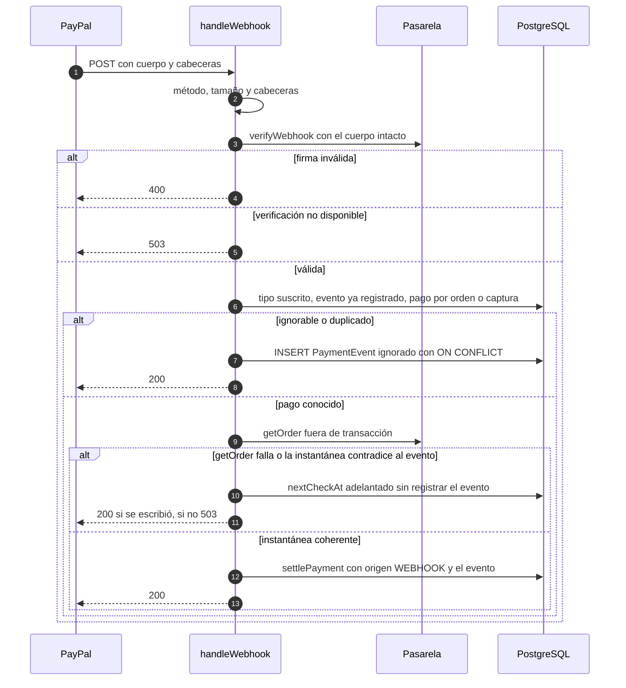

#### TX-10.5 Pseudocódigo con límites de transacción

```ts
async function handleWebhook(req, { clock, gateway, settle = settlePayment }) {
  // ─── 0. límites previos, sin red ───
  const headers = lowercased(req.headers);
  if (!hasAllPaypalHeaders(headers)) return reply(400);
  const raw = await readBodyLimited(req, 256 * 1024);          // bytes SIN transformar; exceso ⇒ null
  if (raw === null) return reply(413);
  const deadline = clock.monotonicNow() + WEBHOOK_BUDGET_MS;

  // ─── 1. verificación (fuera de transacción) ───
  let v;
  try { v = await gateway.verifyWebhook({ headers, rawBody: raw, timeoutMs: budget(deadline, 4000) }); }
  catch (e) { log.warn('verificación no disponible'); return reply(503); }          // NO es «firma inválida»
  if (!v.valid) { await auditRejectionBestEffort('webhook.receive', 'DENIED', 'BAD_SIGNATURE'); return reply(400); }

  const ev = { provider: cfg.paymentProvider, providerEventId: v.event.id, eventType: v.event.type, orderId: v.event.orderId,
               captureId: v.event.captureId, payloadDigest: sha256Hex(raw), receivedAt: clock.now(), summary: allowedSummary(v.event) };

  // ─── 2. clasificación sin red ───
  if (!SUBSCRIBED.has(ev.eventType)) return await recordIgnored(ev, 'IGNORED_EVENT_TYPE', null);        // 200
  if (await db.paymentEvent.findUnique({ where: { provider_providerEventId: { provider: ev.provider, providerEventId: ev.providerEventId } } }))
    return reply(200, { status: 'duplicate' });
  const pay = await findPaymentByOrderOrCapture(ev);            // por providerOrderId; si falta, por providerCaptureId
  if (!pay) return await recordIgnored(ev, 'IGNORED_UNKNOWN_ORDER', null, { unmapped: !ev.orderId });   // 200

  // ─── 3. instantánea (fuera de transacción) ───
  let snap;
  try { snap = await gateway.getOrder(pay.providerOrderId, { timeoutMs: budget(deadline, 4000) }); }
  catch (e) { return await owned(pay, 'GATEWAY_UNAVAILABLE'); }

  // ─── 4. contradicción: la instantánea está por detrás del evento ───
  if (pay.status === 'ORDER_CREATED' && isBehind(ev.eventType, snap)) return await owned(pay, 'EVENT_SNAPSHOT_MISMATCH');   // sin registrar el evento

  // ─── 5. liquidación (TX-09 abre su propia transacción) ───
  let r;
  try { r = await settle({ paymentId: pay.id, snapshot: snap, origin: 'WEBHOOK', actor: { type: 'WEBHOOK' }, event: ev }); }
  catch (e) {
    if (isBusyTryAgain(e)) return await owned(pay, 'BUSY');
    await markPending(pay.id, PENDING_DELAY_MS).catch(() => {});                       // defecto: mejor esfuerzo
    log.error({ requestId, err: e }, 'webhook: defecto al liquidar'); return reply(500);
  }
  return reply(200, { status: r.outcome === 'DUPLICATE_EVENT' ? 'duplicate' : 'processed' });
}

// El trabajo pasa a ser nuestro: se escribe ANTES de responder 2xx
async function owned(pay, why) {
  const ok = await markPending(pay.id, PENDING_DELAY_MS).then(n => n === 1, () => false);   // UPDATE condicionado; 0 filas = pago terminal
  await auditRejectionBestEffort('webhook.receive', why === 'EVENT_SNAPSHOT_MISMATCH' ? 'CONFLICT' : 'FAILED', why);
  return ok ? reply(200, { status: 'pending' }) : reply(503);   // sin trabajo escrito no se promete nada: PayPal reintenta
}
// UPDATE "Payment" SET "nextCheckAt" = LEAST(COALESCE("nextCheckAt", $t), $t), "updatedAt" = $now
//  WHERE "id" = $id AND "status" = 'ORDER_CREATED'          -- solo adelanta; no cambia checkAttempts ni estados
async function recordIgnored(ev, outcome, paymentId, extra?) {
  await withTx(async tx => { await tx.$executeRaw`INSERT INTO "PaymentEvent" (…) VALUES (…) ON CONFLICT ("provider","providerEventId") DO NOTHING`; });
  return reply(200, { status: 'ignored' });                    // ON CONFLICT con objetivo explícito: la reentrega es lo normal (principio 8.3)
}
function isBehind(type, snap) {                                // tabla de TX-10.2
  const c = snap.capture?.status;
  if (type === 'PAYMENT.CAPTURE.COMPLETED') return !(c === 'COMPLETED' || c === 'REFUNDED' || c === 'PARTIALLY_REFUNDED');
  if (type === 'PAYMENT.CAPTURE.PENDING')   return c === undefined;
  return false;
}
```

Notas de lectura:
- Ninguna transacción abarca una llamada de red: la verificación y `getOrder` ocurren antes; `settlePayment` abre la suya (TX-09), y `markPending`/`recordIgnored` son transacciones de una sentencia.
- `markPending` **solo adelanta**: usa `LEAST` con el valor existente, de modo que un evento no puede retrasar una comprobación ya prevista.
- `isBehind` solo aplica a pagos `ORDER_CREATED`: con el pago terminal o la reserva confirmada la instantánea no puede «llegar tarde» (las reglas L-12 a L-17 de TX-09 son monótonas).
- El evento **no** se pasa a `settlePayment` en las ramas «pendiente»: `settlePayment` registra el `PaymentEvent` únicamente cuando decide con una instantánea coherente.

#### TX-10.6 Escrituras y resultado de cada rama

| Rama | Escrituras | Respuesta | Auditoría (`webhook.receive`) |
|---|---|---|---|
| Malformado / grande | Ninguna | 400 / 413 | No |
| Firma inválida | Ninguna | 400 | `DENIED`, `BAD_SIGNATURE` (aparte) |
| Verificación no disponible | Ninguna | 503 | No (log) |
| Duplicado (antes de la instantánea) | Ninguna | 200 `duplicate` | No |
| Tipo no suscrito | `INSERT PaymentEvent` (`IGNORED_EVENT_TYPE`) | 200 `ignored` | No |
| Orden desconocida o sin mapear | `INSERT PaymentEvent` (`IGNORED_UNKNOWN_ORDER`, `summary.unmapped`) | 200 `ignored` | `CONFLICT` solo si venía sin orden |
| `getOrder` falla, pago `ORDER_CREATED` | `nextCheckAt` adelantado | 200 `pending` | `FAILED`, `GATEWAY_UNAVAILABLE` |
| `getOrder` falla, pago terminal | Ninguna | 503 | `FAILED` |
| Contradictorio | `nextCheckAt` adelantado; **sin** `PaymentEvent` | 200 `pending` | `CONFLICT`, `EVENT_SNAPSHOT_MISMATCH` |
| `settlePayment` → `CONFIRMED`, `FLAGGED`, `RELEASED`, `NO_CHANGE`, `ALREADY_CONFIRMED` | Las de TX-09 (incluye el `PaymentEvent` `APPLIED`/`NO_CHANGE`) | 200 `processed` | `SUCCESS` con `outcome` |
| `settlePayment` → `DUPLICATE_EVENT` | Ninguna nueva | 200 `duplicate` | No |
| `settlePayment` → `BUSY_TRY_AGAIN` | `nextCheckAt` adelantado | 200 `pending`, o 503 si no se pudo escribir | `FAILED`, `BUSY` |
| Defecto | `nextCheckAt` (mejor esfuerzo) | 500 | No (log con `requestId`) |

#### TX-10.7 Compatibilidad con TX-09, TX-11 y 03

- **Con TX-09:** el webhook pasa siempre una instantánea **no nula** (`getOrder`); `settlePayment` registra el evento en todas las ramas que terminan y detecta el duplicado bajo los tres bloqueos; el choque de unicidad al insertarlo se recupera tras revertir (regla 8). `recordIgnored` solo inserta eventos **sin** efecto, con `ON CONFLICT` de objetivo explícito.
- **Con TX-11:** el webhook **no toca** el calendario salvo para adelantarlo (`LEAST`); no incrementa `checkAttempts`; la comprobación adelantada la reclama J2 como cualquier otra.
- **Con 03:** `PaymentEvent.paymentId` es opcional; `IGNORED_*` se insertan con `paymentId` nulo o con el pago si se conoce; `ck_pe_fields` (longitudes y `payloadDigest` de 64 hex) se cumple; no se guarda el cuerpo.
- **Con los disparadores diferidos:** `markPending` actualiza solo `nextCheckAt` y `updatedAt` (sin `status`): no dispara la comprobación; `recordIgnored` solo inserta en `PaymentEvent`, que no tiene comprobación diferida.

#### TX-10.8 Errores, idempotencia y recuperación

- **Duplicados concurrentes** (la misma entrega dos veces a la vez): las dos pasan el control previo (ninguna está registrada), las dos llaman a `getOrder`, y `settlePayment` las serializa por `Offer`: una aplica (`APPLIED`) y la otra recibe `DUPLICATE_EVENT` bajo los bloqueos. Las dos responden 200 y hay **una** fila `PaymentEvent`.
- **Fuera de orden:** un evento antiguo que llega después de uno nuevo se evalúa con la **instantánea actual**: normalmente `ALREADY_CONFIRMED`/`NO_CHANGE` registrado. Ningún efecto depende del orden de llegada.
- **Reentrega tras un contradictorio:** como no se registró, se reevalúa; si ya hay progreso, se aplica; si no, vuelve a adelantar `nextCheckAt` (idempotente por `LEAST`).
- **Caída del proceso durante el manejo:** antes de responder no se ha prometido nada (no hubo 2xx) y PayPal puede reentregar; además, todo pago con captura iniciada está en el calendario de TX-11. Después de responder 200 el trabajo ya estaba registrado o escrito.
- **Qué no se promete:** que el webhook llegue (el calendario existe precisamente para eso); que su 2xx llegue a PayPal (una reentrega es inocua).

#### TX-10.9 Pruebas (simulador frente a Sandbox real)

**Qué prueba cada cosa.** Las pruebas automatizadas usan el adaptador `fake` con firma **HMAC local**: demuestran **nuestra** lógica (clasificación, deduplicación, contradicciones, respuestas) y nada sobre la verificación de PayPal. Los eventos del **simulador** de PayPal **no admiten el *postback*** (fuente leída): enviados a esta ruta con `PAYMENT_PROVIDER=paypal`, la verificación fallará y se responderá 400, que es el comportamiento **esperado** y no un defecto; **no** cuentan como prueba de la ruta de verificación. La evidencia real es **T-PAG-24** (manual, con una aplicación de Sandbox real, una compra real y un webhook alcanzable, solo en despliegue; R-08): hasta ejecutarla, la verificación real queda **pendiente**. Contrato del verificador (T-PAG-21, nivel K): respuestas **grabadas de Sandbox real** cuando existan; mientras tanto, solo del `fake`.

Notación: la de TX-05.7 a TX-08.7; `webhook(POST)` invoca `handleWebhook` con el cuerpo y las cabeceras que el `fake` firma; `fake.program('verifyWebhook', 'VALID' | 'INVALID' | 'UNAVAILABLE')`.

| ID | Nivel | Preparación | Acciones | Aserciones |
|---|---|---|---|---|
| T-PAG-08a | I | Evento válido para una reserva `HELD`. | Firma alterada. | 400; 0 filas `PaymentEvent`; reserva y pago sin cambio; `AuditEvent` `DENIED`/`BAD_SIGNATURE`; `fake.calls('getOrder')` = 0. |
| T-PAG-08b | I | — | Faltan cabeceras; cuerpo de 256 KB + 1. | 400 y 413; `fake.calls('verifyWebhook')` = 0. |
| T-PAG-26a | I | Pago `ORDER_CREATED` con intento abierto; evento `COMPLETED` válido; `getOrder` ⇒ `UNAVAILABLE`. | `webhook`. | **200 `pending`**; 0 filas `PaymentEvent`; `nextCheckAt ≤ now + 30 s`; estado sin cambio. Después `reloj.advance(30 s)` + J2 con `getOrder` ⇒ `COMPLETED` ⇒ reserva `CONFIRMED` y 5 entradas (el trabajo no se perdió **sin ninguna reentrega**). |
| T-PAG-26b | I | Evento válido. | `fake.program('verifyWebhook', 'UNAVAILABLE')`. | **503** (no 400); sin escrituras. |
| T-PAG-26c | I | Pago `CAPTURED` + reserva `REVIEW_REQUIRED`; `getOrder` ⇒ `UNAVAILABLE`. | `webhook`. | 503 (no hay trabajo que adelantar); sin escrituras. |
| T-PAG-22 | I | Evento `COMPLETED` con una orden que no existe localmente; otro sin orden; otro de tipo no suscrito. | `webhook` ×3. | 200 ×3; `PaymentEvent` con `IGNORED_UNKNOWN_ORDER` (con y sin `unmapped`) e `IGNORED_EVENT_TYPE`; auditoría `CONFLICT` solo para el que venía sin orden; ningún pago cambia. |
| T-PAG-17a | I | Reserva `CONFIRMED`. Primero se procesa el evento `COMPLETED` `E2`; después llega un evento antiguo `PENDING` `E1`. | `webhook` ×2. | Ambos 200; `PaymentEvent(E1)` y `(E2)` con `NO_CHANGE`/`APPLIED` según el caso; 5 entradas sin cambio; reserva idéntica. |
| T-PAG-17c | I | Pago `ORDER_CREATED` con intento abierto; evento `COMPLETED` válido; `getOrder` ⇒ orden `APPROVED` **sin captura**. | `webhook`; después la **misma** entrega otra vez con `getOrder` ⇒ `COMPLETED`. | La primera: **200 `pending`**, **0** filas `PaymentEvent`, `nextCheckAt` adelantado, reserva y pago **sin cambio** (no se marca `REVIEW_REQUIRED`). La segunda: `CONFIRMED`, 1 fila `PaymentEvent` `APPLIED`, 5 entradas. |
| T-PAG-17d | I | Igual con evento `PENDING` y `getOrder` ⇒ sin captura. | `webhook`. | Igual que 17c (pendiente, sin registrar). |
| T-PAG-17e | I | Reserva `CONFIRMED`; evento `PAYMENT.CAPTURE.REFUNDED` válido; `getOrder` ⇒ captura `COMPLETED` (lectura anterior al reembolso). | `webhook`. | 200 `processed`; `PaymentEvent` `NO_CHANGE`; la reserva **no** se degrada; 5 entradas; 1 `AuditEvent payment.reconcile` `CONFLICT`/`REFUND_AFTER_CONFIRMATION`. |
| T-PAG-07d | C | Reserva `HELD` vigente, `K3`; compuerta en `getOrder`; `barrera.offer`. | Dos `webhook` idénticos (mismo evento) lanzados a la vez; `fake.waitInFlight(2)`; se liberan; `esperarBloqueadas(2)`; `liberar()`. | Ambas 200; **una** fila `PaymentEvent`; una `processed` y otra `duplicate`; 5 entradas. |
| T-PAG-26d | I | Pago `ORDER_CREATED`; `getOrder` ⇒ coherente; `settlePayment` con `BUSY` (barrera `Offer`, `lockTimeoutMs` reducido). | `webhook`. | 200 `pending` con `nextCheckAt` adelantado; 0 filas `PaymentEvent`; al liberar, J2 lo aplica. |

### TX-11 — Conciliación (J2) y «Consultar pasarela»

**Qué cambia respecto al texto condensado anterior** (H-46, H-50; D-74, D-76): se define el **calendario concreto**, el **máximo de comprobaciones**, la **recuperación tras un reinicio** y el **destino de los casos que siguen inciertos**; se corrige la afirmación del lote 2 de que un intento desconocido sin captura visible es un caso «resuelto sin cargo» (TX-08.0): **no se cierra por plazo**, se **escala**; y se fija qué puede hacer cada actor para que **una respuesta antigua no sobrescriba un resultado nuevo**.

#### TX-11.1 Alcance, entradas y autorización

Hay dos entradas a la misma rutina de comprobación:

| Entrada | Quién | Cuándo | Autorización |
|---|---|---|---|
| **J2 `reconcile-payments`** | Sistema | Cada 60 s y al arrancar (02 §11.1) | Ninguna: es un trabajo interno; no está expuesto. |
| **`checkGatewayAction`** («Consultar pasarela») | Administrador | Bajo demanda | Rol `ADMIN`; la reserva debe existir y estar `REVIEW_REQUIRED` (`NOT_FOUND`, `INVALID_STATE`). El administrador **no ve** nombres ni fechas de nacimiento (01 §8.5). |

**Qué casos recoge J2:** los pagos con `status = ORDER_CREATED` y `nextCheckAt` no nulo y vencido. Eso incluye (a) todo pago con un **intento de captura abierto** (el reclamo de TX-08 fija `nextCheckAt` antes de llamar) y (b) los pagos cuyo `nextCheckAt` adelantó el webhook (TX-10). **No** recoge los pagos terminales (`CAPTURED` con reserva en revisión, `DISCREPANT`): esos los consulta el administrador. **Diferencia de poder:** J2 puede **reanudar con la misma clave** un intento que el comprador ya inició (a lo sumo mientras la retención esté vigente con margen); el administrador **solo consulta**: nunca envía una captura.

#### TX-11.2 Calendario concreto, máximo de intentos y destino de los casos inciertos (D-76)

**Parámetros** (constantes del dominio; son una **propuesta de esta planificación**, no cifras de PayPal): `RECONCILE_DELAYS_MIN = [2, 5, 10, 20, 30, 60, 120, 240, 480, 720, 1440, 1440]` (espera **tras** la comprobación 1 a 12) y `MAX_CHECKS = 13`. La comprobación 1 es la que fija el reclamo de TX-08 (`nextCheckAt = reclamo + 2 min`).

| Comprobación | Minutos desde el reclamo | Hora acumulada | ¿Puede reanudar la captura? |
|---|---|---|---|
| 1 | 2 | 0 h 02 | Sí, si la retención está vigente con margen (la retención dura 15 min como máximo) |
| 2 | 4 | 0 h 04 | Ídem |
| 3 | 9 | 0 h 09 | Ídem |
| 4 | 19 | 0 h 19 | No (la retención ya venció) |
| 5 | 39 | 0 h 39 | No |
| 6 | 69 | 1 h 09 | No |
| 7 | 129 | 2 h 09 | No |
| 8 | 249 | 4 h 09 | No |
| 9 | 489 | 8 h 09 | No |
| 10 | 969 | 16 h 09 | No |
| 11 | 1 689 | 28 h 09 | No |
| 12 | 3 129 | 52 h 09 | No |
| 13 | 4 569 | 76 h 09 | No → **agotamiento** si sigue incierto |

**Por qué este calendario.** Densa en los primeros 20 min porque el modo de fallo principal es una respuesta perdida y la retención dura 15 min (la captura se puede reanudar); espaciada después, para capturas `PENDING` y caídas de PayPal. Cubre ≈ 76 h, algo más que los 3 días de reentrega del webhook, **sin depender de ellas**. Son 13 consultas por caso incierto: volumen despreciable.

**Cómo se cuentan los intentos.** `checkAttempts` se incrementa **al reclamar** la comprobación (no al terminar): una caída a mitad de comprobación **consume** el intento y el calendario avanza; así un caso que provoca siempre la misma caída no se repite indefinidamente.

**Recuperación tras un reinicio.** No hay estado en memoria: `nextCheckAt` y `checkAttempts` están en la base. Al arrancar, J2 se ejecuta una vez (02 §11.3) y recoge todo lo vencido; el reclamo de la comprobación deja `nextCheckAt = ahora + 2 min`, de modo que otra instancia o la siguiente pasada no repite la misma comprobación mientras dure.

**Destino de un caso todavía incierto** (comprobación 13 sin resolución, o una comprobación posterior a la 13 tras una caída): **se escala, no se cierra.** (1) Se llama a `settlePayment` con `snapshot = null` y `context = 'RECONCILIATION_EXHAUSTED'`: una reserva `HELD`/`EXPIRED` con intento abierto pasa a `REVIEW_REQUIRED` (`UNCERTAIN_RESULT`, con el detalle «conciliación automática agotada»); si ya estaba en revisión, no cambia. (2) Después se cierra el calendario (`nextCheckAt = NULL`, `lastErrorCode = 'RECONCILE_EXHAUSTED'`). **El intento sigue abierto** (`captureAttemptKey` conservada) y el pago `ORDER_CREATED`: el sistema **no afirma** que no hubo cargo. El caso aparece en la lista del administrador, que puede usar «Consultar pasarela» cuantas veces quiera (consulta, no captura); si la consulta muestra una captura se liquida (R-6); si muestra una captura rechazada se libera; si no muestra nada, **sigue en revisión** y se resuelve fuera del sistema (RB-09; reembolsos fuera del MVP, 01 §3.2). El orden «señalar primero, cerrar después» garantiza que una caída entre ambos pasos deja el calendario abierto (se reintenta), nunca un caso incierto sin señalar. **Inventario:** una reserva en revisión con `expiresAt` vencido no ocupa plazas (03 §5), de modo que un caso agotado no bloquea cupos.

#### TX-11.3 Estados de un caso en conciliación

| Estado | Representación | Quién actúa |
|---|---|---|
| Sin conciliación | Pago `ORDER_CREATED`, `captureAttemptKey = NULL`, `nextCheckAt = NULL` | Nadie (el comprador aún no capturó, o el intento se cerró). |
| En espera | Intento abierto, `nextCheckAt` futuro, `checkAttempts = n` | J2 cuando venza. |
| En comprobación | `nextCheckAt = reclamo + 2 min`, `checkAttempts = n` (acaba de incrementarse) | La instancia que reclamó; si cae, la siguiente pasada tras los 2 min. |
| Resuelto | Pago `CAPTURED`/`DISCREPANT`, o intento cerrado por evidencia concluyente; `nextCheckAt = NULL` | Nadie (lo escribió `settlePayment`). |
| **Agotado (escalado)** | Reserva `REVIEW_REQUIRED` (`UNCERTAIN_RESULT`), intento abierto, `nextCheckAt = NULL`, `lastErrorCode = 'RECONCILE_EXHAUSTED'` | El administrador (consulta); resolución manual fuera del sistema. |

#### TX-11.4 Secuencia de una comprobación de J2

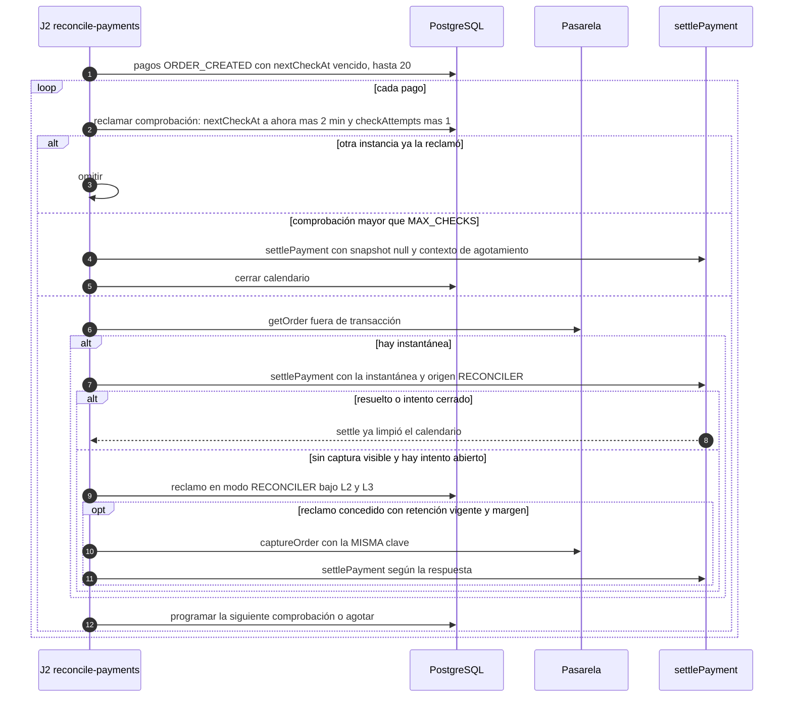

#### TX-11.5 Pseudocódigo con límites de transacción

```ts
// J2: sin solapamiento dentro del proceso; cada pago aislado de los errores de los demás
async function runReconcilePayments({ clock, gateway }) {
  if (reconcileRunning) return;  reconcileRunning = true;
  try {
    const due: { id: string }[] = await db.$queryRaw`SELECT "id" FROM "Payment"
        WHERE "status" = 'ORDER_CREATED' AND "nextCheckAt" IS NOT NULL AND "nextCheckAt" <= ${clock.now()}
        ORDER BY "nextCheckAt" LIMIT 20`;                                    // usa el índice (nextCheckAt)
    for (const { id } of due) { try { await reconcileOne(id, { clock, gateway }); } catch (e) { log.error({ id, err: e }); } }
  } finally { reconcileRunning = false; }
}

async function reconcileOne(paymentId, { clock, gateway }) {
  // ── Reclamo de la comprobación: transacción de UNA sentencia, condicionada (compare-and-set) ──
  const c = await claimCheck(paymentId, clock);                              // UPDATE "Payment" SET "nextCheckAt" = $now + 2 min, "checkAttempts" = "checkAttempts" + 1, "updatedAt" = $now
  if (!c) return;                                                            //  WHERE id AND status = 'ORDER_CREATED' AND "nextCheckAt" IS NOT NULL AND "nextCheckAt" <= $now  RETURNING …
  if (c.attempt > MAX_CHECKS) return await exhaust(c, { clock });            // caída tras la comprobación 13

  // ── Red, SIN transacción ──
  let snap: OrderSnapshot | null = null;
  try { snap = await gateway.getOrder(c.orderId); }
  catch (e) { await noteCheckError(c, 'GATEWAY_UNAVAILABLE'); }              // no cambia estados; el calendario sigue

  if (snap) {
    const r = await settleWithRetry({ paymentId, snapshot: snap, origin: 'RECONCILER', actor: SYSTEM });
    if (r && (r.resolved || r.attemptClosed)) return;                        // settlePayment ya dejó nextCheckAt = NULL

    // Sin captura visible y con un intento abierto: ¿reanudar LA MISMA solicitud?  (nunca iniciar una nueva)
    if (r && !snap.capture && c.hasOpenAttempt) {
      const claim = await claimCaptureAttempt({ reservationId: c.reservationId, mode: 'RECONCILER' }, { clock });   // L2+L3; NOT_ELIGIBLE si no hay margen de retención, etc.
      if (claim.kind === 'CLAIMED') {
        const d = await driveCapture(claim, { origin: 'RECONCILER', actor: SYSTEM }, { gateway, settle });          // misma clave; TX-09 resuelve o deja desconocido
        if (d.kind === 'REFUSED' || d.result.resolved || d.result.attemptClosed) return;
      }
    }
    if (r && !snap.capture && !c.hasOpenAttempt) return await closeCalendar(c);                                     // nada que conciliar (p. ej. adelantado por un webhook)
  }
  await scheduleNext(c, { clock });                                          // siguiente comprobación o agotamiento
}

async function scheduleNext(c, { clock }) {
  if (c.attempt >= MAX_CHECKS) return await exhaust(c, { clock });
  const now = clock.now();
  // CAS: solo si seguimos siendo la última comprobación y nadie adelantó nextCheckAt (p. ej. el webhook)
  await db.payment.updateMany({ where: { id: c.paymentId, status: 'ORDER_CREATED', checkAttempts: c.attempt, nextCheckAt: c.leaseValue },
    data: { nextCheckAt: addMs(now, RECONCILE_DELAYS_MIN[c.attempt - 1] * 60_000), lastCheckedAt: now, updatedAt: now } });
}

async function exhaust(c, { clock }) {
  // 1º SEÑALAR (si no se señaló, el calendario sigue abierto y se reintenta); 2º cerrar el calendario
  await settleWithRetry({ paymentId: c.paymentId, snapshot: null, origin: 'RECONCILER', actor: SYSTEM, context: 'RECONCILIATION_EXHAUSTED' });
  await db.payment.updateMany({ where: { id: c.paymentId, status: 'ORDER_CREATED' }, data: { nextCheckAt: null, lastErrorCode: 'RECONCILE_EXHAUSTED', updatedAt: clock.now() } });
  await auditBestEffort('payment.reconcile', 'FAILED', 'EXHAUSTED', c.paymentId);
}

// «Consultar pasarela» (administrador): consulta, nunca captura; no consume ni reprograma el calendario
async function checkGateway(principal, input, { clock, gateway, settle = settlePayment }) {
  requireRole(principal, 'ADMIN');
  const res = await db.reservation.findUnique({ where: { id: input.reservationId }, select: { status: true } });
  if (!res) throw new AppError('NOT_FOUND');
  if (res.status !== 'REVIEW_REQUIRED') throw new AppError('INVALID_STATE', { details: { reservationStatus: res.status } });
  const pay = await db.payment.findUniqueOrThrow({ where: { reservationId: input.reservationId } });
  if (!pay.providerOrderId) throw new AppError('INVALID_STATE');
  let snap: OrderSnapshot;
  try { snap = await gateway.getOrder(pay.providerOrderId); }
  catch (e) { await noteCheckError({ paymentId: pay.id }, 'GATEWAY_UNAVAILABLE'); throw new AppError('GATEWAY_UNAVAILABLE', { details: { retryable: true } }); }
  const r = await settle({ paymentId: pay.id, snapshot: snap, origin: 'ADMIN', actor: { type: 'USER', userId: principal.userId } });
  return summarizeForAdmin(r, pay, snap);      // estado, motivo, estados de la pasarela, importes esperado y capturado; sin datos de asistentes
}
```

Notas de lectura:
- `claimCheck` es el **candado de la comprobación**: una sentencia condicionada cuyo `WHERE` (`nextCheckAt <= ahora`) la hace excluyente; no hay transacción abierta durante la red.
- `scheduleNext` compara `checkAttempts` **y** el valor de `nextCheckAt` que puso el reclamo: si el webhook adelantó la próxima comprobación mientras ésta corría, se respeta lo adelantado.
- `settlePayment` es quien cierra intentos y marca resoluciones; TX-11 solo programa el calendario de lo que **sigue** abierto.
- «Reanudar» pasa por `claimCaptureAttempt` (TX-08): comparte la exclusión del arrendamiento con el comprador, de modo que J2 y una solicitud simultánea del comprador no envían dos veces.

#### TX-11.6 Escrituras y resultado de cada rama

| Rama | Escrituras | Resultado |
|---|---|---|
| No vencida o ya reclamada | Ninguna | Se omite. |
| Comprobación > `MAX_CHECKS` o 13.ª sin resolver | `settlePayment` (reserva `REVIEW_REQUIRED` si estaba `HELD`/`EXPIRED` con intento abierto); `nextCheckAt = NULL`, `lastErrorCode = 'RECONCILE_EXHAUSTED'`; `AuditEvent payment.reconcile` | **Escalado** (agotado). |
| `getOrder` falla | `lastErrorCode = 'GATEWAY_UNAVAILABLE'`; siguiente comprobación por calendario (se consumió el intento) | Reprogramado. |
| Captura visible o cierre por evidencia | Las de TX-09; `nextCheckAt = NULL` | Resuelto. |
| Sin captura visible, intento abierto, reanudación concedida | `captureAttemptedAt` renovado (clave igual); después según la respuesta (TX-08.4: N1 a N10) | Resuelto, o sigue desconocido y se programa. |
| Sin captura visible, intento abierto, reanudación no concedida (sin retención o sin margen, reserva en otro estado, arrendamiento vigente del comprador) | Ninguna adicional | Se programa la siguiente comprobación. |
| Sin captura visible y **sin** intento abierto | `nextCheckAt = NULL` | Cerrado: no hay nada que conciliar. |
| Consulta del administrador | Las de TX-09 con origen `ADMIN`; `lastCheckedAt`/`lastGatewayStatus`/`lastErrorCode`; **no** toca `checkAttempts` ni `nextCheckAt` salvo que la liquidación lo deje a `NULL` por resolución | Resumen para el administrador. |

#### TX-11.7 Concurrencia entre conciliador, administrador, captura y webhook

**Reglas de exclusión.** (1) Una comprobación de J2 se reclama con una sentencia condicionada: solo una instancia la obtiene. (2) Una captura (del comprador o del conciliador) se reclama con `claimCaptureAttempt` bajo `L2`/`L3`: el arrendamiento de 60 s excluye a la otra. (3) Toda decisión de estado pasa por `settlePayment`, que serializa por `Offer` y es **monótono** (TX-09). (4) El administrador y el webhook solo **leen** de PayPal y liquidan; el webhook, además, solo adelanta el calendario.

| Pareja | Qué puede pasar | Cómo se resuelve |
|---|---|---|
| J2 ↔ J2 (o dos pasadas) | Misma comprobación dos veces | Sin solapamiento en el proceso y reclamo condicionado: una sola. |
| J2 reanuda ↔ comprador captura | Dos envíos de la misma operación | El arrendamiento: la que reclama primero envía (misma clave); la otra recibe `IN_PROGRESS`/`NOT_ELIGIBLE` sin llamar. |
| J2 ↔ administrador | Dos `getOrder` y dos liquidaciones | Ambas son idempotentes: la primera aplica, la segunda ve el estado final (`NO_CHANGE`/`ALREADY_CONFIRMED`). El administrador no toca el calendario. |
| J2 ↔ webhook | El webhook adelanta `nextCheckAt` mientras J2 comprueba | `scheduleNext` compara el valor: se respeta lo adelantado; las liquidaciones se serializan. |
| Captura ↔ webhook | Las dos liquidan | TX-09 (T-PAG-06a). |

**Una respuesta antigua no sobrescribe un resultado nuevo.** Los datos de PayPal llegan por llamadas de red que pueden cruzarse. Los mecanismos, de mayor a menor fuerza:

| Respuesta antigua que llega tarde | Estado nuevo ya aplicado | Mecanismo | Resultado |
|---|---|---|---|
| Cualquiera | Reserva `CONFIRMED` | L-17 de TX-09 | `ALREADY_CONFIRMED`; nunca degrada ni reemite. |
| «Sin captura» o `PENDING` | Pago `CAPTURED` o `DISCREPANT` | L-15, L-16 (monotonía) | `NO_CHANGE`. |
| `PENDING` o `snapshot = null` | Intento **cerrado** por rechazo o evidencia (clave nula) | L-04 exige intento **abierto** | `NO_CHANGE`: no marca `REVIEW_REQUIRED` por un intento ya cerrado. |
| Rechazo (evidencia) de una clave antigua | Intento más nuevo con otra clave | `settlePayment` cierra solo si `captureAttemptKey = evidence.attemptKey` | Ignorado. |
| Cierre del calendario de una comprobación antigua | Calendario ya reprogramado o adelantado | CAS por `checkAttempts` y `nextCheckAt` | 0 filas: no se toca. |
| `PENDING` o `null` de **un intento anterior** | Un intento **nuevo** abierto (otra clave) | Ningún mecanismo lo distingue | **Límite reconocido:** puede marcar `REVIEW_REQUIRED` de forma **conservadora**; nunca confirma, degrada ni emite entradas; TX-11 lo resuelve. |

`lastGatewayStatus` y `lastCheckedAt` son **informativos**: una respuesta antigua aplicada después puede dejar un valor menos reciente, sin consecuencia sobre ningún estado.

#### TX-11.8 Errores, idempotencia y recuperación

- **Administrador:** `NOT_FOUND` (no existe), `FORBIDDEN` (no es `ADMIN`), `INVALID_STATE` (la reserva no está `REVIEW_REQUIRED`), `GATEWAY_UNAVAILABLE` (503, `retryable`), `BUSY_TRY_AGAIN` (503), `INTERNAL_ERROR` (500). Repetir la consulta es idempotente; con la pasarela caída se reintenta sin duplicar efectos (T-PAG-19).
- **J2:** no devuelve errores a nadie: registra, reprograma y sigue con el siguiente pago.
- **Reinicio durante una comprobación:** el reclamo ya consumió el intento y dejó `nextCheckAt = +2 min`; la siguiente pasada continúa el calendario (T-PAG-20c).
- **Pasarela caída durante horas:** consume comprobaciones del calendario; las últimas (cada 24 h) siguen disponibles; si se agotan, el caso se escala. No se concluye nada.
- **Qué nunca hace TX-11:** iniciar un intento de captura, usar una clave nueva sobre un intento abierto, cerrar un intento por plazo, ni dar por «sin cargo» un caso agotado.

#### TX-11.9 Pruebas

Notación: la de TX-05.7 a TX-10.9. `runReconcilePayments()` invoca la rutina de J2 con el reloj falso; `calendario(k)` es la hora acumulada de la tabla de TX-11.2.

**Unitarias (U):** `RECONCILE_DELAYS_MIN` y `MAX_CHECKS` producen exactamente las horas de la tabla (acumulado 4 569 min); `scheduleNext` en la comprobación 13 devuelve «agotar»; `claimCheck` incrementa `checkAttempts` y no reclama dos veces.

| ID | Nivel | Preparación | Acciones | Aserciones |
|---|---|---|---|---|
| T-PAG-20a | I | Intento abierto (`k1`); el `fake` ya capturó pero la respuesta nunca se guardó localmente; `nextCheckAt = T0 + 2 min`. | `reloj.advance(2 min)`; `runReconcilePayments()`. | `getOrder` ⇒ `COMPLETED` ⇒ reserva `CONFIRMED` (tardía si la retención venció), 5 entradas, pago `CAPTURED`, `captureAttemptKey = NULL`, `nextCheckAt = NULL`, `checkAttempts = 1`. |
| T-PAG-20b | I | Tres pagos con `nextCheckAt` vencido mientras «el proceso estaba caído». | Nueva instancia de J2 «al arrancar» (T-OPS-06). | Las tres se procesan **una vez**; `checkAttempts = 1` cada una; sin estado en memoria. |
| T-PAG-20c | I | Intento abierto; `ctrl` simula la caída tras el reclamo (no se llega a terminar). | `runReconcilePayments()` (cae); `advance(2 min)`; `runReconcilePayments()`. | Tras la caída: `checkAttempts = 1`, `nextCheckAt = ahora + 2 min`; la segunda pasada hace la comprobación 2: **el intento se consumió y el calendario avanza**. |
| T-PAG-20d | I | Reserva `HELD` con `expiresAt = T0 + 15 min`; intento abierto `k1`; `fake`: `getOrder` ⇒ `APPROVED` sin captura siempre; `captureOrder` ⇒ `UNCERTAIN` siempre. | Se ejecuta J2 en cada hora de `calendario(k)`, `k = 1…13`. | Comprobaciones 1 a 3 **reanudan con `k1`** (3 llamadas a `captureOrder`, siempre `k1`); a partir de la 4.ª **no** hay más capturas (retención vencida); hay **13** comprobaciones de J2 en las horas de la tabla (cada una con su `getOrder`, más los `getOrder` internos de las tres reanudaciones); tras la 13.ª: reserva `REVIEW_REQUIRED` (`UNCERTAIN_RESULT`, detalle «agotada»), `nextCheckAt = NULL`, `lastErrorCode = 'RECONCILE_EXHAUSTED'`, `AuditEvent payment.reconcile` `FAILED`/`EXHAUSTED`; **el intento sigue abierto con `k1`** y el pago `ORDER_CREATED` (**no se cerró por plazo**). |
| T-PAG-20h | I | Caso agotado (de 20d). | Consulta del administrador (ver 19c). | Sin cambios; se puede repetir cuantas veces se quiera; con una captura visible, pasa a `CONFIRMED`. |
| T-PAG-19a | I | Reserva `REVIEW_REQUIRED` (`UNCERTAIN_RESULT`), intento abierto; `getOrder` ⇒ `COMPLETED` coincidente. | `checkGatewayAction` como `ADMIN`. | `CONFIRMED` (R-6), 5 entradas; `AuditEvent payment.reconcile` con origen `ADMIN`; `fake.calls('captureOrder')` sin cambio. |
| T-PAG-19b | I | Igual con `getOrder` ⇒ `UNAVAILABLE`. | La consulta; después de liberar la pasarela, otra vez. | Primera: `GATEWAY_UNAVAILABLE` con `retryable`, sin cambio de estado; segunda: se aplica; ningún efecto duplicado. |
| T-PAG-19c | I | Caso agotado; `getOrder` ⇒ `APPROVED` sin captura. | Consulta del administrador. | `NO_CHANGE`; **no** se envía ninguna captura; reserva sigue en revisión; `checkAttempts` y `nextCheckAt` intactos. |
| T-PAG-19d | I | Reservas `CONFIRMED`, `HELD`, inexistente; usuario no `ADMIN`. | `checkGatewayAction`. | `INVALID_STATE`, `INVALID_STATE`, `NOT_FOUND`; `FORBIDDEN` para el no administrador (con T-SEG-04). |
| T-PAG-19e | I | Reserva en revisión por `UNCERTAIN_RESULT`; `getOrder` ⇒ captura `DECLINED` (de un intento posiblemente anterior). | Consulta del administrador. | `NO_CHANGE`: la reserva sigue en `REVIEW_REQUIRED` y el intento abierto; el resumen **muestra** el estado de la captura al administrador, que decide fuera del sistema; **no** se libera por esa instantánea. |
| T-PAG-20e | C | Intento abierto; `fake.getOrder` programado: la **primera** llamada (la antigua, retenida en compuerta) devolverá `PENDING` y la **segunda** `COMPLETED`. | Dos comprobaciones (J2 y administrador) lanzadas; se libera primero la que devuelve `COMPLETED`, después la que devuelve `PENDING`. | Reserva `CONFIRMED` una sola vez; la respuesta antigua da `ALREADY_CONFIRMED`; 5 entradas; nunca vuelve a `REVIEW_REQUIRED`. |
| T-PAG-20f | C | Intento cerrado por evidencia (clave nula); reserva `HELD`. | Una liquidación (`RECONCILER`) con una instantánea `PENDING` **antigua**. | `NO_CHANGE`: no se marca `REVIEW_REQUIRED` por un intento ya cerrado (regla L-04). |
| T-PAG-20g | C | Intento abierto, retención vigente con margen, arrendamiento vencido. Compuerta en `captureOrder`. | J2 reanuda y, a la vez, el comprador envía `capturePayment`. | Una sola llamada a `captureOrder` (misma clave `k1`); la otra: `IN_PROGRESS`/`NOT_ELIGIBLE`. Al liberar: una confirmación, 5 entradas. |
| T-PAG-20i | C | Dos comprobaciones simultáneas del mismo pago (dos «instancias» llamando a `reconcileOne`). | Ambas a la vez con `barrera` sobre la fila `Payment`. | `checkAttempts` sube **una** vez; una sola llama a `getOrder`. |
| T-PAG-20j | C | Comprobación en vuelo (compuerta en `getOrder`); mientras tanto un webhook contradictorio adelanta `nextCheckAt` a `ahora + 30 s`. | Se libera `getOrder` (sin captura). | `scheduleNext` **no** pisa el valor adelantado (CAS): `nextCheckAt` sigue en `ahora + 30 s`. |
| T-PAG-06g | C | Reserva `HELD` con captura completada en el `fake`. `barrera.offer`. | Cuatro actores a la vez: J2, administrador, webhook (`E`) y captura del comprador. | Una `CONFIRMED` y tres sin efecto; 5 entradas; 1 auditoría de confirmación; 1 `PaymentEvent(E)`. |

### TX-12 — Consultar una entrada y registrar el ingreso

**Autorización y entrada.** Rol `OPERATOR`; `lookupTicketAction` y `checkInTicketAction` reciben `{ offerId (actividad seleccionada), token }` (el token va en el cuerpo, nunca en la URL ni en logs). Límite: 30 consultas por minuto por operador (06 §3.2; `RATE_LIMITED` + auditoría). Se calcula `tokenHash = SHA-256(token)` (formato `TC1.` + 43 base64url; si no cumple el formato ⇒ `TICKET_NOT_FOUND`, sin consultar).

**Resolución (lectura, sin bloqueos):** `Ticket → Attendee → Reservation → Offer` por `tokenHash`. Todo lo que se usa es inmutable cuando existe una entrada: `attractionId` (fijo desde la primera publicación), reserva `CONFIRMED` (terminal, INV-04) y fechas (fijas con reservas, INV-10). Por eso **no se bloquea `Offer`** ni se lee con `FOR UPDATE`.

**Reglas de ingreso vigentes** (01 RF-33, 03 §4.6) y orden de comprobación; cada una con su código y todas **genéricas hacia el exterior** donde revelarían una entrada ajena:

| # | Comprobación | Error |
|---|---|---|
| 1 | La entrada existe y su atracción es una que el operador gestiona | `TICKET_NOT_FOUND` (idéntico para «no existe» y «otra atracción»; T-ENT-08) |
| 2 | `offer.id = offerId` seleccionado | `WRONG_ACTIVITY` |
| 3 | Reserva `CONFIRMED` (siempre cierto si existe la entrada; defensa) | `TICKET_NOT_FOUND` |
| 4 | `now ∈ [startsAt − CHECKIN_EARLY_MINUTES, endsAt]` | `OUTSIDE_CHECKIN_WINDOW` |
| 5 | (solo registrar) `status = VALID` | `TICKET_ALREADY_USED` (`details.usedAt`) |

**Oferta suspendida o archivada (decisión de este lote, D-79).** El estado de la oferta **no es una condición de ingreso**: ninguna de las reglas anteriores lo menciona y 03 §5 declara que las entradas emitidas **siguen accesibles** en `SUSPENDED` y `ARCHIVED`. Suspender o archivar solo impide *nuevas* retenciones (D-30, D-42); los asistentes que ya pagaron conservan su derecho de acceso. Por tanto consultar y registrar funcionan igual con la oferta `OPEN`, `SUSPENDED` o `ARCHIVED`; la ventana horaria sigue acotando el ingreso. Consecuencia para otros documentos: la selección de actividad de `/panel/ingresos` debe listar también ofertas suspendidas o archivadas **que tengan entradas emitidas** (05 §2, 07).

**Escritura atómica (registrar).** Una transacción corta: `now = clock.now()` justo antes (no hay bloqueos que esperar salvo la propia fila de la entrada), comprobaciones 1–4 con la lectura anterior y

```sql
UPDATE "Ticket" SET "status" = 'USED', "usedAt" = $now, "usedById" = $operador
 WHERE "id" = $id AND "status" = 'VALID';          -- una fila ⇒ ingreso; cero ⇒ se relee: TICKET_ALREADY_USED con usedAt
```

más `AuditEvent` `ticket.check_in` `SUCCESS` en la misma transacción (`offerId`; sin token ni nombre). `ck_ticket_state` exige `usedAt` y `usedById` juntos; `tg_ticket_guard` permite `VALID → USED` solo cambiando esas tres columnas. Consultar **no escribe** salvo auditoría (`ticket.lookup`); devuelve nombre del asistente y estado (nunca fecha de nacimiento, 01 §9.3). Rechazar presencialmente no llama a registrar: la entrada queda `VALID` (T-ENT-13).

**Concurrencia e idempotencia.** Dos dispositivos: el segundo `UPDATE` espera la fila, reevalúa `status = 'VALID'` y afecta cero filas ⇒ `TICKET_ALREADY_USED`; las demás entradas de la reserva no cambian. Repetir tras éxito da `TICKET_ALREADY_USED` con el mismo `usedAt` (idempotente en efecto). Suspender/archivar en paralelo no interfiere: no comparten bloqueo.

**Pruebas clave:** T-ENT-05 (consultar no consume), 06, 07 (doble escaneo: un ingreso, 4 entradas válidas), 08 (otra atracción), 09 `WRONG_ACTIVITY`, 10 ventana (con reloj falso; con `CHECKIN_EARLY_MINUTES`), 11 código mal formado y límite, 13 cancelar; **nuevos subcasos T-ENT-06a/06b:** con la oferta `SUSPENDED` y `ARCHIVED` y la actividad en curso, consultar y registrar **tienen éxito**; fuera de ventana siguen rechazando; suspender entre consultar y registrar no cambia el resultado.

### TX-13 — Restablecer contraseña

**Entrada y validaciones previas (sin transacción):** `token` (de la URL, solo `POST`), `newPassword` (política de 06 §3.1: 10–128, distinta del correo, lista corta). El hash Argon2id se calcula **antes** de abrir la transacción. Se lee sin bloqueo `PasswordResetToken` por `tokenHash` solo para obtener `userId` (columna inmutable); si no existe ⇒ `TOKEN_INVALID`.

**Escritura atómica (una transacción, orden `User → PasswordResetToken → Session`, §2):**

| # | Paso | Si falla |
|---|---|---|
| 1 | `SELECT … FROM "User" WHERE id = $u FOR UPDATE` | — |
| 2 | `UPDATE "PasswordResetToken" SET "usedAt" = $now WHERE "tokenHash" = $h AND "usedAt" IS NULL AND "expiresAt" > $now` (`now` tras el bloqueo) | 0 filas ⇒ `TOKEN_INVALID` (inexistente, usado o vencido: mensaje único) |
| 3 | `UPDATE "User" SET "passwordHash", "passwordChangedAt" = $now` | — |
| 4 | `UPDATE "Session" SET "revokedAt" = $now, "revokeReason" = 'PASSWORD_RESET' WHERE "userId" = $u AND "revokedAt" IS NULL` | — |
| 5 | `AuditEvent` `password.reset` (`sessionsRevoked`) | — |

Tras el `COMMIT`: cerrar sockets (`disconnectSessions(userId)`) y enviar el correo de aviso (fuera de transacción; si falla se registra, no revierte). **No inicia sesión.** Errores: `TOKEN_INVALID`, `VALIDATION_ERROR` (contraseña), `RATE_LIMITED` (06), `BUSY_TRY_AGAIN`. Dos consumos simultáneos: se serializan en el bloqueo de `User`; el segundo ve `usedAt` y recibe `TOKEN_INVALID`; **un** cambio de contraseña (INV-13, T-CTA-13).

*Carrera con un ingreso en curso:* insertar una `Session` toma `FOR KEY SHARE` sobre `User` (clave foránea), que choca con nuestro `FOR UPDATE`; el servicio de ingreso, dentro de la transacción que crea la sesión, comprueba que `passwordChangedAt` no cambió desde que verificó la contraseña. Así no sobrevive una sesión creada con la clave antigua. *La solicitud de recuperación* (crear el token con `INSERT … ON CONFLICT ("userId") DO UPDATE`, 03 §3.1) sigue el mismo orden y no se desarrolla aquí.

**Pruebas clave:** T-CTA-11 (vencido), 12 (usado), **13 (dos consumos: barrera sobre `User`; una contraseña cambiada, un `TOKEN_INVALID`)**, 14 (todas las sesiones revocadas, también sockets: T-CHAT-11), subcaso: ingreso simultáneo con la clave antigua no deja sesión viva.

### TX-14 — Sesiones y efecto sobre HTTP y WebSocket

| Operación | Escritura atómica y reglas |
|---|---|
| **Ingreso** | Fuera de transacción: límites (`LoginThrottle`) y verificación Argon2 (ficticia si el correo no existe). Transacción: re-comprobar `passwordChangedAt` y crear `Session` con token nuevo de 32 bytes (hash SHA-256, `expiresAt = now + 8 h`; `now` después de bloquear `User FOR KEY SHARE`); `AuditEvent` `session.login`. Nunca se reutiliza una cookie previa (sin fijación). |
| **Salida** | `UPDATE "Session" SET "revokedAt" = $now, "revokeReason" = 'LOGOUT' WHERE tokenHash = $h AND "revokedAt" IS NULL`; cero filas = ya salida (idempotente, mismo resultado). Tras `COMMIT`: borrar cookie y `getRuntime().realtime.disconnectSession(sessionId)`. |
| **Validación HTTP** | Cada petición: `revokedAt IS NULL AND expiresAt > now` (sin renovación deslizante, D-15). |
| **WebSocket** | Handshake con cookie y `Origin`; cierre por tres vías (D-55): (a) inmediato por el puente tras `COMMIT` de logout o TX-13, (b) temporizador por socket hasta `expiresAt`, (c) barrido J3 cada 30 s; cada evento entrante revalida la sesión antes de procesarse (INV-14). |

Los cierres (a) son efectos **posteriores al `COMMIT`**; si el puente falla, (b), (c) y la revalidación por evento garantizan el cierre: el invariante no depende del puente. Errores: `INVALID_CREDENTIALS` (mensaje único), `RATE_LIMITED`, `UNAUTHENTICATED`, `BUSY_TRY_AGAIN`. **Pruebas clave:** T-CTA-04, 05, 08, 09, 15; T-CHAT-01, 02, 11, 12 (cierre inmediato y, con el puente desactivado, por barrido y por evento); salida doble idempotente.

### TX-15 — Enviar un mensaje de chat

**Precondiciones (antes de la cola):** sesión válida (revalidada por evento), `{ clientMessageId: uuid, text }`, texto plano 1–500 puntos de código, no solo espacios, límite 5 mensajes/10 s por usuario (memoria; `RATE_LIMITED`). **Escritura atómica** dentro de la cola en proceso **por sala** (serializa «insertar → confirmar», de modo que los `id` se confirman en orden, H-31):

```ts
// dentro de la cola de la sala; una transacción corta, sin bloqueos
const prior = await tx.chatMessage.findUnique({ where: { authorId_clientMessageId } });   // reintento ya procesado
if (prior) return { message: prior, replayed: true };                                       // NO se reemite
const m = await tx.chatMessage.create({ data: { room, authorId, text, clientMessageId, createdAt: now } });
return { message: m, replayed: false };       // COMMIT; la auditoría no registra mensajes (volumen y contenido)
```

Si el `INSERT` choca con `(authorId, clientMessageId)` (carrera de dos pestañas del mismo usuario): la transacción se revierte, se relee **con una consulta nueva** (regla 8) y se devuelve el existente sin reemitir. **Después del `COMMIT`:** emitir `chat:message` a `chat:general`, `notification:new-message` a los sockets fuera de la sala y que no son del autor, y confirmar al emisor `{ ok, message }`. Si la emisión falla, el mensaje **ya existe**: los demás lo recuperan por historial `after=<id>` (INV-15). Errores: `VALIDATION_ERROR`, `RATE_LIMITED`, `UNAUTHENTICATED`/sesión revocada (cierra el socket), `INTERNAL_ERROR`. Sin `UPDATE` ni `DELETE` (privilegios, 03 §8.5). **Pruebas clave:** T-CHAT-03 (persistir antes de emitir), 04, 05 (reintento con el mismo id: una fila, una emisión), 06, 07, 08, 10, **subcaso: dos envíos concurrentes con el mismo `clientMessageId` ⇒ una fila y un `chat:message`** (fila de control sin confirmar, regla 8).
### TX-16 — Eliminar una oferta inédita y descartar la versión de trabajo

Dos operaciones: **TX-16a** `deleteOffer` (borrado físico de una oferta **nunca publicada**) y **TX-16b** `discardWorkingVersion` (descartar la versión de trabajo no aprobada de una oferta **publicada**). Son los **únicos** flujos que borran filas del modelo de ofertas. Reglas compartidas: OFF.1 a OFF.5.

#### TX-16.1 Entradas, autorización y validaciones

| Operación | Entrada | Rol y alcance | Bloqueo |
|---|---|---|---|
| a. Eliminar oferta | `offerId` | `GAD`; `offer.gadId`; cualquier miembro (01 §8.2) | Exclusivo |
| b. Descartar versión | `versionId` | `GAD`; `offer.gadId`; **cualquier miembro**, no solo el autor (T-OFE-19) | Exclusivo |

Comprobaciones (orden de OFF.1: permisos antes que estado):

| # | Operación | Comprobación | Error |
|---|---|---|---|
| 1 | a, b | Rol `GAD`; la oferta existe y es de su GAD (sobre la fila bloqueada) | `FORBIDDEN` / `NOT_FOUND` |
| 2a | a | `offer.status = UNPUBLISHED` (una oferta publicada, suspendida o archivada **no se elimina**: se archiva) | `INVALID_STATE` (`currentStatus`) |
| 2b | b | La oferta no está `ARCHIVED` | `OFFER_ARCHIVED` |
| 3b | b | La oferta no es `UNPUBLISHED` (con una sola versión quedaría sin ninguna: H-34; se usa «eliminar oferta») | `INVALID_STATE` |
| 4b | b | La versión existe y es el `workingVersionId` de la oferta (si es la pública o de otra oferta, o ya no existe) | `NOT_FOUND` / `INVALID_STATE` |

No se comprueba por separado «sin versión `APPROVED`» ni «sin reservas» al **eliminar**: una oferta `UNPUBLISHED` no puede tenerlas (`ck_offer_pointers`: sin versión pública; y solo TX-03 aprueba, moviendo el puntero y cambiando el estado a la vez; una reserva exige oferta `OPEN`). Si alguna apareciera, el borrado de una versión `APPROVED` lo rechaza `tg_offerversion_guard` y el de la oferta, la clave foránea `Restrict` de `Reservation`: **defecto**, `INTERNAL_ERROR` (no se añade una consulta que duplique un invariante ya garantizado por la base).

#### TX-16.2 Secuencia

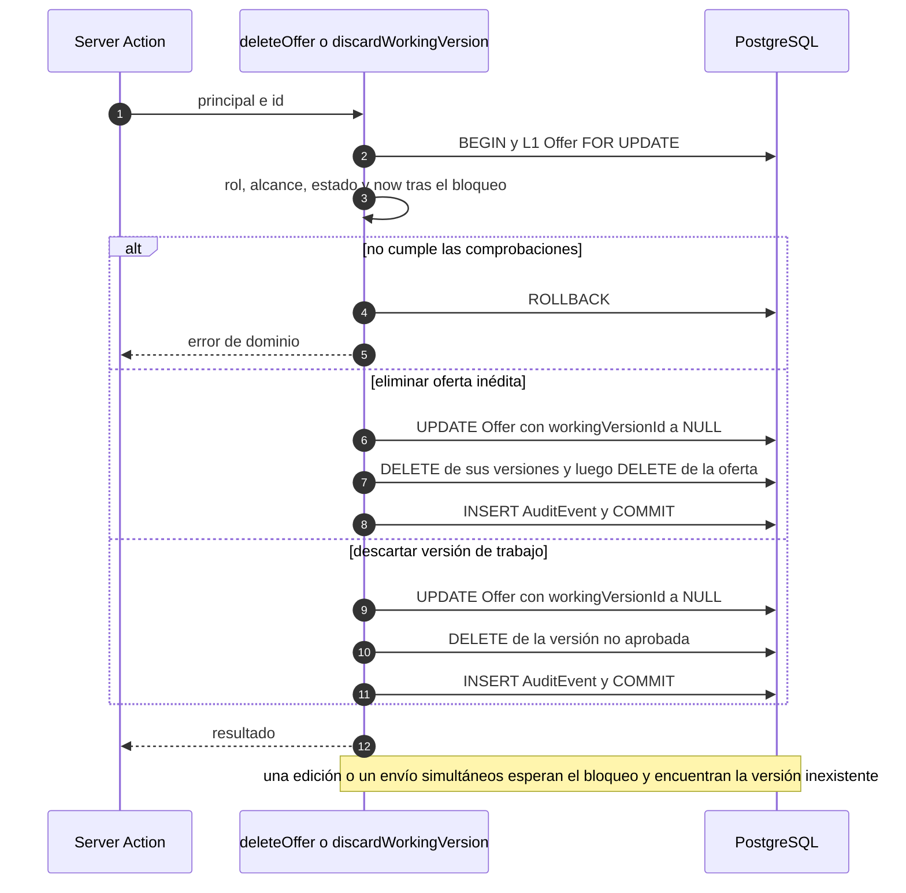

#### TX-16.3 Pseudocódigo (orden de borrado explícito, D-78)

```ts
// ── a. Eliminar una oferta inédita ──
async function deleteOffer(principal, input, { clock }) {
  requireRole(principal, 'GAD');
  try { return await runWithDeadlockRetry(() => withTx(async (tx) => {
    const offer = await lockOffer(tx, input.offerId);                                // L1 exclusivo: ninguna edición, envío, decisión ni reserva en curso
    if (!offer || !isGadMember(principal, offer.gadId)) throw new AppError('NOT_FOUND');
    const now = clock.now();
    if (offer.status !== 'UNPUBLISHED') throw new AppError('INVALID_STATE', { details: { currentStatus: offer.status } });

    // Orden compatible con las claves foráneas, los disparadores y el ciclo Offer ↔ OfferVersion:
    await tx.offer.update({ where: { id: offer.id }, data: { workingVersionId: null, updatedAt: now } });   // 1. suelta el puntero (la FK de los punteros no admite SET NULL)
    await tx.offerVersion.deleteMany({ where: { offerId: offer.id } });                                      // 2. versiones (todas no aprobadas: tg_offerversion_guard lo permite)
    await tx.offer.delete({ where: { id: offer.id } });                                                      // 3. la oferta (tg_offer_guard: publicVersionId nulo)
    await auditInTx(tx, now, { action: 'offer.delete', resourceType: 'Offer', resourceId: offer.id, result: 'SUCCESS', actor: principal,
                               metadata: { gadId: offer.gadId } });                  // AuditEvent no tiene clave foránea: sobrevive al borrado
    return { deleted: true };
  })); } catch (e) { await auditRejectionBestEffort(e, principal, input); throw toAppError(e); }
}

// ── b. Descartar la versión de trabajo de una oferta publicada ──
async function discardWorkingVersion(principal, input, { clock }) {
  requireRole(principal, 'GAD');
  const v0 = await db.offerVersion.findUnique({ where: { id: input.versionId }, select: { offerId: true } });   // inmutable
  if (!v0) throw new AppError('NOT_FOUND');
  try { return await runWithDeadlockRetry(() => withTx(async (tx) => {
    const offer = await lockOffer(tx, v0.offerId);                                   // L1 exclusivo
    if (!offer || !isGadMember(principal, offer.gadId)) throw new AppError('NOT_FOUND');
    const now = clock.now();
    if (offer.status === 'ARCHIVED')    throw new AppError('OFFER_ARCHIVED');
    if (offer.status === 'UNPUBLISHED') throw new AppError('INVALID_STATE', { details: { currentStatus: 'UNPUBLISHED' } });   // usar «eliminar oferta»
    if (offer.workingVersionId !== input.versionId) throw new AppError('INVALID_STATE');      // era la pública, o ya no es la de trabajo
    const v = await tx.offerVersion.findUnique({ where: { id: input.versionId }, select: { number: true, status: true } });
    if (!v) throw new AppError('NOT_FOUND');                                         // la descartó otra solicitud mientras esperábamos

    await tx.offer.update({ where: { id: offer.id }, data: { workingVersionId: null, updatedAt: now } });   // 1. suelta el puntero (lastVersionNumber NO se toca: el número no se reutiliza)
    const del = await tx.offerVersion.deleteMany({ where: { id: input.versionId, status: { not: 'APPROVED' } } });   // 2. borra SOLO una no aprobada
    if (del.count !== 1) throw new DefectError('descarte sin fila');
    await auditInTx(tx, now, { action: 'offer.version.discard', resourceType: 'OfferVersion', resourceId: input.versionId, result: 'SUCCESS', actor: principal,
                               metadata: { offerId: offer.id, versionNumber: v.number } });
    return { discarded: true };
  })); } catch (e) { await auditRejectionBestEffort(e, principal, input); throw toAppError(e); }
}
```

**Por qué un orden explícito en lugar de confiar en `ON DELETE CASCADE` (D-78).** `OfferVersion.offerId` es `Cascade` desde `Offer`, pero `Offer.workingVersionId` apunta **de vuelta** a la versión con una clave foránea compuesta `NO ACTION`. Que el borrado en cascada de la versión no choque con ese puntero depende del orden en que PostgreSQL ejecuta las acciones referenciales dentro de una misma sentencia; **no se verificó** (03 §10.2) y las tres sentencias explícitas son cada una válida por sí sola: sin puntero, sin versiones, sin oferta. Costo: dos sentencias más en una operación infrecuente. El `Cascade` se conserva como red de seguridad del modelo.

#### TX-16.4 Escrituras y resultado de cada rama

| Rama | Condición | Escrituras | Resultado | Auditoría |
|---|---|---|---|---|
| a1 | Oferta `UNPUBLISHED` del GAD | `UPDATE Offer` (puntero a `NULL`), `DELETE OfferVersion` (todas), `DELETE Offer`, `AuditEvent` | `{ deleted: true }`; ni la oferta ni sus versiones existen | `offer.delete` `SUCCESS` |
| a2 | Oferta de otro GAD o inexistente | Ninguna | `NOT_FOUND` | `DENIED` |
| a3 | Sin rol `GAD` | Ninguna | `FORBIDDEN` | `DENIED` |
| a4 | Oferta publicada, suspendida o archivada | Ninguna | `INVALID_STATE` (`currentStatus`) | `CONFLICT` |
| b1 | Versión de trabajo de una oferta `OPEN`/`SUSPENDED` | `UPDATE Offer` (puntero a `NULL`), `DELETE OfferVersion` (esa), `AuditEvent` | `{ discarded: true }`; la versión pública y `lastVersionNumber` **sin cambio** | `offer.version.discard` `SUCCESS` |
| b2 | Fuera del alcance / sin rol | Ninguna | `NOT_FOUND` / `FORBIDDEN` | `DENIED` |
| b3 | Oferta `ARCHIVED` | Ninguna | `OFFER_ARCHIVED` | `CONFLICT` |
| b4 | Oferta `UNPUBLISHED` | Ninguna | `INVALID_STATE` | `CONFLICT` |
| b5 | La versión es la pública, ya está aprobada o no es la de trabajo | Ninguna | `INVALID_STATE` | `CONFLICT` |
| b6 | La versión ya no existe (la descartó otra solicitud) | Ninguna | `NOT_FOUND` | No |
| c | `55P03` o tiempo agotado | Ninguna | `BUSY_TRY_AGAIN` | No (log) |

#### TX-16.5 Compatibilidad con 03, orden de bloqueos e historial

| Objeto de 03 | Qué exige | Cómo se cumple |
|---|---|---|
| FK compuesta de los punteros (`NO ACTION`) | No borrar una versión apuntada | El puntero se anula **antes** de borrar la versión (rama a1 y b1). |
| `ck_offer_pointers` | `UNPUBLISHED ⇔` sin versión pública; `workingVersionId` no nulo ⇒ `lastVersionNumber ≥ 1` | El `UPDATE` previo deja el puntero nulo; el contador no decrece (`tg_offer_guard`). |
| `tg_offerversion_guard` | Una versión `APPROVED` no se borra | Solo se borran versiones no aprobadas (`status <> 'APPROVED'` en el `DELETE` de b1; todas lo son en a1). |
| `tg_offer_guard` (BEFORE DELETE) | No se borra una oferta con `publicVersionId` | Solo `UNPUBLISHED` (sin versión pública). |
| FK `Restrict` de `Reservation` y de otros hijos | No hay hijos al borrar | Una oferta inédita no tiene reservas; si las hubiera, `23503` ⇒ defecto. |
| Orden global de bloqueos | `Offer` → `OfferVersion` → … | `L1` exclusivo primero; las filas de versión se borran bajo ese bloqueo. |
| Privilegios (03 §8.5) | `DELETE` solo en `Offer` y `OfferVersion` | `tc_app` lo tiene en ambas; `tg_*` limitan su alcance. |

**Historial.** Se **conservan** siempre las versiones aprobadas, las reservas, los pagos, las entradas y toda la auditoría. Solo se pierde lo que nunca se publicó (versiones de trabajo de ofertas inéditas, o la versión de trabajo descartada): es la regla del plan (RF-11). La auditoría conserva el rastro de lo borrado (`offer.create`, `offer.version.update`, `offer.delete`), sin títulos ni textos. Los motivos de devolución de una versión descartada **se pierden** (solo queda su longitud en la auditoría).

#### TX-16.6 Errores, idempotencia y concurrencia

- **Idempotencia:** por estado: repetir el borrado de una oferta eliminada ⇒ `NOT_FOUND`; repetir el descarte ⇒ `NOT_FOUND` (la versión ya no existe). Sin duplicar auditoría.
- **Recuperación:** una sola transacción; `BUSY_TRY_AGAIN` se repite sin riesgo; un fallo a medias no deja un puntero a una fila borrada ni versiones sin oferta (las tres sentencias confirman o revierten juntas).
- **Concurrencia** (todas serializadas por `FOR UPDATE`, que **espera** a ediciones y envíos en curso):

| Pareja simultánea | Si gana el borrado/descarte | Si gana la otra operación |
|---|---|---|
| Descartar × enviar o editar (TX-02, TX-01b) | La otra encuentra la versión inexistente: `NOT_FOUND`. | El descarte borra la versión ya editada o `IN_REVIEW` (permitido). |
| Eliminar × editar o enviar | Ídem. | Ídem; la oferta y sus versiones desaparecen. |
| Descartar/eliminar × aprobar (TX-03) | La aprobación recibe `NOT_FOUND`. | La eliminación recibe `INVALID_STATE` (la oferta pasó a `OPEN`); el descarte, `INVALID_STATE` (la versión ya no es la de trabajo). |
| Eliminar × archivar/suspender | No aplican a una oferta `UNPUBLISHED` (`INVALID_STATE`). | Ídem. |
| Descartar × reservar (TX-05) | Una reserva no referencia la versión de trabajo (solo versiones `APPROVED`); no hay conflicto. | Ídem. |

#### TX-16.7 Pruebas

| ID | Nivel | Preparación | Acciones | Aserciones |
|---|---|---|---|---|
| T-OFE-14a | I | Oferta inédita con v1 `DRAFT`; otra `OPEN` con reserva confirmada; otra `ARCHIVED`; una ajena (GAD 2). | `deleteOffer` como `gad.sanisidro` sobre cada una, y como `dual` sobre la inédita (otro miembro). | Inédita: filas de `Offer` y de **todas** sus versiones **inexistentes** (sin `23503` ni `TC_…`); 1 `AuditEvent offer.delete` `SUCCESS` que **sobrevive** al borrado; `OPEN` y `ARCHIVED`: `INVALID_STATE` con `currentStatus`; ajena: `NOT_FOUND`. Las demás ofertas, reservas y entradas intactas. Un miembro distinto del autor puede eliminarla. |
| T-OFE-14b | I | Oferta `OPEN` con público v1 y v2 `CHANGES_REQUESTED` (`lastVersionNumber = 2`); otra `UNPUBLISHED` con v1; otra `ARCHIVED` con v2 `DRAFT`. | `discardWorkingVersion` como `gad.sanisidro` y, en la primera, como `dual` (no autor). | `OPEN`: v2 **no existe**, `workingVersionId` nulo, `publicVersionId` = v1 sin cambio, `lastVersionNumber = 2`, 1 `AuditEvent offer.version.discard`; el descarte por otro miembro es válido (T-OFE-19). `UNPUBLISHED`: `INVALID_STATE`; `ARCHIVED`: `OFFER_ARCHIVED`; sin cambios. Descartar la pública v1 ⇒ `INVALID_STATE`; id inexistente ⇒ `NOT_FOUND`. |
| T-OFE-14d | C | Oferta inédita con v1 `IN_REVIEW`. `ctrl` toma `barrera.offer`. | `lanzar(deleteOffer)` y `lanzar(decideVersion APPROVE)` por `operador.laguna`; `esperarBloqueadas(2)`; `liberar()`. | **En ambos órdenes**: si ganó la aprobación, la oferta es `OPEN` y el borrado da `INVALID_STATE`; si ganó el borrado, no hay filas y la aprobación da `NOT_FOUND`. Nunca una oferta `OPEN` sin versión pública ni una versión sin oferta. |
| T-OFE-14e | C | Oferta publicada con v2 `IN_REVIEW`. `ctrl` toma `barrera.offer`. | `lanzar(discardWorkingVersion)` y `lanzar(decideVersion APPROVE)`; `esperarBloqueadas(2)`; `liberar()`. | **En ambos órdenes**: si ganó la aprobación, `publicVersionId = v2` y el descarte da `INVALID_STATE` (ya no es la de trabajo); si ganó el descarte, v2 no existe y la aprobación da `NOT_FOUND`. |
| T-OFE-14f | I | Oferta inédita. | Crear, eliminar y volver a eliminar; descartar dos veces la misma versión. | Segundo borrado: `NOT_FOUND`; segundo descarte: `NOT_FOUND`; una sola auditoría de éxito en cada caso. |
| T-OFE-14g | I | Oferta inédita insertada directamente por el migrador (como en la semilla, 03 §9.2) con su `v1` `DRAFT` y el puntero de trabajo fijado. | `deleteOffer`. | Las tres sentencias se aplican sin violar `ck_offer_pointers`, la FK de los punteros ni los disparadores. (Prueba el orden explícito de D-78.) |
| T-DB-01d (subcaso) | I | Oferta `OPEN`; versión `APPROVED`. | `DELETE` directo de la oferta publicada y de la versión aprobada. | `TC_OFFER_PUBLISHED_NOT_DELETABLE` y `TC_APPROVED_IMMUTABLE` (la base protege lo que el servicio ya no intenta). |

---

## 4. Coordinación recuperable con PayPal (resumen decidido)

| Momento de la falla | Estado local | Estado en PayPal | Cómo se recupera |
|---|---|---|---|
| Antes de crear la orden | `CREATED` | Nada | Reintento con la misma clave. |
| Orden creada, no guardada | `CREATED` | Orden sin aprobar | Reintento devuelve la misma orden; el comprador no fue redirigido. |
| Aprobada, sin volver al sitio | `ORDER_CREATED` | `APPROVED` | Sin cobro; la retención vence. |
| Captura enviada, respuesta perdida | `captureAttemptedAt` fijado (arrendamiento de 60 s) | Capturada o no | `getOrder` inmediato (TX-08), webhook o J2 → TX-09. |
| Capturada, caída antes de aplicar | Igual | `COMPLETED` | Webhook o J2 al arrancar → TX-09. |
| Capturada tras vencer la retención | Vencida | `COMPLETED` | TX-09 por la rama tardía (L-10 o L-11). |

✅ **Todos los flujos están desarrollados.** TX-06 y TX-12 a TX-15 en forma breve (precondiciones, escritura atómica, errores y pruebas clave). Queda la revisión cruzada final (00 §12) y la ejecución real de las pruebas con la técnica de barrera de [08 §2](08-pruebas-y-evidencias.md).

---

## 5. Fuentes consultadas y verificaciones pendientes (lotes 1 a 3)

**Convención de grados** (corregida en el lote 3): *Leída* = el contenido de la página fue leído por el navegador de investigación de Codex y registrado en [FUENTES-PAYPAL-REVISION.md](../../FUENTES-PAYPAL-REVISION.md) (2026-11-13); verifica **documentación**, no el comportamiento de una integración ejecutada. *Resumen de búsqueda* = lo que devolvió una herramienta de búsqueda web restringida a `developer.paypal.com`; **no** es una página leída y **no se llama «verificado»**. El lote 2 rotuló «dato verificado» a resúmenes de búsqueda y presentó como documentada una retención de 6 h que la lectura de páginas **no confirma**; queda corregido aquí, en el principio 10, en D-72 y en 05 §6.2 (H-51). **En el lote 3 no se pudo abrir ninguna fuente adicional** (no hay herramienta de lectura de páginas en esta sesión y no se usaron subagentes): lo nuevo del lote 3 procede de FUENTES-PAYPAL-REVISION.md (leída) y de un resumen de búsqueda sobre webhooks (no leído).

### 5.1 PayPal — qué se sabe y con qué grado

| Tema | Afirmación | Fuente | Grado | Dónde se usa |
|---|---|---|---|---|
| Retención de la clave | Depende de la API; la guía remite a la referencia del endpoint. | [Idempotency](https://developer.paypal.com/api/rest/reference/idempotency/) | **Leída** | Principio 10.3 |
| Repetición con la misma clave | Devuelve el estado más reciente de la petición anterior, dentro de las garantías de retención aplicables. | Ídem | **Leída** | Reanudación con la misma clave (TX-08.0) |
| Dos solicitudes simultáneas con la misma clave | Pueden producir un fallo en la segunda; la guía no fija un código único. | Ídem | **Leída** | TX-07.1 (no se distingue de otros rechazos); TX-08.6 F9 |
| Clave y tipo de operación | Debe distinguir el tipo de operación; no reutilizar sin justificación entre creación y captura. | Ídem | **Leída** | Claves distintas (principio 10.3) |
| Formato y longitud de la clave | Recomienda UUID; menciona 38 caracteres de un byte. La referencia de creación muestra 1–10 000. **Discrepancia no reconciliada**; un UUID de 36 caracteres cabe en ambas. | Ídem y [Create order](https://developer.paypal.com/api/orders/v2/orders-create) | **Leída** | Claves UUID |
| Retención específica de 6 h, vida útil de una orden | **No confirmadas** por la lectura. | FUENTES-PAYPAL-REVISION.md | Leída (como *ausencia* de confirmación) | Se conservan como verificaciones separadas (§5.2) |
| Webhooks: entrega | Un 2xx reconoce; ante fallos, hasta 25 intentos durante 3 días. | [Integrate webhooks](https://developer.paypal.com/api/rest/webhooks/rest/) | **Leída** | TX-10.3 (no se depende de ello) |
| Webhooks: verificación | Dos métodos: criptográfico local (requiere el cuerpo original para el CRC32) y *postback*. Los eventos del **simulador** no admiten el *postback*. | Ídem | **Leída** | TX-10.1, TX-10.9 |
| Webhooks: duplicados y orden | Entrega al menos una vez; el orden no está garantizado; se recomienda guardar el id del evento con una restricción única. | Resumen de búsqueda (2026-11-13) | Resumen de búsqueda | TX-10.2 |
| Webhooks: plazo de respuesta | 30 s según la guía de webhooks, 5–10 s según una página de buenas prácticas: **contradictorios** en el resumen. | Ídem | Resumen de búsqueda | `WEBHOOK_BUDGET_MS = 8000` (se diseña para el menor) |
| Capturar una orden | `POST /v2/checkout/orders/{id}/capture`; `PayPal-Request-Id` opcional; `Prefer: return=representation` devuelve la representación completa; un reintento duplicado devuelve 200 en lugar de 201. | [Capture payment for order](https://developer.paypal.com/api/orders/v2/orders-capture) | Resumen de búsqueda (la página es **accesible** según la lectura, pero su contenido no se registró) | TX-08 (el adaptador acepta 200 y 201) |
| Errores de captura | `ORDER_ALREADY_CAPTURED`, `ORDER_NOT_APPROVED`, `INSTRUMENT_DECLINED`, `PAYER_ACTION_REQUIRED`; Orders v2 usa 422: ramificar por `issue`. | [Troubleshooting Orders API errors](https://developer.paypal.com/api/rest/integration/orders-api/troubleshooting), [Unprocessable entity](https://developer.paypal.com/api/rest/troubleshooting/rest_unprocessable_entity) | Resumen de búsqueda | TX-08.0 y TX-08.4 |
| `invoice_id` duplicado | `DUPLICATE_INVOICE_ID` existe; único por cuenta de comercio por defecto. | Páginas anteriores y [Common errors overview](https://developer.paypal.com/api/errors/overview) | Resumen de búsqueda | TX-07 R6 |

### 5.2 PayPal — no verificado (a confirmar en Sandbox, P4-06, o con PayPal)

- La retención **de seis horas** de la clave para estos endpoints, y la de 72 h por acuerdo con el gestor de cuenta (el 45 días que citan otras páginas, ídem): **no confirmadas**; no se sabe si el arreglo cubre la captura ni tras cuánto tiempo una clave se trata como nueva y sin error. **No confundir:** retención de la clave, vida de la orden, retención local de cupos (15 min) y arrendamiento local (60 s) son cosas distintas.
- Código HTTP y nombre del error al repetir una clave de forma simultánea o con otro cuerpo.
- Que **Orders v2** devuelva el **mismo `id` de orden** al reintentar la creación con la misma clave.
- Que la **repetición de una captura con la misma clave** devuelva el resultado de la primera petición también cuando ésta fue un rechazo, o cuando sigue en curso.
- La **consistencia de `getOrder`** respecto de una captura recién enviada (si puede mostrar «sin captura» mientras la captura se está procesando): por eso un «sin captura visible» nunca concluye nada.
- Vida útil de una orden sin aprobar o sin capturar: el 2026-11-12 se anotó 6 h (esquema OpenAPI v2.36); **no reconfirmado**; el diseño no depende de ella.
- Si existe una API para localizar una orden por `invoice_id` o `custom_id` (no se halló).
- Cuánto espera realmente PayPal la respuesta de un webhook (30 s o 5–10 s), si desactiva una suscripción tras muchos fallos, y el orden real de entrega.
- Que el `fake` reproduzca estas conductas fielmente: es una aproximación de las pruebas, no una verificación de PayPal. **Los eventos del simulador de PayPal no se pueden usar como prueba de la ruta de verificación.**
### 5.3 Dudas de implementación (no comprobadas)

Nada de lo siguiente se ha ejecutado ni consultado en documentación oficial; son dudas que deben cerrarse al implementar (P0-03, P3-01, P4-03, P4-04). Se suman a las de [03 §10.2](03-datos-estados-e-invariantes.md). Prisma no se consultó en los lotes 2 y 3: no surgió una duda que afectara a la corrección de TX-07, TX-08, TX-10 o TX-11 más allá de las listadas.

| Aspecto | Dónde se confirma |
|---|---|
| Nombres de las opciones `maxWait` y `timeout` de `prisma.$transaction`, y el valor `isolationLevel: 'ReadCommitted'`, en Prisma 7.10.1. | P0-03 |
| Que `SET LOCAL lock_timeout` y `pg_advisory_xact_lock` (con `$executeRaw`, o con `$queryRaw` y un `::text` si Prisma no deserializa `void`) se comporten como se espera dentro de una transacción interactiva con el adaptador `pg`. | P0-03, P3-01 |
| Cómo se informa a la aplicación un `23505`, un `55P03` y un tiempo agotado con Prisma 7 y el adaptador `pg` (SQLSTATE, nombre de la restricción), y los nombres reales de los índices únicos (`Reservation_buyerId_requestKey_key`, `PaymentEvent_provider_providerEventId_key` son la convención supuesta). | P0-03, P3-01, P4-01 |
| Que un error lanzado dentro del callback de `$transaction` revierta y no deje la conexión en un estado abortado dentro del *pool*. | P0-03 |
| Que la fila de control sin confirmar de T-RES-08c y T-PAG-07c bloquee la inserción en el índice único (comportamiento conocido de PostgreSQL, no comprobado aquí) y que `FOR KEY SHARE` de la fila de control no interfiera con los bloqueos del servicio, como se razonó. | P3-01, P4-03 |
| Que el orden en que PostgreSQL atiende a quienes esperan un mismo bloqueo no afecte a las aserciones: las pruebas están escritas para no depender de él (cuando importa, la aserción es válida en ambos órdenes). | P0-05, P3-01 |
| Rendimiento: coste de las cuatro consultas de `fn_check_reservation` por cada `Ticket` al confirmar una reserva de 10 asistentes. | P4-03 |
| Que `updateMany` devuelva `count` fiable y que un `INSERT … ON CONFLICT ("reservationId") DO NOTHING` con `$executeRaw` y `gen_random_uuid()` funcione dentro de la transacción interactiva (TX-07 fase A); que `lockPaymentByReservation` con `SELECT … FOR UPDATE` por `reservationId` se comporte como `lockPayment` (TX-08). | P4-04 |
| Que `withTx` acepte `opts.lockTimeoutMs` y que la variable `DB_LOCK_TIMEOUT_MS` (nueva, defecto 5000) se añada a la validación de entorno (02 §9) y a 09 §3. | P0-03, P0-04 |
| Que el `fake` implemente la compuerta, los modos de clave repetida y la regla «una orden se captura una sola vez» tal como describen TX-07.7 y TX-08.7 (extiende la «latencia programable» de 05 §6.3). | P4-01 |
| Longitud máxima real de `PayPal-Request-Id` y su tratamiento si se repite con otro cuerpo (§5.2). | P4-06 |
| Que la columna `Payment.captureAttemptKey` y `ck_pay_attempt` (03 §3.3, §8.3) se creen en la migración de P4-01 y que `updateMany` con `captureAttemptKey: null` en el `where` genere `IS NULL` (TX-08 reclamo nuevo). | P4-01, P4-04 |
| Que `UPDATE … SET "nextCheckAt" = LEAST(COALESCE("nextCheckAt", $t), $t)` (TX-10 `markPending`) y el reclamo de comprobación con `RETURNING` (TX-11) se ejecuten como se espera con `$executeRaw`/`$queryRaw`; que el verificador del adaptador `paypal` distinga `INVALID` de `UNAVAILABLE`; que `readBodyLimited` conserve los bytes originales del cuerpo en un Route Handler de Next.js 16 (el *postback* y el CRC32 exigen el cuerpo sin alterar). | P4-05, P4-06 |
| `RECONCILE_DELAYS_MIN` y `MAX_CHECKS` (TX-11.2) son **una propuesta** de esta planificación, no cifras de PayPal: confirmar con el equipo antes de implementar. | P4-05 |
| **Lote 4 (ofertas):** que SELECT … FOR KEY SHARE y FOR UPDATE por ` $queryRaw ` dentro de una transacción interactiva de Prisma se comporten como se razonó (el compartido no bloquea a otro compartido; solo choca con FOR UPDATE); que updateMany con `rev: { increment: 1 }` y condiciones sobre 
ev, estado y autor devuelva un count fiable; que el orden explícito de TX-16 (puntero a NULL, borrar versiones, borrar oferta) y la aprobación de TX-03 (versión APPROVED antes del UPDATE de Offer) pasen los disparadores de 03 §8.4 y las claves foráneas compuestas, tal como razona T-OFE-14g y T-OFE-06a. | P2-01, P2-02, P2-03 |
