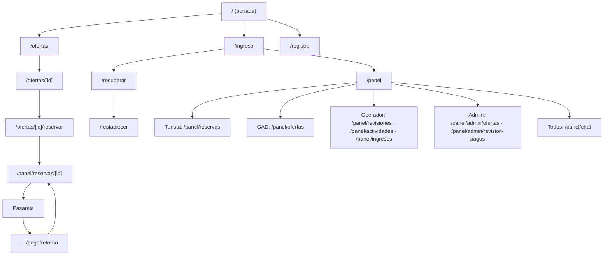

# 07 — Pantallas y experiencia

> **ESTADO: COMPLETO como planificación — guardado el 2026-11-14.** Sujeto a la revisión cruzada final.
> Contiene el mapa de navegación y las reglas de experiencia decididas (§1–§3, §5, §7), las **fichas por pantalla (§4)**, los **estados por pantalla (§6)** y la **lista de comprobaciones manuales (§7.1)**. **D-79 aplicado en `/panel/ingresos`**; la vista de administración recoge la conciliación agotada y el aviso de reembolso posterior a la confirmación (04 TX-11), este último en solo lectura.
> **Las comprobaciones de §7.1 están pendientes de ejecución** (no existe interfaz). No hay sección de «flujos paso a paso» aparte: las fichas de §4 y las decisiones de §5 los cubren.
> Inventario de rutas: [05 §2](05-contratos-http-websocket-y-pagos.md). Todo es diseño: no hay interfaz, ni prueba, ni validación con personas usuarias.

---

## 1. Principios (definitivos)

- Interfaz en español (`lang="es-EC"`). Importes como `$25,50 USD` con un único formateador. Fechas con día, mes en letras, año y hora de 24 h, seguidas de «hora de Ecuador continental».
- El reloj del navegador no decide nada: la cuenta atrás de la retención es informativa y se calcula con la diferencia entre la hora del servidor recibida al cargar y la local.
- Formularios funcionales sin JavaScript donde sea viable (Server Actions con mejora progresiva); JavaScript añade validación inmediata.
- Objetivo propuesto: WCAG 2.2 nivel AA (criterios citados de memoria; se confirman en PE-03).
- Tailwind CSS 4 con componentes propios (D-64). Sin atributos `style` en línea (CSP).
- Con el adaptador `fake`, franja permanente «Pasarela simulada — no es PayPal».

## 2. Ruta inicial

`/` existe (D-63): portada con una frase de presentación, las próximas ofertas y accesos a «Ver catálogo», «Ingresar», «Crear cuenta» o, con sesión, «Ir a mi panel». No añade funciones.

## 3. Mapa de navegación por rol

El panel muestra la **unión** de las secciones de todas las asignaciones del usuario. La cabecera del panel contiene nombre, enlace «Chat» con insignia de mensajes nuevos y botón «Salir» (formulario `POST`).

## 4. *Wireframes* textuales

Fichas breves, una por pantalla (redactadas el 2026-11-14 desde 05 §2–§4 y 01 §8). Cada ficha da **contenido**, **acciones** (la Server Action de 05 §3 entre paréntesis), **estados propios** y **accesibilidad propia**. Los estados compartidos (V, C, X, VAL, CF, DEN, SES, RED, OCU) se definen **una sola vez** en §6.1 y la accesibilidad común está en §7: las fichas solo añaden lo específico. Los textos son orientativos; los códigos de error son los de 05 §3.

**Estructura común de toda pantalla de `/panel/**`:** cabecera (nombre, «Chat» con insignia, «Salir»), enlace «Saltar al contenido», un único `<h1>` y el contenido en `<main>`. El `<title>` incluye el nombre de la pantalla. Las pantallas públicas llevan cabecera con «Ingresar» y «Crear cuenta».

### 4.1 Cuenta (públicas)

| Pantalla | Contenido | Acciones | Estados propios | Accesibilidad propia |
|---|---|---|---|---|
| `/registro` | Nombre (2–80), correo, contraseña y confirmación; ayuda de la política (10–128, sin reglas de composición); enlace a `/ingreso`. | «Crear cuenta» (`registerAction`) → `/ingreso` con aviso «Cuenta creada». | `EMAIL_TAKEN` en el campo correo; `RATE_LIMITED` con espera (`retryAfterSeconds`); errores de contraseña (corta, igual al correo, común) junto al campo. | `autocomplete` `name`, `email`, `new-password`; mostrar/ocultar contraseña con botón etiquetado; se permite pegar. |
| `/ingreso` | Correo y contraseña; `next` oculto (se valida con la regla canónica `safeNext` de 05 §2; si se descarta, se vuelve a `/panel`); enlaces a `/recuperar` y `/registro`. | «Ingresar» (`loginAction`) → `next` o `/panel`. | Llegada con `?next` tras sesión vencida: aviso (SES). `INVALID_CREDENTIALS` y `RATE_LIMITED` muestran **el mismo texto** exista o no la cuenta (RS, D-23). | `autocomplete` `username`, `current-password`; el error general recibe el foco en el resumen. |
| `/recuperar` | Correo. | «Enviar instrucciones» (`requestPasswordResetAction`). | Éxito **siempre** igual: «Si la cuenta existe, enviamos instrucciones»; solo `RATE_LIMITED` por IP se distingue. | El mensaje de éxito se anuncia; no revela nada más. |
| `/restablecer` | Nueva contraseña y confirmación; el token viaja en un campo oculto, la página **no consume** el token con `GET`. `Referrer-Policy: no-referrer`. | «Cambiar contraseña» (`resetPasswordAction`) → `/ingreso` («Ya puedes ingresar»; no inicia sesión). | `TOKEN_INVALID` con mensaje único (inexistente, usado o vencido) y enlace a `/recuperar`. | `autocomplete="new-password"`. |

### 4.2 Públicas del catálogo

| Pantalla | Contenido | Acciones | Estados propios | Accesibilidad propia |
|---|---|---|---|---|
| `/` | Frase de presentación; próximas ofertas; accesos «Ver catálogo», «Ingresar», «Crear cuenta» o «Ir a mi panel». | Navegación. | V: sin ofertas próximas → solo accesos. | Lista de ofertas como `<ul>`; un `<h1>` único. |
| `/ofertas` | Filtro por provincia (24); tarjetas (título, provincia, fecha con etiqueta de zona, precio, «quedan N» o «Agotada»); paginación de 10. | Filtrar (`GET ?provincia&pagina`); abrir detalle. | V: sin resultados con enlace «Quitar filtro». | Filtro con `<label>`; paginación como `<nav aria-label>` con `aria-current`; «Agotada» en texto, no solo color. |
| `/ofertas/[offerId]` | Versión pública: título, descripción, lugar, provincia, fechas, precio, servicios, condiciones, edad mínima si existe, cupos disponibles. | «Reservar» solo si la oferta es `OPEN`, futura y con cupo, y la persona tiene rol `TOURIST`; sin sesión, «Ingresar para reservar» (`/ingreso?next=…`). | `SUSPENDED`: aviso «Ventas suspendidas temporalmente», sin botón. DEN: 404 si no es `OPEN` ni `SUSPENDED`. Con sesión sin rol `TOURIST`: se muestra el detalle sin botón y con un aviso (propuesto). | El aviso de suspensión es texto en el flujo normal, no solo un estilo. |
| `/ofertas/[offerId]/reservar` | Resumen de la oferta (versión que se contrata); selector de cantidad (1–10) que genera filas nominales (nombre 2–120; fecha de nacimiento solo si hay edad mínima, con su razón); casilla de aceptación con el texto de condiciones visible; total calculado por el servidor. | «Reservar» (`createReservationAction`, con `requestKey` generada al cargar) → `/panel/reservas/[id]`. | CF: `VERSION_CHANGED` → condiciones nuevas, se conservan los asistentes y se pide confirmar de nuevo (clave nueva); `INSUFFICIENT_CAPACITY` con `details.available`; `HOLD_LIMIT_REACHED` (`scope` `OFFER` o `BUYER`) con enlace a la reserva existente o a «Mis reservas»; `OFFER_NOT_OPEN`, `ACTIVITY_NOT_FUTURE`; `replayed: true` va a la reserva sin mostrar error. VAL: `attendees.N.birthDate`, `termsAccepted`. | Cada fila de asistente es un `<fieldset>` con `<legend>` «Asistente N»; al cambiar la cantidad se anuncia «N asistentes» (región polite) sin mover el foco. |

### 4.3 Turista

| Pantalla | Contenido | Acciones | Estados propios | Accesibilidad propia |
|---|---|---|---|---|
| `/panel/reservas` | Reservas propias: oferta, fecha, cantidad, total, estado y vencimiento si está retenida. | Abrir reserva. | V: «Aún no tienes reservas» + enlace al catálogo. Estados mostrados: Retenida, Confirmada, Vencida, **En verificación** (`REVIEW_REQUIRED`). | Estado como texto + icono; tabla con `<th scope>` o lista con encabezados. |
| `/panel/reservas/[reservationId]` | Resumen (oferta, versión contratada, asistentes con nombre, total); según estado: **Retenida** → cuenta atrás y «Pagar con PayPal»; **Vencida** → «no hubo cobro» y «Reservar de nuevo con los mismos asistentes»; **En verificación** → explicación y «todavía no hay entradas»; **Confirmada** → una tarjeta por asistente (nombre, `Válida` / `Usada el …`, QR, «Descargar», «Copiar código»). | «Pagar con PayPal» (`startPaymentAction`); «Copiar código» (`revealTicketCodeAction`, auditado; el código no se muestra hasta pedirlo). | CF: `HOLD_EXPIRED`, `PAYMENT_UNDER_REVIEW`, `INVALID_STATE` (ya confirmada) → se recarga el estado real; `GATEWAY_UNAVAILABLE` (`retryable` true: «Reintentar»; false: contactar al equipo, sin reintento automático). **D-79:** si la oferta está `SUSPENDED` o `ARCHIVED`, aviso «Las ventas de esta actividad están cerradas; tus entradas siguen siendo válidas». | Cuenta atrás en región polite con avisos a 5 y 1 min (nunca roba el foco); QR con `alt` «Código QR de la entrada de {nombre}» y el código de texto como alternativa; «Descargar» es un enlace `?descarga=1`; «Copiar» anuncia «Código copiado». |
| `…/pago/retorno` | «Confirmando tu pago…»; los parámetros de PayPal no se usan. | Se envía `capturePaymentAction` al montar; botón «Confirmar pago» como alternativa sin JavaScript. | `CONFIRMED` → «Pago confirmado» y enlace a las entradas; `IN_PROGRESS` → sigue en «Confirmando…» y consulta el estado local (intervalo por fijar en P4-04); `PAYMENT_NOT_APPROVED` → volver a la pasarela; `PAYMENT_DECLINED`; `HOLD_EXPIRED`; `PAYMENT_UNDER_REVIEW` → «Estamos verificando tu pago» (sin mostrar `reviewReason`). **Nunca éxito sin confirmación del servidor.** | Cada resultado se anuncia en región polite; el estado de carga tiene texto, no solo indicador. |
| `…/pago/cancelado` | «Cancelaste el pago en PayPal»; si la reserva sigue retenida, hasta cuándo. | Enlace a la reserva (no escribe nada). | — | — |
| `/pasarela-simulada/[orderId]` (solo `fake`) | Franja «Pasarela simulada — no es PayPal»; datos de la orden. | «Aprobar» / «Cancelar» simulados. | DEN: 404 si el adaptador no es `fake`. | La franja es texto permanente, no decorativa. |

### 4.4 GAD

| Pantalla | Contenido | Acciones | Estados propios | Accesibilidad propia |
|---|---|---|---|---|
| `/panel/ofertas` | Ofertas del GAD: título, estado comercial, estado de la versión de trabajo, fecha. | «Nueva oferta». | V: «Aún no hay ofertas» + «Nueva oferta». | Estados como texto. |
| `/panel/ofertas/nueva` y `…/[offerId]/editar` | Formulario de `OfferContentInput`: título, descripción, lugar, provincia, inicio y fin (etiqueta «hora de Ecuador continental»), precio en texto, capacidad, edad mínima, servicios, condiciones; atracción (editable solo en oferta inédita; en publicada, solo lectura). Si fue devuelta, el motivo de la devolución. | «Guardar» (`createOfferAction` / `updateWorkingVersionAction`, con `rev`); «Enviar a revisión» (`submitVersionAction`), botón aparte. | CF: `STALE_VERSION` (`currentRev`) → se conserva lo escrito y se pide recargar; `SCHEDULE_LOCKED`, `ACTIVITY_NOT_FUTURE`, `OFFER_ARCHIVED`, `INVALID_STATE`. DEN: miembro que no es el autor (`FORBIDDEN`) → vista de solo lectura con aviso. | Contadores de longitud en puntos de código; campos de fecha con formato indicado. |
| `/panel/ofertas/[offerId]` | Estado; versión pública y de trabajo; versiones anteriores (históricas); cupos agregados (capacidad, confirmados, retenidos, disponibles) **sin nombres ni reservas individuales** (01 §8.5). | «Abrir nueva versión» (`startNewVersionAction`); «Descartar versión de trabajo» (`discardWorkingVersionAction`); «Eliminar oferta» (`deleteOfferAction`, solo `UNPUBLISHED`); «Archivar» (`archiveOfferAction`, motivo opcional). | CF: `WORKING_VERSION_EXISTS` (enlace a la versión de trabajo), `OFFER_ARCHIVED`, `INVALID_STATE`. Eliminar y archivar piden confirmación explícita (`confirm: true`); archivar advierte que es definitivo y que las entradas emitidas siguen válidas. | Diálogo de confirmación con foco atrapado, `Escape` cierra y el foco vuelve al botón; sin JavaScript, página de confirmación. |

### 4.5 Operador

| Pantalla | Contenido | Acciones | Estados propios | Accesibilidad propia |
|---|---|---|---|---|
| `/panel/revisiones` | Versiones `IN_REVIEW` de sus atracciones: título, GAD, tipo (primera publicación o nueva versión), fecha de envío. | Abrir. | V: «No hay versiones pendientes». | — |
| `/panel/revisiones/[versionId]` | Versión en solo lectura; diferencias con la pública si existe. | «Aprobar» (`approveVersionAction`) y «Devolver con motivo» (`requestChangesAction`, motivo obligatorio 1–1000), **botones separados**. | DEN: `SELF_REVIEW_FORBIDDEN` → aviso «No puedes revisar tu propia versión» y botones desactivados. CF: `STALE_VERSION`, `CAPACITY_BELOW_COMMITTED` (`details.committed`), `SCHEDULE_LOCKED`, `ACTIVITY_NOT_FUTURE`, `OFFER_ARCHIVED`, `INVALID_STATE` (ya resuelta). | Las diferencias se indican con texto («Antes / Ahora»), no solo con color. |
| `/panel/actividades` | Ofertas de sus atracciones: estado, fecha, conteos de cupos y de entradas (S-13). | «Suspender» (`suspendOfferAction`, motivo opcional); «Reanudar» (`resumeOfferAction`); enlace «Ir a ingresos». | CF: `INVALID_STATE` (`currentStatus`), `OFFER_ARCHIVED`. Archivar **no** aparece aquí. | Los botones nombran la oferta («Suspender {título}»). |

### 4.6 Ingreso de entradas (operador) — aplica D-79

**`/panel/ingresos` — selección de actividad.**

| Elemento | Decisión |
|---|---|
| Contenido | Actividades de sus atracciones: las ofertas **`OPEN`** y también las **`SUSPENDED` o `ARCHIVED` que tengan entradas emitidas** (al menos una); una oferta sin entradas emitidas no aparece (05 §2, D-79). Por fila: título, fecha y hora, estado con texto («Abierta», «Ventas suspendidas», «Archivada») y conteo «N usadas de M emitidas» (S-13). En las dos últimas, la nota «Ventas cerradas; el ingreso sigue permitido para entradas ya emitidas». |
| Acción | «Abrir lector» por fila → `/panel/ingresos/[offerId]`. La lista no se filtra por ventana horaria: la decide el servidor al consultar. |
| Estados propios | V: «No hay actividades con entradas para registrar». DEN: `/panel/ingresos/[offerId]` responde **404** si la oferta no es de una atracción del operador. |

**`/panel/ingresos/[offerId]` — consultar y registrar (dos pasos separados).**

| Elemento | Decisión |
|---|---|
| Paso 1: Consultar | Cámara (`BarcodeDetector` o `jsqr`) **y** campo para pegar el código `TC1.…`, **siempre visibles ambos** (RA-04). «Consultar» → `lookupTicketAction`; el código va en el **cuerpo**, nunca en la URL, y no se guarda en el navegador ni se registra. Al leer un QR la cámara se detiene hasta «Escanear otra», para no agotar el límite de 30 consultas por minuto. **Escanear o consultar nunca consume.** |
| Resultado | Nombre del asistente, actividad, fechas y estado con color **y** texto: `VALID` («Entrada válida») o `USED` («Usada el …»). Sin fecha de nacimiento. |
| Paso 2: Registrar | Botón distinto y separado **«Registrar ingreso»** (`checkInTicketAction`), con `aria-disabled` y la razón en texto cuando no procede (entrada ya usada o consulta fallida). «Cancelar» limpia el código y el resultado sin llamar al servidor: la entrada queda sin usar. |
| Errores | Mensaje único `TICKET_NOT_FOUND` (formato inválido, inexistente, de otra atracción o reserva no confirmada: no se distingue); `WRONG_ACTIVITY`; `OUTSIDE_CHECKIN_WINDOW`; `RATE_LIMITED` con espera; `TICKET_ALREADY_USED` («Ya usada el …», con el mismo `usedAt` si se repite tras un éxito). |
| **D-79** | Si la oferta está `SUSPENDED` o `ARCHIVED`, un aviso informativo («Ventas cerradas; las entradas emitidas siguen admitiéndose») y **ningún bloqueo**: consulta y registro no miran `Offer.status`. Se conservan rol, atracción, actividad seleccionada, ventana horaria, reserva `CONFIRMED` y entrada `VALID`. |
| Accesibilidad | El resultado se anuncia en región polite sin mover el foco; si la cámara se deniega o no existe, el campo manual sigue usable; sin JavaScript el formulario de pegado funciona por `POST`; objetivos táctiles de al menos 24 px (se recomienda más en el lector). |

### 4.7 Chat

| Pantalla | Contenido | Acciones | Estados propios | Accesibilidad propia |
|---|---|---|---|---|
| `/panel/chat` | Lista de mensajes con «Cargar anteriores»; lista de presentes (usuarios únicos); indicador de conexión; campo con contador de 500. | Enviar (evento `chat:send`, ver 05 §5); cargar historial por cursor. | Conexión: conectando, conectado, reconectando (recupera lo faltante por cursor), desconectado. Mensaje propio: pendiente → confirmado, o fallido con «Reintentar» (mismo `clientMessageId`). `RATE_LIMITED` en la confirmación. SES: «Tu sesión terminó». | Lista con `role="log"` y `aria-live="polite"`, sin robar el foco; la insignia de la cabecera tiene texto («3 mensajes nuevos»); el estado de conexión es texto. |

### 4.8 Administración

| Pantalla | Contenido | Acciones | Estados propios | Accesibilidad propia |
|---|---|---|---|---|
| `/panel/admin/ofertas` | Ofertas de todos los GAD con su estado. | «Archivar» con **motivo obligatorio** (`archiveOfferAction`), con confirmación que advierte que es terminal y que las entradas emitidas siguen válidas. | CF: `INVALID_STATE` (inédita), `OFFER_ARCHIVED`. VAL: motivo vacío. | Igual que el diálogo de confirmación del GAD. |
| `/panel/admin/revision-pagos` | **Sección A — «Casos en revisión»** (`REVIEW_REQUIRED`): reserva, oferta, motivo (`reason`), importe esperado, antigüedad (`reviewFlaggedAt`, el más antiguo primero) y, si procede, la etiqueta **«Conciliación automática agotada»**; filtro «Solo agotados». **Sección B — «Avisos de reembolso posterior a la confirmación»**: lista de lectura de los eventos `payment.reconcile` con `CONFLICT` y `REFUND_AFTER_CONFIRMATION`; por aviso: fecha, origen (webhook o consulta del administrador), pago y reserva. | Abrir un caso (sección A). La sección B es **solo lectura**. | A: ver §4.9. B: V «Sin avisos»; **sin estado «atendido»** (04 TX-10: el aviso es la lectura del evento, sin estado nuevo), por lo que un aviso persiste en la lista; paginada, el más reciente primero. La reserva del aviso sigue `CONFIRMED` con sus entradas. | Las etiquetas «Agotada» y «Reembolso posterior» son texto con icono; el orden de las secciones es A y luego B, con `<h2>` cada una. |
| `/panel/admin/auditoria` (opcional, PE-05) | Eventos de auditoría: fecha, acción, resultado, actor (id corto), recurso; filtros por acción y fecha. | Solo lectura. | V: sin eventos. | Tabla con `<caption>`; sin datos personales (RS-20). |
| `/panel` | Tarjetas de la **unión** de las secciones de las asignaciones; para el administrador, contadores de casos en revisión (con los agotados aparte) y de avisos de reembolso (propuesto). | Navegación. | — | Los contadores se leen con su texto («2 casos, 1 agotado»). |

### 4.9 Detalle de un caso de pago — `/panel/admin/revision-pagos/[reservationId]`

| Elemento | Decisión |
|---|---|
| Contenido | `AdminPaymentSummary` de `checkGatewayAction`: estado de la reserva, motivo, estado de la orden y de la captura en la pasarela, importe esperado y capturado (o «sin captura visible»), `orderId`, `captureId`, `availability`. **Sin nombres ni fechas de nacimiento** (01 §8.5). Sin datos de tarjeta (no se almacenan). |
| Acción | **«Consultar pasarela»** (`checkGatewayAction`), repetible cuantas veces se quiera. Texto fijo: «Consulta, no captura; no cambia el calendario de conciliación». Solo para reservas `REVIEW_REQUIRED` (otro estado: `INVALID_STATE`). |
| Resultado de la consulta | Si muestra una captura confirmada: la reserva pasa a `CONFIRMED` y se avisa. Si muestra una captura rechazada: se libera y se avisa. Si no muestra nada: **«Sin cambios»**; el caso sigue en revisión. |
| **Caso agotado** (04 TX-11.2) | Banner: «La conciliación automática se agotó (13 comprobaciones, ≈ 76 h). El sistema **no afirma** que no hubo cargo. Si la pasarela no muestra captura, el caso sigue en revisión y se resuelve fuera del sistema (RB-09); los reembolsos están fuera del MVP.» Se muestra también el caso agotado en la lista (sección A). No se ofrece «cerrar» ni «liberar» manual. |
| Aviso de reembolso | Desde la sección B se abre el detalle de la reserva **solo para lectura**: sin botón «Consultar pasarela» (la reserva está `CONFIRMED`) y con el texto «La pasarela registró un reembolso o reversión; la reserva y las entradas siguen vigentes. Se resuelve fuera del sistema.» |
| Estados propios | `GATEWAY_UNAVAILABLE` (503): «No se pudo consultar a PayPal; el caso no cambió», con reintento. `NOT_FOUND`. |
| Accesibilidad | El resultado de «Consultar pasarela» se anuncia en región polite; los importes se leen con su formato (`$25,50 USD`); la tabla del resumen usa `<th scope="row">`. |

## 5. Decisiones de experiencia ya tomadas por flujo

| Flujo | Decisiones |
|---|---|
| Catálogo | Filtro por provincia (lista de 24), 10 por página, orden por fecha de inicio. Cada tarjeta: título, provincia, fecha, precio y «quedan N» o «Agotada». Estado vacío con enlace para quitar el filtro. |
| Detalle | Condiciones de la versión pública; botón «Reservar» solo si `OPEN`, futura y con cupo. `SUSPENDED`: aviso «Ventas suspendidas temporalmente». |
| Reserva grupal | Selector de cantidad (1–10) que genera filas nominales. Fecha de nacimiento solo si hay edad mínima, con la explicación de por qué se pide. Casilla de aceptación de condiciones con el texto visible. Resumen con total calculado por el servidor. Conflicto `VERSION_CHANGED`: se muestran las condiciones nuevas y se pide confirmar de nuevo, conservando los asistentes escritos. |
| Reserva retenida | Cuenta atrás con avisos accesibles a 5 y 1 minuto; botón «Pagar con PayPal». Vencida: mensaje claro de que no hubo cobro y enlace «Reservar de nuevo con los mismos asistentes» (recomendado). |
| Pago | Retorno: «Confirmando tu pago…» → confirmada, no aprobada, rechazada o «Estamos verificando tu pago». Nunca se muestra éxito sin confirmación del servidor. En revisión: explicación y aviso de que no hay entradas todavía. |
| Entradas | Una tarjeta por asistente con nombre, estado (`Válida` / `Usada el …`), QR, «Descargar» y «Copiar código». |
| Revisión (operador) | Vista de solo lectura de la versión, diferencias respecto de la pública cuando exista, botones separados «Aprobar» y «Devolver con motivo» (el motivo es obligatorio). |
| Ingreso | Paso 1 «Consultar»: cámara o campo de texto para pegar el código, siempre visibles ambos. Resultado: nombre, actividad y estado, con color **y** texto. Paso 2: botón distinto y separado «Registrar ingreso», desactivado si no procede. **Escanear nunca consume.** «Cancelar» conserva la entrada sin usar. |
| Chat | Lista con carga de mensajes anteriores, campo de texto con contador de 500, lista de presentes, indicador de conexión. Mensaje propio pendiente marcado hasta su confirmación. |
| Sesión vencida | Aviso y redirección a `/ingreso?next=…`; el chat muestra «Tu sesión terminó». |

## 6. Estados transversales (decididos)

### 6.1 Estados compartidos (definidos una vez)

| Código | Estado | Comportamiento común |
|---|---|---|
| V | Vacío | Texto que explica por qué no hay nada y una acción sugerida. |
| C | Carga | Indicador **con texto**; el contenido previo no desaparece sin aviso. |
| X | Éxito | Mensaje anunciado en región polite; no roba el foco. |
| VAL | Validación | Resumen de errores que recibe el foco tras enviar + mensaje junto a cada campo (`fieldErrors`, 05 §3.1); se conserva lo escrito. |
| CF | Conflicto | Qué cambió (`STALE_VERSION`, `VERSION_CHANGED`, `INVALID_STATE`…), qué puede hacer la persona y, si procede, el valor nuevo; se conserva lo escrito. |
| DEN | Acceso denegado | 404 (recurso ajeno o inexistente, sin distinguirlos, 05 §1) o 403 (`FORBIDDEN`) con enlace al panel. |
| SES | Sesión vencida | Aviso y redirección a `/ingreso?next=…`; en el chat, «Tu sesión terminó». |
| RED | Fallo de red | Se conserva lo escrito y se ofrece «Reintentar»; no se da por aplicada ninguna acción cuyo resultado no se recibió. |
| OCU | Ocupado | `BUSY_TRY_AGAIN` (503): «Estamos ocupados, vuelve a intentarlo»; **no se aplicó nada**. |

Los errores de 05 §3.1 comunes a toda acción (`ORIGIN_MISMATCH`, `UNAUTHENTICATED`, `VALIDATION_ERROR`, `BUSY_TRY_AGAIN`, `INTERNAL_ERROR`) se muestran por estos estados y no se repiten en las fichas.

### 6.2 Estados por pantalla

Los estados **propios** de cada pantalla están en su ficha de §4; aquí solo se indican los **compartidos** que aplican. Todas las pantallas autenticadas admiten además C, SES, RED y OCU cuando envían una acción.

| Pantalla | Compartidos que aplican |
|---|---|
| `/registro`, `/ingreso`, `/recuperar`, `/restablecer` | C, X, VAL, RED, OCU (sin SES: son públicas; `/ingreso` lo muestra como aviso) |
| `/`, `/ofertas` | V, C, RED |
| `/ofertas/[offerId]` | C, DEN, RED |
| `/ofertas/[offerId]/reservar` | C, X, VAL, CF, DEN, SES, RED, OCU |
| `/panel`, `/panel/reservas` | V, C, SES, RED |
| `/panel/reservas/[reservationId]` y `…/pago/*` | C, X, CF, DEN, SES, RED, OCU |
| `/pasarela-simulada/[orderId]` | C, DEN |
| `/panel/ofertas`, `/panel/revisiones`, `/panel/actividades`, `/panel/ingresos` | V, C, SES, RED |
| `/panel/ofertas/nueva`, `…/editar`, `…/[offerId]` | C, X, VAL, CF, DEN, SES, RED, OCU |
| `/panel/revisiones/[versionId]`, `/panel/actividades` (acciones) | C, X, VAL, CF, DEN, SES, RED, OCU |
| `/panel/ingresos/[offerId]` | C, X, CF, DEN, SES, RED (OCU no aplica: sin transacción de larga espera visible; si ocurre, RED) |
| `/panel/chat` | C, SES, RED (conexión y confirmaciones: §4.7) |
| `/panel/admin/ofertas` | V, C, X, VAL, CF, DEN, SES, RED, OCU |
| `/panel/admin/revision-pagos` y detalle | V, C, CF, DEN, SES, RED, OCU (más los de §4.8 y §4.9) |
| `/panel/admin/auditoria` | V, C, DEN, SES, RED |

## 7. Accesibilidad (objetivo y decisiones)

- Todo operable con teclado; foco visible; orden lógico; enlace «Saltar al contenido».
- Cada campo con `<label>`; errores unidos con `aria-describedby`; campos inválidos con `aria-invalid`; resumen de errores que recibe el foco tras enviar.
- Regiones `aria-live="polite"` para mensajes de chat, avisos y cuenta atrás; nunca roban el foco.
- Contraste mínimo AA; la información no depende solo del color; objetivos táctiles de al menos 24 px.
- Sin CAPTCHA ni pruebas cognitivas; se permite pegar contraseñas.
- La retención de 15 minutos es un límite de tiempo esencial del negocio: se avisa con antelación y se facilita repetir la reserva sin volver a escribir los datos.
- Alternativa manual a cámara y QR siempre disponible (RA-04).

### 7.1 Comprobaciones manuales (pendientes de ejecución)

Redactadas el 2026-11-14. **Ninguna se ha ejecutado: no existe interfaz.** Se harán con teclado, un lector de pantalla y un navegador de escritorio y otro móvil (herramientas por fijar en 08 §3; los criterios WCAG se confirman en PE-03, §1). Los identificadores `MC-nn` (comunes) y `MP-nn` (por pantalla) son **locales de este documento**: 08 los asociará a sus pruebas `T-A11Y-nn` existentes sin crear otro catálogo. Estado de todas: ⏳ pendiente de ejecución. Prioridad: **A** = imprescindible antes de entregar, **B** = deseable.

**Comunes (se aplican a toda pantalla; se ejecutan una vez por pantalla afectada, no se repiten en las fichas).**

| ID | Prior. | Qué hacer | Resultado esperado |
|---|---|---|---|
| MC-01 | A | Recorrer la pantalla solo con Tab, Shift+Tab, Enter, Espacio y Escape. | Todo control es alcanzable y operable; el orden es el visual; no hay trampas de foco. |
| MC-02 | A | Pulsar Tab al cargar la página y luego Enter en el primer enlace. | Aparece «Saltar al contenido» y el foco pasa a `<main>`. |
| MC-03 | A | Mirar el foco en cada control mientras se tabula. | El foco siempre es visible y distinguible del fondo. |
| MC-04 | A | Pulsar sobre cada `<label>` y recorrer los campos con el lector de pantalla. | El clic enfoca el campo; el lector anuncia su nombre; ningún campo se nombra solo con el *placeholder*. |
| MC-05 | A | Enviar el formulario con datos inválidos. | El foco pasa al resumen de errores; cada error enlaza a su campo; el campo tiene `aria-invalid` y `aria-describedby`; el lector lee el mensaje; lo escrito se conserva. |
| MC-06 | A | Abrir un diálogo de confirmación con el teclado, tabular, pulsar Escape. | El foco entra al diálogo y no sale con Tab; Escape lo cierra y el foco vuelve al botón que lo abrió. Sin JavaScript hay una página de confirmación equivalente. |
| MC-07 | A | Provocar un éxito o un aviso (por ejemplo, guardar) con el lector activo. | Se anuncia una vez, sin mover el foco. |
| MC-08 | B | Ver la pantalla en escala de grises. | Cada estado se distingue por texto o icono, no solo por color. |
| MC-09 | B | Ampliar al 200 % y reducir el ancho a 320 px. | Sin desplazamiento horizontal de la página y sin perder funciones. |
| MC-10 | B | Medir los controles táctiles en el móvil. | Cada uno mide al menos 24 px. |
| MC-11 | B | Desactivar JavaScript en los formularios de cuenta, reserva, «Confirmar pago» y pegado de código. | Funcionan por `POST`; lo que requiere JavaScript (cámara, cuenta atrás) tiene alternativa en texto. |
| MC-12 | A | Dejar vencer la sesión y enviar una acción. | Aviso anunciado y redirección a `/ingreso?next=…`; tras ingresar se vuelve a la ruta. |
| MC-13 | A | Cortar la red y enviar un formulario. | Aviso con «Reintentar»; lo escrito se conserva; no se muestra como aplicado. |
| MC-14 | B | Revisar idioma, importes y fechas. | `lang="es-EC"`; importes como `$25,50 USD`; fechas con «hora de Ecuador continental». |
| MC-15 | B | Revisar título y encabezados. | `<title>` propio, un solo `<h1>` y niveles sin saltos. |

**Específicas por pantalla (solo lo que las comunes no cubren).**

| ID | Prior. | Pantalla | Qué hacer | Resultado esperado |
|---|---|---|---|---|
| MP-01 | A | `/ingreso` | Fallar con una cuenta inexistente y con una existente. | Mismo texto y mismo foco en ambos casos; se puede pegar la contraseña. |
| MP-02 | B | `/restablecer` | Abrir un enlace usado o vencido. | Mensaje único `TOKEN_INVALID` con enlace a `/recuperar`; el token no se consume al abrir la página. |
| MP-03 | A | Reservar | Cambiar la cantidad de asistentes. | Se anuncia «N asistentes»; el foco no se mueve; cada asistente es un grupo con su leyenda. |
| MP-04 | A | Reservar | Provocar `VERSION_CHANGED` con la oferta editada por otra sesión. | Se muestran las condiciones nuevas, el foco va al aviso, los asistentes escritos se conservan y se pide confirmar de nuevo. |
| MP-05 | A | Reserva retenida | Dejar correr la cuenta atrás con el lector activo. | Avisos a 5 y 1 minuto, anunciados con cortesía y sin mover el foco; no se anuncia cada segundo. |
| MP-06 | A | Reserva vencida | Esperar el vencimiento. | Dice que no hubo cobro y ofrece «Reservar de nuevo con los mismos asistentes», que conserva los datos. |
| MP-07 | A | `…/pago/retorno` | Abrir el retorno con el adaptador `fake` en estado `IN_PROGRESS` y luego confirmado. | «Confirmando tu pago…» se anuncia; **no aparece éxito** antes de la confirmación del servidor; el resultado final se anuncia sin mover el foco. |
| MP-08 | A | `…/pago/retorno` | Forzar «en verificación», rechazo y `PAYMENT_NOT_APPROVED`. | Cada caso tiene su texto y su acción (en verificación: «todavía no hay entradas»; no aprobado: volver a la pasarela); sin JavaScript, «Confirmar pago» es operable. |
| MP-09 | B | Entradas | Revisar QR, «Descargar» y «Copiar código». | El QR tiene `alt` con el nombre; el código de texto es la alternativa; copiar anuncia «Código copiado». |
| MP-10 | B | Pasarela simulada | Revisar con `fake` activo. | La franja «Pasarela simulada — no es PayPal» está en todas las pantallas del flujo, como texto. |
| MP-11 | A | `/panel/ingresos/[offerId]` | Denegar el permiso de cámara, o abrir en un equipo sin cámara. | El campo para pegar el código sigue visible y se opera solo con teclado; no hay mensaje de error bloqueante. |
| MP-12 | A | `/panel/ingresos/[offerId]` | Consultar la misma entrada `VALID` dos veces sin registrar. | Sigue `VALID`: consultar y escanear no consumen. Solo «Registrar ingreso» la marca `USED`. |
| MP-13 | A | `/panel/ingresos/[offerId]` | Consultar una entrada `USED`. | «Registrar ingreso» queda desactivado con la razón escrita en texto (`aria-disabled`); el estado «Usada el …» no depende del color. |
| MP-14 | A | `/panel/ingresos/[offerId]` | Leer un QR con la cámara. | La cámara se detiene y aparece «Escanear otra»; el resultado se anuncia sin mover el foco; «Cancelar» limpia el código sin consumir. |
| MP-15 | A | `/panel/ingresos` | Con una oferta `SUSPENDED` y otra `ARCHIVED`, ambas con entradas emitidas, y una `ARCHIVED` sin entradas. | Aparecen las dos primeras con la nota «Ventas cerradas…» y permiten consultar y registrar; la tercera no aparece (D-79). |
| MP-16 | A | `/panel/chat` | Recibir mensajes de otra cuenta mientras se escribe. | Se anuncian en la región polite sin mover el foco ni interrumpir la escritura. |
| MP-17 | A | Cabecera, chat | Recibir un mensaje fuera del chat; cortar la red. | La insignia dice «N mensajes nuevos» en texto; el estado de conexión (reconectando, desconectado) es texto. |
| MP-18 | B | `/panel/chat` | Enviar con la red cortada y reintentar. | El mensaje se distingue como pendiente o fallido sin depender del color; «Reintentar» no lo duplica. |
| MP-19 | A | Revisión de pagos | Abrir con un caso agotado y un aviso de reembolso. | Dos secciones con `<h2>`; «Agotada» y «Reembolso posterior» en texto; «Solo agotados» se opera con teclado. |
| MP-20 | A | Detalle de un caso | Pulsar «Consultar pasarela» en un caso agotado. | El resultado se anuncia; el banner no afirma que no hubo cargo; no existe botón para cerrar o liberar. |
| MP-21 | A | Aviso de reembolso | Abrir un aviso (reserva `CONFIRMED`). | Solo lectura: no hay «Consultar pasarela» ni otra acción. |
| MP-22 | B | Revisión del operador | Abrir una versión propia y devolver sin motivo. | Aprobar y devolver quedan desactivados con la razón en texto (`SELF_REVIEW_FORBIDDEN`); en otra versión, devolver sin motivo da `VALIDATION_ERROR` en el campo. |
| MP-23 | B | Edición de oferta | Provocar `STALE_VERSION` desde dos sesiones. | Se conserva lo escrito y se indica que hay que recargar. |
