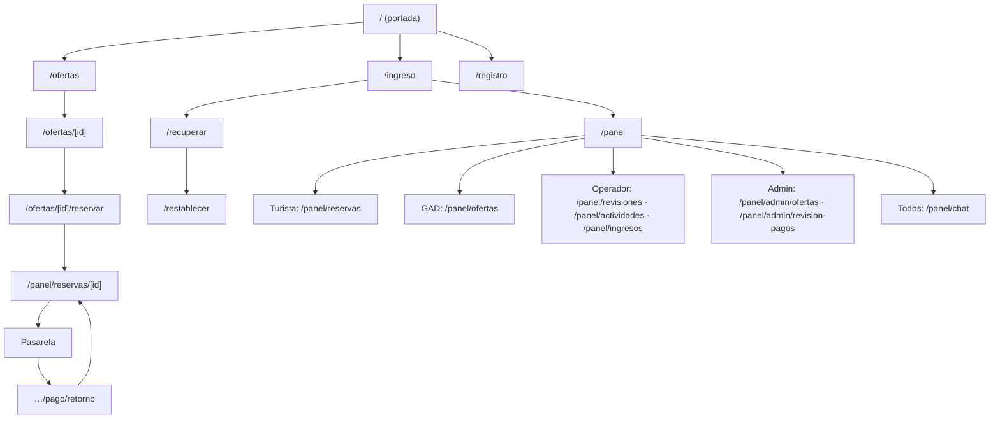

# 07 — Pantallas y experiencia

> **ESTADO: PARCIAL — punto de avance guardado el 2026-11-12.**
> Contiene el mapa de navegación y las reglas de experiencia **ya decididas**. Faltan los *wireframes* textuales, los estados por pantalla y los flujos paso a paso (⏳).
> **Siguiente paso exacto:** §4 — *wireframes* textuales, empezando por las pantallas de cuenta (`/registro`, `/ingreso`, `/recuperar`, `/restablecer`).
> Inventario de rutas: [05 §2](05-contratos-http-websocket-y-pagos.md).

---

## 1. Principios (definitivos)

- Interfaz en español (`lang="es-EC"`). Importes como `$25,50 USD` con un único formateador. Fechas con día, mes en letras, año y hora de 24 h, seguidas de «hora de Ecuador continental».
- El reloj del navegador no decide nada: la cuenta atrás de la retención es informativa y se calcula con la diferencia entre la hora del servidor recibida al cargar y la local.
- Formularios funcionales sin JavaScript donde sea viable (Server Actions con mejora progresiva); JavaScript añade validación inmediata.
- Objetivo propuesto: WCAG 2.2 nivel AA (criterios citados de memoria; se confirman en PE-03).
- Tailwind CSS 4 con componentes propios (D-64). Sin atributos `style` en línea (CSP).
- Con el adaptador `fake`, franja permanente «Pasarela simulada — no es PayPal».

## 2. Ruta inicial

`/` existe (D-63): portada con una frase de presentación, las próximas ofertas y accesos a «Ver catálogo», «Ingresar», «Crear cuenta» o, con sesión, «Ir a mi panel». No añade funciones.

## 3. Mapa de navegación por rol

El panel muestra la **unión** de las secciones de todas las asignaciones del usuario. La cabecera del panel contiene nombre, enlace «Chat» con insignia de mensajes nuevos y botón «Salir» (formulario `POST`).

## 4. *Wireframes* textuales

⏳ Por desarrollar para: cuenta (4), portada, catálogo, detalle, formulario de reserva, lista y detalle de reservas, retorno de pago, entradas, CRUD del GAD (lista, alta y edición, detalle con versiones), revisión del operador, actividades, lector de ingreso, chat, moderación, casos en revisión.

## 5. Decisiones de experiencia ya tomadas por flujo

| Flujo | Decisiones |
|---|---|
| Catálogo | Filtro por provincia (lista de 24), 10 por página, orden por fecha de inicio. Cada tarjeta: título, provincia, fecha, precio y «quedan N» o «Agotada». Estado vacío con enlace para quitar el filtro. |
| Detalle | Condiciones de la versión pública; botón «Reservar» solo si `OPEN`, futura y con cupo. `SUSPENDED`: aviso «Ventas suspendidas temporalmente». |
| Reserva grupal | Selector de cantidad (1–10) que genera filas nominales. Fecha de nacimiento solo si hay edad mínima, con la explicación de por qué se pide. Casilla de aceptación de condiciones con el texto visible. Resumen con total calculado por el servidor. Conflicto `VERSION_CHANGED`: se muestran las condiciones nuevas y se pide confirmar de nuevo, conservando los asistentes escritos. |
| Reserva retenida | Cuenta atrás con avisos accesibles a 5 y 1 minuto; botón «Pagar con PayPal». Vencida: mensaje claro de que no hubo cobro y enlace «Reservar de nuevo con los mismos asistentes» (recomendado). |
| Pago | Retorno: «Confirmando tu pago…» → confirmada, no aprobada, rechazada o «Estamos verificando tu pago». Nunca se muestra éxito sin confirmación del servidor. En revisión: explicación y aviso de que no hay entradas todavía. |
| Entradas | Una tarjeta por asistente con nombre, estado (`Válida` / `Usada el …`), QR, «Descargar» y «Copiar código». |
| Revisión (operador) | Vista de solo lectura de la versión, diferencias respecto de la pública cuando exista, botones separados «Aprobar» y «Devolver con motivo» (el motivo es obligatorio). |
| Ingreso | Paso 1 «Consultar»: cámara o campo de texto para pegar el código, siempre visibles ambos. Resultado: nombre, actividad y estado, con color **y** texto. Paso 2: botón distinto y separado «Registrar ingreso», desactivado si no procede. **Escanear nunca consume.** «Cancelar» conserva la entrada sin usar. |
| Chat | Lista con carga de mensajes anteriores, campo de texto con contador de 500, lista de presentes, indicador de conexión. Mensaje propio pendiente marcado hasta su confirmación. |
| Sesión vencida | Aviso y redirección a `/ingreso?next=…`; el chat muestra «Tu sesión terminó». |

## 6. Estados transversales (decididos)

Cada pantalla define: **vacío** (texto y acción sugerida), **carga** (indicador con texto), **éxito** (mensaje anunciado), **validación** (resumen de errores enfocable + mensaje junto a cada campo), **conflicto** (qué cambió y qué puede hacer), **acceso denegado** (página 404 o 403 con enlace al panel), **sesión vencida**, **fallo de red** (conservar lo escrito y permitir reintentar).

⏳ Falta: tabla de estados por pantalla.

## 7. Accesibilidad (objetivo y decisiones)

- Todo operable con teclado; foco visible; orden lógico; enlace «Saltar al contenido».
- Cada campo con `<label>`; errores unidos con `aria-describedby`; campos inválidos con `aria-invalid`; resumen de errores que recibe el foco tras enviar.
- Regiones `aria-live="polite"` para mensajes de chat, avisos y cuenta atrás; nunca roban el foco.
- Contraste mínimo AA; la información no depende solo del color; objetivos táctiles de al menos 24 px.
- Sin CAPTCHA ni pruebas cognitivas; se permite pegar contraseñas.
- La retención de 15 minutos es un límite de tiempo esencial del negocio: se avisa con antelación y se facilita repetir la reserva sin volver a escribir los datos.
- Alternativa manual a cámara y QR siempre disponible (RA-04).

⏳ Falta: lista de comprobación manual por pantalla.
