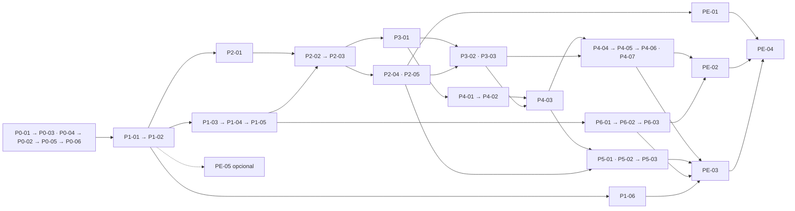

# 10 — Fases y paquetes implementables

> **ESTADO: REDACTADO (2026-11-16) con pendientes explícitos: las 38 fichas del catálogo están completas.**
> Contiene la **lista definitiva de 38 paquetes** con identificador, dependencias, requisitos y pruebas (corregida el 2026-11-16 en P0-02, P0-03, P0-06, P2-02, P4-02, P4-05, P4-07, P5-02, P6-01 y la ubicación de T-SEG-07 y T-DB-02; el grafo se revisó: sin ciclos), las reglas de encaje de pruebas y endurecimiento, las **38 fichas de 13 puntos** con sus decisiones abiertas (D0-x a D7-x), el contraste de las reglas de la fase 3 con los contratos, la revisión del catálogo completo y una **propuesta de paquete para J4** (`P3-04`, sin incorporar). **Pendientes explícitos:** las decisiones abiertas (incluidas D6-1 a D6-12 y D7-1 a D7-11), los asuntos externos (alojamiento Q-04, guías Q-01/Q-02/Q-03/Q-07/Q-09/Q-11 y Sandbox Q-08) y que **ningún paquete se ha implementado**.
> **Siguiente paso exacto:** implementar `P0-01` con el prompt maestro (11 §2) y su prompt (11 §4.2); la revisión cruzada final (00 §12, 2026-11-16) dio el visto bueno.
> **Ningún paquete ha sido implementado.**

---

## 1. Cómo encajan pruebas, endurecimiento y entrega (definitivo)

- **Las pruebas viajan con cada paquete.** Ningún paquete termina sin sus pruebas automatizadas; no hay una fase final de pruebas.
- **El endurecimiento se adelanta:** validación del entorno y redacción de registros en la fase 0; comprobación de `Origin`, cookies, límites y CSP en la fase 1, antes de construir funciones sobre ellas; autorización por recurso desde la primera función de cada módulo.
- **La entrega se prepara de forma continua:** README y `ESTADO-IMPLEMENTACION.md` se actualizan en cada paquete; el despliegue (PE-02) puede adelantarse tras la fase 1 para detectar pronto problemas de alojamiento.
- **Cada paquete** cabe en una sesión de trabajo con IA y deja el repositorio ejecutable y con las pruebas en verde.

## 2. Orden si el plazo aprieta

Todos los paquetes salvo PE-05 son necesarios para cumplir el plan. Si hay que mostrar pronto el recorrido principal, este orden lo consigue antes y deja para después lo que no lo bloquea:

`P0-01, 03, 04, 02, 05, 06` → `P1-01, 02, 03` → `P2-01, 02, 03, 04, 05` → `P3-01, 02, 03` → `P4-01, 02, 03, 04` → `P5-01, 02` → recorrido principal demostrable con el adaptador `fake`.
Después: `P1-04, 05, 06` · `P4-05, 06, 07` · `P5-03` · `P6-01, 02, 03` · `PE-01…04`.

> **Corrección de la revisión cruzada (2026-11-16):** la ruta corta anterior dejaba `P2-04` y `P3-03` para después, pero `P4-03` depende de `P3-03` (y este de `P2-04`) y `P5-02` depende de `P2-04` (§4): con aquel orden no podían cerrarse `P4-03`, `P4-04` ni `P5-02`. El atajo solo puede aplazar paquetes de los que no depende el recorrido principal.

## 3. Dependencia especial entre las fases 4 y 5 (definitivo)

El plan exige emitir las entradas **en la misma transacción** que confirma el pago (fase 4), pero la interfaz de entradas es de la fase 5. Se resuelve adelantando solo los prerrequisitos de datos y servicio:

| Paquete | Aporta | Fase |
|---|---|---|
| P4-02 | Tabla `Ticket`, llavero de cifrado, generación de token, `issueTicketsInTx(tx, …)`. **Sin interfaz.** | 4 |
| P4-03 | `settlePayment`, que llama a `issueTicketsInTx` dentro de su transacción. | 4 |
| P5-01 | Pantalla de entradas, imagen QR y código. | 5 |
| P5-02, P5-03 | Consulta, registro de ingreso y lector. | 5 |

Así el criterio de cierre de la fase 4 se comprueba con pruebas de integración que cuentan las entradas emitidas, y la fase 5 no modifica la liquidación.

## 4. Lista de paquetes (definitiva)

Esfuerzo relativo: **S** pequeño · **M** medio · **L** grande. Todos son obligatorios salvo indicación.

### Fase 0 — Base ejecutable

| ID | Título | Depende de | Requisitos | Pruebas | Esf. |
|---|---|---|---|---|---|
| P0-01 | Repositorio, proyecto Next.js y convenciones | — | RO-04, RO-10, RE-06 | — (compilación y análisis) | S |
| P0-02 | Servidor propio HTTP + Socket.IO + puente de runtime | P0-01, P0-03, P0-04 | RO-02, RO-09 | T-OPS-01, 02, 03 | M |
| P0-03 | PostgreSQL, Prisma 7, roles de base y Mailpit | P0-01 | RO-03, RO-08, RS-24 | — (roles y `withTx`: comprobación manual; T-SEG-07 y T-DB-02 empiezan en P0-06) | M |
| P0-04 | Núcleo compartido: entorno, errores, registros, reloj, dinero y fechas | P0-01 | RS-20, RS-23, RO-06, RA-01 | T-SEG-05, 08 | M |
| P0-05 | Arnés de pruebas (Vitest, barrera, Playwright) y CI | P0-02, P0-03, P0-04 | RE-02, RO-03, RS-28 | T-OPS-04 | M |
| P0-06 | Modelo de cuentas, hash de contraseñas y semilla base | P0-03, P0-04, P0-05 | RF-06, RS-01 | T-CTA-20, T-DB-01, T-DB-02, T-SEG-07 (07a: DDL y tablas de M1; 07d) | M |

> **Correcciones del 2026-11-16 a la fase 0** (decisiones D0-1, D0-2 y D0-7 de §5; sin ciclos):
> - **P0-02** depende ahora también de **P0-03** y **P0-04**: `server.ts` importa `env` y `logger` (P0-04) y `/api/salud` hace `SELECT 1` con el cliente de P0-03. P0-03 y P0-04 solo dependen de P0-01. Orden recomendado: P0-01, P0-03, P0-04, P0-02, P0-05, P0-06.
> - **Vitest** lo instala **P0-04** con configuración mínima (primera prueba: T-SEG-08a); **P0-05** prepara el arnés completo.
> - **T-SEG-07 y T-DB-02** salen de P0-03 (no hay tablas) y empiezan en **P0-06**; T-SEG-07 se amplía en los paquetes que crean cada tabla (P1-01, P3-01, P4-01, P4-02, P6-02) y su subcaso 07c en PE-02; T-DB-02 se repite con la semilla de ofertas (P2-01) y de demostración (PE-04).

### Fase 1 — Cuentas, sesión y panel

| ID | Título | Depende de | Requisitos | Pruebas | Esf. |
|---|---|---|---|---|---|
| P1-01 | Auditoría base | P0-06 | RF-38, RS-20 | T-SEG-11, T-SEG-07 (07a, 07b, 07e sobre `AuditEvent`) | S |
| P1-02 | Sesiones, ingreso, cierre, principal y panel protegido | P1-01 | RF-02, 03, 05, RS-02, 06, 07 | T-CTA-04, 05, 08, 09, 15, 16, 19, T-SEG-01, 12 | L |
| P1-03 | Registro público y componentes de formulario accesibles | P1-02 | RF-01, RS-05, RA-03 | T-CTA-01, 02, 03, T-A11Y-03 | M |
| P1-04 | Límites de intentos y antienumeración | P1-03 | RS-03 | T-CTA-06, 07, T-SEG-13 | M |
| P1-05 | Recuperación y restablecimiento de contraseña | P1-04 | RF-04, RS-04, RO-08 | T-CTA-10 a 14, 17, 18 | M |
| P1-06 | Cabeceras de seguridad, CSP y matriz de permisos automatizada | P1-02 | RS-21, 22, 27 | T-SEG-02, 03, 04, 06, 10 | M |

> **Corrección del 2026-11-16 a la fase 2:** **P2-02** depende también de **P1-03**: su formulario usa los componentes accesibles de P1-03, que no era antecesor de P2-01 (que depende de P1-02). Sin ciclos (P1-03 depende de P1-02). Las pruebas de T-OFE que necesitan reservas se ejecutan desde P3-01 (ver D2-10 en §5).

### Fase 2 — Ofertas, revisión y catálogo

| ID | Título | Depende de | Requisitos | Pruebas | Esf. |
|---|---|---|---|---|---|
| P2-01 | Modelo de ofertas, restricciones y semilla de ofertas | P1-02 | RF-07, RF-10 | T-DB-01, T-DB-02 (semilla de ofertas), T-OFE-11 | M |
| P2-02 | CRUD del GAD | P2-01, P1-03 | RF-07, 08, 11, 14, RS-09 | T-OFE-01 a 04, 14, 19, 24 | L |
| P2-03 | Revisión y publicación de versiones | P2-02 | RF-09, RF-10, RS-08 | T-OFE-05 a 13, 18 | L |
| P2-04 | Suspensión, reanudación, archivo y moderación | P2-03 | RF-11, RF-12 | T-OFE-15, 16 | M |
| P2-05 | Portada y catálogo público | P2-03 | RF-08, RF-13, RF-39 | T-OFE-17, 20 | M |

> **Nota del 2026-11-16 sobre la fase 3:** el catálogo se conserva sin cambios. Con el inventario real de P3-01 (D3-1), T-RES-10, T-RES-17 y T-OFE-21 y 22 (con reservas `HELD` o `EXPIRED`) son ejecutables al cerrar P3-01 aunque se asignen a P3-03; las que exigen una reserva `CONFIRMED` con pago y entradas esperan a P4-02 (D4-5); T-RES-14 se reparte entre P3-02 (14a, 14c) y P3-03 (14b). Ver §5, fase 3.

### Fase 3 — Reserva grupal y cupos

| ID | Título | Depende de | Requisitos | Pruebas | Esf. |
|---|---|---|---|---|---|
| P3-01 | Modelo de reservas, inventario y servicio de retención | P2-03 | RF-15 a 20, RS-10, 11, 25, 29 | T-RES-01 a 09, 12, 13, 15, 16; T-SEG-07 (`Reservation`, `Attendee`) | L |
| P3-02 | Formulario de reserva grupal y vistas del comprador | P3-01, P2-05 | RF-15, 19, 21, RA-08 | T-RES-14, 19 | L |
| P3-03 | Vencimiento, reglas de inventario al publicar y agregados | P3-01, P2-04 | RF-18, 22, 23, RO-07 | T-RES-10, 11, 17, 18, T-OFE-21, 22, 23, T-OPS-06 (06a: J1) | M |

> **Corrección del 2026-11-16 a la fase 4:** **P4-02** depende también de **P4-01**: su migración M9 redefine `fn_check_reservation` con el bloque de pagos (03 §8.4) y M9 sigue a M8 (03 §9.1). Sin ciclos (P4-01 depende de P3-01). Con ello P4-03 (P4-01, P4-02, P3-03) puede confirmar el pago y emitir una entrada por asistente en una sola transacción. **También** (2026-11-16, D4-9): **P4-05** depende de **P4-04** (reutiliza `claimCaptureAttempt` y `driveCapture`) y **P4-07** de **P4-05** (`checkGateway`, los casos agotados y los avisos de reembolso); sin ciclos.

### Fase 4 — Pago de prueba y conciliación

| ID | Título | Depende de | Requisitos | Pruebas | Esf. |
|---|---|---|---|---|---|
| P4-01 | Puerto de pagos, adaptador `fake` y modelo de pagos | P3-01 | RF-24, RF-25 | T-PAG-01, 02; T-SEG-07 (`Payment`, `PaymentEvent`) | M |
| P4-02 | Modelo de entradas, llavero y servicio de emisión | P3-01, P4-01 | RF-30, RS-15 | T-ENT-01, 02, 12, 15; T-SEG-07 (`Ticket`) | M |
| P4-03 | Liquidación: confirmación atómica y casos en revisión | P4-01, P4-02, P3-03 | RF-28, 29, 30, RS-14 | T-PAG-05, 06, 09 a 17 | L |
| P4-04 | Inicio de pago, retorno y captura | P4-03, P3-02 | RF-24, 26, RS-13 | T-PAG-03, 04, 18, 23, 25; y, del servicio de inicio y captura (04 TX-07, TX-08), T-PAG-01, 02 (subcasos), 06 (c a e), 12 (a a h) | L |
| P4-05 | Webhook y conciliación automática | P4-03, P4-04 | RF-27, RS-12, RO-11 | T-PAG-07 (d), 08, 17 (a, c, d, e), 19, 20 (a–j), 22, 26 (a–d), 06 (g), T-OPS-06 (06a: J2) | M |
| P4-06 | Adaptador PayPal Sandbox | P4-04, P4-05 | RF-24, RS-12, RE-11 | T-PAG-21, 24 (manual, pendiente de Q-08) | L |
| P4-07 | Casos en revisión del administrador | P4-03, P4-05 | RF-29 | T-PAG-19 | M |

> **Corrección del 2026-11-16 a la fase 5:** **P5-02** depende también de **P4-03**: sus fixtures (`sembrarEntradas`, que confirma la reserva con `settlePayment`) y la única vía de emisión real de entradas exigen la liquidación. Sin ciclos. P5-01 ya dependía de P4-03, así que dispone de las entradas emitidas por la fase 4.

### Fase 5 — Entradas e ingreso

| ID | Título | Depende de | Requisitos | Pruebas | Esf. |
|---|---|---|---|---|---|
| P5-01 | Entradas del comprador y descarga de QR | P4-03, P3-02 | RF-31, RS-16, 21 | T-ENT-03, 04 | M |
| P5-02 | Consulta y registro de ingreso | P4-02, P4-03, P2-04 | RF-32, 33, RS-17, 30, RA-04, 05 | T-ENT-05 a 11, 13, 14 | L |
| P5-03 | Lector con cámara y accesibilidad del ingreso | P5-02 | RF-32, RA-04 | T-ENT-14, T-A11Y-05 | M |

> **Corrección del 2026-11-16 a la fase 6:** **P6-01** depende también de **P1-05**: restablecer la contraseña debe cerrar todos los sockets del usuario (04 TX-13, T-CHAT-11b) y P1-05 no era antecesor de P6-01. Sin ciclos (P1-05 depende de P1-04). Se cierra D0-3: P6-01 sustituye el *handshake* provisional de P0-02.

### Fase 6 — Chat y notificación

| ID | Título | Depende de | Requisitos | Pruebas | Esf. |
|---|---|---|---|---|---|
| P6-01 | *Gateway* Socket.IO autenticado y cierre por sesión | P1-02, P1-05, P0-02 | RS-18 | T-CHAT-01, 02, 11, 12, T-OPS-06 (06a: J3) | M |

> **Corrección de la revisión cruzada (2026-11-16):** `T-OPS-06` (RO-11: los trabajos corren al arrancar) no estaba asignada a ningún paquete. Se reparte su subcaso 06a por trabajo: J1 en `P3-03`, J2 en `P4-05` (su ficha ya lo decía) y J3 en `P6-01`. La parte de J4 (06a en lo de J4 y 06b a 06d) solo existe si se adopta `P3-04`.
| P6-02 | Chat con historial | P6-01 | RF-34, RS-19, RS-27 | T-CHAT-03 a 07, 13, 14, 16; T-SEG-07 (`ChatMessage`) | L |
| P6-03 | Presencia, notificación adicional y reconexión | P6-02 | RF-35, 36, 37, RA-07 | T-CHAT-08, 09, 10, 15, T-A11Y-04 | M |

### Fase PE — Evidencia y entrega (derivada de `PLAN §4`)

| ID | Título | Depende de | Requisitos | Pruebas | Esf. |
|---|---|---|---|---|---|
| PE-01 | Medición de rendimiento del catálogo | P2-05 | RE-03 | T-PERF-01 | M |
| PE-02 | Despliegue con HTTPS y WSS | P0-06 como mínimo; cierre tras P4-06 y P6-03 | RO-05, RO-09 | T-OPS-02, 05, T-SEG-07c (revisión de configuración) y verificación manual | L |
| PE-03 | Revisión de seguridad, accesibilidad y privacidad | Fases 1 a 6 | RS-26, 28, RA-02, RE-08 | T-SEG-09, T-A11Y-01 a 07 | M |
| PE-04 | Datos de demostración y documentación de entrega | PE-01, PE-02, PE-03 | RE-01 a 12 | T-E2E-01, T-DB-02 (semilla de demostración) | M |
| PE-05 | Vista de auditoría del administrador (**opcional**) | P1-01 | RF-38 | — | S |

*Diagrama corregido en la revisión cruzada del 2026-11-16:* el anterior encadenaba `PE-02 → PE-03` (no es dependencia) y omitía `P1-03 → P2-02`, `P1-05 → P6-01`, `P2-04 → P3-03/P5-02` y `PE-01 → PE-04`. Las flechas entre grupos resumen; **manda la columna «Depende de» de las tablas**.

## 5. Fichas de paquete

**Estado de §5: redactado con pendientes explícitos.** Desarrolladas las fichas de las **38 paquetes** del catálogo —fases 0 a 6 (`P0-01` a `P6-03`) y fase PE (`PE-01` a `PE-05`)—, el 2026-11-16; `P3-04` (purga J4) sigue como propuesta fuera del catálogo. Cada ficha cubre los 13 puntos del encargo: (1) identificador y título; (2) objetivo observable y requisitos; (3) dependencias y estado mínimo del repositorio; (4) documentos, decisiones y contratos que leer; (5) archivos o módulos previstos; (6) tareas ordenadas; (7) contratos que introduce y conserva; (8) criterios de aceptación y pruebas; (9) comandos y evidencia; (10) errores, riesgos y recuperación; (11) datos, credenciales y servicios; (12) esfuerzo, incertidumbre, bloqueos y *commit*; (13) revisión humana y traspaso.

### 5.0 Convenciones de las fichas

- **Comandos previstos frente a verificados.** Todo comando de estas fichas es **previsto**: el repositorio solo contiene documentación y **ningún comando se ha ejecutado**. En cada ficha, la línea «Verificados» dice cuáles se han comprobado de verdad (hoy, ninguno); quien implemente la actualiza con la salida real (11 §3). Los nombres de scripts son los de [09 §4](09-entorno-despliegue-y-operacion.md).
- **Versiones.** Las de [02 §5](02-arquitectura-y-decisiones.md): Node 24 LTS (≥ 24.12), npm 11, TypeScript 5.9.3, Prisma **7.10.1 exacta**. «API por confirmar» remite a [00 §10.4](00-indice-y-control.md): se consulta la documentación de la versión instalada antes de usarla.
- **Evidencia.** Texto de las salidas de comandos y informes en `docs/evidencias/<ID de paquete>/` (propuesta de convención; 08 §5 solo fija `docs/evidencias/`), con fecha y *commit*; nunca capturas inventadas ni resultados no ejecutados. Cada paquete termina con el informe de 11 §3 y la actualización de `README.md` y `ESTADO-IMPLEMENTACION.md`.
- **Commits.** Mensaje propuesto por ficha; el reparto de autoría real entre integrantes (RO-10) depende de Q-03 y del plan de *commits* de 12 §6 (pendiente). No se hace *commit* ni *push* sin que se pida.
- **Orden dentro de la fase.** Los IDs son los de §4. Orden recomendado tras la corrección del 2026-11-16: `P0-01`, `P0-03`, `P0-04`, `P0-02`, `P0-05`, `P0-06` (P0-03 y P0-04 solo dependen de P0-01; P0-02 depende de ambos).

### Fase 0 — Base ejecutable

#### P0-01 — Repositorio, proyecto Next.js y convenciones

1. **Identificador:** `P0-01`, esfuerzo **S**.
2. **Objetivo y requisitos:** proyecto Next.js 16.4 con TypeScript que compila y pasa el análisis; convenciones de carpetas y de dependencias; `README.md` y `ESTADO-IMPLEMENTACION.md` iniciales. Requisitos: RO-04 (parte: dependencias bloqueadas y scripts de análisis y compilación), RO-10 (Git desde la fase 0), RE-06 (README inicial; la declaración final de uso de IA llega en PE-04).
3. **Dependencias y estado mínimo:** ninguna. El repositorio ya existe con la planificación (`docs/`, `docs/planificacion/referencias/PLAN.md`); no hay código ni dependencias. Node ≥ 24.12 y npm 11 instalados.
4. **Leer:** 02 §3 (árbol y notas de `create-next-app`), §4 (reglas de dependencia), §5 (versiones), §6 (ajustes de Next); 09 §1 y §4; 00 §8.1 (D-03, D-08); 01 (RO-04, RO-10, RE-06); 11 §2, §3 y §5.
5. **Archivos previstos:** `package.json`, `package-lock.json`, `tsconfig.json` (alias `@/` → `src/`), `eslint.config.mjs`, `next.config.ts`, `.gitignore`, `.nvmrc`, `.editorconfig`, `README.md`, `ESTADO-IMPLEMENTACION.md`, `src/app/layout.tsx` y `page.tsx` mínimos, y carpetas vacías de `src/modules`, `src/shared`, `src/ui`, `tests/` y `docs/evidencias/`.
6. **Tareas:** (a) comprobar versiones locales; (b) generar el proyecto con `create-next-app` 16.4 con `src/` **y Cache Components desactivado** (por defecto propone lo contrario, 02 §3, D-03). **Carpeta no vacía (añadido en la revisión cruzada del 2026-11-16; conducta no verificada):** la raíz ya contiene `README.md`, `docs/planificacion/referencias/PLAN.md`, `docs/planificacion/referencias/PROMPT-*.md`, `docs/planificacion/referencias/FUENTES-PAYPAL-REVISION.md` y `docs/`; si `create-next-app` rechaza la carpeta, se genera en una carpeta temporal **fuera** del repositorio y se copian los archivos generados sin sobrescribir `docs/`, `docs/planificacion/referencias/PLAN.md` ni los `.md` existentes; el `README.md` nuevo se **fusiona** con el actual (que debe seguir enlazando `docs/planificacion/referencias/PLAN.md` y `docs/planificacion/`); (c) fijar las versiones de 02 §5 que correspondan (sin `^` donde se indica) y `engines`; (d) `next.config.ts` con `cacheComponents: false`, `poweredByHeader: false`, `typedRoutes: true` y la comprobación de `serverExternalPackages` (02 §6); (e) ESLint con `no-restricted-imports` para las reglas 1 y 2 de 02 §4 (se ejercitan cuando existan módulos); (f) scripts `lint`, `typecheck` y `build`; (g) `.gitignore` que excluya `.env*` (salvo los ejemplos), `backups/`, `*.dump` y `src/generated/`; (h) README con requisitos y los pasos de 09 §2 marcados como previstos, y `ESTADO-IMPLEMENTACION.md` con el formato de 11 §5; (i) primer *commit* propio. **Seguridad:** ningún secreto en el repositorio; el `.gitignore` se prueba antes del primer *commit*.
7. **Contratos:** introduce el alias `@/`, la estructura de carpetas de 02 §3, las reglas de dependencia y los nombres de scripts `lint`, `typecheck` y `build`. No hay contratos previos que conservar.
8. **Aceptación:** `npm ci`, `npm run lint`, `npm run typecheck` y `npm run build` terminan sin error desde un clon limpio; `git status` no muestra archivos ignorables ni secretos; una importación prohibida de prueba es rechazada por ESLint (comprobación puntual). **Pruebas T-:** ninguna (el catálogo indica «compilación y análisis»).
9. **Comandos previstos:** `node --version`, `npm --version`, `npm ci`, `npm run lint`, `npm run typecheck`, `npm run build`, `git status`. **Verificados:** ninguno. **Evidencia:** salida de esos comandos en `docs/evidencias/P0-01/`.
10. **Errores y recuperación:** `create-next-app` puede cambiar sus valores por defecto (revisar `src/` y Cache Components); la API de ESLint 10 y de Tailwind 4.3 está **por confirmar** (00 §10.4); en Windows, evitar finales de línea mixtos (`.editorconfig` con `end_of_line = lf`, propuesta). El paquete solo crea archivos: si queda a medias se revierte el *commit* o se restauran los archivos; no hay migraciones.
11. **Datos y servicios:** ninguno; solo el registro de npm. Sin credenciales.
12. **Esfuerzo e incertidumbre:** S; baja, salvo la API de ESLint 10 y Tailwind 4.3. **Bloqueos:** ninguno para el código; Q-03 para la autoría de los *commits* (RO-10). **Commit propuesto:** `chore: inicializar proyecto Next.js y convenciones (P0-01)`.
13. **Revisión humana:** confirmar las opciones elegidas en `create-next-app`, que `.gitignore` excluye secretos y que el README no afirma nada no ejecutado. **Traspaso:** habilita `P0-02`, `P0-03` y `P0-04`; anotar versiones reales instaladas.

#### P0-02 — Servidor propio HTTP + Socket.IO + puente de runtime

1. **Identificador:** `P0-02`, esfuerzo **M**.
2. **Objetivo y requisitos:** un único `server.ts` sirve Next.js y Socket.IO en el mismo puerto, expone `GET /api/salud`, fija cabeceras propias, registra el acceso y se apaga de forma ordenada; el puente `registerRuntime`/`getRuntime` queda disponible. Requisitos: RO-02, RO-09 (parte: salud y apagado ordenado).
3. **Dependencias y estado mínimo:** `P0-01`, `P0-03` y `P0-04` (corregido el 2026-11-16, D0-1): el esqueleto de 02 §7.1 importa `env` y `logger` (**P0-04**) y `/api/salud` hace `SELECT 1` con el cliente de **P0-03**. Estado mínimo: proyecto compilable, entorno validado, registros y cliente de base disponibles y la base local en marcha.
4. **Leer:** 02 §2 (un solo proceso), §7.1 a §7.5, §10.3 (registro de acceso), §11.3; 05 §4 (`/api/salud`) y la introducción de 05 §5; 08 §3.7 (T-OPS-01 a 03); 09 §4 y §6.2 (escucha en `0.0.0.0`, `SIGTERM` y 30 s); 00 (D-05, D-08).
5. **Archivos previstos:** `server.ts`; `scripts/build-server.mjs` (esbuild); `src/shared/runtime/registry.ts`; `src/shared/http/prepare-request.ts` (id de petición e IP de confianza); `src/realtime/gateway.ts` (mínimo); `src/jobs/scheduler.ts` (sin trabajos todavía; respeta `JOBS_ENABLED`); un módulo de apagado (`installGracefulShutdown`); `src/app/api/salud/route.ts`.
6. **Tareas:** (a) `server.ts` según 02 §7.1 con `hostname`, `port` y `httpServer` pasados a `next()`; (b) `prepareRequest`: elimina `x-request-id` y `x-tc-client-ip` entrantes y los vuelve a fijar, antes de `handle`; (c) registro de acceso con ruta **sin cadena de consulta** y sin cuerpos, cookies ni `Authorization`; (d) `attachRealtime` mínimo en `/socket.io/` (ver D0-3); (e) `registerRuntime` y `getRuntime` con implementación nula si no hay registro; (f) `/api/salud` con `SELECT 1` y límite de 2 s (05 §4): 200 `{ "status": "ok" }`, o 503 si falla o el proceso se cierra; (g) apagado: «cerrando» ⇒ 503, detener trabajos (≤ 5 s), `io.close()`, `httpServer.close()`, límite total de 20 s, código de salida 0; (h) `scripts/build-server.mjs` (ESM, `platform=node`, alias `@/` resueltos, dependencias externas); (i) scripts `dev`, `build` (`prisma generate` solo cuando exista P0-03) y `start`. **Seguridad:** nadie fuera del servidor propio puede fijar `x-request-id` ni la IP.
7. **Contratos:** introduce `GET /api/salud` (05 §4), la interfaz `RealtimePort` (02 §7.2), las cabeceras internas y los scripts `dev` y `start`. Conserva el `lint`, `typecheck` y `build` de `P0-01`.
8. **Aceptación:** **T-OPS-01** (HTTP y un cliente Socket.IO responden en el mismo puerto; `/api/salud` 200); **T-OPS-02a** (200 sin sesión ni datos internos); **T-OPS-02b** (503 en < 2 s al detener la base, y 200 al volver; manual hasta P0-05); **T-OPS-03** (`SIGTERM`: deja de aceptar, la petición en curso termina, sockets cerrados, código 0) **en Linux o CI**, no en Windows (08 §3.7.4).
9. **Comandos previstos:** `npm run dev`; `curl http://localhost:3000/api/salud` (PowerShell: `Invoke-RestMethod`); un *script* corto con `socket.io-client` que conecte al mismo puerto; `npm run build && npm run start`; en Linux o WSL, `kill -TERM <pid>` con una petición retenida. **Verificados:** ninguno. **Evidencia:** salida de esos comandos y el resultado del humo con recarga en caliente en `docs/evidencias/P0-02/`. Vitest mínimo ya existe (P0-04), pero T-OPS-01 a 03 necesitan base, navegador o Linux (proyectos de integración y E2E de P0-05): son **manuales** en este paquete y P0-05 las automatiza (D0-2).
10. **Errores y riesgos:** convivencia de la recarga en caliente de Next.js con Socket.IO sobre el mismo `http.Server` **sin garantía documentada** (02 §7.1 y §7.5, 00 §10.4): si choca con el *upgrade*, se documenta la alternativa adoptada; el alias `@/` en esbuild; Windows no representa a `SIGTERM`. Recuperación: el paquete solo añade código; revertir el *commit*.
11. **Datos y servicios:** `socket.io` y `socket.io-client` 4.8.x (misma versión); sin base ni credenciales.
12. **Esfuerzo e incertidumbre:** M; **media-alta** (recarga en caliente, `SIGTERM`). **Bloqueos:** ninguno externo. **Commit propuesto:** `feat: servidor propio HTTP y Socket.IO con salud y apagado ordenado (P0-02)`.
13. **Revisión humana:** confirmar el resultado del humo de recarga en caliente y la alternativa documentada si la hubo. **Traspaso:** anotar qué comprobaciones quedan por automatizar en `P0-05`.

#### P0-03 — PostgreSQL, Prisma 7, roles de base y Mailpit

1. **Identificador:** `P0-03`, esfuerzo **M**.
2. **Objetivo y requisitos:** servicios locales de PostgreSQL 18 y Mailpit; roles `tc_migrator` y `tc_app` con privilegios mínimos; Prisma 7.10.1 configurado con adaptador `pg`; cliente único y `withTx`. Requisitos: RO-03, RO-08 (bandeja SMTP; se completa con T-CTA-18 en P1-05), RS-24.
3. **Dependencias y estado mínimo:** `P0-01`. Docker 28.x o compatible en el equipo.
4. **Leer:** 02 §5.2 (Prisma exacta; `latest` es 8.0 RC), §9 (Prisma no carga `.env`), §11; 03 §8.5 (privilegios), §9.1 y §9.4, §10.2; 04 §5 (`SET LOCAL` y adaptador `pg`); 09 §2, §3 (`DATABASE_URL`, `MIGRATION_DATABASE_URL`, `DB_POOL_MAX`, `DB_LOCK_TIMEOUT_MS`), §5; 08 (T-SEG-07, T-DB-02).
5. **Archivos previstos:** `docker-compose.yml` (`db`: `postgres:18`; `mail`: `axllent/mailpit:v1.33`); `prisma/sql/00-roles.sql`; `prisma.config.ts` (carga `dotenv/config`; URL de migración con el rol migrador); `prisma/schema.prisma` (solo `generator` y `datasource`, sin modelos); `src/shared/db/prisma.ts` (instancia única en `globalThis.__tcPrisma`) y `src/shared/db/tx.ts` (`withTx`).
6. **Tareas:** (a) `docker-compose.yml` con volumen con nombre, comprobación de salud con `pg_isready` y PostgreSQL ligado solo a `localhost` (propuestas de 09 §2.2 y §5.5); (b) `00-roles.sql`: roles `tc_migrator` (propietario, DDL) y `tc_app` (sin DDL), contraseñas ficticias locales y las bases `turismo_dev`, `turismo_test`, `turismo_e2e`, `turismo_perf`; (c) instalar `prisma`, `@prisma/client`, `@prisma/adapter-pg` **7.10.1 exactos** y `pg`; (d) `prisma.config.ts`; (e) `prisma.ts` y `withTx` (`READ COMMITTED`, `SET LOCAL lock_timeout` como primera sentencia, valor por defecto `DB_LOCK_TIMEOUT_MS` = 5000 y `opts.lockTimeoutMs`); (f) scripts `db:up`, `db:down`, `db:generate`, `db:migrate`, `db:migrate:deploy`. **Seguridad:** `tc_app` no puede ejecutar DDL ni usar `SET ROLE tc_migrator`; el esquema `public` no admite `CREATE` para `tc_app`; `MIGRATION_DATABASE_URL` no entra en el entorno de la aplicación en producción (06 A-43).
7. **Contratos:** introduce los roles, los nombres de base, `withTx(opts)`, las variables `DATABASE_URL`, `MIGRATION_DATABASE_URL`, `DB_POOL_MAX` y `DB_LOCK_TIMEOUT_MS`, y el SMTP de Mailpit (1025, interfaz 8025). Conserva los scripts de `P0-01` y `P0-02`.
8. **Aceptación:** comprobaciones **manuales** (todavía no hay tablas ni arnés): `tc_app` rechaza `CREATE TABLE` y `SET ROLE tc_migrator` mientras `tc_migrator` puede crear; `withTx` aplica el `lock_timeout` (prueba de humo); Mailpit acepta un correo. **T-SEG-07 y T-DB-02 ya no se asignan aquí** (D0-7, corregido el 2026-11-16): requieren tablas, privilegios por tabla y arnés, y empiezan en `P0-06` (§4).
9. **Comandos previstos:** `docker compose config`, `npm run db:up`, `docker compose ps`, `docker compose exec db psql -U tc_app -d turismo_dev -c "CREATE TABLE x()"` (debe fallar), `npm run db:generate`. **Verificados:** ninguno. **Evidencia:** salidas y el listado de roles y privilegios en `docs/evidencias/P0-03/`.
10. **Errores y riesgos:** Prisma `latest` es 8.0 RC: **fijar 7.10.1 sin `^`**; opciones del *pool* de `PrismaPg` y comportamiento de `SET LOCAL` y bloqueos con `$executeRaw` **por confirmar** (00 §10.4, 04 §5); `00-roles.sql` solo se ejecuta con el volumen vacío (09 §5.3); si `tc_migrator` necesita `CREATEDB` para `db:reset` (09 §8.14). **Recuperación:** en local, `docker compose down -v` borra el volumen entero y exige autorización (09 §5.3).
11. **Datos y servicios:** imágenes `postgres:18` y `axllent/mailpit:v1.33`; contraseñas ficticias solo locales; ninguna credencial real.
12. **Esfuerzo e incertidumbre:** M; media (Prisma 7). **Bloqueos:** ninguno externo; D0-8. **Commit propuesto:** `feat: PostgreSQL 18, Prisma 7, roles de base y Mailpit (P0-03)`.
13. **Revisión humana:** revisar `00-roles.sql` y los privilegios antes de fusionar. **Traspaso:** registrar la versión real de Prisma instalada, cómo quedó `withTx` y qué comprobaciones manuales de roles automatiza `P0-06`.

#### P0-04 — Núcleo compartido: entorno, errores, registros, reloj, dinero y fechas

1. **Identificador:** `P0-04`, esfuerzo **M**.
2. **Objetivo y requisitos:** utilidades transversales sin dependencias de módulos. Requisitos: RS-20 (registros sin secretos), RS-23 (entorno validado), RO-06 (UTC y centavos enteros), RA-01 (USD y «hora de Ecuador»), RO-04 (`.env.example`).
3. **Dependencias y estado mínimo:** `P0-01`. Con la corrección de D0-1, `P0-02` se ejecuta **después** y consume `env` y `logger`.
4. **Leer:** 02 §9 (reglas de entorno), §10.1 y §10.2 (errores y códigos), §10.3 (registros y redacción), §11 (reloj); 03 §3.0 (reglas 4 y 5: longitud en puntos de código y NFC); 09 §3 y §3.4 (variables y `DB_LOCK_TIMEOUT_MS`); 08 §3.7 (T-SEG-05, T-SEG-08); 01 (RS-20, RS-23, RO-06, RA-01).
5. **Archivos previstos:** `src/shared/config/env.ts`; `src/shared/errors/` (`AppError`, `ErrorCode`, `ActionResult`); `src/shared/logging/` (pino y redacción); `src/shared/http/request-id.ts`; `src/shared/time/` (`Clock`, zona `America/Guayaquil`, edad); `src/shared/money/`; `src/shared/validation/` (longitud en puntos de código, normalización NFC); `.env.example` y `.env.test.example` (09 §3.2 y §3.3); `vitest.config.ts` (mínimo).
6. **Tareas:** (a) `env.ts` con Zod 4: valida al importar, nombra la variable inválida **sin su valor**, reglas cruzadas de 02 §9 (producción exige `paypal`, `https://`, llavero y Argon2 mínimo; solo el anfitrión de Sandbox; ninguna `NEXT_PUBLIC_*`) y `DB_LOCK_TIMEOUT_MS` (entero, defecto 5000; el rango 100 a 30 000 es **propuesta**, 09 §3.4); (b) `AppError` y el catálogo de códigos de 02 §10.2 con su estado HTTP; (c) pino en JSON con los campos fijos y la lista de redacción de 02 §10.3; (d) `Clock` inyectable y monótono (D-10) con reloj falso para pruebas; (e) dinero en centavos con formato único en USD; (f) fechas en UTC con presentación «hora de Ecuador» y cálculo de edad; (g) ayudante de longitud en puntos de código y NFC; (h) los ejemplos de entorno de 09 §3; (i) **instalar Vitest 5 con configuración mínima** (proyecto `unit`, alias `@/`, scripts `test` y `test:unit`): es el prerrequisito de la primera prueba (T-SEG-08a) y P0-05 lo amplía (D0-2, resuelta). **Seguridad:** nunca se escribe el valor de un secreto; los módulos con secretos importan `server-only`.
7. **Contratos:** introduce `env`, `AppError`/`ErrorCode`/`ActionResult` (02 §10), `logger`, `Clock`, utilidades de dinero y fechas, y los archivos de ejemplo. Conserva `/api/salud`, `withTx` y scripts previos.
8. **Aceptación:** **T-SEG-08a** (cada regla de 02 §9 impide el arranque y el mensaje nombra la variable y no su valor); **T-SEG-05c** (el arranque con secretos centinela no los escribe) y la prueba unitaria de redacción de 02 §10.3. **T-SEG-05a/05b** (flujos completos) y **T-SEG-08b/08c** (módulo `fake` en producción, búsqueda en el paquete de cliente) se completan cuando existan esos flujos y el *build* con páginas; cada ficha posterior los asigna.
9. **Comandos previstos:** `npm run lint`, `npm run typecheck`, `npm run test:unit` (con la configuración mínima de Vitest de la tarea (i)), `npm run build`. **Verificados:** ninguno. **Evidencia:** informe de `test:unit` y salida del arranque con variables inválidas en `docs/evidencias/P0-04/`.
10. **Errores y riesgos:** API de Zod 4.6, pino 10 y Vitest 5 **por confirmar** (00 §10.4); el reloj tras bloqueos (D-69) lo usan paquetes posteriores; los *helpers* de `shared/security` no se crean aquí (HMAC en P1-01; token y comparación en P1-02; D0-9 resuelta). Recuperación: solo código; revertir.
11. **Datos y servicios:** valores centinela de prueba; sin servicios.
12. **Esfuerzo e incertidumbre:** M; media (Zod 4, pino 10). **Bloqueos:** D0-10. **Commit propuesto:** `feat: núcleo compartido (entorno, errores, registros, reloj, dinero) (P0-04)`.
13. **Revisión humana:** revisar la lista de redacción y las reglas de entorno. **Traspaso:** listar los códigos de error definidos y qué subcasos de T-SEG-05 y T-SEG-08 quedan abiertos.

#### P0-05 — Arnés de pruebas (Vitest, barrera, Playwright) y CI

1. **Identificador:** `P0-05`, esfuerzo **M**.
2. **Objetivo y requisitos:** infraestructura de pruebas y flujo de CI que aplican la estrategia de 08 §1, §2 y §6. Requisitos: RE-02, RO-03 (las pruebas se niegan a correr contra una base que no sea de pruebas), RS-28 (revisión de dependencias, parte).
3. **Dependencias y estado mínimo:** `P0-02`, `P0-03`, `P0-04` (servidor, base, entorno y reloj). Vitest ya está instalado con configuración mínima (P0-04). Aún no hay tablas de negocio.
4. **Leer:** 08 §1, §2, §6, §3.7 (T-OPS-04), SEG-D6; 09 §2.3, §5.2 (regla por utilidad), §5.3; 02 §3 (`tests/`); 03 §9.4.
5. **Archivos previstos:** `vitest.config.ts` (proyectos unitario, integración y concurrencia), `playwright.config.ts`; `tests/helpers/` (base y `conexion('tc_app'|'tc_migrator')`, reloj falso, barrera por bloqueo de fila); utilidades de base con guardas (limpieza, `db:test:prepare`, `db:reset`) y sus pruebas; `.github/workflows/ci.yml`.
6. **Tareas:** (a) **ampliar** la configuración mínima de Vitest creada en P0-04 (proyectos de integración y concurrencia) y añadir los scripts `test:integration`, `test:concurrency`, `test:e2e` y `test:a11y`; (b) Playwright sobre el *build* de producción con `turismo_e2e`, puerto 3100 y adaptador `fake` (propuesta de 09 §2.3); (c) la **barrera** de 08 §2 (bloqueo de fila y espera por `pg_stat_activity`); (d) utilidades con la **regla por utilidad** de 09 §5.2: limpieza y semilla de pruebas solo en `_test`, `_e2e`, `_perf`; `db:reset` en `turismo_dev` y esas tres, solo en local y con `--confirm`; (e) `db:test:prepare` idempotente (migra y, desde `P0-06`, siembra); (f) CI según 08 §6.1: `postgres:18`, `PAYMENT_PROVIDER=fake`, sin credenciales de PayPal, falla ante `skip`, `todo` o `only`, publica informes con `if: always()`; (g) automatizar T-OPS-01 y 02 si `P0-02` las dejó manuales; `npm audit --omit=dev` informativo.
7. **Contratos:** introduce los scripts `test:*`, `db:test:prepare`, `db:reset`, los ayudantes de `tests/helpers` y el flujo de CI. Conserva los de fases previas.
8. **Aceptación:** **T-OPS-04** (las utilidades se niegan —código ≠ 0, sin enviar sentencias— con `turismo_dev` (limpieza y semilla), `turismo`, `turismo_prod`, `turismo_test_prod`, `turismo_demo`, `turismo_restore`, mayúsculas, parámetros en la URL y cambio de variable; `db:reset` admite `turismo_dev`; y actúan con `_test`, `_e2e`, `_perf`). La barrera se prueba con una **tabla temporal** creada por la propia prueba (no hay tablas de negocio). El flujo de CI se ejecuta en verde.
9. **Comandos previstos:** `npm run db:test:prepare`, `npm run test:unit`, `npm run test:integration`, `npm run test:concurrency`, `npm run test:e2e`; en CI, el flujo `ci.yml`. **Verificados:** ninguno. **Evidencia:** informes JUnit y de Playwright y el enlace a la ejecución de CI (EV-04) en `docs/evidencias/P0-05/`.
10. **Errores y riesgos:** API de Vitest 5 **por confirmar**; la CI en GitHub depende de que Actions esté habilitado en el remoto (D0-11, por verificar); T-OPS-03 exige Linux o CI; riesgo de que una utilidad destructiva actúe sobre una base equivocada (por eso T-OPS-04 va en este paquete). Recuperación: el paquete añade configuración; en local, recrear la base de pruebas con `db:reset` (con autorización).
11. **Datos y servicios:** `postgres:18` en CI; secretos de CI generados por ejecución; sin PayPal.
12. **Esfuerzo e incertidumbre:** M; media (CI sin ejecución previa, Vitest 5). **Bloqueos:** D0-11 (verificar el remoto y Actions); D0-12 (paralelismo por esquema, remitido en 08 §6.2). **Commit propuesto:** `test: arnés de Vitest y Playwright, utilidades protegidas y CI (P0-05)`.
13. **Revisión humana:** revisar las guardas de base y los permisos del flujo de CI. **Traspaso:** qué subcasos son automáticos o manuales, y la decisión adoptada sobre el paralelismo.

#### P0-06 — Modelo de cuentas, hash de contraseñas y semilla base

1. **Identificador:** `P0-06`, esfuerzo **M**.
2. **Objetivo y requisitos:** primera migración (M1) con las entidades de cuentas, hash Argon2id y semilla base de cuentas, GAD y atracciones. Requisitos: RF-06 (roles y vínculos por semilla), RS-01 (Argon2id con sal).
3. **Dependencias y estado mínimo:** `P0-03`, `P0-04`, `P0-05`. Base y roles listos, entorno validado, arnés y utilidades protegidas.
4. **Leer:** 03 §3.0 (enumeraciones y reglas), §3.1 (`User`, `RoleAssignment`, `Gad`, `Attraction`), §8.3 y §8.5, §9.1 (M1), §9.2, §9.3 (semilla base), §10.2; 02 §5.2 (`argon2`) y §6 (`serverExternalPackages`); 09 §3 (`ARGON2_*`, `SEED_DEMO_PASSWORD`) y §4; 08 (T-CTA-20, T-DB-01, T-DB-02, T-SEG-07); 06 A-47.
5. **Archivos previstos:** `prisma/schema.prisma` (enums `Role` y `Province`; modelos de M1); `prisma/migrations/<marca>_p0_06_cuentas/` con SQL manual bajo `-- MANUAL (no modelado por Prisma)`; `src/modules/accounts/infra/password.ts` (`hashPassword`, `verifyPassword`); `prisma/seed/index.ts` y `accounts.ts` (`seedUuid`, `seedBase({ now })`); script `db:seed`.
6. **Tareas:** (a) modelos con `onDelete` y `onUpdate` explícitos y nombres por defecto de Prisma; (b) `prisma migrate dev --create-only` y edición del SQL: `ck_user_email`, `ck_user_displayname`, `ck_user_passwordhash`, `ck_gad_name`, `ck_attraction_name`, `ck_roleassignment_scope`, índice `ux_roleassignment_scope` **`NULLS NOT DISTINCT`** (Prisma no lo expresa) y los `GRANT` de 03 §8.5 (`User`: S, I, U; `RoleAssignment`: S, I; `Gad` y `Attraction`: S); (c) aplicar y comprobar la **deriva** (una segunda `migrate dev` no propone cambios; sonda con `prisma migrate diff`); (d) hash Argon2id con los parámetros de `ARGON2_*`; (e) semilla con `seedUuid` determinista, 2 GAD, 2 atracciones y 8 cuentas `@demo.test` con `SEED_DEMO_PASSWORD`, `RoleAssignment` por búsqueda previa o `ON CONFLICT DO NOTHING` (no `upsert`); se ejecuta con `MIGRATION_DATABASE_URL`; (f) completar `db:test:prepare` con la semilla base; (g) comprobar `serverExternalPackages` para `argon2`, `pino` y el cliente Prisma. **Seguridad:** `passwordHash` nunca se registra ni se devuelve; la semilla se niega sin `SEED_DEMO_PASSWORD` válido.
7. **Contratos:** introduce la migración M1, los enums `Role` y `Province`, `hashPassword`/`verifyPassword` y `db:seed`. Conserva los contratos de P0-01 a P0-05.
8. **Aceptación:** **T-CTA-20** (existen cuentas de los cuatro roles con sus alcances); **T-DB-01** en los subcasos de 03 §8.7 que afectan a M1 y la repetición tras una segunda `migrate` (anti-deriva); **T-DB-02** en su alcance de esta fase (migrar desde cero con M1, semilla base dos veces sin cambios, `tc_app` no puede ejecutarla; se repite con la semilla de ofertas en `P2-01` y la de demostración en `PE-04`); **T-SEG-07** (07a: DDL y privilegios de las tablas de M1; 07d: el *pool* de la aplicación usa `tc_app`), que se amplía en los paquetes que crean las demás tablas (§4). Ambos **empiezan aquí** (D0-7).
9. **Comandos previstos:** `npx prisma validate`, `npx prisma migrate dev --create-only --name p0_06_cuentas`, `npm run db:migrate`, `npm run db:generate`, `npm run db:seed` (dos veces), `npm run db:test:prepare`, `npm run test:integration`. **Verificados:** ninguno. **Evidencia:** salida de `migrate`, de la sonda de deriva, de las dos semillas y los recuentos en `docs/evidencias/P0-06/`.
10. **Errores y riesgos:** deriva de `ux_roleassignment_scope` y de las claves foráneas manuales (**sin documentación hallada**, 03 §10.2); `prisma validate` con relaciones compuestas (P2-01); la sintaxis de `prisma migrate diff` en Prisma 7; `argon2` es un módulo nativo: confirmar en Windows y en la imagen de despliegue; `"User"` es palabra reservada (comillas dobles en el SQL manual). **Recuperación:** una migración aplicada no se edita; en local se recrea la base con `db:reset` (con autorización); en un despliegue, copia previa (RB-08).
11. **Datos y servicios:** semilla de 03 §9.3: «GAD Parroquial San Isidro del Lago» y «GAD Parroquial Valle de los Colibríes», «Laguna Espejo del Cóndor» y «Sendero Cascada Yaku Sisa», y las cuentas `admin`, `gad.sanisidro`, `gad.colibries`, `operador.laguna`, `operador.cascada`, `dual`, `turista.ana` y `turista.luis` (todas `@demo.test`). Sin servicios externos.
12. **Esfuerzo e incertidumbre:** M; media-alta (deriva de objetos manuales, Argon2 nativo). **Bloqueos:** D0-13 (A-47) y D0-14 (deriva). **Commit propuesto:** `feat: modelo de cuentas, hash Argon2id y semilla base (P0-06)`.
13. **Revisión humana:** revisar el SQL manual y los `GRANT` contra 03 §8.5 y confirmar que la segunda `migrate` no propone cambios. **Traspaso:** habilita la fase 1 (`P1-01`); anotar la sintaxis real de Prisma 7 que se usó y los subcasos de T-DB-01 que quedan.

#### Decisiones abiertas y comprobaciones técnicas de la fase 0

Estado al 2026-11-16: **D0-1, D0-2, D0-7 y D0-9 resueltas** (reflejadas en §4 y en las fichas) y **D0-11 registrada** con verificaciones pendientes; las demás siguen abiertas. «Cuándo afecta» indica el punto del paquete en que hay que decidirla o comprobarla.

| Ref. | Tipo | Qué falta | Paquetes y cuándo afecta |
|---|---|---|---|
| D0-1 | **Resuelta** | `P0-02` depende de `P0-01`, `P0-03` y `P0-04` (necesita `env`, `logger` y el cliente de base); sin ciclos, porque P0-03 y P0-04 solo dependen de P0-01 | P0-02: orden P0-01, P0-03, P0-04, P0-02 |
| D0-2 | **Resuelta** | P0-04 instala Vitest con configuración mínima y escribe la primera prueba (T-SEG-08a); P0-05 amplía el arnés (integración, concurrencia, Playwright, CI) | P0-04 y P0-05 |
| D0-3 | Diseño no recogido | Qué acepta el *handshake* de Socket.IO antes del *gateway* autenticado de P6-01 (T-OPS-01 exige conectar un cliente) y cómo no exponerlo en producción | P0-02 (T-OPS-01) y P6-01 |
| D0-4 | Comprobación | Recarga en caliente de Next.js con Socket.IO sobre el mismo `http.Server` (02 §7.1, 00 §10.4) | P0-02: **al hacer el humo** |
| D0-5 | Comprobación | `T-OPS-03` válida solo en Linux o CI; plazo de gracia de `SIGTERM` por fijar (08 §3.7.3) | P0-02 (manual en Linux o WSL) y P0-05 (CI) |
| D0-6 | Comprobación | API concreta de Vitest 5, Zod 4.6, pino 10, ESLint 10 y Tailwind 4.3 (00 §10.4) | P0-01, P0-04, P0-05: **antes de usarlas** |
| D0-7 | **Resuelta** | T-SEG-07 y T-DB-02 empiezan en P0-06 y se amplían por paquete (§4, nota de correcciones) | P0-03 (ya no los asume), P0-06 |
| D0-8 | Comprobación (09 §8.14) | Si `tc_migrator` tiene `CREATEDB` o puede `DROP`/`CREATE DATABASE`; que `00-roles.sql` produzca los privilegios de 03 §8.5; `createdb` con el rol administrador | P0-03; P0-05 (`db:reset`) |
| D0-9 | **Resuelta** | `shared/security`: el HMAC nace en P1-01 (auditoría) y el token y la comparación en tiempo constante en P1-02 | P0-04 (no los crea), P1-01, P1-02 |
| D0-10 | **Resuelta (2026-11-16)** | `DB_LOCK_TIMEOUT_MS` ya figura en 02 §9 y §11 (defecto 5000, 09 §3); **sigue como propuesta** el rango 100 a 30 000 | P0-04: **al escribir `env.ts`** |
| D0-11 | **Registrada; por verificar** | El remoto `origin` es `https://github.com/JuliaanCZ/Proyecto-Turismo-Comunitario.git`: figura en la configuración local (`git remote -v`) y el equipo declara que existe; **no se ha verificado** el acceso. Por verificar: visibilidad (EV-09 pide repositorio público), colaboradores y permisos, autoría real de los *commits* (RO-10; Q-03; plan de 12 §6 pendiente), si Actions está habilitado, protección de `main` y secretos o variables de CI | P0-01 (autoría) y P0-05 (CI) |
| D0-12 | Decisión | Paralelismo por esquema en las pruebas (08 §6.2 lo remite a P0-06); el arnés arranca en serie | P0-05 y P0-06 |
| D0-13 | Decisión | Si la semilla se niega en `APP_ENV=production` (06 A-47) | P0-06: **al escribir la semilla** |
| D0-14 | Comprobación (00 §10.4, 03 §10.2) | Deriva de `ux_roleassignment_scope` y de objetos manuales; `prisma validate`; sintaxis de `prisma migrate diff`; `argon2` en Windows; `serverExternalPackages` | P0-06: **al aplicar M1** |
| D0-15 | Comprobación (04 §5, 00 §10.4) | Opciones del *pool* de `PrismaPg`; `SET LOCAL` y `$executeRaw` con el adaptador `pg` | P0-03: **al implementar `withTx`** |

### Fase 1 — Cuentas, sesión y panel

En todas las fichas de la fase 1: «**Se comprueba al cerrar**» es lo que ya puede ejecutarse con el código del paquete; «**Depende de verificación posterior**» es lo que solo puede cerrarse cuando existan paquetes posteriores, el despliegue o una comprobación técnica pendiente. Los comandos son **previstos**; **Verificados: ninguno**. Evidencia en `docs/evidencias/<ID>/` (§5.0). El arnés (`test:integration`, `db:test:prepare`, utilidades protegidas) es el de P0-05 y la semilla base la de P0-06.

#### P1-01 — Auditoría base

1. **Identificador:** `P1-01`, esfuerzo **S**.
2. **Objetivo y requisitos:** tabla `AuditEvent` de solo inserción para la aplicación y un servicio que escribe eventos con la lista cerrada de claves. Requisitos: RF-38 (base), RS-20 (sin datos sensibles).
3. **Dependencias y estado mínimo:** `P0-06` (cuentas, hash, semilla y arnés). Existen `Clock`, `env`, errores y registros (P0-04).
4. **Leer:** 03 §3.4 (`AuditEvent`, §3.4.1 reglas de escritura, §3.4.2 catálogo y lista cerrada), §8.3 (`ck_audit_*`), §8.5 (solo `S` e `I`), §9.1 (M2); 02 §10.3; 06 §2 (A-43) y §4.6; 08 §3.7 (T-SEG-11, T-SEG-07, SEG-D4/D5).
5. **Archivos previstos:** migración `<marca>_p1_01_auditoria` (M2) y `prisma/schema.prisma` (`AuditActorType`, `AuditResult`, `AuditEvent`); `src/modules/audit/` (`domain/actions.ts` con el catálogo y las claves permitidas por acción, `application/record-audit.ts`, `index.ts`); `src/shared/security/hmac.ts` (`ipHash`); `src/shared/http/request-context.ts` (`RequestContext` con `requestId` e `ip`).
6. **Tareas:** (a) modelo y M2: `ck_audit_actor` (`USER` exige `actorUserId`), longitudes y `ck_audit_*` de 03 §8.3, los cuatro índices y `GRANT SELECT, INSERT … TO tc_app` **sin** `UPDATE`, `DELETE` ni `TRUNCATE`; (b) catálogo completo de acciones de 03 §3.4.2 como constantes tipadas (permite la comprobación estática T-SEG-11a); (c) `recordAudit(db o tx, evento, contexto)`: descarta toda clave de `metadata` fuera de la lista cerrada, fija `occurredAt` con `clock.now()` y calcula `ipHash` (HMAC-SHA-256 con `RATE_LIMIT_SECRET`, 32 hexadecimales, nunca la IP); (d) reglas de 03 §3.4.1: el éxito se inserta **en la misma transacción** y si falla aborta la operación; rechazos, conflictos y fallos se escriben **aparte, tras revertir**, y un fallo al auditarlos solo se registra. **Seguridad:** nunca correo, nombre, texto libre, token, QR ni identificadores de pasarela en `metadata`.
7. **Contratos:** introduce `recordAudit`, el catálogo de acciones, `RequestContext` y `shared/security/hmac` (resuelve D0-9: el HMAC nace aquí porque la auditoría lo usa primero). Conserva `withTx`, `Clock` y el registro con redacción.
8. **Aceptación y pruebas:** **T-SEG-11** en lo que ya existe: 11a (extraer las `action` del código y compararlas con el catálogo), 11c (fallo del `INSERT` en un éxito aborta; en un rechazo no cambia la respuesta) y prueba unitaria del selector de claves. **T-SEG-07 sobre `AuditEvent`** (D0-7): 07a (`tc_app` no puede `UPDATE`, `DELETE` ni `TRUNCATE`; sí `INSERT` y `SELECT`), 07b (caracterización de `tc_migrator`) y 07e (búsqueda estática de `auditEvent.update` y `deleteMany`). Además, los subcasos de **T-DB-01** que cubran `ck_audit_*` (propuesta de añadir al catálogo). *Se comprueba al cerrar:* todo lo anterior. *Depende de verificación posterior:* **11b** (una fila por acción del catálogo) se completa cuando exista cada flujo; la prueba de privilegios del migrador se documenta, no se afirma impedida (A-43).
9. **Comandos previstos:** `npx prisma validate`, `npm run db:migrate`, `npm run db:generate`, `npm run db:test:prepare`, `npm run test:unit`, `npm run test:integration`. **Verificados:** ninguno. **Evidencia:** salida de `migrate`, de T-SEG-07 y de la comparación 11a.
10. **Errores y riesgos:** el SQL de `ck_audit_*` y los privilegios son **documentales, sin ejecutar** (03 §10.2); deriva de la migración manual; si el `INSERT` de un éxito falla se revierte la operación. **Recuperación:** una migración aplicada no se edita; en local, `db:reset` con autorización; en un despliegue, copia previa (RB-08).
11. **Datos y servicios:** UUID de usuarios de la semilla como actores; centinelas de SEG-D4. Sin servicios externos.
12. **Esfuerzo e incertidumbre:** S; baja-media (SQL no ejecutado). **Bloqueos:** ninguno. **Commit propuesto:** `feat: auditoría base de solo inserción (P1-01)`.
13. **Revisión humana:** revisar los privilegios de M2 y la lista cerrada de `metadata`. **Traspaso:** recordar que `P1-02` en adelante audita con `recordAudit`.

#### P1-02 — Sesiones, ingreso, cierre, principal y panel protegido

1. **Identificador:** `P1-02`, esfuerzo **L**.
2. **Objetivo y requisitos:** ingreso, cierre de sesión, resolución del principal y panel protegido. Requisitos: RF-02, RF-03, RF-05, RS-02, RS-06, RS-07.
3. **Dependencias y estado mínimo:** `P1-01`. `Clock`, `AppError`, `recordAudit` y la semilla (cuentas `@demo.test`) disponibles.
4. **Leer:** 02 §7.2 (puente) y §8; 03 §3.1 (`Session`), §9.1 (M3); 04 TX-14; 05 §1, §2 (`safeNext`), §3 (envoltorio `action`) y §3.2 (`loginAction`, `logoutAction`); 06 §3.1 y §3.3; 08 §3.1 (T-CTA-04, 05, 08, 09, 15, 16, 19) y §3.7 (T-SEG-01, 12).
5. **Archivos previstos:** migración M3 (`p1_02_sesiones`) y modelos `SessionRevokeReason` y `Session`; `src/shared/security/token.ts` (token de 32 bytes, SHA-256 y comparación en tiempo constante); `src/shared/http/action.ts` y `origin.ts` (envoltorio de acciones); `src/modules/accounts/{domain,application,infra}` (principal, `login`, `logout`, `getPrincipal`, repositorio de sesiones, `safeNext`); `src/app/(cuenta)/ingreso/page.tsx`; `src/app/panel/layout.tsx` y `page.tsx`.
6. **Tareas:** (a) M3 con `ck_session_tokenhash`, `ck_session_times`, `ck_session_revoke` y `GRANT S, I, U, D`; (b) token de sesión y su hash; (c) `login` según TX-14: verificación Argon2 **ficticia** si el correo no existe, transacción con `User FOR KEY SHARE`, nueva comprobación de `passwordChangedAt` y `Session` con `expiresAt = now + 8 h` (con `now` tomado tras el bloqueo), auditoría `session.login`; **rehash** si los parámetros guardados son inferiores (06 §3.1); (d) cookie `HttpOnly`, `SameSite=Lax`, `Path=/`, sin `Domain`, nombre `tc_session` en local y `__Host-tc_session` con `Secure` en despliegue (la **regla de selección** —p. ej. por el esquema de `APP_ORIGIN`— es propuesta, D1-3); (e) `getPrincipal` (con `cache()` de React) y `requirePrincipal`, con la unión de asignaciones (D-20); (f) `logout` idempotente y `getRuntime().realtime.disconnectSession`; (g) envoltorio `action()`: `Origin` exacto → principal → Zod → servicio → traducción de `AppError`, con `ORIGIN_MISMATCH` y auditoría `security.origin_mismatch`; (h) `safeNext` con las cinco comprobaciones de 05 §2; (i) `/ingreso` (marcado simple, D1-4) y `/panel` con los accesos de las asignaciones, protegido **en cada página** y no en el *layout* (02 §8). **Seguridad:** sin sesión anónima ni fijación; mensaje único `INVALID_CREDENTIALS`; ningún secreto en errores ni registros.
7. **Contratos:** introduce `Principal`, `getPrincipal`/`requirePrincipal`, `action()`, `safeNext`, la cookie de sesión, `loginAction` y `logoutAction` (05 §3.2) y la ruta `/panel`. Conserva `/api/salud`, `recordAudit` y el puente de runtime.
8. **Aceptación y pruebas:** **T-CTA-04, 05, 08, 09, 15, 16 (16a a 16d), 19** y **T-SEG-01, 12**. *Se comprueba al cerrar:* cookie y hash (04), mismo mensaje y una sola verificación ficticia (05), salir revoca (08), vencimiento a las 8 h con reloj falso (09), token nuevo en cada ingreso (15), `safeNext` (16), T-SEG-01a sobre las acciones que ya existen y T-SEG-12a y 12c. *Depende de verificación posterior:* **T-CTA-19** completo (hay otras pantallas y acciones solo desde P2); **T-SEG-01a** sobre las 23 acciones (se amplía por paquete y se genera de la matriz en P1-06); **T-SEG-12b** (cookie `__Host-` con `https`: **cómo probarlo sin despliegue está por definir**, 08 §3.7.3; PE-02); el cierre de sockets (T-CHAT-01, 02, 11, 12; P6-01); T-CTA-13b (carrera con un restablecimiento; P1-05).
9. **Comandos previstos:** `npm run db:migrate`, `npm run test:integration`, `npm run test:e2e`, `npm run build`. **Verificados:** ninguno. **Evidencia:** informes de las pruebas y la lectura real de `Set-Cookie`.
10. **Errores y riesgos:** **sin límites de intentos hasta `P1-04`: no exponer el despliegue (PE-02 puede adelantarse tras la fase 1) hasta cerrar P1-04**; el coste de Argon2 en el equipo y en el alojamiento **sin medir** (06 A-01); `await cookies()` es asíncrono en Next 16; Server Actions admiten peticiones sin `Origin` (por eso el envoltorio propio, 06 §3.3). **Recuperación:** migración aplicada no se edita; revertir el código del paquete.
11. **Datos y servicios:** semilla base, `SEED_DEMO_PASSWORD` de prueba, IP de documentación `203.0.113.n`. Sin servicios externos (el correo llega en P1-05).
12. **Esfuerzo e incertidumbre:** L; media. **Bloqueos:** ninguno externo; D1-3, D1-4 y D1-11. **Commit propuesto:** `feat: sesiones, ingreso, cierre y panel protegido (P1-02)`.
13. **Revisión humana:** revisar atributos de cookie, `safeNext` y que ninguna página privada dependa del *layout* para autorizar. **Traspaso:** `Principal` y `action()` los usan todos los paquetes posteriores.

#### P1-03 — Registro público y componentes de formulario accesibles

1. **Identificador:** `P1-03`, esfuerzo **M**.
2. **Objetivo y requisitos:** registro de turistas y componentes de formulario con errores por campo anunciados. Requisitos: RF-01, RS-05, RA-03.
3. **Dependencias y estado mínimo:** `P1-02` (principal, `action()`, `/ingreso`).
4. **Leer:** 03 §3.1 (`User`, `RoleAssignment`; normalización del correo) y §3.0; 05 §3.1 y §3.2 (`registerAction`); 06 §3.1 (política de contraseña); 07 (principios de formularios y estados `VAL`); 08 §3.1 (T-CTA-01 a 03) y §3.7 (T-A11Y-03).
5. **Archivos previstos:** `src/modules/accounts/{domain (política de contraseña, normalización), application (register), infra}`; `src/app/(cuenta)/registro/page.tsx`; `src/ui/forms/` (campo, resumen de errores, botón de envío con gestión del foco).
6. **Tareas:** (a) correo: recorte → NFKC → minúsculas (el `CHECK` no impone la minúscula, 03 §3.1) y formato Zod; (b) política de contraseña: 10 a 128 caracteres, distinta del correo y lista corta de comunes (**contenido por definir**, D1-5); (c) `register`: `INSERT User` y `RoleAssignment TOURIST` en **una** transacción, `EMAIL_TAKEN` desde la unicidad (`23505`) como resultado de dominio y no como `INTERNAL_ERROR`, auditoría `account.register` (`SUCCESS` o `CONFLICT`); no inicia sesión; (d) `strip` de Zod: se ignoran `role`, `gadId` y `attractionId`; (e) componentes accesibles: resumen de errores con el foco, `aria-invalid`, `aria-describedby`, `autocomplete` correctos y etiquetas; migrar `/ingreso` a esos componentes. **Seguridad:** el registro **sí revela** si el correo existe (riesgo aceptado, 06 §3.2); sin límite hasta P1-04.
7. **Contratos:** introduce `registerAction`, `/registro`, la política de contraseña y los componentes de `src/ui/forms`. Conserva los de P1-02.
8. **Aceptación y pruebas:** **T-CTA-01, 02, 03** y **T-A11Y-03**. *Se comprueba al cerrar:* hash `$argon2id$` con sal distinta, una `RoleAssignment TOURIST`, errores por campo, duplicado con otra capitalización o espacios y rechazo de campos de rol; foco y asociación de errores en `/registro` e `/ingreso`. *Depende de verificación posterior:* el límite de registro por IP (T-CTA-02c, P1-04); T-A11Y-01, 02, 06 y 07 y las comprobaciones manuales `MC`/`MP` de 07 §7.1 (PE-03).
9. **Comandos previstos:** `npm run test:integration`, `npm run test:a11y`, `npm run build`. **Verificados:** ninguno. **Evidencia:** informes de Vitest y de Playwright.
10. **Errores y riesgos:** longitudes en **puntos de código**, no unidades UTF-16 (03 §3.0); la carrera de dos registros simultáneos con el mismo correo debe terminar en `EMAIL_TAKEN`; API de Zod 4 por confirmar. **Recuperación:** solo código y sin migración propia.
11. **Datos y servicios:** correos con sufijo único por prueba; contraseñas `PW_*` de 08.
12. **Esfuerzo e incertidumbre:** M; media. **Bloqueos:** D1-5. **Commit propuesto:** `feat: registro público y componentes de formulario accesibles (P1-03)`.
13. **Revisión humana:** probar el registro solo con teclado. **Traspaso:** los componentes se reutilizan en todas las pantallas.

#### P1-04 — Límites de intentos y antienumeración

1. **Identificador:** `P1-04`, esfuerzo **M**.
2. **Objetivo y requisitos:** bloqueo temporal por cuenta y por origen en ingreso y registro, y respuestas indistinguibles. Requisitos: RS-03.
3. **Dependencias y estado mínimo:** `P1-03`; `RATE_LIMIT_SECRET` y `x-tc-client-ip` disponibles.
4. **Leer:** 03 §3.1 (`LoginThrottle`), §9.1 (M4); 06 §3.2 (umbrales **propuestos**); 04 TX-14; 05 §3.2; 08 §3.1 (T-CTA-06, 07) y §3.7 (T-SEG-13, SEG-D3).
5. **Archivos previstos:** migración M4 (`p1_04_limites`) con `ThrottleScope` y `LoginThrottle`; `src/modules/accounts/infra/throttle.ts`; ajustes en `login` y `register`.
6. **Tareas:** (a) M4: los cinco valores de `ThrottleScope`, `ck_throttle_keyhash` (64 hexadecimales), `attempts ≥ 0`, único `(scope, keyHash)` y `GRANT S, I, U, D`; (b) clave = HMAC del correo normalizado o de la IP (nunca el dato en claro); (c) incremento atómico `INSERT … ON CONFLICT DO UPDATE` con **ventana fija**; (d) umbrales propuestos: ingreso 5 por cuenta y 20 por IP en 15 min con bloqueo de 15 min; registro 10 por hora y por IP; (e) `RATE_LIMITED` con `retryAfterSeconds` y el mismo texto exista o no la cuenta; se bloquea **aunque la contraseña sea correcta**; el contador se reinicia al llegar a `blockedUntil`; (f) auditoría `session.login` `DENIED` con `scope` e `ipHash`, sin correo; (g) los ámbitos de recuperación se definen en el enum pero los usa P1-05. **Seguridad:** el límite por cuenta no bloquea a la IP y viceversa (A-02).
7. **Contratos:** introduce el servicio de límites y `RATE_LIMITED`. Conserva `loginAction` y `registerAction` con el mismo contrato de errores.
8. **Aceptación y pruebas:** **T-CTA-06, 07** y **T-SEG-13** (13a, ingreso; 13c, registro duplicado). *Se comprueba al cerrar:* bloqueo y liberación con reloj falso, `keyHash` y `ipHash` sin datos en claro, igualdad de respuestas con una verificación Argon2 por caso. *Depende de verificación posterior:* **qué responde exactamente el 5.º fallo** y qué cuenta como intento (D1-6); la comparación de tiempos es solo indicativa (margen por definir, 08 §3.7.3); T-SEG-13b y T-CTA-17 (P1-05); los umbrales son **propuestos** (06 §3.2).
9. **Comandos previstos:** `npm run db:migrate`, `npm run test:integration`. **Verificados:** ninguno. **Evidencia:** informes y filas de `LoginThrottle` sin datos personales.
10. **Errores y riesgos:** el atacante distribuido elude el límite por IP (06 A-01, riesgo residual); la purga de estas filas (J4) **no tiene paquete asignado** (D1-7). **Recuperación:** migración aplicada no se edita; vaciar `LoginThrottle` solo en pruebas.
11. **Datos y servicios:** semilla base, reloj falso `T0`, IP `203.0.113.n`.
12. **Esfuerzo e incertidumbre:** M; media. **Bloqueos:** D1-6. **Commit propuesto:** `feat: límites de intentos y antienumeración (P1-04)`.
13. **Revisión humana:** revisar umbrales y que no se registre el correo. **Traspaso:** con este paquete ya puede adelantarse el despliegue sin exponer el ingreso sin límites.

#### P1-05 — Recuperación y restablecimiento de contraseña

1. **Identificador:** `P1-05`, esfuerzo **M**.
2. **Objetivo y requisitos:** recuperar la contraseña por enlace de correo, un solo uso y 30 minutos. Requisitos: RF-04, RS-04, RO-08.
3. **Dependencias y estado mínimo:** `P1-04` y Mailpit (P0-03). El puente de runtime (P0-02) permite cerrar sockets.
4. **Leer:** 03 §3.1 (`PasswordResetToken`, corrección H-28), §9.1 (M5); 04 TX-13 y TX-14; 05 §2 y §3.2; 06 §3.1 y §3.2; 02 §11 (correo tras confirmar); 08 §3.1 (T-CTA-10 a 14, 17, 18).
5. **Archivos previstos:** migración M5 (`p1_05_recuperacion`); `src/modules/accounts/infra/mailer.ts` (puerto `Mailer`, adaptador `nodemailer` y adaptador en memoria para pruebas); `application/request-password-reset.ts` y `reset-password.ts`; `src/app/(cuenta)/recuperar/page.tsx` y `restablecer/page.tsx`.
6. **Tareas:** (a) M5: `userId` **único**, `tokenHash` único, `ck_prt_tokenhash`, `ck_prt_times` y `GRANT S, I, U, D`; (b) solicitud: respuesta y tiempo uniformes, límites 3 por hora y por cuenta y 10 por hora y por IP, `INSERT … ON CONFLICT ("userId") DO UPDATE` (el último enlace sustituye al anterior), token de 32 bytes con hash SHA-256, correo enviado **después** del `COMMIT` y con el enlace construido con `APP_ORIGIN`; (c) restablecimiento según TX-13: `Argon2` antes de la transacción, orden `User → PasswordResetToken → Session`, `UPDATE` condicional del token y revocación de **todas** las sesiones con `PASSWORD_RESET`; (d) tras el `COMMIT`: cerrar sockets (`disconnectUser`) y correo de aviso; **no inicia sesión**; (e) el token va en un campo oculto y la página **no** lo consume con `GET`; `Referrer-Policy: no-referrer` en `/restablecer` (D1-9); (f) auditoría `password.reset_request` y `password.reset`. **Seguridad:** nada de tokens en registros ni auditoría.
7. **Contratos:** introduce `requestPasswordResetAction` y `resetPasswordAction` (05 §3.2), el puerto `Mailer` y `/recuperar` y `/restablecer`. Conserva el contrato de sesiones.
8. **Aceptación y pruebas:** **T-CTA-10, 11, 12, 13, 14, 17, 18**. *Se comprueba al cerrar:* respuesta idéntica, token vencido o usado, dos consumos simultáneos con barrera sobre `User` (13) y subcaso 13b (ingreso simultáneo), revocación de sesiones, límites, y el recorrido completo con Mailpit (18); además T-SEG-13b. *Depende de verificación posterior:* el cierre de **sockets** al restablecer (T-CHAT-11; P6-01); API de nodemailer 10 **por confirmar**; el SMTP de pruebas alcanzable desde el alojamiento (PE-02, RB-02).
9. **Comandos previstos:** `npm run db:up`, `npm run db:migrate`, `npm run test:integration`, `npm run test:concurrency`, `npm run test:e2e`. **Verificados:** ninguno. **Evidencia:** informes y el correo recibido en Mailpit sin el token en los registros.
10. **Errores y riesgos:** un correo que falla no revierte el cambio (se registra y la persona puede pedir otro enlace); el plan gratuito evaluado bloquea los puertos SMTP habituales (§6.3, RB-02); la purga de tokens (J4) sin paquete (D1-7). **Recuperación:** migración aplicada no se edita.
11. **Datos y servicios:** Mailpit en 1025 y 8025; buzón en memoria en las pruebas de integración (CTA-D1).
12. **Esfuerzo e incertidumbre:** M; media. **Bloqueos:** ninguno externo; D1-9. **Commit propuesto:** `feat: recuperación y restablecimiento de contraseña (P1-05)`.
13. **Revisión humana:** leer el correo real en Mailpit y comprobar que el token solo viaja en el enlace. **Traspaso:** el puerto `Mailer` queda disponible.

#### P1-06 — Cabeceras de seguridad, CSP y matriz de permisos automatizada

1. **Identificador:** `P1-06`, esfuerzo **M**.
2. **Objetivo y requisitos:** cabeceras y CSP con *nonce*, `no-store` en lo privado y una matriz de permisos generada desde una única tabla. Requisitos: RS-21, RS-22, RS-27.
3. **Dependencias y estado mínimo:** `P1-02` (principal y acciones). Conviene tener `P1-05` para recorrer `/restablecer`.
4. **Leer:** 06 §3.3 a §3.5; 02 §3 (`proxy.ts`) y §6; 01 §8 (matriz de permisos); 05 §1 y §3; 08 §3.7 (T-SEG-02, 03, 04, 06, 10; SEG-D2).
5. **Archivos previstos:** `proxy.ts` (nonce y CSP; la **ubicación** exacta se confirma, 02 §3); `next.config.ts` (cabeceras estáticas); regla de ESLint que prohíbe `dangerouslySetInnerHTML`; `tests/security/matriz.ts` (tabla única) y sus pruebas.
6. **Tareas:** (a) CSP de 06 §3.5 con *nonce* por petición, `'strict-dynamic'`, sin `'unsafe-inline'` ni `'unsafe-eval'` en producción, `form-action 'self' https://www.sandbox.paypal.com` y `frame-ancestors 'none'`; (b) `nosniff`, `Referrer-Policy`, `Permissions-Policy` y HSTS solo en despliegue; (c) `Cache-Control: no-store` en `/panel/**`; (d) `proxy.ts` **no** autoriza ni consulta la base (D-06); (e) matriz generada desde 01 §8 y 05 §3 para T-SEG-04, y la prueba de que cada acción existente figura en ella; (f) sondas de inyección SQL con las comillas y metacaracteres de T-SEG-06; (g) ESLint contra `dangerouslySetInnerHTML` y las consultas sin parámetros. **Seguridad:** sin scripts de terceros.
7. **Contratos:** introduce las cabeceras y la CSP, `no-store` en `/panel/**` y la tabla `matriz`. Conserva `safeNext` y `action()`.
8. **Aceptación y pruebas:** **T-SEG-02, 03, 04, 06, 10**. *Se comprueba al cerrar:* cabeceras y CSP en el *build* de producción (02a, 02b), `no-store` en `/panel` (03a) y «Atrás» tras salir (03b), matriz 04a/04b/04h sobre las acciones y rutas existentes, 06a/06b sobre los campos existentes y 10a/10b/10c/10d. *Depende de verificación posterior:* `no-store` del QR y del historial (T-ENT-03a, T-CHAT-07e); la matriz completa de las 23 acciones y de WebSocket (se amplía por paquete); la política de caché de las páginas públicas (**por definir**, 08 §3.7.3); la compatibilidad de la CSP con estilos en línea de Tailwind y Next (D1-8); el comportamiento de `form-action` con PayPal (P4-06).
9. **Comandos previstos:** `npm run build`, `npm run test:e2e`, `npm run test:integration`, `npm run lint`. **Verificados:** ninguno. **Evidencia:** cabeceras reales por ruta, informe de la matriz y consola sin violaciones de CSP.
10. **Errores y riesgos:** el *nonce* exige render dinámico (por eso `cacheComponents: false`, D-03); un estilo en línea rompe la CSP; la ubicación de `proxy.ts` (raíz o `src/`) **por confirmar**; no confundir ausencia de errores de CSP en los recorridos actuales con cobertura de pantallas futuras. **Recuperación:** solo configuración y código.
11. **Datos y servicios:** principales de SEG-D2 de la semilla; navegador de Playwright.
12. **Esfuerzo e incertidumbre:** M; media-alta (CSP con Next 16). **Bloqueos:** D1-8. **Commit propuesto:** `feat: cabeceras, CSP con nonce y matriz de permisos automatizada (P1-06)`.
13. **Revisión humana:** revisar la CSP resultante y la tabla `matriz`. **Traspaso:** cada paquete posterior añade sus filas a la matriz.

#### Decisiones abiertas y comprobaciones de la fase 1

| Ref. | Tipo | Qué falta | Paquetes y cuándo afecta |
|---|---|---|---|
| D1-1 | **Resuelta** | `shared/security`: HMAC en P1-01 y token y comparación en P1-02 (cierra D0-9) | P1-01 y P1-02 |
| D1-2 | Alineación | El catálogo de §4 no asigna `T-DB-01` a los paquetes P1-01, P1-02, P1-04 y P1-05 aunque crean `CHECK`, índices y privilegios a mano (M2 a M5); se propone ejecutarlo en cada uno | P1-01, P1-02, P1-04, P1-05: **al cerrar cada migración** |
| D1-3 | Decisión (propuesta) | Regla que elige `tc_session` o `__Host-tc_session` (p. ej. por el esquema de `APP_ORIGIN`) | P1-02: **al crear la cookie**; PE-02 |
| D1-4 | Decisión | `/ingreso` nace en P1-02 con marcado simple y se migra a los componentes de P1-03; T-A11Y-03 le aplica desde P1-03 | P1-02 y P1-03 |
| D1-5 | Decisión | Contenido de la lista corta de contraseñas comunes | P1-03: **al escribir la política** |
| D1-6 | Decisión | Respuesta exacta del 5.º fallo, qué cuenta como intento y si un ingreso correcto reinicia el contador antes del bloqueo | P1-04: **al implementar** (08 §3.1.2) |
| D1-7 | Asignación faltante | La purga de `Session`, `PasswordResetToken` y `LoginThrottle` (J4, 06 §4.1) no figura en ningún paquete de §4. **Propuesta `P3-04` anotada al final de la fase 2** (pendiente de decisión del equipo) | P1-02, P1-04, P1-05 (crecen las tablas); asignar antes de PE-04 |
| D1-8 | Comprobación | Compatibilidad de la CSP con `style-src` y los estilos de Tailwind y Next; ubicación de `proxy.ts` | P1-06: **al empezar** |
| D1-9 | Decisión | Dónde se fija `Referrer-Policy: no-referrer` en `/restablecer` (en la página de P1-05 o solo en P1-06) | P1-05 y P1-06 |
| D1-10 | Comprobación (08 §3.7.3) | Cómo probar T-SEG-12b sin despliegue; margen de la comparación de tiempos de T-SEG-13a | P1-02, P1-04; PE-02 |
| D1-11 | Comprobación (06 A-01) | Coste real de Argon2 en el equipo, CI y alojamiento | P1-02: **al medir el ingreso**; PE-02 |
| D1-12 | Comprobación (00 §10.4) | API de Zod 4.6, nodemailer 10 y Vitest 5 al usarlas | P1-02, P1-03, P1-05 |
| D1-13 | Verificación del SQL (03 §10.2) | Los `CHECK`, `GRANT` y la unicidad de M2 a M5 no están ejecutados | P1-01, P1-02, P1-04, P1-05: **al aplicar cada migración** |

### Fase 2 — Ofertas, revisión y catálogo

Convenciones de §5.0 y de la fase 1: los comandos son **previstos**, **Verificados: ninguno**, y la evidencia va a `docs/evidencias/<ID>/`. «**Se comprueba al cerrar**» es lo ejecutable con el código del paquete; «**Depende de verificación posterior**» es lo que exige un paquete posterior, una decisión abierta o una comprobación técnica. **Las reservas no existen hasta `P3-01`** (tabla `Reservation`, migración M7): toda prueba que las necesite se indica con «ejecutable desde `P3-01`». Cobertura de la fase: **una sola versión de trabajo por oferta** (`workingVersionId` único, `WORKING_VERSION_EXISTS`), **permisos de revisión y publicación** (OFF.1: autoría, identidad y alcance de atracción) y **conservación del historial al archivar** (el archivo es terminal y no borra versiones, reservas, pagos ni entradas).

**Comprobación de dependencias de la fase (2026-11-16).** Con las dependencias de §4, `P2-01` (`P1-02`), `P2-03` (`P2-02`), `P2-04` (`P2-03`) y `P2-05` (`P2-03`) pueden cerrarse. `P2-02` **no podía**: su formulario necesita los componentes accesibles de `P1-03`, que no es antecesor de `P2-01` (`P2-01` depende de `P1-02`); **se añade `P1-03` a sus dependencias** (§4 corregido, sin ciclos: `P1-03` depende de `P1-02`). Dos acoplamientos con la fase 3 se resuelven con puertos y se registran (D2-2, D2-8, D2-9): las comprobaciones de aprobación que leen `Reservation`, los cupos disponibles y los conteos agregados.

#### P2-01 — Modelo de ofertas, restricciones y semilla de ofertas

1. **Identificador:** `P2-01`, esfuerzo **M**.
2. **Objetivo y requisitos:** tablas `Offer` y `OfferVersion` con sus restricciones y disparadores, y semilla de ofertas. Requisitos: RF-07 y RF-10 (base de datos).
3. **Dependencias y estado mínimo:** `P1-02` (sesiones y principal; transitivamente cuentas, auditoría y semilla base). Existen `Gad`, `Attraction`, `User` y el arnés.
4. **Leer:** 03 §3.2 (`Offer`, `OfferVersion`, §3.2.1 orden de inserción), §4.1 y §4.2 (estados), §8.2 (claves compuestas), §8.3 (`ck_offer_*`, `ck_ov_*`), §8.4 (disparadores incrementales), §8.5, §8.7 (T-DB-01), §9.1 (M6) y §9.3 (semilla de ofertas), §10.2; 08 §3.2 (T-OFE-11).
5. **Archivos previstos:** migración M6 (`<marca>_p2_01_ofertas`) y `prisma/schema.prisma` (`OfferStatus`, `OfferVersionStatus`, `Offer`, `OfferVersion`); `prisma/seed/offers.ts` y el paso de ofertas en `db:seed`.
6. **Tareas:** (a) modelos con `onDelete` y `onUpdate` explícitos y las **claves foráneas compuestas** `(attractionId, gadId)`, `(publicVersionId, id)` y `(workingVersionId, id)`; (b) `prisma migrate dev --create-only` y SQL manual: `ck_offer_pointers`, `ck_offer_statusmeta`, `ck_ov_ranges`, `ck_ov_lengths`, `ck_ov_review`, `tg_offerversion_guard`, `tg_offer_guard` **sin** el bloque `[P3-01]` (la tabla `Reservation` no existe) y `tg_offer_pointer_status`; (c) `GRANT SELECT, INSERT, UPDATE, DELETE` a `tc_app` (el `DELETE` solo es efectivo sobre filas no publicadas, por los disparadores); (d) **sonda de deriva** con `prisma migrate diff` (decide si `prisma validate` acepta la clave primaria en `fields` o se usan punteros escalares con la clave compuesta solo en SQL, 03 §3.2); (e) semilla de ofertas con el patrón de **tres pasos** (`INSERT Offer` inédita → `INSERT OfferVersion` → un solo `UPDATE Offer`): ≥ 25 ofertas en ≥ 10 provincias, fechas relativas a las 09:00 de `America/Guayaquil` y 4 h de duración, una por cada estado, una `OPEN` con `minAge = 12`, una con **`capacity = 1`** y una con dos versiones; autor = usuario `GAD` y revisor = operador distinto; con `MIGRATION_DATABASE_URL`, `seedBase({ now })` y sin tocar lo que existe (03 §9.3). **Seguridad:** el catálogo solo verá versiones `APPROVED` por puntero público; una versión aprobada es inmutable.
7. **Contratos:** introduce las entidades y estados de 03 §4, los nombres de restricciones `ck_*`, `fk_*` y `tg_*` y la semilla de ofertas. Conserva M1 a M5.
8. **Aceptación y pruebas:** **T-DB-01** (a: existencia de los objetos de M6; b: claves compuestas de M6; c: cada `ck_*` de M6, incluido `ck_ov_review`; d: `tg_offerversion_guard` y el `DELETE` de una oferta publicada; f: puntero a versión de otra oferta y oferta con atracción de otro GAD; i: deriva tras una segunda `migrate`), **T-DB-02** con la semilla de ofertas (repetible y sin duplicados) y **T-OFE-11** en su parte de base (11b: `UPDATE` y `DELETE` directos sobre una versión `APPROVED` ⇒ `TC_APPROVED_IMMUTABLE`). *Se comprueba al cerrar:* todo lo anterior. *Depende de verificación posterior:* la parte de servicio de T-OFE-11 (11a, `INVALID_STATE`) desde `P2-02` y `P2-03`; el subcaso e de T-DB-01 y las claves compuestas de reservas desde `P3-01`; el bloque `[P3-01]` de `fn_offer_guard`.
9. **Comandos previstos:** `npx prisma validate`, `npx prisma migrate dev --create-only --name p2_01_ofertas`, `npm run db:migrate`, `npm run db:generate`, `npm run db:seed` (dos veces), `npm run test:integration`. **Verificados:** ninguno. **Evidencia:** salida de `migrate` y de la sonda, recuentos de la semilla y informe de T-DB-01.
10. **Errores y riesgos:** el SQL de §8 es **documental y no se ha ejecutado** (03 §10.2); `prisma validate` con relaciones compuestas que incluyen la clave primaria **sin verificar**; riesgo de deriva de las claves y disparadores manuales; el orden de la semilla (el ciclo `Offer` ↔ `OfferVersion`). **Recuperación:** una migración aplicada no se edita; en local `db:reset` con autorización; en un despliegue, copia previa (RB-08).
11. **Datos y servicios:** cuentas, GAD y atracciones de la semilla base; sin servicios externos.
12. **Esfuerzo e incertidumbre:** M; media-alta (SQL no ejecutado, relaciones compuestas). **Bloqueos:** D2-5. **Commit propuesto:** `feat: modelo de ofertas, restricciones y semilla de ofertas (P2-01)`.
13. **Revisión humana:** revisar el SQL manual contra 03 §8 y la decisión sobre `prisma validate`. **Traspaso:** anotar si los punteros quedaron como relación Prisma o como escalares.

#### P2-02 — CRUD del GAD

1. **Identificador:** `P2-02`, esfuerzo **L**. **Dependencias corregidas:** `P2-01` y `P1-03`.
2. **Objetivo y requisitos:** alta, edición de la versión de trabajo, listado, detalle, descarte y eliminación de ofertas por el GAD. Requisitos: RF-07, RF-08, RF-11 (eliminar), RF-14, RS-09 (parte).
3. **Dependencias y estado mínimo:** `P2-01`, `P1-03` (componentes de formulario) y, por transitividad, `action()`, el principal y `recordAudit`.
4. **Leer:** 04 OFF.1 a OFF.5, TX-01 (§§1 a 7) y TX-16; 05 §2 (rutas), §3.1 y §3.3; 07 §4.4 y §6; 03 §3.2, §3.4.2 (acciones `offer.*`); 08 §3.2 (T-OFE-01 a 04, 14, 19, 24) y §3.2.1.
5. **Archivos previstos:** `src/modules/offers/{domain (contenido, fechas), application (create, update, discard, delete, list, get), infra (inventory.ts con lockOffer y lockOfferShared)}`; `src/app/panel/ofertas/{page, nueva/page, [offerId]/page, [offerId]/editar/page}.tsx` y las Server Actions; `tests/helpers` (fábricas de estados por SQL de tres pasos).
6. **Tareas:** (a) `offerVersionContentSchema` (OFF.3: rangos de 03 §8.3, longitudes en puntos de código, precio en texto → centavos sin coma flotante, fechas locales de `America/Guayaquil` → UTC, `strip`); (b) `createOffer` (TX-01: oferta inédita, versión 1 `DRAFT` y `workingVersionId` en una transacción; la atracción debe ser del GAD); (c) `updateWorkingVersion` con `FOR KEY SHARE`, `rev` condicional, autor como identidad (`FORBIDDEN` a otro miembro), `STALE_VERSION` y la comprobación de fechas de **cortesía** (OFF.4); (d) `discardWorkingVersion` y `deleteOffer` (TX-16, orden explícito de D-78, cualquier miembro del GAD); (e) listado y detalle del GAD (404 ante recursos ajenos, D-14) y las tres pantallas, con contadores de longitud y el motivo de devolución; (f) auditoría `offer.create`, `offer.version.update`, `offer.version.discard`, `offer.delete`; (g) listado de 10 por página con la **propuesta** de D2-3. **Seguridad:** autorización sobre la fila **bloqueada**; el principal nunca viaja en el cuerpo; `confirm: true` exacto al eliminar.
7. **Contratos:** introduce `createOfferAction`, `updateWorkingVersionAction`, `discardWorkingVersionAction` y `deleteOfferAction` (05 §3.3), `/panel/ofertas`, `/nueva`, `/[offerId]` y `/editar`, `lockOffer`/`lockOfferShared` y `offerVersionContentSchema`. Conserva `Principal`, `action()` y los componentes de P1-03.
8. **Aceptación y pruebas:** **T-OFE-01, 02, 03, 04, 14, 19, 24**. *Se comprueba al cerrar:* 01a a 01c y bordes; 03a sobre las acciones que ya existen (editar, descartar, eliminar y consultar) y 03d; 04a a 04c (barrera `OfferVersion`); 14a, 14b, 14c, 14f y 14g (las ofertas `OPEN` y `ARCHIVED` de partida se siembran **por SQL de tres pasos con el migrador**, porque aún no existen la aprobación ni el archivo); 19a en lo de editar; 24a y 24b en lo de crear y editar. *Depende de verificación posterior:* **14d y 14e** (frente a aprobar) y lo de **enviar** de 03a, 19a y 24b, desde `P2-03`; lo de **archivar** y **abrir versión nueva** de 03a, desde `P2-04` y `P2-03`; **22a** (cambio de fechas con reservas) y el resto con reservas, **ejecutable desde `P3-01`**; **T-OFE-02** depende de la propuesta de listado (D2-3).
9. **Comandos previstos:** `npm run test:integration`, `npm run test:concurrency`, `npm run test:e2e`, `npm run build`, `npm run lint`. **Verificados:** ninguno. **Evidencia:** informes y la salida de la barrera de 04c.
10. **Errores y riesgos:** el alta puede duplicarse con un doble clic (se acepta: dos borradores descartables, 03 O-1); la frontera `startsAt = now` por confirmar (D2-6); al borrar, el orden explícito de TX-16 debe respetar las claves y los disparadores; el contenido va en NFC y se mide en puntos de código. **Recuperación:** solo código; revertir.
11. **Datos y servicios:** `gad.sanisidro`, `dual`, `gad.colibries`; `CONTENIDO_OK` de OFE-D3; reloj falso `T0`.
12. **Esfuerzo e incertidumbre:** L; media. **Bloqueos:** D2-3 y D2-6. **Commit propuesto:** `feat: CRUD de ofertas del GAD (P2-02)`.
13. **Revisión humana:** probar el formulario con teclado y revisar el aislamiento entre GAD. **Traspaso:** dejar documentado cómo se arman las ofertas de prueba por SQL hasta `P2-03`.

#### P2-03 — Revisión y publicación de versiones

1. **Identificador:** `P2-03`, esfuerzo **L**.
2. **Objetivo y requisitos:** enviar a revisión, aprobar o devolver, abrir una versión nueva y publicar mediante el puntero. Requisitos: RF-09, RF-10, RS-08, RS-09 (parte).
3. **Dependencias y estado mínimo:** `P2-02`. Existen `lockOffer`, `lockOfferShared`, el esquema de contenido y las pantallas del GAD.
4. **Leer:** 04 TX-02, TX-03 (§§1 a 7) y TX-01 (abrir versión); OFF.1, OFF.2 y OFF.4; 05 §3.3; 07 §4.4 y §4.5; 03 §4.2, §8.4; 08 §3.2 (T-OFE-05 a 13, 18).
5. **Archivos previstos:** `modules/offers/application/{submit-version, decide-version, start-new-version}.ts`; `modules/offers/infra/inventory.ts` (**puerto** `countCommitted` y `reservationsExist`); `src/app/panel/revisiones/page.tsx` y `[versionId]/page.tsx`; ampliación de `/panel/ofertas/[offerId]` («Abrir nueva versión»).
6. **Tareas:** (a) `submitVersion` (TX-02): `FOR KEY SHARE`, revalida el contenido, exige `startsAt > now` con la hora tomada tras el bloqueo y anticipa `SCHEDULE_LOCKED`; (b) `decideVersion` (TX-03): bloqueo exclusivo, comprobaciones 1 a 10 en el orden fijo de OFF.1, `APPROVED`, movimiento del puntero público y estado `OPEN` en **una** transacción, sin reanudar una `SUSPENDED`; (c) **autoaprobación prohibida por identidad** (`principal.userId ≠ authorId`) y `ck_ov_review` como segunda barrera; (d) `startNewVersion` (copia de la pública; una sola versión de trabajo: `WORKING_VERSION_EXISTS` con `details.workingVersionId`); (e) numeración creciente sin reutilizar números; (f) las pantallas del operador con «Antes / Ahora» y botones separados; (g) auditoría `offer.version.submit`, `.approve`, `.request_changes`, `.open`. **Seguridad:** el operador debe serlo de la **atracción** de la oferta; un operador de otra atracción recibe `NOT_FOUND`.
7. **Contratos:** introduce `submitVersionAction`, `approveVersionAction`, `requestChangesAction` y `startNewVersionAction` (05 §3.3), `/panel/revisiones` y el puerto `inventory`. Conserva los de P2-02.
8. **Aceptación y pruebas:** **T-OFE-05 a 13 y 18**. *Se comprueba al cerrar:* 05a, 05c, 05d, 05f y 05g; 06a y 06b (sobre `SUSPENDED` sembrada por el migrador); 07 en lo de aprobar y devolver; 08a a 08d; 09, 10, 11 (11a y 11b), 12a, 13a, 13b y 18; y 14d y 14e, aplazadas desde P2-02. *Depende de verificación posterior:* **05e** (envío frente a archivo) y 16c, desde `P2-04`; las comprobaciones 9 y 10 de TX-03 se prueban **a nivel de lógica con un puerto simulado** (T-OFE-21 y 22 en su parte lógica), pero las pruebas con `Reservation` real —**T-OFE-21, T-OFE-22 (22c, 22d) y T-RES-17— son ejecutables desde `P3-01`** (el catálogo las asigna a `P3-03`; D2-2); la frontera `startsAt = now` (D2-6).
9. **Comandos previstos:** `npm run test:integration`, `npm run test:concurrency` (barreras `offer` y `version`), `npm run test:e2e`. **Verificados:** ninguno. **Evidencia:** informes, con ambos órdenes de PC-OFE-3 en las pruebas de carrera.
10. **Errores y riesgos:** sin `Reservation` las comprobaciones 9 y 10 son vacías: **no hay ventana de riesgo** porque no se pueden crear reservas antes de `P3-01`, que debe activar el puerto real (D2-2); el orden en que PostgreSQL concede el bloqueo no está prometido (H-35); la hora se toma **después** del último bloqueo (D-69). **Recuperación:** solo código.
11. **Datos y servicios:** `dual` (autor y revisor de otras versiones), `operador.laguna`, `operador.cascada`; la fábrica `crearVersionEnRevision` ya puede usar los servicios.
12. **Esfuerzo e incertidumbre:** L; media-alta (concurrencia). **Bloqueos:** D2-2 y D2-6. **Commit propuesto:** `feat: revisión y publicación de versiones de ofertas (P2-03)`.
13. **Revisión humana:** revisar la autorización por identidad y el orden de las escrituras de la aprobación. **Traspaso:** `P2-04` y `P2-05` parten de ofertas `OPEN` creadas por los servicios.

#### P2-04 — Suspensión, reanudación, archivo y moderación

1. **Identificador:** `P2-04`, esfuerzo **M**.
2. **Objetivo y requisitos:** suspender y reanudar las ventas, archivar de forma terminal conservando el historial y moderación del administrador. Requisitos: RF-11 (archivar), RF-12.
3. **Dependencias y estado mínimo:** `P2-03` (ofertas `OPEN` por los servicios y estados publicados).
4. **Leer:** 04 TX-04 (§§1 a 6) y TX-16 (historial); OFF.1 y OFF.2; 05 §3.3; 07 §4.4, §4.5 y §4.8; 03 §4.1, §3.6 (política de eliminación); 08 §3.2 (T-OFE-15, 16).
5. **Archivos previstos:** `modules/offers/application/change-offer-status.ts`; `src/app/panel/actividades/page.tsx`; `src/app/panel/admin/ofertas/page.tsx`; ampliación de `/panel/ofertas/[offerId]` («Archivar» con confirmación).
6. **Tareas:** (a) `changeOfferStatus` (TX-04) con bloqueo exclusivo: `OPEN → SUSPENDED → OPEN`, y archivar desde un estado publicado; `statusReason`, `statusChangedAt` y `statusChangedById`; (b) **autorización:** suspender y reanudar, solo el operador de la atracción (el administrador no suspende); archivar, el GAD de la oferta, o el `ADMIN` con **motivo obligatorio**; (c) `ARCHIVED` es **terminal**: no se borra ninguna versión, reserva, pago ni entrada; la versión de trabajo queda **inerte**; las entradas emitidas siguen válidas (D-79); (d) la oferta archivada sale del catálogo y no admite nuevas retenciones; (e) pantallas con confirmación explícita (`confirm: true`, foco atrapado y `Escape`) y la lista del administrador; (f) auditoría `offer.suspend`, `offer.resume` y `offer.archive` (solo longitud del motivo). **Seguridad:** el motivo no entra en la auditoría; recurso ajeno ⇒ `NOT_FOUND`.
7. **Contratos:** introduce `suspendOfferAction`, `resumeOfferAction` y `archiveOfferAction` (05 §3.3), `/panel/actividades` y `/panel/admin/ofertas`. Conserva los de P2-03.
8. **Aceptación y pruebas:** **T-OFE-15 y 16**. *Se comprueba al cerrar:* 15b y 15c; 16a (estado terminal, versión de trabajo inerte, fuera del catálogo; el administrador sin y con motivo y otro GAD); 16b, 16b′ y 16c (en ambos órdenes); y los pendientes **05e** de P2-03 y 07 en lo de suspender. *Depende de verificación posterior:* **15a** (suspender con una retención y una reserva confirmadas) y de 16a la parte «conserva reservas, pagos y entradas», **ejecutables desde `P3-01`** (con la fábrica `sembrarReserva`); **16d** (archivar frente a reservar) **desde `P3-01`** (TX-05); T-RES-13 desde `P3-01` y T-RES-18 desde `P3-03`; los **conteos de cupos y de entradas** de `/panel/actividades` desde `P3-03` (D2-9).
9. **Comandos previstos:** `npm run test:integration`, `npm run test:concurrency`, `npm run test:e2e`. **Verificados:** ninguno. **Evidencia:** informes y la comprobación de que un archivo no borra filas.
10. **Errores y riesgos:** `tg_offer_guard` impide todo `UPDATE` tras `ARCHIVED` (03 §9.2): el archivo es el último cambio; aprobar sobre `SUSPENDED` no la reanuda; `OFFER_ARCHIVED` frente a una versión `IN_REVIEW` que queda inerte. **Recuperación:** archivar es irreversible: no hay vuelta atrás (se advierte en la interfaz).
11. **Datos y servicios:** `operador.laguna`, `gad.sanisidro`, `admin`; ofertas `OPEN` creadas por los servicios.
12. **Esfuerzo e incertidumbre:** M; baja-media. **Bloqueos:** ninguno. **Commit propuesto:** `feat: suspensión, archivo y moderación de ofertas (P2-04)`.
13. **Revisión humana:** probar el diálogo de confirmación con teclado y comprobar que archivar no borra nada. **Traspaso:** `P3-03` añadirá los agregados de cupos.

#### P2-05 — Portada y catálogo público

1. **Identificador:** `P2-05`, esfuerzo **M**.
2. **Objetivo y requisitos:** portada, catálogo paginado con filtro por provincia y detalle de la versión pública. Requisitos: RF-08 (catálogo), RF-13, RF-39.
3. **Dependencias y estado mínimo:** `P2-03` (ofertas publicadas por los servicios); el listado de ofertas de la semilla (P2-01) sirve de datos.
4. **Leer:** 03 §3.2 (`OfferVersion(province, startsAt)`, H-20); 05 §2 (`/`, `/ofertas`, `/ofertas/[offerId]`); 07 §4.2 y §6; 06 §3.5; 08 §3.2 (T-OFE-17, 20).
5. **Archivos previstos:** `modules/offers/application/{list-catalog, get-public-offer}.ts`; `src/app/page.tsx`; `src/app/ofertas/page.tsx` y `[offerId]/page.tsx`; componentes de tarjeta y paginación en `src/ui`.
6. **Tareas:** (a) consulta del catálogo: solo ofertas `OPEN` futuras con los datos de su **versión pública**, filtro por la provincia de **esa** versión (índice `(province, startsAt)`), orden `startsAt` ascendente con desempate por `id` y 10 por página; (b) detalle: `OPEN` o `SUSPENDED` (esta última con «Ventas suspendidas temporalmente» y sin botón), 404 en otro caso; (c) «quedan N» o «Agotada» desde el puerto `inventory` (hasta `P3-01` no hay reservas: N = capacidad); (d) portada con próximas ofertas y accesos; (e) **comportamiento de `provincia` y `pagina` inválidas según la propuesta de D2-4**; (f) etiqueta «hora de Ecuador continental»; (g) el botón «Reservar» y el enlace «Ingresar para reservar» **no se muestran** hasta que exista `/ofertas/[offerId]/reservar` (`P3-02`; D2-8). **Seguridad:** nunca se muestran datos de la versión de trabajo; parámetros siempre parametrizados (T-SEG-06).
7. **Contratos:** introduce `/`, `/ofertas` (`?provincia&pagina`) y `/ofertas/[offerId]`. Conserva los de fases previas.
8. **Aceptación y pruebas:** **T-OFE-17 y 20**. *Se comprueba al cerrar:* 17a y 17b (solo `OPEN` futuras con versión pública, la v2 `DRAFT` no se ve, detalle 404 y suspendida, filtro y paginación, estado vacío con «Quitar filtro») y T-OFE-20 hasta «aparece en la portada y el catálogo». *Depende de verificación posterior:* `pagina` y `provincia` inválidas (**depende de D2-4**; también T-SEG-06a); el «Ingresar para reservar» de T-OFE-20 **desde `P3-02`**; «quedan N» con reservas reales **desde `P3-01`**; la política de caché de las páginas públicas (08 §3.7.3); T-A11Y-01 y T-PERF-01 (PE-01, con la paginación profunda aún sin analizar, 08 §7).
9. **Comandos previstos:** `npm run test:integration`, `npm run test:e2e`, `npm run test:a11y`, `npm run build`. **Verificados:** ninguno. **Evidencia:** informes y `EXPLAIN ANALYZE` solo si PE-01 lo pide (no aquí).
10. **Errores y riesgos:** el índice `(province, startsAt)` no se ha medido (PE-01); un parámetro inválido no debe dar 500; el catálogo es render dinámico (D-03). **Recuperación:** solo código.
11. **Datos y servicios:** semilla de ofertas (≥ 25 en ≥ 10 provincias) y las ofertas creadas en las pruebas; sin servicios externos.
12. **Esfuerzo e incertidumbre:** M; baja-media. **Bloqueos:** D2-4 y D2-7. **Commit propuesto:** `feat: portada y catálogo público de ofertas (P2-05)`.
13. **Revisión humana:** recorrer filtro y paginación con teclado. **Traspaso:** `P3-02` añade el botón «Reservar» y la ruta `/reservar`.

#### Decisiones abiertas y comprobaciones de la fase 2

| Ref. | Tipo | Qué falta | Paquetes y cuándo afecta |
|---|---|---|---|
| D2-1 | **Resuelta** | `P2-02` depende también de `P1-03` (componentes de formulario); §4 corregido, sin ciclos | P2-02 |
| D2-2 | Decisión (propuesta; **adoptada en la ficha de P3-01, D3-1**) | Las comprobaciones 9 y 10 de TX-03 y los cupos disponibles leen `Reservation`, que no existe hasta `P3-01`. Se propone el puerto `inventory` con implementación «sin reservas» en `P2-03` y la implementación real con SQL en `P3-01` (que la necesita para reservar). Efecto: **T-OFE-21 y T-OFE-22 ejecutables al cerrar `P3-01`**, aunque el catálogo los asigna a `P3-03` | P2-03 (al empezar), P2-05; P3-01 |
| D2-3 | Propuesta (contrato incompleto) | RF-08 fija «de 10 en 10, ordenado por fecha e id, con filtro por provincia», pero 05 §2 y 07 §4.4 no listan `?provincia&pagina` en `/panel/ofertas`. **Propuesta:** aceptarlos; orden `createdAt` descendente con desempate por `id` descendente (el índice `(gadId, createdAt)` lo soporta); la provincia es la de la versión de trabajo si existe y si no la pública; `pagina` no entera o < 1 ⇒ 1; fuera de rango ⇒ lista vacía con enlace a la primera. **Prueba que depende:** T-OFE-02 (hoy solo exige «sin 500») y T-SEG-06a | P2-02: **al implementar el listado** |
| D2-4 | Propuesta (contrato incompleto) | Catálogo `/ofertas`: orden `startsAt` ascendente con desempate por `id` (T-OFE-17 ya lo asume); `provincia` fuera de los 24 códigos ⇒ se ignora el filtro, sin error; `pagina` inválida ⇒ 1; fuera de rango ⇒ página vacía con enlace a la primera, sin 404. **Pruebas que dependen:** T-OFE-17 (17a, 17b), T-SEG-06a; la paginación profunda se analiza en T-PERF-01 | P2-05: **al implementar la consulta** |
| D2-5 | Comprobación (03 §10.2) | `prisma validate` con relaciones compuestas que incluyen la clave primaria; deriva de claves e índices manuales | P2-01: **al aplicar M6** |
| D2-6 | Comprobación (03 §7) | Frontera `startsAt = now` (se asume `startsAt > now`) | P2-02 (no valida), P2-03 (envío y aprobación); T-OFE-24 |
| D2-7 | Decisión (08 §3.7.3) | Política de caché de las páginas públicas | P2-05 |
| D2-8 | Dependencia | «Reservar» y «Ingresar para reservar» exigen `/ofertas/[offerId]/reservar` (`P3-02`); la regla `safeNext` ya lista esa ruta. Hasta entonces no se muestran | P2-05; T-OFE-20 completo desde P3-02 |
| D2-9 | Dependencia | Conteos de cupos y de entradas en `/panel/actividades` y en el detalle del GAD (agregados) | P3-03 (hasta entonces, sin conteos) |
| D2-10 | Dependencia | Pruebas con reservas: 15a, 16a (parte de conservación), 16d, 22a, T-OFE-21 y 22, T-RES-13 y 17 | Ejecutables al cerrar `P3-01` con `P2-04` cerrado; T-OFE-15a, 16d y T-RES-18 a más tardar en `P3-03` (D3-11) |
| D2-11 | Comprobación | Hasta `P2-03` las ofertas `OPEN`, `SUSPENDED` y `ARCHIVED` de las pruebas se arman por SQL de tres pasos con el migrador (no por los servicios, a diferencia de OFE-D4); `sembrarReserva` solo desde `P3-01` | P2-02 y P2-03 |
| D2-12 | Verificación del SQL (03 §10.2) | `CHECK`, claves compuestas y disparadores de M6 no están ejecutados | P2-01: **al aplicar M6** |

#### Propuesta pendiente: paquete para el trabajo J4 (purga periódica)

**Estado: propuesta, no incorporada al catálogo** (§4 es «definitiva» con 38 paquetes; añadir uno exige decisión del equipo). Resuelve la asignación faltante D1-7: J4 (02 §11.1) y la conservación automática de 06 §4.1 no figuran en ningún paquete.

| Campo | Propuesta |
|---|---|
| ID y título | `P3-04` — Purga periódica (J4) y minimización |
| Qué hace | Cada 6 h y al arrancar (02 §11.1): borra `Session` revocadas o vencidas hace más de 7 días, `PasswordResetToken` usados o vencidos hace más de 24 h y `LoginThrottle` sin actividad más de 24 h; anula `Attendee.birthDate` 30 días después de `endsAt` de la actividad (D-62). Idempotente; escribe `job.run` con `count` solo si afectó filas |
| Depende de | `P0-02` (planificador y `JOBS_ENABLED`), `P1-01` (`recordAudit`), `P1-02` (`Session`), `P1-04` (`LoginThrottle`), `P1-05` (`PasswordResetToken`) y `P3-01` (`Attendee` y `tg_attendee_guard`, que debe admitir la anulación de `birthDate`) |
| Posición recomendada | Tras `P3-01` y antes de `PE-02` y `PE-04`. Alternativa: dos paquetes (tablas de cuentas tras `P1-05`; `birthDate` tras `P3-01`); se prefiere uno solo para no repartir el planificador |
| Privilegios | `tc_app`: `DELETE` ya concedido sobre las tres tablas de cuentas (03 §8.5); `UPDATE` de `birthDate` solo por el disparador de `Attendee` |
| Pruebas | T-OPS-06 (los trabajos corren al arrancar), **T-OPS-06b** (anulación, ya en 08) y pruebas **nuevas propuestas** para sesiones, tokens y límites (p. ej. `T-OPS-06c` a `06e`); A-41 y T-RES-06 |
| Esfuerzo | S a M; incertidumbre baja |
| Qué falta decidir | Si el trabajo corre con `JOBS_ENABLED=false` en pruebas (las invoca a mano con reloj falso); la relación con el script manual `data:purge` (09 §4; alcance sin definir); y alinear 06 §4.1, 08 §3.7 y 11 |

### Fase 3 — Reserva grupal y cupos

Convenciones de §5.0 y de las fases 1 y 2: los comandos son **previstos**, **Verificados: ninguno**, evidencia en `docs/evidencias/<ID>/`, y «**Se comprueba al cerrar**» frente a «**Depende de verificación posterior**». Las fichas siguen los paquetes del catálogo (`P3-01` a `P3-03`); **`P3-04` (purga J4) sigue siendo una propuesta fuera del catálogo** (al final de la fase 2). Datos de 03 §3.3, §4.3, §5, §6, §7 y §8; transacciones de 04 TX-05 y TX-06 y de OFF.1 a OFF.5; pruebas de 08 §3.3 (`T-RES`) y §3.2 (`T-OFE`).

**Comprobación de dependencias de la fase.** Con las dependencias de §4 pueden cerrarse `P3-01` (`P2-03`), `P3-02` (`P3-01`, `P2-05`) y `P3-03` (`P3-01`, `P2-04`). `P3-01` **no depende de `P2-04`**: por eso las pruebas que combinan reservas con suspender o archivar (T-OFE-15a, 16d y T-RES-18) se ejecutan cuando están cerrados **ambos** paquetes (a más tardar en `P3-03`, que depende de los dos); con el orden recomendado (fase 2 completa antes de la 3) es al cerrar `P3-01`, salvo T-OFE-15a, que además necesita una reserva `CONFIRMED` con pago y entradas y por tanto `P4-02` (**corregido el 2026-11-16**, D4-5). No se cambia el catálogo.

#### Contraste de reglas con los contratos vigentes (2026-11-16)

| Regla | Qué dicen los contratos | Estado | Secciones y pruebas afectadas | Propuesta |
|---|---|---|---|---|
| **`startsAt = now`** | «Futuro» es `startsAt > now` **estricto** en 04 TX-02.1 (6), TX-03.1 (8), TX-05.1 (5, rama A5 `startsAt ≤ now`) y R-5 de 03 §4.3; 02 §10.2 describe `ACTIVITY_NOT_FUTURE` («ya comenzó o su fecha no es futura»). **03 §3.2, §5 y §7 solo dicen «futuro» y no fijan la frontera.** 08 la trata como «por confirmar en 03 §7» | Sin contradicción de comportamiento; **laguna de redacción en 03** y marca obsoleta en 08 | 03 §3.2 (`OfferVersion.startsAt`), §5 y §7; 08 T-OFE-24 y su pendiente en §3.2, T-RES-13c y 13d y el pendiente de §3.3 | Añadir a 03 §7 «futuro = `startsAt > now`» y retirar «por confirmar» en 08. Pruebas que dependen: **T-OFE-24 (24b), T-RES-13c** |
| **`expiresAt = now`** | 03 §4.3: vigente ⇔ `expiresAt > ahora`, vencida ⇔ `expiresAt ≤ ahora`; 03 §5 y **§8.6 (SQL `"expiresAt" > $2`)**; 04 TX-06 marca `expiresAt <= $now` | **Definido en 03 §8.6**; la marca de 08 está obsoleta | 08 T-RES-10 (10c y 10d, con la nota «si 03 §8.6 fijara `≥`») y el pendiente de §3.3 | Retirar la nota condicional en 08. Pruebas: **T-RES-10c, 10d, T-RES-11** |
| **Máximo de tres retenciones** | 03 §6 (1 por comprador y oferta; 3 por comprador), 03 §8.6 (consulta 3: `HELD` **o `REVIEW_REQUIRED`** con `expiresAt > now`; no cuenta `CONFIRMED`), 04 TX-05.1 (7) con `details.scope` `OFFER` o `BUYER`, 01 RS-29 | **Discrepancia parcial:** 08 T-RES-15f dice «el límite es de `HELD` vigentes» y su pendiente pregunta si una `CONFIRMED` cuenta; 03 §8.6 ya responde que **no** y que **sí** cuenta una `REVIEW_REQUIRED` vigente. Ninguna prueba lo cubre | 08 T-RES-15 (15f y su nota) y el pendiente de §3.3; 05 §3.4 (`HOLD_LIMIT_REACHED`) sin cambios | Reescribir 15f según 03 §8.6 y añadir **15g** (una `REVIEW_REQUIRED` vigente cuenta; una vencida no), sembrada con el migrador (ejecutable en `P3-01`). Pruebas: **T-RES-15** |
| **29 de febrero** | 03 §7 fija la función `ageOn` (los nacidos el 29 de febrero cumplen el **1 de marzo** en años no bisiestos) y 00 §8 (D-36) | **Definida**; no se mantiene como pendiente. Es una convención del proyecto, no verificada con la guía (Q-01) | 08 T-RES-05 (05c) y el pendiente de §3.3 aún dicen «por confirmar en 03 §7» | Retirar la marca en 08. Prueba: **T-RES-05 (05a, 05c)** |

Ninguna de las cuatro cambia el comportamiento de los servicios: son alineaciones de redacción pendientes de aplicar en 03 y 08 (no se han modificado en esta tarea).

#### P3-01 — Modelo de reservas, inventario y servicio de retención

1. **Identificador:** `P3-01`, esfuerzo **L**.
2. **Objetivo y requisitos:** tablas `Reservation` y `Attendee`, inventario real y reserva grupal con idempotencia (TX-05). Requisitos: RF-15 a RF-20, RS-10, RS-11, RS-25, RS-29.
3. **Dependencias y estado mínimo:** `P2-03` (ofertas publicadas por los servicios, `lockOffer`, puerto `inventory` provisional). Para las pruebas con suspender y archivar, `P2-04` ya cerrado (orden recomendado). Existen `ageOn`, `Clock`, `withTx`, el arnés y las barreras.
4. **Leer:** 03 §3.3 (`Reservation`, `Attendee`), §4.3 (R-1 a R-8), §5, §6, §7, §8.2 a §8.6, §9.1 (M7); 04 TX-05 (§§1 a 7), TX-06 y OFF.4; 05 §3.4 (`createReservationAction`); 06 §3 (`RS-25`); 08 §3.3.
5. **Archivos previstos:** migración M7 (`<marca>_p3_01_reservas`) y `prisma/schema.prisma` (`ReservationStatus`, `ReviewReason`, `Reservation`, `Attendee`); `src/modules/reservations/{domain, application/create-reservation.ts, infra}`; `src/modules/offers/infra/inventory.ts` (**implementación real**); la Server Action `createReservationAction`; `tests/helpers` (`crearOfertaAbierta`, `crearReservaRetenida`, `sembrarReserva`, `barrera.comprador`).
6. **Tareas:** (a) modelos y **M7** con SQL manual: `ck_res_*` (rangos, `expiresAt > createdAt`, estado y campos de revisión, moneda), `ck_att_ranges`, clave compuesta `(offerVersionId, offerId)`, `tg_reservation_guard` y `tg_attendee_guard` (solo se admite anular `birthDate`), `fn_check_reservation` en su versión de asistentes con los disparadores diferidos `_r` y `_a`, los índices de 03 §3.3 y el único `(buyerId, requestKey)`; **`CREATE OR REPLACE fn_offer_guard`** con el bloque `[P3-01]`; `GRANT SELECT, INSERT, UPDATE` sin `DELETE`; (b) **inventario real** (ver abajo); (c) `createReservation` según TX-05: validación de formato y `requestHash` fuera de la transacción, reconsulta por `(buyerId, requestKey)` **antes** del bloqueo, bloqueo asesor del comprador y `lockOffer`, `now` tomado **tras** los bloqueos, comprobaciones 2 a 8 en el orden fijo de TX-05.1, `INSERT` de la reserva, los asistentes y la auditoría `reservation.create` en la misma transacción, manejo de `23505` (A11) y reintento ante `40P01`; (d) `expiresAt = min(now + 15 min, startsAt)`; (e) edad con `ageOn` en la fecha local de inicio y `birthDate` solo si hay `minAge` (RS-25); (f) `createReservationAction` delgada; (g) las fábricas de prueba (OFE-D5 y RES-D5, con el migrador y en una transacción). **Seguridad:** el precio y el total salen de la versión pública; el comprador es siempre el principal; nunca nombres ni fechas de nacimiento en la auditoría.
7. **Contratos:** introduce `createReservationAction` y el servicio `createReservation`, `countCommitted`, `reservationsExist` y la disponibilidad (capacidad pública − comprometido), los códigos `HOLD_LIMIT_REACHED`, `INSUFFICIENT_CAPACITY`, `VERSION_CHANGED` e `IDEMPOTENCY_KEY_REUSED` en uso, y la tabla `Reservation`. Conserva la firma de `inventory` de P2-03.
8. **Aceptación y pruebas:** **T-RES-01 a 09, 12, 13, 15 y 16** (los subcasos de 04 TX-05.7 con sus barreras), **T-DB-01** (a, b, c, d, e en lo de asistentes, f, h e i sobre M7), **T-DB-02** (migración M7 desde cero) y **T-SEG-07** (07a sobre `Reservation` y `Attendee`: sin `DELETE`). *Se comprueba al cerrar:* todo lo anterior y, con el inventario real, **las pruebas de la fase 2 que quedan habilitadas** (abajo) y **T-RES-10** y **T-RES-17**, que el catálogo asigna a `P3-03`. *Depende de verificación posterior:* **T-RES-11** y 18 (`P3-03`); **T-RES-14** y 19 (`P3-02`); `Payment` y `Ticket` en la comprobación diferida (`P4-01`, `P4-02`); las pruebas de las alineaciones de redacción de la tabla anterior (T-RES-13c, 15, 05, 10c).
9. **Comandos previstos:** `npx prisma validate`, `npm run db:migrate`, `npm run db:generate`, `npm run test:integration`, `npm run test:concurrency` (barreras `offer` y `comprador`), `npm run build`. **Verificados:** ninguno. **Evidencia:** salida de `migrate`, informes con PC-RES-3 (comprometido ≤ capacidad) en cada prueba y la sonda de deriva.
10. **Errores y riesgos:** el SQL de 03 §8 **no está ejecutado**; `pg_advisory_xact_lock` y `FOR UPDATE` con `$executeRaw` dentro de `$transaction` de Prisma 7, el comportamiento de `23505` con el adaptador `pg` y los disparadores diferidos **por confirmar** (04 §5, 03 §10.2); `hashtextextended` puede colisionar (solo serializa de más); el orden de concesión del bloqueo no está prometido (H-35). **Recuperación:** migración aplicada no se edita; en local `db:reset` con autorización; en un despliegue, copia previa (RB-08).
11. **Datos y servicios:** `turista.ana`, `turista.beto` y hasta ocho compradores (RES-D2), `gad.sanisidro`, `operador.laguna`; oferta base de RES-D3; reloj falso `T0` y `JOBS_ENABLED=false`.
12. **Esfuerzo e incertidumbre:** L; **media-alta** (concurrencia y SQL sin ejecutar). **Bloqueos:** D3-1, D3-10. **Commit propuesto:** `feat: reservas grupales, inventario real y retención con idempotencia (P3-01)`.
13. **Revisión humana:** revisar el SQL de M7, el orden de las comprobaciones de TX-05.1 y que el puerto provisional ya no existe. **Traspaso:** `P3-02` y `P3-03` parten de `createReservation` y de la disponibilidad real.

**Cómo entra el inventario real (decisión D3-1).**

- **Hace falta el puerto provisional de `P2-03`.** La aprobación (TX-03, comprobaciones 9 y 10), el envío (TX-02, cortesía de fechas) y los cupos del catálogo necesitan `countCommitted` y `reservationsExist`, pero la tabla `Reservation` no existe hasta M7 y `P3-01` depende de `P2-03`: una consulta real en `P2-03` fallaría. Las alternativas se descartan: mover M7 a la fase 2 rompe el catálogo; comprobar la existencia de la tabla en ejecución (`to_regclass`) añade una rama que solo sirve durante dos paquetes. **No hay ventana de riesgo:** antes de `P3-01` no se puede crear ninguna reserva, así que «sin reservas» es verdad.
- **Sustitución.** `P3-01` reemplaza **solo** la implementación de `modules/offers/infra/inventory.ts` (misma firma): `countCommitted(tx, offerId, now, excludeId)` con la consulta 2 de 03 §8.6 (confirmadas más `HELD` o `REVIEW_REQUIRED` con `expiresAt > now`, sin la reserva excluida) y `reservationsExist(tx, offerId)` (cualquier reserva, en cualquier estado). **TX-02, TX-03, TX-01 (cortesía) y el catálogo no cambian**: pasan a leer datos reales.
- **Cupos.** Disponibilidad = capacidad de la **versión pública** − comprometido (03 §5). TX-05 la calcula **bajo el bloqueo** y tras tomar `now`; el catálogo y el detalle (P2-05) la leen **sin bloqueo** y solo como información («quedan N» o «Agotada»).
- **Defensa en la base.** M7 redefine `fn_offer_guard` con el bloque `[P3-01]` (`TC_OFFER_SCHEDULE_LOCKED` si cambia el puntero público con reservas y distintas fechas): es una defensa, no sustituye al bloqueo (03 §8.4).
- **Prueba de sustitución.** Una prueba de conformidad ejecuta la lógica de TX-03 con reservas **reales** (T-OFE-21 y 22): si el puerto siguiera siendo el provisional, fallaría.
- **Estado de D2-2:** la propuesta queda **adoptada en esta ficha**; falta la confirmación del equipo y no exige cambios en 02 §4 ni en 04 OFF.4 (las firmas ya estaban definidas).

**Pruebas de la fase 2 que quedan habilitadas** al cerrar `P3-01` (con `P2-04` cerrado para las que lo necesitan), **con reservas `HELD` o `EXPIRED`**: **T-OFE-21** (21a y 21b), **T-OFE-22** (22a en lo de `HELD` y `EXPIRED`, 22b, 22c y 22d), **T-OFE-16a** (oferta archivada con una retención) y **16d**, **T-RES-13**, **T-RES-17** y T-RES-18 (al cerrar `P3-03` como máximo); además el «quedan N» real de **T-OFE-17**. **Corrección (D4-5):** las que necesitan una reserva `CONFIRMED` **con pago y entradas** —**T-OFE-15a**, la parte de conservación de pagos y entradas de **T-OFE-16a**, la de `CONFIRMED` de **22a**, T-RES-11g, 12d, 15f y 07f— se habilitan al cerrar **`P4-02`**, porque la fábrica de OFE-D5 inserta el conjunto completo. **T-OFE-23** no necesita reservas: ya es ejecutable desde `P2-02` (23a) y `P2-03` (23b), aunque el catálogo la asigna a `P3-03`.

#### P3-02 — Formulario de reserva grupal y vistas del comprador

1. **Identificador:** `P3-02`, esfuerzo **L**.
2. **Objetivo y requisitos:** formulario de reserva grupal y pantallas del comprador. Requisitos: RF-15, RF-19, RF-21, RA-08.
3. **Dependencias y estado mínimo:** `P3-01` y `P2-05` (detalle de oferta). Existen los componentes de formulario (P1-03) y `createReservationAction`.
4. **Leer:** 05 §2 y §3.4; 07 §4.2 (`/ofertas/[offerId]/reservar`), §4.3 (`/panel/reservas` y `[reservationId]`), §5 y §6; 04 TX-05.6; 08 §3.3 (T-RES-14, T-RES-19).
5. **Archivos previstos:** `src/app/ofertas/[offerId]/reservar/page.tsx`; `src/app/panel/reservas/page.tsx` y `[reservationId]/page.tsx`; `modules/reservations/application/{list-my-reservations, get-my-reservation}.ts`; ajuste de `/ofertas/[offerId]` (botón y enlace).
6. **Tareas:** (a) formulario con selector de cantidad 1–10 que genera un `<fieldset>` por asistente (nombre; fecha de nacimiento solo si hay edad mínima, con su razón), casilla de aceptación con las condiciones visibles y `requestKey` generada **al cargar**; (b) manejo de errores: `VERSION_CHANGED` (condiciones nuevas, se conservan los asistentes, clave nueva y foco en el resumen), `INSUFFICIENT_CAPACITY` (`details.available`), `HOLD_LIMIT_REACHED` (`scope`), `OFFER_NOT_OPEN`, `ACTIVITY_NOT_FUTURE`; `replayed: true` va a la reserva sin error; (c) `/panel/reservas` (estados Retenida, Confirmada, Vencida, En verificación) y detalle con vencimiento «hora de Ecuador continental», cuenta atrás **informativa** (el servidor decide, RA-08) con avisos a 5 y 1 minuto, «Tu retención venció» y «Reservar de nuevo con los mismos asistentes» (clave nueva); (d) mostrar «Reservar» e «Ingresar para reservar» en `/ofertas/[offerId]` (cierra D2-8); (e) acceso desde `/panel`. **Seguridad:** recurso ajeno ⇒ 404 idéntico a uno inexistente; la reserva se lista solo al comprador.
7. **Contratos:** introduce `/ofertas/[offerId]/reservar`, `/panel/reservas` y `/panel/reservas/[reservationId]`. Conserva `createReservationAction`.
8. **Aceptación y pruebas:** **T-RES-14** y **T-RES-19**. *Se comprueba al cerrar:* 14a y 14c (el comprador ve solo las suyas; 404 en la ajena) y T-RES-19 pasos 1 a 3 (reserva con tres asistentes, conflicto de versión con el foco en el aviso y el formulario conservado, doble clic); el «Ingresar para reservar» de **T-OFE-20**. *Depende de verificación posterior:* **14b** (agregados del GAD y asistentes del operador) en `P3-03`; **T-RES-19 paso 4** (vencimiento con reloj acelerado y botón de pago deshabilitado) exige el *hook* de prueba del adaptador `fake` (`P4-01`) y el botón de pago (`P4-04`) (D3-9); las secciones de pago y entradas del detalle, desde `P4-04` y `P5-01`; T-A11Y-02, 03, 04 y 07 y las comprobaciones `MC`/`MP` (PE-03).
9. **Comandos previstos:** `npm run test:integration`, `npm run test:e2e`, `npm run test:a11y`, `npm run build`. **Verificados:** ninguno. **Evidencia:** informes de Playwright y de las pruebas del comprador.
10. **Errores y riesgos:** una clave nueva por cada cambio de contenido (TX-05.6); el navegador no debe decidir nada con su reloj; el botón de pago aún no existe (hasta `P4-04`); sin JavaScript el formulario sigue funcionando por `POST` (MC-11). **Recuperación:** solo código.
11. **Datos y servicios:** semilla de ofertas, `turista.ana` y `turista.beto`, `gad.sanisidro` (publica `V2` en T-RES-19).
12. **Esfuerzo e incertidumbre:** L; media. **Bloqueos:** D3-9. **Commit propuesto:** `feat: formulario de reserva grupal y vistas del comprador (P3-02)`.
13. **Revisión humana:** reservar con tres asistentes solo con teclado y comprobar los anuncios. **Traspaso:** `P4-04` añade el pago y `P5-01` las entradas a `/panel/reservas/[id]`.

#### P3-03 — Vencimiento, reglas de inventario al publicar y agregados

1. **Identificador:** `P3-03`, esfuerzo **M**.
2. **Objetivo y requisitos:** el trabajo J1 que normaliza las retenciones vencidas, la verificación de las reglas de inventario al publicar y los agregados para el GAD y el operador. Requisitos: RF-18, RF-22, RF-23, RO-07.
3. **Dependencias y estado mínimo:** `P3-01` y `P2-04`. Existen el planificador (P0-02), `recordAudit` y el inventario real.
4. **Leer:** 04 TX-06, TX-03.1 (9 y 10) y TX-04.6; 03 §4.3 (R-3), §5; 02 §11.1 (J1); 07 §4.4 y §4.5; 05 §2; 08 §3.3 (T-RES-10, 11, 17, 18) y §3.2 (T-OFE-21, 22, 23).
5. **Archivos previstos:** `src/jobs/expire-holds.ts` y su alta en `src/jobs/scheduler.ts`; `modules/offers/application/get-offer-aggregates.ts`; ampliación de `/panel/ofertas/[offerId]` y `/panel/actividades`.
6. **Tareas:** (a) J1 (TX-06): `UPDATE … SET status = 'EXPIRED'` por lotes de 500 con `FOR UPDATE SKIP LOCKED`, sin bloquear `Offer`, `expiresAt <= now`, idempotente, un `AuditEvent` `reservation.expire_batch` por lote solo si afectó filas, cada 60 s y al arrancar, y desactivado con `JOBS_ENABLED=false`; (b) agregados sin datos personales: capacidad, confirmadas, retenidas y disponibles por oferta (RF-22); (c) los **conteos de cupos** en `/panel/actividades`; (d) verificar que las comprobaciones de aprobación y envío ya leen el inventario real (T-OFE-21 y 22) y completar los casos que quedaran fuera; (e) la lista de asistentes de su atracción para el operador, con los campos que permita 01 §8.4. **Seguridad:** el GAD nunca ve nombres, fechas de nacimiento ni correos (RS-07, A-16); J1 no necesita autorización de usuario.
7. **Contratos:** introduce el trabajo J1 y los agregados. Conserva la disponibilidad de P3-01.
8. **Aceptación y pruebas:** **T-RES-10, 11, 17, 18** y **T-OFE-21, 22, 23**. *Se comprueba al cerrar:* T-RES-11 (11a a 11g); T-RES-18 (reserva frente a suspensión y archivo, con `P2-04`); lo que no se hubiera ejecutado ya de T-RES-10, T-RES-17 y T-OFE-21, 22 y 23 (habilitadas desde `P3-01`); **T-RES-14b**; y **T-OPS-06a en lo de J1** (corre al arrancar con `JOBS_ENABLED=true` y una segunda ejecución no cambia nada; revisión cruzada 2026-11-16). *Depende de verificación posterior:* los **conteos de entradas** de `/panel/actividades` y del detalle (S-13) exigen `Ticket` (`P4-02`) (D3-7); T-OPS-06a en lo de J2 (`P4-05`) y J3 (`P6-01`); la purga J4 (`P3-04`, propuesta sin adoptar: 06a en lo de J4 y 06b a 06d); el calendario de J2 (P4-05).
9. **Comandos previstos:** `npm run test:integration`, `npm run test:concurrency`, `npm run test:e2e`. **Verificados:** ninguno. **Evidencia:** informes de J1 con el recuento de lotes y de las pruebas de ambos órdenes.
10. **Errores y riesgos:** J1 solo normaliza el estado: los cupos se liberan igual con J1 detenido (RO-07; T-RES-10); una fila bloqueada por una liquidación se salta y se recoge después; `SKIP LOCKED` con Prisma 7 y el adaptador `pg` **por confirmar**. **Recuperación:** solo código; RB-04 si no se limpian.
11. **Datos y servicios:** reservas sembradas con el migrador, reloj falso y `JOBS_ENABLED=false`.
12. **Esfuerzo e incertidumbre:** M; media. **Bloqueos:** D3-7. **Commit propuesto:** `feat: vencimiento de retenciones, agregados y reglas de inventario (P3-03)`.
13. **Revisión humana:** comprobar que ninguna vista del GAD muestra datos personales. **Traspaso:** `P4-03` usa las reservas `HELD` y `EXPIRED` normalizadas por J1.

#### Decisiones abiertas y comprobaciones de la fase 3

| Ref. | Tipo | Qué falta | Paquetes y cuándo afecta |
|---|---|---|---|
| D3-1 | Decisión (adoptada en la ficha; falta confirmación) | El puerto `inventory` provisional de P2-03 hace falta; P3-01 lo sustituye con la consulta real y activa las comprobaciones 9 y 10 de TX-03; **cierra D2-2** | P2-03 y P3-01: **al cerrar P3-01** |
| D3-2 | Alineación de redacción | Frontera `startsAt > now` (04 la fija; 03 §7 y 08 la dan por pendiente) | 03 §7; 08 (T-OFE-24, T-RES-13c) |
| D3-3 | Alineación de redacción | `expiresAt = now` no cuenta (03 §8.6); 08 T-RES-10 conserva una nota condicional | 08 (T-RES-10c, 10d) |
| D3-4 | **Discrepancia parcial** | El límite de tres cuenta `HELD` y `REVIEW_REQUIRED` vigentes y no `CONFIRMED` (03 §8.6); 08 T-RES-15f habla solo de `HELD`. Propuesta: 15g | 08 (T-RES-15); P3-01 |
| D3-5 | Alineación de redacción | 29 de febrero definido (03 §7, D-36); retirar «por confirmar» en 08 T-RES-05 | 08 (T-RES-05, pendiente de §3.3) |
| D3-6 | Comprobación | Fábricas `sembrarReserva` y `crearReservaRetenida` con el migrador y una transacción (la comprobación diferida exige el conjunto completo) | P3-01: **al escribir las fábricas** |
| D3-7 | Dependencia | Los conteos de entradas (S-13) necesitan `Ticket`; hasta `P4-02` solo se muestran cupos | P3-03; P4-02 |
| D3-8 | Dependencia | T-RES-14 se parte: 14a y 14c en `P3-02`; 14b (agregados y asistentes del operador) en `P3-03` | P3-02 y P3-03 |
| D3-9 | Dependencia | T-RES-19 paso 4 necesita el *hook* de reloj del `fake` (`P4-01`) y el botón de pago (`P4-04`); cómo acelera el reloj el E2E no está definido fuera de 08 | P3-02; P4-01 y P4-04 |
| D3-10 | Comprobación (04 §5, 03 §10.2) | `pg_advisory_xact_lock`, `FOR UPDATE` y `FOR UPDATE SKIP LOCKED` con `$executeRaw` y el adaptador `pg`; `23505`; disparadores diferidos; SQL de M7 sin ejecutar | P3-01 y P3-03: **al implementar** |
| D3-11 | Dependencia (corregida por D4-5) | 16d y T-RES-18 exigen `P3-01` **y** `P2-04`; T-OFE-15a y las partes con reserva `CONFIRMED` exigen además `P4-02`; T-RES-10 y T-RES-17 son ejecutables en `P3-01` aunque el catálogo las asigna a `P3-03` | P3-01, P3-03 y P4-02 |
| D3-12 | Propuesta | `P3-04` (purga J4) sigue fuera del catálogo; ahora cuenta con `Attendee` de `P3-01` como dependencia efectiva | Decisión del equipo antes de PE-02 y PE-04 |

### Fase 4 — Pago de prueba y conciliación (fichas de `P4-01` a `P4-07`)

Convenciones de §5.0 y de las fases anteriores: comandos **previstos**, **Verificados: ninguno**, evidencia en `docs/evidencias/<ID>/`, y «**Se comprueba al cerrar**» frente a «**Depende de verificación posterior**». Aquí se añade una tercera categoría: «**Solo con PayPal Sandbox (Q-08)**», lo que ninguna prueba con el adaptador `fake` o con instantáneas escritas a mano puede demostrar (08 §3.4.1; `T-PAG-24` es manual y sigue **pendiente**). Datos de 03 §3.3, §4.3 a §4.5 y §8; liquidación de 04 TX-09; contratos de 05 §6 y §7; pruebas de 08 §3.4 (`T-PAG`) y §3.5 (`T-ENT`). Las fichas de `P4-04` a `P4-07` se añadieron después, con su propia comprobación de dependencias.

**Comprobación de dependencias: confirmar el pago y emitir una entrada por asistente en la misma transacción.** `settlePayment` (`P4-03`) escribe `Payment` y `Reservation` y llama a `issueTicketsInTx(tx, …)` dentro de **su** transacción, bajo el orden de bloqueos `Offer → Reservation → Payment → Ticket → PaymentEvent`. Con las dependencias de §4, `P4-03` depende de `P4-01` (tabla `Payment`, puerto y tipos de instantánea), `P4-02` (tabla `Ticket`, llavero y `issueTicketsInTx`) y `P3-03` (reservas y cupos reales; el vencimiento de J1), de modo que **al empezar `P4-03` ya existen** las migraciones M8 y M9 y la comprobación diferida `fn_check_reservation` tiene sus tres bloques (asistentes, pago y entradas): el `COMMIT` rechaza una reserva `CONFIRMED` sin pago `CAPTURED` o sin exactamente `quantity` entradas (INV-03). La liquidación **no llama a la pasarela**: recibe la instantánea ya traducida, así que `P4-03` no necesita `P4-04` ni `P4-05`. **Hallazgo y corrección:** `P4-02` **no** declaraba depender de `P4-01`, pero su migración M9 redefine `fn_check_reservation` con los bloques `[P4-01]` y `[P4-02]` (03 §8.4) y M9 sigue a M8 (03 §9.1): ejecutarla antes fallaría por falta de `Payment`. **§4 pasa a `P4-02` ← `P3-01, P4-01`** (sin ciclos: `P4-01` depende de `P3-01`).

#### P4-01 — Puerto de pagos, adaptador `fake` y modelo de pagos

1. **Identificador:** `P4-01`, esfuerzo **M**.
2. **Objetivo y requisitos:** tablas `Payment` y `PaymentEvent`, el puerto `PaymentGateway` y el adaptador `fake` programable. Requisitos: RF-24, RF-25.
3. **Dependencias y estado mínimo:** `P3-01` (`Reservation` y `Attendee`; M7 aplicada). Existen `env` (con `PAYMENT_PROVIDER` y la prohibición de `fake` en producción), el arnés y las barreras.
4. **Leer:** 03 §3.3 (`Payment`, `PaymentEvent`), §4.4 (P-1 a P-6), §8.2 (clave compuesta de pago), §8.3 (`ck_pay_*`, `ck_pe_*`), §8.4 (`tg_payment_guard` y el bloque `[P4-01]`), §8.5, §9.1 (M8); 05 §6.1 (puerto), §6.3 (`fake`) y §6.4; 02 §7.2 (dos grafos: el almacén del `fake` es único); 08 §3.4.1 (PAG-D3), §3.4.3 (T-PAG-01, 02).
5. **Archivos previstos:** migración M8 (`<marca>_p4_01_pagos`) y `prisma/schema.prisma` (`PaymentProvider`, `PaymentStatus`, `PaymentEventOutcome`, `Payment`, `PaymentEvent`); `src/modules/payments/domain/{gateway.ts (puerto y tipos), states.ts}`; `src/modules/payments/infra/fake/` (adaptador, compuerta, modos, firma HMAC); la fábrica `getGateway()` que elige por `PAYMENT_PROVIDER`; `tests/helpers` (`fake.gate`, `waitInFlight`, `release`, `mode`, `program`, `calls`).
6. **Tareas:** (a) modelos y **M8** con SQL manual: `ck_pay_amounts`, `ck_pay_state`, `ck_pay_attempt`, `ck_pe_fields`, clave compuesta `(reservationId, amountCents) → Reservation(id, totalCents)`, índices y únicos (`reservationId`, `providerOrderId`, `providerCaptureId`, `(provider, providerEventId)`), `tg_payment_guard`, y **`CREATE OR REPLACE fn_check_reservation` con el bloque `[P4-01]`** más el disparador diferido `_p`; `GRANT SELECT, INSERT, UPDATE` en `Payment` y `SELECT, INSERT` en `PaymentEvent`; (b) el puerto con `createOrder`, `captureOrder`, `getOrder` y `verifyWebhook`, `OrderSnapshot`, `CaptureOutcome` y `GatewayError` tal como están en 05 §6.1; (c) adaptador `fake` determinista: almacén de órdenes en el registro global del proceso, **compuerta** que retiene cada llamada, modos de clave repetida (`RETURN_SAME`, `FAIL_SECOND`, `CREATE_TWO`, `DUPLICATE_INVOICE`), la regla «una orden se captura una sola vez», `program(...)` y `calls(op)`, ids con prefijo `FAKE-` y firma de webhook con HMAC y `FAKE_PAYMENT_WEBHOOK_SECRET`; (d) la fábrica rechaza `fake` con `APP_ENV=production` (02 §9). **Seguridad:** `approvalUrl` y cuerpos de PayPal nunca en registros; `PaymentEvent` guarda solo el digest y `summary` con claves permitidas.
7. **Contratos:** introduce `PaymentGateway` y sus tipos, el adaptador `fake`, `getGateway()` y las tablas de pago. Conserva M7 y `inventory`. **No incluye** la pantalla `/pasarela-simulada/[orderId]` (es de `P4-04`, 05 §2).
8. **Aceptación y pruebas:** **T-DB-01** (a, b, c, d, e en lo del bloque de pagos —`CONFIRMED` sin captura, `DISCREPANT` sin revisión—, f con el importe distinto del total, g con dos pagos sin `providerOrderId`, h e i), **T-DB-02** y **T-SEG-07** (07a sobre `Payment` y `PaymentEvent`); además las **pruebas de conformidad del `fake`** que exige PAG-D3 (compuerta, modos, `calls`, firma HMAC y clave repetida). *Se comprueba al cerrar:* lo anterior. *Depende de verificación posterior:* **T-PAG-01 y 02** en lo que ejerce el servicio de inicio de pago (TX-07) se cierran en `P4-04`, como indica el catálogo; T-PAG-03 y 18 (`P4-04`); **T-PAG-21** (contrato del adaptador PayPal con respuestas grabadas, que **no existen**; `P4-06`); **solo con PayPal Sandbox (Q-08):** que el `fake` aproxime bien a PayPal (la conducta real de la clave repetida y de la captura, 04 §5.2) y **T-PAG-24**.
9. **Comandos previstos:** `npx prisma validate`, `npm run db:migrate`, `npm run db:generate`, `npm run test:unit`, `npm run test:integration`. **Verificados:** ninguno. **Evidencia:** salida de `migrate` y de la sonda de deriva, informe de T-DB-01 y de la conformidad del `fake`.
10. **Errores y riesgos:** el SQL de M8 **no está ejecutado**; los nombres reales de los índices únicos y `updateMany` con `captureAttemptKey: null` en Prisma 7.10.1 **por confirmar** (04 §5.2, D4-6); dos grafos de módulos obligan a que el almacén del `fake` sea único (02 §7.2); el `fake` **aproxima** a PayPal, no lo verifica. **Recuperación:** una migración aplicada no se edita; en local `db:reset` con autorización; en un despliegue, copia previa (RB-08).
11. **Datos y servicios:** `FAKE_PAYMENT_WEBHOOK_SECRET` de prueba; reservas de P3-01; ninguna credencial de PayPal (Q-08).
12. **Esfuerzo e incertidumbre:** M; media (SQL no ejecutado; adaptador programable). **Bloqueos:** D4-3, D4-6. **Commit propuesto:** `feat: puerto de pagos, adaptador fake y modelo de pagos (P4-01)`.
13. **Revisión humana:** revisar `ck_pay_*` y la lista de modos del `fake` contra 04 TX-07.7. **Traspaso:** `P4-02` y `P4-03` usan `Payment`; `P4-04` usa la compuerta del `fake`.

#### P4-02 — Modelo de entradas, llavero y servicio de emisión

1. **Identificador:** `P4-02`, esfuerzo **M**. **Dependencias corregidas:** `P3-01` y `P4-01`.
2. **Objetivo y requisitos:** tabla `Ticket`, llavero de cifrado y `issueTicketsInTx`, **sin interfaz** (10 §3). Requisitos: RF-30, RS-15.
3. **Dependencias y estado mínimo:** `P3-01` y `P4-01` (M8 aplicada). Existen `TICKET_KEYRING` y `TICKET_ACTIVE_KEY_ID` validados (P0-04), `shared/security` (P1-01, P1-02) y `Attendee`.
4. **Leer:** 03 §3.3 (`Ticket`), §4.5 (T-1 a T-3), §8.3 y §8.4 (`tg_ticket_guard` y el bloque `[P4-02]`), §9.1 (M9); 05 §7 (token, hash, cifrado, llavero y rotación); 02 §4 (`issueTicketsInTx`); 09 §4 (scripts); 08 §3.5 (T-ENT-01, 02, 12, 15).
5. **Archivos previstos:** migración M9 (`<marca>_p4_02_entradas`) y el modelo `Ticket` y `TicketStatus`; `src/modules/tickets/{domain (token, llavero), infra (cifrado AES-256-GCM, repositorio), application/issue-tickets.ts, index.ts}`; `scripts/rotate-ticket-key.ts` y `scripts/reissue-tickets.ts` (scripts `tickets:rotate-key` y `tickets:reissue`); fábrica `sembrarEntradas` y la versión completa de `sembrarReserva`.
6. **Tareas:** (a) modelo y **M9**: `ck_ticket_token`, `ck_ticket_state`, longitud de `tokenNonce` y de `tokenCiphertext`, únicos `attendeeId` y `tokenHash`, `tg_ticket_guard`, **`CREATE OR REPLACE fn_check_reservation` con los bloques `[P4-01]` y `[P4-02]`** y el disparador diferido `_t`, `GRANT SELECT, INSERT, UPDATE` sin `DELETE`; (b) token de 32 bytes de `crypto.randomBytes`, texto `TC1.` + base64url (47 caracteres) y `tokenHash` = SHA-256 de los 32 bytes; (c) cifrado AES-256-GCM con *nonce* aleatorio de 12 bytes y **el id de la entrada como dato asociado**: la aplicación genera el `id` (`crypto.randomUUID()`) **antes** de cifrar (03 §3.3, H-40); (d) llavero `k1:<base64>[,k2:…]` y clave activa; se cifra con la activa y se descifra con la que indica la fila; (e) `issueTicketsInTx(tx, reservation, attendees, now)`: **una** entrada por asistente, inserción en lote **sin ignorar duplicados**, dentro de la transacción de quien la llama; (f) scripts de rotación (recifra las `VALID`, idempotente y reanudable, sin cambiar el token) y de reemisión (token nuevo solo para las `VALID`); (g) `sembrarReserva({ estado: 'CONFIRMED' })` completa (pago `CAPTURED` y entradas, con el migrador y en una transacción). **Seguridad:** el token nunca en URL, registros ni auditoría; sin interfaz hasta `P5-01`.
7. **Contratos:** introduce `issueTicketsInTx`, el módulo `tickets` y la tabla `Ticket`, y los scripts de llavero. Conserva `Payment` de `P4-01`.
8. **Aceptación y pruebas:** **T-ENT-01** (01a a 01d), **T-ENT-02** en lo directo (02b: un segundo `issueTicketsInTx` falla por unicidad y revierte todo), **T-ENT-12** (12a y 12b), **T-ENT-15** (15a a 15c); **T-DB-01** (a, b, c, d con `Ticket` `USED`, e con entradas de una reserva no `CONFIRMED`, h e i), **T-DB-02** y **T-SEG-07** (07a sobre `Ticket`). *Se comprueba al cerrar:* lo anterior. **Habilita** las pruebas anteriores que exigen una reserva `CONFIRMED` **con pago y entradas** (la fábrica de OFE-D5 necesita ambas tablas): T-OFE-15a, T-OFE-16a (conservación de reservas, pagos y entradas), T-OFE-22a (con `CONFIRMED`), T-RES-11g, 12d, 15f y 07f (tras confirmar) (D4-5). *Depende de verificación posterior:* **T-ENT-02a y 02c** (`settlePayment`, `P4-03`); T-ENT-03 y 04 (`P5-01`); T-ENT-05 a 11, 13 y 14 (`P5-02`, `P5-03`); el uso de entradas desde el navegador y la cámara (manual). **Solo con PayPal Sandbox (Q-08):** nada: esta área no depende de PayPal.
9. **Comandos previstos:** `npm run db:migrate`, `npm run test:unit`, `npm run test:integration`, `npm run tickets:rotate-key` y `npm run tickets:reissue` contra la base de pruebas. **Verificados:** ninguno. **Evidencia:** informes de T-ENT-01, 12 y 15 y la prueba de que el token no aparece en `Ticket`, `AuditEvent` ni `PaymentEvent` (01d).
10. **Errores y riesgos:** la **longitud de `tokenCiphertext`** (48 si se cifran los 32 bytes brutos, 63 si el texto `TC1.…`; 05 §7 no lo fija, D4-4); perder una clave del llavero impide volver a mostrar el QR (RB-10); el SQL de M9 no está ejecutado; el orden de rotación (añadir, activar, recifrar y retirar). **Recuperación:** migración aplicada no se edita; RB-10 para el llavero.
11. **Datos y servicios:** llavero de pruebas (ENT-D2), `k1` y `k2`; sin servicios externos.
12. **Esfuerzo e incertidumbre:** M; media. **Bloqueos:** D4-4. **Commit propuesto:** `feat: modelo de entradas, llavero y servicio de emisión (P4-02)`.
13. **Revisión humana:** revisar el cifrado (dato asociado y *nonce* único) y los `GRANT` de `Ticket`. **Traspaso:** `P4-03` llama a `issueTicketsInTx` dentro de su transacción.

#### P4-03 — Liquidación: confirmación atómica y casos en revisión

1. **Identificador:** `P4-03`, esfuerzo **L**.
2. **Objetivo y requisitos:** `settlePayment`, la única función que decide el efecto de una captura: confirma y emite las entradas, o marca para revisión, o libera. Requisitos: RF-28, RF-29, RF-30, RS-14.
3. **Dependencias y estado mínimo:** `P4-01`, `P4-02` y `P3-03` (ver la comprobación de dependencias). Existen `lockOffer`, `countCommitted` (con exclusión), `Clock`, `recordAudit` y las fábricas `crearReservaConPago` e `instantaneaCompleta`.
4. **Leer:** 04 TX-09 (§§1 a 8), §1 y §2 (orden de bloqueos y `now` tras ellos); 03 §4.3 (R-2 a R-7), §4.4 (P-3, P-4, P-5b) y §4.5 (T-1); §8.4; 05 §6.1; 06 §2 (amenazas de pagos y webhooks); 08 §3.4.1, §3.4.3 y §3.5 (T-ENT-02).
5. **Archivos previstos:** `src/modules/payments/domain/{classify.ts (`K0a` a `K4`), decide-settlement.ts (reglas `L-01` a `L-18`)}`; `src/modules/payments/application/settle-payment.ts`; uso de `issueTicketsInTx` de `tickets`; `tests/helpers` (`instantaneaCompleta`, `crearReservaConPago`).
6. **Tareas:** (a) funciones **puras** `classify` y `decideSettlement` (una prueba por regla `L-01` a `L-18`); (b) `settlePayment(input, { clock })`: lecturas previas solo de columnas inmutables, bloqueos `Offer → Reservation → Payment`, **`now` tomado tras el último bloqueo**, comprobación de si el evento ya estaba registrado y la decisión de la tabla; (c) **confirmar en una sola transacción:** pago `CAPTURED` (con `capturedAmountCents = amountCents`), reserva `CONFIRMED` con `confirmedAt`, **`issueTicketsInTx` con una entrada por asistente**, `PaymentEvent` si hay evento y auditoría `reservation.confirm` (`late`, `ticketsIssued`), con el cierre del intento de captura (`captureAttemptKey` a `NULL` en el mismo `UPDATE`, `ck_pay_attempt`); (d) captura tardía: con cupo confirma (`L-10`); sin cupo, oferta no abierta o actividad iniciada, pago `CAPTURED` y reserva `REVIEW_REQUIRED` sin entradas (`L-11`); (e) discrepancia de importe, moneda o referencia: pago `DISCREPANT` y reserva `REVIEW_REQUIRED` (`L-08`), sin guardar `providerCaptureId` si la referencia no coincide; (f) resultado incierto, evidencia concluyente (`K0a`, solo con la clave del intento) y monotonía (`L-12` a `L-17`): una reserva `CONFIRMED` nunca se degrada ni reemite entradas, y el aviso `REFUND_AFTER_CONFIRMATION` se audita; (g) manejo de `23505`, `BUSY_TRY_AGAIN`, `40P01` y defectos `TC_…` (`INTERNAL_ERROR`); (h) ningún parche toca `amountCents` ni `currency`. **Seguridad:** sin cuerpos de proveedor, nombres ni fechas en `reviewDetail`, `PaymentEvent` ni auditoría (PC-PAG-2).
7. **Contratos:** introduce `settlePayment`, `SettleInput` y `SettleResult` (04 TX-09.1) y los motivos de revisión. Conserva `issueTicketsInTx`, `PaymentGateway` y la disponibilidad real. **No está expuesta por ningún adaptador y no autoriza**: cada invocador lo hace antes (`P4-04`, `P4-05`, `P4-07`).
8. **Aceptación y pruebas:** unitarias `L-01` a `L-18`, `classify` y la regla de que ningún plazo vuelve concluyente a `K0b`; integración con los disparadores diferidos activos: **T-PAG-05, 09, 10, 11, 13 (y 13a), 14 (y 14c), 15 (15a y 15b), 16**, **T-PAG-06 (06a, 06b)**, **T-PAG-07 (07a, 07b, 07c)**, **T-PAG-12 y T-PAG-17 en los subcasos de `settlePayment` directo** (TX-09.8) y **T-ENT-02 (02a y 02c)**, con **PC-PAG-1** al final de cada prueba (una reserva `CONFIRMED` tiene pago `CAPTURED` y N entradas). *Se comprueba al cerrar:* todo lo anterior, incluido que la confirmación y la emisión son **una** transacción (la prueba T-PAG-07c comprueba la reversión total). *Depende de verificación posterior:* **T-PAG-06 (06c a 06e) y 12 (por la captura)** (`P4-04`); **T-PAG-07d, 17 (webhook), 06g y 20** (`P4-05`); **T-PAG-14d y 14e** (conciliador y administrador; `P4-05` y `P4-07`); T-PAG-25 (E2E); **solo con PayPal Sandbox (Q-08):** que las instantáneas escritas a mano reflejen las respuestas reales (estados, importes y errores de captura; consistencia de `getOrder` tras capturar), la verificación real de un webhook y **T-PAG-24**.
9. **Comandos previstos:** `npm run test:unit`, `npm run test:integration`, `npm run test:concurrency` (barrera `offer`, con ambos órdenes de PC-OFE-3 y la honestidad de 04 TX-09.8 sobre T-PAG-14c), `npm run build`. **Verificados:** ninguno. **Evidencia:** informes de la tabla `L-01` a `L-18` y de PC-PAG-1.
10. **Errores y riesgos:** el orden de bloqueos y la hora tras la espera son lo más delicado (T-PAG-13a y 15a distinguen una hora tomada antes de esperar; T-PAG-14c no); un choque de unicidad en `Ticket` es un **defecto**, no se oculta; el reparto de subcasos entre `P4-03`, `P4-04` y `P4-05` usa rótulos repetidos (D4-1); `K0a` exige la clave del intento. **Recuperación:** solo código; ante un `COMMIT` fallido nada queda aplicado y J2, el webhook y «Consultar pasarela» reintentan.
11. **Datos y servicios:** reservas con pago `ORDER_CREATED` (`FAKE-ORD-1`), instantáneas escritas a mano, llavero de pruebas y reloj falso; **sin credenciales de PayPal**.
12. **Esfuerzo e incertidumbre:** L; **media-alta** (concurrencia y SQL sin ejecutar). **Bloqueos:** D4-1, D4-6 y D4-7. **Commit propuesto:** `feat: liquidación atómica con emisión de entradas y casos en revisión (P4-03)`.
13. **Revisión humana:** revisar la tabla de decisión, el orden de bloqueos y que la emisión va en la misma transacción. **Traspaso:** `P4-04` llama a `settlePayment` desde la captura y `P4-05` desde el webhook y J2.

#### Decisiones abiertas y comprobaciones de `P4-01` a `P4-03`

| Ref. | Tipo | Qué falta | Paquetes y cuándo afecta |
|---|---|---|---|
| D4-1 | Alineación de rótulos y reparto | El catálogo asigna `T-PAG-06`, `07`, `12` y `17` a varios paquetes y los rótulos de subcaso se repiten entre TX-08.7, TX-09.8 y TX-10.9 (p. ej. 12a a 12e, 17a). Reparto adoptado: los subcasos que llaman a `settlePayment` directamente, en `P4-03`; los de la captura (TX-08), en `P4-04`; los del webhook y la conciliación, en `P4-05`. Al implementar se usan los rótulos de 08 §3.4.3 y se anota la correspondencia | P4-03: **al escribir las pruebas** |
| D4-2 | **Resuelta** | `P4-02` depende también de `P4-01` (la migración M9 redefine `fn_check_reservation` con el bloque de pagos); §4 corregido, sin ciclos | P4-02 |
| D4-3 | Decisión (D3-9) | Cómo acelera el reloj el E2E (T-RES-19, paso 4). Propuesta: un mecanismo de prueba **solo con `APP_ENV=test` y `PAYMENT_PROVIDER=fake`**, nunca en producción, que ajusta el `Clock` del proceso; 05 §6.3 no lo recoge | P4-01 y P3-02 (T-RES-19): **al empezar P4-01** |
| D4-4 | Decisión | Longitud de `tokenCiphertext`: 48 (cifrar los 32 bytes brutos) o 63 (cifrar el texto `TC1.…`); 03 §3.3 y 05 §7 no lo fijan. Propuesta: 48 | P4-02: **al escribir M9** |
| D4-5 | **Corrección** | Las pruebas que necesitan una reserva `CONFIRMED` con pago y entradas (T-OFE-15a, 16a, 22a, T-RES-11g, 12d, 15f, 07f) **no** son ejecutables al cerrar `P3-01`, como afirmaba la ficha de `P3-01`: la fábrica exige las tablas de pago y de entradas. Se habilitan al cerrar `P4-02` | P3-01 (ficha corregida), P4-02 |
| D4-6 | Comprobación (04 §5.2, 03 §10.2) | Nombres de las restricciones únicas, `updateMany` con `captureAttemptKey: null`, opciones de transacción de Prisma 7.10.1 y el SQL de M8 y M9, sin ejecutar | P4-01 y P4-03: **al implementar** |
| D4-7 | Comprobación | Disparadores diferidos con `Ticket` insertada con la reserva ya `CONFIRMED` en la misma transacción; defectos `TC_…` al `COMMIT` | P4-02 y P4-03 |
| D4-8 | **Solo con PayPal Sandbox (Q-08)** | `T-PAG-24` y las conductas reales de 04 §5.2 (retención de la clave de idempotencia, formas de error de captura, consistencia de `getOrder`, búsqueda por `invoice_id`, verificación real de un webhook). Ninguna prueba de `P4-01` a `P4-03` las cubre; el `fake` y las instantáneas manuales **aproximan** | P4-06 y la verificación manual |

#### Comprobación de dependencias de `P4-04` a `P4-07` (2026-11-16)

| Paquete | Qué necesita | ¿Lo da su dependencia declarada? | Resultado |
|---|---|---|---|
| `P4-04` (`P4-03`, `P3-02`) | `settlePayment` y `Payment`/`Ticket` (`P4-03`); la compuerta, los modos y `program` del `fake` (`P4-01`); `/panel/reservas/[id]` donde va «Pagar con PayPal» (`P3-02`); `lockOffer` y las reservas | Sí | Cierra con lo declarado |
| `P4-05` (`P4-03`) | `claimCaptureAttempt` en modo `RECONCILER`, `driveCapture` y `getOrderWithRetries` de TX-08, que **TX-11 reutiliza** (04 TX-08.7, «pendientes para otros flujos») | **No**: esas piezas nacen en `P4-04` | **§4 pasa a `P4-05` ← `P4-03, P4-04`** |
| `P4-06` (`P4-04`, `P4-05`) | Servicios de inicio, captura, webhook y conciliación para enchufar el adaptador | Sí | Cierra con lo declarado, **salvo `T-PAG-24`** (credenciales Q-08 y una URL pública HTTPS, ver D4-16) |
| `P4-07` (`P4-03`) | La rutina `checkGateway` de TX-11 compartida con J2, los casos agotados que escribe J2 y los avisos de reembolso que escribe el webhook (`P4-05`) | **No**: nacen en `P4-05` | **§4 pasa a `P4-07` ← `P4-03, P4-05`** |

Sin ciclos: `P4-04` depende de `P4-03` y `P3-02`; `P4-05` de `P4-03` y `P4-04`; `P4-06` de `P4-04` y `P4-05`; `P4-07` de `P4-03` y `P4-05`. **Reparto de `T-PAG-19`** (el catálogo lo asigna a `P4-05` y a `P4-07`): el **servicio** `checkGateway` y su comportamiento (19a a 19c y 19e) se prueban en `P4-05`, que lo comparte con J2; la **acción**, los permisos (19d) y las pantallas, en `P4-07`.

**Qué demuestra el `fake` y qué solo PayPal Sandbox (Q-08).** En `P4-04` a `P4-07` todo se automatiza con el adaptador `fake` o con instantáneas escritas a mano: demuestra **nuestra** lógica (estados, bloqueos, claves, calendario, clasificación), **no** la conducta de PayPal. **Solo con PayPal Sandbox real (`T-PAG-24`, manual y pendiente por Q-08):** que PayPal devuelva la misma orden al repetir la creación, la retención real de la clave de idempotencia y su conducta ante una repetición simultánea o con otro cuerpo, los códigos y formas exactos de los errores de captura, la consistencia de `getOrder` tras capturar, la vida útil de una orden, la búsqueda por `invoice_id`, el plazo real de respuesta del webhook y la **verificación real por *postback*** (los eventos del simulador no la admiten) (04 §5.2; 08 §3.4.1).

#### P4-04 — Inicio de pago, retorno y captura

1. **Identificador:** `P4-04`, esfuerzo **L**.
2. **Objetivo y requisitos:** iniciar el pago, la pasarela simulada, el retorno del navegador y la captura con intentos reanudables. Requisitos: RF-24, RF-26, RS-13.
3. **Dependencias y estado mínimo:** `P4-03` y `P3-02`. Existen `settlePayment`, el `fake`, las reservas con sus pantallas y `lockOffer`.
4. **Leer:** 04 TX-07 (§§1 a 7) y TX-08 (§§0 a 7), principios de §1 (clave por operación, hora tras los bloqueos); 05 §2, §3.4 y §6.1; 07 §4.3 (reserva retenida, retorno, cancelado y pasarela simulada); 03 §4.4 (P-1, P-2, P-5, P-5b); 08 §3.4.3 y T-PAG-25.
5. **Archivos previstos:** `src/modules/payments/application/{start-payment, capture-payment, claim-capture-attempt, drive-capture}.ts`; `startPaymentAction` y `capturePaymentAction`; `src/app/panel/reservas/[reservationId]/pago/{retorno,cancelado}/page.tsx` y un componente de cliente que envía la captura por `POST`; `src/app/pasarela-simulada/[orderId]/page.tsx` (solo con `fake`); ajuste de `/panel/reservas/[id]` («Pagar con PayPal»).
6. **Tareas:** (a) `startPayment` (TX-07): fase A bajo el bloqueo de la reserva con `now` posterior y margen de 30 s (`PAYMENT_MIN_REMAINING_MS`), `INSERT Payment` en `CREATED` **antes** de llamar, `createOrder` con `idempotencyKey = createKey(paymentId)` (UUID de 36 caracteres derivado), `custom_id = reservationId`, `invoice_id = paymentId` y `description` constante; fase B `UPDATE … WHERE status = 'CREATED'`; **la URL solo se entrega tras guardar la orden** y si la retención sigue vigente; reintentos con la misma clave y `GatewayError` (`UNAVAILABLE`, `DUPLICATE_INVOICE`, `REJECTED`); (b) `capturePayment` (TX-08): validaciones en orden (la comprobación de intento en curso antes que `HOLD_EXPIRED`), **reclamo** del intento con `captureAttemptKey` y arrendamiento de 60 s que **solo excluye**; **un resultado incierto se reanuda con la misma clave y una clave nueva solo existe tras un rechazo definitivo**; `getOrder` hasta 2 veces con 1 s de pausa fuera de transacciones; `IN_PROGRESS` no es un error; (c) la captura llama a `settlePayment` con `snapshot` o `evidence` según el resultado y reintenta `BUSY_TRY_AGAIN` una vez; (d) retorno: **nunca captura al cargar** y los parámetros de PayPal no se usan; un componente envía `capturePaymentAction` por `POST` y existe «Confirmar pago» sin JavaScript; (e) `/pasarela-simulada/[orderId]` («Aprobar» y «Cancelar», aviso permanente «Pasarela simulada», 404 si el adaptador no es `fake`); (f) intervalo de consulta del estado local en «Confirmando tu pago…» (por fijar, D4-14). **Seguridad:** ningún importe ni estado del cliente; recurso ajeno ⇒ `NOT_FOUND`; sin datos de tarjeta.
7. **Contratos:** introduce `startPaymentAction` y `capturePaymentAction` (05 §3.4) con `CaptureResult`, las rutas de retorno y cancelado y `/pasarela-simulada/[orderId]`, y `claimCaptureAttempt` y `driveCapture`, que reutiliza `P4-05`. Conserva `settlePayment` y el puerto.
8. **Aceptación y pruebas:** **T-PAG-01 (01a a 01c), 02 (02a a 02c), 03 (03a a 03c), 04 (04a a 04e), 06 (06c1, 06c2, 06d, 06d′, 06e), 12 (12a a 12i; 12i falta en el catálogo, D4-12), 18 (18a a 18g), 23 (23a a 23c)** y las unitarias de TX-07 y TX-08 (`createKey`, `mapDrive`, `claimCaptureAttempt` que nunca inicia un intento en modo `RECONCILER`, el 4xx no reconocido como `UNCERTAIN`). *Se comprueba al cerrar:* todo lo anterior **con el `fake`** (compuerta, `waitInFlight`, modos y `program`) y **T-RES-19 paso 4** (botón de pago deshabilitado al vencer); **T-PAG-25** hasta «reserva confirmada». *Depende de verificación posterior:* **T-PAG-25** paso 2 «sus entradas» desde `P5-01` y el reloj acelerado (D4-3); el rescate de un intento desconocido por J2 (T-PAG-20; `P4-05`). **Solo con PayPal Sandbox (Q-08):** que PayPal devuelva la misma orden al repetir la creación, la conducta de la clave repetida en captura y los errores 422 reales (T-PAG-24).
9. **Comandos previstos:** `npm run test:unit`, `npm run test:integration`, `npm run test:concurrency`, `npm run test:e2e` (con `PAYMENT_PROVIDER=fake`), `npm run build`. **Verificados:** ninguno. **Evidencia:** informes con las llamadas del `fake` (`fake.calls`) que muestran **la misma clave** al reanudar.
10. **Errores y riesgos:** una clave nueva sobre un intento abierto sería un cobro duplicado potencial; el arrendamiento de 60 s **no concluye nada**; el peor caso de una solicitud (≈ 31 s) va fuera de transacciones; la orden creada pero no guardada solo se recupera con la misma clave (R4); **no se halló API para buscar una orden por `invoice_id`** (04 §5.2). **Recuperación:** solo código; ante un fallo a medias, J2 y «Consultar pasarela» recogen el intento.
11. **Datos y servicios:** `turista.ana` y `turista.beto`, reservas con `crearReservaConPago`, `fake` programable y reloj falso; sin credenciales de PayPal.
12. **Esfuerzo e incertidumbre:** L; media-alta (concurrencia y claves). **Bloqueos:** D4-3, D4-12, D4-14. **Commit propuesto:** `feat: inicio de pago, retorno y captura con intentos reanudables (P4-04)`.
13. **Revisión humana:** comprobar que ninguna ruta del navegador confirma un pago y que la reanudación usa la misma clave. **Traspaso:** `P4-05` reutiliza `claimCaptureAttempt` y `driveCapture`.

#### P4-05 — Webhook y conciliación automática

1. **Identificador:** `P4-05`, esfuerzo **M**. **Dependencias corregidas:** `P4-03` y `P4-04`.
2. **Objetivo y requisitos:** recibir el webhook, conciliar con el trabajo J2 y consultar la pasarela. Requisitos: RF-27, RS-12 (con `P4-06`), RO-11.
3. **Dependencias y estado mínimo:** `P4-03` y `P4-04`. Existen `settlePayment`, `claimCaptureAttempt`, `driveCapture`, `getOrderWithRetries`, el planificador y el `fake` con `verifyWebhook`.
4. **Leer:** 04 TX-10 (§§1 a 9) y TX-11 (§§1 a 9); 05 §4 y §6.2; 03 §4.4 (P-6); 02 §11.1 (J2 y J3); 06 §3.2 (A-25); 08 §3.4.3 y §3.4.1.
5. **Archivos previstos:** `src/app/api/pagos/paypal/webhook/route.ts`; `src/modules/payments/application/{handle-webhook, reconcile-one, check-gateway, schedule-next}.ts`; `src/modules/payments/domain/reconcile-schedule.ts`; `src/jobs/reconcile-payments.ts` y su alta en el planificador; `tests/helpers` (`runReconcilePayments`, `calendario(k)`).
6. **Tareas:** (a) *handler*: método `POST`, cuerpo en bytes sin transformar con tope de 256 KB (413), cabeceras exigidas (400), **sin cookie ni `Origin`**, `verifyWebhook` (`INVALID` ⇒ 400 con `DENIED`; `UNAVAILABLE` ⇒ 503, **nunca 400**), presupuesto `WEBHOOK_BUDGET_MS`; (b) las categorías de TX-10.2: duplicado, tipo no suscrito, orden desconocida (200 e ignorado), normal o fuera de orden, **contradictorio** (no se registra, se adelanta `nextCheckAt` ≈ 30 s y se responde 200) y pasarela no disponible o `BUSY` (200 `pending` si se escribió el trabajo, 503 si no); (c) `settlePayment` con `origin = WEBHOOK` y el aviso `REFUND_AFTER_CONFIRMATION` para `…REFUNDED` y `…REVERSED`; (d) **J2** (60 s y al arrancar): reclama la comprobación con `checkAttempts` y `nextCheckAt` condicionados, consulta `getOrder` y llama a `settlePayment`; **reanuda un intento desconocido con la misma clave** (`claimCaptureAttempt` en modo `RECONCILER`) mientras la retención esté vigente con margen y **nunca inicia un intento**; (e) **agotamiento:** tras la comprobación 13, `settlePayment` con `snapshot = null` y `context = 'RECONCILIATION_EXHAUSTED'` **escala** a `REVIEW_REQUIRED` (`UNCERTAIN_RESULT`) y cierra el calendario con `lastErrorCode = 'RECONCILE_EXHAUSTED'`; **el intento sigue abierto con su clave**; no se cierra por plazo; (f) `checkGateway` (la rutina de «Consultar pasarela»): solo consulta, nunca captura ni toca el calendario; (g) **calendario como constantes de dominio, propuesta pendiente** (D4-10); (h) auditoría `webhook.receive` y `payment.reconcile`. **Seguridad:** el cuerpo del webhook solo se hashea (`payloadDigest`) y nunca se guarda ni se registra; importe, moneda y estados del evento se ignoran (la verdad es `getOrder`).
7. **Contratos:** introduce `POST /api/pagos/paypal/webhook` (05 §4), el trabajo J2, `checkGateway` y las constantes del calendario. Conserva `settlePayment` y `claimCaptureAttempt`.
8. **Aceptación y pruebas:** **T-PAG-07 (07d), 08 (08a, 08b), 17 (17a, 17c, 17d, 17e), 22, 26 (26a a 26d), 06 (06g), 19 (19a a 19c y 19e, en el servicio), 20 (20a a 20j y 20k de 08)**, **T-OPS-06** en lo de J2 y las unitarias del calendario (las horas de la tabla, `scheduleNext` en la 13.ª, `claimCheck`). *Se comprueba al cerrar:* todo lo anterior con el `fake` y firma **HMAC local**: reanudación con **la misma clave** (20d), escalado sin cierre al agotarse (20d, 20h), aplicación posterior de una captura tras el agotamiento (20k), el trabajo no se pierde sin reentrega (26a, 20b), y las carreras 20e a 20j y 06g. *Depende de verificación posterior:* **T-PAG-19 (acción, permisos y pantallas) y 14d y 14e con origen administrador** (`P4-07`); T-PAG-21 (`P4-06`). **Solo con PayPal Sandbox (Q-08):** la **verificación real por *postback***, el plazo real de respuesta que exige PayPal, el orden y las reentregas reales, la vida útil de una orden y la búsqueda por `invoice_id`; los eventos del simulador **no** cuentan.
9. **Comandos previstos:** `npm run test:unit`, `npm run test:integration`, `npm run test:concurrency`, `npm run build`. **Verificados:** ninguno. **Evidencia:** informes de 20d con el listado de comprobaciones por hora y de que `captureAttemptKey` se conserva.
10. **Errores y riesgos:** **el calendario (13 comprobaciones, ≈ 76 h) es una propuesta**: si cambia, cambian 20d y 20k; **A-25** (límite por origen para firmas inválidas) **sin decidir**: solo rigen el tope de 256 KB y el 400; el *handler* no debe leer el cuerpo antes de comprobar el tamaño; el webhook **acelera**, la fuente de verdad es `getOrder` y la conciliación. **Recuperación:** solo código; J2 recoge todo lo vencido al arrancar.
11. **Datos y servicios:** `fake` con `verifyWebhook` programable, reloj falso, `JOBS_ENABLED=false` y J2 invocado a mano; sin credenciales de PayPal.
12. **Esfuerzo e incertidumbre:** M; media-alta (concurrencia y calendario). **Bloqueos:** D4-10, D4-13, D4-15. **Commit propuesto:** `feat: webhook de PayPal y conciliación automática con escalado (P4-05)`.
13. **Revisión humana:** comprobar que un caso agotado queda escalado y no cerrado, y revisar los códigos de respuesta del webhook. **Traspaso:** `P4-07` muestra los casos agotados y los avisos de reembolso que este paquete escribe.

#### P4-06 — Adaptador PayPal Sandbox

1. **Identificador:** `P4-06`, esfuerzo **L**.
2. **Objetivo y requisitos:** el adaptador real contra PayPal Sandbox que cumple el puerto. Requisitos: RF-24, RS-12, RE-11.
3. **Dependencias y estado mínimo:** `P4-04` y `P4-05`. Existen el puerto, los servicios y el `fake` de referencia; `PAYPAL_*` validadas (P0-04). **Necesita credenciales de Sandbox (Q-08)** y, para el webhook real, una URL pública HTTPS (despliegue, `PE-02`).
4. **Leer:** 05 §6.1, §6.2 y §6.4; 04 §4 y §5 (grado de cada fuente); 06 §3.5 (CSP, `form-action`); 02 §5.4 (sin SDK); 08 §3.4.1 a §3.4.3 (T-PAG-21 y 24).
5. **Archivos previstos:** `src/modules/payments/infra/paypal/{client, oauth, orders, webhook-verify, translate}.ts`; `tests/contract/paypal/` (respuestas grabadas); `docs/evidencias/P4-06/` para EV-07.
6. **Tareas:** (a) cliente `fetch` con `AbortSignal.timeout` de 10 s, solo el anfitrión de Sandbox, OAuth 2 de credenciales de cliente con el token en memoria; (b) `createOrder` (`intent CAPTURE`, `custom_id`, `invoice_id`, `user_action PAY_NOW`, `shipping_preference NO_SHIPPING`, `PayPal-Request-Id` de 36 caracteres) y enlace `payer-action` o `approve`; (c) `captureOrder` con `PayPal-Request-Id` = la clave del **intento** (la misma al reanudar) y `Prefer: return=representation`; los 422 se traducen **por `issue`** (`ORDER_NOT_APPROVED` y `PAYER_ACTION_REQUIRED` ⇒ `NOT_APPROVED`, `INSTRUMENT_DECLINED` ⇒ `DECLINED`, `ORDER_ALREADY_CAPTURED` ⇒ `ALREADY_CAPTURED`); **un 4xx no reconocido y un tiempo agotado ⇒ `UNCERTAIN`, nunca rechazo**; (d) `getOrder` con la captura en `purchase_units[0].payments.captures[0]` (una orden `COMPLETED` sin captura es anomalía); (e) `verifyWebhook` por *postback* (`/v1/notifications/verify-webhook-signature`) con el cuerpo **sin volver a serializar**, y `UNAVAILABLE` distinto de `INVALID`; (f) importes como texto decimal a centavos exactos; (g) la fábrica elige `paypal` solo si `PAYMENT_PROVIDER=paypal`; (h) las respuestas grabadas, primero del `fake` y, **cuando existan, de Sandbox** (se anota la fecha). **Seguridad:** sin SDK de navegador (D-37), sin credenciales en repositorio ni registros, cabeceras y cuerpos solo por un selector de campos.
7. **Contratos:** introduce el adaptador `paypal` tras `PaymentGateway`; no cambia ninguna firma. Conserva el `fake` para las pruebas.
8. **Aceptación y pruebas:** **T-PAG-21 (21a, nivel K)** con respuestas grabadas y **T-PAG-24 (manual)**. *Se comprueba al cerrar:* T-PAG-21 contra las respuestas **del `fake`**, que es lo único que existe hoy: la traducción a los tipos del puerto, el 4xx no reconocido y el tiempo agotado como `UNCERTAIN`, `DUPLICATE_INVOICE_ID`, los importes sin coma flotante y la firma inválida frente al verificador caído; la fábrica rechaza cualquier base que no sea de Sandbox. *Depende de verificación posterior / solo con PayPal Sandbox (Q-08):* **T-PAG-24 queda pendiente** (compra completa, repetir «Pagar», cancelar, webhook real por *postback*, reenvío, firma alterada, rechazo del medio de pago, corte de red) y con ella **EV-07**; las respuestas grabadas **reales** que sustituyan a las del `fake`; la conducta real de la clave de idempotencia, la vida de una orden y la comprobación de `form-action` con la redirección a PayPal. **El paquete puede cerrarse «con pendientes manuales»** (RE-11: la prueba real queda registrada como pendiente hasta ejecutarse).
9. **Comandos previstos:** `npm run test:unit` y la suite `tests/contract/paypal` con `PAYMENT_PROVIDER=fake` en CI; **T-PAG-24, manualmente** con `PAYMENT_PROVIDER=paypal`, `PAYPAL_API_BASE` de Sandbox y las credenciales de la persona operadora. **Verificados:** ninguno. **Evidencia:** informe de T-PAG-21 y, **cuando se ejecute**, la solicitud, respuesta y cabeceras de cada paso de T-PAG-24 sin credenciales (EV-07). **No se afirma hecha hasta existir.**
10. **Errores y riesgos:** la retención de la clave de idempotencia, la forma exacta de los errores y la consistencia de `getOrder` **no están confirmadas** (04 §5.2): el diseño no depende de ellas, pero el adaptador debe tratar lo inesperado como incierto; las credenciales de Sandbox no pueden estar en CI; un webhook real exige HTTPS en el puerto 443. **Recuperación:** volver a `PAYMENT_PROVIDER=fake`.
11. **Datos y servicios:** aplicación REST de Sandbox, cuentas *business* y *personal*, un webhook suscrito a los cinco tipos del MVP y un despliegue alcanzable (Q-08, `PE-02`).
12. **Esfuerzo e incertidumbre:** L; **alta** (comportamiento real de PayPal). **Bloqueos:** Q-08 y D4-16. **Commit propuesto:** `feat: adaptador de PayPal Sandbox con pruebas de contrato (P4-06)`.
13. **Revisión humana:** revisar la traducción de errores y que ninguna credencial entra en el repositorio. **Traspaso:** `PE-02` cierra con este paquete; T-PAG-24 se ejecuta cuando haya credenciales y despliegue.

#### P4-07 — Casos en revisión del administrador

1. **Identificador:** `P4-07`, esfuerzo **M**. **Dependencias corregidas:** `P4-03` y `P4-05`.
2. **Objetivo y requisitos:** la vista del administrador con los casos en revisión, los casos agotados y los avisos de reembolso, y «Consultar pasarela». Requisito: RF-29.
3. **Dependencias y estado mínimo:** `P4-03` y `P4-05` (`checkGateway`, J2 y el webhook que escriben los casos agotados y los avisos). Existe el panel del administrador (P1-02).
4. **Leer:** 05 §2 (`/panel/admin/revision-pagos`, secciones A y B y la nota de resumen de avisos) y §3.4 (`checkGatewayAction`); 07 §4.8 y §4.9; 04 TX-11.1 a TX-11.3, TX-09 (L-17) y TX-10.3; 03 §3.4.2; 08 §3.4.3 (T-PAG-19, 14d, 14e, 20h, 20k).
5. **Archivos previstos:** `src/app/panel/admin/revision-pagos/page.tsx` y `[reservationId]/page.tsx`; `checkGatewayAction`; `src/modules/payments/application/{list-review-cases, list-refund-notices}.ts`; contadores en `/panel` del administrador (propuesto).
6. **Tareas:** (a) **sección A**: reservas `REVIEW_REQUIRED` con motivo, importe esperado y antigüedad (`reviewFlaggedAt`, la más antigua primero), con la etiqueta «Conciliación automática agotada» (`lastErrorCode = RECONCILE_EXHAUSTED`) y el filtro «Solo agotados»; (b) **sección B, solo lectura**: la lectura **fija** de `AuditEvent` con `action = 'payment.reconcile'`, `result = 'CONFLICT'` y `reasonCode = 'REFUND_AFTER_CONFIRMATION'`, orden `occurredAt` descendente y paginada (tamaño por fijar), sin filtros del cliente, que muestra fecha, origen, `paymentId` y la reserva resuelta en el servidor, **sin** `actorUserId`, `ipHash`, nombres ni fechas de nacimiento, **sin estado «atendido»** y sin Server Action nueva (usa el índice `(action, occurredAt)`); (c) **detalle del caso**: `AdminPaymentSummary` con importes, `orderId` y `captureId`, y el botón **«Consultar pasarela»** (`checkGatewayAction`, rol `ADMIN`, solo `REVIEW_REQUIRED`; texto fijo «Consulta, no captura; no cambia el calendario»), repetible; (d) el **banner del caso agotado** («La conciliación automática se agotó… el sistema **no afirma** que no hubo cargo… se resuelve fuera del sistema (RB-09)») **sin** botón de cerrar ni liberar; (e) el **detalle de un aviso de reembolso**: solo lectura y sin «Consultar pasarela» (la reserva está `CONFIRMED`); (f) otro rol recibe 404 en la ruta y `FORBIDDEN` en la acción. **Seguridad:** el administrador no ve nombres ni fechas de nacimiento (01 §8.5); la lectura de la sección B no se audita (propuesto).
7. **Contratos:** introduce `checkGatewayAction` (05 §3.4), `/panel/admin/revision-pagos` y su detalle. Conserva `checkGateway` de `P4-05`.
8. **Aceptación y pruebas:** **T-PAG-19** (19a a 19e: la acción, los permisos —19d, con la fila de la matriz de T-SEG-04— y el resumen), **T-PAG-14d y 14e con origen administrador**, **20h y 20k (variante del administrador)**, y pruebas de las dos secciones: el caso agotado aparece con su etiqueta y el aviso de reembolso aparece solo en lectura. *Se comprueba al cerrar:* todo lo anterior con el `fake`. *Depende de verificación posterior:* las comprobaciones manuales de 07 §7.1 para estas pantallas (PE-03); **solo con PayPal Sandbox (Q-08):** que `getOrder` real muestre la captura o el reembolso que el administrador espera (T-PAG-24).
9. **Comandos previstos:** `npm run test:integration`, `npm run test:e2e`, `npm run test:a11y`, `npm run build`. **Verificados:** ninguno. **Evidencia:** informes y la prueba de que el HTML y la carga de datos no contienen nombres.
10. **Errores y riesgos:** los valores de `reason` y `availability` del resumen son **ilustrativos** en 05 §6.6: la lista definitiva está en 04 TX-09 y TX-11 (D4-17); un reembolso hecho fuera del sistema **no** cierra el caso dentro de la aplicación (sigue en `REVIEW_REQUIRED`, §7.3 de 09) y el estado «resuelto fuera del sistema» sigue **pendiente de diseño**; el tamaño de página de los avisos por fijar. **Recuperación:** solo código.
11. **Datos y servicios:** casos agotados producidos por J2 con el `fake` y avisos producidos por webhooks `REFUNDED`; cuentas `admin` y `turista.ana`.
12. **Esfuerzo e incertidumbre:** M; baja-media. **Bloqueos:** D4-17. **Commit propuesto:** `feat: vista del administrador para casos en revisión y avisos de reembolso (P4-07)`.
13. **Revisión humana:** probar la pantalla con teclado y comprobar que no hay acciones sobre los avisos. **Traspaso:** `P5-01` completa las entradas de las reservas confirmadas.

#### Decisiones abiertas y comprobaciones de `P4-04` a `P4-07`

| Ref. | Tipo | Qué falta | Paquetes y cuándo afecta |
|---|---|---|---|
| D4-9 | **Resuelta** | `P4-05` depende también de `P4-04` y `P4-07` también de `P4-05`; §4 corregido, sin ciclos | P4-05, P4-07 |
| D4-10 | **Propuesta pendiente** | Calendario de conciliación: `RECONCILE_DELAYS_MIN = [2, 5, 10, 20, 30, 60, 120, 240, 480, 720, 1440, 1440]` y `MAX_CHECKS = 13` (≈ 76 h), **propuesta de la planificación** (04 TX-11.2), no cifras de PayPal. Se implementa como constantes de dominio. **Pruebas que dependen:** las unitarias del calendario, T-PAG-20d, 20h y 20k | P4-05: **antes de escribir las pruebas** |
| D4-11 | Reparto | `T-PAG-19` en `P4-05` (servicio) y `P4-07` (acción, permisos y pantallas) | P4-05 y P4-07 |
| D4-12 | Catálogo | El catálogo asigna a `P4-04` `T-PAG-12 (a a h)`, pero TX-08.7 incluye también 12i; se incluye aquí | P4-04 |
| D4-13 | Sin decidir (06 A-25) | Umbral del límite por origen para firmas de webhook inválidas: solo rigen el tope de 256 KB y el 400 | P4-05 |
| D4-14 | Por fijar | Intervalo con que «Confirmando tu pago…» consulta el estado local (07 §4.3) | P4-04 |
| D4-15 | Comprobación | `WEBHOOK_BUDGET_MS` y los tiempos de 8 s y 4 s son propuestas; el plazo real que PayPal espera (30 s o 5 a 10 s) **no se sabe** | P4-05; **solo Sandbox (Q-08)** |
| D4-16 | Dependencia (Q-08, `PE-02`) | `T-PAG-24` exige credenciales de Sandbox y una URL pública HTTPS en el puerto 443 (un despliegue); `P4-06` cierra con ese pendiente manual y EV-07 | P4-06; PE-02 |
| D4-17 | Alineación | Valores definitivos de `reason` y `availability` del resumen (ilustrativos en 05 §6.6) y tamaño de página de los avisos; estado «resuelto fuera del sistema» (09 §7.3) sigue pendiente de diseño | P4-07: **al implementar** |
| D4-18 | Dependencia | `T-PAG-25` paso 2 (entradas visibles) desde `P5-01` y paso 4 con el reloj acelerado (D4-3) | P4-04; P5-01 |
| D4-19 | Comprobación (04 §5.2) | Respuestas grabadas **reales** de Sandbox para T-PAG-21 **no existen**; hasta entonces el contrato se prueba con las del `fake` | P4-06; **solo Sandbox (Q-08)** |

### Fase 5 — Entradas e ingreso

Convenciones de §5.0 y de las fases anteriores: comandos **previstos**, **Verificados: ninguno**, evidencia en `docs/evidencias/<ID>/`, y «**Se comprueba al cerrar**» frente a «**Depende de verificación posterior**». Datos de 03 §3.3, §4.5 y §4.6; emisión de 04 TX-09 e ingreso de 04 TX-12; contratos de 05 §2, §3.5, §4 y §7; pantallas de 07 §4.3 y §4.6; pruebas de 08 §3.5 (`T-ENT`).

**Qué se verifica localmente y qué sigue pendiente.** Todas las pruebas de la fase 5 se ejecutan **sin PayPal**: las entradas de partida las emite la liquidación real (`sembrarEntradas` usa `settlePayment`, ENT-D4) con instantáneas escritas a mano, y los recorridos de navegador usan el adaptador `fake`. **Ninguna prueba de `T-ENT` depende de PayPal Sandbox.** Siguen pendientes, y **no se dan por hechas**: **`T-PAG-24`** (Q-08), cuyo paso 1 («compra completa con la cuenta personal: `CONFIRMED` y N entradas») sería la única evidencia de emisión de entradas tras una captura **real**, y **`T-ENT-14d`**, la lectura con una cámara y un QR **reales** (manual, no depende de Sandbox).

**Comprobación de dependencias.** (1) **`P5-01` tiene disponibles las entradas ya emitidas por la fase 4:** depende de `P4-03` (la liquidación emite una `Ticket` por asistente en la misma transacción que confirma) y, por transitividad, de `P4-02` (tabla `Ticket`, llavero, descifrado) y `P4-01`; con `P3-02` tiene la pantalla de reserva donde mostrarlas. No necesita `P4-04` ni `P4-05`: para probar, `sembrarEntradas` confirma la reserva llamando a `settlePayment`. (2) **`P5-02` no podía cerrarse con lo declarado** (`P4-02`, `P2-04`): sus fixtures (`sembrarEntradas`, ENT-D4) y la única vía de emisión real exigen `P4-03`. **§4 pasa a `P5-02` ← `P4-02, P4-03, P2-04`** (sin ciclos). (3) `P5-03` (`P5-02`) cierra con lo declarado. (4) La fila de la matriz de permisos (T-SEG-04) y el `no-store` de las páginas privadas suponen la fase 1 completa (orden recomendado).

**Separación de funciones.** **Descarga del comprador** (`P5-01`): imagen QR y código de texto de la reserva propia confirmada. **Consulta de una entrada por el operador** (`P5-02`): `lookupTicketAction`, que **nunca consume**. **Registro del ingreso** (`P5-02`): `checkInTicketAction`, la única que consume (`VALID → USED`), en un segundo paso con su propio botón. El lector con cámara (`P5-03`) solo rellena el código de la consulta y se detiene tras leer.

#### P5-01 — Entradas del comprador y descarga de QR

1. **Identificador:** `P5-01`, esfuerzo **M**.
2. **Objetivo y requisitos:** el comprador ve, descarga y revela el código de cada entrada de su reserva confirmada. Requisitos: RF-31, RS-16, RS-21.
3. **Dependencias y estado mínimo:** `P4-03` y `P3-02`. Existen entradas `VALID` emitidas por `settlePayment`, el llavero con sus claves, el descifrado de `tokenCiphertext` (con el id de la entrada como dato asociado) y `/panel/reservas/[reservationId]`.
4. **Leer:** 03 §3.3 (`Ticket`) y §4.5 (T-1); 04 TX-09 (emisión); 05 §3.5 (`revealTicketCodeAction`), §4 (`GET /api/entradas/[ticketId]/qr`) y §7; 07 §4.3 (reserva confirmada y D-79); 06 §3.5; 08 §3.5.1, §3.5.3 (T-ENT-03 y 04) y §3.7 (T-SEG-03, 05).
5. **Archivos previstos:** `src/app/api/entradas/[ticketId]/qr/route.ts`; `src/modules/tickets/application/{get-ticket-image, reveal-ticket-code}.ts`; `revealTicketCodeAction`; ajuste de `/panel/reservas/[reservationId]` (una tarjeta por asistente); utilidad de imagen QR (`qrcode` 1.5.x).
6. **Tareas:** (a) *handler* `GET` con cookie: comprador dueño y reserva `CONFIRMED`; PNG del QR cuyo contenido es **solo** el token `TC1.…` descifrado de la copia; `Content-Type: image/png`, `Cache-Control: no-store`, `X-Content-Type-Options: nosniff` y, con `?descarga=1`, `Content-Disposition: attachment`; (b) recurso ajeno, inexistente o `ticketId` que no es UUID ⇒ **404 idéntico** en cuerpo y cabeceras; los roles `OPERATOR`, `GAD` y `ADMIN` no conceden acceso; (c) **sin sesión: respuesta por decidir** (D5-4); (d) `revealTicketCodeAction`: devuelve `{ code }` con `no-store`, solo al comprador, audita `ticket.reveal_code` con **solo** `reservationId` y sin el código; (e) tarjeta por asistente: nombre, `Válida` o `Usada el …`, QR con `alt` «Código QR de la entrada de {nombre}» (sin el token), «Descargar», «Copiar código» (anuncia «Código copiado»); (f) **D-79**: con la oferta `SUSPENDED` o `ARCHIVED` la reserva muestra «Las ventas de esta actividad están cerradas; tus entradas siguen siendo válidas» y **la descarga y el código siguen funcionando** (no miran `Offer.status`); (g) fila nueva de la matriz de permisos para el *handler* y la acción. **Seguridad:** el token nunca va en URL, registros ni auditoría; clave desconocida del llavero ⇒ error sin token (RB-10).
7. **Contratos:** introduce `GET /api/entradas/[ticketId]/qr` (05 §4) y `revealTicketCodeAction` (05 §3.5). Conserva `settlePayment` y `issueTicketsInTx`.
8. **Aceptación y pruebas:** **T-ENT-03 (03a a 03f)** y **T-ENT-04 (04a, 04b)**, **T-SEG-03a** (`no-store` del QR) y la parte del QR de **T-SEG-05**. *Se comprueba al cerrar:* la imagen decodificada es el token de esa entrada (el de `descifrarToken`), cinco imágenes distintas, 404 idéntico a terceros y roles ajenos, `revealTicketCodeAction` y su auditoría, y que el token no aparece en URL, `Referer`, historial, consola, registros ni auditoría (PC-ENT-3); **T-PAG-25** pasos 1 a 3 (reserva confirmada y **entradas visibles solo tras la captura**). *Se comprueba también al cerrar (2026-11-16):* la respuesta **sin sesión** (401, 05 §4; antes D5-4) y la **cobertura D-79 del comprador** (**03f**: descarga y revelado con la oferta `SUSPENDED` y `ARCHIVED`; antes D5-7). *Depende de verificación posterior:* T-PAG-25 paso 4 (reloj acelerado, D4-3); T-A11Y de la reserva y las comprobaciones `MC`/`MP` (PE-03). **Solo con PayPal Sandbox (Q-08):** que las entradas emitidas tras una captura **real** se vean y descarguen (paso 1 de T-PAG-24).
9. **Comandos previstos:** `npm run test:integration`, `npm run test:e2e`, `npm run build`. **Verificados:** ninguno. **Evidencia:** informes y la búsqueda del token centinela sin resultados.
10. **Errores y riesgos:** el **texto cifrado**: la longitud de `tokenCiphertext` (48 o 63) sigue sin decidir (D5-2) y un `CHECK` distinto al cifrado real rompería la emisión y la descarga; dos clientes que descargan a la vez no interfieren (solo lectura); un llavero sin la clave de la fila impide mostrar el QR (RB-10). **Recuperación:** solo código; sin migración.
11. **Datos y servicios:** `sembrarEntradas` de 5 asistentes, `turista.ana` (comprador) y `turista.beto`, `operador.laguna`, `gad.sanisidro` y `admin` para los casos negativos; llavero de pruebas.
12. **Esfuerzo e incertidumbre:** M; baja-media. **Bloqueos:** D5-2 (D5-4 resuelta en 05 §4). **Commit propuesto:** `feat: entradas del comprador con descarga de QR y código (P5-01)`.
13. **Revisión humana:** abrir la reserva con teclado y comprobar que el `alt` no contiene el token y que nada se guarda en caché. **Traspaso:** `P5-02` usa las mismas entradas y el mismo descifrado solo por `tokenHash`.

#### P5-02 — Consulta y registro de ingreso

1. **Identificador:** `P5-02`, esfuerzo **L**. **Dependencias corregidas:** `P4-02`, `P4-03` y `P2-04`.
2. **Objetivo y requisitos:** el operador **consulta** una entrada (sin consumirla) y, en un segundo paso, **registra** el ingreso una sola vez, también con la oferta suspendida o archivada. Requisitos: RF-32, RF-33, RS-17, RS-30, RA-04, RA-05.
3. **Dependencias y estado mínimo:** `P4-02`, `P4-03` y `P2-04`. Existen `Ticket`, la búsqueda por `tokenHash`, `settlePayment`, los servicios de suspender y archivar, `CHECKIN_EARLY_MINUTES` y el principal con la atracción que gestiona.
4. **Leer:** 04 TX-12 (todo) y D-79; 03 §4.5 (T-2), §4.6 y §3.4.2 (`ticket.lookup`, `ticket.check_in`); 05 §2 (`/panel/ingresos`) y §3.5; 07 §4.6; 06 §3.2 (A-30); 08 §3.5.1 a §3.5.3 (T-ENT-05 a 11, 13 y 14).
5. **Archivos previstos:** `src/modules/tickets/application/{lookup-ticket, check-in-ticket, list-checkin-offers}.ts`; `lookupTicketAction` y `checkInTicketAction`; un limitador en memoria por operador; `src/app/panel/ingresos/page.tsx` y `[offerId]/page.tsx` (campo para pegar el código y dos botones separados); `tests/helpers` (`sembrarEntradas`, `barrera.ticket`, `descifrarToken`).
6. **Tareas:** (a) **consulta** (`lookupTicket`): rol `OPERATOR`; límite por operador; formato `TC1.` + 43 base64url **antes** de leer la base (si no, `TICKET_NOT_FOUND`); `tokenHash` y lectura `Ticket → Attendee → Reservation → Offer` **sin bloqueos**; devuelve **exactamente** `{ attendeeName, status, usedAt, offerTitle, startsAt, endsAt }`, sin fecha de nacimiento ni hash; audita `ticket.lookup`; **no escribe en `Ticket`**; (b) **orden de comprobación** de TX-12: atracción gestionada (`TICKET_NOT_FOUND` idéntico a «no existe»), actividad seleccionada (`WRONG_ACTIVITY`), reserva `CONFIRMED`, ventana `[startsAt − CHECKIN_EARLY_MINUTES, endsAt]` (`OUTSIDE_CHECKIN_WINDOW`; frontera **por confirmar**, D5-3); (c) **registro** (`checkInTicket`): las mismas comprobaciones y, en una transacción corta con `now` justo antes, `UPDATE "Ticket" SET status='USED', usedAt, usedById WHERE id = $id AND status = 'VALID'`; una fila ⇒ ingreso con `AuditEvent ticket.check_in`; **cero filas ⇒ se relee y `TICKET_ALREADY_USED` con el mismo `usedAt`**; no bloquea `Offer`; (d) **doble ingreso concurrente**: dos dispositivos, el segundo espera la fila y recibe `TICKET_ALREADY_USED`; las demás entradas de la reserva no cambian; (e) **D-79**: ni consulta ni registro miran `Offer.status`; (f) **selector** `/panel/ingresos`: ofertas `OPEN` de sus atracciones y las `SUSPENDED` o `ARCHIVED` con al menos una entrada emitida, con «N usadas de M emitidas», sin filtrar por ventana; `/panel/ingresos/[offerId]` ajeno ⇒ 404; (g) **alternativa manual a la cámara (RA-04)**: campo para pegar el código **siempre visible**, formulario por `POST` que funciona sin JavaScript, «Consultar» y «Registrar ingreso» como botones distintos (`aria-disabled` con la razón en texto), «Cancelar» que limpia sin llamar al servidor y resultado anunciado en una región `polite`; (h) el servicio **no exige** una consulta previa (D5-6). **Seguridad:** el token solo en el cuerpo de los `POST`; el campo no usa `autocomplete` ni `localStorage`; auditoría solo con `offerId`.
7. **Contratos:** introduce `lookupTicketAction` y `checkInTicketAction` (05 §3.5), `/panel/ingresos` y `/panel/ingresos/[offerId]` y el limitador de consultas. Conserva `Ticket` y el descifrado de `P5-01`.
8. **Aceptación y pruebas:** **T-ENT-05 a 11, 13 y 14 (14a a 14c)**, con los subcasos de 08: **06a y 06b (D-79: oferta `SUSPENDED` y `ARCHIVED` con la actividad en curso, y las demás condiciones se siguen aplicando), 06c (cambio de estado entre consultar y registrar, también con `barrera.offer`), 06d (selector), 06e (sin consulta previa)**, **07a a 07d (doble ingreso)**, **10d** (la ventana sigue aplicándose con la oferta cerrada) y **T-OFE-15a y 16a (partes con entradas)** ya habilitadas desde `P4-02`; además T-SEG-01, 04 y 05 para las dos acciones. *Se comprueba al cerrar:* una sola respuesta de éxito y las demás `TICKET_ALREADY_USED` con el mismo `usedAt`, y las otras cuatro entradas `VALID`; consultar nunca consume (PC-ENT-1); recorrido completo **solo con teclado y sin cámara** (14a) y **sin JavaScript** (14b); «Cancelar» sin petición (13). *Depende de verificación posterior:* **14c** (cámara denegada) y la lectura de QR de **05c**, en `P5-03`; las pruebas con **frontera de la ventana** (10a a 10d, 06a (iii) y 06b1) **dependen de D5-3**; las del **límite de consultas** (T-ENT-11, 11a a 11d) **dependen de D5-5**; **06e** depende de D5-6. **Solo con PayPal Sandbox (Q-08):** nada; las entradas de partida salen de `settlePayment`.
9. **Comandos previstos:** `npm run test:integration`, `npm run test:concurrency` (barrera `ticket`), `npm run test:e2e`, `npm run test:a11y`, `npm run build`. **Verificados:** ninguno. **Evidencia:** informes de 07a a 07d con ambos órdenes de PC-ENT-1 y de 06a y 06b.
10. **Errores y riesgos:** cuatro asuntos siguen **pendientes** y afectan a este paquete: frontera de la ventana (D5-3), umbral y alcance del límite de 30 consultas (D5-5), consulta previa (D5-6) y longitud cifrada (D5-2, solo si se usa el descifrado); el limitador vive en memoria (un solo proceso) y se reinicia con el servidor; leer una `Ticket` sin bloqueo es seguro porque los datos son inmutables con una entrada emitida (INV-04, INV-10). **Recuperación:** solo código.
11. **Datos y servicios:** `sembrarEntradas` (oferta «en curso», `startsAt = T0 − 1 h`, `endsAt = T0 + 3 h`), `operador.laguna`, `operador.cascada`, `dual`, `turista.ana`, `gad.sanisidro`, `admin`; reloj falso.
12. **Esfuerzo e incertidumbre:** L; media. **Bloqueos:** D5-3, D5-5 y D5-6. **Commit propuesto:** `feat: consulta y registro de ingreso de entradas (P5-02)`.
13. **Revisión humana:** probar el ingreso solo con teclado y confirmar que escanear o consultar nunca consume. **Traspaso:** `P5-03` añade la cámara al paso de consulta.

#### P5-03 — Lector con cámara y accesibilidad del ingreso

1. **Identificador:** `P5-03`, esfuerzo **M**.
2. **Objetivo y requisitos:** lectura del QR con la cámara como **complemento** del campo manual, y accesibilidad del ingreso. Requisitos: RF-32, RA-04.
3. **Dependencias y estado mínimo:** `P5-02` (campo manual, consulta y registro). Existe la política `camera=(self)` (P1-06) y la CSP sin `wasm` ni *workers*.
4. **Leer:** 07 §4.6 y §7 (MC y MP del ingreso); 06 §3.5; 02 §5.2 (`jsqr`); 08 §3.5.3 (T-ENT-14, 05c) y §3.7 (T-A11Y-05); 00 §10.4 (disponibilidad de `BarcodeDetector`).
5. **Archivos previstos:** componente de cliente del lector en `src/app/panel/ingresos/[offerId]/` (cámara, `BarcodeDetector` o `jsqr`); ajustes de estilo y foco del ingreso.
6. **Tareas:** (a) lector con `BarcodeDetector` y, si no existe, `jsqr` (sin WebAssembly ni *workers*); (b) al leer un QR la cámara **se detiene hasta «Escanear otra»**, para no agotar el límite de consultas; (c) el valor leído solo **rellena** el campo y dispara la consulta: **leer el QR nunca consume**; (d) cámara denegada o inexistente: aviso en texto y **el campo manual sigue usable**; (e) objetivos táctiles de al menos 24 px, región `polite` para el resultado sin mover el foco y orden de foco lógico; (f) el valor leído no se guarda en el navegador ni se registra. **Seguridad:** el token solo viaja en el cuerpo del `POST`.
7. **Contratos:** no añade acciones ni rutas; reutiliza `lookupTicketAction`. Conserva la alternativa manual de `P5-02`.
8. **Aceptación y pruebas:** **T-ENT-14 (14a a 14c)**, **T-ENT-05c** (lectura simulada con vídeo de prueba y sin pulsar «Registrar») y **T-A11Y-05**. *Se comprueba al cerrar:* 14c (cámara denegada: el campo manual y el aviso), 05c y que 14a y 14b siguen pasando. *Depende de verificación posterior:* **T-ENT-14d es manual y sigue pendiente** (cámara y QR reales en el teléfono, luz variable; MC y MP de 07 §7.1); la disponibilidad de `BarcodeDetector` en los dispositivos de la demostración y el rendimiento de `jsqr` **sin verificar** (00 §10.4); el vídeo de prueba en Playwright (cámara simulada) **por confirmar**. **Solo con PayPal Sandbox (Q-08):** nada.
9. **Comandos previstos:** `npm run test:e2e`, `npm run test:a11y`, `npm run build`. **Verificados:** ninguno. **Evidencia:** informes de Playwright y, **cuando se ejecute**, el registro manual de 14d (no se afirma hecho).
10. **Errores y riesgos:** sin HTTPS no hay acceso a la cámara en el despliegue (comprobar con `PE-02`); `BarcodeDetector` no está en todos los navegadores; la CSP no admite `wasm`. **Recuperación:** solo código; el campo manual garantiza el ingreso.
11. **Datos y servicios:** vídeo de prueba con un QR conocido, `sembrarEntradas` y `operador.laguna`.
12. **Esfuerzo e incertidumbre:** M; media. **Bloqueos:** ninguno externo; la cámara real (14d) es manual. **Commit propuesto:** `feat: lector de QR con cámara y accesibilidad del ingreso (P5-03)`.
13. **Revisión humana:** probar con un teléfono real y registrar 14d. **Traspaso:** con la fase 5 queda completo el recorrido compra → entrada → ingreso.

#### Decisiones abiertas y comprobaciones de la fase 5

| Ref. | Tipo | Qué falta | Pruebas afectadas | Paquetes y cuándo afecta |
|---|---|---|---|---|
| D5-1 | **Resuelta** | `P5-02` depende también de `P4-03` (fixtures `sembrarEntradas` y la única vía de emisión real); §4 corregido, sin ciclos | T-ENT-05 a 11, 13 | P5-02 |
| D5-2 | **Pendiente** (D4-4) | **Longitud de la copia cifrada**: 48 (cifrar los 32 bytes brutos) o 63 (cifrar el texto `TC1.…`); 03 §3.3 la condiciona y 05 §7 no la fija. Propuesta: 48 | T-ENT-01 (01b, 01c), T-ENT-12, T-ENT-03a (descifrado del QR), T-DB-01c (`CHECK`) | P4-02 (al escribir M9); P5-01 |
| D5-3 | **Pendiente** | **Frontera horaria del ingreso**: 03 §4.6 y TX-12 escriben `[startsAt − CHECKIN_EARLY_MINUTES, endsAt]` y ENT-D5 la asume con los dos extremos incluidos, pero ninguna sección lo afirma en texto y 08 §3.5.2 la deja «por confirmar» | T-ENT-10 (10a a 10d), 06a (iii), 06b1 | P5-02: **al escribir la comprobación 4** |
| D5-4 | **Resuelta (2026-11-16)** | **Respuesta sin sesión de la descarga**: fijada en 05 §4 (nota «Sin sesión válida», aplica 02 §8): 401 `UNAUTHENTICATED` con `no-store` (02 §10.2), distinto del 404 de un recurso ajeno | T-ENT-03 (03b), T-SEG-04 (04c, 04h), T-SEG-03a | P5-01: **al escribir el *handler*** |
| D5-5 | **Pendiente** | **Umbral de consultas**: 30 por minuto y operador es **propuesta** (06 §3.2, A-30); falta decidir si cuenta solo `lookup` o también `checkIn`, si la ventana es fija o deslizante y el valor | T-ENT-11 (11a a 11d), A-30; T-ENT-14 (la cámara se detiene tras leer) | P5-02: **al implementar el limitador** |
| D5-6 | Pendiente | Si el servicio exige una consulta previa antes de registrar (hoy no: la separación es de la interfaz) | T-ENT-06e | P5-02 |
| D5-7 | **Resuelta (2026-11-16)** | Subcaso **03f** de T-ENT-03 adoptado como contrato (PLAN F2: suspender o archivar «conserva el acceso a las entradas emitidas»; 05 §4; 08 T-ENT-03): descarga y revelado con la oferta `SUSPENDED` y `ARCHIVED` | T-ENT-03 | P5-01 |
| D5-8 | Comprobación (00 §10.4) | `BarcodeDetector` en los dispositivos de la demostración, rendimiento de `jsqr`, API de `qrcode` 1.5.x y cámara simulada en Playwright; `T-ENT-14d` manual pendiente | T-ENT-14 (14c, 14d), 05c, T-A11Y-05 | P5-01 (`qrcode`), P5-03 |
| D5-9 | Dependencia | `T-PAG-25` completo: paso 2 con entradas desde `P5-01`; paso 4 con el reloj acelerado (D4-3) | T-PAG-25 | P5-01; P4-01 |
| D5-10 | **Solo con PayPal Sandbox (Q-08)** | Evidencia de entradas emitidas tras una captura **real** (paso 1 de `T-PAG-24`) | T-PAG-24, EV-07 | P4-06; PE-02 |

### Fase 6 — Chat y notificación

Convenciones de §5.0 y de las fases anteriores: comandos **previstos**, **Verificados: ninguno**, evidencia en `docs/evidencias/<ID>/`, y «**Se comprueba al cerrar**» frente a «**Depende de verificación posterior**». Referencias: 03 §3.3 y §3.4 (`ChatMessage`, `realtime.handshake`), 04 TX-13, TX-14 y TX-15, 05 §4 y §5, 02 §7.2 y §11, 07 §4.7 y §6, y 08 §3.6 (`T-CHAT`). **Nada de la fase 6 depende de PayPal ni de Sandbox**: se verifica toda en local con servidor Socket.IO real y clientes `socket.io-client`.

**Comprobación de dependencias.**

| Qué necesita la fase | Quién lo aporta | Resultado |
|---|---|---|
| Servidor Socket.IO sobre el servidor propio, puente `registerRuntime`/`getRuntime` y planificador | `P0-02` (`P6-01` lo declara) | Disponible. `P0-02` deja un `attachRealtime` mínimo y provisional (D0-3): **`P6-01` lo sustituye por el *gateway* autenticado** |
| Sesiones, `Session`, validación y salida con `disconnectSession` | `P1-02` (declarada) | Disponible |
| **Restablecer la contraseña cierra todos los sockets** (T-CHAT-11b, 04 TX-13) | `P1-05` | **Faltaba**: `P1-05` no es antecesor de `P6-01`. **§4 pasa a `P6-01` ← `P1-02, P1-05, P0-02`** (sin ciclos: `P1-05` solo depende de `P1-04`) |
| Auditoría de rechazos del *handshake* (`realtime.handshake`, 03 §3.4.2) | `P1-01`, por `P1-02` | Disponible |
| Base de pruebas, servidor real en Vitest y barreras | `P0-05` y `P0-03`, por `P1-02` | Disponible; el *gateway* debe poder levantarse sin Next sobre un `http.Server` de prueba (CHAT-D1) |
| Tabla `ChatMessage` y migración M10 | `P6-02` (03 §9.1) | La crea `P6-02`; `P6-01` no necesita la tabla |
| Base de `src/ui` (P1-03) y CSP (P1-06) para T-CHAT-14 y 15 | No son antecesores de `P6-02` | **Con el orden recomendado** (fases 1 a 5 antes de la 6) están disponibles; las aserciones de CSP de T-CHAT-14 y la matriz de permisos de T-SEG-04 las suponen. No se añade dependencia |

Sin ciclos: `P6-01` (`P1-02`, `P1-05`, `P0-02`), `P6-02` (`P6-01`) y `P6-03` (`P6-02`).

**Dónde se verifica cada comportamiento.**

| Comportamiento | Paquete | Pruebas |
|---|---|---|
| Autenticación del *handshake* (cookie y `Origin`) | `P6-01` | T-CHAT-01, 02 |
| Cierre por salida, por restablecimiento, por vencimiento, por barrido y por evento | `P6-01` | T-CHAT-11, 12 |
| Validación, límite de frecuencia y XSS del mensaje | `P6-02` | T-CHAT-04, 06, 14 |
| **Persistencia antes de emitir** | `P6-02` | T-CHAT-03 (03a, 03b, 03c) |
| **Deduplicación** (autor e id de envío, carrera, reintento) | `P6-02` | T-CHAT-05 (05a a 05e) |
| Historial por cursor y exigencia de sesión del historial HTTP | `P6-02` | T-CHAT-07, 13 (13a), 16 |
| **Recuperación del historial al reconectar** | `P6-03` | T-CHAT-08 (08a a 08f), 13 (13b) |
| **Presencia con varias pestañas y varias sesiones** | `P6-03` | T-CHAT-09 (09a a 09f), 15 |
| **Aviso adicional en el panel** (separado del contenido y de la presencia) | `P6-03` | T-CHAT-10 (10a a 10e), T-A11Y-04 |

#### P6-01 — *Gateway* Socket.IO autenticado y cierre por sesión

1. **Identificador:** `P6-01`, esfuerzo **M**. **Dependencias corregidas:** `P1-02`, `P1-05` y `P0-02`.
2. **Objetivo y requisitos:** *gateway* en `/socket.io/` que autentica cada conexión y cierra los sockets de una sesión que deja de valer. Requisito: RS-18.
3. **Dependencias y estado mínimo:** `P1-02`, `P1-05` y `P0-02`. Existen `Session`, `validateSession`, el puente `registerRuntime` con la interfaz `RealtimePort`, el planificador y la auditoría.
4. **Leer:** 04 TX-14 y TX-13; 05 §5 (conexión, validación de la sesión); 02 §7.2 y §11.1 (J3); 03 §3.4.2 (`realtime.handshake`); 06 §3.3; 08 §3.6.1 a §3.6.3 (T-CHAT-01, 02, 11, 12).
5. **Archivos previstos:** `src/realtime/{gateway.ts, handshake.ts, session-sweep.ts}`; la implementación real de `RealtimePort` registrada desde `server.ts`; `src/jobs/ws-session-sweep.ts` (J3); `tests/helpers/ws.ts` (`conectar`, `esperarEvento`, `puente.desactivar`, `ejecutarBarridoSockets`, `revocarEnBase`).
6. **Tareas:** (a) *handshake*: exige `Origin = APP_ORIGIN` y la cookie de una sesión vigente (`revokedAt IS NULL AND expiresAt > now`); si no, `connect_error` con `ORIGIN_MISMATCH` o `UNAUTHENTICATED`; cada socket entra en `user:<userId>` y `session:<sessionId>`; mensaje máximo de 16 KB; (b) **cada evento entrante revalida la sesión** antes de procesarse: si ya no vale, `session:expired` (`expired` o `revoked`), `UNAUTHENTICATED` en la confirmación y desconexión; (c) **tres vías de cierre**: inmediata tras el `COMMIT` de salida o de restablecimiento (`disconnectSession` y el cierre de todos los sockets del usuario), un temporizador por socket hasta `expiresAt` y el barrido J3 cada 30 s; (d) el puente es una **optimización**, no la garantía: sin él, la revalidación por evento y el barrido bastan; (e) auditoría `realtime.handshake` `DENIED` (`UNAUTHENTICATED`, `ORIGIN_MISMATCH`) sin cookie ni token; (f) retirar el *handshake* provisional de `P0-02` (D0-3): `T-OPS-01` pasa a conectar **con una cookie de sesión**; (g) intervalos de latido y barrido **reducibles por configuración de prueba** (propuesta). **Seguridad:** `SameSite` no protege el WebSocket por sí solo: `Origin` y cookie se comprueban siempre.
7. **Contratos:** introduce el *handshake* y `session:expired` (05 §5) y la implementación real de `RealtimePort`. Conserva el contrato del puente de `P0-02`: `P1-02` y `P1-05` ya lo invocan.
8. **Aceptación y pruebas:** **T-CHAT-01, 02, 11 y 12** y **T-OPS-06a en lo de J3** (el barrido corre al arrancar; revisión cruzada 2026-11-16). *Se comprueba al cerrar:* conexión rechazada sin cookie, con formato inválido, con sesión revocada, vencida o inexistente, y con `Origin` ajeno (01a y 02a; 01b: el socket cae al llamar a `disconnectSession` de **su** sesión; 01c: tras el rechazo no se procesa ningún envío); salida de S1 (dos sockets) sin afectar a S2 y de forma idempotente (11a); **restablecer la contraseña cierra todos los sockets** (11b, con `P1-05`); **sin puente**, el envío da `UNAUTHENTICATED` y el barrido cierra el resto (11c); revocar en base sin puente (11d); vencimiento por temporizador, por barrido y por evento (12a a 12d). *Depende de verificación posterior:* los efectos de un envío rechazado sobre `ChatMessage` (`PC-CHAT-1`) **desde `P6-02`**, que crea la tabla; hasta entonces los envíos de 01c, 11c y 12c se comprueban solo contra la ausencia de procesamiento. **Aserciones que dependen de decisiones abiertas:** precedencia entre `ORIGIN_MISMATCH` y `UNAUTHENTICATED` con ambos fallos (**02a**, D6-5); si el cierre por el puente emite `session:expired` (**11a y 11b**, D6-6); el nombre de la función de cierre de todos los sockets de un usuario ya está fijado (`disconnectUser`, D6-9 resuelta); el volumen de la auditoría del *handshake* (**01a y 02a**, D6-10).
9. **Comandos previstos:** `npm run test:integration` (servidor real y `socket.io-client` sobre `turismo_test`), `npm run test:e2e`, `npm run build`. **Verificados:** ninguno. **Evidencia:** informes con los códigos de `connect_error` por caso y la prueba de cierre sin puente.
10. **Errores y riesgos:** convivencia con el *hot reload* de Next.js (D0-4, **sin garantía documentada**); un socket conectado antes de revocar la sesión puede recibir contenido hasta 30 s: **limitación conocida**, la garantía es de cierre y de rechazo de envío (T-CHAT-12); un solo proceso (02 §13). **Recuperación:** solo código; revertir.
11. **Datos y servicios:** `turista.ana`, `turista.beto` y cuentas con varias sesiones; cookies reales de `loginAction`; reloj y temporizadores falsos; `JOBS_ENABLED=false` y J3 a mano.
12. **Esfuerzo e incertidumbre:** M; media-alta (convivencia con Next, temporizadores). **Bloqueos:** D6-5, D6-6 y D6-10 (D6-9 resuelta). **Commit propuesto:** `feat: gateway Socket.IO autenticado con cierre por sesión (P6-01)`.
13. **Revisión humana:** comprobar que ningún camino acepta una conexión sin sesión. **Traspaso:** `P6-02` añade el mensaje sobre este *gateway*.

#### P6-02 — Chat con historial

1. **Identificador:** `P6-02`, esfuerzo **L**.
2. **Objetivo y requisitos:** enviar mensajes con persistencia antes de emitir, deduplicación e historial por cursor. Requisitos: RF-34, RS-19, RS-27.
3. **Dependencias y estado mínimo:** `P6-01`. Existen el *gateway* autenticado, el puente y las barreras; la cola por sala no existe todavía.
4. **Leer:** 04 TX-15 (todo) y principios de §1 y §2; 05 §4 (`GET /api/chat/mensajes`) y §5; 03 §3.4 (`ChatMessage`, H-31), §8.5 y §9.1 (M10); 06 §3.2 y §3.5; 07 §4.7 y §6; 08 §3.6 (T-CHAT-03 a 07, 13, 14 y 16).
5. **Archivos previstos:** migración M10 (`<marca>_p6_02_chat`) y el modelo `ChatMessage`; `src/modules/chat/{domain, application/{post-message, list-history}.ts, infra, index.ts}`; `src/realtime/chat.handlers.ts` (`chat:join`, `chat:leave`, `chat:send`, `chat:message`); `src/app/api/chat/mensajes/route.ts`; `src/app/panel/chat/page.tsx`; el limitador en memoria por usuario; `tests/helpers` (`sembrarMensajes`, `emision.fallar`).
6. **Tareas:** (a) **M10**: `ck_chat_text` (1 a 500 y no solo espacios), único `(authorId, clientMessageId)`, índice `(room, id)`, `GRANT SELECT, INSERT` (sin `UPDATE` ni `DELETE`) y `USAGE` de la secuencia; (b) `postMessage`: texto plano de 1 a 500 puntos de código tras recortar y NFC, `clientMessageId` UUID, límite de 5 mensajes cada 10 s **por usuario**; (c) **cola en proceso por sala** que serializa «insertar → confirmar → emitir», de modo que los `id` se confirman en orden (H-31); (d) **persistir antes de emitir**: la fila se confirma con `COMMIT` y solo después se emite `chat:message` a `chat:general`; (e) **deduplicación**: si `(authorId, clientMessageId)` existe se devuelve el mensaje guardado **sin emitir**; si dos envíos chocan en el `INSERT`, el perdedor **revierte, relee con una consulta nueva** y devuelve el existente (sin `25P02`); (f) `GET /api/chat/mensajes?before=<id>&limit=30` y `?after=<id>&limit=100` con cursor por `id`, orden ascendente, `no-store` y sesión obligatoria; (g) la pantalla `/panel/chat` con lista `role="log"` y `aria-live="polite"`, contador de 500, «Cargar anteriores», estado del mensaje (pendiente, confirmado o fallido con «Reintentar» con el mismo `clientMessageId`); (h) el chat **no se audita**. **Seguridad:** texto plano mostrado con `white-space: pre-wrap`; prohibido `dangerouslySetInnerHTML`; el contenido no entra en registros ni auditoría (PC-CHAT-3).
7. **Contratos:** introduce `chat:join`, `chat:leave`, `chat:send` y `chat:message` (05 §5), `GET /api/chat/mensajes` (05 §4), `/panel/chat` y la tabla `ChatMessage`. Conserva el *gateway* de `P6-01`.
8. **Aceptación y pruebas:** **T-CHAT-03, 04, 05, 06, 07, 13 (13a) y 14 y 16**, **T-DB-01** (objetos de M10), **T-DB-02** y **T-SEG-07** (07a sobre `ChatMessage`: sin `UPDATE` ni `DELETE`). *Se comprueba al cerrar:* el mensaje **persiste antes de emitirse** y el otro cliente lo ve con la fila ya visible desde otra conexión (03a); `ok: true` con el mismo `id` y la carga exacta del evento (03a); orden por `id` con cuatro usuarios a la vez (03c); validaciones y normalización (04); deduplicación incluida la carrera con una fila **sin confirmar** (05a a 05e); límite por usuario (06); historial hacia atrás y hacia delante con cursor estable (07); el historial sobrevive al reinicio (13a); texto con marcado mostrado como texto (14); el historial HTTP exige sesión (16). *Depende de verificación posterior:* **13b** (reconexión tras la caída entre el `COMMIT` y la emisión) y la recuperación en el cliente, en `P6-03`; la presencia y el aviso, en `P6-03`; T-CHAT-14 en lo de CSP exige `P1-06` (orden recomendado). **Aserciones que dependen de decisiones abiertas:** **qué confirma el servidor si la emisión falla tras guardar** (`ok: true` o `INTERNAL_ERROR`; **03b**, y 08e y 13b en `P6-03`, D6-2); si la ventana del límite es fija o deslizante y qué cuenta (**06a** en el borde de los 10 s, **06d**, **04** y 13c, D6-1); el mismo `clientMessageId` con **otro texto** (**05b**, D6-3); parámetros inválidos del historial (**07d**, D6-4). El 401 del historial sin sesión (**16a**) ya está fijado en 05 §4 (D6-11 resuelta) y se comprueba al cerrar.
9. **Comandos previstos:** `npx prisma validate`, `npm run db:migrate`, `npm run test:integration`, `npm run test:concurrency`, `npm run test:e2e`, `npm run build`. **Verificados:** ninguno. **Evidencia:** informes de 03, 05 y 07 y la prueba de que el texto no está en `AuditEvent` ni en los registros.
10. **Errores y riesgos:** el cursor por `id` solo es seguro con **una cola por sala y un solo proceso** (H-31, 02 §13); los huecos por inserciones revertidas son inocuos; si la emisión falla el mensaje **ya existe** y se recupera por historial; el limitador en memoria se reinicia con el servidor (**limitación conocida**); el SQL de M10 no está ejecutado. **Recuperación:** migración aplicada no se edita; RB-06 ante un reinicio.
11. **Datos y servicios:** `turista.ana`, `turista.beto`, `turista.carla` y `operador.laguna`; `sembrarMensajes`; reloj falso; sin servicios externos.
12. **Esfuerzo e incertidumbre:** L; media-alta (cola, deduplicación y concurrencia). **Bloqueos:** D6-1 a D6-4 (D6-11 resuelta en 05 §4). **Commit propuesto:** `feat: chat con persistencia previa, deduplicación e historial por cursor (P6-02)`.
13. **Revisión humana:** probar el chat con teclado y comprobar que el texto se ve literal. **Traspaso:** `P6-03` añade presencia, aviso y reconexión.

#### P6-03 — Presencia, notificación adicional y reconexión

1. **Identificador:** `P6-03`, esfuerzo **M**.
2. **Objetivo y requisitos:** presencia de usuarios únicos, aviso adicional fuera de la sala y recuperación al reconectar. Requisitos: RF-35, RF-36, RF-37, RA-07.
3. **Dependencias y estado mínimo:** `P6-02`. Existen `chat:message`, la cola por sala, el historial por cursor y el limitador.
4. **Leer:** 05 §5 (presencia, `notification:new-message` y recuperación del historial); 04 TX-15; 07 §4.7 y §6 (conexión, insignia); 08 §3.6 (T-CHAT-08, 09, 10, 15) y §3.7 (T-A11Y-04).
5. **Archivos previstos:** `src/realtime/presence.ts`; la emisión de `notification:new-message` en `chat.handlers.ts`; el cliente de `/panel/chat` (reconexión, combinación de mensajes `mezclar`, indicador de conexión); la insignia de la cabecera de `/panel`.
6. **Tareas:** (a) **presencia**: mapa en memoria `userId → conjunto de sockets en la sala`; `presence:update` solo en las transiciones 0→1 y 1→0 sockets de **ese usuario**, con `{ users: [{ id, displayName }], count }` de **usuarios únicos**; latido para la desconexión abrupta (25 s + 20 s); un socket conectado pero no unido no cuenta; (b) **aviso adicional**: tras el `COMMIT` se envía `notification:new-message` `{ messageId, authorDisplayName, createdAt }` **sin texto** a los sockets fuera de `chat:general` **y que no son del autor**; un reenvío deduplicado, un mensaje inválido o uno limitado **no notifican**; (c) **insignia** en la cabecera de `/panel` con texto («3 mensajes nuevos») y región `polite`, sin mover el foco; (d) **recuperación al reconectar**: `GET ?after=<último id>&limit=100` repetido hasta `hasMore = false`, comparación con `lastMessageId` tras `chat:join`, petición del hueco si llega un `id > último + 1` (una vez, sin bucle), descarte por `id` y emparejamiento del propio por `clientMessageId`; (e) estados de conexión (conectando, conectado, reconectando, desconectado) como texto y «Tu sesión terminó». **Seguridad:** `presence:update` y la notificación no llevan correo ni texto (PC-CHAT-3).
7. **Contratos:** introduce `presence:update` y `notification:new-message` (05 §5) y la insignia. Conserva los eventos de `P6-02`.
8. **Aceptación y pruebas:** **T-CHAT-08, 09, 10 y 15 y T-A11Y-04**, y **13b**. *Se comprueba al cerrar:* tras reconectar se reciben los mensajes perdidos **una vez y en orden**, también con más de 100 pendientes y con un hueco por inserción revertida (08a a 08e); presencia de usuarios únicos con dos pestañas, con `chat:leave`, con caída abrupta, con dos sesiones y tras un reinicio (09a a 09f); el aviso llega a quien está fuera de la sala y **no al autor**, solo tras persistir, sin texto (10a a 10d); dos navegadores conversan y ven presencia y la insignia sin recargar (15, 08f y 10e). *Depende de verificación posterior:* las comprobaciones manuales con lector de pantalla de **T-A11Y-04 (parte M)** y los `MC` y `MP` del chat (PE-03). **Aserciones que dependen de decisiones abiertas:** la **confirmación cuando falla la emisión tras guardar** (**08e y 13b**, D6-2); si la notificación es **por socket** o agregada por usuario (**10c**, D6-7); si la **insignia se limpia** al abrir `/panel/chat` (**10e** y T-A11Y-04, D6-8); si cuenta el reintento deduplicado para el límite (**06d** de `P6-02`).
9. **Comandos previstos:** `npm run test:integration`, `npm run test:e2e`, `npm run test:a11y`, `npm run build`. **Verificados:** ninguno. **Evidencia:** informes de 08 y 09 y de Playwright con dos contextos.
10. **Errores y riesgos:** la presencia vive en memoria y **se reconstruye al reconectar** (un reinicio la vacía); no distinguir mensaje, presencia y aviso rompe las aserciones (cada uno tiene su evento); el latido de 25 s + 20 s hace lentas las pruebas si no se reduce (D6-12). **Recuperación:** solo código.
11. **Datos y servicios:** `turista.ana`, `turista.beto`, `turista.carla`; contextos de Playwright con `setOffline`; temporizadores falsos.
12. **Esfuerzo e incertidumbre:** M; media. **Bloqueos:** D6-2, D6-7, D6-8 y D6-12. **Commit propuesto:** `feat: presencia, aviso adicional y reconexión del chat (P6-03)`.
13. **Revisión humana:** probar con dos navegadores y un lector de pantalla. **Traspaso:** con la fase 6 queda completo el recorrido funcional; sigue la fase de evidencia y entrega, que empieza en `PE-01`.

#### Decisiones abiertas y comprobaciones de la fase 6

| Ref. | Tipo | Qué falta | Aserciones afectadas | Paquetes y cuándo afecta |
|---|---|---|---|---|
| D6-1 | **Pendiente** (06 §3.2, 08 §3.6.2) | **Límite de frecuencia** (5 cada 10 s por usuario): ventana fija o deslizante; si cuentan los rechazados por validación, los reintentos deduplicados y los de dos pestañas (se supone un contador por usuario); qué pasa tras un reinicio | T-CHAT-06 (06a en el borde de los 10 s, 06d), T-CHAT-04, T-CHAT-13c | P6-02: **al implementar el limitador** |
| D6-2 | **Pendiente** | **Qué confirma el servidor si la emisión falla tras guardar**: `ok: true` o `INTERNAL_ERROR`. Propuesta: `ok: true` con el mensaje guardado (existe y es recuperable) y el fallo de emisión solo se registra; 04 TX-15 no lo fija | T-CHAT-03 (03b), T-CHAT-08 (08e), T-CHAT-13 (13b) | P6-02 (03b); P6-03 (08e, 13b) |
| D6-3 | Pendiente | Mismo `clientMessageId` con **otro texto**: hoy devuelve el original sin comparar (como TX-15); un conflicto cambiaría 04 y 05 | T-CHAT-05 (05b) | P6-02 |
| D6-4 | Pendiente | Parámetros del historial: `limit` máximo, inválidos, `before` y `after` juntos (05 §4 solo da ejemplos) | T-CHAT-07 (07d) | P6-02 |
| D6-5 | Pendiente | Precedencia entre `ORIGIN_MISMATCH` y `UNAUTHENTICATED` cuando ambos fallan | T-CHAT-02 (02a), T-CHAT-01 | P6-01 |
| D6-6 | Pendiente | Si el cierre por el puente emite `session:expired` antes de desconectar | T-CHAT-11 (11a, 11b), T-CHAT-12 (12a) | P6-01 |
| D6-7 | Pendiente | Notificación **por socket** (como dice 05 §5) o agregada por usuario | T-CHAT-10 (10c) | P6-03 |
| D6-8 | Pendiente | Si la insignia se limpia al abrir `/panel/chat` | T-CHAT-10 (10e), T-A11Y-04 | P6-03 |
| D6-9 | **Resuelta (2026-11-16)** | Nombre de la función que cierra todos los sockets de un usuario: se usa el contrato del puente de 02 §7.2, `disconnectUser(userId, 'password-reset')`; 04 TX-13 y 05 §5 se alinearon (antes decían `disconnectSessions(userId)`) | T-CHAT-11 (11b), T-CTA-14 | P6-01 (y P1-05, que ya lo invoca) |
| D6-10 | Pendiente (06) | Volumen acotado de la auditoría `realtime.handshake` (03 §3.4.2 dice «acotado por 06» y 06 no lo define) | T-CHAT-01 (01a), T-CHAT-02 (02a) | P6-01 |
| D6-11 | **Resuelta (2026-11-16, 05 §4)** | Respuesta sin sesión del historial HTTP; igual que D5-4 (descarga del QR). Fijado: 401 `UNAUTHENTICATED` con `no-store` para ambos | T-CHAT-16 (16a), T-SEG-04 (04c, 04h) | P6-02; con P5-01 |
| D6-12 | Propuesta (08 §3.6.1) | Intervalos de latido y de barrido (25 s + 20 s; 30 s) **reducibles por configuración de prueba** | T-CHAT-09 (09c), 11 (11c), 12 (12b) | P6-01 |
| D6-13 | **Resuelta** | `P6-01` depende también de `P1-05` (restablecer la contraseña cierra los sockets); §4 corregido, sin ciclos | T-CHAT-11 (11b) | P6-01 |
| D6-14 | Comprobación | **D0-3 se cierra** al sustituir el *handshake* provisional; `T-OPS-01` conecta ya con cookie; convivencia con el *hot reload* de Next (D0-4) y API de `socket.io` 4.8.x al usarla | T-OPS-01, T-CHAT-01 | P6-01 |

### Fase PE — Evidencia y entrega

Convenciones de §5.0 y de las fases anteriores: comandos **previstos**, **Verificados: ninguno**, evidencia en `docs/evidencias/<ID>/`. Referencias: 08 §5 a §7 (evidencias EV-01 a EV-11, CI y rendimiento), 09 §5 a §8 (copias, despliegue y *runbooks*), 12 (demostración y entrega) y 01 §5.5 (RE-01 a RE-12). **Criterio de cierre y pendientes externos.** Cada ficha separa tres cosas: lo que **cierra el paquete** (criterio de cierre propio, que no depende de nadie ajeno); lo que **queda pendiente por un asunto externo** —**alojamiento** (Q-04), **guías académicas** (Q-01, Q-02, Q-07, Q-09 y Q-03/Q-11 para la entrega) y **PayPal Sandbox** (Q-08)—, que se registra como pendiente y **nunca se afirma como cumplido**; y lo que se prueba solo con evidencia real. Las decisiones D6-1 a D6-12 **siguen abiertas** y ninguna bloquea esta fase.

#### PE-01 — Medición de rendimiento del catálogo

1. **Identificador:** `PE-01`, esfuerzo **M**.
2. **Objetivo y requisitos:** medir de forma **reproducible** el catálogo filtrado por provincia y dejar un informe con mediana, p95, volumen y comando. Requisito: RE-03 (EV-06).
3. **Dependencias y estado mínimo:** `P2-05` (catálogo y filtro) y, por transitividad, `P2-01` (índice `OfferVersion(province, startsAt)` y semilla). Existen `turismo_perf`, `scripts/` y la semilla base de cuentas, GAD y atracciones.
4. **Leer:** 08 §7 (método), T-PERF-01 en §3.7.4; 03 §3.2 (índice, H-20) y §9.3 (etapa de rendimiento); 09 §3.4 (`turismo_perf` sin archivo propio todavía) y §5; 02 §3 (`scripts/perf-catalog.ts`, D-61); 05 §2 (`/ofertas`); 12 §2 (bloque de rendimiento).
5. **Archivos previstos:** `scripts/perf-catalog.ts` y la semilla `prisma/seed/perf.ts`; scripts `perf:seed` y `perf:catalog`; `.env.perf.example` (propuesta, 09 §3.4); `docs/evidencias/PE-01/informe-rendimiento.md` (EV-06) y los textos de `EXPLAIN ANALYZE`.
6. **Tareas (cómo reproducir la medición).**
   - **Datos de prueba:** base **`turismo_perf`**, creada por `00-roles.sql` y protegida por la guarda `_perf` (09 §5.2). `perf:seed` aplica las migraciones y carga **20 000 ofertas `OPEN`** con versión pública `APPROVED`, repartidas **uniformemente entre las 24 provincias** (≈ 833 por provincia), con `startsAt` futuros repartidos en el tiempo y la técnica de **tres pasos** en SQL por lotes (03 §9.3); identificadores deterministas (`seedUuid`) para que la carga sea repetible; usa las cuentas y los GAD de la semilla base.
   - **Build de producción:** `npm run build` y `npm run start` con `NODE_ENV=production`, `PAYMENT_PROVIDER=fake`, `JOBS_ENABLED=false` y las URL de `turismo_perf`. Con `APP_ENV=production` el arranque exige PayPal y `https` (02 §9): en local se usa **`APP_ENV=local` con el build de producción** (**propuesta**, D7-2). Puerto propio distinto de los de desarrollo y E2E (propuesta: 3200).
   - **Qué se mide:** `GET /ofertas?provincia=<código>` (HTML de la primera página; provincia fija, propuesta `PICHINCHA`) y, **aparte**, la consulta SQL del catálogo con `EXPLAIN (ANALYZE, BUFFERS)`.
   - **Volumen y método:** **50 peticiones de calentamiento descartadas** y **1000 peticiones con concurrencia 10**; se mide el tiempo hasta recibir el HTML completo desde un cliente en el mismo equipo; **mediana, percentil 95 (por rango más cercano), mínimo, máximo y número de errores** (toda respuesta distinta de 200). Se repite **con y sin** el índice `OfferVersion(province, startsAt)`: el índice se elimina y se recrea solo en `turismo_perf`, con el rol migrador. Tres repeticiones de cada variante (propuesta).
   - **Comandos previstos:** `npm run db:up`, `npm run perf:seed`, `npm run build`, `npm run start` (en otra consola) y `npm run perf:catalog` (con la variante con índice, la variante sin índice y el análisis de planes).
   - **Informe (formato propuesto, EV-06):** equipo (CPU, memoria, sistema), versiones (Node, PostgreSQL, Next.js) y *commit*, fecha UTC; parámetros (volumen, distribución, provincia, calentamiento, muestra, concurrencia, repeticiones); tabla con y sin índice (mediana, p95, mínimo, máximo, errores); extractos de `EXPLAIN` con el tipo de recorrido (se espera `Index Scan` con índice); conclusión frente al criterio propuesto; limitaciones (una sola máquina, cliente en el mismo equipo, caché de PostgreSQL caliente).
   - **Paginación profunda** (08 §7.2, definida aquí como propuesta): tiempo de la consulta sin filtro en las páginas 1, 10, 100, 1000 y 2000 y la última página con filtro, para mostrar el coste de `OFFSET`; solo se **analiza y documenta**, no se optimiza en este paquete.
   **Seguridad:** la guarda `_perf` impide ejecutar `perf:seed` sobre otra base; ninguna cifra se inventa.
7. **Contratos:** introduce `perf:seed`, `perf:catalog`, el informe EV-06 y el archivo de entorno `.env.perf.example`. No cambia contratos de la aplicación.
8. **Criterio de cierre y pruebas:** **T-PERF-01 (manual).** **Cierra cuando** la medición se **ejecutó con los parámetros anteriores y su informe real está guardado**, y el plan con índice **usa el índice**. El criterio **propuesto** de 08 §7 (**p95 ≤ 300 ms** en la página y **≤ 20 ms** en la consulta con índice) es un **objetivo por validar**: si no se cumple, el hallazgo se registra y el equipo decide; **no impide cerrar el paquete**. *Depende de verificación posterior:* el comportamiento de `pagina` y `provincia` inválidas (D2-4) no se mide. **Pendiente externo (guías):** la guía puede fijar herramienta, volumen o umbral (Q-09): si lo hace, se repite la medición con esos valores; **mientras tanto el método es propuesta** y así se declara. **Alojamiento y Sandbox:** no afectan; la medición es local.
9. **Comandos previstos:** los de la tarea 6. **Verificados:** ninguno. **Evidencia:** `docs/evidencias/PE-01/` con el informe, los planes y la salida literal del script. **No se afirma hecha hasta existir.**
10. **Errores y riesgos:** el nombre real del índice y los de Prisma **por confirmar** (P2-01); si el índice no se usa, revisar la consulta de P2-05; ruido de otros procesos del equipo; la caché de PostgreSQL falsea la primera ronda (por eso el calentamiento). **Recuperación:** `docker compose` o `db:reset` de `turismo_perf` con autorización; el índice se recrea.
11. **Datos y servicios:** `turismo_perf` en el PostgreSQL local; sin servicios externos.
12. **Esfuerzo e incertidumbre:** M; baja-media. **Bloqueos:** ninguno externo; D7-2. **Commit propuesto:** `perf: medición reproducible del catálogo filtrado (PE-01)`.
13. **Revisión humana:** otra persona repite el comando y comprueba que las cifras son del orden informado. **Traspaso:** EV-06 alimenta el bloque de rendimiento de la demostración (12 §2) y PE-04.

#### PE-02 — Despliegue con HTTPS y WSS

1. **Identificador:** `PE-02`, esfuerzo **L**.
2. **Objetivo y requisitos:** el monolito corriendo en una URL pública con HTTPS y WSS, con migraciones, secretos, reinicios y copias. Requisitos: RO-05, RO-09.
3. **Dependencias y estado mínimo:** `P0-06` como mínimo para empezar (10 §1 permite adelantar el despliegue tras la fase 1, pero **no exponer el ingreso sin límites antes de `P1-04`**); **cierra tras `P4-06` y `P6-03`**. Existen `/api/salud`, el apagado ordenado, los *runbooks* y las copias (09).
4. **Leer:** 09 §1, §5, §6 (requisitos, propuesta de alojamiento, plan gratuito y **alternativa de servidor virtual §6.4**), §7 y §8; 02 §7.4, §9 y §13; 06 §3.5 y A-43; 08 §3.7 (T-OPS-01 a 05, T-SEG-02, 07c y 12b); 12 §7.
5. **Archivos previstos:** `Dockerfile` y `.dockerignore`; configuración del proveedor elegido (o del servidor virtual); variables de entorno secretas; documentación del despliegue en `README.md` y 09; `docs/evidencias/PE-02/`.
6. **Tareas:** (a) imagen de producción (`npm ci && npm run build`, arranque `npm run start`) que escucha en `0.0.0.0:PORT`; (b) HTTPS gestionado y **WSS en el mismo puerto**, `APP_ORIGIN` con `https://`, `TRUST_PROXY_HOPS` según el proxy; (c) secretos solo en el entorno del servicio y **`MIGRATION_DATABASE_URL` fuera del entorno de la aplicación** (migrar con una orden aparte, A-43); (d) base PostgreSQL 18 administrada o propia con TLS; (e) comprobación de salud sobre `/api/salud` y `SIGTERM` con margen; (f) copia con `pg_dump` y **restauración de prueba** (09 §5.4 y §5.5); (g) SMTP de pruebas alcanzable (RB-02) o la alternativa que se decida; (h) la URL del webhook de PayPal pública y estable en el puerto 443. **Seguridad:** `__Host-tc_session` con `Secure`, HSTS, CSP, ningún secreto en la imagen.
7. **Contratos:** introduce la imagen y la configuración de despliegue; no cambia contratos de la aplicación.
8. **Criterio de cierre y pruebas:** **T-OPS-01 (en el despliegue: HTTP y WSS en el mismo puerto, HSTS, `__Host-`, `Secure`)**, **T-OPS-02 (02a y 02b)**, **T-OPS-05 (restauración de una copia real)**, **T-SEG-07c (revisión: la aplicación no tiene `MIGRATION_DATABASE_URL`)**, T-SEG-02 y T-SEG-12b en el despliegue, y T-OPS-03 en Linux o CI. **Cierra cuando** el recorrido principal y el chat funcionan en la URL pública, la salud responde, el restablecimiento de una copia se probó y el despliegue puede repetirse con las órdenes documentadas. **Pendientes externos, registrados y no afirmados:** **alojamiento (Q-04): el paquete no puede cerrarse sin elegir proveedor**; hasta entonces solo existe la **preparación independiente del proveedor** (imagen, `/api/salud`, apagado, copias); **PayPal Sandbox (Q-08):** con `APP_ENV=production` el arranque exige `PAYMENT_PROVIDER=paypal` (02 §9), así que **un despliegue público sin credenciales de Sandbox no arranca en modo producción** (D7-1); **`T-PAG-24` se ejecuta después del cierre**, sobre este despliegue y con credenciales, y no es criterio de cierre de PE-02; **guías académicas:** no afectan. T-OPS-05: la reaplicación de borrados (09 §5.5, paso 7) usa la utilidad de 06 §4.5, que **ningún paquete crea** y está fuera del MVP; mientras no se procese ninguna solicitud la lista es **vacía** y el paso se registra como tal (D7-3).
9. **Comandos previstos:** `docker build`, `npm run db:migrate:deploy` (con la credencial separada), `curl https://<dominio>/api/salud`, un cliente Socket.IO con cookie, `pg_dump` y `pg_restore` según 09 §5. **Verificados:** ninguno. **Evidencia:** salida de salud, cabeceras reales, registro de la restauración y de la revisión de configuración. **No se afirma hecho hasta existir.**
10. **Errores y riesgos:** plan gratuito: suspensión por inactividad, base que caduca a los 30 días, puertos SMTP bloqueados (09 §6.3); un solo proceso; el plazo de gracia de `SIGTERM` por fijar. **Recuperación:** RB-01, RB-06, RB-08, RB-11 y RB-12.
11. **Datos y servicios:** proveedor de alojamiento y base (Q-04), dominio, buzón SMTP y, para el webhook, credenciales de Sandbox (Q-08).
12. **Esfuerzo e incertidumbre:** L; **alta** (proveedor no elegido). **Bloqueos:** Q-04 y D7-1; Q-08 para T-PAG-24. **Commit propuesto:** `ops: despliegue con HTTPS y WSS (PE-02)`.
13. **Revisión humana:** revisar los secretos, las cabeceras y la restauración. **Traspaso:** PE-03 y PE-04 usan la URL pública; si no existe, la contingencia local de 12 §7.

#### PE-03 — Revisión de seguridad, accesibilidad y privacidad

1. **Identificador:** `PE-03`, esfuerzo **M**.
2. **Objetivo y requisitos:** revisión final de las tres áreas con evidencia real. Requisitos: RS-26, RS-28, RA-02, RE-08.
3. **Dependencias y estado mínimo:** las fases 1 a 6 completas (10 §4). Existen las matrices de 06 y los informes de las pruebas.
4. **Leer:** 06 §2 (48 amenazas), §4 y §5; 08 §3.7 (T-SEG-09, T-A11Y-01 a 07, matriz de cobertura) y §5; 07 §7.1 (MC y MP); 01 (RS-26, RS-28, RA-02); 00 §10.4 (WCAG 2.2 citado de memoria).
5. **Archivos previstos:** `docs/evidencias/PE-03/` (informes y listas ejecutadas); la matriz de seguridad con los resultados reales (EV-05).
6. **Tareas:** (a) `npm audit` y revisión de dependencias (T-SEG-09); (b) análisis automático de accesibilidad y **ejecución de las listas manuales** `MC` y `MP` con lector de pantalla, teclado y contraste (T-A11Y-01 a 07); (c) verificar contra la fuente oficial los criterios de WCAG 2.2 que se citaron de memoria; (d) completar la matriz de seguridad con el resultado de cada `T-SEG` y cerrar las filas «Falta» de 06 §2 (A-08, A-16, A-34, A-35, A-45); (e) revisión de privacidad de 06 §4 (conservación y anulación); (f) decidir **A-25** (umbral de firmas inválidas del webhook). **Seguridad:** ninguna afirmación de certificación ni de equivalencia con OWASP.
7. **Contratos:** introduce los informes y la matriz EV-05; no cambia código salvo correcciones.
8. **Criterio de cierre y pruebas:** **T-SEG-09 (manual)** y **T-A11Y-01 a 07** (con la parte manual ejecutada). **Cierra cuando** cada fila de la matriz tiene su resultado real o su pendiente explícito, `npm audit` no deja hallazgos altos o críticos sin justificar, el análisis automático no tiene infracciones graves o críticas y las listas manuales están ejecutadas. **Pendientes externos, registrados y no afirmados:** **guías académicas (Q-02): RS-26, la correspondencia con los objetivos Common Criteria de la propuesta, no puede completarse**; la matriz conserva la columna «objetivo de la propuesta» como `PENDIENTE` y **no se declara certificación** (06 §5); **Q-01** impide afirmar conformidad con la guía; **alojamiento:** las comprobaciones sobre HTTPS real (T-SEG-12b) son de PE-02; **Sandbox (Q-08):** la verificación real del webhook por *postback* sigue en T-PAG-24, fuera de este paquete. **Privacidad (corregido en la revisión cruzada del 2026-11-16):** RS-25 se cierra con su criterio de 01 («`birthDate` es nulo salvo que la versión exija edad»: `P3-01`, T-RES-06 y 14); la **anulación** de `birthDate` tras la actividad (A-41, D-62) depende de **`P3-04`**, sin adoptar: si no se adopta, A-41 figura en EV-05 como **riesgo residual declarado** y no impide cerrar (D7-6).
9. **Comandos previstos:** `npm audit --omit=dev`, `npm run test:a11y`, `npm run test:e2e`, y las listas manuales. **Verificados:** ninguno. **Evidencia:** informes en `docs/evidencias/PE-03/`; las pruebas manuales **no se dan por hechas** sin registro.
10. **Errores y riesgos:** hallazgos de accesibilidad que obligan a tocar pantallas de fases anteriores; WCAG 2.2 como **objetivo propuesto** (RA-02). **Recuperación:** correcciones por paquete.
11. **Datos y servicios:** lector de pantalla y navegadores del equipo; sin servicios externos.
12. **Esfuerzo e incertidumbre:** M; media. **Bloqueos:** Q-02 (parcial) y D7-5. **Commit propuesto:** `docs: revisión final de seguridad, accesibilidad y privacidad (PE-03)`.
13. **Revisión humana:** otra persona revisa la matriz y las listas manuales. **Traspaso:** EV-05 y los informes alimentan PE-04.

#### PE-04 — Datos de demostración y documentación de entrega

1. **Identificador:** `PE-04`, esfuerzo **M**.
2. **Objetivo y requisitos:** dejar listo todo lo que se entrega y se muestra. Requisitos: RE-01 a RE-12.
3. **Dependencias y estado mínimo:** `PE-01`, `PE-02` y `PE-03`; por transitividad las fases 1 a 6. Existen el recorrido principal, las evidencias EV-04 a EV-06 y los *runbooks*.
4. **Leer:** 12 (todo: guion, datos, entregables, declaración de IA, *commits* y contingencia) y 01 §5.5; 08 §5 (EV-01 a EV-11) y T-E2E-01; 03 §9.3 (etapa de demostración); 09 §5 y §6; 11 §3 y §5.
5. **Archivos previstos:** `prisma/seed/demo.ts` (etapa de demostración); `README.md` y `ESTADO-IMPLEMENTACION.md` finales; `docs/diagramas/` (EV-01 y EV-02); la matriz de requisitos con resultados (EV-03); el guion detallado, el plan de *commits* y la contingencia en 12; la presentación.
6. **Tareas:** (a) **semilla de demostración** (03 §9.3): una actividad **en curso** con entradas `VALID`, una oferta con **un solo cupo libre**, un caso `REVIEW_REQUIRED`, una reserva vencida y unos 10 mensajes de chat; repetible y refrescada poco antes de la demostración; (b) `README.md` con pasos de ejecución y **declaración veraz de uso de IA** (12 §5); (c) exportar EV-01 y EV-02 y completar EV-03 con los resultados **reales**; (d) reunir EV-04 a EV-07 (EV-07 **solo si existe**); (e) aplicar el **guion minuto a minuto, el plan de *commits* y la contingencia** de 12 (redactados el 2026-11-16) y completar el reparto cuando se responda Q-03; (f) repositorio con *commits* de **cada integrante con su propia cuenta** y la etiqueta `v1.0-b1` (**sin simular autoría ni actividad**); (g) presentación de 15 minutos y 5 de preguntas; (h) el formato de entrega según la guía. **Seguridad:** la contraseña de la semilla no es la de local en un despliegue público.
7. **Contratos:** introduce la semilla de demostración y los documentos de entrega.
8. **Criterio de cierre y pruebas:** **T-E2E-01** (recorrido principal sobre el *build*: oferta, aprobación, reserva de 5, pago con el `fake`, 5 QR, ingresos uno a uno y repetición rechazada) y **T-DB-02** con la semilla de demostración. **Cierra cuando** todo lo que no depende de terceros está entregado y **cada pendiente externo figura en el README y en el informe de entrega con su efecto sobre lo que puede afirmarse**. **Pendientes externos, registrados y no afirmados:** **guías académicas:** conformidad y formato de entrega (Q-01), significado de la «notificación adicional» (Q-07), umbral de la medición (Q-09), reparto de integrantes y fechas (Q-03) y dónde y con qué visibilidad se publica el repositorio (Q-11; EV-09 exige repositorio público y se verifica el remoto, D0-11); **Common Criteria:** Q-02 vía PE-03; **alojamiento:** Q-04 vía PE-02, con la **contingencia local de 12 §7** si no hay despliegue; **Sandbox:** EV-07 queda **pendiente** hasta ejecutar `T-PAG-24` (Q-08) y una demostración con el `fake` **no** es evidencia de PayPal. T-E2E-01 depende además del mecanismo de reloj acelerado del `fake` (D4-3, abierto).
9. **Comandos previstos:** `npm run db:seed`, `npm run build`, `npm run test:e2e` (T-E2E-01), `git tag v1.0-b1`. **Verificados:** ninguno. **Evidencia:** los EV-01 a EV-11 que existan, cada uno con su estado real.
10. **Errores y riesgos:** las fechas de la semilla son relativas: hay que resembrar antes de la demostración (R-15); el reparto de autoría depende de Q-03; sin la guía no se puede afirmar cumplimiento. **Recuperación:** contingencia de 12 §7.
11. **Datos y servicios:** cuentas `@demo.test` (12 §3), despliegue de PE-02 o entorno local con Docker, la guía de la materia (Q-01).
12. **Esfuerzo e incertidumbre:** M; media-alta (depende de terceros). **Bloqueos:** Q-01, Q-03, Q-11 y D7-5. **Commit propuesto:** `docs: datos de demostración y documentación de entrega (PE-04)`.
13. **Revisión humana:** todos los integrantes ensayan la demostración y pueden explicar cada paquete (12 §6). **Traspaso:** fin del plan; lo pendiente queda listado en `ESTADO-IMPLEMENTACION.md`.

#### PE-05 — Vista de auditoría del administrador (opcional)

1. **Identificador:** `PE-05`, esfuerzo **S**. **Opcional** (10 §2: todos los paquetes salvo PE-05 son necesarios).
2. **Objetivo y requisitos:** consulta general de solo lectura de `AuditEvent` para `ADMIN`. Requisito: RF-38 (la **vista**; el requisito de auditar lo cubren `P1-01` y los flujos).
3. **Dependencias y estado mínimo:** `P1-01` (tabla y servicio de auditoría) y, por transitividad, el principal y el panel del administrador.
4. **Leer:** 05 §2 (`/panel/admin/auditoria`, **única consulta general**, opcional); 07 §4.8; 03 §3.4 (índices, `audit.read`); 06 §4.6; 01 §8.
5. **Archivos previstos:** `src/app/panel/admin/auditoria/page.tsx` y `modules/audit/application/list-audit.ts`.
6. **Tareas:** (a) tabla paginada con fecha, acción, resultado, actor (id corto) y recurso, y filtros por **acción de la lista cerrada** y por fecha, sin texto libre; (b) acceso solo `ADMIN` (404 para los demás); (c) **sin datos personales** (RS-20); (d) `<caption>` y estado vacío; (e) la lectura audita `audit.read` (**propuesta**). **Seguridad:** consulta parametrizada y acotada; nunca `metadata` fuera de la lista cerrada.
7. **Contratos:** introduce `/panel/admin/auditoria`; no cambia otros.
8. **Criterio de cierre y pruebas:** el catálogo no asigna pruebas (`—`); se **proponen**: una fila en la matriz de permisos (T-SEG-04, ruta solo `ADMIN`), ausencia de datos personales y T-A11Y-01 sobre la pantalla. **Cierra cuando** esas comprobaciones pasan. **La entrega no depende de este paquete:** ningún otro paquete lo declara como dependencia (§4), RF-38 se demuestra con `P1-01` y **T-SEG-11**, los avisos de reembolso se leen en `/panel/admin/revision-pagos` sin pasar por esta vista (05 §2, `P4-07`) y el guion de 12 no la usa. **Pendientes externos:** ninguno.
9. **Comandos previstos:** `npm run test:integration`, `npm run test:e2e`, `npm run build`. **Verificados:** ninguno. **Evidencia:** informes si se implementa.
10. **Errores y riesgos:** una consulta general sin límites puede volverse costosa (índices `(occurredAt)` y `(action, occurredAt)`); riesgo de exponer datos si se amplían filtros. **Recuperación:** retirar la ruta.
11. **Datos y servicios:** eventos sembrados por los flujos; `admin`.
12. **Esfuerzo e incertidumbre:** S; baja. **Bloqueos:** ninguno. **Commit propuesto:** `feat: vista de auditoría del administrador (PE-05)`.
13. **Revisión humana:** comprobar que ningún dato personal aparece. **Traspaso:** ninguno; si no se hace, se declara en `ESTADO-IMPLEMENTACION.md`.

#### Revisión del catálogo completo de 38 paquetes (2026-11-16)

| Comprobación | Resultado |
|---|---|
| **Fichas** | Las 38 tienen ficha de 13 puntos: `P0-01` a `P0-06` (6), `P1-01` a `P1-06` (6), `P2-01` a `P2-05` (5), `P3-01` a `P3-03` (3), `P4-01` a `P4-07` (7), `P5-01` a `P5-03` (3), `P6-01` a `P6-03` (3) y `PE-01` a `PE-05` (5). **`P3-04` sigue siendo una propuesta fuera del catálogo** |
| **Dependencias y ciclos** | Se analizó el grafo de §4: sin identificadores inexistentes y **sin ciclos**; un orden topológico válido es `P0-01, P0-03, P0-04, P0-02, P0-05, P0-06`, las fases 1 a 6 en orden de identificador y `PE-01` a `PE-05`. Siete dependencias se corrigieron: `P0-02` (`P0-03`, `P0-04`), `P2-02` (`P1-03`), `P4-02` (`P4-01`), `P4-05` (`P4-04`), `P4-07` (`P4-05`), `P5-02` (`P4-03`) y `P6-01` (`P1-05`) |
| **Incompatibilidades con criterios de cierre** | (1) `PE-02` exige restaurar una copia (T-OPS-05) con la reaplicación de borrados, cuya utilidad no está en ningún paquete: se acepta la **lista vacía** mientras la anonimización siga fuera del MVP (D7-3). (2) `PE-02` en modo producción exige PayPal (02 §9): un despliegue público sin credenciales no arranca (D7-1). (3) ~~`PE-03` no puede cerrar la revisión de privacidad sin la purga~~ — corregido el 2026-11-16: RS-25 se cumple con `P3-01`; sin `P3-04`, la anulación de A-41 se declara riesgo residual (D7-6). (4) `P4-06` cierra sin `T-PAG-24` y `T-PAG-24` exige el despliegue de `PE-02`: **sin ciclo**, porque `T-PAG-24` se ejecuta después de ambos cierres. (5) `PE-04` depende de `PE-02` y este de Q-04: el cierre de `PE-04` admite la contingencia local de 12 §7 y declara el despliegue pendiente. (6) `T-E2E-01` depende de D4-3 (reloj acelerado) |
| **PE-05 opcional** | **La entrega no depende de él:** ninguna fila de §4 lo cita como dependencia, `PE-04` depende de `PE-01`, `PE-02` y `PE-03`, y RF-38, los avisos de reembolso y el guion de 12 se cubren sin él |
| **Pendientes externos** | Alojamiento (Q-04): `PE-02` y, por contingencia, `PE-04`. Guías (Q-01, Q-02, Q-03, Q-07, Q-09, Q-11): `PE-01` (umbral), `PE-03` (RS-26) y `PE-04`. Sandbox (Q-08): `P4-06` y `T-PAG-24`, con EV-07 |
| **Decisiones D6-1 a D6-12** | **Siguen abiertas**; ninguna bloquea la fase PE |

#### Decisiones abiertas y comprobaciones de la fase PE

| Ref. | Tipo | Qué falta | Paquetes y cuándo afecta |
|---|---|---|---|
| D7-1 | **Pendiente** | **Entorno del despliegue público sin credenciales de Sandbox:** `APP_ENV=production` exige `PAYMENT_PROVIDER=paypal` y prohíbe `fake` (02 §9). Opciones: esperar a Q-08 o definir un entorno no productivo declarado para la demostración con el `fake` (cambiaría 02 §9) | PE-02, PE-04; T-SEG-08b |
| D7-2 | Propuesta | Medición de `PE-01`: `APP_ENV=local` con el *build* de producción, archivo `.env.perf.example`, puerto, provincia, tres repeticiones, percentil por rango más cercano y demás convenciones de cálculo de 08 §7.1 (el formato del informe y la paginación profunda quedaron redactados en 08 §7.1 y §7.2 el 2026-11-16); el nombre real del índice; los umbrales de 08 §7 son propuestas (Q-09) | PE-01: **al escribir el script** |
| D7-3 | Pendiente | T-OPS-05 con la lista de borrados vacía mientras la anonimización esté fuera del MVP; la utilidad de 06 §4.5 y la guardia de `Attendee` no existen | PE-02 |
| D7-4 | **Externo (Q-04)** | Proveedor, presupuesto y dominio; sin ellos `PE-02` no cierra | PE-02, PE-04 |
| D7-5 | **Externo (guías y equipo)** | Q-01 (conformidad y formato de entrega), Q-02 (Common Criteria), Q-03 (integrantes, fechas y reparto), Q-07, Q-09 y Q-11 (publicación del repositorio) | PE-01, PE-03, PE-04 |
| D7-6 | **Pendiente (decisión del equipo)** | Adoptar o no `P3-04` (purga J4). **No impide cerrar `PE-03`** (corregido el 2026-11-16): RS-25 se cumple con su criterio en `P3-01`; la anulación tras la actividad (D-62) es propuesta y, sin `P3-04`, A-41 se declara riesgo residual en EV-05 | PE-03 (declaración de A-41); si se adopta, antes de PE-02 y PE-04 |
| D7-7 | Pendiente | A-25: umbral del límite por origen para firmas de webhook inválidas | PE-03 |
| D7-8 | Comprobación | Criterios de WCAG 2.2 citados de memoria, a verificar en la fuente oficial | PE-03 |
| D7-9 | Decisión | Si se implementa `PE-05` y si la lectura se audita (`audit.read`) | PE-05 |
| D7-10 | Comprobación | Verificar el remoto (`origin`: visibilidad pública, colaboradores, autoría de los *commits*, etiqueta `v1.0-b1`) antes de EV-09 | PE-04 (D0-11) |
| D7-11 | **Solo con PayPal Sandbox (Q-08)** | `T-PAG-24` y EV-07 tras el despliegue | Después de PE-02 |

**Fichas pendientes de §5: ninguna.** Las 38 fichas del catálogo están redactadas; lo que queda en este documento son decisiones abiertas y pendientes externos, listados en las tablas de cada fase. Siguiente documento: 11 §4 (prompts por paquete).
