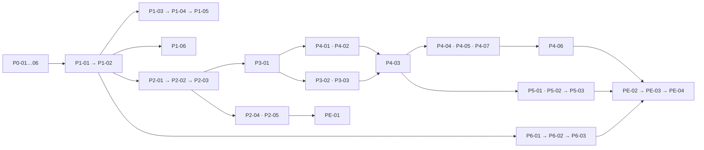

# 10 — Fases y paquetes implementables

> **ESTADO: PARCIAL — punto de avance guardado el 2026-11-12.**
> Contiene la **lista definitiva de 38 paquetes** con identificador, dependencias, requisitos y pruebas, y las reglas de encaje de pruebas y endurecimiento. Falta la ficha de 13 puntos de cada paquete (⏳).
> **Siguiente paso exacto:** §5 — ficha completa de `P0-01`, y continuar en orden de identificador.
> **Ningún paquete ha sido implementado.**

---

## 1. Cómo encajan pruebas, endurecimiento y entrega (definitivo)

- **Las pruebas viajan con cada paquete.** Ningún paquete termina sin sus pruebas automatizadas; no hay una fase final de pruebas.
- **El endurecimiento se adelanta:** validación del entorno y redacción de registros en la fase 0; comprobación de `Origin`, cookies, límites y CSP en la fase 1, antes de construir funciones sobre ellas; autorización por recurso desde la primera función de cada módulo.
- **La entrega se prepara de forma continua:** README y `ESTADO-IMPLEMENTACION.md` se actualizan en cada paquete; el despliegue (PE-02) puede adelantarse tras la fase 1 para detectar pronto problemas de alojamiento.
- **Cada paquete** cabe en una sesión de trabajo con IA y deja el repositorio ejecutable y con las pruebas en verde.

## 2. Orden si el plazo aprieta

Todos los paquetes salvo PE-05 son necesarios para cumplir el plan. Si hay que mostrar pronto el recorrido principal, este orden lo consigue antes y deja para después lo que no lo bloquea:

`P0-01…06` → `P1-01, 02, 03` → `P2-01, 02, 03, 05` → `P3-01, 02` → `P4-01, 02, 03, 04` → `P5-01, 02` → recorrido principal demostrable con el adaptador `fake`.
Después: `P1-04, 05, 06` · `P2-04` · `P3-03` · `P4-05, 06, 07` · `P5-03` · `P6-01, 02, 03` · `PE-01…04`.

## 3. Dependencia especial entre las fases 4 y 5 (definitivo)

El plan exige emitir las entradas **en la misma transacción** que confirma el pago (fase 4), pero la interfaz de entradas es de la fase 5. Se resuelve adelantando solo los prerrequisitos de datos y servicio:

| Paquete | Aporta | Fase |
|---|---|---|
| P4-02 | Tabla `Ticket`, llavero de cifrado, generación de token, `issueTicketsInTx(tx, …)`. **Sin interfaz.** | 4 |
| P4-03 | `settlePayment`, que llama a `issueTicketsInTx` dentro de su transacción. | 4 |
| P5-01 | Pantalla de entradas, imagen QR y código. | 5 |
| P5-02, P5-03 | Consulta, registro de ingreso y lector. | 5 |

Así el criterio de cierre de la fase 4 se comprueba con pruebas de integración que cuentan las entradas emitidas, y la fase 5 no modifica la liquidación.

## 4. Lista de paquetes (definitiva)

Esfuerzo relativo: **S** pequeño · **M** medio · **L** grande. Todos son obligatorios salvo indicación.

### Fase 0 — Base ejecutable

| ID | Título | Depende de | Requisitos | Pruebas | Esf. |
|---|---|---|---|---|---|
| P0-01 | Repositorio, proyecto Next.js y convenciones | — | RO-04, RO-10, RE-06 | — (compilación y análisis) | S |
| P0-02 | Servidor propio HTTP + Socket.IO + puente de runtime | P0-01 | RO-02, RO-09 | T-OPS-01, 02, 03 | M |
| P0-03 | PostgreSQL, Prisma 7, roles de base y Mailpit | P0-01 | RO-03, RO-08, RS-24 | T-SEG-07, T-DB-02 | M |
| P0-04 | Núcleo compartido: entorno, errores, registros, reloj, dinero y fechas | P0-01 | RS-20, RS-23, RO-06, RA-01 | T-SEG-05, 08 | M |
| P0-05 | Arnés de pruebas (Vitest, barrera, Playwright) y CI | P0-02, P0-03, P0-04 | RE-02, RO-03, RS-28 | T-OPS-04 | M |
| P0-06 | Modelo de cuentas, hash de contraseñas y semilla base | P0-03, P0-04, P0-05 | RF-06, RS-01 | T-CTA-20, T-DB-01 | M |

### Fase 1 — Cuentas, sesión y panel

| ID | Título | Depende de | Requisitos | Pruebas | Esf. |
|---|---|---|---|---|---|
| P1-01 | Auditoría base | P0-06 | RF-38, RS-20 | T-SEG-11 | S |
| P1-02 | Sesiones, ingreso, cierre, principal y panel protegido | P1-01 | RF-02, 03, 05, RS-02, 06, 07 | T-CTA-04, 05, 08, 09, 15, 16, 19, T-SEG-01, 12 | L |
| P1-03 | Registro público y componentes de formulario accesibles | P1-02 | RF-01, RS-05, RA-03 | T-CTA-01, 02, 03, T-A11Y-03 | M |
| P1-04 | Límites de intentos y antienumeración | P1-03 | RS-03 | T-CTA-06, 07, T-SEG-13 | M |
| P1-05 | Recuperación y restablecimiento de contraseña | P1-04 | RF-04, RS-04, RO-08 | T-CTA-10 a 14, 17, 18 | M |
| P1-06 | Cabeceras de seguridad, CSP y matriz de permisos automatizada | P1-02 | RS-21, 22, 27 | T-SEG-02, 03, 04, 06, 10 | M |

### Fase 2 — Ofertas, revisión y catálogo

| ID | Título | Depende de | Requisitos | Pruebas | Esf. |
|---|---|---|---|---|---|
| P2-01 | Modelo de ofertas, restricciones y semilla de ofertas | P1-02 | RF-07, RF-10 | T-DB-01, T-OFE-11 | M |
| P2-02 | CRUD del GAD | P2-01 | RF-07, 08, 11, 14, RS-09 | T-OFE-01 a 04, 14, 19, 24 | L |
| P2-03 | Revisión y publicación de versiones | P2-02 | RF-09, RF-10, RS-08 | T-OFE-05 a 13, 18 | L |
| P2-04 | Suspensión, reanudación, archivo y moderación | P2-03 | RF-11, RF-12 | T-OFE-15, 16 | M |
| P2-05 | Portada y catálogo público | P2-03 | RF-08, RF-13, RF-39 | T-OFE-17, 20 | M |

### Fase 3 — Reserva grupal y cupos

| ID | Título | Depende de | Requisitos | Pruebas | Esf. |
|---|---|---|---|---|---|
| P3-01 | Modelo de reservas, inventario y servicio de retención | P2-03 | RF-15 a 20, RS-10, 11, 25, 29 | T-RES-01 a 09, 12, 13, 15, 16 | L |
| P3-02 | Formulario de reserva grupal y vistas del comprador | P3-01, P2-05 | RF-15, 19, 21, RA-08 | T-RES-14, 19 | L |
| P3-03 | Vencimiento, reglas de inventario al publicar y agregados | P3-01, P2-04 | RF-18, 22, 23, RO-07 | T-RES-10, 11, 17, 18, T-OFE-21, 22, 23 | M |

### Fase 4 — Pago de prueba y conciliación

| ID | Título | Depende de | Requisitos | Pruebas | Esf. |
|---|---|---|---|---|---|
| P4-01 | Puerto de pagos, adaptador `fake` y modelo de pagos | P3-01 | RF-24, RF-25 | T-PAG-01, 02 | M |
| P4-02 | Modelo de entradas, llavero y servicio de emisión | P3-01 | RF-30, RS-15 | T-ENT-01, 02, 12, 15 | M |
| P4-03 | Liquidación: confirmación atómica y casos en revisión | P4-01, P4-02, P3-03 | RF-28, 29, 30, RS-14 | T-PAG-05, 06, 09 a 17 | L |
| P4-04 | Inicio de pago, retorno y captura | P4-03, P3-02 | RF-24, 26, RS-13 | T-PAG-03, 04, 18, 23, 25; y, del servicio de inicio y captura (04 TX-07, TX-08), T-PAG-01, 02 (subcasos), 06 (c a e), 12 (a a h) | L |
| P4-05 | Webhook y conciliación automática | P4-03 | RF-27, RS-12, RO-11 | T-PAG-07 (d), 08, 17 (a, c, d, e), 19, 20 (a–j), 22, 26 (a–d), 06 (g) | M |
| P4-06 | Adaptador PayPal Sandbox | P4-04, P4-05 | RF-24, RS-12, RE-11 | T-PAG-21, 24 (manual, pendiente de Q-08) | L |
| P4-07 | Casos en revisión del administrador | P4-03 | RF-29 | T-PAG-19 | M |

### Fase 5 — Entradas e ingreso

| ID | Título | Depende de | Requisitos | Pruebas | Esf. |
|---|---|---|---|---|---|
| P5-01 | Entradas del comprador y descarga de QR | P4-03, P3-02 | RF-31, RS-16, 21 | T-ENT-03, 04 | M |
| P5-02 | Consulta y registro de ingreso | P4-02, P2-04 | RF-32, 33, RS-17, 30, RA-04, 05 | T-ENT-05 a 11, 13, 14 | L |
| P5-03 | Lector con cámara y accesibilidad del ingreso | P5-02 | RF-32, RA-04 | T-ENT-14, T-A11Y-05 | M |

### Fase 6 — Chat y notificación

| ID | Título | Depende de | Requisitos | Pruebas | Esf. |
|---|---|---|---|---|---|
| P6-01 | *Gateway* Socket.IO autenticado y cierre por sesión | P1-02, P0-02 | RS-18 | T-CHAT-01, 02, 11, 12 | M |
| P6-02 | Chat con historial | P6-01 | RF-34, RS-19, RS-27 | T-CHAT-03 a 07, 13, 14, 16 | L |
| P6-03 | Presencia, notificación adicional y reconexión | P6-02 | RF-35, 36, 37, RA-07 | T-CHAT-08, 09, 10, 15, T-A11Y-04 | M |

### Fase PE — Evidencia y entrega (derivada de `PLAN §4`)

| ID | Título | Depende de | Requisitos | Pruebas | Esf. |
|---|---|---|---|---|---|
| PE-01 | Medición de rendimiento del catálogo | P2-05 | RE-03 | T-PERF-01 | M |
| PE-02 | Despliegue con HTTPS y WSS | P0-06 como mínimo; cierre tras P4-06 y P6-03 | RO-05, RO-09 | T-OPS-02, 05 y verificación manual | L |
| PE-03 | Revisión de seguridad, accesibilidad y privacidad | Fases 1 a 6 | RS-26, 28, RA-02, RE-08 | T-SEG-09, T-A11Y-01 a 07 | M |
| PE-04 | Datos de demostración y documentación de entrega | PE-01, PE-02, PE-03 | RE-01 a 12 | T-E2E-01 | M |
| PE-05 | Vista de auditoría del administrador (**opcional**) | P1-01 | RF-38 | — | S |

## 5. Fichas de paquete

⏳ **Por desarrollar.** Cada ficha tendrá los 13 puntos exigidos: (1) identificador y título; (2) objetivo observable y requisitos; (3) dependencias y estado mínimo del repositorio; (4) documentos, decisiones y contratos que leer; (5) archivos o módulos previstos y responsabilidad de cada cambio; (6) tareas ordenadas con migraciones, índices, validaciones y seguridad; (7) contratos que introduce y que conserva; (8) criterios de aceptación y pruebas por identificador; (9) comandos de verificación y evidencia; (10) errores esperados, riesgos y recuperación si queda a medias; (11) datos de prueba, credenciales o servicios externos; (12) esfuerzo, incertidumbre, bloqueos y propuesta de commit; (13) punto de revisión humana y contexto de traspaso.
