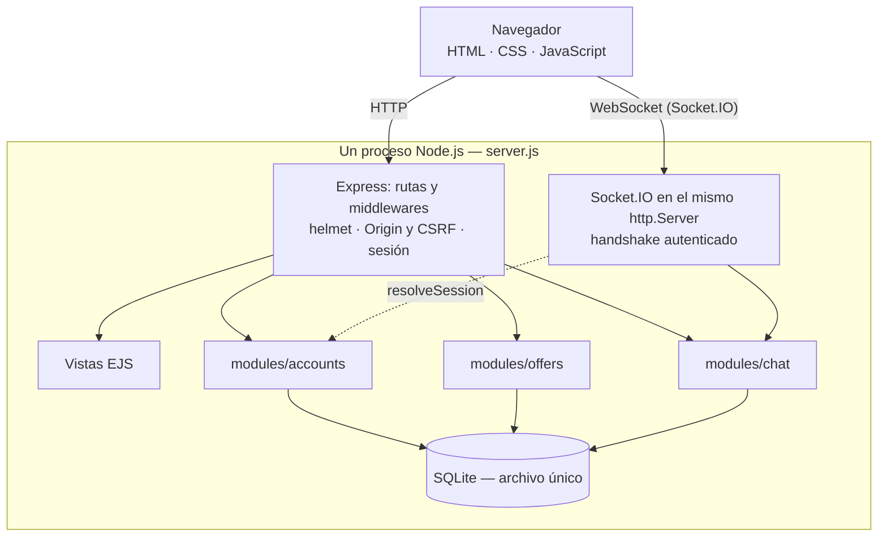
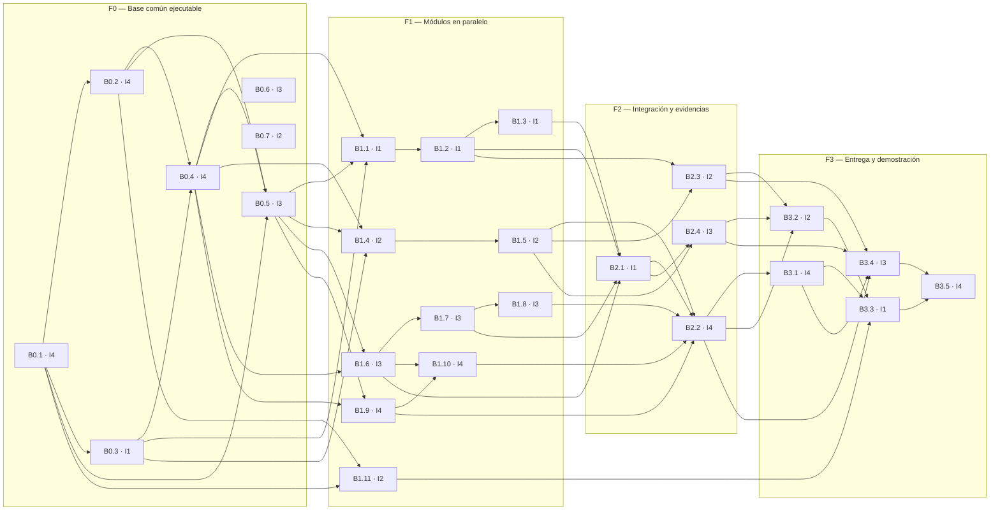

# PLAN-MVP — MVP del primer bimestre (Aplicaciones Web Avanzadas)

> **Estado:** planificación. **No hay código de aplicación, ni dependencias instaladas, ni pruebas ejecutadas.** Todo comando de este documento es **previsto** hasta que alguien lo ejecute; todo resultado marcado «prevista» es una evidencia por obtener.
> **Fecha de redacción:** 2026-11-16. **Archivo hermano:** `PLAN-PROMPTS.md` (un prompt por bloque; comparte los identificadores de fases y bloques de este documento).
> **Fuente que manda:** `mvp-primer-bimestre/Guía del Proyecto AppWebAv.docx` (sección «Primer bimestre» y su rúbrica sobre 20 puntos). El diseño anterior (`docs/planificacion/referencias/PLAN.md` y `docs/planificacion/00`–`12`) aporta contexto y piezas reutilizables, no exigencias.
> **Alcance acordado por el equipo:** sin pagos. Stack: Node.js + Express + EJS + HTML5, CSS3 y JavaScript, con Socket.IO y SQLite.

---

## 0. Cómo leer este plan

### 0.1 Identificadores

| Prefijo | Significado | Dónde se define |
|---|---|---|
| `F0`–`F3` | Fases de implementación y entrega | §3.1 |
| `Bx.y` | Bloque de trabajo (27 en total) | §3.5 y §4 |
| `R1`–`R11` | Ítems de la rúbrica del primer bimestre, en el orden del Word | §1.2 |
| `O1`–`O15` | Obligaciones del Word que no tienen fila propia en la rúbrica | §1.3 |
| `W1`–`W11` | Secciones del Word citadas | §1.1 |
| `DM-nn` | Decisión del equipo o de este plan | §2.6 |
| `PM-nn` | Pendiente externo o ambigüedad abierta | §6.6 |
| `C-…` | Contrato compartido (`C-ENV`, `C-DAT`, `C-SES`, `C-EVT`, `C-VAL`, `C-ERR`, `C-MOD`, `C-HTTP`, `C-OFE`) | §5.1 |
| `HU-nn` | Historia de usuario | B0.7 |
| `TM-ÁREA-nn` | Prueba del MVP (`TM-` para no confundirla con los `T-…` del diseño anterior) | §4 |
| `E-nn` | Punto de la lista de entrega | §6.3 |
| `Integrante 1`–`4` | Nombres reemplazables por los reales (PM-08) | §5 |

### 0.2 Qué se leyó y con qué alcance

| Fuente | Cobertura | Uso en este plan |
|---|---|---|
| Word `Guía del Proyecto AppWebAv.docx` | **Completo**: párrafos y las 5 tablas (requisitos funcionales, stacks del monolito, stacks del segundo bimestre, rúbrica del primer bimestre, rúbrica del segundo). Sin notas ni comentarios; la única imagen son logotipos. | Alcance, rúbrica, evidencias, entregables |
| `docs/planificacion/referencias/PLAN.md` | Completo | Contexto de la PYME y del recorrido anterior |
| `docs/planificacion/00` | §1, §2, §4–§7 y §12 leídos; §3 y §8–§11 no se leyeron en detalle | Estado, convenciones, supuestos, pendientes |
| `01` | Matriz de requisitos (§5.1, §5.5) leída; el resto por encabezados | Origen de requisitos |
| `02` | §1–§5.1 y §8–§13 | Arquitectura, sesión, errores |
| `03` | §3.0, §3.1, §3.2 (`OfferVersion`), §3.4 (`ChatMessage`), §6; el resto por encabezados | Campos, límites, longitudes |
| `04` | Solo TX-13, TX-14 y TX-15; reservas, pagos y entradas no se leyeron (fuera del MVP) | Recuperación, sesión, chat |
| `05` | §1–§5 salvo §3.4–§3.5 (reservas y entradas); §6 y §7 (pagos y QR) no se leyeron | Contratos HTTP y Socket.IO |
| `06` | §3 completo; el resto por encabezados | Controles de seguridad |
| `07` | §1–§4.1 y §4.7 | Principios y pantallas |
| `08` | §1, §3.6, §7 y §7.1; el resto por encabezados | Pruebas de chat, método de rendimiento |
| `09` | §6; el resto por encabezados | Despliegue |
| `10` | §1–§4 (fases 0 y 1 y paquetes P6/PE); las fichas no se leyeron | Orden y paquetes |
| `11` | §1–§4.1 | Prompt maestro e informe |
| `12` | Completo | Demo, commits, IA, contingencia |

La lectura fue **dirigida** a lo reutilizable: no es una relectura línea a línea de los 1,5 MB del diseño anterior. Si al implementar un bloque aparece una discrepancia con esos documentos, manda este plan y su ficha.

---

## 1. Alcance, rúbrica y trazabilidad

### 1.1 Qué se leyó del Word y qué aplica al primer bimestre

| Código | Sección del Word | ¿Aplica al primer bimestre? |
|---|---|---|
| W1 | «Descripción general del proyecto» (grupo de 4 a 5, PYME, entidad principal con al menos 5 atributos, dos etapas) | Sí, es condición general de la entrega |
| W2 | «Primer bimestre» → Objetivo y «Qué significa monolítica» | Sí |
| W3 | «Requisitos funcionales obligatorios» (tabla: registro, inicio de sesión, recuperación de clave, pantalla principal, CRUD, chat, base de datos) | Sí |
| W4 | «Requisitos no funcionales» (validación, seguridad, navegabilidad, rendimiento, calidad) | Sí |
| W5 | «Stacks permitidos para el monolito» (tabla y aclaraciones) | Sí |
| W6 | «Presentación (ambos bimestres)», incluido el «contenido específico del primer bimestre» | Sí |
| W7 | «Repositorio y entrega» (repositorio público, README, etiqueta `v1.0-b1`) | Sí |
| W8 | «Integridad académica y uso de inteligencia artificial» | Sí |
| W9 | «Evaluación» → tabla «Primer bimestre (sobre 20 puntos)» | Sí: guía principal |
| W10 | «Segundo bimestre» (frontend desacoplado y microservicios) | **No es alcance**; solo orienta los límites del diseño y la ruta de evolución (§7) |
| W11 | «Puntos extra» y la fila de extras de la rúbrica del segundo bimestre | No aplica al primero (§1.4) |

### 1.2 Matriz de la rúbrica del primer bimestre (20 puntos)

Origen de cada fila: **Guía** (Word). La columna «Bloques» se genera a partir de los bloques de §4 que declaran cubrir el ítem. Todas las evidencias son **previstas**.

| ID | Ítem (peso · puntos máx.) | Solución mínima | Bloques | Evidencia prevista | Word |
|---|---|---|---|---|---|
| R1 | Planteamiento del problema, objetivos y cronograma (5.0 % · 1.0) | Documento de 1–2 páginas: PYME ficticia, problema justificado, objetivo general y al menos tres específicos medibles, cronograma por fases con responsable y roles de los cuatro. | B0.6, B3.4 | `docs/mvp/problema-objetivos-cronograma.md`; diapositivas iniciales | W9, W6, W1 |
| R2 | Requerimientos funcionales o historias de usuario (7.5 % · 1.5) | Quince historias con criterios de aceptación, prioridad según el peso de la rúbrica y bloque; estado final tomado del código real. | B0.7, B3.2 | `docs/mvp/historias-de-usuario.md` y matriz en `docs/mvp/pruebas.md` | W9, W6 |
| R3 | Diagrama de arquitectura (5.0 % · 1.0) | Un diagrama del monolito (navegador, Express + EJS, módulos, SQLite, Socket.IO en el mismo servidor) comprobado contra las carpetas reales. | B3.1 | `docs/mvp/arquitectura.md` con la imagen exportada | W2, W6, W9 |
| R4 | Registro (SignUp) y recuperación de clave (10.0 % · 2.0) | `/registro` con validación en cliente y servidor; `/recuperar` y `/restablecer` con token aleatorio de un solo uso y 30 minutos; bandeja de pruebas controlada en lugar de SMTP. | B0.3, B1.1, B1.3 | Pruebas `TM-CTA-01` a `TM-CTA-05` y `TM-CTA-13` a `TM-CTA-19`; capturas | W3, W4, W9 |
| R5 | Inicio de sesión (SignIn) y seguridad (10.0 % · 2.0) | Credenciales contra SQLite, Argon2id con sal, sesión del lado del servidor en cookie `HttpOnly`, rutas protegidas, CSRF y cierre de sesión efectivo. | B1.2, B2.1, B2.4 | Pruebas `TM-CTA-06` a `TM-CTA-12`, `TM-INT-01` a `TM-INT-05`, `TM-SEG-01` a `TM-SEG-10` | W3, W4, W9 |
| R6 | Pantalla principal con operaciones CRUD (15.0 % · 3.0) | `/panel` protegido con navegación; CRUD de la oferta propia con detalle por ID, filtro por provincia, paginación de 10 y confirmación antes de eliminar. | B1.4, B1.5, B1.9, B2.2 | Pruebas `TM-OFE-01` a `TM-OFE-15`, `TM-NAV-01` a `TM-NAV-06`; capturas | W3, W4, W9 |
| R7 | Chat que use WebSockets (12.5 % · 2.5) | Socket.IO propio en el mismo proceso, handshake autenticado, sala general, historial en SQLite, usuarios conectados y aviso adicional de nuevo mensaje. | B1.6, B1.7, B1.8, B1.10, B2.1, B2.2, B2.4 | Pruebas `TM-WS-01` a `TM-WS-07`, `TM-CHAT-01` a `TM-CHAT-14`, `TM-NOT-01` a `TM-NOT-05`; `docs/mvp/websocket.md` | W3, W4, W5, W9 |
| R8 | Guarda datos en una base de datos (7.5 % · 1.5) | SQLite con siete tablas, claves foráneas, restricciones, migraciones numeradas, esquema documentado e índices en los campos de búsqueda. | B0.2, B1.4 | `docs/mvp/esquema.md`; `TM-DB-01` a `TM-DB-05`; `TM-OFE-08` | W3, W9 |
| R9 | Calidad: pruebas, README y rendimiento (7.5 % · 1.5) | Más de cien pruebas automatizadas previstas (la guía pide al menos 5 relevantes), README con instrucciones, `.env.example` y una medición del listado filtrado y paginado con 20 filas ficticias (DM-17). | B0.1, B0.5, B2.3, B3.2, B3.3 | Salida de `npm test`; `docs/mvp/evidencias/B2.3/rendimiento.md`; README | W4, W9 |
| R10 | Link de repositorio público con commits de todos (5.0 % · 1.0) | Repositorio público, un PR por bloque con revisor distinto, commits propios de los cuatro, etiqueta `v1.0-b1`, sin secretos ni datos reales. | B3.3, B3.5 | `git shortlog -sne`, etiqueta en el remoto, revisión de secretos | W7, W9 |
| R11 | Presentación en grupo, defensa y evidencias subidas (15.0 % · 3.0) | 15 minutos de presentación más 5 de preguntas, los cuatro exponen, demo en vivo, declaración de IA y evidencias entregadas. | B3.4, B3.5 | Presentación, guion, registro del ensayo, comprobante de subida | W6, W8, W9 |
| | **Total (100.0 % · 20.0)** | | | | |

**Uso de los pesos.** CRUD y presentación pesan 3.0 puntos cada uno, el chat 2.5, y registro/recuperación y sesión 2.0 cada uno: son los bloques con más pruebas y los que mandan en el tiempo de demo (§6.4). Los documentos (R1 a R3) suman 3.5 puntos y se redactan en paralelo a la base (F0) para que no queden para el final.

### 1.3 Obligaciones del Word que no tienen fila propia

Origen: **Guía**, salvo indicación.

| ID | Obligación | Word | Bloques | Evidencia prevista |
|---|---|---|---|---|
| O1 | Monolito: vistas HTML y rutas resueltas en el servidor; lógica, persistencia y presentación en un solo proyecto desplegable; el servidor WebSocket es parte del mismo proyecto. | W2 | B0.1, B0.4, B1.11, B3.1 | Diagrama de B3.1; `TM-BASE-02`; un solo `http.Server` |
| O2 | Entidad principal con al menos 5 atributos validables (tipos, formatos, longitudes) y, preferiblemente, varias entidades relacionadas. | W1 | B1.4 | `offers` con 6 atributos y relación con `users`; `TM-OFE-02` |
| O3 | Validación en cliente (requeridos, números, formato, longitud) **y** en servidor, con mensajes de error claros. | W4 | B0.3, B0.4, B1.1, B1.3, B1.4, B1.5, B2.4 | `TM-VAL-01` a `07`, `TM-CTA-03`, `TM-OFE-02`, `TM-SEG-02` |
| O4 | Seguridad: rutas protegidas, sesión segura, protección básica contra inyección SQL, XSS y CSRF, secretos en variables de entorno; en WebSocket: autenticación en el handshake, validación y saneamiento de mensajes y conexión segura (wss) en el despliegue. | W4 | B0.4, B1.1, B1.2, B1.3, B1.4, B1.6, B1.7, B1.11, B2.1, B2.4 | `docs/mvp/seguridad.md`; `TM-SEG-*`; `TM-DEP-02` |
| O5 | Navegabilidad: menú coherente y navegación entre todas las pantallas. | W4 | B0.4, B1.5, B1.9, B2.2 | `TM-NAV-01` a `06` |
| O6 | Rendimiento: paginación, índices en los campos de búsqueda, actualización del chat sin recargar y al menos una medición simple. | W4 | B0.2, B1.4, B1.5, B1.7, B1.10, B2.3 | `TM-OFE-04`, `TM-OFE-08`, informe de B2.3 |
| O7 | Stack de la lista permitida; el grupo explica cómo funciona la librería sobre WebSocket (handshake, eventos, mecanismos de respaldo). | W5 | B0.1, B1.6, B3.4 | `docs/mvp/websocket.md`; banco de preguntas |
| O8 | Servidor de tiempo real propio, sin servicios externos (Pusher, Firebase, Ably…). | W5 | B0.1, B1.6 | `TM-BASE-02`, `TM-WS-04` |
| O9 | README con descripción de la PYME y del problema, stack, pasos para ejecutar, variables de entorno (`.env.example`), diagramas, integrantes con roles y sección «Uso de IA». | W7 | B3.3 | `README.md` verificado con `TM-ENT-01` |
| O10 | Sin credenciales, tokens, claves privadas, `.env` reales ni datos personales reales; datos de la PYME ficticios. | W7 | B0.1, B2.2, B3.3 | `TM-SEG-09`, `TM-ENT-02` |
| O11 | Uso de IA: declarar herramienta y propósito, revisar, probar y comprender lo generado y poder explicarlo y modificarlo en la defensa. | W8 | B3.3, B3.5 | Sección «Uso de IA», `docs/mvp/ia.md`, revisión cruzada de cada bloque |
| O12 | Presentación: contenido común, contenido específico del primer bimestre (pantallas, demostración de seguridad, diagrama del monolito) y entrega del enlace o ZIP y la presentación. | W6, W7 | B3.4, B3.5 | Presentación, `guion-demo.md`, comprobante de subida |
| O13 | Equipo de 4 a 5 integrantes; PYME real o realista del contexto local; problema planteado. | W1 | B0.6 | Documento de B0.6 |
| O14 | Entrega fuera de plazo: se aplica la normativa de la EPN (informativo; el Word no da fecha). | W7 | B3.5 | Registro del calendario; PM-01 |
| O15 | La entrega del segundo bimestre evoluciona desde esta aplicación y conserva sus funciones: el diseño modular lo prepara (informativo). | W1, W10 | B0.4 | Esqueleto de módulos de B0.4; §7 |

### 1.4 Puntos extra

- **No aplican al primer bimestre.** El Word enumera Kubernetes, OAuth 2.0 / OpenID Connect, despliegue continuo a la nube y mensajería asíncrona dentro de la sección del segundo bimestre, y solo la rúbrica del segundo bimestre tiene la fila «Puntos extra». La rúbrica del primero (W9) no la tiene. Quedan **fuera del alcance** mientras el docente no confirme su aplicación (PM-06).
- **Inconsistencia a aclarar para el segundo bimestre (PM-07).** El texto dice «hasta 4 puntos sobre la nota del examen»; la fila de la rúbrica dice «máximo 1.0 punto en total». No se asume ninguna de las dos cifras ni se registra bonificación alguna.
- **Si el docente confirma un extra para el primero**, se trataría como opción separada, sin tocar la escala de 20 puntos ni asumir su valor:

| Opción | Evidencia que habría que mostrar | Esfuerzo relativo | Dependencia con este plan |
|---|---|---|---|
| Despliegue continuo a una nube | Flujo que despliega en cada integración a `main` y registro de una ejecución real | M | Requiere el alojamiento de B1.11 (PM-03) |
| OAuth 2.0 / OpenID Connect | Inicio de sesión con un proveedor externo además de las credenciales propias | L | Cambia B1.2 y el contrato C-SES |
| Mensajería asíncrona entre servicios | Un mensaje entre dos componentes por un intermediario | L | No aplica a un monolito: tendría poco sentido antes del segundo bimestre |
| Kubernetes | Manifiestos y despliegue local | L | Requiere contenedores, que son del segundo bimestre |

### 1.5 Ambigüedades del Word (resumen)

Se conservan como pendientes y no frenan las partes claras; el detalle y los bloques afectados están en §6.6: fecha de entrega y calendario (PM-01); plataforma donde se suben las evidencias (PM-02); si el aviso de nuevo mensaje satisface el «evento o notificación adicional» (el Word lo da como ejemplo; PM-05); aplicabilidad de los puntos extra (PM-06 y PM-07); y que el Word no fija herramienta ni umbral para la medición de rendimiento (PM-09).

---

## 2. Diseño mínimo

### 2.1 Actores y recorrido de demostración

**Actores.** *Visitante* (sin sesión: portada, catálogo de ofertas publicadas, contacto por WhatsApp, registro, ingreso y recuperación) y *Usuario registrado* (un único tipo de cuenta: administra sus ofertas y conversa). Para la demo se usan dos usuarios ficticios, Ana y Luis.

**Recorrido principal (el que se ensaya y se automatiza en B2.2):**

1. Ana abre la portada y crea su cuenta en `/registro` (validación en cliente y servidor visible).
2. Ana ingresa; llega a `/panel` (pantalla principal) y ve el menú: Inicio, Mis ofertas, Chat, Salir.
3. Crea una oferta, sube una foto y la publica. En el panel, filtra por provincia, pagina, edita y elimina otra oferta con confirmación. La gestión de una oferta ajena devuelve 404. Como visitante, abre la oferta publicada en el catálogo y comprueba que «Consultar reserva por WhatsApp» abre un chat con el mensaje preparado. La reserva se conversa con el negocio fuera de la app.
4. Ana pide recuperar su clave; abre la bandeja de pruebas, usa el enlace, cambia la contraseña; el enlace usado ya no sirve y su sesión anterior queda cerrada.
5. Ana y Luis (en otro navegador) abren `/panel/chat`: ven quién está conectado, intercambian mensajes y recargan para ver el historial.
6. Luis navega por `/panel`; Ana escribe en el chat y a Luis le aparece «1 mensaje nuevo» sin recargar (aviso adicional).
7. Ana cierra sesión: su chat se desconecta y la cookie anterior ya no abre el panel.

### 2.2 Arquitectura y límites de módulos

Un solo proceso Node (`server.js`): Express para rutas y HTML renderizado con EJS; Socket.IO adjunto al mismo `http.Server`; SQLite en un archivo; JavaScript del navegador para validación y actualizaciones en tiempo real.



**Estructura de carpetas prevista** (la aplicación vive en la raíz del repositorio, junto a la documentación anterior):

```text
server.js                    arranque: config → base → migraciones → contenedor → app → servidor
src/config.js · container.js · app.js · server.js
src/shared/                  db, migrate, clock, time, errors, validation/validate.js, http/ (origen, csrf, auth, errores)
src/modules/accounts|offers|chat/   index.js · domain/ · service/ · data/      ← reglas y acceso a SQLite
src/web/                     *.routes.js y views/ (EJS)                          ← adaptador HTTP
src/realtime/                gateway, handlers de chat, presencia, avisos         ← adaptador Socket.IO
public/css · public/js       estilos y JavaScript de navegador
db/migrations/               001 base · 010 cuentas · 020 ofertas · 030 chat
scripts/                     migrate, seed-demo, perf-seed, perf-catalog, check-ws
tests/                       helpers · unit · integration · ws · security · base
docs/mvp/                    entregables, esquema, evidencias
```

| Capa | Hace | No hace |
|---|---|---|
| `src/web` y `src/realtime` (adaptadores) | Leer la petición o el evento, validar el origen y la sesión, llamar **un** servicio, traducir el resultado a HTML, JSON o confirmación. | Consultar SQLite, decidir permisos ni reglas de negocio. |
| `modules/*/service` | Reglas de negocio, autorización por propiedad, orquestación, transacciones. | Conocer Express, EJS o Socket.IO. |
| `modules/*/domain` | Esquemas de validación, constantes y cálculos puros. | Entrada o salida. |
| `modules/*/data` | **Único** lugar que habla con SQLite, con sentencias preparadas. | Decidir permisos. |
| `src/shared` | Utilidades sin dependencias de módulos. | Importar de `modules`. |

**Qué administra cada módulo y qué contrato usa de otro:**

| Módulo | Datos propios | Contrato que ofrece (ver C-MOD) | Contrato que usa de otro |
|---|---|---|---|
| `accounts` | `users`, `sessions`, `password_reset_tokens`, `mail_outbox` | `registerUser`, `authenticate`, `createSession`, `resolveSession`, `revokeSession`, `revokeAllSessions`, `requestPasswordReset`, `resetPassword` | Ninguno |
| `offers` | `offers`, `offer_photos` | CRUD, foto y catálogo según C-MOD y C-OFE, `PROVINCES` | El panel usa `principal.userId`. El catálogo solo expone ofertas publicadas según C-OFE. |
| `chat` | `chat_messages` | `postMessage`, `getHistory`, `lastMessageId` | Solo `principal` (id y nombre); guarda una copia del nombre y no consulta `users` |

Las reglas se comprueban con ESLint (`no-restricted-imports`, B0.4). La separación en procesos, el frontend desacoplado y la migración de datos son del segundo bimestre (§7).

### 2.3 Pantallas y rutas

**Guía visual compartida.** Al empezar `B0.4`, el Integrante 4 pide una propuesta visual breve para una PYME ecuatoriana de turismo comunitario y la comparte en el PR del bloque para revisión. La propuesta prioriza cercanía y confianza, y permite localizar de un vistazo el nombre, el lugar y la fecha de cada oferta. El Integrante 4 registra la dirección en `docs/mvp/diseno-visual.md` y la aplica al CSS y a la plantilla EJS. La guía cubre paleta con contraste, tipografía, espaciado, botones, formularios, tarjetas donde aporten y estados de error y vacío, con reglas breves para móvil y escritorio. Las pantallas de cuentas, ofertas y chat reutilizan esa base. `B1.9` la aplica a la portada, el panel y el menú. `B2.2` revisa el conjunto con las pantallas integradas.

| Ruta | Pantalla | Acceso | Módulo | Bloque |
|---|---|---|---|---|
| `/salud` | Estado (`{"status":"ok"}`) | Público | — | B0.1 |
| `/` | Portada con enlaces | Público | panel | B1.9 |
| `/registro` | Registro | Público | accounts | B1.1 |
| `/ingreso` (`POST /salir`) | Inicio y cierre de sesión | Público / sesión | accounts | B1.2 |
| `/recuperar`, `/restablecer?token=` | Solicitud y nueva contraseña | Público | accounts | B1.3 |
| `/dev/bandeja` | Bandeja de pruebas (solo con `DEMO_MAILBOX_ENABLED` y clave) | Controlado | accounts | B1.3 |
| `/panel` | Pantalla principal | Sesión | panel | B1.9 |
| `/panel/ofertas?provincia=&pagina=`, `/nueva`, `/:id`, `/:id/editar`, `/:id/eliminar` | CRUD de ofertas propias | Sesión y propietario | offers | B1.5 |
| `GET /ofertas?pagina=`, `GET /ofertas/:id`, `GET /ofertas/:id/foto` | Catálogo paginado, detalle con foto y enlace de WhatsApp | Público, solo ofertas publicadas y futuras | offers | B1.5 |
| `GET /panel/ofertas/:id/foto`, `POST /panel/ofertas/:id/foto` | Vista previa y subida o reemplazo de una foto | Sesión y propietario | offers | B1.5 |
| `/panel/chat` | Chat de la sala general | Sesión | chat | B1.7, B1.8 |
| `/api/chat/mensajes?before=&after=&limit=` | Historial en JSON | Sesión (401 JSON si no) | chat | B1.7 |
| `/socket.io/` | Handshake y transporte Socket.IO | Sesión + `Origin` | realtime | B1.6 |

### 2.4 Datos (siete tablas más el control de migraciones)

En desarrollo, SQLite vive en `./data/app.sqlite`, configurable con `DATABASE_FILE`. El despliegue usa el mismo esquema en un archivo sobre disco persistente. La foto se guarda como BLOB en una tabla separada, en el mismo SQLite. Si en una etapa posterior se adopta Supabase, evaluar PostgreSQL para metadatos y Storage para archivos. Ese cambio requiere migrar el esquema, los datos y las pruebas, y mantener Express y Socket.IO propios. Los listados leen solo metadatos y sirven la foto en otra petición. El límite de una imagen pequeña por oferta permite mantener una única base y evitar un servicio de archivos adicional. Las imágenes de demo deben ser propias o de uso autorizado.

Tiempos como `INTEGER` en milisegundos UTC. Las longitudes se miden en caracteres Unicode (`length()` de SQLite y puntos de código en JavaScript). Esquema documentado en `docs/mvp/esquema.md` (B0.2).

| Tabla (módulo) | Columnas principales | Restricciones e índices |
|---|---|---|
| `users` (accounts) | `id` PK, `email`, `display_name` (2–80), `password_hash`, `created_at` | `email` único y en minúsculas; el hash empieza por `$argon2id$` (lo comprueba la prueba, no el `CHECK`) |
| `sessions` (accounts) | `id` (UUID), `user_id` → `users`, `token_hash` (SHA-256 hex), `created_at`, `expires_at`, `revoked_at`, `revoke_reason` (`LOGOUT` o `PASSWORD_RESET`) | `token_hash` único; `expires_at > created_at`; `revoked_at` y `revoke_reason` ambos nulos o ambos presentes; índice por `user_id` |
| `password_reset_tokens` (accounts) | `id`, `user_id` → `users`, `token_hash`, `created_at`, `expires_at`, `used_at` | `user_id` único (un token activo por usuario); `token_hash` único; `expires_at > created_at` |
| `mail_outbox` (accounts) | `id`, `to_email`, `subject`, `body`, `created_at` | Bandeja de pruebas; sin SMTP |
| `offers` (offers) | `id` PK, `owner_id` → `users`, `title` (5–120), `description` (20–2000), `province` (24 códigos), `location_text` (5–200), `starts_at`, `capacity` (1–1000), `is_published` (0 por defecto), `created_at`, `updated_at` | `CHECK` de rangos, provincias y `is_published IN (0,1)`; índices `idx_offers_owner_province_starts (owner_id, province, starts_at, id)`, `idx_offers_owner_starts (owner_id, starts_at, id)` y `idx_offers_public_starts (is_published, starts_at, id)` |
| `offer_photos` (offers) | `offer_id` PK y FK → `offers` con `ON DELETE CASCADE`, `content_type`, `alt_text`, `image_bytes` (BLOB) | Una foto por oferta; MIME JPEG, PNG o WebP; texto alternativo de 1 a 160 caracteres; BLOB entre 1 y 2 097 152 bytes (máximo 2 MiB). |
| `chat_messages` (chat) | `id` PK autoincremental (cursor), `room` (`general`), `author_id` → `users`, `author_name`, `text` (1–500, no solo espacios), `client_message_id`, `created_at` | `UNIQUE (author_id, client_message_id)`; índice `(room, id)` |
| `schema_migrations` (base) | `version`, `checksum`, `applied_at` | Una fila por migración aplicada |

La oferta tiene **seis atributos propios** (título, descripción, provincia, ubicación, fecha y hora de inicio, cupo referencial) y se relaciona con `users`; el cupo es solo descriptivo.

### 2.5 Controles de seguridad y validación

| Requisito (Word W4) | Control | Dónde | Bloque |
|---|---|---|---|
| Contraseña con hash y sal | Argon2id (19 456 KiB, 2 pasadas, 1 hilo; parámetros por entorno) | `accounts/service/hasher.js` | B1.1 |
| Sesión segura | Token de 32 bytes, solo su SHA-256 en SQLite, 8 horas absolutas, validación en base en cada petición y evento, revocación inmediata | `accounts` + `attachPrincipal` | B1.2, B0.4 |
| Cookie | `HttpOnly`, `SameSite=Lax`, `Path=/`; en HTTPS `Secure` y prefijo `__Host-` | `accounts` (ingreso) y `.env` | B1.2, B1.11 |
| Rutas protegidas | `requireAuth`: 302 a `/ingreso` en páginas, 401 JSON en `/api/*`, `no-store` | `shared/http/auth.js` | B0.4 |
| CSRF | `Origin` presente e igual a `APP_ORIGIN` en toda mutación, más token HMAC ligado a la sesión (`_csrf`) | `shared/http/origin.js`, `csrf.js` | B0.4 |
| Inyección SQL | Solo sentencias preparadas; propiedad por `owner_id` en cada consulta | `modules/*/data` | B1.4, B1.7 |
| XSS | Plantillas con `<%= %>`, `textContent` en el navegador, regla ESLint contra `innerHTML`, CSP sin scripts en línea | `src/web/views`, `public/js`, `eslint.config.js` | B0.4, B1.7, B2.4 |
| Validación cliente y servidor | Un único `validate.js` que corre en ambos lados | `shared/validation` | B0.3 |
| Secretos | Variables de entorno; `.env` ignorado; `.env.example` con marcadores | `src/config.js`, `.gitignore` | B0.1, B3.3 |
| WebSocket | `Origin` y cookie válidos en el handshake, revalidación por evento, cierre al revocarse o vencer la sesión, cargas validadas y de máximo 16 kB | `realtime/gateway.js` | B1.6, B1.7 |
| `wss` en el despliegue | Proxy TLS con `Upgrade` y comprobación con `check-ws.js` | `docs/mvp/despliegue.md`, `scripts/check-ws.js` | B1.11 |
| Recuperación | Token de 32 bytes, hash en base, un uso, 30 minutos, respuesta uniforme, enlace construido con `APP_ORIGIN` | `accounts/service/password-reset.js` | B1.3 |

**Riesgos residuales declarados** (se listan en `docs/mvp/seguridad.md`): sin límite de intentos de ingreso ni de solicitudes de recuperación (DM-12); el registro revela si un correo existe; sin cierre por inactividad; sin límite de frecuencia de mensajes (DM-13).

### 2.6 Decisiones del equipo y de este plan

| ID | Decisión | Por qué | Si resulta falsa |
|---|---|---|---|
| DM-01 | **Sin pagos** en el MVP: sin cobro, pasarela, webhook ni conciliación. PayPhone queda registrado solo como proveedor preferido para una etapa posterior; no se investiga ni se configura nada. | Decisión del equipo (alcance); la rúbrica no pide pagos | Fuera del primer bimestre |
| DM-01a | Una foto por oferta y contacto de reservas por WhatsApp. Solo las ofertas publicadas, futuras y con foto aparecen en el catálogo. La app no registra reservas, retiene cupos ni confirma cobros. | Visibilizar los destinos y facilitar el contacto sin implantar un motor de reservas | B0.1, B0.2, B1.4, B1.5 y B2.2 |
| DM-02 | Stack: Node.js LTS (24.x), Express, EJS, HTML5, CSS3 y JavaScript, Socket.IO, SQLite. Es la primera opción de la tabla de stacks permitidos (W5). Node 24.22.3 está instalado en el equipo donde se redactó este plan; el registro de npm el 2026-11-16 listaba `express` 5.3.0, `socket.io` 4.8.4, `ejs` 7.0.2 y `argon2` 0.45.2 (SQLite se usa con `node:sqlite`, integrado en Node; ver DM-03). Son versiones **consultadas, no instaladas ni probadas**: B0.1 las fija en el lockfile. | Menor fricción; reemplaza Next.js, TypeScript, Prisma y PostgreSQL del diseño anterior | — |
| DM-03 | Controlador SQLite: `node:sqlite` (`DatabaseSync`, síncrono, sentencias preparadas), tras la capa de datos. Sustituye a `better-sqlite3`, que en Windows con Node 24.22.3 y npm 11.19.1 intentó compilarse con node-gyp y exigió el toolset de C++ (revisión del PR de B0.1). | Módulo integrado, sin compilación nativa; las inserciones se serializan solas | Ya aplicada en B0.1; evidencia en `docs/mvp/evidencias/B0.1/` |
| DM-04 | Hash: Argon2id con el paquete `argon2`. Alternativa aceptada por el Word: `bcryptjs`. | Parámetros ya decididos en `06` §3.1 | Mismo caso que DM-03 |
| DM-05 | Un solo tipo de cuenta; la oferta pertenece a quien la crea (`owner_id`) y el servidor verifica la propiedad en cada consulta. El listado muestra solo las ofertas propias; lo ajeno responde 404. | El problema del MVP es centralizar las ofertas del propio usuario; evita roles | Roles y organizaciones quedan para la ampliación (§7) |
| DM-06 | Sesiones propias en SQLite con cookie y validación en base por petición (no `express-session`). | Permite revocar por usuario y cerrar sockets al instante | — |
| DM-07 | CSRF: `Origin` exacto en toda mutación más token por sesión. | `Origin` ya era la decisión del diseño anterior; el token refuerza | — |
| DM-08 | Validación compartida: un único `validate.js` para servidor y navegador, con el esquema entregado al formulario por `data-schema`. | Evita duplicar reglas | — |
| DM-09 | Pruebas con `node:test` y `supertest`, `socket.io-client` para WebSocket; sin Playwright. Base de pruebas en `:memory:` aislada. | Menos dependencias; dos sockets cubren la prueba de chat con dos sesiones | Añadir un E2E en navegador si sobra tiempo |
| DM-10 | Tiempos en milisegundos UTC; zona de Ecuador continental UTC−5 sin horario de verano. | Evita conversiones ambiguas | — |
| DM-11 | La aplicación vive en la raíz del repositorio; la documentación anterior se conserva como referencia. | Un solo repositorio público | — |
| DM-12 | Se aplazan los límites de intentos de ingreso y de recuperación. | No los pide la guía; se declara como riesgo residual | Añadir `login_throttle` en una ampliación |
| DM-13 | Se aplaza el límite de frecuencia del chat; no hace falta cola por sala. | SQLite síncrono ya ordena las inserciones | — |
| DM-14 | El chat guarda una copia del nombre del autor (`author_name`). | Evita que `chat` consulte `users` y prepara la separación del segundo bimestre | — |
| DM-15 | La recuperación de clave usa una bandeja de pruebas (`mail_outbox` y `/dev/bandeja`) controlada por entorno y clave. | El Word permite simular el envío; evita SMTP | — |
| DM-16 | La notificación adicional es el aviso de nuevo mensaje en el panel (el Word lo cita como ejemplo). | Reutiliza el diseño anterior (supuesto S-04) | Confirmar con el docente (PM-05) |
| DM-17 | La medición B2.3 usa **20 ofertas ficticias**, una en cada una de 20 provincias; cuatro provincias quedan sin filas. Conserva calentamiento, 1000 muestras, tres repeticiones y comparación con/sin índice. | Decisión del equipo del 2026-11-17: la guía pide una medición, pero no fija volumen (PM-09), y el equipo redujo las 20 000 filas propuestas | El resultado demuestra el procedimiento con el volumen acordado, no escalabilidad; si el docente fija otro volumen se repite |

### 2.7 Qué se conserva, simplifica, cambia o aplaza del diseño anterior

| Tema | Origen | Decisión | Por qué |
|---|---|---|---|
| **Stack y arquitectura** (Next.js, TypeScript, Prisma, PostgreSQL; un proceso con Socket.IO; módulos y dirección de dependencias) | `docs/planificacion/referencias/PLAN.md` §2; `02` §2–§5 | **Cambia** el stack (DM-02); **conserva** el proceso único con Socket.IO adjunto; **simplifica** los módulos a `accounts`, `offers` y `chat` con `domain/service/data` | La guía permite el stack elegido; los módulos preparan el segundo bimestre |
| **Cuentas y sesión** (sesión en base con hash SHA-256, Argon2id, recuperación de 30 minutos, CSRF por `Origin`) | `02` §8; `06` §3.1 y §3.3; `04` TX-13 y TX-14; `03` §3.1 | **Conserva** parámetros, tiempos y reglas; cambia Mailpit/SMTP por la bandeja de pruebas (DM-15) y añade token CSRF (DM-07) | Cumplen la rúbrica y ya estaban decididos |
| **Seguridad que se aplaza** (límites de intentos, auditoría `AuditEvent`) | `06` §3.2; `03` §3.1 y §3.4 | **Aplaza** (DM-12) y declara riesgo residual | No los pide la guía |
| **Roles y organizaciones** (GAD, operador, administrador) | `01` §7–§8; `03` §3.1 | **Aplaza**: un solo tipo de cuenta (DM-05) | El MVP es de un usuario con sus ofertas |
| **Ofertas** (versiones, revisión, estados, precio, condiciones) | `03` §3.2; `04` OFF.1–OFF.5; `05` §3.3 | **Simplifica** a una oferta editable con seis atributos; conserva límites de longitud, provincias y fecha futura | El CRUD de la rúbrica no exige versiones |
| **Reservas, cupos, pagos, entradas QR e ingreso** | `docs/planificacion/referencias/PLAN.md` F3–F5; `03` §3.3; `04` TX-05 y TX-09 a TX-12; `05` §6–§7 | **Aplaza** las reservas internas, entradas e ingreso; en el MVP hay contacto por WhatsApp y **sin pagos** (DM-01 y DM-01a) | Decisión del equipo; el cupo es descriptivo |
| **Chat y tiempo real** (handshake, eventos, cursor, presencia, aviso) | `05` §4–§5; `04` TX-14 y TX-15; `03` §3.4; `00` S-04 | **Conserva** los contratos de eventos y el historial por cursor; **simplifica**: sin cola por sala ni límite de frecuencia (DM-13); presencia y aviso se conservan | Cumplen la fila de chat de la rúbrica |
| **Validación y datos** (longitudes en puntos de código, zona horaria, convenciones) | `03` §3.0, §6, §7 | **Conserva** reducido (DM-08, DM-10) | Reutiliza reglas ya razonadas |
| **Pruebas y medición** | `08` §1, §3.6, §7, §7.1 | **Simplifica** el arnés (DM-09) y el volumen a 20 filas (DM-17); conserva calentamiento, 1000 muestras, tres repeticiones y percentil 95, adaptados a SQLite | Cumple «pruebas» y «medición» con menos dependencias; el informe declara que 20 filas no prueban escalabilidad |
| **Despliegue** | `09` §6; `02` §7 | **Cambia**: SQLite exige disco persistente; sin PostgreSQL ni PayPal | El diseño anterior suponía base administrada |
| **Demo, entrega y prompts** | `12` §2, §5–§7; `11` §2–§3 | **Conserva** la política de commits auténticos, la declaración de IA, la contingencia y el informe por bloque; **reescribe** el guion para el recorrido sin pagos | Las reglas siguen valiendo |

---

## 3. Fases y orden de implementación

### 3.1 Fases y criterio de cierre

La base común (F0) va primero. Un bloque puede empezar **en cuanto sus prerrequisitos estén integrados en `main`**, sin esperar al cierre de toda la fase; el cierre de fase es un hito que se verifica.

| Fase | Objetivo | Bloques | Criterio de cierre verificable |
|---|---|---|---|
| **F0 — Base común ejecutable** | Un proyecto que arranca, migra y prueba desde un clon limpio, con los contratos hechos código y los documentos independientes del código redactados. | B0.1, B0.2, B0.3, B0.4, B0.5, B0.6, B0.7 | Desde un clon limpio, `npm ci`, `npm run db:migrate` y `npm test` terminan en verde; `npm start` sirve `/salud` y `/` y un cliente Socket.IO conecta por `websocket` al mismo puerto; el esquema completo está migrado y documentado; los contratos de §5.1 existen como código (`createApp`, `createContainer`, `requireAuth` inyectable, `validate`, arnés de pruebas) y los tres módulos tienen su esqueleto; los documentos B0.6 y B0.7 están revisados; todos los PR de la fase están integrados en `main` con un revisor distinto del autor. |
| **F1 — Módulos en paralelo** | Cuentas, ofertas, chat y panel se construyen a la vez sobre los contratos de F0. | B1.1, B1.2, B1.3, B1.4, B1.5, B1.6, B1.7, B1.8, B1.9, B1.10, B1.11 | Cada módulo cumple el criterio de aceptación de sus bloques y está integrado en `main`: se puede registrar, ingresar, salir, recuperar la clave y proteger `/panel`; el CRUD privado funciona con filtro, paginación y confirmación, y el catálogo público muestra ofertas publicadas con foto y contacto por WhatsApp cuando se configura; dos sockets autenticados intercambian mensajes persistentes, ven la presencia y reciben el aviso adicional; el despliegue con HTTPS y WSS está verificado o declarado pendiente (PM-03); `npm test` y `npm run lint` pasan con todo integrado. |
| **F2 — Integración y evidencias** | Unir los módulos con servicios reales y producir las evidencias de seguridad y rendimiento. | B2.1, B2.2, B2.3, B2.4 | El recorrido completo (registro, ingreso, CRUD, chat entre dos usuarios con historial, presencia y aviso, salida) pasa en una prueba automatizada y manualmente con dos navegadores; tras cerrar sesión o restablecer la clave, `/panel`, `/panel/chat` y el WebSocket pierden el acceso; las pruebas de seguridad de B2.4 pasan; el informe de rendimiento de B2.3 contiene cifras reales de dos ejecuciones. |
| **F3 — Entrega y demostración** | Cerrar documentación, ensayar y entregar. | B3.1, B3.2, B3.3, B3.4, B3.5 | La lista de §6.3 está completa o cada pendiente figura con su motivo: README y `.env.example` verificados en un clon limpio por otra persona, historias y matriz con resultados reales, diagrama coherente con el código, presentación lista, ensayo de 15 + 5 minutos con los cuatro, repositorio público con commits de los cuatro, etiqueta `v1.0-b1` y evidencias subidas. |

### 3.2 Orden, paralelismo e integraciones

Las olas indican qué puede avanzar a la vez dentro de cada fase (calculadas a partir de las dependencias de §3.5).

| Fase | Ola | Bloques que pueden avanzar a la vez | Condición para empezar |
|---|---|---|---|
| F0 | 1 | B0.1 (I4), B0.6 (I3), B0.7 (I2) | Cuando sus prerrequisitos (de fases anteriores) estén integrados |
| F0 | 2 | B0.2 (I4), B0.3 (I1) | Cuando terminen los bloques de la ola anterior de los que dependen |
| F0 | 3 | B0.4 (I4) | Cuando terminen los bloques de la ola anterior de los que dependen |
| F0 | 4 | B0.5 (I3) | Cuando terminen los bloques de la ola anterior de los que dependen |
| F1 | 1 | B1.1 (I1), B1.4 (I2), B1.6 (I3), B1.9 (I4), B1.11 (I2) | Cuando sus prerrequisitos (de fases anteriores) estén integrados |
| F1 | 2 | B1.2 (I1), B1.5 (I2), B1.7 (I3), B1.10 (I4) | Cuando terminen los bloques de la ola anterior de los que dependen |
| F1 | 3 | B1.3 (I1), B1.8 (I3) | Cuando terminen los bloques de la ola anterior de los que dependen |
| F2 | 1 | B2.1 (I1), B2.3 (I2) | Cuando sus prerrequisitos (de fases anteriores) estén integrados |
| F2 | 2 | B2.2 (I4), B2.4 (I3) | Cuando terminen los bloques de la ola anterior de los que dependen |
| F3 | 1 | B3.1 (I4), B3.2 (I2) | Cuando sus prerrequisitos (de fases anteriores) estén integrados |
| F3 | 2 | B3.3 (I1), B3.4 (I3) | Cuando terminen los bloques de la ola anterior de los que dependen |
| F3 | 3 | B3.5 (I4) | Cuando terminen los bloques de la ola anterior de los que dependen |

Puntos de integración, es decir, donde converge el trabajo de varias personas: **B0.4** (base de datos y validación compartida), **B1.2** (sesión real frente al arnés de B0.5), **B2.1** (cuentas, gateway y chat), **B2.2** (todo el panel), **B2.4** (todos los módulos), **B3.3** y **B3.5** (todo el equipo).

Grafo de dependencias (nodo = bloque y responsable):



### 3.3 Primer bloque de cada integrante

| Integrante | Primer bloque | Cuándo puede empezar | Resultado que habilita |
|---|---|---|---|
| Integrante 1 | B0.3 — Núcleo compartido: validación, errores y reloj | Cuando esté integrado B0.1 | B0.4 (Integrante 4), B1.1 (Integrante 1), B1.4 (Integrante 2) |
| Integrante 2 | B0.7 — Historias de usuario priorizadas (borrador) | Desde el primer día | — |
| Integrante 3 | B0.6 — Problema, objetivos, cronograma y roles | Desde el primer día | — |
| Integrante 4 | B0.1 — Repositorio, herramientas y servidor mínimo | Desde el primer día | B0.2 (Integrante 4), B0.3 (Integrante 1), B0.5 (Integrante 3), B1.11 (Integrante 2) |

### 3.4 Cronograma relativo

Estimación orientativa para cuatro personas en días hábiles contados desde el inicio; **no hay fechas reales** porque el Word no da la fecha de entrega (PM-01).

| Hito | Días (orientativo) | Se alcanza cuando |
|---|---|---|
| H0 — Base ejecutable | 1–3 | Se cumple el cierre de F0 |
| H1 — Módulos integrados | 3–8 | Se cumple el cierre de F1 |
| H2 — Recorrido completo y evidencias | 8–11 | Se cumple el cierre de F2 |
| H3 — Entrega | 11–13 | Se cumple el cierre de F3 y se crea `v1.0-b1` |

### 3.5 Tabla de bloques

| Bloque | Título | Fase | Responsable | Revisor | Esf. | Depende de | Habilita |
|---|---|---|---|---|---|---|---|
| B0.1 | Repositorio, herramientas y servidor mínimo | F0 | Integrante 4 | Integrante 3 | S | — | B0.2, B0.3, B0.5, B1.11 |
| B0.2 | SQLite, migraciones y esquema inicial | F0 | Integrante 4 | Integrante 2 | M | B0.1 | B0.4, B0.5, B1.11 |
| B0.3 | Núcleo compartido: validación, errores y reloj | F0 | Integrante 1 | Integrante 4 | M | B0.1 | B0.4, B1.1, B1.4 |
| B0.4 | Núcleo web: aplicación Express, EJS, origen y CSRF | F0 | Integrante 4 | Integrante 1 | M | B0.2, B0.3 | B0.5, B1.1, B1.4, B1.6, B1.9 |
| B0.5 | Arnés de pruebas HTTP y WebSocket | F0 | Integrante 3 | Integrante 2 | M | B0.1, B0.2, B0.4 | B1.1, B1.4, B1.6, B1.9 |
| B0.6 | Problema, objetivos, cronograma y roles | F0 | Integrante 3 | Integrante 1 | S | — | — |
| B0.7 | Historias de usuario priorizadas (borrador) | F0 | Integrante 2 | Integrante 3 | M | — | — |
| B1.1 | Registro y almacenamiento seguro de contraseñas | F1 | Integrante 1 | Integrante 2 | M | B0.3, B0.4, B0.5 | B1.2 |
| B1.2 | Ingreso, sesión, cierre y rutas protegidas | F1 | Integrante 1 | Integrante 4 | L | B1.1 | B1.3, B2.1, B2.3 |
| B1.3 | Recuperación de clave con token de un solo uso | F1 | Integrante 1 | Integrante 3 | M | B1.2 | B2.1 |
| B1.4 | Ofertas: reglas, validación y acceso a datos | F1 | Integrante 2 | Integrante 1 | M | B0.3, B0.4, B0.5 | B1.5 |
| B1.5 | Ofertas: pantallas CRUD, filtro y paginación | F1 | Integrante 2 | Integrante 4 | L | B1.4 | B2.2, B2.3, B2.4 |
| B1.6 | Gateway Socket.IO autenticado y cierre por sesión | F1 | Integrante 3 | Integrante 1 | M | B0.4, B0.5 | B1.7, B1.10, B2.1 |
| B1.7 | Chat: mensajes persistentes, historial y pantalla | F1 | Integrante 3 | Integrante 2 | L | B1.6 | B1.8, B2.1 |
| B1.8 | Presencia de usuarios conectados | F1 | Integrante 3 | Integrante 4 | S | B1.7 | B2.2 |
| B1.9 | Panel principal y navegación coherente | F1 | Integrante 4 | Integrante 2 | S | B0.4, B0.5 | B1.10, B2.2 |
| B1.10 | Aviso de nuevo mensaje en el panel | F1 | Integrante 4 | Integrante 3 | M | B1.6, B1.9 | B2.2 |
| B1.11 | Despliegue con HTTPS y WSS | F1 | Integrante 2 | Integrante 4 | M | B0.1, B0.2 | B3.3 |
| B2.1 | Integración de sesión HTTP y WebSocket | F2 | Integrante 1 | Integrante 3 | M | B1.2, B1.3, B1.6, B1.7 | B2.2, B2.4 |
| B2.2 | Integración del panel y datos de demostración | F2 | Integrante 4 | Integrante 1 | M | B1.5, B1.8, B1.9, B1.10, B2.1 | B3.1, B3.2, B3.4 |
| B2.3 | Medición de rendimiento del listado filtrado | F2 | Integrante 2 | Integrante 4 | M | B1.2, B1.5 | B3.2, B3.4 |
| B2.4 | Pruebas de seguridad y demostración de seguridad | F2 | Integrante 3 | Integrante 1 | M | B2.1, B1.5 | B3.2, B3.4 |
| B3.1 | Diagrama de arquitectura y coherencia con el código | F3 | Integrante 4 | Integrante 2 | S | B2.2 | B3.3, B3.4 |
| B3.2 | Historias finales y matriz de trazabilidad con pruebas | F3 | Integrante 2 | Integrante 3 | S | B2.2, B2.3, B2.4 | B3.3 |
| B3.3 | README, uso de IA y revisión del repositorio | F3 | Integrante 1 | Integrante 4 | M | B3.1, B3.2, B1.11 | B3.5 |
| B3.4 | Presentación y guion de demo | F3 | Integrante 3 | Integrante 1 | M | B2.2, B2.3, B2.4, B3.1 | B3.5 |
| B3.5 | Ensayo general y cierre de entrega | F3 | Integrante 4 | Integrante 2 | M | B3.3, B3.4 | — |

---

## 4. Ficha de cada bloque

Convenciones: esfuerzo relativo S (pequeño), M (medio), L (grande). Los comandos son **previstos**. Cada bloque deja pruebas escritas por su responsable y una evidencia en `docs/mvp/evidencias/<bloque>/`. Ningún bloque reúne tareas que no se puedan revisar o integrar juntas; los de mayor tamaño (B1.2, B1.5, B1.7) se limitan a una sola capacidad.

### Fase F0 — Base común ejecutable

### B0.1 — Repositorio, herramientas y servidor mínimo

| Fase | Responsable | Revisor | Esfuerzo | Depende de | Habilita |
|---|---|---|---|---|---|
| F0 | Integrante 4 | Integrante 3 | S | — | B0.2 (Integrante 4), B0.3 (Integrante 1), B0.5 (Integrante 3), B1.11 (Integrante 2) |

**Resultado observable.** Un clon limpio instala las dependencias y arranca un único proceso Node con Express (`GET /salud` y una portada mínima) y Socket.IO adjunto al mismo servidor HTTP; un script comprueba el handshake WebSocket contra cualquier URL.

**Requisitos que cubre.** O1, O7, O8, O10, R9 (ver §1).

**Archivos o módulos previstos.**
- `package.json` (`"type": "module"`, `engines.node`, scripts `start`, `dev`, `test`, `lint`), `package-lock.json`, `.nvmrc`, `.gitignore`, `.env.example`, `eslint.config.js`
- `server.js` (arranque), `src/server.js` (`createHttpServer(app)`), `src/config.js` (lectura y validación de variables de entorno)
- `scripts/check-ws.js`, `tests/base/servidor.test.js`
- `README.md` (reescrito para el MVP; enlaza `docs/planificacion/referencias/PLAN.md` y `docs/planificacion/` como diseño anterior de referencia) y carpeta `docs/mvp/`

**Entradas, salidas y reglas compartidas.**
- `createHttpServer(app) → { httpServer, io }`: es la única forma de crear el servidor; ningún bloque abre otro puerto ni otro servidor WebSocket.
- C-ENV: los nombres de variables de §5.1 quedan fijados aquí; los demás bloques solo leen `config`, nunca `process.env`.
- Scripts npm: `start`, `dev`, `test`, `lint` (los demás los añade el bloque que crea el script).

**Pasos de implementación.**
1. Inspeccionar el repositorio y crear la rama `bloque/B0.1-base`. No modificar `docs/planificacion/referencias/PLAN.md`, `docs/planificacion/` ni `mvp-primer-bimestre/`.
2. Inicializar `package.json` con módulos ES, `engines.node` `>=24` y `.nvmrc` con la versión LTS instalada (24.22.3 en el equipo donde se redactó este plan).
3. Instalar ejecución: `express`, `ejs`, `socket.io`, `argon2`, `helmet`, `cookie`; desarrollo: `socket.io-client`, `supertest`, `eslint`. Fijar versiones exactas en el lockfile. SQLite usa `node:sqlite` (DM-03), que viene con Node y no se instala. Comprobar que `argon2` instala en Windows sin compilar a mano; si falla, registrar el error exacto y aplicar la alternativa de §2.6 (`bcryptjs`) como decisión nueva.
4. `src/config.js`: leer y validar **todas** las variables de C-ENV (§5.1) con valores por defecto de desarrollo; fallar nombrando la variable inválida sin imprimir su valor. `WHATSAPP_BOOKING_NUMBER` queda opcional, vacío en `.env.example` y validado como número internacional en dígitos cuando se configure. El arranque usa `node --env-file=.env server.js`.
5. `src/server.js`: `createHttpServer(app)` crea `http.Server` y le adjunta `new Server(httpServer)` de Socket.IO; devuelve `{ httpServer, io }`. `server.js` lo usa con una app Express provisional (`GET /salud` → `{"status":"ok"}`, `GET /` → texto).
6. `scripts/check-ws.js <url>`: conecta con `socket.io-client` forzando `transports: ['websocket']` e imprime el transporte, `connect` o `connect_error` (con su código) y termina con código de salida distinto de 0 si no hubo respuesta.
7. `.env.example` con todas las claves de C-ENV y valores ficticios; `.gitignore` con `node_modules/`, `.env`, `data/`, `*.sqlite*`.
8. README mínimo: qué es, requisitos (Node LTS), `npm ci`, `npm start`, `npm test`; el resto se completa en B3.3.
9. Escribir la prueba `tests/base/servidor.test.js` y ejecutar `npm ci`, `npm test` y `npm start`.

**Pruebas.**
- TM-BASE-01 — arranque en puerto efímero: `GET /salud` responde 200 con `{"status":"ok"}`.
- TM-BASE-02 — un cliente `socket.io-client` conecta al mismo puerto por `websocket` (`socket.io.engine.transport.name === 'websocket'`).

**Comando previsto.** `npm ci && npm test` · `node scripts/check-ws.js http://localhost:3000` (con `npm start` en otra terminal).

**Evidencia.** Salida literal de `npm ci`, `npm test` y `check-ws.js` en `docs/mvp/evidencias/B0.1/` (prevista; se genera al ejecutar).

**Criterio de aceptación.** En un clon limpio `npm ci` y `npm test` terminan sin errores; `npm start` responde 200 en `/salud`; `scripts/check-ws.js` informa transporte `websocket` contra el mismo puerto; `.env` está ignorado por Git y `.env.example` no contiene secretos reales.

**Fuera del bloque.** Base de datos, rutas de negocio, plantillas EJS, seguridad HTTP y cualquier módulo de cuentas, ofertas o chat.

---

### B0.2 — SQLite, migraciones y esquema inicial

| Fase | Responsable | Revisor | Esfuerzo | Depende de | Habilita |
|---|---|---|---|---|---|
| F0 | Integrante 4 | Integrante 2 | M | B0.1 | B0.4 (Integrante 4), B0.5 (Integrante 3), B1.11 (Integrante 2) |

**Resultado observable.** `npm run db:migrate` crea desde cero el esquema completo del MVP (todas las tablas con claves, restricciones e índices) en un archivo SQLite; las pruebas usan bases en memoria aisladas; el esquema queda documentado con diagrama entidad-relación.

**Requisitos que cubre.** R8, O6 (ver §1).

**Archivos o módulos previstos.**
- `src/shared/db.js` (`openDb`, `withTransaction`), `src/shared/migrate.js`, `scripts/migrate.js`
- `db/migrations/001_base.sql`, `010_accounts.sql`, `020_offers.sql`, `030_chat.sql`
- `docs/mvp/esquema.md` (tablas, columnas, restricciones, índices con la consulta que sirven, diagrama ER)
- `tests/unit/db-migraciones.test.js`

**Entradas, salidas y reglas compartidas.**
- C-DAT (§5.1): propietario de cada tabla, nombres de tablas y columnas de §2.4, tiempos en milisegundos UTC, números de migración por módulo.
- `openDb(file)` y `withTransaction(db, fn)` son la única forma de abrir la base y de transaccionar.
- Una migración ya integrada en `main` no se edita: se añade otra (el checksum lo impide).

**Pasos de implementación.**
1. `openDb(file)` con `DatabaseSync` de `node:sqlite` (DM-03; módulo integrado de Node, sin compilación nativa): `PRAGMA journal_mode = WAL` (en archivo), `foreign_keys = ON`, `busy_timeout = 5000`; `':memory:'` para pruebas. `withTransaction(db, fn)` abre `BEGIN IMMEDIATE`, confirma o revierte y devuelve el resultado de `fn`.
2. Migrador: aplica `db/migrations/*.sql` en orden lexicográfico, una transacción por archivo, y registra `version`, `checksum` (SHA-256 del contenido) y `applied_at` en `schema_migrations`; reejecutar no cambia nada; si un archivo ya aplicado cambió, falla con un mensaje claro.
3. Escribir el DDL de §2.4 respetando la numeración reservada: `001` base (`schema_migrations`), `010` cuentas (`users`, `sessions`, `password_reset_tokens`, `mail_outbox`), `020` ofertas (`offers`, `offer_photos`), `030` chat (`chat_messages`). Cambios posteriores usan números nuevos dentro del rango del módulo (011, 012…; 021…; 031…).
4. Restricciones `CHECK` de longitudes y rangos (en SQLite `length()` cuenta caracteres Unicode), `CHECK` de las 24 provincias, claves foráneas con `ON DELETE` explícito y marcas de tiempo `INTEGER` en milisegundos UTC.
5. Índices: `idx_offers_owner_province_starts (owner_id, province, starts_at, id)`, `idx_offers_owner_starts (owner_id, starts_at, id)`, `idx_offers_public_starts (is_published, starts_at, id)`, `idx_chat_room_id (room, id)`, `idx_sessions_user (user_id)` y los únicos de §2.4.
6. `scripts/migrate.js` toma `DATABASE_FILE` de `config`, crea la carpeta `data/` si falta y añade `db:migrate` a `package.json`.
7. Redactar `docs/mvp/esquema.md`: una tabla por entidad con módulo propietario, columnas, restricciones, índices y consulta a la que sirve cada índice, más un diagrama ER (Mermaid).
8. Pruebas sobre `:memory:` y ejecución real de `npm run db:migrate` sobre un archivo nuevo.

**Pruebas.**
- TM-DB-01 — aplicar las migraciones a `:memory:` crea las tablas e índices esperados (consulta a `sqlite_master`).
- TM-DB-02 — reejecutar el migrador no cambia nada; modificar un archivo ya aplicado hace fallar el migrador.
- TM-DB-03 — claves foráneas activas: insertar una oferta con `owner_id` inexistente falla.
- TM-DB-04 — `UNIQUE (author_id, client_message_id)` y `UNIQUE (email)` rechazan duplicados.
- TM-DB-05 — los `CHECK` rechazan capacidad 0, título de 4 caracteres, texto de chat vacío y provincia desconocida.
- TM-DB-05a — una sola foto por oferta, límites de formato, longitud y tamaño en `offer_photos`, y borrado en cascada al eliminar la oferta.

**Comando previsto.** `node --test tests/unit/db-migraciones.test.js` · `npm run db:migrate` sobre un archivo nuevo.

**Evidencia.** Salida de `db:migrate` y de la prueba; `docs/mvp/esquema.md` con el diagrama ER (prevista).

**Criterio de aceptación.** `npm run db:migrate` sobre un archivo nuevo crea las siete tablas del MVP más `schema_migrations`, con sus índices; una segunda ejecución no cambia nada; las pruebas de restricciones pasan; `docs/mvp/esquema.md` indica el módulo propietario de cada tabla y la consulta que justifica cada índice.

**Fuera del bloque.** Datos de demostración, repositorios por módulo (los escribe cada responsable) y cualquier tabla de reservas, pagos, entradas o auditoría.

---

### B0.3 — Núcleo compartido: validación, errores y reloj

| Fase | Responsable | Revisor | Esfuerzo | Depende de | Habilita |
|---|---|---|---|---|---|
| F0 | Integrante 1 | Integrante 4 | M | B0.1 | B0.4 (Integrante 4), B1.1 (Integrante 1), B1.4 (Integrante 2) |

**Resultado observable.** Una función pura `validate(schema, input)` que corre igual en Node y en el navegador, un catálogo de errores `AppError` y un reloj inyectable con ayudantes de la zona horaria de Ecuador.

**Requisitos que cubre.** O3, R4 (ver §1).

**Archivos o módulos previstos.**
- `src/shared/validation/validate.js` (sin importaciones de Node; se servirá al navegador)
- `src/shared/errors.js`, `src/shared/clock.js`, `src/shared/time.js`
- `tests/unit/validate.test.js`, `tests/unit/time.test.js`

**Entradas, salidas y reglas compartidas.**
- C-VAL y C-ERR (§5.1): forma del esquema, del resultado y del error; el mismo archivo lo importa el servidor y lo sirve B0.4 al navegador en `/js/shared/validate.js`.
- Longitudes siempre en puntos de código, nunca en unidades UTF-16.
- Los módulos reciben `clock` por inyección; ningún servicio llama a `Date.now()` directamente.

**Pasos de implementación.**
1. Fijar el formato de esquema C-VAL (§5.1): por campo `type` (`string`, `int`, `email`, `localDateTime`, `enum`), `label`, `required`, `min`, `max`, `pattern`, `values`, `equalsField` y `message` opcional. Resultado: `{ ok, values, errors }` con `errors = { campo: [mensaje] }`.
2. Normalizar antes de validar: recorte, NFC y colapso de espacios donde corresponda; medir longitudes en puntos de código (`[...texto].length`); enteros estrictos (sin decimales ni notación científica); correo en minúsculas, formato razonable y máximo 254.
3. Mensajes en español, claros y por regla (obligatorio, mínimo, máximo, formato, número, coincidencia).
4. `time.js`: convertir `YYYY-MM-DDTHH:mm` en hora de Ecuador (UTC−5, sin horario de verano) a milisegundos UTC y de vuelta; formatear «15 de diciembre de 2026, 09:30 (hora de Ecuador)»; rechazar fechas inexistentes como 2026-02-30.
5. `errors.js`: `AppError(code, status, message, { fieldErrors, details })` y el catálogo C-ERR de §5.1.
6. `clock.js`: `systemClock` y `fixedClock(ms)` con `advance(ms)` para pruebas.
7. Pruebas unitarias con aserciones por regla y por borde.

**Pruebas.**
- TM-VAL-01 — campos obligatorios, recorte y mensajes por campo.
- TM-VAL-02 — longitudes en puntos de código (un emoji cuenta 1) y NFC.
- TM-VAL-03 — enteros: rechaza `1.5`, `1e3` y `abc`; respeta mínimo y máximo.
- TM-VAL-04 — correo válido e inválido, minúsculas y máximo de 254.
- TM-VAL-05 — `equalsField` y `enum`.
- TM-VAL-06 — `localDateTime`: ida y vuelta con Ecuador (UTC−5) y rechazo de `2026-02-30T10:00`.
- TM-VAL-07 — el archivo `validate.js` no contiene `import`, `require` ni `node:` (se lee su fuente).

**Comando previsto.** `node --test tests/unit/validate.test.js tests/unit/time.test.js`

**Evidencia.** Salida de las pruebas en `docs/mvp/evidencias/B0.3/` (prevista).

**Criterio de aceptación.** Las siete pruebas pasan; `validate.js` se importa sin errores desde Node y carece de dependencias de Node (TM-VAL-07); cada regla incumplida devuelve un mensaje en español asociado a su campo.

**Fuera del bloque.** Esquemas de formularios concretos de cuentas, ofertas o chat (los define cada módulo) y el código de navegador que lee `data-schema` (B0.4).

---

### B0.4 — Núcleo web: aplicación Express, EJS, origen y CSRF

| Fase | Responsable | Revisor | Esfuerzo | Depende de | Habilita |
|---|---|---|---|---|---|
| F0 | Integrante 4 | Integrante 1 | M | B0.2, B0.3 | B0.5 (Integrante 3), B1.1 (Integrante 1), B1.4 (Integrante 2), B1.6 (Integrante 3), B1.9 (Integrante 4) |

**Resultado observable.** `createApp(container)` monta Express con cabeceras de seguridad, estáticos, EJS con plantilla y parciales, protección de origen y CSRF, resolución de sesión inyectable (`attachPrincipal`, `requireAuth`) y manejador de errores; los tres módulos quedan con su esqueleto para que cada responsable edite solo sus archivos.

**Requisitos que cubre.** O1, O3, O4, O5, O15 (ver §1).

**Archivos o módulos previstos.**
- `src/container.js` (único punto de composición), `src/app.js`
- `src/shared/http/{origin,csrf,auth,error-handler,safe-next}.js`
- `src/web/views/{layout.ejs,partials/header.ejs,partials/form-field.ejs,errors/404.ejs,errors/500.ejs}`
- `src/web/{accounts,offers,chat,panel}.routes.js` (routers vacíos montados)
- `src/modules/{accounts,offers,chat}/index.js` (fábricas que lanzan `NOT_IMPLEMENTED`, con las firmas de §5.1), `src/realtime/gateway.js` (esqueleto)
- `public/css/app.css`, `public/js/form-validate.js` (lee `data-schema`, valida al enviar y al salir del campo, escribe los errores en `[data-error-for]`)
- `docs/mvp/diseno-visual.md` (guía breve propuesta al iniciar el bloque, §2.3)
- `tests/integration/web-base.test.js`, regla `no-restricted-imports` en `eslint.config.js`

**Entradas, salidas y reglas compartidas.**
- C-SES y C-HTTP (§5.1): `req.principal`, `requireAuth`, `safeNext`, `res.locals.csrfToken`, cookie `tc_session`.
- `createContainer(config, overrides)` y `createApp(container)`: un bloque nuevo se registra editando solo su router, su servicio y sus vistas.
- Archivos compartidos y su responsable: ver §6.1.

**Pasos de implementación.**
1. `createContainer(config, overrides)`: crea `db`, `clock`, `sessionEvents` (un `EventEmitter`) y los servicios; `overrides` permite inyectar servicios falsos en pruebas.
2. `createApp(container)`: `helmet` con CSP sin inline (`default-src 'self'`, `script-src 'self'`, `style-src 'self'`, `connect-src 'self'` más `ws:`/`wss:` del origen), `express.urlencoded` y `express.json` con límite de 16 kB, lectura de cookies, estáticos `/css` y `/js`, y `/js/shared` apuntando a `src/shared/validation`. `app.set('trust proxy', config.trustProxy)`.
3. `originGuard`: toda petición distinta de `GET`, `HEAD` u `OPTIONS` exige `Origin` presente e igual a `APP_ORIGIN`; si no, 403 `ORIGIN_MISMATCH`. `csrf`: token HMAC-SHA256 del id de sesión con `CSRF_SECRET`, exigido en el campo `_csrf` o en la cabecera `x-csrf-token` cuando hay sesión; expuesto como `res.locals.csrfToken`.
4. `attachPrincipal(resolveSession)` lee la cookie `tc_session` (o `__Host-tc_session`) y fija `req.principal` (o `null`); `requireAuth`: páginas → 302 a `/ingreso?next=<ruta segura>`; `/api/*` → 401 JSON `UNAUTHENTICATED`; respuestas de `/panel` y `/api` con `Cache-Control: no-store`.
5. `safeNext(raw)`: acepta solo rutas internas que empiezan por `/panel`, sin `//`, `\` ni caracteres de control, y confirma con `new URL(raw, APP_ORIGIN)` que el origen no cambia; si no, devuelve `/panel`.
6. Plantilla: `layout.ejs` con `<title>` por página, enlace «Saltar al contenido», `<main>`, parcial de cabecera y parcial de campo con su mensaje de error; todo dato se imprime con `<%= %>`.
   - Define en `app.css` las variables de color, tipografía y espaciado de la guía, y los estilos compartidos para botones, formularios, tarjetas y mensajes. Comprueba en una vista de ejemplo que el foco sea visible y que el contenido se adapte a una pantalla estrecha.
7. Manejador de errores: `AppError` → página o JSON según la ruta; cualquier otro error → `INTERNAL_ERROR` sin trazas hacia el cliente.
8. Esqueleto: `index.js` de cada módulo exporta `create<Modulo>Service(deps)` que lanza `NOT_IMPLEMENTED`; routers vacíos montados en `createApp`; reglas ESLint: `src/modules/**` no importa `express`, `socket.io`, `ejs`, `src/web` ni `src/realtime`; un módulo importa a otro solo por su `index.js`.
9. Pruebas con servicios falsos inyectados.

**Pruebas.**
- TM-WEB-01 — `POST` sin `Origin` → 403 `ORIGIN_MISMATCH`.
- TM-WEB-02 — `POST` con `Origin` de otro sitio → 403.
- TM-WEB-03 — con sesión simulada, `POST` sin token CSRF → 403; con token → pasa el guardián.
- TM-WEB-04 — `/panel` sin sesión → 302 a `/ingreso?next=%2Fpanel`; `/api/x` sin sesión → 401 JSON.
- TM-WEB-05 — `safeNext` rechaza `//evil.test`, `/\evil`, `https://x` y acepta `/panel/ofertas?pagina=2`.
- TM-WEB-06 — cabeceras: CSP, `X-Content-Type-Options` y `no-store` en `/panel`.
- TM-WEB-07 — una ruta inexistente muestra la página 404 sin trazas.
- TM-WEB-08 — `npm run lint` rechaza un import prohibido (fixture) y `/js/shared/validate.js` se sirve idéntico al archivo de `src/shared/validation`.

**Comando previsto.** `node --test tests/integration/web-base.test.js` · `npm run lint`

**Evidencia.** Salida de pruebas y de `lint` en `docs/mvp/evidencias/B0.4/` (prevista).

**Comprobaciones de integración.**
- Converge B0.2 (la base inyectada en `createContainer`) y B0.3 (`validate.js` servido al navegador, `AppError` en el manejador): comprobar que `createContainer` abre la base migrada de B0.2 y que `public/js/form-validate.js` importa `/js/shared/validate.js`.
- Confirmar con el revisor (Integrante 1) que `AppError` y los códigos de C-ERR son los de B0.3, sin duplicarlos.

**Criterio de aceptación.** Las ocho pruebas pasan; `npm start` muestra la portada con la plantilla; un `POST` sin `Origin` o sin token es rechazado; el navegador descarga el mismo `validate.js` que usa el servidor; cada módulo tiene su carpeta con `index.js` y su router sin que dos responsables compartan archivo.

**Fuera del bloque.** Lógica de cuentas, ofertas o chat; el contenido del panel (B1.9); el gateway real (B1.6).

---

### B0.5 — Arnés de pruebas HTTP y WebSocket

| Fase | Responsable | Revisor | Esfuerzo | Depende de | Habilita |
|---|---|---|---|---|---|
| F0 | Integrante 3 | Integrante 2 | M | B0.1, B0.2, B0.4 | B1.1 (Integrante 1), B1.4 (Integrante 2), B1.6 (Integrante 3), B1.9 (Integrante 4) |

**Resultado observable.** Ayudantes reutilizables para crear un contexto de prueba con base en memoria, usuarios y sesiones válidas según C-SES sin usar el módulo de cuentas, un servidor en puerto efímero y clientes Socket.IO con cookie y `Origin` elegibles.

**Requisitos que cubre.** R9 (ver §1).

**Archivos o módulos previstos.**
- `tests/helpers/{context.js,factories.js,auth.js,ws.js}`
- `tests/base/arnes.test.js`
- `docs/mvp/pruebas.md` (convenciones: prefijo `TM-`, ubicación de pruebas, cómo ejecutarlas, ejemplo de uso)

**Entradas, salidas y reglas compartidas.**
- C-SES (§5.1): el helper de sesión guarda `sha256(token)` en hexadecimal minúscula y la cookie se llama `tc_session`; B1.2 comprobará que el servicio real acepta estas sesiones.
- Ningún helper usa `setTimeout` fijo para esperar eventos; todos esperan una condición.
- Los helpers insertan por SQL y no importan servicios de módulos (para que los bloques avancen en paralelo).

**Pasos de implementación.**
1. `createTestContext({ overrides, clock })`: abre `:memory:`, aplica las migraciones, crea el contenedor con `createContainer(config, overrides)` de B0.4 y devuelve `{ db, container, app, clock, close }` (`app` = `createApp(container)`). Mientras B0.4 no esté integrado se puede avanzar en la rama con `ws.js`, `factories.js` y `auth.js`, que solo dependen del esquema de B0.2, pero el bloque no se cierra hasta usar el contenedor real.
2. `factories`: `createUser(ctx, { email, displayName })` inserta la fila con un `password_hash` de relleno; `createOffer(ctx, ownerId, datos)` y `createMessages(ctx, n, { authors })` insertan por SQL conforme a §2.4.
3. `auth.createSessionFor(ctx, userId, { ttlMs })` genera un token de 32 bytes, guarda su SHA-256 en `sessions` y devuelve `{ token, sessionId, cookie }`; `revokeInDb(ctx, sessionId)` y `fakeAccounts(map)` (un `resolveSession` falso para inyectar en el contenedor).
4. `startTestServer(appOrContext)` usa `createHttpServer` en el puerto 0 y devuelve `{ url, port, close }`.
5. `ws.connect({ url, cookie, origin, transports })` devuelve un cliente con `received[]`, `waitFor(evento, n)` y `expectNoEvent(cliente, evento, testigo)`: afirma que algo no llegó esperando un mensaje testigo posterior, nunca con esperas fijas.
6. Documentar en `docs/mvp/pruebas.md` un ejemplo de menos de 15 líneas (usuario + sesión + cliente conectado).
7. Probar el propio arnés con el contexto real y, para el cliente WebSocket, con un servidor Socket.IO mínimo creado dentro de la prueba.

**Pruebas.**
- TM-ARN-01 — `createSessionFor` guarda un hash de 64 hexadecimales y no el token.
- TM-ARN-02 — `waitFor` espera `n` eventos y falla con mensaje claro si no llegan.
- TM-ARN-03 — `expectNoEvent` detecta correctamente un evento ausente y uno presente (con testigo).

**Comando previsto.** `node --test tests/base/arnes.test.js`

**Evidencia.** Salida de la prueba y ejemplo documentado en `docs/mvp/pruebas.md` (prevista).

**Criterio de aceptación.** Las tres pruebas del arnés pasan; el ejemplo de `docs/mvp/pruebas.md` crea usuario, sesión y cliente conectado en menos de 15 líneas; ningún helper usa esperas fijas.

**Fuera del bloque.** Pruebas de negocio de cualquier módulo.

---

### B0.6 — Problema, objetivos, cronograma y roles

| Fase | Responsable | Revisor | Esfuerzo | Depende de | Habilita |
|---|---|---|---|---|---|
| F0 | Integrante 3 | Integrante 1 | S | — | — (último eslabón de su cadena) |

**Resultado observable.** `docs/mvp/problema-objetivos-cronograma.md` con la PYME ficticia y su problema justificado, el objetivo general y los específicos medibles, el cronograma por fases y el reparto de roles de los cuatro integrantes.

**Requisitos que cubre.** R1, O13 (ver §1).

**Archivos o módulos previstos.**
- `docs/mvp/problema-objetivos-cronograma.md`

**Entradas, salidas y reglas compartidas.**
- El documento no inventa fechas ni resultados; lo no conocido figura como pendiente (PM-01, PM-08).

**Pasos de implementación.**
1. Releer la fila 1 de la rúbrica del Word («Planteamiento del problema, objetivos y cronograma») y la lista de contenido común de la presentación.
2. Describir la PYME ficticia de turismo comunitario y el problema: ofertas y comunicación del equipo dispersas; justificar por qué centralizarlas importa.
3. Redactar un objetivo general y al menos tres específicos medibles (por ejemplo: «implementar el CRUD de ofertas con filtro por provincia y paginación de 10, verificado con pruebas automatizadas»; «lograr que dos usuarios intercambien mensajes persistentes por WebSocket autenticado»).
4. Copiar el cronograma por fases y bloques de PLAN-MVP §3 con sus responsables; las fechas reales quedan «por fijar» hasta resolver PM-01.
5. Sustituir «Integrante 1» a «Integrante 4» por los nombres reales y describir el rol de cada uno (§5).
6. Pedir la revisión de coherencia con PLAN-MVP al revisor.

**Pruebas.**
- TM-DOC-01 — lista de comprobación: problema, justificación, objetivo general, al menos tres específicos medibles, cronograma con responsables y los cuatro roles (revisión del revisor; sin prueba automatizada).

**Comando previsto.** — (revisión de pares) · `git diff --stat`

**Evidencia.** El documento aprobado por el revisor (prevista).

**Criterio de aceptación.** El documento contiene problema justificado, objetivo general, al menos tres objetivos específicos medibles, cronograma por fases con responsable y los cuatro roles, y marca como pendientes las fechas que aún no se conocen.

**Fuera del bloque.** Historias de usuario (B0.7) y diagramas (B3.1).

---

### B0.7 — Historias de usuario priorizadas (borrador)

| Fase | Responsable | Revisor | Esfuerzo | Depende de | Habilita |
|---|---|---|---|---|---|
| F0 | Integrante 2 | Integrante 3 | M | — | — (último eslabón de su cadena) |

**Resultado observable.** `docs/mvp/historias-de-usuario.md` con historias HU-01 a HU-15, cada una con criterios de aceptación verificables, prioridad, bloque previsto y prueba prevista, y una sección de lo aplazado.

**Requisitos que cubre.** R2 (ver §1).

**Archivos o módulos previstos.**
- `docs/mvp/historias-de-usuario.md`

**Entradas, salidas y reglas compartidas.**
- Cada HU usa los nombres de rutas, pantallas y eventos de PLAN-MVP §2.3 y §5.1; si una HU necesita un cambio de alcance, se anota como pendiente y no se asume.

**Pasos de implementación.**
1. Releer la fila 2 de la rúbrica («completos, priorizados y consistentes con lo implementado»).
2. Redactar HU-01 Registro, HU-02 Ingreso, HU-03 Recuperar clave, HU-04 Salir, HU-05 Panel principal, HU-06 Crear oferta, HU-07 Listar con filtro por provincia y paginación, HU-08 Ver detalle por ID, HU-09 Editar, HU-10 Eliminar con confirmación, HU-11 Enviar y recibir mensajes, HU-12 Ver historial, HU-13 Ver usuarios conectados, HU-14 Aviso de nuevo mensaje en el panel y HU-15 Conexión WebSocket autenticada.
3. Para cada una: «Como… quiero… para…», criterios de aceptación observables, prioridad, bloque previsto (§4) y prueba prevista (`TM-…`). Todas son obligatorias según el Word; la prioridad (Alta o Media) ordena el trabajo y el tiempo de demo por el peso de su ítem de la rúbrica: Alta para CRUD (3,0 puntos) y chat (2,5), Media para el resto; justificarla en una línea.
4. Distinguir el catálogo con foto y el contacto por WhatsApp de lo aplazado: registro interno de reservas, pagos, entradas QR, control de ingreso, revisión de ofertas y roles.
5. Dejar una columna «Estado» para completarla en B3.2.

**Pruebas.**
- TM-DOC-02 — lista de comprobación: todas las funciones de §2.3 aparecen en una HU y cada HU tiene criterios verificables, prioridad y bloque (revisión del revisor).

**Comando previsto.** — (revisión de pares) · `git diff --stat`

**Evidencia.** Documento aprobado por el revisor (prevista).

**Criterio de aceptación.** Las quince historias tienen criterios de aceptación observables, prioridad y bloque asignado; todas las pantallas y eventos de §2.3 y §5.1 están cubiertos por alguna historia; lo aplazado figura con su motivo.

**Fuera del bloque.** Estado final de las historias (B3.2) y matriz de trazabilidad con resultados.

### Fase F1 — Módulos en paralelo

### B1.1 — Registro y almacenamiento seguro de contraseñas

| Fase | Responsable | Revisor | Esfuerzo | Depende de | Habilita |
|---|---|---|---|---|---|
| F1 | Integrante 1 | Integrante 2 | M | B0.3, B0.4, B0.5 | B1.2 (Integrante 1) |

**Resultado observable.** Un visitante crea una cuenta en `/registro` con validación en el navegador y en el servidor; la contraseña se guarda con Argon2id y sal; el correo es único.

**Requisitos que cubre.** R4, O3, O4 (ver §1).

**Archivos o módulos previstos.**
- `src/modules/accounts/index.js`, `domain/schemas.js`, `domain/password-policy.js`, `service/register.js`, `service/hasher.js`, `data/users.repo.js`
- `src/web/accounts.routes.js` (ruta de registro), `src/web/views/accounts/registro.ejs`
- `tests/unit/cuentas-politica.test.js`, `tests/integration/cuentas-registro.test.js`

**Entradas, salidas y reglas compartidas.**
- `accounts.registerUser({ displayName, email, password, passwordConfirm }) → { userId }`; errores `VALIDATION_ERROR` (con `fieldErrors`) y `EMAIL_TAKEN`.
- `users.password_hash` contiene una cadena `$argon2id$…`; `accounts.hasher` es el único lugar donde se hashea y verifica.
- La política de contraseña (10–128, distinta del correo, no común) es la misma que usará B1.3.

**Pasos de implementación.**
1. `schemas.js` (C-VAL): `displayName` 2–80, `email` válido (≤254, minúsculas), `password` 10–128, `passwordConfirm` igual a `password`.
2. `password-policy.js`: la contraseña no puede ser igual al correo ni estar en una lista corta de contraseñas comunes (unas 20 entradas); se permite pegar.
3. `hasher.js`: Argon2id con `ARGON2_MEMORY_KIB`, `ARGON2_TIME_COST` y `ARGON2_PARALLELISM` de `config` (por defecto 19 456 KiB, 2 pasadas, 1 hilo); funciones `hash(plain)` y `verify(hash, plain)`; la sal la genera la librería; nunca se registra la contraseña.
4. `users.repo.js`: sentencias preparadas `insertUser` y `findByEmail`.
5. `registerUser(input)`: validar en servidor, normalizar (recorte, NFC, correo en minúsculas), comprobar la política, calcular el hash y guardar; ante `SQLITE_CONSTRAINT_UNIQUE` devolver `EMAIL_TAKEN` (409, campo `email`).
6. Ruta `GET/POST /registro`: renderiza el formulario con `data-schema`; si hay errores, 422 y se repinta sin la contraseña; si todo va bien, 302 a `/ingreso?aviso=cuenta-creada` (no inicia sesión).
7. Vista con `<label>` por campo, `autocomplete` (`name`, `email`, `new-password`), resumen de errores y mensajes junto a cada campo.
8. Pruebas y ejecución real.

**Pruebas.**
- TM-CTA-01 — registro válido crea una fila en `users` con hash `$argon2id$` distinto de la contraseña.
- TM-CTA-02 — dos usuarios con la misma contraseña tienen hashes distintos (sal).
- TM-CTA-03 — cada regla incumplida (nombre corto, correo inválido, contraseña corta, igual al correo, común, confirmación distinta) devuelve error en su campo y no inserta.
- TM-CTA-04 — correo duplicado, también con otra capitalización → 409 `EMAIL_TAKEN`.
- TM-CTA-05 — `POST /registro` sin `Origin` válido → 403 y sin fila.

**Comando previsto.** `node --test tests/unit/cuentas-politica.test.js tests/integration/cuentas-registro.test.js`

**Evidencia.** Salida de las pruebas y captura de `/registro` con errores (prevista).

**Comprobaciones de integración.**
- Con B0.4: el formulario usa `form-validate.js` y `csrfToken`; con B0.3: el mismo `validate` valida en servidor y navegador (probar un campo inválido con JavaScript desactivado).

**Criterio de aceptación.** Con datos válidos `POST /registro` crea una fila con hash Argon2id y redirige a `/ingreso`; cada regla incumplida devuelve 422 con su mensaje junto al campo y no crea fila; un correo repetido da 409; ni las respuestas ni los registros contienen la contraseña.

**Fuera del bloque.** Inicio y cierre de sesión (B1.2), recuperación (B1.3), límites de intentos y verificación de correo.

---

### B1.2 — Ingreso, sesión, cierre y rutas protegidas

| Fase | Responsable | Revisor | Esfuerzo | Depende de | Habilita |
|---|---|---|---|---|---|
| F1 | Integrante 1 | Integrante 4 | L | B1.1 | B1.3 (Integrante 1), B2.1 (Integrante 1), B2.3 (Integrante 2) |

**Resultado observable.** Un usuario registrado ingresa en `/ingreso`, recibe una sesión del lado del servidor en una cookie segura, accede a `/panel` y cierra sesión; `resolveSession` real sustituye al falso y las rutas protegidas redirigen sin sesión.

**Requisitos que cubre.** R5, O4 (ver §1).

**Archivos o módulos previstos.**
- `src/modules/accounts/service/sessions.js`, `service/login.js`, `data/sessions.repo.js`
- `src/web/accounts.routes.js` (ingreso y salida), `src/web/views/accounts/ingreso.ejs`
- `src/container.js` (cablear `accounts` real; cambio mínimo acordado con el Integrante 4)
- `tests/integration/cuentas-sesion.test.js`

**Entradas, salidas y reglas compartidas.**
- C-SES completo (§5.1): cookie, TTL, `resolveSession(token, now) → Principal | null`, `revokeSession`, `revokeAllSessions`, evento `session-revoked`.
- Mensaje de error de ingreso idéntico para correo inexistente y contraseña incorrecta.
- Una sesión vencida o revocada nunca da acceso: se valida en base en cada petición, sin caché.

**Pasos de implementación.**
1. `createSession(userId)`: token aleatorio de 32 bytes en base64url, guarda `sha256(token)` en hexadecimal, `expires_at = ahora + SESSION_TTL_HOURS` (8 h por defecto), `id` UUID.
2. `resolveSession(token, now)`: una consulta con `JOIN` a `users` que exige `revoked_at IS NULL AND expires_at > now`; devuelve el `Principal` de C-SES o `null`.
3. `authenticate(email, password)`: buscar por correo normalizado; si no existe, verificar contra un hash ficticio para igualar el tiempo; mensaje único `INVALID_CREDENTIALS` (401) en ambos casos.
4. `POST /ingreso`: validar campos obligatorios en servidor, autenticar, crear una sesión nueva (ignora cualquier cookie presentada: sin fijación), fijar la cookie `tc_session` (`__Host-tc_session` y `Secure` si `COOKIE_SECURE`) con `HttpOnly`, `SameSite=Lax`, `Path=/` y `Max-Age` igual al TTL; redirigir a `safeNext(next)` o `/panel`.
5. `POST /salir` (con CSRF): `revokeSession(sessionId, 'LOGOUT')` (`revoked_at`, `revoke_reason`), borrar la cookie, y tras confirmar emitir `sessionEvents.emit('session-revoked', { sessionId })`; es idempotente.
6. Dos niveles para revocar todas las sesiones de un usuario: `sessions.revokeAllInTx(db, userId, reason, now)` (solo actualiza filas, para usarla dentro de otra transacción) y `accounts.revokeAllSessions(userId, reason)` (la envuelve en su propia transacción y emite `session-revoked { userId }` **después** de confirmar). B1.3 usa la primera dentro de su transacción.
7. Cablear el servicio real en `createContainer` y proteger `/panel` con `requireAuth`.
8. Pruebas, incluida la comprobación cruzada con el helper de sesión de B0.5.

**Pruebas.**
- TM-CTA-06 — ingreso correcto: la cookie es `HttpOnly` y `SameSite=Lax`; en la base solo está el hash del token.
- TM-CTA-07 — contraseña incorrecta y correo inexistente devuelven el mismo estado y el mismo mensaje.
- TM-CTA-08 — `/panel` sin cookie → 302 a `/ingreso`; con cookie válida → 200.
- TM-CTA-09 — tras `POST /salir`, la cookie anterior ya no abre `/panel` y `resolveSession` devuelve `null`; salir dos veces da el mismo resultado.
- TM-CTA-10 — una sesión vencida (reloj +8 h) no da acceso.
- TM-CTA-11 — cada ingreso genera un token distinto y no reutiliza la cookie presentada (sin fijación).
- TM-CTA-12 — `next=https://evil.test` o `//evil.test` se ignora y se redirige a `/panel`.

**Comando previsto.** `node --test tests/integration/cuentas-sesion.test.js`

**Evidencia.** Salida de las pruebas y captura de las cabeceras `Set-Cookie` en el navegador (prevista).

**Comprobaciones de integración.**
- Con B0.4: `attachPrincipal` usa `container.accounts.resolveSession` real y `requireAuth` redirige con `safeNext`.
- Con B0.5: una sesión creada con `createSessionFor` debe ser aceptada por `resolveSession` (si no, corregir el helper o el servicio y avisar a ambos responsables).
- Con B1.6 (más adelante): confirmar que `session-revoked` lleva `{ sessionId }` o `{ userId }` tal como lo espera el gateway.

**Criterio de aceptación.** Un usuario registrado ingresa y llega a `/panel`; la base guarda solo el hash del token; la cookie tiene `HttpOnly` y `SameSite=Lax` (y `Secure` con `COOKIE_SECURE=true`); tras salir, la cookie anterior no abre ninguna ruta protegida; el helper de sesión de B0.5 y `resolveSession` aceptan las mismas filas.

**Fuera del bloque.** Recuperación de clave (B1.3), cierre efectivo de sockets (lo hace el gateway, B1.6; se prueba en B2.1), límites de intentos y renovación deslizante.

---

### B1.3 — Recuperación de clave con token de un solo uso

| Fase | Responsable | Revisor | Esfuerzo | Depende de | Habilita |
|---|---|---|---|---|---|
| F1 | Integrante 1 | Integrante 3 | M | B1.2 | B2.1 (Integrante 1) |

**Resultado observable.** Desde `/recuperar` un usuario pide un enlace; una bandeja de pruebas controlada muestra el mensaje con un token aleatorio; en `/restablecer` fija una contraseña nueva una sola vez y antes de 30 minutos; todas sus sesiones quedan revocadas.

**Requisitos que cubre.** R4, O3, O4 (ver §1).

**Archivos o módulos previstos.**
- `src/modules/accounts/service/password-reset.js`, `service/mailer.js` (escribe en `mail_outbox`), `data/reset-tokens.repo.js`, `data/mailbox.repo.js`
- `src/web/accounts.routes.js` (recuperar, restablecer, bandeja), `src/web/views/accounts/{recuperar,restablecer,bandeja}.ejs`
- `tests/integration/cuentas-recuperacion.test.js`

**Entradas, salidas y reglas compartidas.**
- `accounts.requestPasswordReset(email) → { accepted: true }` siempre; `accounts.resetPassword(...) → {}` o `TOKEN_INVALID`.
- `mail_outbox` pertenece a `accounts`; cualquier otro módulo que necesite enviar correo lo hará por `accounts`.
- Token: 32 bytes aleatorios, solo su hash en la base, un uso, 30 minutos, uno activo por usuario.

**Pasos de implementación.**
1. `requestPasswordReset(email)`: validar formato; si existe el usuario, generar un token de 32 bytes en base64url y guardarlo como `sha256` con `INSERT … ON CONFLICT(user_id) DO UPDATE` (un solo token activo por usuario, `expires_at = ahora + 30 min`, `used_at = NULL`); escribir en `mail_outbox` un mensaje con el enlace `APP_ORIGIN/restablecer?token=<token>` (nunca construido con la cabecera `Host`). La respuesta es siempre la misma exista o no la cuenta.
2. `GET /restablecer?token=`: muestra el formulario con el token en un campo oculto **sin consumirlo**; responde con `Referrer-Policy: no-referrer`.
3. `resetPassword({ token, newPassword, newPasswordConfirm })`: validar con la política de B1.1; calcular el hash Argon2id **antes** de abrir la transacción (`DatabaseSync` de `node:sqlite` es síncrono); en una transacción `BEGIN IMMEDIATE`: `UPDATE password_reset_tokens SET used_at = ? WHERE token_hash = ? AND used_at IS NULL AND expires_at > ?` (0 filas → `TOKEN_INVALID`, mensaje único), actualizar `users.password_hash` y llamar a `sessions.revokeAllInTx(db, userId, 'PASSWORD_RESET', now)` (de B1.2). Solo **después** de confirmar la transacción, emitir `session-revoked` con `{ userId }`. No inicia sesión; redirige a `/ingreso?aviso=clave-cambiada`.
4. Bandeja de pruebas: `GET /dev/bandeja` solo si `DEMO_MAILBOX_ENABLED=true`, protegida con autenticación básica usando `DEMO_MAILBOX_PASSWORD`; lista destinatario, asunto y enlace de los mensajes recientes; con la bandeja desactivada responde 404. El enlace no se imprime en consola ni en registros.
5. Vistas `recuperar`, `restablecer` y `bandeja` con validación en cliente y servidor y mensajes claros.
6. Pruebas con reloj falso.

**Pruebas.**
- TM-CTA-13 — solicitud con correo existente e inexistente: mismo estado y mismo cuerpo.
- TM-CTA-14 — el token se guarda solo como hash y el enlace usa `APP_ORIGIN`.
- TM-CTA-15 — un token válido cambia la clave una vez; el segundo uso → `TOKEN_INVALID`.
- TM-CTA-16 — un token vencido (reloj +31 min) → `TOKEN_INVALID`.
- TM-CTA-17 — dos solicitudes seguidas dejan un solo token utilizable (el último).
- TM-CTA-18 — tras restablecer, una sesión anterior ya no abre `/panel` y se emitió `session-revoked` con `userId`.
- TM-CTA-19 — `/dev/bandeja` responde 404 si está desactivada y 401 sin la clave.

**Comando previsto.** `node --test tests/integration/cuentas-recuperacion.test.js`

**Evidencia.** Salida de las pruebas y captura de la bandeja con el enlace de la demo (prevista).

**Comprobaciones de integración.**
- Con B1.2: una sesión creada por el ingreso real queda revocada tras el restablecimiento y `/panel` la rechaza.
- Con el gateway (B1.6, aún por integrar): el evento `session-revoked { userId }` es el contrato que cerrará los sockets; la desconexión efectiva se prueba en B2.1.

**Criterio de aceptación.** El flujo `/recuperar` → bandeja → `/restablecer` cambia la contraseña exactamente una vez; el token usado o vencido da el mismo mensaje de error; las sesiones previas quedan revocadas y el evento `session-revoked` sale con `userId`; la bandeja no está accesible sin activarla y sin clave.

**Fuera del bloque.** Servidor SMTP real, correo de aviso posterior al cambio y límites de solicitudes.

---

### B1.4 — Ofertas: reglas, validación y acceso a datos

| Fase | Responsable | Revisor | Esfuerzo | Depende de | Habilita |
|---|---|---|---|---|---|
| F1 | Integrante 2 | Integrante 1 | M | B0.3, B0.4, B0.5 | B1.5 (Integrante 2) |

**Resultado observable.** El servicio `offers` gestiona el CRUD privado, la foto y la publicación por el propietario, y expone solo ofertas publicadas, futuras y con foto para el catálogo. Todo se comprueba sin HTTP.

**Requisitos que cubre.** R6, R8, O2, O3, O4, O6 (ver §1).

**Archivos o módulos previstos.**
- `src/modules/offers/index.js`, `domain/schemas.js`, `domain/provinces.js`, `domain/pagination.js`, `service/offers.service.js`, `data/offers.repo.js`
- `tests/unit/ofertas-validacion.test.js`, `tests/integration/ofertas-servicio.test.js`

**Entradas, salidas y reglas compartidas.**
- API de `offers` (C-MOD, §5.1): el CRUD y el DTO privado `{ id, title, description, province, provinceLabel, locationText, startsAt, startsAtLocal, capacity, isPublished, hasPhoto, createdAt, updatedAt }`, más las operaciones de foto y catálogo del contrato C-OFE.
- De otro módulo solo usa `principal.userId`; no consulta `users`.
- Códigos: `VALIDATION_ERROR`, `NOT_FOUND`.

**Pasos de implementación.**
1. `provinces.js`: las 24 provincias con código y etiqueta (lista en `docs/planificacion/03` §3.0), `PROVINCES` y `provinceLabel(code)`.
2. `schemas.js` (C-VAL): `title` 5–120, `description` 20–2000, `province` (enum), `locationText` 5–200, `startsAt` (`YYYY-MM-DDTHH:mm`, hora de Ecuador), `capacity` entero 1–1000. La fecha debe ser futura al crear y al cambiarla; la comprueba el servicio con el reloj inyectado.
3. `offers.repo.js`: conserva las sentencias preparadas para gestión privada y añade consultas parametrizadas para foto y catálogo según C-OFE. No leas bytes de fotos al listar.
4. Servicio: `createOffer(principal, input)`, `listOffers(principal, { provincia, pagina })` → `{ items, page, pageSize: 10, total, totalPages, provincia }`, `getOffer(principal, id)`, `updateOffer(principal, id, input)` y `deleteOffer(principal, id, { confirm })`; `deleteOffer` exige `confirm === true` (si no, `VALIDATION_ERROR`).
5. Reglas del listado: orden `starts_at ASC, id ASC`; `pagina` inválida o menor que 1 → 1; mayor que la última → la última; `provincia` desconocida se ignora; solo ofertas del propietario.
6. Privado: cada operación restringe por `owner_id`; un ID ajeno o inexistente produce el mismo `NOT_FOUND`. Aplica C-OFE para publicar, reemplazar la foto y leer el catálogo. Las consultas públicas usan una proyección explícita sin dueño ni BLOB, con filtro de publicada, futura y con foto; los bytes se leen solo para servir una foto concreta. Usa una transacción para comprobar propiedad y actualizar foto o publicación.
7. Pruebas con el arnés de B0.5 y sesión simulada.

**Pruebas.**
- TM-OFE-01 — crear con datos válidos persiste los seis atributos y devuelve el DTO.
- TM-OFE-02 — cada regla de validación (tipo, formato, longitud, fecha pasada) devuelve error por campo y no inserta.
- TM-OFE-03 — el listado filtrado devuelve solo la provincia pedida y solo ofertas propias.
- TM-OFE-04 — con 25 ofertas, las páginas son 10, 10 y 5, en orden estable por fecha e id, sin repetir ni omitir.
- TM-OFE-05 — consultar, editar o eliminar la oferta de otro usuario → `NOT_FOUND` y la fila no cambia.
- TM-OFE-06 — eliminar sin `confirm` → `VALIDATION_ERROR`; con `confirm: true` borra.
- TM-OFE-07 — `provincia = "' OR 1=1 --"` se ignora; un título con comillas se guarda literal.
- TM-OFE-08 — `EXPLAIN QUERY PLAN` del listado filtrado usa `idx_offers_owner_province_starts`.
- TM-OFE-08a — una oferta nace privada, publicar sin foto falla, con foto válida aparece en el catálogo, y despublicar o llegar a la fecha de inicio la oculta. El reemplazo por el dueño conserva una sola foto, un tercero no puede reemplazarla y eliminar la oferta elimina su foto.

**Comando previsto.** `node --test tests/unit/ofertas-validacion.test.js tests/integration/ofertas-servicio.test.js`

**Evidencia.** Salida de las pruebas y del plan de consulta (prevista).

**Comprobaciones de integración.**
- Con B0.2: las columnas e índices usados existen con los nombres de §2.4 (si falta alguno, pedir la migración al Integrante 4 y no crear tablas desde este bloque).
- Con B0.3: los mensajes de `validate` llegan al servicio sin reescribirse.

**Criterio de aceptación.** Las pruebas pasan. La gestión de ofertas ajenas falla, el catálogo cumple C-OFE, el listado privado filtrado usa el índice previsto y la capa de datos usa sentencias preparadas.

**Fuera del bloque.** Pantallas y rutas HTTP (B1.5), versiones, revisión, precio y condiciones de la oferta anterior.

---

### B1.5 — Ofertas: pantallas CRUD, filtro y paginación

| Fase | Responsable | Revisor | Esfuerzo | Depende de | Habilita |
|---|---|---|---|---|---|
| F1 | Integrante 2 | Integrante 4 | L | B1.4 | B2.2 (Integrante 4), B2.3 (Integrante 2), B2.4 (Integrante 3) |

**Resultado observable.** El usuario autenticado gestiona sus ofertas en `/panel/ofertas`, con filtro y paginación, alta, detalle, edición y eliminación con confirmación. Puede subir o reemplazar la foto y publicar la oferta. Un visitante ve las ofertas publicadas en `/ofertas`, abre el detalle con foto y puede iniciar una consulta por WhatsApp.

**Requisitos que cubre.** R6, O3, O5, O6 (ver §1).

**Archivos o módulos previstos.**
- `src/web/offers.routes.js`
- `src/web/views/offers/{lista,detalle,formulario,eliminar}.ejs` y vistas públicas de lista y detalle; módulo de validación de imágenes en la capa HTTP y `public/js/oferta-foto.js`.
- `tests/integration/ofertas-http.test.js`

**Entradas, salidas y reglas compartidas.**
- Usa únicamente la API de `offers` y `res.locals.csrfToken`; no cambia el servicio ni el esquema.
- Layout y cabecera son de B0.4/B1.9: este bloque no los modifica.
- Rutas y parámetros (`provincia`, `pagina`) como en §2.3. Usa el contrato C-OFE para visibilidad pública, fotos y WhatsApp.

**Pasos de implementación.**
1. Rutas protegidas con `requireAuth`: `GET /panel/ofertas?provincia=&pagina=`, `GET /panel/ofertas/nueva`, `POST /panel/ofertas`, `GET /panel/ofertas/:id`, `GET /panel/ofertas/:id/editar`, `POST /panel/ofertas/:id/editar`, `GET /panel/ofertas/:id/eliminar` (confirmación) y `POST /panel/ofertas/:id/eliminar`. Un `:id` no entero responde 404.
2. Listado: selector de las 24 provincias con `<label>`, enlace «Quitar filtro», título, provincia, fecha local con «hora de Ecuador» y cupo, paginación como `<nav aria-label>` con `aria-current` que conserva el filtro, estado vacío y enlace «Nueva oferta».
3. Formulario con `data-schema` generado desde el mismo esquema del servidor, campo `datetime-local`, mensajes por campo; ante un error 422 se repinta con los valores escritos.
4. Detalle con todos los atributos y acciones Editar, Eliminar y Volver al listado.
5. Eliminar: página que repite el título y pide confirmar; `POST` sin `confirm` → 422; con `confirm=on` y CSRF la ruta llama al servicio con `confirm: true` → 302 al listado con `?aviso=eliminada`.
6. Avisos solo por `?aviso=creada|actualizada|eliminada` (lista blanca). Todo texto del usuario con `<%= %>`.
7. Integra la subida de C-OFE con `FormData` y `x-csrf-token` desde JavaScript externo. Usa solo las dependencias de multipart y validación de imagen necesarias, con límites aplicados antes de persistir. Decodifica con límite de 12 megapíxeles y vuelve a codificar sin metadatos. Valida también el formato y el tamaño final antes de guardar. Si la carga falla, conserva la foto anterior. El formulario debe mostrar errores accesibles y texto alternativo descriptivo.
8. Añade control de publicación, indicador de borrador y vistas públicas con foto y botón «Consultar reserva por WhatsApp» en el detalle. Documenta que se abre una conversación y que la PYME confirma el cupo por ese canal. Cuando falte `WHATSAPP_BOOKING_NUMBER`, muestra el estado previsto en C-ENV.
9. Pruebas con sesión simulada (B0.5), archivos de prueba y capturas de ambas vistas.

**Pruebas.**
- TM-OFE-09 — ciclo completo por HTTP: alta → listado → detalle por ID → edición → eliminación con confirmación.
- TM-OFE-10 — un `POST` inválido devuelve 422 con el mensaje junto al campo y conserva los valores.
- TM-OFE-11 — sin sesión, las rutas privadas de ofertas exigen autenticación. El catálogo y el detalle publicados son públicos.
- TM-OFE-12 — la oferta de otro usuario devuelve 404 en detalle, edición y eliminación.
- TM-OFE-13 — un título `<script>alert(1)</script>` aparece escapado en lista y detalle.
- TM-OFE-14 — con 25 ofertas y filtro, se muestran 10 por página y los enlaces de paginación conservan la provincia.
- TM-OFE-15 — `POST` de eliminación sin `confirm` no borra.
- TM-OFE-16 — subida válida, reemplazo, MIME falso o archivo dañado, exceso de tamaño y rechazo sin sesión, sin CSRF o con propietario ajeno. Comprueba que una subida rechazada conserva cualquier foto previa.
- TM-OFE-17 — visitante ve solo ofertas publicadas, futuras y con foto. Comprueba que borrador o vencida devuelve 404 también para la foto y que el enlace de WhatsApp contiene solo el número configurado y el mensaje codificado. Sin número válido configurado no se genera enlace.

**Comando previsto.** `node --test tests/integration/ofertas-http.test.js`

**Evidencia.** Salida de las pruebas y capturas de lista, formulario con errores, detalle y confirmación (prevista).

**Comprobaciones de integración.**
- Con B0.4: la cabecera y el layout aparecen sin duplicarse; el formulario usa `form-validate.js` y `csrfToken`.
- Con B1.4: la forma exacta del DTO y de `fieldErrors` coincide con la usada en las vistas.
- En F2 (B2.2) se repite el ciclo con ingreso real en lugar de sesión simulada.

**Criterio de aceptación.** Las pruebas pasan. El CRUD privado conserva filtro, paginación, propiedad y salida escapada. El dueño puede cargar y reemplazar la foto, y el visitante ve la oferta publicada con el enlace de WhatsApp según C-OFE.

**Fuera del bloque.** Cambios al esquema o al servicio de B1.4, galerías, reservas internas, cupos en tiempo real, automatización de WhatsApp y pagos.

---

### B1.6 — Gateway Socket.IO autenticado y cierre por sesión

| Fase | Responsable | Revisor | Esfuerzo | Depende de | Habilita |
|---|---|---|---|---|---|
| F1 | Integrante 3 | Integrante 1 | M | B0.4, B0.5 | B1.7 (Integrante 3), B1.10 (Integrante 4), B2.1 (Integrante 1) |

**Resultado observable.** Todo cliente Socket.IO debe presentar `Origin` igual a `APP_ORIGIN` y una cookie de sesión válida en el handshake; cada socket queda asociado a su sesión y usuario, y se cierra al revocarse o vencer la sesión.

**Requisitos que cubre.** R7, O4, O7, O8 (ver §1).

**Archivos o módulos previstos.**
- `src/realtime/gateway.js` (`attachGateway(io, container)`), `src/realtime/session-guard.js`
- `docs/mvp/websocket.md` (explicación y verificación para la defensa)
- `tests/ws/gateway-handshake.test.js`

**Entradas, salidas y reglas compartidas.**
- C-EVT (§5.1): handshake, códigos `UNAUTHENTICATED` y `ORIGIN_MISMATCH` en `err.data.code`, salas `user:<id>`, `session:<id>`, `chat:general`, evento `session:expired`, `gateway.onMessageStored` y `gateway.messageStored`.
- `session-revoked` con `{ sessionId }` o `{ userId }` (C-SES).
- El servidor WebSocket vive en el mismo proceso y puerto que HTTP; no se usa ningún servicio externo.

**Pasos de implementación.**
1. `attachGateway(io, container)` (se invoca desde `src/server.js`): `maxHttpBufferSize` de 16 kB, mismo origen y sin CORS.
2. Middleware `io.use`: (a) `Origin` ausente o distinto de `APP_ORIGIN` → error con `data.code = 'ORIGIN_MISMATCH'`; (b) cookie ausente, malformada o sesión no válida según `container.accounts.resolveSession` → `data.code = 'UNAUTHENTICATED'`; (c) si es válida: `socket.data = { principal, token }`, unirse a `user:<id>` y `session:<id>`.
3. `guard(socket, handler)`: envoltorio para todo evento entrante que vuelve a validar la sesión; si ya no es válida, emite `session:expired { reason }`, responde `{ ok: false, error: { code: 'UNAUTHENTICATED' } }` cuando hay confirmación y desconecta.
4. Temporizador por socket hasta `sessionExpiresAt` (acotado): emite `session:expired { reason: 'expired' }` y desconecta.
5. Suscribirse a `container.sessionEvents` (`session-revoked`): con `{ sessionId }` cierra la sala `session:<id>`; con `{ userId }` la sala `user:<id>`; antes emite `session:expired { reason: 'revoked' }` y llama a `disconnectSockets(true)`.
6. Exponer el enlace con el chat: `gateway.onMessageStored(fn)` registra una función y `gateway.messageStored(message)` las invoca; `gateway.roomMembers('chat:general')` devuelve los sockets de la sala.
7. Redactar `docs/mvp/websocket.md`: cómo se pasa de HTTP a WebSocket (`GET /socket.io/?EIO=4&transport=websocket` con `Upgrade`, respuesta 101), qué son los paquetes de Engine.IO y los eventos de Socket.IO (tramas `42[…]`), qué es el respaldo por sondeo largo y por qué el cliente fuerza `websocket`, reconexión y latido (valores por defecto de Socket.IO 4: comprobar los de la versión instalada), y cómo verificarlo en DevTools (Network → WS → Headers y Messages), con `socket.io.engine.transport.name` y con `scripts/check-ws.js`; `wss://` en el despliegue (B1.11).
8. Pruebas con `container.accounts` falso (B0.5).

**Pruebas.**
- TM-WS-01 — conectar sin cookie → `connect_error` con `UNAUTHENTICATED` y sin unirse a ninguna sala.
- TM-WS-02 — cookie válida con `Origin` ajeno o ausente → `ORIGIN_MISMATCH`.
- TM-WS-03 — cookie de una sesión revocada o vencida → rechazo.
- TM-WS-04 — con cookie válida el socket conecta por `websocket` y entra en `user:` y `session:`.
- TM-WS-05 — `session-revoked` por `sessionId` cierra solo los sockets de esa sesión; por `userId`, todos los del usuario.
- TM-WS-06 — con la sesión revocada en la base y sin evento, un mensaje entrante recibe `UNAUTHENTICATED` y el socket se desconecta.
- TM-WS-07 — al llegar `expires_at` (reloj falso) el socket recibe `session:expired` y se cierra.

**Comando previsto.** `node --test tests/ws/gateway-handshake.test.js`

**Evidencia.** Salida de las pruebas y captura de DevTools con el WebSocket 101 y sus tramas, citada en `docs/mvp/websocket.md` (prevista).

**Comprobaciones de integración.**
- Con B0.5: las pruebas usan el cliente `ws.connect` y `fakeAccounts`; no dependen de B1.2.
- Con B1.2/B1.3: confirmar que el servicio real emite `session-revoked` con la forma pactada (la prueba con servicios reales es B2.1).
- Con B1.7, B1.8 y B1.10: `onMessageStored` y las salas son su punto de enganche; no cambiar sus firmas sin avisar a los Integrantes 3 y 4.

**Criterio de aceptación.** Las siete pruebas pasan; ningún cliente sin cookie válida y `Origin` correcto llega a una sala; la sesión revocada o vencida pierde el socket; `docs/mvp/websocket.md` permite a cualquier integrante explicar y verificar handshake, eventos y respaldo.

**Fuera del bloque.** Mensajes de chat, presencia y aviso (B1.7, B1.8, B1.10) y límites de frecuencia.

---

### B1.7 — Chat: mensajes persistentes, historial y pantalla

| Fase | Responsable | Revisor | Esfuerzo | Depende de | Habilita |
|---|---|---|---|---|---|
| F1 | Integrante 3 | Integrante 2 | L | B1.6 | B1.8 (Integrante 3), B2.1 (Integrante 1) |

**Resultado observable.** En `/panel/chat` dos usuarios autenticados intercambian mensajes en la sala general sin recargar; cada mensaje se guarda en SQLite antes de emitirse; el historial se muestra al abrir la sala y se completa tras una reconexión.

**Requisitos que cubre.** R7, O4, O6 (ver §1).

**Archivos o módulos previstos.**
- `src/modules/chat/index.js`, `domain/schemas.js`, `service/chat.service.js`, `data/messages.repo.js`
- `src/realtime/chat.handlers.js`
- `src/web/chat.routes.js` (`GET /panel/chat`, `GET /api/chat/mensajes`), `src/web/views/chat/sala.ejs`, `public/js/chat.js`
- `tests/integration/chat-servicio.test.js`, `tests/ws/chat-mensajes.test.js`

**Entradas, salidas y reglas compartidas.**
- C-EVT: `chat:join`, `chat:leave`, `chat:send` (con confirmación), `chat:message`; forma del mensaje y de la confirmación.
- API del historial (cursor entero, `before`/`after`, `hasMore`) y `chat.postMessage`, `chat.getHistory`, `chat.lastMessageId` (C-MOD).
- `chat_messages` pertenece al módulo `chat`; el nombre del autor se guarda como copia, de modo que `chat` no consulta `users`.

**Pasos de implementación.**
1. `schemas.js`: `clientMessageId` UUID y `text` de 1 a 500 puntos de código tras recorte y NFC, no solo espacios.
2. `messages.repo.js`: `insertOrGet(authorId, authorName, clientMessageId, text, now)` con `INSERT … ON CONFLICT(author_id, client_message_id) DO NOTHING` y relectura del existente, `listBefore(id, limit)`, `listAfter(id, limit)` y `lastId()`.
3. `chat.postMessage(principal, { clientMessageId, text }) → { message, duplicated }` con `message = { id, author: { id, displayName }, text, createdAt, clientMessageId }`; guarda `author_name` como copia del `displayName` del principal.
4. `chat.handlers.js`: `chat:join` (une al socket a `chat:general`; confirma `{ ok: true, lastMessageId }`; B1.8 añade la presencia), `chat:leave` y `chat:send`. Orden: validar → guardar → confirmar al emisor `{ ok: true, message }` → si no es duplicado, `io.to('chat:general').emit('chat:message', message)` → `gateway.messageStored(message)`. Todos los eventos pasan por `guard` (B1.6). No hay cola: la inserción síncrona de SQLite ya serializa los mensajes.
5. `GET /api/chat/mensajes?before=<id>&limit=30` y `?after=<id>&limit=100`: `limit` entre 1 y 100 (fuera de rango o no numérico → 422), respuesta `{ messages: […en orden ascendente], hasMore }`, `Cache-Control: no-store`; sin sesión → 401 JSON `UNAUTHENTICATED`.
6. Pantalla: EJS pinta los últimos 30 mensajes con el texto escapado y `data-first-id` y `data-last-id`; `public/js/chat.js` conecta con `io({ transports: ['websocket'] })`, envía con `crypto.randomUUID()`, muestra cada mensaje propio como pendiente → confirmado o fallido con «Reintentar» (mismo id), añade mensajes con `textContent` (nunca `innerHTML`), carga anteriores con `before`, y al reconectar pide `after=<último id>` y descarta repetidos por `id`; muestra el transporte activo; la lista usa `role="log"` y `aria-live="polite"`; al abrir `/panel/chat` borra la clave `chatNuevos` de `sessionStorage` (contador del aviso de B1.10).
7. Pruebas de servicio y de WebSocket con dos clientes.

**Pruebas.**
- TM-CHAT-01 — un envío válido se guarda antes de emitirse y lo recibe el otro cliente.
- TM-CHAT-02 — texto vacío, solo espacios, 501 puntos de código, tipo incorrecto o UUID inválido → `VALIDATION_ERROR`, sin fila ni emisión.
- TM-CHAT-03 — reenviar el mismo `clientMessageId` → una fila y un solo `chat:message`.
- TM-CHAT-04 — historial por cursor: 75 mensajes en páginas de 30, 30 y 15, ascendentes, sin repetir ni omitir.
- TM-CHAT-05 — tras reconectar, `after=<n>` entrega los mensajes perdidos una sola vez.
- TM-CHAT-06 — el historial sobrevive al reinicio (se cierra el servidor y se abre otro sobre el mismo archivo SQLite temporal).
- TM-CHAT-07 — un mensaje con `<script>` se guarda y se entrega literal; la página lo muestra escapado.
- TM-CHAT-08 — `GET /api/chat/mensajes` sin sesión → 401 JSON.
- TM-CHAT-09 — enviar con la sesión revocada en la base → `UNAUTHENTICATED`, sin fila.

**Comando previsto.** `node --test tests/integration/chat-servicio.test.js tests/ws/chat-mensajes.test.js`

**Evidencia.** Salida de las pruebas y capturas del chat con dos navegadores (prevista).

**Comprobaciones de integración.**
- Con B1.6: el chat solo se enlaza por `attachGateway`, `guard` y `gateway.messageStored`; el aviso de B1.10 depende de que `messageStored` se invoque solo tras guardar un mensaje nuevo.
- Con B0.4: la página usa el layout y el CSRF vigentes; `chat.js` no usa `innerHTML` (la regla ESLint lo comprueba).
- Con B1.8 (siguiente): dejar `chat:join` listo para añadir la presencia sin cambiar su firma.

**Criterio de aceptación.** Las nueve pruebas pasan; dos usuarios con sesión intercambian mensajes en tiempo real sin recargar; el historial aparece al abrir `/panel/chat`, sobrevive al reinicio y se completa tras una reconexión; el contenido se muestra siempre como texto.

**Fuera del bloque.** Presencia (B1.8), aviso en el panel (B1.10), límite de frecuencia, cola por sala y varias salas.

---

### B1.8 — Presencia de usuarios conectados

| Fase | Responsable | Revisor | Esfuerzo | Depende de | Habilita |
|---|---|---|---|---|---|
| F1 | Integrante 3 | Integrante 4 | S | B1.7 | B2.2 (Integrante 4) |

**Resultado observable.** La sala muestra la lista de usuarios únicos conectados y se actualiza en vivo al entrar o salir; varias pestañas del mismo usuario cuentan como una presencia.

**Requisitos que cubre.** R7 (ver §1).

**Archivos o módulos previstos.**
- `src/realtime/presence.js`
- cambios acotados en `src/realtime/chat.handlers.js`, `src/web/views/chat/sala.ejs` y `public/js/chat.js`
- `tests/ws/chat-presencia.test.js`

**Entradas, salidas y reglas compartidas.**
- C-EVT: `presence:update { users: [{ id, displayName }], count }`; la presencia es por usuario, no por socket; un socket conectado pero no unido a la sala no cuenta.
- No cambia la firma de `chat:join` ni el contenido de `chat:message`.

**Pasos de implementación.**
1. `presence.js`: mapa en memoria `userId → conjunto de sockets` solo de los sockets unidos a `chat:general`.
2. `chat:join`, `chat:leave` y la desconexión actualizan el mapa; se emite `presence:update { users: [{ id, displayName }], count }` a `chat:general` únicamente cuando un usuario pasa de 0 a 1 o de 1 a 0 sockets.
3. La confirmación de `chat:join` incluye `presence` para que el recién llegado vea la lista actual.
4. La desconexión abrupta se detecta por el latido de Socket.IO; el cierre por sesión revocada llega como una desconexión normal.
5. Interfaz: bloque «Conectados (N)» con los nombres como texto; la carga no incluye correos.
6. Pruebas con el cliente de B0.5.

**Pruebas.**
- TM-CHAT-10 — dos usuarios unidos se ven mutuamente en la lista.
- TM-CHAT-11 — dos pestañas de Ana cuentan como una presencia: cerrar una no la quita; cerrar la segunda sí.
- TM-CHAT-12 — un socket conectado que no se unió a la sala no aparece.
- TM-CHAT-13 — al cerrar la sesión (`session-revoked`), el usuario sale de la presencia.
- TM-CHAT-14 — la carga de `presence:update` contiene solo `id` y `displayName`.

**Comando previsto.** `node --test tests/ws/chat-presencia.test.js`

**Evidencia.** Salida de las pruebas y captura con dos navegadores mostrando «Conectados (2)» (prevista).

**Comprobaciones de integración.**
- Con B1.7: no se alteran los eventos de mensajes ni el historial (repetir TM-CHAT-01 a 09).
- Con B1.6: el cierre por `session-revoked` debe terminar en desconexión para que la presencia se limpie.

**Criterio de aceptación.** Las cinco pruebas pasan; la lista de conectados cuenta usuarios únicos y se actualiza sin recargar al entrar, salir o cerrar sesión.

**Fuera del bloque.** Notificación en el panel (B1.10), presencia en otras salas y persistencia de presencia.

---

### B1.9 — Panel principal y navegación coherente

| Fase | Responsable | Revisor | Esfuerzo | Depende de | Habilita |
|---|---|---|---|---|---|
| F1 | Integrante 4 | Integrante 2 | S | B0.4, B0.5 | B1.10 (Integrante 4), B2.2 (Integrante 4) |

**Resultado observable.** `/panel` es la pantalla principal protegida: saluda al usuario, enlaza a «Mis ofertas» y «Chat», muestra un resumen y permite cerrar sesión; la portada `/` y las páginas de error completan una navegación coherente.

**Requisitos que cubre.** R6, O5 (ver §1).

**Archivos o módulos previstos.**
- `src/web/panel.routes.js`, `src/web/views/panel/inicio.ejs`, `src/web/views/portada.ejs`
- `src/web/views/partials/header.ejs` (menú final) y `public/css/app.css`
- `tests/integration/panel-navegacion.test.js`

**Entradas, salidas y reglas compartidas.**
- El menú y la insignia `#chat-badge` son el contrato con B1.10; el menú se escribe una sola vez en `header.ejs`.
- No modifica servicios; usa `offers.listOffers` solo para el resumen.

**Pasos de implementación.**
1. Menú único en todas las pantallas autenticadas: Inicio (`/panel`), Mis ofertas (`/panel/ofertas`), Chat (`/panel/chat`), contenedor `#chat-badge` para la insignia de B1.10, nombre del usuario y botón «Salir» (formulario `POST` con CSRF); en las públicas: Ofertas, Ingresar y Crear cuenta. El enlace Ofertas se comprueba cuando se integra B1.5.
2. `GET /` portada con enlaces; con sesión, «Ir a mi panel».
3. `GET /panel` exige sesión y muestra el resumen con el número de ofertas propias (`offers.listOffers(principal, { pagina: 1 }).total`) y accesos al chat y a la creación de ofertas.
4. Aplica la guía de §2.3 y los estilos compartidos de B0.4 en portada, panel y menú. Comprueba contraste, foco visible, enlace «Saltar al contenido», adaptación a móvil y un `<h1>` y un `<title>` propios por pantalla.
5. Páginas 404 y 403 con enlace de regreso.
6. Pruebas con sesión simulada y servicios falsos.

**Pruebas.**
- TM-NAV-01 — `/panel` sin sesión redirige a `/ingreso`.
- TM-NAV-02 — con sesión, el menú muestra Inicio, Mis ofertas, Chat y Salir.
- TM-NAV-03 — una ruta inexistente muestra el 404 con enlace de regreso y sin trazas.
- TM-NAV-04 — el nombre del usuario se muestra escapado (`<b>Ana</b>` aparece como texto).
- TM-NAV-05 — el resumen refleja el número real de ofertas del usuario.

**Comando previsto.** `node --test tests/integration/panel-navegacion.test.js`

**Evidencia.** Salida de las pruebas y capturas de portada y panel (prevista).

**Comprobaciones de integración.**
- Con B0.4: este bloque reemplaza el contenido provisional de `header.ejs` y del panel sin tocar el resto de la plantilla.
- Con B1.5 y B1.7 (aún no integrados): los enlaces pueden dar 404 hasta entonces; el recorrido de todos los enlaces se prueba en B2.2.

**Criterio de aceptación.** Las cinco pruebas pasan; el menú es idéntico en todas las pantallas autenticadas; `/panel` solo abre con sesión y enlaza a ofertas, chat y salida.

**Fuera del bloque.** Contenido de ofertas y chat, insignia en tiempo real (B1.10) y la implementación del catálogo y del enlace de WhatsApp (B1.5).

---

### B1.10 — Aviso de nuevo mensaje en el panel

| Fase | Responsable | Revisor | Esfuerzo | Depende de | Habilita |
|---|---|---|---|---|---|
| F1 | Integrante 4 | Integrante 3 | M | B1.6, B1.9 | B2.2 (Integrante 4) |

**Resultado observable.** Un usuario conectado que no está en la pantalla del chat recibe un aviso en tiempo real cuando otro usuario envía un mensaje: la insignia del menú muestra «N mensajes nuevos» sin recargar; el aviso es distinto de la entrega del mensaje a la sala y no llega al autor.

**Requisitos que cubre.** R7, O6 (ver §1).

**Archivos o módulos previstos.**
- `src/realtime/notifications.js` (`registerNotifications(gateway)`)
- `public/js/notificaciones.js`, insignia en `src/web/views/partials/header.ejs` (acordada con B1.9)
- `src/server.js` (una línea que invoca `registerNotifications` tras `attachGateway`)
- `tests/ws/aviso-mensaje.test.js`

**Entradas, salidas y reglas compartidas.**
- C-EVT: `notification:new-message { messageId, authorDisplayName, createdAt }`; llega a sockets de otros usuarios fuera de `chat:general`; nunca al autor ni a quien está en la sala.
- La clave de `sessionStorage` del contador es `chatNuevos`.
- El gateway y el chat no se modifican: este bloque solo usa `gateway.onMessageStored`.

**Pasos de implementación.**
1. `registerNotifications(gateway)`: `gateway.onMessageStored(message => …)` recorre los sockets conectados; a cada socket cuyo usuario no es el autor y que no está en `chat:general` le emite `notification:new-message { messageId, authorDisplayName, createdAt }` (sin texto ni correo).
2. `notificaciones.js` se carga en todas las pantallas autenticadas salvo `/panel/chat`: abre `io({ transports: ['websocket'] })` sin unirse a la sala; al recibir el aviso incrementa un contador guardado en `sessionStorage` (sobrevive a la navegación) y actualiza `#chat-badge` con texto («1 mensaje nuevo», «3 mensajes nuevos») dentro de una región `aria-live="polite"`.
3. `chat.js` (B1.7) borra el contador al abrir el chat; este bloque solo lee y escribe la misma clave de `sessionStorage` acordada en el contrato.
4. Pruebas invocando `gateway.messageStored(message)` directamente.

**Pruebas.**
- TM-NOT-01 — Luis conectado fuera de la sala recibe `notification:new-message` y no recibe `chat:message`.
- TM-NOT-02 — quien está unido a `chat:general` recibe `chat:message` y no el aviso.
- TM-NOT-03 — el autor no recibe el aviso, tampoco en otra pestaña.
- TM-NOT-04 — la carga del aviso no contiene el texto del mensaje ni correos.

**Comando previsto.** `node --test tests/ws/aviso-mensaje.test.js`

**Evidencia.** Salida de las pruebas y captura de la insignia «1 mensaje nuevo» sin recargar (prevista).

**Comprobaciones de integración.**
- Con B1.6: usa `onMessageStored` y las salas de C-EVT; no cambia sus firmas.
- Con B1.7 y B1.9: el aviso real con mensajes guardados por el chat y la insignia del menú se comprueban de extremo a extremo en B2.2 (incluido que un mensaje rechazado o repetido no genera aviso).

**Criterio de aceptación.** Las cuatro pruebas pasan; en dos navegadores, el usuario que está en `/panel` ve aparecer la insignia sin recargar cuando el otro escribe en el chat, y el autor no la ve.

**Fuera del bloque.** Persistencia de avisos entre sesiones, notificaciones por correo y avisos de otros eventos del negocio.

---

### B1.11 — Despliegue con HTTPS y WSS

| Fase | Responsable | Revisor | Esfuerzo | Depende de | Habilita |
|---|---|---|---|---|---|
| F1 | Integrante 2 | Integrante 4 | M | B0.1, B0.2 | B3.3 (Integrante 1) |

**Resultado observable.** La aplicación corre fuera del equipo de desarrollo detrás de HTTPS, con SQLite, incluidas las fotos, en almacenamiento persistente, y un cliente Socket.IO se conecta por `wss://` al mismo origen; los pasos y la evidencia quedan documentados.

**Requisitos que cubre.** O1, O4 (ver §1).

**Archivos o módulos previstos.**
- `docs/mvp/despliegue.md`
- configuración del proxy o de la plataforma elegida (por ejemplo `deploy/Caddyfile`), si aplica
- ajustes acotados a `scripts/check-ws.js` y a `server.js` (cierre ordenado ante `SIGTERM`), acordados con el Integrante 4

**Entradas, salidas y reglas compartidas.**
- C-ENV (§5.1): las variables de producción; el proxy no altera `Origin`.
- La aplicación no asume otro puerto que `PORT` ni otro esquema que el de `APP_ORIGIN`.

**Pasos de implementación.**
1. Registrar la decisión de alojamiento (PM-03) con los requisitos mínimos: un proceso Node persistente, WebSocket, HTTPS gestionado, disco persistente para SQLite y sus fotos, y variables de entorno. Usar un volumen donde se conserve el archivo y sus auxiliares de SQLite. Si al iniciar no hay proveedor, usar la variante local (proxy inverso con certificado local, por ejemplo Caddy con `tls internal` o mkcert) y dejar el despliegue público como pendiente.
2. Variables de producción: `APP_ENV=production`, `APP_ORIGIN=https://<dominio>`, `COOKIE_SECURE=true` (cookie `__Host-tc_session`), `TRUST_PROXY=1`, `DATABASE_FILE` dentro del volumen persistente y secretos distintos de los de desarrollo; `DEMO_MAILBOX_ENABLED` solo durante la demo y con su propia clave.
3. Arranque: `npm ci --omit=dev && npm run db:migrate && npm start`, un solo proceso; `server.js` cierra HTTP, Socket.IO y la base al recibir `SIGTERM`.
4. Proxy: reenviar `Upgrade` y `Connection` para WebSocket y conservar `Host` y `Origin`.
5. Verificar HTTPS: `curl -I https://<host>/salud` devuelve 200 con certificado válido y la cabecera `Strict-Transport-Security`.
6. Verificar WSS: `node scripts/check-ws.js https://<host>` informa `transport=websocket` y, sin cookie, `connect_error` con `UNAUTHENTICATED` (prueba que el handshake sobre TLS llegó a la aplicación); en el navegador, DevTools → Network → WS muestra `wss://…`, estado 101 y tramas `42[…]`.
7. Registrar la versión de Node del entorno y comprobar que `node:sqlite` está disponible y que `argon2` quedó instalado en él (PM-04).
8. Comprobar la persistencia: crear una oferta, reiniciar el proceso y confirmar que sigue ahí.

**Pruebas.**
- TM-DEP-01 — HTTPS: `curl -I` a `/salud` con certificado válido y HSTS (manual).
- TM-DEP-02 — WSS: `check-ws.js` contra `https://<host>` y captura de DevTools con `wss://` y 101 (manual).
- TM-DEP-03 — persistencia: una oferta creada sobrevive al reinicio del proceso (manual).

**Comando previsto.** `curl -I https://<host>/salud` · `node scripts/check-ws.js https://<host>`

**Evidencia.** Salidas de los comandos y capturas en `docs/mvp/evidencias/B1.11/`, con la URL real o la indicación «local con certificado propio» (prevista).

**Criterio de aceptación.** Queda registrada una de dos situaciones: (a) URL pública con HTTPS y WSS verificados con evidencia, o (b) variante local con TLS verificada y despliegue público declarado pendiente (PM-03); en ambos casos `docs/mvp/despliegue.md` permite repetir los pasos y la persistencia tras reinicio está comprobada.

**Fuera del bloque.** Contenedores y CI/CD (segundo bimestre), copias automáticas, varias instancias y cualquier pasarela de pago.

### Fase F2 — Integración y evidencias

### B2.1 — Integración de sesión HTTP y WebSocket

| Fase | Responsable | Revisor | Esfuerzo | Depende de | Habilita |
|---|---|---|---|---|---|
| F2 | Integrante 1 | Integrante 3 | M | B1.2, B1.3, B1.6, B1.7 | B2.2 (Integrante 4), B2.4 (Integrante 3) |

**Resultado observable.** Con cuentas reales, el panel y el chat pierden el acceso en cuanto la sesión se cierra o se restablece la contraseña: la cookie anterior deja de abrir `/panel` y `/panel/chat`, el historial HTTP responde 401 y los sockets abiertos se cierran.

**Requisitos que cubre.** R5, R7, O4 (ver §1).

**Archivos o módulos previstos.**
- `tests/integration/sesion-http-ws.test.js`
- ajustes mínimos en `src/container.js` y `src/server.js` si falta cablear el servicio real y `sessionEvents` en el gateway (acordados con el Integrante 4)
- `docs/mvp/evidencias/B2.1/` (salida de pruebas y pasos de la comprobación manual con dos navegadores)

**Entradas, salidas y reglas compartidas.**
- C-SES y C-EVT tal como están en §5.1; este bloque no los cambia, solo los verifica con servicios reales.
- Evento `session-revoked` con `{ sessionId }` o `{ userId }`, emitido por `accounts` solo después de confirmar la transacción.

**Pasos de implementación.**
1. Cablear en el arranque real: `accounts` real como resolvedor del gateway y el mismo `sessionEvents` compartido entre cuentas y tiempo real.
2. Prueba de extremo a extremo con servidor real en puerto efímero: registrar e ingresar a Ana y a Luis por HTTP con cookies reales y conectar a ambos al chat.
3. Cierre de sesión de Ana (`POST /salir`): su socket recibe `session:expired` y se desconecta; `GET /panel` y `GET /panel/chat` con la cookie vieja → 302 a `/ingreso`; `GET /api/chat/mensajes` → 401; reconectar con la cookie vieja → `connect_error` `UNAUTHENTICATED`; Luis sigue conectado.
4. Restablecimiento de clave de Luis (flujo de B1.3): todos sus sockets se cierran y su cookie anterior pierde acceso.
5. Revalidación por evento: revocar una sesión directamente en la base, sin emitir evento, y enviar `chat:send` → `UNAUTHENTICATED` y ninguna fila nueva.
6. Documentar la comprobación manual (dos navegadores: cerrar sesión en uno y observar que el chat del otro lado, abierto con esa sesión, se desconecta).
7. Si una prueba falla por un contrato incompatible, devolverla con el nombre de la prueba al responsable del bloque (B1.2, B1.3, B1.6 o B1.7) en lugar de corregir su código.

**Pruebas.**
- TM-INT-01 — tras `POST /salir`, el socket de esa sesión se cierra y la cookie anterior no abre `/panel`, `/panel/chat` ni el historial; las demás sesiones siguen activas.
- TM-INT-02 — restablecer la clave cierra todos los sockets del usuario y sus cookies pierden acceso.
- TM-INT-03 — reconectar con una cookie de sesión revocada → `connect_error` `UNAUTHENTICATED`.
- TM-INT-04 — con la sesión revocada solo en la base, `chat:send` → `UNAUTHENTICATED` y 0 filas nuevas.
- TM-INT-05 — con la sesión vencida (reloj +8 h) el socket se cierra y `/panel` redirige.

**Comando previsto.** `node --test tests/integration/sesion-http-ws.test.js`

**Evidencia.** Salida de las pruebas y registro de la comprobación manual con dos navegadores (prevista).

**Comprobaciones de integración.**
- Converge B1.2/B1.3 (cuentas), B1.6 (gateway) y B1.7 (chat): comprobar que `accounts` emite `session-revoked` después del `COMMIT`, que el gateway lo escucha del mismo `sessionEvents` y que `chat:send` pasa por `guard`.
- Cualquier fallo se registra con el nombre de la prueba y el bloque responsable.

**Criterio de aceptación.** Las cinco pruebas pasan con servicios reales; tras cerrar sesión o restablecer la clave, `/panel`, `/panel/chat`, el historial y el WebSocket de esa sesión dejan de funcionar mientras las demás sesiones siguen vivas; la comprobación manual queda documentada.

**Fuera del bloque.** Funciones nuevas de cuentas o chat y cambios de contrato.

---

### B2.2 — Integración del panel y datos de demostración

| Fase | Responsable | Revisor | Esfuerzo | Depende de | Habilita |
|---|---|---|---|---|---|
| F2 | Integrante 4 | Integrante 1 | M | B1.5, B1.8, B1.9, B1.10, B2.1 | B3.1 (Integrante 4), B3.2 (Integrante 2), B3.4 (Integrante 3) |

**Resultado observable.** El recorrido completo de la demo funciona de extremo a extremo con datos ficticios sembrados y una prueba automatizada lo recorre sin intervención.

**Requisitos que cubre.** R6, R7, O5, O10 (ver §1).

**Archivos o módulos previstos.**
- `scripts/seed-demo.js` (idempotente, usa los servicios de los módulos), script `seed:demo` en `package.json`
- `tests/integration/recorrido-completo.test.js`
- `docs/mvp/demo.md` (datos de demostración y comprobaciones previas; el guion es de B3.4), `docs/mvp/evidencias/B2.2/`

**Entradas, salidas y reglas compartidas.**
- Contratos de §5.1 sin cambios; el seed solo usa las API públicas de `accounts`, `offers` y `chat`.
- Datos ficticios y dominio reservado `@demo.test`; ninguna contraseña real en el repositorio. Al menos dos ofertas futuras con fotos propias o autorizadas, publicadas mediante el servicio, más una privada para demostrar el límite. En pruebas usa un número ficticio y verifica el enlace sin enviar mensajes; para una demo en vivo, acuerda el número comercial o de demostración.

**Pasos de implementación.**
1. `seed-demo.js`: cuentas `ana@demo.test` y `luis@demo.test` con la contraseña de `SEED_DEMO_PASSWORD` (no versionada), 12 ofertas ficticias de Ana repartidas en 4 provincias, 3 de Luis y 5 mensajes de chat iniciales. Usa imágenes propias o autorizadas, con sus créditos, para al menos dos ofertas futuras. Cargar y publicar por el servicio según C-OFE. Ejecutarlo dos veces no duplica datos.
2. Prueba de recorrido sin intervención: registro → ingreso → crear oferta → listar, filtrar y paginar → detalle por ID → editar → cargar foto y publicar → verificar catálogo y enlace como visitante → eliminar con confirmación → recuperar la clave con la bandeja → chat entre dos usuarios → historial, presencia y aviso → cierre de sesión. En automatización verifica el enlace sin abrir servicios externos.
3. Incluir en la prueba: recorrido de todos los enlaces del menú (todos responden 200 y repiten el menú) y que un mensaje rechazado o repetido no genera aviso.
4. Lista de comprobación manual con dos navegadores en `docs/mvp/demo.md`: incluye subida de una foto, publicación, consulta del catálogo como visitante y apertura del mensaje preparado de WhatsApp con el número autorizado de la demo. Verifica que los borradores y sus fotos permanezcan privados. El recorrido no necesita enviar un mensaje.
5. Medir y anotar cuánto tarda el recorrido manual para dimensionar el guion de B3.4.
6. Corregir solo incompatibilidades de contrato devolviéndolas a su responsable; este bloque no parcha módulos ajenos.

**Pruebas.**
- TM-INT-06 — recorrido automatizado completo (registro hasta cierre de sesión) pasa sin intervención.
- TM-NAV-06 — todos los enlaces del menú responden 200 con sesión real y repiten el menú.
- TM-NOT-05 — un mensaje rechazado o repetido no genera aviso; uno válido sí.
- TM-INT-07 — `npm run seed:demo` dos veces deja las mismas filas (idempotente).

**Comando previsto.** `npm run seed:demo && node --test tests/integration/recorrido-completo.test.js`

**Evidencia.** Salida de las pruebas y registro de la comprobación manual con dos navegadores, con tiempos (prevista).

**Comprobaciones de integración.**
- Converge B1.5 (ofertas), B1.8 (presencia), B1.9 (panel), B1.10 (aviso) y B2.1 (sesión): ejecutar el recorrido contra `main` con todo integrado y anotar qué bloque falla ante cada error.
- Repetir TM-OFE-09 con ingreso real y TM-CHAT-01 a 03 con cuentas reales.
- Revisar en escritorio y móvil que el menú, los formularios, las ofertas y el chat usen la misma base visual. Recorrer las pantallas con teclado, comprobar foco visible, mensajes legibles y ausencia de desplazamiento horizontal en la página. Registrar el resultado junto a la comprobación manual y asignar los ajustes de cada vista a su responsable.

**Criterio de aceptación.** El recorrido automatizado pasa; con la base sembrada, dos navegadores completan la demo, incluido el catálogo público con foto y la apertura del enlace de WhatsApp. El menú lleva a todas las pantallas. El seed es idempotente y no contiene credenciales reales.

**Fuera del bloque.** Guion y presentación (B3.4) y cualquier registro interno de reservas, pagos o entradas.

---

### B2.3 — Medición de rendimiento del listado filtrado

| Fase | Responsable | Revisor | Esfuerzo | Depende de | Habilita |
|---|---|---|---|---|---|
| F2 | Integrante 2 | Integrante 4 | M | B1.2, B1.5 | B3.2 (Integrante 2), B3.4 (Integrante 3) |

**Resultado observable.** Un informe repetible del tiempo de respuesta del listado filtrado y paginado con 20 ofertas ficticias (DM-17), con volumen, comandos, versiones y resultados reales, comparando con y sin índice.

**Requisitos que cubre.** R9, O6 (ver §1).

**Archivos o módulos previstos.**
- `scripts/perf-seed.js`, `scripts/perf-catalog.js`; scripts `perf:seed` y `perf:catalog` en `package.json`
- `docs/mvp/evidencias/B2.3/rendimiento.md` y la salida literal de los comandos
- `tests/integration/rendimiento-datos.test.js` (verificación del sembrado con un volumen reducido)

**Entradas, salidas y reglas compartidas.**
- No modifica el servicio ni el esquema; si el índice de B0.2 no sirve a la consulta, se informa al Integrante 4 con el plan de consulta.
- El informe nunca contiene cifras estimadas ni de ejemplo.

**Pasos de implementación.**
1. `perf:seed`: crea `data/perf.sqlite` (se niega si el nombre no es exactamente `perf.sqlite`; nunca toca la base de desarrollo), aplica las migraciones, crea el usuario `perf@demo.test` y 20 ofertas ficticias del mismo usuario, una en cada una de 20 provincias y cuatro sin filas, con fechas futuras, en una sola transacción; imprime el volumen y el reparto por provincia.
2. `perf:catalog`: arranca el servidor con `NODE_ENV=production` sobre esa base, ingresa una vez y mide `GET /panel/ofertas?provincia=PICHINCHA` (primera página) y una página profunda: 50 peticiones de calentamiento descartadas, 1000 muestras con concurrencia 10 y 3 repeticiones; calcula mediana y percentil 95 por rango más cercano, mínimo, máximo y errores (las respuestas distintas de 200 cuentan como errores y no entran en los percentiles).
3. Medir también la consulta SQL aislada (reloj monótono dentro del proceso) y guardar `EXPLAIN QUERY PLAN`.
4. Variante `--sin-indice`: copia de la base sin `idx_offers_owner_province_starts` para comparar.
5. Plantilla del informe con: identificación (fecha UTC, commit, quién), entorno (CPU, memoria, sistema, versiones de Node y SQLite), datos reales tras sembrar, parámetros y comando exacto, resultados por repetición y resumen, plan de consulta, lectura honesta y limitaciones (una sola máquina, caché caliente). Estado inicial `PENDIENTE DE EJECUCIÓN`; solo pasa a `EJECUTADO` con las cifras copiadas de la salida real.
6. El revisor repite la medición en su equipo; ambos resultados figuran en el informe. El criterio de referencia (p95 ≤ 300 ms en la página) es una **propuesta**, no un resultado.

**Pruebas.**
- TM-PERF-01 — el sembrado crea exactamente 20 filas, una en cada una de 20 provincias, y se niega a actuar sobre un archivo cuyo nombre no sea `perf.sqlite` (verificación SQL).
- TM-PERF-02 — `EXPLAIN QUERY PLAN` del listado usa `idx_offers_owner_province_starts`.
- TM-PERF-03 — el informe no tiene celdas vacías ni «—» y declara el estado `EJECUTADO` (lista de comprobación manual).

**Comando previsto.** `npm run perf:seed && npm run perf:catalog` · `npm run perf:catalog -- --sin-indice`

**Evidencia.** `docs/mvp/evidencias/B2.3/rendimiento.md` con salida real de dos ejecuciones (prevista).

**Comprobaciones de integración.**
- Con B1.5: el listado medido es el de la ruta real `/panel/ofertas`; con B0.2: se comprueba el índice de verdad, no un supuesto.
- Con B1.2: el script usa el servicio de ingreso real para obtener la cookie.

**Criterio de aceptación.** `perf:seed` crea 20 filas verificadas por SQL; `perf:catalog` imprime mediana, p95, mínimo, máximo y errores por repetición; el informe indica volumen, comando, entorno, plan de consulta y la limitación de no inferir escalabilidad con 20 filas, compara con y sin índice y fue repetido por otra persona; ninguna cifra es estimada.

**Fuera del bloque.** Optimizaciones de código, Lighthouse y pruebas de carga del chat.

---

### B2.4 — Pruebas de seguridad y demostración de seguridad

| Fase | Responsable | Revisor | Esfuerzo | Depende de | Habilita |
|---|---|---|---|---|---|
| F2 | Integrante 3 | Integrante 1 | M | B2.1, B1.5 | B3.2 (Integrante 2), B3.4 (Integrante 3) |

**Resultado observable.** Un conjunto de pruebas automatizadas y un guion de tres minutos demuestran hash con sal, validación en el servidor, rutas protegidas, CSRF, XSS, inyección SQL y WebSocket autenticado.

**Requisitos que cubre.** R5, R7, O3, O4 (ver §1).

**Archivos o módulos previstos.**
- `tests/security/*.test.js`
- `docs/mvp/seguridad.md` (matriz control → requisito del Word → archivo → prueba → cómo mostrarlo en vivo)
- regla `no-restricted-properties` para `innerHTML` en `public/js` dentro de `eslint.config.js` (acordada con el Integrante 4)

**Entradas, salidas y reglas compartidas.**
- No cambia contratos ni código de otros bloques: cada fallo se devuelve con el nombre de la prueba al responsable.
- Los riesgos conocidos no cubiertos (límites de intentos, enumeración al registrar, sin inactividad de sesión) se listan como riesgo residual en `docs/mvp/seguridad.md`.

**Pasos de implementación.**
1. Redactar la matriz de `docs/mvp/seguridad.md` a partir de §2.5 y de la sección «Seguridad» del Word.
2. TM-SEG-01 (hash): en la base el valor empieza por `$argon2id$`, no contiene la contraseña y dos cuentas con la misma contraseña difieren.
3. TM-SEG-02 (validación en servidor): `POST` directo, sin JavaScript, con datos inválidos → 422 y nada en la base (cuentas y ofertas).
4. TM-SEG-03 (rutas protegidas): recorrer la tabla de rutas de §2.3 sin sesión → 302 o 401.
5. TM-SEG-04 (CSRF): `POST` sin `Origin`, con `Origin` ajeno o sin token → 403 y sin efecto, en ofertas y en `/salir`.
6. TM-SEG-05 (XSS): títulos y mensajes con `` y `<script>` salen escapados; `npm run lint` impide `innerHTML` en `public/js`; comprobación visual en el navegador con captura.
7. TM-SEG-06 (inyección SQL): cargas maliciosas en `provincia`, `pagina`, el correo de ingreso y los campos de oferta no producen error 500 ni filas ajenas y las tablas siguen intactas.
8. TM-SEG-07 (WebSocket): sin cookie, con `Origin` ajeno, con cargas inválidas (`text` objeto, 600 caracteres) y con sesión revocada → rechazo sin persistir.
9. TM-SEG-08 (cookies): `Set-Cookie` con `HttpOnly` y `SameSite=Lax`; con `COOKIE_SECURE=true`, `Secure` y prefijo `__Host-`.
10. TM-SEG-09 (secretos): `.env` está ignorado por Git, `.env.example` contiene solo marcadores y las claves coinciden con `src/config.js`.
11. TM-SEG-10 (cabeceras): CSP, `nosniff` y `frame-ancestors` presentes.
12. Guion de demostración de seguridad de tres minutos para B3.4.

**Pruebas.**
- TM-SEG-01 — hash Argon2id con sal.
- TM-SEG-02 — validación en servidor sin JavaScript.
- TM-SEG-03 — rutas protegidas sin sesión.
- TM-SEG-04 — CSRF: origen y token.
- TM-SEG-05 — XSS escapado y regla contra `innerHTML`.
- TM-SEG-06 — inyección SQL sin efecto.
- TM-SEG-07 — WebSocket: autenticación, origen y cargas inválidas.
- TM-SEG-08 — atributos de la cookie de sesión.
- TM-SEG-09 — secretos fuera del repositorio.
- TM-SEG-10 — cabeceras de seguridad.

**Comando previsto.** `node --test "tests/security/*.test.js"` · `npm run lint`

**Evidencia.** Salida de las pruebas, matriz de `docs/mvp/seguridad.md` y capturas del guion de demostración (prevista).

**Comprobaciones de integración.**
- Converge cuentas (B1.1 a B1.3), ofertas (B1.5), chat (B1.7) y la base común (B0.4): ejecutar contra `main` con todo integrado; cada fallo se asigna al bloque responsable.
- Confirmar con B2.1 que la comprobación de sesión del WebSocket no se duplica entre ambos bloques.

**Criterio de aceptación.** Las diez pruebas pasan; la matriz relaciona cada control con su requisito del Word, su archivo y su prueba; los riesgos residuales están declarados; el guion de tres minutos puede ejecutarse en vivo con las cuentas sembradas.

**Fuera del bloque.** Corregir defectos en módulos ajenos, escaneos automáticos de dependencias y pruebas de penetración externas.

### Fase F3 — Entrega y demostración

### B3.1 — Diagrama de arquitectura y coherencia con el código

| Fase | Responsable | Revisor | Esfuerzo | Depende de | Habilita |
|---|---|---|---|---|---|
| F3 | Integrante 4 | Integrante 2 | S | B2.2 | B3.3 (Integrante 1), B3.4 (Integrante 3) |

**Resultado observable.** `docs/mvp/arquitectura.md` contiene el diagrama del monolito (capas, SQLite y servidor WebSocket) exportado como imagen, actualizado con el código real y listo para el README y las diapositivas.

**Requisitos que cubre.** R3, O1 (ver §1).

**Archivos o módulos previstos.**
- `docs/mvp/arquitectura.md`, `docs/mvp/img/arquitectura.svg` (o `.png`)
- actualización de `docs/mvp/esquema.md` si el esquema final difiere

**Entradas, salidas y reglas compartidas.**
- El diagrama no promete nada que el código no tenga: lo aplazado se marca como fuera del MVP.

**Pasos de implementación.**
1. Partir del diagrama de PLAN-MVP §2.2 y de la tabla de componentes.
2. Contrastar cada componente con el árbol real (`git ls-files src public db`) y con las rutas registradas en `createApp`; corregir lo que no coincida.
3. Dibujar el diagrama en Mermaid y exportarlo a imagen; incluir navegador, Express (rutas, middlewares), vistas EJS, módulos `accounts`, `offers` y `chat`, capa de datos, SQLite, Socket.IO en el mismo `http.Server` y la bandeja de pruebas.
4. Añadir la tabla «componente → carpeta → responsabilidad» y las reglas de dependencia entre módulos.
5. Actualizar el diagrama entidad-relación de `esquema.md` contra las migraciones reales.
6. El revisor verifica cinco afirmaciones del diagrama contra el código y anota cuáles.

**Pruebas.**
- TM-ARQ-01 — cada carpeta y archivo nombrado en el diagrama existe (comprobación con `test -e` sobre una lista) y el revisor confirma cinco afirmaciones.

**Comando previsto.** `git ls-files src public db scripts` y una lista de comprobación de rutas

**Evidencia.** Diagrama exportado, tabla de coherencia y registro de las cinco afirmaciones verificadas (prevista).

**Criterio de aceptación.** Todos los componentes y carpetas del diagrama existen en el repositorio; el diagrama muestra capas, base de datos y servidor WebSocket en un solo proyecto; el revisor confirmó cinco afirmaciones contra el código.

**Fuera del bloque.** Diagramas de la evolución al segundo bimestre y cualquier cambio de código.

---

### B3.2 — Historias finales y matriz de trazabilidad con pruebas

| Fase | Responsable | Revisor | Esfuerzo | Depende de | Habilita |
|---|---|---|---|---|---|
| F3 | Integrante 2 | Integrante 3 | S | B2.2, B2.3, B2.4 | B3.3 (Integrante 1) |

**Resultado observable.** `historias-de-usuario.md` queda actualizado con lo realmente implementado y `docs/mvp/pruebas.md` contiene la matriz requisito → historia → prueba → resultado real de la última ejecución.

**Requisitos que cubre.** R2, R9 (ver §1).

**Archivos o módulos previstos.**
- `docs/mvp/historias-de-usuario.md` (columna «Estado»), `docs/mvp/pruebas.md` (matriz y conteo)
- `docs/mvp/evidencias/B3.2/npm-test.txt` (salida completa de `npm test`)

**Entradas, salidas y reglas compartidas.**
- Los resultados provienen únicamente de ejecuciones reales; nada se rellena por estimación.

**Pasos de implementación.**
1. Ejecutar `npm test` completo sobre `main` y guardar la salida literal.
2. Marcar cada historia como implementada, parcial o aplazada según el código y las pruebas reales; corregir criterios que ya no coincidan.
3. Construir la matriz: cada ítem de la rúbrica (R1–R11) y cada obligación (O1–O15) con su historia, sus pruebas (`TM-…`) y su estado (pasa / falla / pendiente / manual).
4. Contar las pruebas automatizadas relevantes por categoría (validación, cuentas, CRUD, chat, seguridad) y declarar el total real.
5. Registrar como pendiente todo criterio sin evidencia.

**Pruebas.**
- TM-ENT-06 — cada R y cada O de PLAN-MVP §1 tiene al menos una prueba o evidencia en la matriz, o está marcado como pendiente (revisión del revisor).

**Comando previsto.** `npm test`

**Evidencia.** `npm-test.txt`, matriz actualizada y conteo de pruebas (prevista).

**Criterio de aceptación.** La matriz cubre los once ítems de la rúbrica y las quince obligaciones; todas las historias tienen estado; el conteo de pruebas coincide con la salida de `npm test`; los criterios sin evidencia figuran como pendientes.

**Fuera del bloque.** Escribir pruebas nuevas o cambiar código para que la matriz cuadre.

---

### B3.3 — README, uso de IA y revisión del repositorio

| Fase | Responsable | Revisor | Esfuerzo | Depende de | Habilita |
|---|---|---|---|---|---|
| F3 | Integrante 1 | Integrante 4 | M | B3.1, B3.2, B1.11 | B3.5 (Integrante 4) |

**Resultado observable.** `README.md` completo (PYME y problema, stack, pasos de ejecución, variables de entorno, diagramas, integrantes con roles y «Uso de IA»), `.env.example` verificado y repositorio listo para hacerse público sin secretos ni datos personales reales, con la autoría de los cuatro comprobada.

**Requisitos que cubre.** R9, R10, O9, O10, O11 (ver §1).

**Archivos o módulos previstos.**
- `README.md`, `.env.example`, `docs/mvp/ia.md` (registro de uso de IA por bloque)
- `docs/mvp/evidencias/B3.3/` (autoría, búsqueda de secretos, instalación en clon limpio)

**Entradas, salidas y reglas compartidas.**
- La declaración de IA es veraz: no atribuye trabajo a quien no lo hizo ni oculta herramientas usadas.
- No se suben credenciales, tokens, claves privadas ni archivos `.env` reales.

**Pasos de implementación.**
1. README con las secciones que exige el Word: descripción de la PYME y del problema, stack, pasos para ejecutar (`npm ci`, `npm run db:migrate`, `npm run seed:demo`, `npm start`, `npm test`), variables de entorno con `.env.example`, diagramas (B3.1 y `esquema.md`), integrantes con sus roles y la sección «Uso de IA».
2. «Uso de IA»: herramientas y versiones, propósito (planificación y generación de código por bloques), qué se generó, cómo se revisó (tabla bloque → revisor distinto del autor, pruebas ejecutadas) y la declaración de que cada integrante puede explicar y modificar lo suyo; `docs/mvp/ia.md` guarda el detalle por bloque.
3. Verificar `.env.example` contra `src/config.js`: todas las claves, solo marcadores.
4. Revisar secretos: `.env` no versionado (`git ls-files`), búsqueda de patrones de claves en el historial y en el árbol, contraseñas solo ficticias.
5. Revisar el contenido heredado antes de publicar (PM-11): `docs/planificacion/referencias/PLAN.md` (contiene rutas locales de otra persona en sus citas), `docs/planificacion/referencias/FUENTES-PAYPAL-REVISION.md`, `docs/planificacion/referencias/PROMPT-*.md`, `.claude/`, el `.docx` de la guía y `mvp-primer-bimestre/`; decidir y anotar qué se publica, qué se mueve a una carpeta de referencia y qué se retira, sin reescribir historia.
6. Auditoría de autoría: `git shortlog -sne` y `git log --format='%an' | sort | uniq -c`; cada integrante debe tener commits propios; cualquier desequilibrio se declara en el README y no se corrige reescribiendo historia ni alterando fechas.
7. Un integrante distinto del autor sigue solo el README en un clon limpio y registra el resultado.

**Pruebas.**
- TM-ENT-01 — clon limpio + README: `npm ci`, `npm run db:migrate`, `npm run seed:demo`, `npm test` y `npm start` funcionan siguiendo solo el README (lo ejecuta una persona distinta del autor).
- TM-ENT-02 — lista de secretos: `.env` ignorado, `.env.example` solo con marcadores, sin patrones de claves en el árbol ni el historial.

**Comando previsto.** `git clone <repo> limpio && cd limpio && npm ci && npm run db:migrate && npm run seed:demo && npm test`

**Evidencia.** Registro de la instalación en clon limpio, salida de `git shortlog` y resultado de la revisión de secretos (prevista).

**Comprobaciones de integración.**
- Con B1.11: los pasos de despliegue del README coinciden con `docs/mvp/despliegue.md`.
- Con B3.1 y B3.2: los diagramas y la matriz enlazados existen y son los finales.

**Criterio de aceptación.** El README contiene todas las secciones del Word y permite ejecutar el proyecto desde cero; el registro de IA está completo; no hay secretos ni datos personales reales; los cuatro integrantes aparecen con commits propios (o el desequilibrio queda declarado); se decidió qué contenido heredado se publica.

**Fuera del bloque.** Crear la etiqueta (B3.5), preparar la presentación (B3.4) y cualquier función nueva.

---

### B3.4 — Presentación y guion de demo

| Fase | Responsable | Revisor | Esfuerzo | Depende de | Habilita |
|---|---|---|---|---|---|
| F3 | Integrante 3 | Integrante 1 | M | B2.2, B2.3, B2.4, B3.1 | B3.5 (Integrante 4) |

**Resultado observable.** Una presentación en PowerPoint o Canva con el contenido común y el específico del primer bimestre, un guion de demo de 15 minutos con presentador y minutos por tramo, y un banco de preguntas por integrante.

**Requisitos que cubre.** R1, R11, O7, O12 (ver §1).

**Archivos o módulos previstos.**
- archivo de la presentación (o enlace público) y `docs/mvp/guion-demo.md`
- `docs/mvp/preguntas.md` (banco de preguntas y responsables)

**Entradas, salidas y reglas compartidas.**
- Los resultados mostrados proceden de las evidencias reales de B1.11, B2.1 a B2.4 y B3.2; ninguno se inventa.

**Pasos de implementación.**
1. Diapositivas según el Word: introducción y problema, objetivos, cronograma y roles, historias de usuario, diagrama de arquitectura del monolito, modelo de datos, enlace al repositorio con evidencia de commits de todos, demostración, pruebas y resultados, declaración de uso de IA y conclusiones; además las pantallas realizadas, la demostración de seguridad (hash, validación en servidor, WebSocket autenticado) y el diagrama del monolito.
2. Guion de 15 minutos proporcional a los pesos de la rúbrica (ver §6.4): quién presenta cada tramo (los cuatro), qué se muestra y qué evidencia se enseña.
3. Plan alternativo: base sembrada y comprobada antes de empezar, dos navegadores listos, capturas de evidencias reales rotuladas con fecha, comprobación local si el despliegue público falla; nunca se presenta una captura antigua como actual.
4. Banco de preguntas con responsable: cómo funcionan el handshake, los eventos y el respaldo de Socket.IO; por qué Argon2id con sal; cómo se evita CSRF y XSS; cómo se garantiza la propiedad de las ofertas; por qué SQLite; qué falta y cómo evoluciona.
5. Marcar en las diapositivas cada resultado como real o como evidencia prevista según el estado verificado en ese momento.
6. El revisor comprueba que todo resultado mostrado existe en `docs/mvp/evidencias/`.

**Pruebas.**
- TM-ENT-07 — cada tramo del guion tiene presentador, minutos y evidencia enlazada, y los cuatro integrantes exponen (revisión del revisor).

**Comando previsto.** — (revisión de pares y lectura cronometrada)

**Evidencia.** Presentación, `guion-demo.md` y `preguntas.md` (prevista).

**Criterio de aceptación.** La presentación contiene todo el contenido común y el específico del Word; el guion suma 15 minutos con los cuatro integrantes; cada resultado mostrado tiene su evidencia; el banco de preguntas asigna un responsable por tema.

**Fuera del bloque.** Ensayo general y etiqueta (B3.5) y diapositivas de pagos, gestión interna de reservas o QR.

---

### B3.5 — Ensayo general y cierre de entrega

| Fase | Responsable | Revisor | Esfuerzo | Depende de | Habilita |
|---|---|---|---|---|---|
| F3 | Integrante 4 | Integrante 2 | M | B3.3, B3.4 | — (último eslabón de su cadena) |

**Resultado observable.** Un ensayo cronometrado con los cuatro integrantes, la lista de entrega completa, la etiqueta `v1.0-b1` sobre el commit final y las evidencias y la presentación entregadas donde indique el docente.

**Requisitos que cubre.** R10, R11, O11, O12, O14 (ver §1).

**Archivos o módulos previstos.**
- `docs/mvp/evidencias/B3.5/ensayo.md` (tiempos, problemas y correcciones), lista de entrega marcada
- etiqueta Git `v1.0-b1`

**Entradas, salidas y reglas compartidas.**
- No se reescribe historia ni se simulan commits; la etiqueta apunta al commit que se probó.
- Todo lo que el ensayo no pudo demostrar se declara como pendiente.

**Pasos de implementación.**
1. Congelar `main`: ningún cambio nuevo salvo defectos que bloqueen la demo, corregidos por el responsable del bloque con su revisor.
2. Recorrer la lista de §6.3 y marcar cada punto con su evidencia o como pendiente.
3. Ensayo completo de 15 minutos más 5 de preguntas, cronometrado, en el entorno de la demo (dos navegadores; WSS si hay despliegue) con los cuatro presentando; registrar tiempos reales, fallos y decisiones.
4. Ronda de preguntas individuales: cada integrante responde una pregunta del banco sin ayuda y se anota qué falló.
5. Crear la etiqueta anotada `v1.0-b1` sobre el commit final, empujarla y comprobar que el repositorio es público y que la etiqueta aparece en el remoto.
6. Subir el enlace (o ZIP) y la presentación a la plataforma indicada (PM-02) y guardar el comprobante con fecha.
7. Registrar los pendientes reales y las evidencias que siguen siendo previstas.

**Pruebas.**
- TM-ENT-03 — `git tag -l v1.0-b1` y `git ls-remote --tags origin` muestran la etiqueta en el commit final.
- TM-ENT-04 — el ensayo cronometrado dura 15 minutos o menos con los cuatro presentando.
- TM-ENT-05 — cada integrante responde una pregunta del banco sin ayuda (registro del ensayo).

**Comando previsto.** `git tag -a v1.0-b1 -m "Entrega primer bimestre" && git push origin v1.0-b1` · `git ls-remote --tags origin`

**Evidencia.** `ensayo.md`, lista de entrega marcada y comprobante de subida (prevista).

**Comprobaciones de integración.**
- Converge a los cuatro integrantes: antes de etiquetar, `npm ci && npm test` verde en un clon limpio y los PR de todos los bloques integrados.
- Si un integrante no puede presentar o responder, se declara en el ensayo y se decide con el equipo, sin cambiar los registros de autoría.

**Criterio de aceptación.** La lista de §6.3 está completa o cada pendiente figura con su motivo; el ensayo cronometrado cabe en 15 minutos con los cuatro presentando; la etiqueta `v1.0-b1` está en el remoto sobre el commit final y el repositorio es público; evidencias y presentación entregadas con comprobante.

**Fuera del bloque.** Nuevas funciones, refactorizaciones o cambios de contrato.

---

## 5. Reparto entre cuatro integrantes

### 5.1 Contratos compartidos (se definen antes de empezar y se fijan en F0)

**C-ENV — Variables de entorno** (las lee solo `src/config.js`, B0.1; los demás bloques usan `config`):

| Variable | Valor de desarrollo | Uso |
|---|---|---|
| `PORT` | `3000` | Puerto único de HTTP y WebSocket |
| `APP_ENV` | `development` · `test` · `production` | Modo de ejecución |
| `APP_ORIGIN` | `http://localhost:3000` | `Origin` exacto aceptado, enlaces de recuperación y `connect-src` |
| `DATABASE_FILE` | `./data/app.sqlite` | Archivo SQLite |
| `WHATSAPP_BOOKING_NUMBER` | vacío | Número comercial en formato internacional, de 8 a 15 dígitos, sin `+`, sin espacios y con primer dígito distinto de 0. Puede omitirse en local y pruebas. Si falta, el catálogo muestra «Contacto por WhatsApp no disponible». |
| `SESSION_TTL_HOURS` | `8` | Duración absoluta de la sesión |
| `COOKIE_SECURE` | `false` (`true` con HTTPS) | Cookie `Secure` y prefijo `__Host-` |
| `TRUST_PROXY` | `0` (`1` detrás de un proxy) | Saltos de proxy de confianza |
| `CSRF_SECRET` | cadena aleatoria larga | Clave del token CSRF; sin valor por defecto en producción |
| `ARGON2_MEMORY_KIB` · `ARGON2_TIME_COST` · `ARGON2_PARALLELISM` | `19456` · `2` · `1` | Parámetros de Argon2id |
| `DEMO_MAILBOX_ENABLED` · `DEMO_MAILBOX_PASSWORD` | `true` · marcador | Bandeja de pruebas controlada |
| `SEED_DEMO_PASSWORD` | marcador | Contraseña de las cuentas de demostración |

**C-DAT — Datos.** Tablas, columnas y propietarios de §2.4. Solo el módulo propietario lee y escribe sus tablas desde `modules/*/data`; los scripts de `scripts/` pueden insertar por SQL solo para volumen (`perf-seed`). Tiempos en milisegundos UTC. Todo acceso usa sentencias preparadas y `withTransaction` (`BEGIN IMMEDIATE`). Números de migración reservados: `001` base (Integrante 4), `010`–`019` cuentas (Integrante 1), `020`–`029` ofertas (Integrante 2), `030`–`039` chat (Integrante 3). Una migración integrada en `main` no se edita.

**C-SES — Sesión.**
- Cookie `tc_session` (`__Host-tc_session` con `COOKIE_SECURE`), valor = token de 32 bytes en base64url; la base guarda `sha256(token)` en hexadecimal minúscula; `HttpOnly`, `SameSite=Lax`, `Path=/`, `Max-Age` = TTL.
- `Principal = { userId, sessionId, displayName, sessionExpiresAt }`.
- `accounts.resolveSession(token, now) → Principal | null` exige `revoked_at IS NULL AND expires_at > now`.
- `attachPrincipal` fija `req.principal` (o `null`) con el resolvedor **inyectado** en el contenedor; `requireAuth` redirige a `/ingreso?next=…` (páginas) o responde 401 JSON `UNAUTHENTICATED` (`/api/*`).
- `accounts.revokeSession(sessionId, reason)` y `accounts.revokeAllSessions(userId, reason)`; tras confirmar la transacción emiten `sessionEvents.emit('session-revoked', { sessionId })` o `{ userId }`. Dentro de otra transacción (restablecer la clave) se usa `sessions.revokeAllInTx(db, userId, reason, now)`, que no emite nada: el evento se emite solo después del `COMMIT`.
- En pruebas se inyecta `fakeAccounts` (B0.5) y las sesiones se crean con `createSessionFor`.

**C-EVT — Eventos Socket.IO** (mismo origen, ruta `/socket.io/`; el cliente fuerza `transports: ['websocket']`):

| Evento | Dirección | Carga | Confirmación o error |
|---|---|---|---|
| handshake | cliente → servidor | cookie de sesión y `Origin` | conecta, o `connect_error` con `err.data.code` = `UNAUTHENTICATED` u `ORIGIN_MISMATCH` |
| `chat:join` | cliente → servidor | — | `{ ok: true, lastMessageId, presence }` |
| `chat:leave` | cliente → servidor | — | — |
| `chat:send` | cliente → servidor | `{ clientMessageId: uuid, text }` | `{ ok: true, message }` o `{ ok: false, error: { code, message, fieldErrors? } }` |
| `chat:message` | servidor → `chat:general` | `{ id, author: { id, displayName }, text, createdAt, clientMessageId }` | — |
| `presence:update` | servidor → `chat:general` | `{ users: [{ id, displayName }], count }` | — |
| `notification:new-message` | servidor → sockets de otros usuarios fuera de `chat:general` | `{ messageId, authorDisplayName, createdAt }` | — |
| `session:expired` | servidor → socket | `{ reason: 'expired' \| 'revoked' }` | — |

Salas: `user:<id>`, `session:<id>`, `chat:general`. Enganche entre bloques: `gateway.onMessageStored(fn)` registra una función y `gateway.messageStored(message)` las invoca tras guardar un mensaje **nuevo**. La clave de `sessionStorage` del contador de avisos es `chatNuevos`.

**C-VAL — Validación.** `validate(schema, input) → { ok, values, errors }`. Esquema: `{ campo: { type: 'string' | 'int' | 'email' | 'localDateTime' | 'enum', label, required, min, max, pattern, values, equalsField, message } }`; `errors = { campo: [mensaje] }`; longitudes en puntos de código; recorte y NFC antes de validar. Los formularios llevan `data-schema` con el mismo esquema y `[data-error-for="campo"]` para los mensajes.

**C-ERR — Errores.** `AppError(code, status, message, { fieldErrors, details })`. Catálogo: `VALIDATION_ERROR` 422 · `UNAUTHENTICATED` 401 · `NOT_FOUND` 404 · `ORIGIN_MISMATCH` 403 · `CSRF_INVALID` 403 · `EMAIL_TAKEN` 409 · `INVALID_CREDENTIALS` 401 · `TOKEN_INVALID` 400 · `NOT_IMPLEMENTED` 501 · `INTERNAL_ERROR` 500. Páginas HTML: se repinta el formulario con el error (422) o se muestra la página de error; `/api/*`: `{ error: { code, message, fieldErrors? } }`; Socket.IO: confirmación `{ ok: false, error }`.

**C-MOD — API de módulos** (cada `index.js` exporta una fábrica que recibe `{ db, clock, config, … }`; los servicios lanzan `AppError`):

| Módulo | Funciones públicas |
|---|---|
| `accounts` | `registerUser`, `authenticate`, `createSession`, `resolveSession`, `revokeSession`, `revokeAllSessions`, `requestPasswordReset`, `resetPassword`, `listMailbox` |
| `offers` | `createOffer`, `listOffers`, `getOffer`, `updateOffer`, `deleteOffer`, `setOfferPhoto`, `getOwnOfferPhoto`, `listPublicOffers`, `getPublicOffer`, `getPublicOfferPhoto`, `PROVINCES`, `offerSchema` |
| `chat` | `postMessage`, `getHistory`, `lastMessageId`, `chatMessageSchema` |

**C-HTTP — HTTP.** Toda mutación es `POST` con `Origin` exacto y `_csrf` o la cabecera `x-csrf-token` si hay sesión; ningún `GET` modifica estado; `/panel` y `/api` con `Cache-Control: no-store`; redirección tras ingreso solo a rutas internas que empiezan por `/panel` (`safeNext`); avisos únicamente por `?aviso=` con lista blanca; un recurso ajeno en el panel responde 404 igual que uno inexistente.

**C-OFE — Publicación, foto y contacto.** `createOffer` crea borradores. `updateOffer` recibe `isPublished` opcional (ausente conserva el estado) y comprueba en la misma transacción que una oferta que se publica tenga foto y fecha futura. El DTO privado añade `isPublished` y `hasPhoto`, sin BLOB. `setOfferPhoto(principal, id, photo)` comprueba propiedad y reemplaza atómicamente la foto ya validada. `getOwnOfferPhoto(principal, id)` sirve la foto al dueño. `listPublicOffers({ pagina })`, `getPublicOffer(id)` y `getPublicOfferPhoto(id)` consultan solo ofertas publicadas, futuras y con foto. El catálogo pagina de 10 en 10 por `starts_at, id`; sus DTO excluyen datos del propietario. Las rutas de imagen responden con MIME validado, `nosniff` y `no-store`; un borrador o una oferta vencida devuelve 404 en rutas públicas. La subida recibe un solo archivo JPEG, PNG o WebP de hasta 2 MiB y texto alternativo. La ruta comprueba sesión, propiedad, origen y `x-csrf-token` antes de procesar el archivo; usa un parser multipart con límites y valida el contenido real con decodificación de hasta 12 megapíxeles, vuelve a codificar sin metadatos y comprueba el tamaño final antes de persistir. Usa el número comercial validado por `config` para construir `https://wa.me/<número>?text=<mensaje-codificado>` con el nombre y la fecha local de la oferta. El visitante decide si envía el mensaje. La app no transmite datos personales en el enlace ni crea reservas en su base.

### 5.2 Reparto y carga

El punto de partida fue: 1 cuentas y sesión, 2 CRUD de ofertas, 3 chat, historial y presencia, 4 base del monolito, panel y aviso. Se mantuvo, con tres ajustes para equilibrar el esfuerzo: la **base** es la parte más pesada del Integrante 4, así que el **despliegue** (B1.11) pasa al Integrante 2 y los documentos B0.6 (problema, objetivos y cronograma) y B3.4 (presentación) al Integrante 3, y la integración de sesión entre HTTP y WebSocket (B2.1) y el README con la revisión de IA y de autoría (B3.3) al Integrante 1, que ya es dueño del contrato de sesión. Cada integrante escribe las pruebas y evidencias de sus bloques; la integración, la medición y la demo son compartidas (B2.2 a B2.4, B3.x).

| Integrante | Bloques propios | N.º | Esfuerzo (S=1, M=2, L=3) | Bloques que revisa |
|---|---|---|---|---|
| Integrante 1 | B0.3, B1.1, B1.2, B1.3, B2.1, B3.3 | 6 | 13 | 7 (B0.4, B0.6, B1.4, B1.6, B2.2, B2.4, B3.4) |
| Integrante 2 | B0.7, B1.4, B1.5, B1.11, B2.3, B3.2 | 6 | 12 | 7 (B0.2, B0.5, B1.1, B1.7, B1.9, B3.1, B3.5) |
| Integrante 3 | B0.5, B0.6, B1.6, B1.7, B1.8, B2.4, B3.4 | 7 | 13 | 6 (B0.1, B0.7, B1.3, B1.10, B2.1, B3.2) |
| Integrante 4 | B0.1, B0.2, B0.4, B1.9, B1.10, B2.2, B3.1, B3.5 | 8 | 13 | 7 (B0.3, B1.2, B1.5, B1.8, B1.11, B2.3, B3.3) |

### 5.3 Qué puede empezar, qué espera y qué entrega cada integrante

#### Integrante 1

| Bloque | Debe esperar a | Entrega a los demás |
|---|---|---|
| B0.3 Núcleo compartido: validación, errores y reloj | B0.1 (Integrante 4) | B0.4 (Integrante 4), B1.4 (Integrante 2) |
| B1.1 Registro y almacenamiento seguro de contraseñas | B0.4 (Integrante 4), B0.5 (Integrante 3), B0.3 (propio) | — |
| B1.2 Ingreso, sesión, cierre y rutas protegidas | B1.1 (propio) | B2.3 (Integrante 2) |
| B1.3 Recuperación de clave con token de un solo uso | B1.2 (propio) | — |
| B2.1 Integración de sesión HTTP y WebSocket | B1.6 (Integrante 3), B1.7 (Integrante 3), B1.2 (propio), B1.3 (propio) | B2.2 (Integrante 4), B2.4 (Integrante 3) |
| B3.3 README, uso de IA y revisión del repositorio | B3.1 (Integrante 4), B3.2 (Integrante 2), B1.11 (Integrante 2) | B3.5 (Integrante 4) |

Puede empezar sin esperar a nadie: ningún bloque de código; mientras tanto lee §5.1 y prepara su entorno (ver nota abajo). Revisa: B0.4, B0.6, B1.4, B1.6, B2.2, B2.4, B3.4.

#### Integrante 2

| Bloque | Debe esperar a | Entrega a los demás |
|---|---|---|
| B0.7 Historias de usuario priorizadas (borrador) | nada | — |
| B1.4 Ofertas: reglas, validación y acceso a datos | B0.3 (Integrante 1), B0.4 (Integrante 4), B0.5 (Integrante 3) | — |
| B1.5 Ofertas: pantallas CRUD, filtro y paginación | B1.4 (propio) | B2.2 (Integrante 4), B2.4 (Integrante 3) |
| B1.11 Despliegue con HTTPS y WSS | B0.1 (Integrante 4), B0.2 (Integrante 4) | B3.3 (Integrante 1) |
| B2.3 Medición de rendimiento del listado filtrado | B1.2 (Integrante 1), B1.5 (propio) | B3.4 (Integrante 3) |
| B3.2 Historias finales y matriz de trazabilidad con pruebas | B2.2 (Integrante 4), B2.4 (Integrante 3), B2.3 (propio) | B3.3 (Integrante 1) |

Puede empezar sin esperar a nadie: B0.7. Revisa: B0.2, B0.5, B1.1, B1.7, B1.9, B3.1, B3.5.

#### Integrante 3

| Bloque | Debe esperar a | Entrega a los demás |
|---|---|---|
| B0.5 Arnés de pruebas HTTP y WebSocket | B0.1 (Integrante 4), B0.2 (Integrante 4), B0.4 (Integrante 4) | B1.1 (Integrante 1), B1.4 (Integrante 2), B1.9 (Integrante 4) |
| B0.6 Problema, objetivos, cronograma y roles | nada | — |
| B1.6 Gateway Socket.IO autenticado y cierre por sesión | B0.4 (Integrante 4), B0.5 (propio) | B1.10 (Integrante 4), B2.1 (Integrante 1) |
| B1.7 Chat: mensajes persistentes, historial y pantalla | B1.6 (propio) | B2.1 (Integrante 1) |
| B1.8 Presencia de usuarios conectados | B1.7 (propio) | B2.2 (Integrante 4) |
| B2.4 Pruebas de seguridad y demostración de seguridad | B2.1 (Integrante 1), B1.5 (Integrante 2) | B3.2 (Integrante 2) |
| B3.4 Presentación y guion de demo | B2.2 (Integrante 4), B2.3 (Integrante 2), B3.1 (Integrante 4), B2.4 (propio) | B3.5 (Integrante 4) |

Puede empezar sin esperar a nadie: B0.6. Revisa: B0.1, B0.7, B1.3, B1.10, B2.1, B3.2.

#### Integrante 4

| Bloque | Debe esperar a | Entrega a los demás |
|---|---|---|
| B0.1 Repositorio, herramientas y servidor mínimo | nada | B0.3 (Integrante 1), B0.5 (Integrante 3), B1.11 (Integrante 2) |
| B0.2 SQLite, migraciones y esquema inicial | B0.1 (propio) | B0.5 (Integrante 3), B1.11 (Integrante 2) |
| B0.4 Núcleo web: aplicación Express, EJS, origen y CSRF | B0.3 (Integrante 1), B0.2 (propio) | B0.5 (Integrante 3), B1.1 (Integrante 1), B1.4 (Integrante 2), B1.6 (Integrante 3) |
| B1.9 Panel principal y navegación coherente | B0.5 (Integrante 3), B0.4 (propio) | — |
| B1.10 Aviso de nuevo mensaje en el panel | B1.6 (Integrante 3), B1.9 (propio) | — |
| B2.2 Integración del panel y datos de demostración | B1.5 (Integrante 2), B1.8 (Integrante 3), B2.1 (Integrante 1), B1.9 (propio), B1.10 (propio) | B3.2 (Integrante 2), B3.4 (Integrante 3) |
| B3.1 Diagrama de arquitectura y coherencia con el código | B2.2 (propio) | B3.3 (Integrante 1), B3.4 (Integrante 3) |
| B3.5 Ensayo general y cierre de entrega | B3.3 (Integrante 1), B3.4 (Integrante 3) | — |

Puede empezar sin esperar a nadie: B0.1. Revisa: B0.3, B1.2, B1.5, B1.8, B1.11, B2.3, B3.3.


**Mientras espera.** El Integrante 1 puede preparar el entorno (Node, Git) y leer §5.1 antes de que se integre B0.1, y empieza B0.3 en cuanto lo esté; el Integrante 3 empieza con el documento B0.6 y, cuando B0.2 esté integrado, adelanta en su rama los ayudantes de B0.5 que solo dependen del esquema (`ws.js`, `factories.js`, `auth.js`), aunque B0.5 no se cierra hasta que B0.4 esté integrado; el Integrante 2 empieza con las historias B0.7 y, tras B0.2, puede preparar el sembrado de B2.3. Todos leen §5.1 antes de tocar código.

---

## 6. Integración y entrega

### 6.1 Cómo coordinar el trabajo en el mismo monolito

- **Una rama y un PR por bloque.** Rama `bloque/<ID>-<tema>` (por ejemplo `bloque/B1.2-sesion`), título del PR `B1.2: Ingreso, sesión, cierre y rutas protegidas`.
- **Cada responsable edita solo sus archivos.** B0.4 crea el esqueleto de los tres módulos, sus routers y sus carpetas de vistas precisamente para eso.
- **Archivos compartidos y su dueño:**

| Archivo o contrato | Responsable | Cómo se cambia |
|---|---|---|
| `package.json`, `package-lock.json` | Integrante 4 | Cada bloque añade solo sus dependencias o scripts, lo explica en su PR y regenera el lockfile con `npm install`; los conflictos del lockfile se resuelven rehaciéndolo, no a mano |
| `src/container.js`, `src/app.js`, `src/server.js`, `server.js` | Integrante 4 | Cambio mínimo de una línea por bloque, acordado en el PR |
| `src/config.js`, `.env.example` | Integrante 4 (B0.1); luego cada bloque añade su variable acordándola | Una variable nueva exige actualizar ambos |
| `db/migrations/*` y `src/shared/migrate.js` | Integrante 4 el ejecutor; cada módulo su rango | Número de archivo dentro del rango del módulo; nunca se edita una migración integrada |
| `src/shared/validation`, `errors.js`, `clock.js`, `time.js` | Integrante 1 | Cambio de contrato → PR con la etiqueta `contrato` y los dos afectados como revisores |
| `src/web/views/layout.ejs`, `partials/header.ejs`, `public/css/app.css`, `public/js/form-validate.js`, `docs/mvp/diseno-visual.md` | Integrante 4 | Los demás aplican la guía de §2.3 en sus vistas y coordinan con el Integrante 4 los cambios compartidos |
| `src/realtime/gateway.js`, `session-guard.js` | Integrante 3 | Los hooks de C-EVT no cambian de firma sin avisar al Integrante 4 |
| `tests/helpers/*` | Integrante 3 | Se amplían sin romper las firmas existentes |
| `eslint.config.js`, `README.md` | Integrante 4 hasta F2; B3.3 (Integrante 1) al final | — |
| Contratos de §5.1 | Quien los define (B0.3, B0.4, B1.6) | Una propuesta de cambio se escribe en el informe del bloque y se aprueba en un PR con la etiqueta `contrato` |

- **Migraciones.** Nadie crea tablas fuera de `db/migrations`; las tablas de F0 ya existen (B0.2). Si un bloque necesita una columna o un índice, añade una migración nueva en el rango de su módulo, la integra el responsable y el revisor comprueba que un clon limpio migra de cero.
- **Qué hacer ante un contrato incompatible:** detener el trabajo, anotar el contrato esperado y el encontrado, y avisar al dueño del contrato. No se parchea en un bloque ajeno.

### 6.2 Pull requests, revisión y qué debe pasar antes de integrar

- **Cuándo abrir el PR:** al terminar el bloque, con el informe del prompt como descripción (resultado, archivos, comandos con resultado real, pruebas, pendientes, siguiente bloque habilitado). Un PR abierto temprano puede marcarse como borrador.
- **Quién revisa:** el revisor de la tabla de §3.5 (siempre distinto del responsable). Lee el diff contra la ficha del bloque, ejecuta `npm test` y los comandos de la ficha en su equipo y comprueba el criterio de aceptación; en los bloques de integración repite las comprobaciones de integración.
- **Antes de integrar:** `npm ci`, `npm test` y `npm run lint` en verde sobre la rama actualizada con `main`; el criterio de aceptación comprobado; las pruebas del bloque escritas; sin secretos ni archivos `.env`; `.env.example` y README actualizados si hay comandos o variables nuevas; evidencia guardada.
- **Cómo se integra:** fusión con commit de fusión o *rebase* (sin aplastar los commits) para conservar la autoría de cada persona; nadie empuja directamente a `main`; no se reescribe historia.
- **Autoría auténtica.** Cada integrante confirma con **su propia cuenta** lo que revisó y entiende; si la IA produjo el código y otra persona lo revisó, confirma quien revisó; no se simulan commits, no se alteran fechas ni autorías, y la línea `Co-authored-by` solo aparece si la herramienta la añade. Los desequilibrios se declaran en el README (B3.3).

### 6.3 Lista de entrega

Todos los puntos están en estado **previsto** hasta que se cumplan con evidencia real.

| # | Punto | Word | Bloque | Evidencia prevista |
|---|---|---|---|---|
| E-01 | Repositorio público con README completo (PYME y problema, stack, pasos, variables y `.env.example`, diagramas, integrantes con roles, «Uso de IA») | W7 | B3.3 | README verificado con `TM-ENT-01` |
| E-02 | Sin credenciales, tokens, `.env` reales ni datos personales reales; datos ficticios | W7 | B3.3, B2.2 | `TM-ENT-02`, `TM-SEG-09` |
| E-03 | Commits de los cuatro integrantes y un PR por bloque con revisor distinto | W7, W9 | todos, B3.3 | `git shortlog -sne` |
| E-04 | Etiqueta `v1.0-b1` en el remoto sobre el commit final | W7 | B3.5 | `TM-ENT-03` |
| E-05 | Enlace al repositorio (o ZIP) y presentación en la carpeta del grupo | W7 | B3.5 | Comprobante de subida |
| E-06 | Evidencias subidas a la plataforma (PM-02) | W9 | B3.5 | Comprobante |
| E-07 | Problema, objetivos, cronograma y roles | W9 | B0.6 | Documento aprobado |
| E-08 | Historias de usuario con estado real | W9 | B3.2 | `historias-de-usuario.md` |
| E-09 | Diagrama del monolito coherente con el código | W2, W9 | B3.1 | `TM-ARQ-01` |
| E-10 | Esquema documentado e índices | W3, W9 | B0.2 | `esquema.md`, `TM-DB-01` a `05` |
| E-11 | Al menos 5 pruebas relevantes (validación, autenticación, CRUD) pasando; conteo real | W4 | todos, B3.2 | `npm test`, `pruebas.md` |
| E-12 | Medición de rendimiento con volumen y pasos de repetición | W4 | B2.3 | `rendimiento.md` |
| E-13 | `.env.example` completo y sin secretos | W7, W9 | B0.1, B3.3 | `TM-SEG-09` |
| E-14 | HTTPS y `wss` verificados, o pendiente declarado | W4 | B1.11 | `TM-DEP-01`, `TM-DEP-02` |
| E-15 | Declaración y revisión del uso de IA | W8 | B3.3 | README y `ia.md` |
| E-16 | Presentación con contenido común y específico | W6 | B3.4 | Presentación |
| E-17 | Ensayo de 15 + 5 minutos con los cuatro presentando | W6 | B3.5 | `ensayo.md` |
| E-18 | Demo en vivo con dos usuarios conectados y demostración de seguridad | W3, W6 | B2.2, B2.4 | Recorrido automatizado y manual |
| E-19 | Explicación de Socket.IO sobre WebSocket (handshake, eventos, respaldo) | W5 | B1.6, B3.4 | `websocket.md`, banco de preguntas |

### 6.4 Guion corto de demo (15 minutos + 5 de preguntas)

Tiempos proporcionales a los pesos de la rúbrica; se ensaya con la base sembrada (B2.2) y dos navegadores (perfil normal y ventana privada). Todos los integrantes exponen.

| Minutos | Tramo | Ítems | Presenta | Qué se muestra | Evidencia |
|---|---|---|---|---|---|
| 0:00–1:30 | Problema, objetivos, cronograma, roles e historias | R1, R2 | Integrante 3 | PYME ficticia, objetivos medibles, equipo y cronograma | B0.6, B0.7 |
| 1:30–2:30 | Arquitectura del monolito y modelo de datos | R3, R8 | Integrante 4 | Diagrama; siete tablas e índices | B3.1, B0.2 |
| 2:30–5:00 | Registro y recuperación | R4 | Integrante 1 | Validación en cliente y servidor; bandeja de pruebas, token usado una vez | `TM-CTA-*` |
| 5:00–7:00 | Ingreso y seguridad | R5 | Integrante 1 | Hash `$argon2id$` en la base, cookie `HttpOnly`, ruta protegida, CSRF | `docs/mvp/seguridad.md` |
| 7:00–10:30 | Pantalla principal y CRUD | R6 (+ R9) | Integrante 2 | Alta, filtro, paginación, edición, eliminación con confirmación y 404 en el panel para una oferta ajena. Mostrar foto, publicación y apertura de WhatsApp desde el detalle público. Reservar 30 s para el informe de rendimiento | `TM-OFE-*`, B2.3 |
| 10:30–13:00 | Chat con WebSocket | R7 | Integrante 3 | Dos navegadores, historial tras recargar, usuarios conectados, DevTools (WS 101, transporte), handshake rechazado sin cookie | `websocket.md`, `TM-WS-*` |
| 13:00–14:00 | Aviso adicional y cierre de sesión | R7, R5 | Integrante 4 | Insignia sin recargar; al cerrar sesión el chat se desconecta | `TM-NOT-*`, `TM-INT-01` |
| 14:00–15:00 | Pruebas, repositorio, IA y conclusiones | R9, R10, R11 | Integrante 2 | Salida de `npm test`, commits de los cuatro, etiqueta, declaración de IA | B3.2, B3.3 |
| 15:00–20:00 | Preguntas individuales | R11 | Todos | Banco de preguntas por tema | `preguntas.md` |

**Plan alternativo:** base sembrada y comprobada antes de empezar; capturas de evidencias reales rotuladas con fecha; comprobación local si el despliegue público falla (se dice en voz alta); si falta tiempo se recorta el tramo de pruebas y conclusiones, nunca el CRUD ni el chat. Un resultado todavía no obtenido se presenta como evidencia prevista.

### 6.5 Contribución de los cuatro integrantes

| Integrante | Bloques propios | Bloques que revisa | Evidencia de participación | Tramo de la demo |
|---|---|---|---|---|
| Integrante 1 | B0.3, B1.1, B1.2, B1.3, B2.1, B3.3 | B0.4, B0.6, B1.4, B1.6, B2.2, B2.4, B3.4 | PR y commits propios de sus bloques; comentarios de revisión en los PR que revisa | Registro, recuperación, ingreso y seguridad (2:30–7:00) |
| Integrante 2 | B0.7, B1.4, B1.5, B1.11, B2.3, B3.2 | B0.2, B0.5, B1.1, B1.7, B1.9, B3.1, B3.5 | PR y commits propios de sus bloques; comentarios de revisión en los PR que revisa | CRUD y medición (7:00–10:30) y cierre con pruebas, repositorio e IA (14:00–15:00) |
| Integrante 3 | B0.5, B0.6, B1.6, B1.7, B1.8, B2.4, B3.4 | B0.1, B0.7, B1.3, B1.10, B2.1, B3.2 | PR y commits propios de sus bloques; comentarios de revisión en los PR que revisa | Problema, objetivos y roles (0:00–1:30) y chat (10:30–13:00) |
| Integrante 4 | B0.1, B0.2, B0.4, B1.9, B1.10, B2.2, B3.1, B3.5 | B0.3, B1.2, B1.5, B1.8, B1.11, B2.3, B3.3 | PR y commits propios de sus bloques; comentarios de revisión en los PR que revisa | Arquitectura y datos (1:30–2:30) y aviso adicional y cierre de sesión (13:00–14:00) |

Las listas de bloques propios y revisados salen de la tabla de §3.5. La participación real se comprueba al final con `git shortlog -sne` y el historial de PR (B3.3); si resulta desigual, se declara en el README.

### 6.6 Pendientes externos y bloques que afectan

| ID | Pendiente | Bloques afectados | Mientras tanto |
|---|---|---|---|
| PM-01 | Fecha de entrega y calendario del bimestre; el Word menciona la normativa de la EPN para entregas fuera de plazo pero no da fechas | B0.6, B3.5 | Cronograma relativo (§3.4); fechas «por fijar» |
| PM-02 | Plataforma y formato exactos donde se suben el enlace o ZIP, la presentación y las «evidencias» | B3.3, B3.5 | Preparar enlace y ZIP; registrar el comprobante cuando se conozca |
| PM-03 | Alojamiento y presupuesto para un despliegue con HTTPS y WSS; con SQLite hace falta disco persistente | B1.11, B3.3, B3.5 | Variante local con TLS propio; despliegue público declarado pendiente |
| PM-04 | Compatibilidad real de `node:sqlite` y `argon2` con Windows y con el entorno de despliegue (no verificada) | B0.1, B1.11 | Alternativas de DM-03 y DM-04 |
| PM-05 | Confirmación del docente de que el aviso de nuevo mensaje cuenta como «evento o notificación adicional» | B1.10 | Se asume que sí (el Word lo da como ejemplo; DM-16) |
| PM-06 | Si algún punto extra aplica al primer bimestre | ninguno | Fuera de alcance (§1.4) |
| PM-07 | Cifra de los puntos extra: «hasta 4 sobre el examen» frente a «máximo 1.0» | ninguno (segundo bimestre) | No se registra bonificación |
| PM-08 | Nombres reales de los cuatro integrantes | B0.6, B3.3, B3.4 | «Integrante 1» a «4» |
| PM-09 | El Word no fija herramienta ni umbral de rendimiento; el criterio p95 ≤ 300 ms es una propuesta | B2.3 | Se informa lo medido sin afirmar un umbral oficial |
| PM-10 | Visibilidad actual del repositorio remoto configurado (`origin`) y política de publicación; no se verificó | B3.3, B3.5 | Se verifica en B3.3 |
| PM-11 | Contenido heredado que conviene revisar antes de publicar: `docs/planificacion/referencias/PLAN.md` (citas con rutas locales de otra persona), `docs/planificacion/referencias/FUENTES-PAYPAL-REVISION.md`, `docs/planificacion/referencias/PROMPT-*.md`, `.claude/`, el `.docx` del docente | B3.3 | Decidir qué se publica sin reescribir historia |
| PM-12 | Número comercial de WhatsApp autorizado e imágenes autorizadas para la demo | B1.5, B2.2, B3.4 | Probar el enlace sin enviar mensajes y usar imágenes de prueba. Configurar el número real en el entorno de la demo. |

---

## 7. Ruta de evolución

Orientativa; el trabajo ejecutable de este encargo es solo el primer bimestre.

### 7.1 Tres etapas

| Etapa | Qué se conserva | Qué cambia | Decisiones que quedan para más adelante |
|---|---|---|---|
| **1. MVP del primer bimestre** (este plan) | — | Monolito con Express, EJS, Socket.IO y SQLite; un tipo de cuenta; oferta simple; chat | Si el docente confirma extras para este bimestre (PM-06) |
| **2. Evolución académica del segundo bimestre** (W10) | Lógica de `domain` y `service` de los tres módulos; `validate.js`; los contratos de eventos de C-EVT; la mayoría de las pruebas de servicio (`TM-CTA`, `TM-OFE`, `TM-CHAT`); los documentos de esquema y seguridad como punto de partida | Frontend desacoplado que consume HTTP y WebSocket (sin vistas EJS); al menos tres servicios con código, proceso y despliegue propios; punto de entrada único (gateway o proxy); JWT en lugar de la cookie de sesión; una base por servicio; contenedores, observabilidad y CI/CD | Tecnología del frontend y de los servicios; qué patrones se aplican; si cada servicio sigue con SQLite o pasa a otra base; cómo se versionan los contratos (OpenAPI) |
| **3. Ampliación hacia el plan general** (después del segundo bimestre) | El núcleo de cuentas, ofertas y chat ya separado | Roles (turista, GAD, operador, administrador), revisión y versiones de ofertas, reservas grupales con retención de cupos, pagos, entradas QR y control de ingreso, auditoría | Proveedor de pagos (PayPhone queda como preferencia; no se investigó ni verificó), manejo de concurrencia de cupos y de dinero, base de datos adecuada a esa concurrencia, almacenamiento de datos de asistentes, hosting |

### 7.2 Cómo podrían evolucionar los módulos en el segundo bimestre

| Módulo actual | Servicio objetivo | Se reutiliza | Se adapta o migra |
|---|---|---|---|
| `accounts` | Servicio de autenticación y usuarios: emite el JWT y gestiona recuperación | `domain`/`service` (política de contraseña, hash, recuperación); pruebas `TM-CTA`; token de recuperación | Adaptadores HTTP (`accounts.routes.js` → API REST), cookie de sesión → JWT (cambia C-SES), `sessions` desaparece o se reduce a revocación; `users`, `password_reset_tokens` y `mail_outbox` pasan a la base del servicio; `/dev/bandeja` se sustituye por un envío real o un servicio de correo |
| `offers` | Servicio del dominio principal (CRUD de ofertas) | `domain` (esquema, provincias, paginación), `service`, pruebas `TM-OFE`; consulta indexada | Vistas EJS → componentes del frontend; `owner_id` deja de ser clave foránea y pasa a ser un identificador que viene del JWT; `offers` y las imágenes de `offer_photos` migran al almacenamiento del servicio |
| `chat` | Servicio de chat y tiempo real | `service`, `domain`, pruebas `TM-CHAT` y `TM-WS`, historial por cursor, contrato C-EVT | El gateway se autentica con el JWT del handshake en lugar de la cookie; presencia y avisos podrían necesitar un adaptador compartido si hay varias instancias; `chat_messages` migra a su base (ya guarda `author_name`, así que no consulta usuarios) |
| Transversal | Gateway o proxy inverso | Reglas de `Origin` y de cabeceras | Enrutamiento HTTP y WebSocket por servicio; composición (por ejemplo, el panel que combina ofertas y avisos) en el gateway o un servicio de orquestación |

**Reutilizables sin cambios:** `validate.js`, `time.js`, el catálogo de errores y las pruebas unitarias. **Requieren migración de datos:** las tres tablas de dominio de §2.4, que se reparten entre las bases de los servicios.

### 7.3 Ampliaciones del producto (después del segundo bimestre)

Según `docs/planificacion/referencias/PLAN.md` y `docs/planificacion/`: **revisión de ofertas** (`03` §3.2, `04` OFF.1–OFF.5), **reservas grupales y retención de cupos** (`docs/planificacion/referencias/PLAN.md` F3, `04` TX-05), **pagos** (`docs/planificacion/referencias/PLAN.md` F4; PayPhone como proveedor preferido si se incorporan), **entradas QR** (`docs/planificacion/referencias/PLAN.md` F5, `05` §7) y **control de ingreso** (`04` TX-12). Al llegar a esa etapa habrá que revisar: el modelo de roles, el límite de SQLite frente a la concurrencia de cupos y pagos (`BEGIN IMMEDIATE` y bloqueos), la idempotencia y la conciliación con el proveedor elegido, la protección de datos de asistentes, y la migración de `offers` a oferta con versiones.

---

## 8. Verificación cruzada de este plan

Cruce hecho el 2026-11-16 con un verificador independiente que **lee los dos Markdown ya escritos** (no los datos de origen). Resultado: **sin discrepancias**. El verificador comprueba coherencia entre los archivos; **no** prueba que los comandos previstos funcionen, porque nada está implementado.

| Comprobación pedida | Resultado |
|---|---|
| Los 20 puntos base están cubiertos | 11 filas de rúbrica con los pesos y puntos del Word; suman 100.0 % y 20.0 puntos; cada fila cita al menos un bloque cuya ficha declara cubrirla, y a la inversa |
| Cada requisito tiene un bloque y una evidencia | Los 11 ítems de la rúbrica y las 15 obligaciones de §1.3 tienen bloques y evidencia prevista; ningún código de requisito de las fichas es desconocido |
| Cada bloque tiene responsable, revisor y prompt | 27 fichas en §4, 27 filas en §3.5, 27 filas en las tablas de fase de `PLAN-PROMPTS.md` y 27 prompts; en los 27, responsable y revisor son personas distintas |
| Coinciden IDs, responsables, prerrequisitos y criterios | Para cada bloque son idénticos en la ficha, en §3.5, en la tabla de su fase y en su prompt: título, fase, responsable, revisor, esfuerzo, prerrequisitos, bloques que habilita, resultado, pasos, pruebas y criterio de cierre; cada prompt está en la fase de su ficha |
| El orden permite integrar paso a paso | Cada bloque depende solo de bloques con ID menor y de la misma fase o anteriores; no hay ciclos; «Habilita» es el inverso exacto de «Depende de»; recorrer los bloques por ID es un orden de integración válido |
| Reparto equilibrado | Esfuerzo (S=1, M=2, L=3): Integrante 1 = 13, 2 = 12, 3 = 13, 4 = 13; revisiones: 7, 7, 6 y 7; cada integrante tiene al menos seis bloques propios y un primer bloque asignado |
| Pruebas | 124 identificadores `TM-` únicos, todos los citados en el plan existen en alguna ficha; 110 son automatizadas y 14 son listas de comprobación o verificaciones manuales (`TM-DOC`, `TM-DEP`, `TM-ENT`, `TM-ARQ-01`, `TM-PERF-03`). Calidad: validación (`TM-VAL`) 7, cuentas (`TM-CTA`) 19, ofertas y CRUD (`TM-OFE`) 15, chat y WebSocket 26, seguridad 10, integración 7, de modo que se superan con holgura las 5 pruebas relevantes que pide la guía |
| Referencias | 150 citas a secciones de `docs/planificacion/` comprobadas contra los encabezados reales de esos archivos; todas las citas de secciones de este plan existen |
| Los prompts piden lo exigido | Los 27 incluyen ID y responsable, qué leer, prerrequisitos integrados, comportamiento, contratos, comprobaciones, criterio de cierre, informe, la orden de inspeccionar el repositorio, la de detenerse si falta un prerrequisito y la de no hacer commits; los 17 bloques donde converge el trabajo de varias personas incluyen comprobaciones de integración |
| Sin pagos | «PayPal» aparece solo para marcar su exclusión y en el nombre de un archivo heredado que se revisa antes de publicar; ningún prompt pide pasarela, webhook ni conciliación; PayPhone figura únicamente como preferencia futura |

**Criterios sin evidencia hoy (pendientes).** Toda evidencia está marcada como *prevista* porque no hay código ni ejecuciones. Además, cuatro criterios dependen de algo externo y no podrán cerrarse sin ello: R1 (fechas del cronograma, PM-01), R9 (no hay umbral oficial de rendimiento, PM-09), R11 (plataforma de entrega, PM-02) y la parte pública de O4 (`wss` en un despliegue real, PM-03). Los once pendientes de §6.6 siguen abiertos.

**Límites de esta verificación.** La lectura del diseño anterior fue dirigida (§0.2); las versiones de paquetes son las del registro de npm consultadas ese día y no se instalaron; el comportamiento exacto de `node:sqlite`, `argon2` y Socket.IO en Windows y en el alojamiento no se ha comprobado (PM-04).
