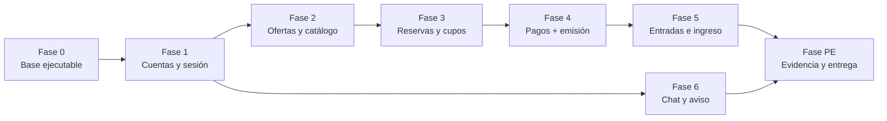

# 00 — Índice y control de la planificación

> Este índice corresponde al diseño ampliado. Para implementar el monolito del primer bimestre, sigue el [plan del MVP](mvp-primer-bimestre/PLAN-MVP.md).

> **Proyecto:** MVP de turismo comunitario (monolito web, proyecto universitario de Aplicaciones Web Avanzadas + Desarrollo de Software Seguro).
> **Etapa:** planificación técnica. **No existe código de aplicación, ni dependencias instaladas, ni pruebas ejecutadas.**
> **Fuente de alcance:** `docs/planificacion/referencias/PLAN.md` (intacto). **Encargo:** `docs/planificacion/referencias/PROMPT-CLAUDE-PLANIFICACION.md`.
> **Fecha de redacción y de consulta de fuentes externas:** 2026-11-12 (consulta adicional del 2026-11-13: ver §10.3.1). Último punto de avance: 2026-11-16 (revisión cruzada final, §12).

---

## 1. Estado de los documentos (progreso real)

Leyenda: ✅ completo · 🟡 provisional (utilizable, con pendientes señalados) · ⛔ bloqueado · ⏳ pendiente de redacción.

| # | Documento | Estado | Motivo / pendientes |
|---|---|---|---|
| 00 | [00-indice-y-control.md](00-indice-y-control.md) | ✅ | **Completo (2026-11-16): §12, revisión cruzada final, hecha** — hallazgos H-55 a H-67 corregidos en los documentos, decisiones que siguen abiertas con su paquete y **veredicto: `P0-01` puede empezar** (§12.4). Historial: actualizado el 2026-11-14 (estado de 06 y 07; ver §1.1). Actualizado el 2026-11-13 con los hallazgos H-23 a H-34 y las decisiones D-66 a D-68 (documento 03). |
| 01 | [01-alcance-y-trazabilidad.md](01-alcance-y-trazabilidad.md) | ✅ | Completo. Revisado en la revisión cruzada final (§12, 2026-11-16). La conformidad académica que describe sigue pendiente de Q-01 y Q-02. |
| 02 | [02-arquitectura-y-decisiones.md](02-arquitectura-y-decisiones.md) | ✅ | Completo. Revisado en la revisión cruzada final (§12, 2026-11-16). |
| 03 | [03-datos-estados-e-invariantes.md](03-datos-estados-e-invariantes.md) | ✅ | Completo como planificación (guardado el 2026-11-13): diagrama ER, diccionario por campo de las 16 entidades, catálogo de auditoría, política de eliminación, transiciones ampliadas, SQL complementario, migraciones y semillas. Revisado en la revisión cruzada final (§12, 2026-11-16). **El SQL y los esquemas Prisma no se han ejecutado ni validado**; se comprueban en P0-06 a P4-02 con T-DB-01 (§8.7 y §10.2 de 03). |
| 04 | [04-reglas-transacciones-y-concurrencia.md](04-reglas-transacciones-y-concurrencia.md) | ✅ | **Completo como planificación (lote 5, 2026-11-13).** Desarrollado con secuencia, pseudocódigo, escrituras por rama, errores y pruebas: §1 principios, §2 orden de bloqueos, **reglas compartidas de ofertas (OFF.1–OFF.5)**, **TX-01, TX-02, TX-03, TX-04 y TX-16** (lote 4), **TX-05**, **TX-07**, **TX-08**, **TX-09**, **TX-10** y **TX-11**. **TX-06 y TX-12 a TX-15** en forma breve (precondiciones, escritura atómica, errores, pruebas clave). Revisado en la revisión cruzada final (§12, 2026-11-16). Todo el pseudocódigo y el SQL son documentales (no ejecutados); fuentes de PayPal con su grado y dudas en 04 §5. |
| 05 | [05-contratos-http-websocket-y-pagos.md](05-contratos-http-websocket-y-pagos.md) | ✅ | **Completo (2026-11-13).** Revisado en la revisión cruzada final (§12, 2026-11-16). Páginas, esquemas de las Server Actions (§3.1–3.5, con D-79 en `/panel/ingresos`), *handlers*, Socket.IO (§5, verificado contra TX-14 y TX-15), puerto de pagos, datos de PayPal, QR y ejemplos de pagos (§6.6). Quedan **pendientes de Sandbox** (no de redacción) las conductas de PayPal listadas en 04 §5.2. |
| 06 | [06-seguridad-y-privacidad.md](06-seguridad-y-privacidad.md) | 🟡 | **Parcial.** Guardado: controles decididos con parámetros, cabeceras y CSP, retención. **Modelo de amenazas (§1), matriz de 48 amenazas (§2) y §4 (conservación, anonimización y solicitudes de borrado) hechos el 2026-11-14.** A-43 alineada con `tc_migrator`; **A-25 sigue pendiente de decisión (umbral)**. **⛔ La matriz Common Criteria (§5) está bloqueada por Q-02.** |
| 07 | [07-pantallas-y-experiencia.md](07-pantallas-y-experiencia.md) | ✅ | **Completo como planificación (2026-11-14):** principios, mapa de navegación, decisiones por flujo, fichas por pantalla (§4), estados por pantalla (§6) y lista de comprobaciones manuales (§7.1: 15 comunes y 23 por pantalla). D-79 en `/panel/ingresos`; conciliación agotada y aviso de reembolso (solo lectura) en la vista del administrador. **Las comprobaciones manuales están pendientes de ejecución** (no hay interfaz). Revisado en la revisión cruzada final (§12, 2026-11-16). |
| 08 | [08-pruebas-y-evidencias.md](08-pruebas-y-evidencias.md) | ✅ | **Completo como planificación (2026-11-16): §6 CI redactado (grupos, condiciones de fusión, base de pruebas, `fake` en CI, evidencias por materia); `T-PAG-24` sigue manual y pendiente (Q-08). El formato del informe de rendimiento EV-06 quedó redactado en §7.1 y §7.2 en la revisión cruzada (resultados pendientes de `PE-01`). Sin pruebas ejecutadas.** Historial: Guardado: estrategia, técnica de concurrencia, catálogo de 150 identificadores, matriz de fallos de pago, método de rendimiento, evidencias. **Cuentas (`T-CTA-01` a `T-CTA-20`) con preparación, acción y resultado esperado (2026-11-14), pendientes de ejecución.** **Ofertas (`T-OFE-01` a `T-OFE-24`) también (2026-11-14).** **Reservas (`T-RES-01` a `T-RES-19`) también (2026-11-16).** **Pagos (`T-PAG-01` a `T-PAG-26`) también (2026-11-16); T-PAG-24 sigue bloqueado por Q-08.** **Entradas (`T-ENT-01` a `T-ENT-15`, más 06a a 06e) también (2026-11-16); `T-ENT-14d` es manual.** **Chat (`T-CHAT-01` a `T-CHAT-16`) también (2026-11-16).** **Transversales (§3.7: `T-SEG`, `T-DB`, `T-OPS`, `T-A11Y`, `T-PERF`, `T-E2E`) también (2026-11-16); §3 completo como planificación.** **§6 CI detallado también (2026-11-16).** |
| 09 | [09-entorno-despliegue-y-operacion.md](09-entorno-despliegue-y-operacion.md) | ✅ | **Redactado (2026-11-16) con pendientes explícitos: todos los apartados tienen contenido, nada se ha ejecutado.** Pendientes: Q-04 (alojamiento; §6.2 y §6.4 sin elegir), propuestas de §8.13, tres puntos **pendientes de diseño** (§7.3), verificaciones de PostgreSQL y Prisma (§8.14), `data:purge` sin alcance. Historial: Guardado: variables de entorno, scripts previstos, servicios locales, alojamiento con límites verificados, lista de *runbooks*. **§2 (clon limpio, PowerShell y Bash, pruebas locales) y §3 (borradores de `.env.example` y `.env.test.example`, `DB_LOCK_TIMEOUT_MS`) hechos el 2026-11-16, sin ejecutar.** **§5 también (2026-11-16): bases que admite cada utilidad de reinicio, `db:reset` frente a `docker compose down -v`, copias con `pg_dump` (plazos y ubicación como propuesta), restauración aislada para T-OPS-05 con reaplicación de borrados.** **§8 también (2026-11-16): doce fichas RB-01 a RB-12.** **§7 (diagnóstico por síntoma) y §6.4 (servidor virtual, sin proveedor) también (2026-11-16): 09 queda redactado.** Decisión de alojamiento pendiente de Q-04. |
| 10 | [10-fases-y-paquetes-implementables.md](10-fases-y-paquetes-implementables.md) | ✅ | **Redactado (2026-11-16) con pendientes explícitos: las 38 fichas de 13 puntos están completas** (`P0-01` a `P6-03` y `PE-01` a `PE-05`); catálogo §4 corregido en 9 filas (P0-02, P0-03, P0-06, P2-02, P4-02, P4-05, P4-07, P5-02 y P6-01) y grafo revisado sin ciclos; revisión del catálogo completo al final de §5. **Pendientes:** decisiones abiertas D0-x a D7-x (incluidas D6-1 a D6-12), asuntos externos (alojamiento Q-04, guías Q-01, Q-02, Q-03, Q-07, Q-09 y Q-11, Sandbox Q-08), propuesta `P3-04` (purga J4) sin adoptar y que **ningún paquete se ha implementado**. Los comandos de las fichas son previstos, ninguno verificado. **Revisión cruzada (2026-11-16):** ruta corta de §2 y diagrama de §4 corregidos, `T-OPS-06` asignada, D0-10, D5-4, D5-7, D6-9 y D6-11 resueltas, D7-6 ya no bloquea `PE-03` y nota de carpeta no vacía en `P0-01` (§12). |
| 11 | [11-prompts-para-la-ia-implementadora.md](11-prompts-para-la-ia-implementadora.md) | ✅ | **Redactado el 2026-11-16.** Prompt maestro, plantilla de informe, formato de `ESTADO-IMPLEMENTACION.md` y **los 38 prompts por paquete** (uno por ficha de 10 §4; `PE-05` opcional). Comandos previstos, ninguno probado; pendientes externos intactos (Q-04, guías, privacidad, Q-08). **Alineado con las correcciones de la revisión cruzada (2026-11-16, §12)** en `P0-01`, `P1-05`, `P3-03`, `P5-01`, `P6-01`, `P6-02`, `PE-01` y `PE-03`. |
| 12 | [12-demo-y-entrega-academica.md](12-demo-y-entrega-academica.md) | ✅ | **Redactado el 2026-11-16, con pendientes externos.** Guion de 15 + 5 minutos (§2), plan de commits auténticos y de revisión humana (§6), contingencia (§7). Pendientes: reparto (Q-03), guías (Q-01, Q-02, Q-07, Q-09), alojamiento (Q-04), repositorio (Q-11) y **Q-08 (T-PAG-24, EV-07)**. |

### 1.1 Punto de avance — guardado el 2026-11-13

**Situación.** Los trece archivos existen en `docs/planificacion/`. Cinco están completos (00 salvo §12, 01, 02, 03 y 04) y ocho son parciales (05 a 12). Los parciales contienen todas las decisiones ya tomadas en forma condensada, de modo que nada del diseño depende de la memoria de la conversación. **No se ha realizado la revisión global de consistencia (§12).** El 2026-11-13 se completó 03 y se desarrolló el **lote 1 de 04** (principios, orden de bloqueos, TX-05 y TX-09); 04 sigue parcial. Al hacerlo se detectaron seis hallazgos más (H-35 a H-40) y se ajustaron referencias puntuales en 02 (reloj), 03 (reloj, `PaymentEvent`, `Ticket.id`) y 08 (tabla de barreras, niveles de T-RES-10 y T-PAG-07/13/15); el resto de los pendientes de esos documentos no se tocó. **Lote 2 de 04** (también 2026-11-13): se desarrollaron **TX-07** (iniciar el pago y crear la orden) y **TX-08** (solicitar la captura y manejar su resultado); se consultó la documentación de PayPal sobre idempotencia y errores de captura (resúmenes de búsqueda; no páginas completas) y se detectaron cinco hallazgos más (H-41 a H-45). Se ajustaron referencias en 03 (§4.4 P-1, P-2, P-5, nueva P-5b y el campo `captureAttemptedAt`), 05 (§3, §6.1 `GatewayError`, §6.2 claves, captura y ventana, §6.3 compuerta del `fake`), 08 (filas T-PAG-01, 02, 03, 06, 12, 18, 23 y tabla de barreras) y 10 (pruebas de P4-04). TX-10 y TX-11 no se tocaron. **Lote 3 de 04** (también 2026-11-13): se desarrollaron **TX-10** y **TX-11** y se **revisó** la afirmación del lote 2 de que «un arrendamiento vencido y una consulta sin captura equivalen a un caso resuelto sin cargo»: era falsa. Se corrigieron TX-08 (estados del intento, `captureAttemptKey`, misma clave para reanudar, clave nueva solo tras un rechazo definitivo), TX-09 (regla L-02 de 60 s retirada; clases `K0a`/`K0b`; evidencia) y 03 (nueva columna `Payment.captureAttemptKey`, `ck_pay_attempt`, P-5, P-5b, R-7). Se leyó `docs/planificacion/referencias/FUENTES-PAYPAL-REVISION.md` (páginas leídas) y se corrigió el rotulado de los resúmenes de búsqueda del lote 2 (H-51). Seis hallazgos más (H-46 a H-51) y tres decisiones más (D-74 a D-76); D-71 y D-72 reescritas. Referencias ajustadas en 01, 02 (J2), 03, 05, 08 y 10. **Lote 5 de 04** (2026-11-13): se cerró 04 con **TX-06 y TX-12 a TX-15** en forma breve; decisión **D-79**: las entradas emitidas siguen válidas con la oferta `SUSPENDED` o `ARCHIVED` (el ingreso depende solo de rol, actividad, ventana, reserva `CONFIRMED` y entrada `VALID`); la selección de actividad de `/panel/ingresos` debe listar esas ofertas si tienen entradas emitidas (a recoger en 05 y 07; **05 ya lo recoge**, §2 y §3.5). **Lote 4 de 04** (también 2026-11-13): se desarrollaron los flujos de **ofertas y versiones** (TX-01, TX-02, TX-03, TX-04 y TX-16) con sus reglas compartidas (autorización por identidad con varios roles, bloqueos de la oferta, validación del contenido, inventario). No se volvió a investigar ni a cambiar nada de pagos; el calendario de conciliación sigue como **propuesta pendiente**. Hallazgos H-52 a H-54 y decisiones D-77 y D-78; se alinearon 03 (V-3, V-4, V-7, O-7) y 08 (filas T-OFE y T-RES-17/18 y tabla de barreras). **05 §3** (2026-11-13): se redactaron los esquemas de entrada, salida y errores de las 23 Server Actions (corregido el 2026-11-14: antes decía 25; el inventario de §3 tiene 23) (§3.1 convenciones, §3.2 cuentas, §3.3 ofertas, §3.4 reservas y pagos, §3.5 entradas), reutilizando de 04 solo OFF.1/OFF.3/OFF.5, TX-05.1, TX-07.1, TX-08.1/.6, TX-11 (`checkGateway`), TX-12, TX-13, TX-14 y TX-16.1 y de 02 §10; y se aplicó **D-79** en 05 §2: `/panel/ingresos` lista las ofertas `SUSPENDED` o `ARCHIVED` con entradas emitidas y conserva las demás condiciones de ingreso. No se tocaron 03, 04 ni 08. Los formatos de correo (minúsculas, ≤ 254), `passwordConfirm`, `confirm: true` al eliminar y el indicador `replayed` de la reserva son **precisiones propias de 05**, sin cambio de reglas. 07 recogió D-79 en la pantalla de ingresos el 2026-11-14 (ver abajo). **05 §5 y §6** (2026-11-13): se redactaron las cargas, confirmaciones y errores de Socket.IO (§5) y los ejemplos de pagos (§6.6: crear orden, captura confirmada o en revisión, webhook aplicado, duplicado, ignorado o pendiente, y «Consultar pasarela»), separando respuestas de la aplicación y de PayPal. Se corrigió en 05 §3.4 una discrepancia con 04 TX-07 (E2/E3: `GATEWAY_UNAVAILABLE` con `retryable` true o false, no `INTERNAL_ERROR`). **05 queda completo**; los cuerpos de PayPal de §6.6 son ilustrativos y las verificaciones de Sandbox siguen pendientes. Los valores de `reason` y `availability` en el ejemplo de «Consultar pasarela» son ilustrativos: la lista definitiva está en 04 TX-09. **06 §1 y §2** (2026-11-14): se redactaron el modelo de amenazas (9 activos, 8 actores, 8 límites de confianza) y la matriz de **48 amenazas `A-nn`** (cuentas y sesiones, permisos entre organizaciones, cupos, pagos y webhooks, entradas QR, chat, datos sensibles y plataforma), reutilizando decisiones D-nn, RS-nn y los IDs de prueba de 08 y 04; cada fila marca el control como decidido o propuesto y la evidencia que falta (§2.8). No se creó un catálogo `C-nn` aparte. Se consultó 00 §8–9, 01 (RS), 02 §1, 04 (TX-10, TX-12, TX-14, TX-15) y 08; no se modificó ningún otro documento. El mapeo Common Criteria (06 §5) sigue pendiente de Q-02. Ninguna prueba se ha ejecutado. **06 §4** (2026-11-14): se redactaron la conservación automática (J4), los principios (anonimizar y no borrar el historial; la auditoría no se reescribe porque ya es seudónima), la tabla de qué se elimina, anonimiza o conserva, el tratamiento de solicitudes de borrado (verificación por correo, diferimiento si hay retenciones, pagos no terminales o reservas confirmadas de actividades no terminadas; plazo interno **propuesto** de 30 días, no legal), el procedimiento transaccional con `tc_migrator`, la auditoría `account.anonymize` y las copias de respaldo. Se consultó solo 03 (§3.4, §3.6, §8.5 y diccionarios de `User`, `Attendee`, `AuditEvent`) y D-36, D-56, D-57, D-58 y D-62. **A-43** se alineó con 03 §8.5 (`tc_migrator` puede alterar la auditoría y desactivar disparadores; `tc_app` no) y **A-25 sigue pendiente de decisión**: no se fijó umbral. Se corrigió en 06 §1.2 una referencia errónea (A-26 → A-43). **No se modificaron 03, 05, 07, 08 ni 09**; las alineaciones que exige §4 quedan listadas en 06 §4.8 y en §1 (Pendientes). §5 sigue pendiente de Q-02. **07 §4 y §6** (2026-11-14): fichas breves por pantalla (contenido, acciones, estados propios y accesibilidad propia) para cuenta, catálogo, reserva, turista, GAD, operador, ingreso, chat y administración, y estados compartidos (V, C, X, VAL, CF, DEN, SES, RED, OCU) definidos una sola vez con una tabla de cuáles aplican a cada pantalla. **D-79** aplicado en `/panel/ingresos`: la lista incluye las ofertas `OPEN` y las `SUSPENDED` o `ARCHIVED` con entradas emitidas; consultar (`lookupTicketAction`) y registrar (`checkInTicketAction`) son dos pasos con botones separados, y escanear nunca consume. En `/panel/admin/revision-pagos` se recogió la **conciliación automática agotada** (etiqueta, filtro y banner que no afirma que no hubo cargo, 04 TX-11.2) y el **aviso de reembolso posterior a la confirmación** (sección de solo lectura sobre `payment.reconcile` `REFUND_AFTER_CONFIRMATION`, sin estado «atendido», 04 TX-10/TX-09 L-17). Se consultó 07, 05 §1–§4, 01 §8 y de 04 solo TX-11 y las filas de TX-09/TX-10 sobre el aviso. **No se modificaron 01, 03, 04, 05, 06, 08 ni 09.** Las alineaciones que surgen están en §1 (Pendientes). Los textos de pantalla son orientativos y nada se ha validado con personas usuarias. Se detiene aquí antes de 08. **07 §7 y alineación con 05 y 01** (2026-11-14): se redactó **§7.1** (15 comprobaciones manuales comunes `MC-01` a `MC-15` y 23 por pantalla `MP-01` a `MP-23`, cada una con qué hacer y resultado esperado; prioridad A/B; priorizan teclado, foco tras errores y diálogos, etiquetas, avisos de chat y de pagos, y la alternativa manual a la cámara en el ingreso con QR). **Todas quedan pendientes de ejecución**; los identificadores son locales de 07 y 08 los asociará a sus `T-A11Y-nn`. **07 queda ✅ completo como planificación.** Se alinearon **05 §2** (la pantalla de revisión de pagos tiene sección A con los casos, incluidos los agotados, y sección B con el resumen de avisos de reembolso, con una nota que documenta acceso solo `ADMIN`, consulta fija de `AuditEvent` `payment.reconcile`/`CONFLICT`/`REFUND_AFTER_CONFIRMATION`, campos mostrados y ausencia de acción) y **01 §8.4** (fila nueva en la matriz; la consulta general de auditoría **sigue en PE-05**, opcional, y el resumen no depende de ella). Decisiones **propuestas** sin confirmar: no auditar la lectura del resumen y el tamaño de página (por fijar en P4-07). No se modificaron 03, 04, 06, 08 ni 09. **Siguiente en 08:** §3 — preparación, pasos y aserciones por prueba, empezando por `T-CTA-01`; después §6 CI. **08 §3.1 Cuentas** (2026-11-14): se desarrollaron `T-CTA-01` a `T-CTA-20` con preparación, acción y resultado esperado, agrupando datos y pasos comunes (§3.1.1: entorno, cuentas de la semilla, constantes, limpieza, lecturas, ausencia de secretos y auditoría) y referenciando 04 TX-13 y TX-14 sin repetirlos. Se consultaron solo 05 §3.2, 04 TX-13/TX-14, 03 (`User`, `Session`, `PasswordResetToken`, `LoginThrottle`, auditoría y semilla), 06 §3.1–§3.2 y 01 RS-01 a RS-05. Se añadieron los subcasos `02c` (límite de registro de 06 §3.2, que no tenía prueba), `10b` (`Host` falsificado, cierra A-08, única prueba de nivel E dentro de una de nivel I), `10c`, `13b` (carrera con un ingreso, de 04 TX-13), `17a`/`17b`, sin IDs nuevos. Se corrigió en 08 §2 la barrera de T-CTA-13 (`User`, como 04 TX-13, y no `PasswordResetToken`). **Hallazgos abiertos:** la regla de `next` de 05 §2 admitiría `/\evil.test` (los navegadores lo tratan como `//`) y hay que ampliarla; la respuesta exacta del 5.º fallo de ingreso queda para P1-04. Los umbrales usados son los **propuestos** de 06 §3.2. **Todas las pruebas de `T-CTA` están pendientes de ejecución** (no existe código). ~~Siguiente ID pendiente: `T-OFE-01`~~ (hecho el 2026-11-14, ver abajo). **`next` y 08 §3.2** (2026-11-14): se corrigió la regla de `next` en **05 §2** (y la fila de `loginAction` en 05 §3.2): solo se acepta una ruta interna **permitida para la sesión actual**, mediante una única función `safeNext` con cinco comprobaciones (longitud, sin caracteres de control ni `\`, empieza por `/` sin `//` ni `/\`, resolución con `new URL(raw, APP_ORIGIN)` cuyo origen sea exactamente `APP_ORIGIN`, y página del inventario accesible por rol); si falla, el destino es `/panel` sin error ni auditoría. Cierra el hallazgo de `/\evil.test`. En **08**, `T-CTA-16` pasó a cuatro subcasos (16a a 16d), con 16c para destinos externos que parecen internos (`/\`, tabulación y saltos de línea, `///`) y 16d para rutas internas no permitidas. Se desarrolló **08 §3.2 `T-OFE-01` a `T-OFE-24`**: preparación común (§3.2.1) y una tabla de acción y resultado (§3.2.2) que **remite a 04** (TX-01.7, TX-02.7, TX-03.7, TX-04.6 y TX-16.7) para los subcasos ya especificados, incluida toda la concurrencia, y añade lo que 04 no cubre: `02`, `03a`, `03d`, `07`, `13b`, `17`, `20`, `24` y bordes de `01` y `18`. Se consultaron solo 05 §2–§3.2, 08 §2–§3.2 y los apartados de prueba de 04 y OFF.3, y 03 §7 por referencia. No se modificaron 01, 03, 04, 06 ni 07. **Alineación hecha el 2026-11-16:** 06 (A-10 y §3.4) y 07 §4.1 remiten a `safeNext` de 05 §2. **Por fijar:** orden y provincia del listado del GAD y `pagina` inválida (P2-02, P2-05), y la frontera `startsAt = now` (03 §7). **Todas las pruebas de `T-OFE` están pendientes de ejecución. Siguiente ID pendiente: `T-RES-01` (08 §3.3).** Se detiene antes de reservas y de §6 CI.

**2026-11-16 — 08 §3.3 `T-RES-01` a `T-RES-19`**: preparación común (§3.3.1: RES-D1..D6, PC-RES-1..4) y tabla de acción y resultado (§3.3.2). Remite a 04 TX-05.7 (07a a 07e, 08a1, 08a2, 08b, 08c, 09a, 09b, 10a, 10a′, 10b, 15a a 15c), TX-03.7 (17), TX-04.6 (18) y TX-06 (11); 08 añade `01` a `06`, `07f`, `08d`, `09c`, `09d`, `10c`, `10d`, `11a` a `11g`, `12` a `14`, `15d` a `15f`, `16` y `19`. Frontera `startsAt = now`: el caso `13c` comprueba la precondición 5 de TX-05 (`startsAt > now`) y espera `ACTIVITY_NOT_FUTURE` con la igualdad; sigue **por confirmar en 03 §7**. Alineado: 06 A-10 y §3.4 y 07 §4.1 remiten a la regla canónica `safeNext` de 05 §2 (retorno a `/panel`). **Por fijar en su propio lote (no se resolvieron):** orden, provincia y `pagina` inválida del listado del GAD (P2-02, P2-05; T-OFE-02). **Nuevos por confirmar en 03:** convención del 29 de febrero, retención con `expiresAt = now` y si una `CONFIRMED` cuenta para el límite de 3. **Todas las pruebas de `T-RES` están pendientes de ejecución. Siguiente ID pendiente: `T-PAG-01` (08 §3.4).** Se detiene antes de pagos y de §6 CI.

**2026-11-16 — 08 §3.4 `T-PAG-01` a `T-PAG-26`**: preparación común (§3.4.1: PAG-D1..D4, PC-PAG-1..3), tabla de lo que demuestra el adaptador `fake` frente a PayPal Sandbox, matriz de cobertura (§3.4.1) y acción/resultado por prueba (§3.4.3). Remite a 04 TX-07.7, TX-08.7, TX-09.8, TX-10.9 y TX-11.9 para casi todos los subcasos. **Huecos hallados y añadidos por 08:** `04` (retorno del navegador sin captura), `14d` y `14e` (captura tardía sin cupo por conciliador o administrador, reserva ya `EXPIRED`, reevaluación `L-12`), `20k` (captura real que llega tras agotar la conciliación), `21` (contrato del adaptador con respuestas grabadas, hoy solo del `fake`), `24` (guion manual de Sandbox) y `25` (E2E con `fake`). **Pendientes conservados:** T-PAG-24 y las conductas reales de PayPal (Q-08, R-14, 04 §5.2, P4-06); respuestas grabadas de Sandbox para T-PAG-21 (no existen); el calendario `RECONCILE_DELAYS_MIN`/`MAX_CHECKS` (propuesta, P4-05); nombres de Prisma y de restricciones (P0-03, P4-01, P4-04); A-25 (umbral de firmas inválidas de webhook, sin decidir). **Todas las pruebas de `T-PAG` están pendientes de ejecución. Siguiente ID pendiente: `T-ENT-01` (08 §3.5).** Se detiene antes de las pruebas de entradas.

**2026-11-16 — 08 §3.5 `T-ENT-01` a `T-ENT-15`**: preparación común (§3.5.1: ENT-D1..D7, PC-ENT-1..4), pendientes (§3.5.2) y acción/resultado por prueba (§3.5.3). 04 TX-09 especifica la emisión (T-PAG-05, 06a, 06b, 07a, 07b); 04 TX-12 fija reglas, códigos y orden pero **solo nombra** las pruebas, así que 08 escribe preparación, acciones y aserciones de todas. Cubre: una entrada por asistente (01c, 02), descarga solo del comprador con `no-store` y 404 idéntico a terceros (03), consultar, mostrar o descargar el QR sin consumir (03e, 05), doble ingreso concurrente con una sola operación (07a a 07d). **T-ENT-06a (suspendida) y 06b (archivada) no estaban en el catálogo**: se añaden con D-79 y las demás condiciones de ingreso (actividad, atracción, ventana, rol, entrada usada); además 06c (cambio de estado entre consultar y registrar), 06d (selector de `/panel/ingresos`) y 06e (ingreso sin consulta previa). **Por fijar:** longitud de la copia cifrada (48 o 63, P4-02), frontera de la ventana (03 §4.6), 401 sin sesión del QR (05 §4), umbral de 30 consultas por minuto (A-30) y si el servicio exige consulta previa. **Alineaciones:** 04 TX-12, 01 (RF-33) y 10 (P5-02) deberían citar 06a a 06e. **Todas las pruebas de `T-ENT` están pendientes de ejecución; `T-ENT-14d` es manual. Siguiente ID pendiente: `T-CHAT-01` (08 §3.6).** Se detiene antes del chat.

**2026-11-16 — 08 §3.7 Transversales (`T-SEG-01` a `T-E2E-01`)**: §3.7.1 preparación común (SEG-D1..D6, PC-SEG-1..3), §3.7.2 cobertura de la matriz de 06 §2, §3.7.3 controles propuestos o pendientes con lo que falta definir, §3.7.4 acción/resultado por prueba y §3.7.5 correspondencia `MC`/`MP` ↔ `T-A11Y` (propuesta). **Cobertura:** permisos por recurso (matriz generada `T-SEG-04a` a `04h`, con prueba de completitud de las 23 acciones y aserción explícita de A-16), datos sensibles en respuestas y registros (`T-SEG-05` con centinelas y lista de lugares permitidos; `T-SEG-08c` busca secretos en el paquete de cliente, A-45) y privilegios de auditoría (`T-SEG-07a` a `07e`: `tc_app` solo `SELECT`/`INSERT`; el migrador se **documenta**, no se afirma como impedido, A-43). Se reutilizan T-CTA-16, T-ENT-04, T-CHAT-16, T-DB-01 (03 §8.7) y otras. Nuevas: `T-SEG-11d` a `11i` (anonimización, provisionales), `T-OPS-06b` (anulación de `birthDate`, A-41), `T-DB-01j`. **A-08, A-16, A-34, A-35 y A-45 quedan cubiertas en 08** (06 §2 aún dice «Falta»). **Estado conservado:** **A-25 sigue PENDIENTE DE DECISIÓN** (sin umbral ni prueba) y **06 §5 Common Criteria sigue pendiente de Q-02** (sin prueba ni mapeo). **Por definir antes de fijar aserciones:** umbrales A-01, A-30, A-39; borde de la anulación (A-41); comprobación automática de `MIGRATION_DATABASE_URL` (A-43); 403 o 404 por ruta; 401 de los *handlers*; caché de páginas públicas; pruebas con HTTPS; plazo de gracia de `SIGTERM` (T-OPS-03 exige Linux o CI) y rotación de copias (09 §5). **Alineaciones:** 06 §2 (marcar A-08/16/34/35/45), 03 (guardia de `Attendee`, `account.anonymize`, `anon.invalid`), 07 §7.1 (citar la tabla), 09. **Todas las pruebas de §3.7 están pendientes de ejecución; T-SEG-09, T-OPS-05, T-PERF-01 y las partes con lector o cámara son manuales. Siguiente apartado pendiente: 08 §6 Avance de fase y CI.** Se detiene tras §3.7.

**2026-11-16 — 08 §3.6 `T-CHAT-01` a `T-CHAT-16`**: preparación común (§3.6.1: CHAT-D1..D6, PC-CHAT-1..4), decisiones abiertas (§3.6.2) y acción/resultado por prueba (§3.6.3). 04 TX-14 y TX-15 y 05 §5 fijan reglas y códigos pero solo **nombran** las pruebas, así que 08 escribe preparación, acciones y aserciones. Cubre: sesión al conectar (01, 02) y al enviar (11, 12 por puente, barrido y revalidación por evento), revocación y vencimiento, límite de envío (06), persistencia antes de emitir (03), deduplicación incluida la carrera con fila sin confirmar (05), presencia con varias pestañas y sesiones (09), recuperación al reconectar sin pérdida ni duplicado, con más de 100 pendientes y huecos por inserciones revertidas (08), y la **notificación adicional del panel por separado** (10: autor excluido, sin texto, solo tras persistir, insignia en el navegador). **Por fijar (no decidido):** ventana fija o deslizante del límite y qué envíos cuentan; confirmación si falla la emisión; mismo `clientMessageId` con otro texto; parámetros inválidos del historial; precedencia `ORIGIN_MISMATCH`/`UNAUTHENTICATED`; si el puente emite `session:expired`; limpieza de la insignia; notificación por socket o por usuario; intervalos de latido reducibles (P6-01). **Alineaciones:** 04 TX-14/TX-15 y 05 §5. **Todas las pruebas de `T-CHAT` están pendientes de ejecución. Siguiente ID pendiente: `T-SEG-01` (08 §3.7).** Se detiene antes de transversales.

**2026-11-16 — 08 §6 Avance de fase y CI**: §6.1 tabla de cuándo corre cada grupo en GitHub Actions, cuáles bloquean la fusión (análisis, tipos, unidad, integración, concurrencia, compilación y E2E; `npm audit` solo avisa, propuesto) y qué informe se guarda; seis condiciones previas a fusionar y orden del flujo. §6.2 preparar (`db:test:prepare`, protección `_test`/`_e2e`/`_perf`, migrar con `tc_migrator`, probar con `tc_app`, semilla base) y limpiar (`TRUNCATE … RESTART IDENTITY CASCADE` con la utilidad de `T-OPS-04`; en CI se descarta el contenedor). §6.3 adaptador `fake` en CI, el flujo falla si hay credenciales de PayPal, y **`T-PAG-24` sigue manual y pendiente (Q-08)**. §6.4 evidencias por materia (Aplicaciones Web Avanzadas y Desarrollo de Software Seguro) con ID de §5. **Por fijar:** caducidad de artefactos, paralelismo por esquema (P0-06), umbral de cobertura, revisión humana obligatoria, `npm audit` bloqueante. No se modificó ningún otro documento. Nada está ejecutado. **Siguiente: 09 (§2, `.env.example`, §5 copias, §8 *runbooks*).** Se detiene antes de 09.

**2026-11-16 — 09 §2 y §3**: §2 secuencia común desde un clon limpio (requisitos, `npm ci`, `.env`, secretos, `db:up`, `db:generate`/`db:migrate`/`db:seed`, `dev`, comprobación) con PowerShell y Bash solo en copiar, generar secretos y comprobar; preparación local de pruebas (`.env.test`, `db:test:prepare`, grupos `test:*`, Playwright sobre `turismo_e2e`) con las mismas reglas de aislamiento de 08 §6.2; problemas frecuentes. §3 tabla con **`DB_LOCK_TIMEOUT_MS`** (defecto 5000, de 04 §5), borrador comentado de **`.env.example`** y **`.env.test.example`** (propuesto) con valores ficticios y reglas de validación. **Hallazgo:** 09 §5, leída literalmente (nombres `_test`/`_e2e`/`_perf` para toda utilidad que reinicie), rechazaría `db:reset` sobre `turismo_dev`, que 03 §9.4 define; se dejó sin resolver y el reinicio local documentado es `docker compose down -v`. **`db:reset-demo` sigue como propuesta pendiente.** **Por fijar:** rango de `DB_LOCK_TIMEOUT_MS` (100–30 000, propuesto), validación del formato de secretos, `.env.test.example` como archivo nuevo, puerto 3100 y URLs de Playwright, coste de Argon2 en pruebas, contraseñas locales de roles, comprobación de salud de `db`. **Alineaciones pendientes:** 02 §9 y §11 deben recoger `DB_LOCK_TIMEOUT_MS` (cierra la de 04 §5; la fila de 09 de «Alineación» ya la tiene en 09 §3). No se modificaron 02, 03, 04 ni 08. Nada está ejecutado. **Siguiente apartado: 09 §5 (copias con `pg_dump`, T-OPS-05, retención; incluye decidir la regla de `db:reset`), después 09 §8 (*runbooks*).** Se detiene antes de §5.

**2026-11-16 — 09 §5**: §5.2 regla **por utilidad**: la limpieza de pruebas solo admite `_test`/`_e2e`/`_perf`; `db:reset` admite exactamente `turismo_dev` y esas tres, solo en local (ambas URL) y con `--confirm`, y rechaza `_demo`, `turismo_restore` y producción (resuelve el hallazgo del avance anterior); `db:reset-demo` **sigue como propuesta pendiente**. §5.3 distingue reiniciar **una** base de `docker compose down -v` (volumen entero, sin guardas; `00-roles.sql` solo corre con volumen vacío). §5.4 copias: `pg_dump` formato personalizado con `tc_migrator`, con propietarios y privilegios, sin `>` (corrompe en PowerShell 5.1), con suma y manifiesto; ubicación, acceso (dos personas), frecuencia y **30 días de conservación son propuesta**. §5.5 restauración aislada (`turismo_restore`, acceso cerrado hasta el final, trabajos apagados, sin correo ni PayPal): comprobaciones estructurales, sesiones y tokens eliminados (propuesta), **reaplicación de borrados antes de abrir el acceso**, J4, descarga de una entrada (prueba el llavero) y comprobaciones por cuenta anonimizada. **Hallazgos:** (1) la auditoría restaurada **no contiene** los `account.anonymize` posteriores a la copia (06 §4.7 y 08 T-OPS-05 lo daban por fuente); la lista sale de la base original o del registro de solicitudes del equipo; (2) la utilidad de 06 §4.5 podría **diferir** al aplicarse sobre una copia antigua; (3) las sesiones revocadas tras la copia reviven al restaurar. **Alineado:** 03 §9.4 (`db:reset` y estado de `db:reset-demo`), 09 §2.2, §2.4 y §4. **No modificados:** 06, 08. **Por decidir:** plazos y ubicación de copias, modo de restauración sin diferimiento, valor `RESTORE` en `account.anonymize`, mecanismo de recreación de `db:reset` (`DROP`/`CREATE` por `tc_migrator` o `prisma migrate reset`). **Por verificar:** `pg_restore --single-transaction` con el SQL de 03 §8 en PostgreSQL 18, privilegios de `00-roles.sql` frente a 03 §8.5, `createdb` con el rol administrador. Nada está ejecutado. **Siguiente: 09 §8 (*runbooks*).** Se detiene antes de §8.

**2026-11-16 — 09 §8 y alineación de 06 §4.7 y 08 T-OPS-04/05**: **§8** doce fichas breves (señal, diagnóstico, acción, recuperación, escalado) con reglas comunes (qué no se toca a mano, quién actúa, cuaderno de incidentes y plazo de escalado, **propuestos**). RB-05 sigue TX-10 (respuestas 200/400/413/503/500, contradictorios, duplicados; el webhook acelera y la fuente de verdad es `getOrder`/J2); RB-09 sigue TX-09/TX-11 («Consultar pasarela» solo consulta; un caso agotado no afirma que no hubo cargo; la resolución del cargo es **fuera del sistema**); RB-11 remite a 09 §5.5. **Alineado:** 09 §5.5 (paso 6 y 7.1 ampliados y **regla de cierre**: acceso cerrado si falta el registro, falla la reaplicación o falla una comprobación), 06 §4.7 y §4.8, 08 T-OPS-04 (regla por utilidad) y T-OPS-05. **Fuente del registro posterior:** la auditoría restaurada solo llega hasta la copia; la lista sale de los `account.anonymize` de la base original o del registro de solicitudes del equipo (UUID, fecha UTC, resultado, persona; fuera de la base y de las copias; margen de 24 h). **Sesiones y tokens:** tras restaurar se eliminan todos (**propuesta**), porque una sesión revocada o un token consumido tras la copia reaparecerían vigentes; no se marcan revocados porque `SessionRevokeReason` solo tiene `LOGOUT` y `PASSWORD_RESET`. **Propuestas sin decidir** (09 §8.13): invalidación tras restaurar, retención (30 días) y ubicación de copias, modo de restauración sin diferimiento, `RESTORE` en `account.anonymize`. **Verificaciones técnicas pendientes, aparte** (09 §8.14): PostgreSQL 18 (`pg_restore` con el SQL de 03 §8, roles y privilegios de `00-roles.sql`, `createdb`/`dropdb`, `CREATEDB` de `tc_migrator`, cliente `pg_dump` 18) y Prisma 7 (`migrate reset`, `migrate status`/`resolve`, `_prisma_migrations` restaurada, `migrate diff`). **Hallazgos para revisar:** (1) no consta en 05 §3 una acción de administración para desbloquear cuentas ni revocar sesiones ajenas (RB-07, por confirmar); (2) no existe un estado «resuelto fuera del sistema» para casos reembolsados a mano (RB-09; 04 y 07); (3) una restauración pierde lo posterior a la copia, incluidas capturas de PayPal sin registro (RB-11, revisión manual). No se modificaron 01 a 05, 07 ni 10 a 12. Nada está ejecutado. **Siguiente: 09 §7 (guía de diagnóstico por síntoma), después 09 §6.4.** Se detiene aquí.

**2026-11-16 — 09 §7 y §6.4; 09 queda redactado**: **§7** registros (decidido) y tabla de 17 síntomas con primera comprobación y ficha de §8; §7.3 aclara los tres puntos abiertos. **Cuentas:** el bloqueo vence solo (15 min, propuesta de 06 §3.2) y las vías definidas son esperar, restablecer la contraseña (30 min, un solo uso, revoca todas las sesiones) y cerrar sesión; **cortar sesiones ajenas queda pendiente de diseño** (RB-07 ya no autoriza borrar `Session` a mano). **Reembolsos manuales:** escalado de RB-09; se distingue un reembolso hecho **fuera del sistema** (el caso sigue en `REVIEW_REQUIRED`) de un caso **cerrado dentro de la aplicación** (liquidado o liberado por `settlePayment`); el estado «resuelto fuera del sistema» queda pendiente de diseño. **Restauración:** nuevo **paso 10 de 09 §5.5** (el de habilitar pasa a 11) y fila de **08 T-OPS-05**: cobros posteriores a la copia identificados con evidencia de PayPal (`custom_id` = reserva, `invoice_id` = pago) y clasificados A (ya aplicado), B (vinculable: reglas de conciliación vigentes) o C (no vinculable o dudoso: evidencia conservada y escalado; nunca se crea reserva ni se emite un QR). **Hueco de diseño:** J2 solo recoge pagos con `nextCheckAt` y la consulta del administrador exige `REVIEW_REQUIRED`, así que un pago restaurado `ORDER_CREATED` sin intento abierto solo lo recogería la reentrega del webhook; mientras tanto se trata como C. **§6.4:** servidor virtual con proxy HTTPS/WSS, `app` y `db` en red interna, secretos fuera de la imagen y `MIGRATION_DATABASE_URL` fuera del contenedor, reinicios y salud, `pg_dump` programado con copia fuera del servidor; sin proveedor ni precios, pendiente de Q-04. No se modificaron 01 a 07, 10 a 12. Nada está ejecutado. **Siguiente apartado: 10 §5 (fichas de paquete, desde `P0-01`).** Se detiene aquí.

**2026-11-16 — 10 §5, fichas de la fase 0 (`P0-01` a `P0-06`)**: cada ficha cubre los 13 puntos del encargo con texto breve (archivos previstos, tareas, contratos, pruebas por identificador, comandos, riesgos, datos, esfuerzo, *commit* propuesto, revisión y traspaso) y remite a 02, 03, 08 y 09. Se conservan IDs y dependencias de §4. **Todos los comandos son previstos y ninguno está verificado**; cada ficha lo dice en «Verificados». Evidencia propuesta en `docs/evidencias/<ID>/`. **Decisiones abiertas y comprobaciones (tabla D0-1 a D0-15 al final de la fase 0, con el momento en que afectan):** D0-1 P0-02 importa `env`, `logger` y la base de P0-04 y P0-03 aunque §4 solo declara `P0-01` (ejecutar P0-03 y P0-04 antes, o piezas provisionales); D0-2 las pruebas de P0-04 necesitan Vitest antes del arnés de P0-05 (propuesta: configuración mínima en P0-04); D0-3 qué acepta Socket.IO antes de P6-01; D0-4 recarga en caliente con Socket.IO; D0-5 T-OPS-03 solo en Linux o CI; D0-7 sin tablas no se cierran T-SEG-07 ni T-DB-02 en P0-03 (parte en P0-06); D0-8 `CREATEDB` de `tc_migrator` y privilegios de `00-roles.sql` (09 §8.14); D0-10 `DB_LOCK_TIMEOUT_MS` sigue sin recogerse en 02 §9 y §11; D0-11 falta repositorio remoto para la CI y la autoría de *commits* (Q-03); D0-12 paralelismo por esquema; D0-13 A-47; D0-14 y D0-15 comprobaciones de PostgreSQL y Prisma (deriva de `ux_roleassignment_scope`, `SET LOCAL`, *pool* de `PrismaPg`). **Siguiente paquete pendiente: `P1-01` (Auditoría base).** 10 sigue **parcial**; no se tocó ningún otro documento. Se detiene antes de la fase 1.

**2026-11-16 — 10: correcciones de la fase 0 y fichas de la fase 1 (`P1-01` a `P1-06`)**: pasada por la fase 0 y cuatro correcciones. **D0-1:** `P0-02` pasa a depender de `P0-01`, `P0-03` y `P0-04` (importa `env`, `logger` y el cliente de base); sin ciclos; orden recomendado P0-01, P0-03, P0-04, P0-02, P0-05, P0-06. **D0-2:** Vitest lo instala `P0-04` con configuración mínima y la primera prueba (T-SEG-08a); `P0-05` prepara el arnés. **D0-7:** T-SEG-07 y T-DB-02 salen de `P0-03` y empiezan en `P0-06`; T-SEG-07 se amplía en P1-01, P3-01, P4-01, P4-02, P6-02 y su 07c en PE-02, y T-DB-02 se repite en P2-01 y PE-04 (08 §3.7 alineado; filas del catálogo editadas). **D0-11:** el remoto `origin` es `https://github.com/JuliaanCZ/Proyecto-Turismo-Comunitario.git`, figura en la configuración local y el equipo declara que existe; **por verificar:** visibilidad, colaboradores, autoría de los *commits*, Actions habilitado, protección de `main` y secretos de CI (08 §6.1 lo anota). **D0-9** queda resuelta (HMAC en P1-01, token en P1-02). **Fase 1:** seis fichas de 13 puntos con «se comprueba al cerrar» y «depende de verificación posterior» en cada una; reutilizan 03 §3.1 y §3.4, 04 TX-13 y TX-14, 05 §2 y §3.2, 06 §3 y 08 §3.1 y §3.7. **Decisiones y comprobaciones nuevas (D1-1 a D1-13):** cookie `tc_session` o `__Host-tc_session` (propuesta), `/ingreso` simple en P1-02 y migrado en P1-03, lista de contraseñas comunes, respuesta del 5.º fallo, **purga J4 sin paquete asignado** (sesiones, tokens y límites), compatibilidad de la CSP con Tailwind y Next y ubicación de `proxy.ts`, `Referrer-Policy` de `/restablecer`, coste real de Argon2, cómo probar T-SEG-12b sin despliegue, y SQL de M2 a M5 sin ejecutar. **Riesgo registrado:** entre P1-02 y P1-04 el ingreso no tiene límites de intentos; no exponer el despliegue hasta cerrar P1-04. Todos los comandos son previstos y ninguno está verificado. 10 sigue **parcial**. **Siguiente paquete pendiente: `P2-01`.** Se detiene antes de la fase 2.

**2026-11-16 — 10 §5, fichas de la fase 2 (`P2-01` a `P2-05`)**: fichas de 13 puntos con «se comprueba al cerrar» y «depende de verificación posterior». **Comprobación de dependencias:** P2-01, P2-03, P2-04 y P2-05 cierran con las de §4; **P2-02 no podía** (su formulario usa los componentes de P1-03, que no era antecesor) y **§4 pasa a `P2-01, P1-03`** (sin ciclos). **Cobertura:** una sola versión de trabajo (`workingVersionId` único, `WORKING_VERSION_EXISTS`, P2-02 y P2-03), permisos de revisión y publicación (autoría, autoaprobación por identidad y alcance de atracción, P2-03; suspensión solo del operador y archivo del GAD o del administrador con motivo, P2-04) y conservación del historial al archivar (terminal, versión de trabajo inerte, nada se borra, P2-04). **Pruebas con reservas (ejecutables desde `P3-01`):** T-OFE-15a, la parte de conservación de 16a, 16d, 22a, T-OFE-21 y 22, T-RES-13 y 17; T-RES-18 desde `P3-03`. **D2-2 (propuesta):** las comprobaciones 9 y 10 de TX-03 y los cupos leen `Reservation`, que no existe hasta P3-01: puerto `inventory` «sin reservas» en P2-03 y SQL real en P3-01, por lo que T-OFE-21 y 22 serían ejecutables al cerrar P3-01 aunque el catálogo los asigna a P3-03. **Listado del GAD (D2-3) y catálogo (D2-4), propuestas:** RF-08 fija «10 en 10, por fecha e id, con filtro por provincia» pero 05 §2 y 07 §4.4 no listan `?provincia&pagina` en `/panel/ofertas`; se propone orden `createdAt` y `id` descendentes, provincia de la versión de trabajo si existe y si no la pública, `pagina` inválida ⇒ 1 y fuera de rango ⇒ lista vacía con enlace; en el catálogo, `startsAt` ascendente con `id`, `provincia` desconocida ⇒ sin filtro; dependen T-OFE-02, T-OFE-17 y T-SEG-06a. **Otras:** D2-5 (`prisma validate` con relaciones compuestas), D2-6 (`startsAt = now`), D2-7 (caché de páginas públicas), D2-8 («Reservar» e «Ingresar para reservar» hasta P3-02), D2-9 (conteos hasta P3-03). **Propuesta de paquete J4 (`P3-04`, no incorporada al catálogo de 38):** purga de sesiones, tokens y límites y anulación de `birthDate` a los 30 días; depende de P0-02, P1-01, P1-02, P1-04, P1-05 y P3-01; tras P3-01 y antes de PE-02 y PE-04; pruebas T-OPS-06, T-OPS-06b y nuevas 06c a 06e por alinear en 08. Todos los comandos son previstos y ninguno está verificado. 10 sigue **parcial**; no se modificó ningún otro documento. **Siguiente paquete pendiente: `P3-01`.** Se detiene antes de la fase 3.

**2026-11-16 — 10 §5, fichas de la fase 3 (`P3-01` a `P3-03`)**: fichas de 13 puntos con 03 (datos y migración M7), 04 TX-05 y TX-06 y 08 §3.3; el catálogo no cambia y `P3-04` (purga J4) sigue como propuesta fuera de él. **Dependencias:** cierran con las de §4; `P3-01` no depende de `P2-04`, así que T-OFE-15a, 16d y T-RES-18 exigen ambos paquetes (a más tardar en `P3-03`). **Inventario real (D3-1, cierra D2-2):** el puerto provisional de `P2-03` **hace falta** (sin tabla `Reservation` una consulta real fallaría y las alternativas son peores) y es seguro (no hay reservas antes de P3-01); `P3-01` reemplaza solo `modules/offers/infra/inventory.ts` con la consulta 2 de 03 §8.6 y redefine `fn_offer_guard` con el bloque `[P3-01]`, de modo que aprobación, envío, catálogo y TX-05 leen datos reales sin cambiar de código; el catálogo y el detalle leen la disponibilidad sin bloqueo y TX-05 la calcula bajo el bloqueo. **Pruebas de la fase 2 habilitadas al cerrar P3-01:** T-OFE-21 y 22, T-OFE-15a, T-OFE-16a (conservación de reservas) y 16d, T-RES-13, T-RES-17 y T-RES-10, y el «quedan N» real de T-OFE-17; T-OFE-23 ya era ejecutable desde P2-02 y P2-03. **Contraste con los contratos:** (1) `startsAt = now`: 04 TX-02, TX-03, TX-05 y R-5 fijan `startsAt > now` estricto, pero 03 §3.2, §5 y §7 no la fijan y 08 la da por «por confirmar» (laguna de redacción; T-OFE-24 y T-RES-13c); (2) `expiresAt = now`: 03 §4.3 y §8.6 ya fijan que no cuenta, y la nota condicional de 08 T-RES-10 está obsoleta; (3) **máximo de tres retenciones: discrepancia parcial** — 03 §8.6 cuenta `HELD` y `REVIEW_REQUIRED` vigentes y no `CONFIRMED`, mientras 08 T-RES-15f habla solo de `HELD` y ninguna prueba cubre `REVIEW_REQUIRED` (se propone el subcaso 15g, ejecutable en P3-01); (4) **29 de febrero: definido** (03 §7, D-36), no se mantiene como pendiente, y la marca de 08 T-RES-05 es obsoleta. Ninguna cambia el comportamiento de los servicios; **no se modificaron 03 ni 08**. **Otras dependencias:** T-RES-14 se reparte entre P3-02 (14a, 14c) y P3-03 (14b); los conteos de entradas esperan a P4-02; T-RES-19 paso 4 exige el *hook* de reloj del `fake` (P4-01) y el botón de pago (P4-04). Todos los comandos son previstos y ninguno está verificado. 10 sigue **parcial**. **Siguiente paquete pendiente: `P4-01`.** Se detiene antes de la fase 4.

**2026-11-16 — ajustes de 03 y 08 y fichas `P4-01` a `P4-03`**. **Ajustes (solo documentación):** (1) **03 §7** fija ahora que «futuro» es `startsAt > now` estricto (04 TX-02, TX-03 y TX-05) y que una retención es vigente solo si `expiresAt > now` (03 §4.3, §4.6 y §8.6; J1 usa `expiresAt <= now`); (2) **08** se alinea: T-OFE-24, T-RES-13 (13c) y T-RES-10 (10c y 10d) dejan de marcar esas reglas como pendientes, y los «Pendiente de esta área» de §3.2 y §3.3 se reescriben; (3) **08 T-RES-15**: nuevo subcaso **15g** (una `REVIEW_REQUIRED` vigente cuenta para el límite de tres, vencida no; una `CONFIRMED` queda fuera, 15f), sembrado con el migrador; (4) **29 de febrero**: la nota de pendiente se retira de 08 T-RES-05 y remite a la decisión **D-36** (00 §8) y a 03 §7. **Fichas `P4-01` a `P4-03`:** 13 puntos con 03, 04 TX-09 y 08. **Dependencias:** `P4-03` (`P4-01`, `P4-02`, `P3-03`) puede confirmar el pago y emitir una entrada por asistente **en una sola transacción** porque al empezar ya están M8 y M9 y la comprobación diferida tiene sus tres bloques, y `settlePayment` no llama a la pasarela (no necesita `P4-04` ni `P4-05`). **Hallazgo:** `P4-02` no dependía de `P4-01` aunque su migración M9 redefine `fn_check_reservation` con el bloque de pagos y sigue a M8; **§4 pasa a `P4-02` ← `P3-01, P4-01`** (sin ciclos). **Corrección a la fase 3 (D4-5):** las pruebas que necesitan una reserva `CONFIRMED` con pago y entradas (T-OFE-15a, la conservación de 16a, la parte `CONFIRMED` de 22a, T-RES-11g, 12d, 15f y 07f) se habilitan al cerrar **`P4-02`**, no `P3-01`. **Qué se prueba al cerrar:** `P4-01` — M8, T-DB-01, T-DB-02, T-SEG-07 (pagos) y la conformidad del `fake`; `P4-02` — T-ENT-01, 02b, 12, 15, M9 y el llavero; `P4-03` — `L-01` a `L-18`, T-PAG-05, 06 (a, b), 07 (a, b, c), 09 a 17 (liquidación directa), T-ENT-02a y 02c y PC-PAG-1. **Dependen de paquetes posteriores:** T-PAG-01 a 04, 18, 23 y 25 y 06c a e (`P4-04`), webhook y conciliación (`P4-05`), 14d y 14e (`P4-05` y `P4-07`), T-PAG-21 (`P4-06`) y las pantallas de entradas (`P5-x`). **Solo con PayPal Sandbox (Q-08):** `T-PAG-24` y las conductas reales de 04 §5.2; **sigue pendiente** y ninguna prueba de este lote la cubre. **Decisiones nuevas:** D4-1 reparto y rótulos repetidos de T-PAG-06, 07, 12 y 17 entre `P4-03`, `P4-04` y `P4-05`; D4-3 reloj acelerado del E2E; D4-4 longitud de `tokenCiphertext` (48 propuesta); D4-6 y D4-7 comprobaciones de Prisma y de los disparadores diferidos. Todos los comandos son previstos y ninguno está verificado. 10 sigue **parcial**. **Siguiente paquete pendiente: `P4-04`.** Se detiene antes de `P4-04`.

**2026-11-16 — 10 §5, fichas `P4-04` a `P4-07` (cierra la fase 4)**: 13 puntos con 04 TX-07 a TX-11, 05 §2, §3.4, §4 y §6, 07 §4.8 y §4.9 y 08 §3.4. **Dependencias comprobadas:** `P4-04` y `P4-06` cierran con las de §4; **`P4-05` no podía** (TX-11 reutiliza `claimCaptureAttempt`, `driveCapture` y `getOrderWithRetries`, que nacen en `P4-04`) y **`P4-07` tampoco** (necesita `checkGateway`, los casos agotados de J2 y los avisos del webhook, de `P4-05`): **§4 pasa a `P4-05` ← `P4-03, P4-04` y `P4-07` ← `P4-03, P4-05`**, sin ciclos. **T-PAG-19** se reparte: servicio en `P4-05`, acción, permisos y pantallas en `P4-07`; 12i (TX-08.7) falta en el catálogo y va en `P4-04`. **Conservado en las fichas:** una captura incierta **se reanuda con la misma clave** (`captureAttemptKey`; solo un rechazo definitivo permite otra) y al agotarse la conciliación el caso **se escala al administrador** (`REVIEW_REQUIRED`, `RECONCILE_EXHAUSTED`) **sin cerrar el intento**; el calendario (`RECONCILE_DELAYS_MIN`, `MAX_CHECKS = 13`, ≈ 76 h) queda como **propuesta pendiente** (D4-10; dependen 20d, 20h y 20k). **Vista de revisión (P4-07):** sección A con los casos agotados marcados y sección B con los avisos de reembolso **solo lectura**, según 05 §2 y 07 §4.8 y §4.9. **Con el `fake` se verifica** la lógica propia de estados, claves, calendario, webhook con firma HMAC local y casos agotados; **solo con PayPal Sandbox (Q-08)** quedan la verificación real por *postback*, la conducta real de la clave de idempotencia, los errores de captura, `getOrder` tras capturar, la vida de una orden y la búsqueda por `invoice_id` (**`T-PAG-24` sigue pendiente**; exige credenciales y una URL pública HTTPS, D4-16; `P4-06` cierra «con pendientes manuales» y EV-07 no existe). Otras decisiones: D4-13 (A-25 sin decidir), D4-14 (intervalo del retorno), D4-15 (plazos del webhook), D4-17 (`reason` y `availability` definitivos), D4-19 (respuestas grabadas reales inexistentes). Todos los comandos son previstos y ninguno está verificado. 10 sigue **parcial**; no se modificó ningún otro documento. **Primer paquete pendiente de la fase 5: `P5-01` (Entradas del comprador y descarga de QR).** Se detiene antes de redactar la fase 5.

**2026-11-16 — 10 §5, fichas de la fase 5 (`P5-01` a `P5-03`)**: 13 puntos con 03, 04 TX-09 y TX-12, 05 §2, §3.5, §4 y §7, 07 §4.3 y §4.6 y 08 §3.5. **Dependencias:** `P5-01` (`P4-03`, `P3-02`) **tiene disponibles las entradas emitidas por la fase 4** (la liquidación inserta una `Ticket` por asistente en la transacción que confirma; no necesita `P4-04` ni `P4-05` porque `sembrarEntradas` usa `settlePayment`); **`P5-02` no podía cerrarse** (sus fixtures y la única vía de emisión exigen `P4-03`) y **§4 pasa a `P5-02` ← `P4-02, P4-03, P2-04`**, sin ciclos; `P5-03` cierra con lo declarado. **Separación:** descarga del comprador (`P5-01`), consulta que nunca consume y registro atómico `VALID → USED` (`P5-02`), lector de cámara solo como relleno de la consulta (`P5-03`). **Cubiertos:** **alternativa manual a la cámara** (campo de pegado siempre visible y formulario por `POST` sin JavaScript, T-ENT-14a y 14b), **doble ingreso concurrente** (T-ENT-07a a 07d: un éxito y los demás `TICKET_ALREADY_USED` con el mismo `usedAt`) y **D-79** (T-ENT-06a a 06d y 10d para el operador; para el comprador se propone el subcaso **03f**, que hoy ninguna prueba cubre). **Verificable con el `fake`/local:** toda la fase; **pendiente fuera de Sandbox:** `T-ENT-14d` (cámara real, manual); **pendiente en Sandbox (Q-08):** `T-PAG-24` paso 1 como única evidencia de entradas tras una captura real (EV-07 no existe). **Pendientes conservados, con las pruebas que afectan:** (1) **longitud de la copia cifrada** 48 o 63 (D5-2): T-ENT-01 (01b, 01c), T-ENT-12, T-ENT-03a, T-DB-01c; (2) **frontera horaria** del ingreso (D5-3): T-ENT-10 (10a a 10d), 06a (iii), 06b1; (3) **respuesta sin sesión de la descarga** (D5-4, propuesta 401): T-ENT-03 (03b), T-SEG-04 (04c, 04h), T-SEG-03a; (4) **umbral y alcance del límite de consultas** (D5-5, A-30): T-ENT-11 (11a a 11d); además la consulta previa (D5-6, T-ENT-06e). Todos los comandos son previstos y ninguno está verificado. 10 sigue **parcial**; no se modificó ningún otro documento. **Primer paquete pendiente de la fase 6: `P6-01` (*Gateway* Socket.IO autenticado y cierre por sesión).** Se detiene antes de la fase 6.

**2026-11-16 — 10 §5, fichas de la fase 6 (`P6-01` a `P6-03`)**: 13 puntos con 04 TX-13, TX-14 y TX-15, 05 §4 y §5, 02 §7.2, 07 §4.7 y 08 §3.6. **Dependencias comprobadas:** el servidor Socket.IO y el puente (`P0-02`), las sesiones y la salida con cierre (`P1-02`), la auditoría (`P1-01`, por `P1-02`) y la base y el arnés de pruebas (`P0-05`, por `P1-02`) están disponibles; **faltaba `P1-05`** (restablecer la contraseña debe cerrar todos los sockets, T-CHAT-11b) y **§4 pasa a `P6-01` ← `P1-02, P1-05, P0-02`**, sin ciclos; `P6-01` sustituye el *handshake* provisional de `P0-02` (**cierra D0-3**; `T-OPS-01` conecta ya con cookie). `P6-02` y `P6-03` cierran con lo declarado; la CSP (T-CHAT-14) y `src/ui` suponen el orden recomendado. **Dónde se verifica cada comportamiento:** autenticación y cierre de sesión en `P6-01` (T-CHAT-01, 02, 11, 12); persistencia antes de emitir (T-CHAT-03), deduplicación (T-CHAT-05), límite, validación, XSS e historial por cursor en `P6-02`; presencia con varias pestañas (T-CHAT-09), recuperación al reconectar (T-CHAT-08, 13b) y aviso adicional del panel (T-CHAT-10, T-A11Y-04) en `P6-03`. **Decisiones abiertas que afectan aserciones (D6-1 a D6-12):** **qué confirma el servidor si la emisión falla tras guardar** (propuesta `ok: true`; T-CHAT-03b, 08e, 13b); ventana y alcance del límite de frecuencia (06a, 06d, 04, 13c); mismo `clientMessageId` con otro texto (05b); parámetros del historial (07d); precedencia `ORIGIN_MISMATCH` frente a `UNAUTHENTICATED` (02a); `session:expired` desde el puente (11a, 11b, 12a); notificación por socket o por usuario (10c); limpieza de la insignia (10e, T-A11Y-04); nombre `disconnectUser` frente a `disconnectSessions` (02 §7.2 frente a 04 TX-13 y 05 §5; 11b, T-CTA-14); volumen de la auditoría del *handshake*; 401 del historial sin sesión (misma familia que D5-4; 16a, T-SEG-04). **Sin PayPal ni Sandbox:** toda la fase se verifica en local. Todos los comandos son previstos y ninguno está verificado. 10 sigue **parcial** (falta la fase PE); no se modificó ningún otro documento. **Primer paquete pendiente de entrega: `PE-01` (Medición de rendimiento del catálogo).** Se detiene antes de redactarlo.

**2026-11-16 — 10 §5, fichas de la fase PE (`PE-01` a `PE-05`) y cierre de 10**: 13 puntos con 08 §5 a §7, 09 §5 a §8, 12 y 01 §9. **`PE-01` (reproducir la medición del catálogo):** base `turismo_perf` con 20 000 ofertas `OPEN` repartidas entre las 24 provincias (`perf:seed`, tres pasos y `seedUuid`), *build* de producción con `APP_ENV=local` (propuesta: con `production` el arranque exige PayPal), `npm run perf:catalog`, 50 peticiones de calentamiento y 1000 con concurrencia 10 sobre `GET /ofertas?provincia=<código>`, con y sin el índice `OfferVersion(province, startsAt)`, mediana, p95 (rango más cercano), mínimo, máximo y errores, `EXPLAIN (ANALYZE, BUFFERS)`, formato del informe EV-06 y análisis de la paginación profunda (ambos propuestos); los umbrales de 08 §7 son propuestas (Q-09) y no impiden cerrar. **Criterios de cierre separados de los pendientes externos** en `PE-02` a `PE-04`: **alojamiento (Q-04)** bloquea el cierre de `PE-02` (hasta entonces solo la preparación independiente del proveedor) y `PE-04` admite la contingencia local de 12 §7; **guías (Q-01, Q-02, Q-03, Q-07, Q-09, Q-11)** impiden afirmar conformidad y completar RS-26 (matriz Common Criteria con la columna `PENDIENTE`) y se listan en el README; **Sandbox (Q-08)**: `T-PAG-24` y EV-07 se ejecutan **después** de los cierres de `P4-06` y `PE-02` y no son criterio de cierre de ninguno. **`PE-05` queda opcional** y la entrega **no depende de él** (ninguna fila de §4 lo cita; RF-38 se cubre con `P1-01` y T-SEG-11; los avisos de reembolso se leen en `/panel/admin/revision-pagos`; el guion de 12 no lo usa). **Revisión del catálogo de 38:** todas con ficha (6+6+5+3+7+3+3+5); grafo analizado, sin identificadores inexistentes ni ciclos; orden válido `P0-01, P0-03, P0-04, P0-02, P0-05, P0-06`, fases 1 a 6 y `PE-01` a `PE-05`. **Incompatibilidades con criterios de cierre detectadas:** (1) `PE-02` exige T-OPS-05 con la reaplicación de borrados y su utilidad no está en ningún paquete: se acepta la lista vacía mientras la anonimización siga fuera del MVP (D7-3); (2) **un despliegue público en `APP_ENV=production` no arranca sin credenciales de Sandbox** (02 §9; D7-1, decisión abierta); (3) `PE-03` no cierra la privacidad (RS-25, A-41) sin la purga `P3-04`, sin adoptar (D7-6); (4) `T-E2E-01` depende de D4-3. **D6-1 a D6-12 siguen abiertas.** Nuevas decisiones D7-1 a D7-11. Los comandos de las fichas son previstos y ninguno está verificado. **10 pasa a ✅ redactado con pendientes explícitos.** **Primer prompt pendiente de 11 §4: `P0-01`.** Se detiene aquí.

**2026-11-16 — 11 §4, prompts de la fase 0 y aclaración de cierres de entrega**: **11 §4** gana una introducción (los prompts se pegan tras el prompt maestro y **no lo repiten ni repiten la ficha**; si difieren, manda la ficha; comandos previstos y no probados), la estructura común y **seis prompts reutilizables** en el orden `P0-01`, `P0-03`, `P0-04`, `P0-02`, `P0-05`, `P0-06`: cada uno con objetivo, requisitos, dependencias probadas, qué leer, alcance y exclusiones, cambios esperados, contratos, reglas, pruebas, verificación (previstos frente a probados), evidencia, criterio de cierre y qué hacer si queda a medias, y con las decisiones abiertas que le afectan. **Se respeta D0-1** (`P0-02` después de `P0-03` y `P0-04`), **D0-2** (Vitest mínimo en `P0-04`, arnés en `P0-05`, que amplía y no rehace) y **D0-7** (T-SEG-07 y T-DB-02 empiezan en `P0-06`; ni `P0-03` ni `P0-05` los asumen). 11 sigue **parcial** (6 de 38). **Cierres de entrega, aclarados:** (1) **T-OPS-05** (restauración de una copia, 09 §5.5) se da por superada **con alcance parcial** cuando la **lista de borrados es vacía**: el paso de reaplicación se registra como «sin solicitudes procesadas» porque la anonimización está fuera del MVP (06 §4) y ni la utilidad de 06 §4.5 ni la guardia de `Attendee` existen; el resto de pasos (verificar, restaurar en `turismo_restore`, comprobar, invalidar sesiones y tokens como propuesta, cobros posteriores con evidencia de PayPal, descargar una entrada) se ejecuta; **no prueba** el camino de reaplicación (T-SEG-11d a 11i, provisionales) y, si se procesara una solicitud, T-OPS-05 **no** se da por superada hasta que exista esa utilidad (D7-3). (2) **`PE-02`** sigue pendiente: lo habilita la **decisión de alojamiento** (Q-04: proveedor, presupuesto y dominio), **D7-1** (un despliegue en `APP_ENV=production` exige PayPal: esperar a Q-08 o definir un entorno declarado con el `fake`, cambiando 02 §9), el cierre de `P4-06` y `P6-03`, T-OPS-03 en Linux o CI y T-OPS-05 con el alcance anterior; `T-PAG-24` se ejecuta **después** y no es criterio de cierre. (3) **`PE-03`** sigue pendiente: lo habilitan **Q-02** (objetivos Common Criteria para RS-26; hasta entonces la columna queda `PENDIENTE`), **D7-6** (adoptar `P3-04`, la purga J4, para cerrar la privacidad RS-25 y A-41), **D7-7** (umbral A-25), **D7-8** (verificar WCAG 2.2 en la fuente oficial), la ejecución de las listas manuales `MC` y `MP` y `npm audit`. (4) **T-E2E-01** (recorrido principal en navegador) sigue pendiente: lo habilita **D4-3** (el mecanismo de reloj acelerado del `fake`, solo con `APP_ENV=test` y `PAYMENT_PROVIDER=fake`) además de las fases 2 a 6 y las pruebas T-OFE-20, T-RES-19, T-PAG-25 y T-ENT-03d. **D6-1 a D6-12 siguen abiertas.** Ningún comando está probado. **Siguiente prompt pendiente de 11 §4: `P1-01` (Auditoría base).** Se detiene antes de la fase 1.

**2026-11-16 — 11 §4, prompts de la fase 1 (`P1-01` a `P1-06`)**: seis prompts reutilizables en el orden de las dependencias del catálogo (`P1-01`, `P1-02`, `P1-03`, `P1-04`, `P1-05`, `P1-06`; `P1-06` solo depende de `P1-02` pero se recomienda al final) precedidos de las **reglas de la fase** (orden, prerrequisito de la fase 0 cerrada, J4 fuera, SQL de M2 a M5 no ejecutado y T-DB-01 por migración, D1-2 y D1-13). Cada uno remite a su ficha y al prompt maestro e indica prerrequisitos, qué leer, alcance y exclusiones, cambios esperados, contratos, reglas, **pruebas por ID separadas en «se comprueban al cerrar» y «dependen de paquetes posteriores»**, comandos previstos (ninguno probado), evidencia, decisiones abiertas, criterio de cierre y qué hacer si queda a medias. **Condición conservada:** **no se expone el inicio de sesión (ni el registro) públicamente, ni se despliega, hasta cerrar `P1-04`**; está en las reglas de la fase y en los prompts de `P1-02`, `P1-03` y `P1-04` (este último exige que el informe declare si la condición ya se cumple, con el despliegue aún sujeto a Q-04). **Recuperación de contraseña (`P1-05`):** el prompt exige el **consumo único** del token (`UPDATE` condicional con `usedAt IS NULL AND expiresAt > now`, dos consumos simultáneos: un cambio y un `TOKEN_INVALID`) y la **revocación de todas las sesiones** con `PASSWORD_RESET` en la misma transacción, orden `User → PasswordResetToken → Session`, cierre de sockets por el puente tras el `COMMIT` (el cierre efectivo es de `P6-01`; el nombre `disconnectUser` frente a `disconnectSessions` sigue abierto en D6-9), correo de aviso y sin inicio de sesión automático. **J4**: ningún prompt de la fase la implementa; sigue como propuesta `P3-04` **fuera del catálogo y sin prompt**. 11 sigue **parcial** (12 de 38). Ningún comando está probado. **Siguiente prompt pendiente de 11 §4: `P2-01` (Modelo de ofertas, restricciones y semilla de ofertas).** Se detiene antes de la fase 2.

**2026-11-16 — 11 §4, prompts de la fase 2 (`P2-01` a `P2-05`)**: cinco prompts reutilizables en el orden de sus dependencias (`P2-01`, `P2-02`, `P2-03`, `P2-04`, `P2-05`), precedidos de las **reglas de la fase**; cada uno remite a su ficha y al prompt maestro e indica qué leer, qué implementar, **pruebas por ID**, comandos previstos (ninguno probado), evidencia en `docs/evidencias/<ID>/`, decisiones que le afectan y criterio de cierre. **Conservado:** `P2-02` depende de `P2-01` **y de `P1-03`** (prerrequisito explícito del prompt). **Revisión y publicación (`P2-03`):** versión de trabajo **única** (`WORKING_VERSION_EXISTS`), **autoaprobación prohibida por identidad** (servicio y `ck_ov_review`), operador de la atracción, aprobación y puntero en una transacción y **conservación del historial** (también en el archivo de `P2-04`: terminal, versión de trabajo inerte, nada se borra). **Clasificación de pruebas en cada prompt:** al cerrar; **con reservas `HELD` o `EXPIRED`, desde `P3-01`** (T-OFE-21, 22 salvo la parte `CONFIRMED`, 16d, T-RES-13 y 17, y T-RES-18 a más tardar en `P3-03`); y **con una reserva `CONFIRMED` con pago y entradas, desde `P4-02`** (T-OFE-15a, la conservación de pagos y entradas de 16a y la parte `CONFIRMED` de 22a), según las fichas actualizadas (D4-5). **Propuestas que siguen pendientes y así se registran:** D2-3 (orden `createdAt` e `id` descendentes, provincia de la versión de trabajo o pública, `pagina` inválida ⇒ 1, fuera de rango ⇒ lista vacía con enlace) y D2-4 (catálogo: `startsAt` e `id`, `provincia` desconocida ⇒ sin filtro, `pagina` inválida ⇒ 1, fuera de rango ⇒ página vacía); **ya fijado** `startsAt > now` (03 §7). J4 sigue fuera del catálogo (`P3-04`, sin prompt). 11 sigue **parcial** (**17 de 38**). Ningún comando está probado. **Siguiente prompt pendiente de 11 §4: `P3-01` (Modelo de reservas, inventario y servicio de retención).** Se detiene antes de la fase 3.

**2026-11-16 — 11 §4, prompts de la fase 3 (`P3-01` a `P3-03`)**: tres prompts reutilizables en el orden de sus dependencias (`P3-01`, `P3-02`, `P3-03`), precedidos de las **reglas de la fase** (prerrequisito: fases 0 a 2 cerradas, incluida `P2-04`; reglas ya fijadas y alineadas: `startsAt > now`, `expiresAt > now`, límite de tres con `REVIEW_REQUIRED` vigente dentro y `CONFIRMED` fuera, 29 de febrero resuelto; clasificación de pruebas; J4 fuera). Cada uno remite a su ficha y al prompt maestro e indica qué leer, alcance y exclusiones, contratos, reglas, **pruebas por ID**, comandos previstos (ninguno probado), evidencia en `docs/evidencias/<ID>/`, decisiones y criterio de cierre. **`P3-01` explica la sustitución del inventario provisional:** se reemplaza **solo** `modules/offers/infra/inventory.ts` con la misma firma por la consulta 2 de 03 §8.6 y la disponibilidad real (capacidad pública menos comprometido, bajo el bloqueo en TX-05 y sin él en el catálogo), `fn_offer_guard` recibe su bloque `[P3-01]`, TX-02, TX-03 y el catálogo no cambian y una prueba de sustitución (T-OFE-21 y 22 con reservas reales) falla si queda el provisional. Cubre la **competencia por el último cupo** (T-RES-09), los **reintentos idempotentes** (T-RES-07 y 08: reconsulta antes del bloqueo, `IDEMPOTENCY_KEY_REUSED`, `23505`), el **vencimiento exacto** (T-RES-10 y 16: `expiresAt > now`, `expiresAt = min(now + 15 min, startsAt)`) y **T-RES-15g** (`REVIEW_REQUIRED` vigente cuenta para el límite de tres, sembrada con el migrador con motivo `UNCERTAIN_RESULT`). **Separación de pruebas:** se habilitan en la fase 3 las que usan reservas `HELD`, `EXPIRED` o `REVIEW_REQUIRED` (T-OFE-21, 22 salvo `CONFIRMED`, 16d, T-RES-13, 17, 10); **requieren pagos y entradas de `P4-01` y `P4-02`**: T-RES-15f (`CONFIRMED` queda fuera del límite), 12d, 07f tras confirmar, 11f (pago `ORDER_CREATED`) y 11g, y de la fase 2 T-OFE-15a, la conservación de pagos y entradas de 16a y la parte `CONFIRMED` de 22a. `P3-04` (purga J4) sigue **fuera del catálogo y sin prompt**. 11 sigue **parcial** (**20 de 38**). Ningún comando está probado. **Siguiente prompt pendiente de 11 §4: `P4-01` (Puerto de pagos, adaptador `fake` y modelo de pagos).** Se detiene antes de la fase 4.

**2026-11-16 — 11 §4, prompts `P4-01` a `P4-03`**: tres prompts breves en el orden de sus dependencias (`P4-01`, `P4-02`, `P4-03`), con unas **reglas del lote** y cada uno con prerrequisitos, qué leer, cambios esperados, pruebas por ID, comandos previstos (ninguno probado), evidencia en `docs/evidencias/<ID>/`, decisiones y criterio de cierre; remiten al prompt maestro y a la ficha. **Dependencia conservada:** `P4-02` depende de `P3-01` **y de `P4-01`** porque su migración **M9 redefine `fn_check_reservation` con los bloques `[P4-01]` y `[P4-02]` y sigue a M8**. **`P4-03`:** `settlePayment` **confirma la reserva y emite una entrada por asistente en la misma transacción** (pago `CAPTURED`, reserva `CONFIRMED`, `issueTicketsInTx`, `PaymentEvent` y auditoría, todo o nada; la comprobación diferida rechaza un `CONFIRMED` sin pago `CAPTURED` o sin exactamente `quantity` entradas) y **no llama a PayPal**: los invocadores llaman a la pasarela **fuera de la transacción** y le pasan una instantánea ya traducida. **Separación de pruebas:** con **datos preparados desde `P4-02`** (fábrica completa de `sembrarReserva` `CONFIRMED` con pago y entradas): T-OFE-15a, la conservación de pagos y entradas de T-OFE-16a, la parte `CONFIRMED` de 22a, T-RES-11g, 12d, 15f, 07f, y desde `P4-01` T-RES-11f; las que **ejecutan la liquidación** solo desde `P4-03` (T-PAG-05, 06 a y b, 07 a, b y c, 09 a 17 directos, T-ENT-02a y 02c). **Lo que depende de otros paquetes:** `P4-04` (T-PAG-01 a 04, 06c a e, 12 por la captura, 18, 23 y 25), `P4-05` (T-PAG-07d, 06g, 17 por webhook, 19 y 20), `P4-05` y `P4-07` (14d y 14e), `P4-06` (T-PAG-21) y `P5-x` (T-ENT-03 en adelante). **Q-08 sigue pendiente:** `T-PAG-24` y todo lo que solo PayPal Sandbox puede demostrar (el `fake` y las instantáneas manuales aproximan, no verifican). `P3-04` (purga J4) sigue **fuera del catálogo y sin prompt**. 11 sigue **parcial** (**23 de 38**). **Siguiente prompt pendiente de 11 §4: `P4-04` (Inicio de pago, retorno y captura).** Se detiene antes de `P4-04`.

**2026-11-16 — 11 §4, prompts `P4-04` a `P4-07` (cierra la fase 4)**: cuatro prompts breves en el orden de sus dependencias (`P4-04`, `P4-05`, `P4-06`, `P4-07`; `P4-07` depende de `P4-03` y `P4-05` y puede hacerse antes de `P4-06`), con unas **reglas del lote** y cada uno con prerrequisitos, qué leer, qué implementar, **pruebas por ID**, comandos previstos (ninguno probado), evidencia en `docs/evidencias/<ID>/`, decisiones y criterio de cierre; remiten al prompt maestro y a la ficha. **`P4-04`:** una captura incierta **se reanuda con la misma clave** (`captureAttemptKey`; clave nueva solo tras un rechazo definitivo; las llamadas a PayPal fuera de la transacción). **`P4-05`:** webhook (256 KB, firma, `UNAVAILABLE` ⇒ 503 y nunca 400, contradictorios que no se registran), J2 que **reanuda y nunca inicia** y **escalado de los casos agotados a `REVIEW_REQUIRED` sin cerrar el intento** (clave y pago `ORDER_CREATED` intactos); **el calendario sigue como propuesta** (D4-10). **`P4-06`:** T-PAG-21 con respuestas grabadas **del `fake`** (lo único que existe) se comprueba al cerrar; **T-PAG-24 y EV-07 siguen PENDIENTES por Q-08** (credenciales y despliegue alcanzable, D4-16): no se crean ni simulan y el paquete cierra «con pendientes manuales» (RE-11). **`P4-07`:** secciones A (casos agotados marcados) y B (avisos de reembolso **solo lectura**, lectura fija de `AuditEvent`, sin datos personales ni acciones) y **separación de pruebas**: el servicio `checkGateway` (T-PAG-19: 19a a 19c y 19e) ya se prueba en `P4-05`; aquí la acción, los permisos (19d) y las pantallas, más 14d, 14e, 20h y 20k con origen administrador. `P3-04` (purga J4) sigue **fuera del catálogo y sin prompt**. 11 sigue **parcial** (**27 de 38**). **Siguiente prompt pendiente de 11 §4: `P5-01` (Entradas del comprador y descarga de QR).** Se detiene antes de la fase 5.

**2026-11-16 — 11 §4, prompts de la fase 5 (`P5-01` a `P5-03`)**: tres prompts breves en el orden de sus dependencias (`P5-01`, `P5-02`, `P5-03`), con unas **reglas de la fase** y cada uno con prerrequisitos, qué leer, qué implementar, **pruebas por ID**, comandos previstos (ninguno probado), evidencia en `docs/evidencias/<ID>/`, criterio de cierre y remisión al prompt maestro y a la ficha. **`P4-03` se conserva como prerrequisito de `P5-02`** (junto con `P4-02` y `P2-04`): los datos de prueba (`sembrarEntradas`) se crean **mediante `settlePayment`**. **Separación:** descarga del comprador (`P5-01`), consulta que nunca consume y registro atómico `VALID → USED` (`P5-02`) y cámara como simple relleno de la consulta (`P5-03`). **Incluido:** la **alternativa manual a la cámara** (campo de pegado siempre visible, formulario por `POST` sin JavaScript), el **doble ingreso concurrente** (T-ENT-07a a 07d: un éxito y los demás `TICKET_ALREADY_USED` con el mismo `usedAt`) y **D-79** (operador: T-ENT-06a a 06d y 10d; comprador: **T-ENT-03f queda como propuesta**, sin contrato). **Pendientes:** **`T-ENT-14d` es prueba manual** (cámara y QR reales) y no se da por hecha; en Sandbox (**Q-08**) el paso 1 de `T-PAG-24` y EV-07. **Decisiones abiertas de la fase, con las pruebas que afectan:** D5-2 longitud cifrada (T-ENT-01 (01b, 01c), 12, 03a, T-DB-01c); D5-3 frontera horaria (T-ENT-10 (10a a 10d), 06a (iii), 06b1); D5-4 respuesta sin sesión de la descarga (T-ENT-03 (03b), T-SEG-04 (04c, 04h), T-SEG-03a); D5-5 umbral y alcance de las consultas (T-ENT-11 (11a a 11d)); D5-6 consulta previa (06e); D5-8 `BarcodeDetector` y `jsqr` (14c, 14d, 05c). `P3-04` (purga J4) sigue **fuera del catálogo y sin prompt**. 11 sigue **parcial** (**30 de 38**). **Siguiente prompt pendiente de 11 §4: `P6-01` (*Gateway* Socket.IO autenticado y cierre por sesión).** Se detiene antes de la fase 6.

**2026-11-16 — 11 §4, prompts de la fase 6 (`P6-01` a `P6-03`)**: tres prompts breves en el orden de sus dependencias (`P6-01`, `P6-02`, `P6-03`), con unas **reglas de la fase** y cada uno con prerrequisitos, qué leer, qué implementar, **pruebas por ID**, comandos previstos (ninguno probado), evidencia en `docs/evidencias/<ID>/`, criterio de cierre y remisión al prompt maestro y a la ficha. **`P6-01`** cubre la autenticación del *handshake* (cookie y `Origin`) y el cierre por revocación (inmediato, temporizador y barrido J3, más la revalidación por evento) y **conserva `P1-05` como dependencia** para probar que **restablecer la contraseña cierra todos los sockets** del usuario (T-CHAT-11b); retira el *handshake* provisional de `P0-02`. **`P6-02`** cubre la **persistencia antes de emitir** (cola por sala, `COMMIT` y solo después `chat:message`) y la **deduplicación** (`(authorId, clientMessageId)`, relectura con consulta nueva tras la carrera). **`P6-03`** cubre la **presencia de usuarios únicos con varias pestañas y sesiones**, la **recuperación del historial al reconectar** (`after` hasta `hasMore = false`, hueco una sola vez) y la **notificación adicional del panel** (sin texto, no al autor, solo tras persistir). **D6-1 a D6-12 siguen abiertas** y cada prompt remite a las pruebas que dependen de ellas, **en especial D6-2: qué confirma el servidor si la emisión falla tras guardar** (propuesta `ok: true`; T-CHAT-03b, 08e y 13b), además de D6-1 (06a, 06d, 04, 13c), D6-3 (05b), D6-4 (07d), D6-5 (02a), D6-6 (11a, 11b, 12a), D6-7 (10c), D6-8 (10e, T-A11Y-04), D6-9 (11b, T-CTA-14), D6-10 (01a, 02a), D6-11 (16a, T-SEG-04) y D6-12 (09c, 11c, 12b). **Sin PayPal ni Sandbox.** `P3-04` (purga J4) sigue **fuera del catálogo y sin prompt**. 11 sigue **parcial** (**33 de 38**). **Siguiente prompt pendiente de 11 §4: `PE-01` (Medición de rendimiento del catálogo).** Se detiene antes de los paquetes de entrega.

**2026-11-16 — 11 §4, prompts de la fase PE (`PE-01` a `PE-05`) y cierre de 11**: cinco prompts en el orden de 10 §4 (`PE-01`, `PE-02`, `PE-03`, `PE-04`, `PE-05` opcional), con reglas de fase, qué leer, tareas, pruebas por ID, comandos previstos (ninguno probado), evidencia en `docs/evidencias/<ID>/` y criterio de cierre; remiten al prompt maestro y a su ficha. **`PE-01`** conserva el protocolo de medición (20 000 ofertas, 24 provincias, 50 de calentamiento y 1000 peticiones, con y sin índice, `EXPLAIN`) y **exige resultados reales**: si no se ejecuta, T-PERF-01 queda pendiente. **`PE-02` a `PE-04`** separan lo completable con la información actual de lo pendiente por **alojamiento (Q-04, D7-1)**, **guías académicas (Q-01, Q-02, Q-03, Q-07, Q-09, Q-11)**, **privacidad (D7-6)** y **PayPal Sandbox (Q-08)**; **T-OPS-05 conserva alcance parcial** (lista de borrados vacía, D7-3) y **T-PAG-24 y EV-07 siguen pendientes** de la verificación real. **`PE-05` sigue opcional** (la entrega no depende de él). **Verificación del catálogo:** hay **un prompt por cada una de las 38 fichas**, sin duplicados ni faltantes, y los prerrequisitos de cada prompt coinciden con la columna de dependencias de 10 §4. **11 queda redactado (38 de 38).** **Primer apartado pendiente de 12: §2 (guion minuto a minuto)**, después §6 y §7. `P3-04` (purga J4) sigue **fuera del catálogo y sin prompt**.

**2026-11-16 — 12 §2, §6 y §7 (12 redactado)**: **§2** guion de 15 minutos y 5 de preguntas con tiempos por bloque (flujo principal 6 min, funciones académicas 6, contexto 1, seguridad y evidencias 2), acciones en pantalla, evidencia de cada bloque, puntos de control (minutos 8, 10 y 13), qué recortar si falta tiempo y preguntas previstas; **el reparto por integrante sigue pendiente de Q-03**. **§6** cómo repartir el trabajo y registrar commits auténticos por integrante (un paquete, una rama, confirma quien revisó; sin simular autoría ni alterar historia) y cómo documentar el uso de IA y la revisión humana (README, `ESTADO-IMPLEMENTACION.md`, informes); **no se crearon commits**. **§7** alternativas breves ante fallos de PayPal Sandbox, cámara, despliegue, red y semilla, y tabla que separa la **demo con `fake`** de la **evidencia real de Sandbox**; **T-PAG-24 y EV-07 siguen pendientes (Q-08)**. 12 queda **redactado con pendientes externos** (Q-01, Q-02, Q-03, Q-04, Q-07, Q-08, Q-09, Q-11). **Siguiente paso: 00 §12, revisión cruzada final.** Se detiene antes de ella.

**2026-11-16 — 00 §12, revisión cruzada final (hecha).** Punto de partida: `docs/planificacion/referencias/PLAN.md` como alcance, este §1.1 y §12. Se corrigieron **13 hallazgos (H-55 a H-67, detalle en §12.2)** directamente en los documentos y se guardaron en cinco *commits*, uno por bloque: (1) **contratos** — 401 `UNAUTHENTICATED` con `no-store` en los *handlers* del QR y del historial sin sesión (05 §4; cierra D5-4 y D6-11), un solo nombre del puente para cerrar todos los sockets, `disconnectUser` (02 §7.2, 04 TX-13, 05 §5; cierra D6-9), y **T-ENT-03f como contrato** (el comprador conserva sus entradas con la oferta `SUSPENDED` o `ARCHIVED`, como exige PLAN F2; cierra D5-7); (2) **dependencias y pruebas sin paquete** — la ruta corta de 10 §2 omitía `P2-04` y `P3-03`, prerrequisitos de `P4-03` y `P5-02`; diagrama de 10 §4 alineado con las tablas; `T-OPS-06` (RO-11) repartida entre `P3-03`, `P4-05` y `P6-01`; J4 marcada en 02 y 09 como **propuesta sin paquete** (`P3-04`); `DB_LOCK_TIMEOUT_MS` en 02 §9 y §11 (cierra D0-10); RS-25 se cierra con `P3-01` y, sin `P3-04`, A-41 queda como riesgo residual declarado (D7-6 ya no bloquea `PE-03`); (3) **referencias e identificadores** — 00 §4 y §8 apuntaban a apartados de 06, 05, 07 y 08 renumerados, `C-nn` no existe, 01, 02, 10 y 11 tenían referencias rotas, y 05 §2 no recogía la paginación y el filtro de `/panel/ofertas` que exige PLAN F2; (4) **08 §7.1 y §7.2** — formato del informe EV-06 con campos vacíos y estado `PENDIENTE DE EJECUCIÓN`, y análisis de la paginación profunda; (5) **este índice** y una nota en `P0-01` sobre generar el proyecto en una raíz no vacía. Se comprobó sin encontrar contradicciones: matriz de permisos de ofertas (01 §8.2, 04 OFF.1 y TX-16, 05 §3.3, 08 T-OFE-19), estados y motivos de pago, calendario de conciliación (02 §11.1, 04 TX-11.2, D-76), D-79 del operador y catálogo de errores. **Siguen pendientes de ejecución todas las pruebas y todos los comandos** (ninguno se ha ejecutado) y siguen visibles Common Criteria (Q-02), alojamiento (Q-04) y PayPal Sandbox (Q-08). **Veredicto: `P0-01` puede empezar** (§12.4). Se detiene antes de implementar.

**2026-11-17 — reducción del volumen de rendimiento (B2.3 / DM-17):** el equipo acordó sustituir las 20 000 ofertas propuestas el día anterior por **20 ofertas ficticias**, una en cada una de 20 provincias y cuatro sin filas. La guía académica exige una medición pero no fija volumen (Q-09). Se actualizaron las fichas, prompts, método, datos y documentación del MVP. Se conservan calentamiento, muestras, repeticiones, métricas y comparación con/sin índice. La evidencia debe declarar que 20 filas demuestran reproducibilidad funcional y **no permiten inferir escalabilidad ni paginación profunda**.

**Decisiones ya tomadas y guardadas**

| Qué | Dónde |
|---|---|
| 67 hallazgos de coherencia (22 del plan, 32 detectados al ampliar 03 y 04 y 13 de la revisión cruzada final, H-55 a H-67) con su resolución | 00 §3.2 y §12.2 |
| 79 decisiones técnicas (D-01 a D-79) con alternativas y razón | 00 §8 |
| 18 supuestos, 11 preguntas, 18 riesgos | 00 §6, §7, §9 |
| Requisitos (RF, RS, RA, RO, RE), casos de uso, pertenencias y matriz de permisos | 01 |
| Arquitectura, árbol de carpetas, versiones verificadas, punto de entrada, errores y códigos | 02 |
| 20 invariantes, diagrama ER, diccionario por campo de 16 entidades, catálogo de auditoría, cinco máquinas de estado con tablas de transición, SQL complementario, migraciones y semillas | 03 |
| Aislamiento, orden global de bloqueos y algoritmo de 16 flujos; **TX-01 a TX-16 desarrollados** (secuencia, pseudocódigo, escrituras por rama, pruebas; reglas compartidas de ofertas OFF.1–OFF.5; tabla de decisión L-01…L-18; estados del intento de captura; calendario de conciliación) | 04 |
| Rutas, Server Actions, eventos Socket.IO, puerto de pagos, formato del QR | 05 |
| Parámetros de sesión, límites, CSP, retención de datos | 06 |
| Catálogo de 150 identificadores de prueba y técnica de barrera | 08 |
| Variables de entorno, scripts, alojamiento, lista de *runbooks* | 09 |
| 38 paquetes con dependencias | 10 §4 |
| Prompt maestro, plantilla de informe, formato de estado | 11 |

**Siguiente apartado exacto que desarrollar**

**Ninguno de redacción.** La revisión cruzada final (§12) está hecha (2026-11-16) y la planificación queda **cerrada con pendientes explícitos**: 06 §5 sigue bloqueado por Q-02 y las decisiones de §12.3 siguen abiertas sin impedir el arranque. **Siguiente paso: implementar `P0-01`** con el prompt maestro (11 §2) y el prompt de `P0-01` (11 §4.2), no con el mensaje de §11. **A-25** (umbral del límite de frecuencia por origen para firmas de webhook inválidas, 04 TX-10.1) sigue **pendiente de decisión del equipo** (afecta a `P4-05` y `PE-03`).

Orden del trabajo restante, sin cambiar identificadores:

1. ~~**03**~~ → **hecho el 2026-11-13** (sin revisión cruzada final).
2. **04** → ~~TX-05, TX-09~~ (lote 1), ~~TX-07, TX-08~~ (lote 2), ~~TX-10, TX-11~~ (lote 3) y ~~TX-01, TX-02, TX-03, TX-04, TX-16~~ (lote 4), hechos el 2026-11-13 y ~~TX-06, TX-12 a TX-15~~ (lote 5), hechos el 2026-11-13.
3. **05** → ~~§3 esquemas, §5 Socket.IO y §6 ejemplos~~ (hechos el 2026-11-13; 05 completo).
4. **06** → ~~§1 modelo de amenazas, §2 matriz~~ (hechos el 2026-11-14); ~~§4 anonimización y borrado~~ (hecho el 2026-11-14); §5 queda como plantilla hasta responder Q-02.
5. **07** → ~~§4 fichas por pantalla, §6 estados por pantalla~~ (hechos el 2026-11-14); ~~§7 lista de comprobación manual~~ (hecha el 2026-11-14; 07 completo, comprobaciones pendientes de ejecución).
6. **08** → ~~§3 preparación, pasos y aserciones~~ (hecho el 2026-11-16, `T-CTA-01` a §3.7); ~~§6 CI~~ (hecho el 2026-11-16).
7. **09** → ~~§2 preparación por sistema operativo, `.env.example`~~ , ~~§5 copias~~, ~~§8 *runbooks*~~, ~~§7 diagnóstico~~ y ~~§6.4 servidor virtual~~ (hechos el 2026-11-16; **09 redactado**).
8. **10** → §5 fichas de paquete: ~~`P0-01` a `P0-06`~~, ~~`P1-01` a `P1-06`~~, ~~`P2-01` a `P2-05`~~, ~~`P3-01` a `P3-03`~~, ~~`P4-01` a `P4-07`~~, ~~`P5-01` a `P5-03`~~, ~~`P6-01` a `P6-03`~~ y ~~`PE-01` a `PE-05`~~ (hechas el 2026-11-16): **10 redactado, 38 fichas**.
9. **11** → §4 prompts por paquete: ~~fase 0 (`P0-01`, `P0-03`, `P0-04`, `P0-02`, `P0-05`, `P0-06`)~~ ~~fase 1 (`P1-01` a `P1-06`)~~, ~~fase 2 (`P2-01` a `P2-05`)~~ ~~fase 3 (`P3-01` a `P3-03`)~~, ~~fase 4 (`P4-01` a `P4-07`)~~, ~~fase 5 (`P5-01` a `P5-03`)~~ ~~fase 6 (`P6-01` a `P6-03`)~~ y ~~fase PE (`PE-01` a `PE-05`)~~ (hechas el 2026-11-16; **11 redactado, 38 de 38**).
10. **12** → ~~§2 guion detallado, §6 plan de commits, §7 contingencia~~ (hechos el 2026-11-16; **12 redactado con pendientes externos**).
11. **00** → ~~§12 revisión de consistencia entre documentos~~ (hecha el 2026-11-16; ver §12).

**Pendientes y bloqueos**

| Tipo | Detalle | Impide |
|---|---|---|
| ⛔ Bloqueo externo | Q-01: guía académica no disponible. | Afirmar cumplimiento académico; formato de entrega (12). |
| ⛔ Bloqueo externo | Q-02: objetivos Common Criteria no disponibles. | La matriz de 06 §5 y RS-26. |
| ⛔ Bloqueo externo | Q-03: integrantes y fechas. | Reparto del guion y de commits (12). |
| ⛔ Bloqueo externo | Q-04: alojamiento y presupuesto. | Cerrar 09 §6 y el paquete PE-02. |
| ⛔ Bloqueo externo | Q-08: credenciales de PayPal Sandbox. | La verificación real T-PAG-24 (no la planificación). |
| ~~⏳ Redacción~~ | ~~Apartados marcados ⏳ en los documentos 04 a 12.~~ Hecho: el último (08 §7, formato del informe de rendimiento) se redactó en la revisión cruzada del 2026-11-16. Solo 06 §5 sigue sin contenido, por Q-02. | — |
| ⏳ Verificación PayPal | Conductas de PayPal sin confirmar (04 §5.2): retención real de la clave para estos endpoints (la cifra de 6 h **no** está confirmada) y su conducta ante repetición simultánea o con otro cuerpo; si Orders v2 devuelve la misma orden al reintentar la creación; consistencia de `getOrder` tras una captura; vida útil de una orden; API para localizar una orden por `invoice_id`; códigos HTTP de los errores de captura; plazo real de respuesta del webhook; verificación de un webhook **real** por *postback* (el simulador no la admite). | Verificación manual real T-PAG-24 y P4-06 (Q-08); hasta entonces el diseño no depende de ellas. |
| ~~⏳ Alineación~~ | ~~09 §3: añadir `DB_LOCK_TIMEOUT_MS`~~ (hecho el 2026-11-16). ~~Validarla en 02 §9 y citarla en 02 §11~~ (hecho en la revisión cruzada del 2026-11-16, H-65; el rango 100–30 000 sigue como propuesta). | — |
| ⏳ Decisión | ~~09 §5 vs 03 §9.4 sobre `db:reset`~~ (aclarado el 2026-11-16, 09 §5.2). **Quedan:** confirmar la regla por utilidad, `db:reset-demo` (propuesta), plazos y ubicación de copias (30 días propuesto), modo de restauración sin diferimiento y `RESTORE` en `account.anonymize`. Las alineaciones en **08** (T-OPS-04 y T-OPS-05) y **06 §4.7** se hicieron el 2026-11-16. Siguen sin decidir las propuestas de 09 §8.13 y están pendientes aparte las verificaciones de PostgreSQL y Prisma de 09 §8.14. | Cerrar 09 §5 y §8. |
| ⏳ Alineación | 06: límite de frecuencia por origen para firmas de webhook inválidas (04 TX-10.1; **A-25, umbral aún sin decidir**). ~~07: la vista del administrador debe mostrar los casos agotados y los avisos `REFUND_AFTER_CONFIRMATION`~~ (hecho en 07 §4.8–§4.9, 2026-11-14). ~~05 §2 y 01 §8.4 deben recoger los avisos de reembolso y los casos agotados~~ (hecho el 2026-11-14). ~~09: RB-05 y RB-09 deben seguir 04 TX-10.3 y TX-11.2~~ (hecho el 2026-11-16 en 09 §8). Confirmar con el equipo los parámetros del calendario de conciliación (`RECONCILE_DELAYS_MIN`, `MAX_CHECKS`), que son una **propuesta** de esta planificación. | Cerrar esos documentos sin contradecir 04. |
| ⏳ Alineación | 09: roles y privilegios de [03 §8.5](03-datos-estados-e-invariantes.md), base `_demo` y utilidad `db:reset-demo` (D-67). ~~06: riesgo residual del rol migrador~~ (hecho: A-43, 2026-11-14). 08: pasos y aserciones de los subcasos T-DB-01a–i. | Cerrar esos documentos sin contradecir 03. |
| ⏳ Alineación | Exigidas por 06 §4 (propuestas, sin aplicar): **03** — `tg_attendee_guard` admite `fullName` → `Asistente anonimizado` solo con `current_user = 'tc_migrator'`; acción `account.anonymize` y sus claves de `metadata` en §3.4.2; el registro rechaza el dominio `anon.invalid`. **08** — pruebas del procedimiento (también de A-41). **09** — runbook, rotación de copias y `MIGRATION_DATABASE_URL` fuera del entorno de la aplicación. Decisión del equipo: plazo de 30 días y anonimización en lugar de borrado físico. | Ejecutar el procedimiento de 06 §4.5; cerrar 03, 08 y 09 sin contradecir 06. |
| ⏳ Verificación al implementar | SQL y esquemas Prisma de 03 no ejecutados; lista en [03 §10.2](03-datos-estados-e-invariantes.md). | Afirmar que el modelo funciona en PostgreSQL 18 con Prisma 7. |
| ⏳ Cierres de entrega | **T-OPS-05, PE-02, PE-03 y T-E2E-01** (ver §1.1, 2026-11-16 «Cierres de entrega»): T-OPS-05 se cierra con la lista de borrados **vacía** (alcance parcial); `PE-02` se habilita con la decisión de alojamiento (Q-04) y D7-1; `PE-03` con Q-02, D7-7 y D7-8 (D7-6 ya no lo bloquea desde la revisión cruzada: sin `P3-04`, A-41 se declara riesgo residual); T-E2E-01 con D4-3. | Cerrar PE-02, PE-03 y PE-04 sin afirmar lo no demostrado. |
| ~~⏳ Redacción~~ | ~~Fichas de paquete (10 §5)~~ (hechas el 2026-11-16, 38 fichas) y ~~prompts por paquete (11 §4)~~ (**38 de 38, hechos el 2026-11-16**). | — (`P0-01` tiene ficha y prompt; veredicto en §12.4). |
| ~~⏳ Revisión~~ | ~~Revisión de consistencia final (§12).~~ Hecha el 2026-11-16: 13 hallazgos corregidos y decisiones abiertas listadas con su paquete en §12.3. | — |

Ningún bloqueo externo ni decisión abierta impide empezar la implementación por `P0-01` (§12.4). Cada decisión abierta afecta a un paquete posterior y se registra en §12.3.

**Para reanudar** en esta u otra conversación: usar el mensaje de §11 indicando «continúa desde el punto de avance de 00 §1.1».

---

## 2. Orden de lectura y orden de ejecución

**Lectura (para entender el sistema):** 00 → 01 → 02 → 03 → 04 → 05 → 06 → 07 → 08 → 09 → 10 → 11 → 12.

**Lectura mínima antes de implementar cualquier paquete:** 00 (§4–§8), 02 (§3 árbol y §4 dependencias), el apartado de 03/04/05 que cite el paquete, y la ficha del paquete en 10.

**Ejecución (implementación):** los paquetes de `10-fases-y-paquetes-implementables.md` en el orden de su grafo de dependencias, usando el prompt homónimo de `11-prompts-para-la-ia-implementadora.md`. Las fases 0 a 6 del plan se conservan; se añade una fase de entrega (`PE`) derivada de `docs/planificacion/referencias/PLAN.md §4`.



La fase 6 solo depende de la fase 1 (sesiones), por lo que puede desarrollarse en paralelo a las fases 2–5 si el equipo se divide.

---

## 3. Evaluación del plan original

### 3.1 Fortalezas

- Recorrido principal único y demostrable, con criterios de cierre por fase verificables.
- Invariantes críticos ya enunciados: versiones aprobadas inmutables con puntero público, retención de 15 minutos que caduca por fecha y no por temporizador, bloqueo de la fila de la oferta, claves de idempotencia en reserva/pago/webhook/chat, función única de confirmación, consumo condicional del QR.
- Buenas prácticas de seguridad explícitas: Argon2id, sesión opaca con hash en base, token QR opaco con hash y copia cifrada, respuesta uniforme en recuperación, registros sin secretos.
- Alcance acotado con exclusiones claras (reembolsos, descuentos, sustituciones, validación sin conexión).

### 3.2 Hallazgos de coherencia y su resolución

Cada hallazgo indica el problema, la resolución adoptada y las decisiones y paquetes afectados. Ninguno cambia el stack ni las reglas comerciales del plan; donde se añade un refinamiento, se marca como tal.

| ID | Problema detectado en `docs/planificacion/referencias/PLAN.md` | Resolución | Decisiones | Paquetes |
|---|---|---|---|---|
| H-01 | Las dos fuentes citadas (guía de Web Avanzadas y propuesta de Software Seguro) apuntan a rutas de otro equipo y no están disponibles. | Los requisitos académicos se registran como «afirmados por el plan», no «comprobados». La conformidad académica y el mapeo Common Criteria quedan **pendientes** (Q-01, Q-02). | — | PE-03, PE-04 |
| H-02 | La fase 0 pide sembrar «ofertas ficticias», pero el modelo de ofertas se define en la fase 2. | Semilla incremental: fase 0 siembra GAD, atracciones y cuentas; las ofertas se añaden en P2-01; reservas y entradas de demostración en PE-04. El cierre de fase 0 del plan no exige ofertas. | — (03 §9) | P0-06, P2-01, PE-04 |
| H-03 | La fase 4 debe emitir entradas en la misma transacción de confirmación, pero las entradas son de la fase 5. | El modelo `Ticket`, el llavero de cifrado y el servicio de emisión (sin interfaz) se adelantan a la fase 4 (P4-02) como prerrequisito de la liquidación (P4-03). La fase 5 solo añade descarga e ingreso. | D-41, D-46 | P4-02, P4-03, P5-01 |
| H-04 | La capacidad vive en `OfferVersion` (versionada), pero el inventario es de la oferta y lo comparten todas las versiones. | Capacidad efectiva = capacidad de la versión pública. Las reservas cuentan por `offerId`. Al aprobar una versión nueva se exige capacidad ≥ confirmados + retenciones vigentes, bajo el bloqueo de la oferta. | D-27, D-32 | P3-01, P3-03 |
| H-05 | «Fecha y atracción fijas desde la primera reserva», pero la fecha está en la versión y la atracción en la oferta. | La fecha (inicio/fin) no puede cambiar al aprobar si existe cualquier reserva de la oferta. La atracción es inmutable desde la **primera publicación** (más estricto que el plan y compatible con él). | D-28 | P2-03, P3-03 |
| H-06 | No se enumeran los estados comerciales de `Offer` ni qué ocurre con las versiones aprobadas anteriores. | `Offer`: `UNPUBLISHED`, `OPEN`, `SUSPENDED`, `ARCHIVED`. `OfferVersion`: `DRAFT`, `IN_REVIEW`, `CHANGES_REQUESTED`, `APPROVED`. «Histórica» es un estado **derivado** (aprobada y no apuntada). | D-24, D-25 | P2-01 |
| H-07 | `REVIEW_REQUIRED` es ambiguo: el plan lo aplica a «la reserva» pero el motivo procede del pago. | `REVIEW_REQUIRED` es estado de `Reservation` con `reviewReason`. `Payment` tiene estados propios (`CREATED`, `ORDER_CREATED`, `CAPTURED`, `DISCREPANT`). | D-31, D-39 | P3-01, P4-01, P4-03 |
| H-08 | El ingreso solo vale «entre inicio y fin» y solo se reserva una actividad «futura»: una demostración continua (comprar y entrar) es imposible sin esperar. | Parámetro `CHECKIN_EARLY_MINUTES` (por defecto **0**, que reproduce el plan). El entorno de demostración puede abrir el ingreso antes del inicio. Además la semilla incluye una actividad en curso con entradas emitidas. | D-48, S-16 | P5-02, PE-04 |
| H-09 | Una retención de 15 minutos puede extenderse más allá del inicio de la actividad. | La retención vence en `min(ahora + 15 min, inicio)`. Así «retención vigente» implica «actividad futura». | D-33 | P3-01 |
| H-10 | Suspender o archivar «bloquea nuevas retenciones», pero no se define el efecto sobre retenciones vigentes con pago en curso. | Se honra la retención vigente (literal de F4: «si la retención sigue vigente, convertirla en confirmación»). Un pago verificado **después** del vencimiento sí exige oferta abierta, actividad futura y cupo. | D-42 | P4-03 |
| H-11 | Puede existir dinero capturado sin entradas y los reembolsos están fuera del MVP. | El sistema lo **detecta** (`REVIEW_REQUIRED` + motivo), lo lista al administrador, permite «Consultar pasarela» y lo **escala** a un procedimiento manual documentado. No se añaden estados de reembolso. | D-44 | P4-07, 09 §RB-09 |
| H-12 | Cerrar WebSocket al revocar la sesión exige comunicar el código de Next.js con el servidor de Socket.IO, que viven en grafos de módulos distintos del mismo proceso. | Puente de proceso (`globalThis`) para el cierre inmediato + barrido periódico + revalidación por evento. El invariante no depende del puente. | D-05, D-55 | P0-02, P6-01 |
| H-13 | F5 prohíbe tokens en URL, pero el enlace de recuperación de F1 lleva un token en la URL por necesidad. | La prohibición se aplica al token QR. Para el de recuperación: un solo uso, 30 minutos, hash en base, `Referrer-Policy: no-referrer`, registro de acceso sin *query string*. | D-19 | P1-05 |
| H-14 | La recuperación responde igual para correos existentes e inexistentes, pero el registro con unicidad revela si un correo existe. | Se acepta como riesgo residual del MVP (sin verificación de correo), mitigado con límite por IP. | D-23 | P1-03 |
| H-15 | «El autor nunca puede aprobar esa versión», pero varios miembros del GAD podrían editar la misma versión. | Autor único por versión: solo quien la creó la edita y la envía. La prohibición se comprueba por identidad (servicio) y con una restricción `CHECK` en base. | D-22 | P2-02, P2-03 |
| H-16 | El plan habla de «captura tardía», pero la captura siempre la inicia el servidor con retención vigente. | Se precisan los escenarios reales: respuesta perdida, carrera con el vencimiento y caída tras capturar. El webhook **no** captura. Se añade un margen mínimo de retención para capturar. | D-40, D-43, D-65 | P4-03, P4-04, P4-05 |
| H-17 | El stack no fija versiones y el ecosistema cambió: `prisma@latest` es una *release candidate* 8.x con otra API; TypeScript 7 no es compatible con `typescript-eslint`; `create-next-app` activa Cache Components. | Se fijan versiones exactas verificadas (02 §5): Prisma 7.10.1, TypeScript 5.9.3, Node 24 LTS, Next 16.4 con `cacheComponents` desactivado. | D-02, D-03 | P0-01, P0-03 |
| H-18 | El plan pide «instancia Node persistente detrás de HTTPS con WSS» sin alojamiento. El plan gratuito del proveedor evaluado bloquea SMTP 25/465/587, suspende por inactividad y su PostgreSQL gratuito caduca a los 30 días. | Alojamiento propuesto con limitaciones documentadas y alternativa. Decisión final pendiente (Q-04). | D-59 | PE-02 |
| H-19 | «Presencia de usuarios únicos» y «notificación adicional» no definen alcance ni ubicación. | Presencia = usuarios distintos con al menos un socket en la sala `chat:general`. Notificación adicional = aviso de mensaje nuevo en el panel para quien no está en el chat. | D-53, D-54 | P6-03 |
| H-20 | «Filtrar por provincia indexada», pero la provincia está en la versión, no en la oferta. | Índice `OfferVersion(province, startsAt)` y unión por el puntero público. Sin desnormalización. | D-30 | P2-01, P2-05, PE-01 |
| H-21 | La sesión solo define expiración absoluta de ocho horas; no hay tiempo de inactividad. | Se implementa lo que pide el plan. La ausencia de expiración por inactividad queda como riesgo residual documentado. | D-15 | P1-02 |
| H-22 | Las horas se muestran en `America/Guayaquil`, pero Galápagos usa otra zona. | Se muestra siempre hora de Ecuador continental con etiqueta explícita (S-15). | D-10 | P2-02 |
| H-23 | *(Detectado el 2026-11-13 al ampliar 03.)* Los punteros `publicVersionId`/`workingVersionId` eran claves foráneas simples: podían apuntar a una versión de otra oferta o con el estado equivocado, y un `CHECK` no puede verlo. | Clave foránea compuesta `(puntero, id) → OfferVersion(id, offerId)` + disparador de estado + `CHECK` «`UNPUBLISHED` ⇔ sin versión pública» + orden de inserción que rompe el ciclo sin claves diferidas. Refina D-25. | D-25, D-68 | P2-01 (03 §3.2, §8) |
| H-24 | `Reservation.offerVersionId` y `offerId` eran independientes: una reserva podía contratar una versión de otra oferta. | Clave foránea compuesta `(offerVersionId, offerId)`; versión `APPROVED` al insertar (disparador). | D-68 | P3-01 |
| H-25 | Nada vinculaba `Payment.amountCents` con `Reservation.totalCents`. | Clave foránea compuesta `(reservationId, amountCents) → Reservation(id, totalCents)`. | D-68 | P4-01 |
| H-26 | El único de `RoleAssignment` no cubría los nulos (`TOURIST`/`ADMIN` duplicables) y Prisma no expresa `NULLS NOT DISTINCT`: riesgo de deriva (R-12). | Índice manual `NULLS NOT DISTINCT`, esquema sin `@@unique` para esa tupla, sonda de deriva y T-DB-01a/g/i. | D-58 | P0-06 |
| H-27 | El límite de 3 retenciones por comprador se comprobaba bajo el bloqueo de **una** oferta: dos solicitudes simultáneas a ofertas distintas lo superaban. | Bloqueo asesor por comprador antes del de la oferta; 04 §2 y TX-05 ajustados; T-RES-15 ampliada. | D-35, D-66 | P3-01 (04, 08) |
| H-28 | «Un token de recuperación activo por usuario» por borrar-e-insertar no es atómico ante dos solicitudes. | `userId` único + `INSERT … ON CONFLICT DO UPDATE`. | D-19 | P1-05 |
| H-29 | «Semilla idempotente con fechas relativas» choca con la inmutabilidad de versiones y reservas: repetir la semilla no puede refrescar fechas. | Semilla = crear lo que falta sin modificar; ids deterministas; refresco con `db:reset` local (y `db:reset-demo` solo como propuesta pendiente de 09 §5). | D-67 | P0-06, P2-01, PE-04 (03 §9, 09, 12 §4) |
| H-30 | Los límites de longitud de JavaScript (UTF-16) y de PostgreSQL (`char_length`, puntos de código) difieren con emojis y similares. | Todo límite se mide en puntos de código con un ayudante compartido. | — | P0-04 (03 §3.0) |
| H-31 | El cursor del chat por `autoincrement` puede perder mensajes si dos transacciones confirman desordenadas. | Se documenta que «sin pérdida» depende de la cola por sala y del proceso único. | D-52 | P6-02 (03 §3.4, 02 §13) |
| H-32 | INV-03, INV-05 y la coherencia pago–reserva–entradas solo dependían del servicio; no eran expresables con `CHECK`. | INV-18; comprobación diferida por disparador de restricción; privilegios sin `DELETE` en `Attendee`, `Payment`, `Ticket`, `Reservation`. | D-57, D-58, D-68 | P3-01, P4-01, P4-02 |
| H-33 | La semilla de P2-01 pedía «una oferta con un solo cupo libre», imposible sin reservas (fase 3). El orden de migraciones etiquetaba P1-04 como «recuperación». | En P2-01 será una oferta de capacidad 1; el caso con reservas es de PE-04. Orden de migraciones corregido (P1-04 límites, P1-05 recuperación). | — (03 §9) | P2-01, PE-04 |
| H-34 | Descartar la única versión de una oferta inédita la dejaba sin versiones; enviar a revisión no comprobaba la oferta archivada. | Descartar prohibido en `UNPUBLISHED` y `ARCHIVED` (se usa «eliminar oferta»); TX-02 comprueba `OFFER_ARCHIVED`; 04 ajustado. | D-29 | P2-02 (03 §4.2, 04) |
| H-35 | *(Detectado el 2026-11-13 al desarrollar 04.)* El principio 5 de 04 («`now` al comenzar la transacción») es incorrecto: una transacción puede esperar hasta 5 s por cada bloqueo y decidiría vigencia y cupos con una hora obsoleta; la monotonía entre transacciones solo se cumplía si PostgreSQL atiende a los que esperan en orden de llegada, y no lo promete. Ejemplo: liquidación que empieza en T+30 s con retención que vence en T+60 s, y una reserva posterior que obtiene el bloqueo antes y reserva la última plaza ⇒ sobreventa. | `now` se toma **una vez, después del último bloqueo del que depende la decisión**; reloj monótono no decreciente; pruebas que avanzan el reloj falso mientras la llamada espera. | D-10, D-69 | P0-04, P3-01, P4-03 (02 §11, 03 §7, 04 §1.5) |
| H-36 | TX-05 consultaba la clave idempotente **fuera** de la transacción y evaluaba límites y cupo **antes** de cualquier reconsulta dentro: un reintento ya procesado (respuesta perdida, doble clic) podía recibir `HOLD_LIMIT_REACHED` o `INSUFFICIENT_CAPACITY` aunque la reserva existiera. | La reconsulta va dentro de la transacción, justo tras el bloqueo asesor del comprador y antes de oferta, límites y cupo; se elimina la consulta previa. | D-34, D-66, D-70 | P3-01 (04 TX-05) |
| H-37 | TX-09 salía en el paso 2 si la reserva ya estaba `CONFIRMED` sin registrar el `PaymentEvent` del webhook, y no comprobaba dentro de la transacción si el evento ya estaba registrado. | El evento se registra en **todas** las ramas que terminan (`APPLIED` o `NO_CHANGE`); la duplicidad se detecta bajo los tres bloqueos. | D-41, D-43 | P4-03, P4-05 (04 TX-09, 03 §3.3) |
| H-38 | TX-09 no definía qué hacer con pagos ya terminales (`CAPTURED`, `DISCREPANT`), instantáneas obsoletas o contradictorias, el estado `SAVED`, una orden `COMPLETED` sin captura, el motivo cuando hay varias discrepancias, dónde guardar una referencia distinta ni cómo llegar a `UNCERTAIN_RESULT` sin captura `PENDING`; reclasificar un pago terminal habría intentado reescribir campos que `tg_payment_guard` protege. | Tabla de decisión L-01 a L-18 con monotonía; nunca se escribe `amountCents` ni `currency` (importe esperado); `providerCaptureId` no se guarda si la referencia no coincide; prioridad `REFERENCE > CURRENCY > AMOUNT`; `snapshot` nula (solo captura) equivale a resultado incierto. | D-39, D-41, D-44 | P4-03 (04 TX-09) |
| H-39 | El texto anterior decía «un fallo de unicidad se traduce a su código de dominio» y «releer» (TX-05) o «revertir y responder 200» (TX-09) sin precisar que tras un error de PostgreSQL la transacción queda abortada (`25P02`). | Regla 8 de 04 §1: sin `catch` que continúe la transacción; recuperación tras la reversión con consulta nueva; sin `ON CONFLICT`/`skipDuplicates` que oculten otras violaciones; pruebas con fila de control sin confirmar. | D-70 | P0-03, P3-01, P4-03 (04 §1.8) |
| H-40 | `Ticket.id` tenía valor por defecto de la base, pero el cifrado del token usa ese `id` como dato asociado (AAD, D-46) y debe conocerse antes de cifrar. | El `id` lo genera la aplicación (`crypto.randomUUID()`) y se inserta explícitamente. | D-46 | P4-02 (03 §3.3, 04 TX-09) |
| H-41 | *(Detectado el 2026-11-13 al desarrollar 04 TX-07/TX-08.)* Las claves de idempotencia previstas (`tc-create-<paymentId>`, 46 caracteres; `tc-capture-<paymentId>`) superan el límite de 38 caracteres que la documentación de PayPal da como motivo para recomendar UUID; sus especificaciones de endpoint indican 1–10 000, así que la discrepancia no se resolvió. | Claves en formato UUID de 36 caracteres: de creación, derivada del pago; de captura, aleatoria por intento. *(La de captura se corrigió en el lote 3: persistida por intento y reutilizada para reanudar; H-47.)* | D-40, D-72 | P4-04, P4-06 (04 §1.10, 05 §6.2) |
| H-42 | `captureAttemptedAt` se usaba como candado permanente («si ya hubo un intento sin resultado, no volver a capturar»): bloqueaba indefinidamente un reintento legítimo tras un rechazo, y la clave de captura única por pago podía devolver el rechazo guardado por PayPal. No quedaba definido qué respondía la segunda solicitud simultánea. | Arrendamiento de 60 s con reclamo atómico bajo bloqueo; cierre explícito («comparar y limpiar» el propio reclamo) tras un resultado definitivo sin captura; clave de captura nueva por intento; resultado `IN_PROGRESS` para la solicitud que llega con un arrendamiento vigente. Refina D-40 y D-65. **Corregido en el lote 3 (H-46, H-47, D-74):** el arrendamiento solo excluye, el cierre exige evidencia y la clave del intento se persiste y se reutiliza para reanudar. | D-40, D-65, D-71 | P4-04 (04 TX-08, 03 §4.4) |
| H-43 | Dos llamadas simultáneas a `createOrder` con la misma clave: PayPal procesa la primera y **puede** fallar la segunda (no se halló el código HTTP ni el nombre del error); y no se halló una API para localizar una orden creada pero no guardada. El texto anterior solo cubría «la misma clave devuelve la misma orden». | Ante cualquier fallo se relee el pago (otra solicitud pudo guardar); se entrega siempre la orden guardada y solo tras guardarla; política de abandono si la orden no puede recuperarse (sin cargo: nadie recibió su URL). Sin columna nueva. | D-40, D-73 | P4-04, P4-06 (04 TX-07) |
| H-44 | TX-07 y TX-08 no definían qué hora decide la vigencia (la retención se comprobaba sin bloqueo ni hora posterior a la espera) ni verificaban la vigencia antes de entregar la URL de aprobación. | Bloqueo de la reserva en TX-07 y de reserva y pago en TX-08; `now` tras ellos (D-69); el margen de 30 s se aplica también antes de entregar la URL. | D-65, D-69 | P4-04 (04 TX-07, TX-08) |
| H-45 | 05 §6.2 daba por «verificada el 2026-11-12» una ventana de 6 h para redirigir, aprobar y capturar. El 2026-11-13 la única cifra de 6 h documentada hallada es la de la **clave de idempotencia**; no se halló fuente sobre la vida de una orden. | La cifra queda marcada como no reconfirmada en 05 §6.2; el diseño no depende de ella. | — | P4-06 (05 §6.2, 04 §5.2) |
| H-46 | *(Detectado el 2026-11-13 al desarrollar 04 TX-10/TX-11.)* El lote 2 afirmó que «un arrendamiento vencido y una consulta sin captura equivalen a un caso resuelto sin cargo», y el lote 1 liberaba una reserva en revisión «pasados 60 s sin captura visible» (regla L-02): ambas **cierran una incertidumbre por un plazo local**. El arrendamiento mide cuándo enviamos, no qué hizo PayPal; una orden `APPROVED` sin captura es lo que se ve antes de que una captura en curso termine o si nunca llegó. | Estados explícitos del intento (ninguno, posiblemente en curso, desconocido, rechazo definitivo, captura visible, pendiente); evidencia concluyente = rechazo definitivo en la **respuesta a nuestra solicitud** (una captura `DECLINED`/`FAILED` vista después en una consulta **no** lo es: puede ser de un intento anterior); clases `K0a`/`K0b`; L-02 solo con `K0a`; `VOIDED` pasa a «no soportado»; un caso agotado **se escala**, no se cierra. | D-71, D-74 | P4-03, P4-04, P4-05 (04 TX-08.0, TX-09, TX-11; 03 §4.3) |
| H-47 | El lote 2 generaba una **clave de captura nueva** tras vencer el arrendamiento, y «cerraba» el intento comparando por fecha: dos intentos podían compartir clave (mismo milisegundo) o repetir una operación incierta con otra clave, justo lo que docs/planificacion/referencias/FUENTES-PAYPAL-REVISION.md advierte. Faltaba representar la **identidad** del intento. | Columna `Payment.captureAttemptKey` (UUID anulable) y `ck_pay_attempt` (la única novedad de modelo, justificada); misma clave para reanudar un intento desconocido; clave nueva solo con la anterior cerrada por rechazo definitivo; el cierre lo escribe `settlePayment` comparando la clave. | D-72, D-74 | P4-01, P4-04 (03 §3.3, §4.4, §8.3; 04 TX-08) |
| H-48 | TX-10 no definía cuándo responder 2xx: responder error para forzar la reentrega **depende de las 25 reentregas finitas** de PayPal, y registrar un evento contradictorio como procesado podía **descartar** la única señal de una captura. | Criterio: 2xx solo si el evento quedó registrado o el trabajo pendiente quedó escrito (`nextCheckAt` adelantado); los eventos contradictorios no se registran, no cambian estados y adelantan el calendario; el calendario de TX-11 cubre ≈ 76 h sin webhook. | D-43, D-75 | P4-05 (04 TX-10) |
| H-49 | `verifyWebhook` solo distinguía válido/inválido: un fallo del verificador respondería 400 y haría desaparecer un evento real. Los eventos del simulador no admiten el *postback* y no deben presentarse como prueba de la verificación. | `INVALID` ⇒ 400; `UNAVAILABLE` ⇒ 503 (no 400); pruebas con HMAC del `fake` separadas de T-PAG-24 (Sandbox real). | D-43 | P4-05, P4-06 (04 TX-10.1, TX-10.9; 05 §6.1) |
| H-50 | TX-11 no tenía calendario, máximo de intentos, recuperación tras reinicio ni destino de los casos que siguen inciertos; un 4xx no reconocido en una captura podía tratarse como rechazo definitivo; una respuesta antigua podía regresar un estado. | Calendario de 13 comprobaciones en ≈ 76 h (propuesta); intento consumido al reclamar; agotamiento: señalar primero (`REVIEW_REQUIRED`) y cerrar el calendario después, con el intento abierto; un 4xx no reconocido es `UNCERTAIN`; tabla de respuestas antiguas (monotonía, evidencia por clave, CAS por `checkAttempts`). | D-76 | P4-05 (04 TX-11) |
| H-51 | El lote 2 llamó «dato verificado» a resúmenes de búsqueda y presentó la retención de 6 h de la clave como documentada; la lectura de las páginas **no la confirma** (la retención depende de la API) y la «ventana de 6 h para aprobar y capturar» tampoco. | Convención de grados (*leída* frente a *resumen de búsqueda*) en 04 §5; 6 h y vida de la orden quedan como verificaciones separadas; correcciones en 04 principio 10, TX-07 R3, D-72, 05 §6.2 y 00 §10.3.2. | D-72 | P4-06 (04 §5, 05 §6.2) |
| H-52 | *(Detectado el 2026-11-13 al desarrollar 04 TX-01 a TX-04.)* Editar la versión de trabajo (TX-01b) y enviarla a revisión (TX-02) estaban «sin bloqueo de oferta»: leían que la oferta no estaba archivada y escribían con un `UPDATE` condicionado **solo** por la fila de la versión. Un archivo o una eliminación confirmados entre la lectura y la escritura no pueden detectarse con una condición sobre otra tabla, de modo que se podía enviar a revisión o editar una versión de una oferta ya archivada o ya descartada. | Bloqueo **compartido** de `Offer` (`FOR KEY SHARE`) en edición y envío: no se bloquean entre sí y solo esperan a quien tome `FOR UPDATE`; orden global ampliado a `Offer` → `OfferVersion` → `Reservation`; las lecturas previas al bloqueo solo usan columnas inmutables (`offerId`, `authorId`). | D-26, D-77 | P2-02, P2-03 (04 §1.2, §2, OFF.2; 03 V-3, V-4) |
| H-53 | TX-16 borraba la oferta confiando en `ON DELETE CASCADE` hacia las versiones mientras `Offer.workingVersionId` apunta de vuelta con una clave foránea compuesta `NO ACTION`: que no choquen depende del orden de las acciones referenciales de PostgreSQL, **no verificado**. | Orden explícito y válido sentencia a sentencia: anular el puntero, borrar las versiones, borrar la oferta; el `Cascade` queda como red de seguridad. Se retiran comprobaciones redundantes (sin versión aprobada, sin reservas), que ya garantizan `ck_offer_pointers`, `tg_offerversion_guard` y la clave foránea `Restrict`. | D-29, D-78 | P2-02, P2-04 (04 TX-16; 03 O-7, V-7) |
| H-54 | El orden de las comprobaciones de TX-01 a TX-04 no estaba fijado: no se decía si la identidad (autor/no autor) va antes que el estado, qué código recibe un miembro del GAD que no es el autor, ni sobre qué lectura se evalúa el alcance (la `attractionId` es mutable antes de publicar). Tampoco se anticipaba al autor el rechazo de fechas que TX-03 impondría. | Orden fijo en OFF.1 (rol → alcance → identidad → estado → `rev` → reglas): miembro no autor ⇒ `FORBIDDEN`, fuera del alcance ⇒ `NOT_FOUND`, autor que decide ⇒ `SELF_REVIEW_FORBIDDEN`; el alcance se evalúa sobre la fila leída **bajo el bloqueo**; comprobación de `SCHEDULE_LOCKED` como **cortesía no autoritativa** en edición y envío (la autoritativa es TX-03). | D-14, D-22, D-28 | P2-02, P2-03 (04 OFF.1, OFF.4) |

**H-55 a H-67** (revisión cruzada final del 2026-11-16): detalle, resolución y documentos tocados en [§12.2](#122-hallazgos-corregidos-h-55-a-h-67).

### 3.3 Decisiones que el plan dejaba abiertas y esta planificación cierra

Modelo de pertenencias y roles múltiples (D-20 a D-22), máquinas de estado (D-24, D-31, D-39, D-47), ubicación de la capacidad (D-27), orden global de bloqueos y nivel de aislamiento (D-32, 04 §2), coordinación recuperable con PayPal (D-40, D-41), custodia y rotación de la clave de QR (D-46), cierre de WebSocket (D-55), estructura de carpetas y punto de entrada (D-01, D-04, D-08), versiones (D-02) y estrategia de pruebas concurrentes reproducibles (D-60).

---

## 4. Convenciones de identificadores

| Prefijo | Significado | Ejemplo | Dónde se define |
|---|---|---|---|
| `RF-nn` | Requisito funcional | RF-15 | 01 §5 |
| `RS-nn` | Requisito de seguridad | RS-10 | 01 §5 |
| `RA-nn` | Requisito de accesibilidad y experiencia | RA-02 | 01 §5 |
| `RO-nn` | Requisito de operación | RO-01 | 01 §5 |
| `RE-nn` | Requisito de entrega académica | RE-03 | 01 §5 |
| `CU-nn` | Caso de uso | CU-07 | 01 §4 |
| `H-nn` | Hallazgo de coherencia del plan | H-04 | 00 §3.2 |
| `D-nn` | Decisión técnica | D-32 | 00 §8 |
| `S-nn` | Supuesto reversible | S-01 | 00 §6 |
| `Q-nn` | Pregunta pendiente | Q-04 | 00 §7 |
| `R-nn` | Riesgo | R-05 | 00 §9 |
| `INV-nn` | Invariante del sistema | INV-01 | 03 §2 |
| `TX-nn` | Flujo transaccional | TX-09 | 04 |
| `A-nn` | Amenaza | A-07 | 06 §2 |
| ~~`C-nn`~~ | **No se usa** (decidido el 2026-11-14): los controles se citan por su decisión `D-nn` y su amenaza `A-nn` | — | 06 §2–§3 |
| `T-ÁREA-nn` | Prueba. Áreas: `CTA`, `OFE`, `RES`, `PAG`, `ENT`, `CHAT`, `SEG`, `OPS`, `A11Y`, `PERF`, `E2E`, `DB` | T-RES-09 | 08 §3 |
| `EV-nn` | Evidencia de entrega | EV-05 | 08 §5 |
| `RB-nn` | *Runbook* operativo | RB-04 | 09 §8 |
| `Pf-nn` | Paquete de implementación de la fase *f* (`P0`…`P6`, `PE`) | P4-03 | 10 |

**Origen de un requisito** (columna «Origen» en 01):
`PLAN §n` = explícito en el plan · `GUÍA?` = el plan lo atribuye a la guía académica, **no comprobado** · `PROMPT` = pedido en el encargo de planificación · `PROPUESTO` = decisión técnica de esta planificación.

**Nomenclatura técnica:** entidades en inglés `PascalCase` (`OfferVersion`); estados y códigos de error en `MAYÚSCULAS_CON_GUION_BAJO`; eventos Socket.IO `ámbito:evento` (`chat:send`); rutas visibles en español (`/panel/reservas`); identificadores de código en inglés.

---

## 5. Glosario

| Término | Definición |
|---|---|
| GAD | Gobierno Autónomo Descentralizado. Institución que crea ofertas. Entidad `Gad`. |
| Atracción | Lugar o servicio turístico operado por uno o más operadores. Entidad `Attraction`. |
| Operador | Usuario asignado a una atracción; revisa versiones, suspende ventas y registra ingresos. |
| Oferta | Experiencia con **una fecha**. Entidad `Offer`: identidad, estado comercial e inventario. |
| Versión | Contenido de una oferta (`OfferVersion`): título, fechas, precio, capacidad, condiciones. |
| Versión pública | La versión `APPROVED` a la que apunta `Offer.publicVersionId`; es la que se vende. |
| Versión de trabajo | La única versión no aprobada de una oferta (`DRAFT`, `IN_REVIEW` o `CHANGES_REQUESTED`). |
| Versión contratada | La versión pública en el instante de reservar; queda fija en `Reservation.offerVersionId`. |
| Retención (*hold*) | Reserva `HELD` que ocupa cupos hasta `expiresAt`. |
| Retención vigente | Reserva en `HELD` o `REVIEW_REQUIRED` con `expiresAt` posterior al instante actual. |
| Comprometido | Asistentes confirmados + asistentes de retenciones vigentes de una oferta. |
| Disponibilidad | Capacidad de la versión pública − comprometido. |
| Asistente | Persona nominal de una reserva (`Attendee`). |
| Entrada | Derecho de acceso individual de un asistente (`Ticket`) con un token QR. |
| Ingreso | Registro del uso de una entrada por un operador (*check-in*). |
| Pasarela | Proveedor de pagos externo (PayPal Sandbox) o su sustituto de pruebas. |
| Adaptador | Implementación del puerto `PaymentGateway` (`paypal` o `fake`). |
| Liquidación (*settle*) | Función única que aplica el estado de la pasarela a pago, reserva y entradas. |
| Conciliación | Consulta a la pasarela para resolver un estado local incierto. |
| Principal | Usuario autenticado con sus asignaciones de rol, tal como lo reciben los servicios. |
| Alcance (*scope*) | GAD o atracción a los que se limita una asignación de rol. |
| Puente de runtime | Registro en `globalThis` que comunica el código de Next.js con el servidor propio. |
| Paquete | Unidad de implementación pensada para una sesión de trabajo con IA. |

---

## 6. Supuestos (reversibles)

Todo supuesto puede revertirse sin rediseñar; se indica qué cambiaría.

| ID | Supuesto | Si resulta falso | Afecta |
|---|---|---|---|
| S-01 | Una atracción pertenece a un único GAD; un GAD solo ofrece experiencias en sus atracciones. | Quitar la clave foránea compuesta `Offer(attractionId, gadId)` y la comprobación del servicio. | 03, P0-06, P2-01 |
| S-02 | El operador que suspende ventas puede reanudarlas; archivar es terminal. | Añadir o quitar transiciones en `Offer.status`. | 03 §4, P2-04 |
| S-03 | Límites de dominio: precio USD 1,00–10 000,00; capacidad 1–1000; duración máxima 72 h; edad mínima 1–99. | Cambiar constantes y restricciones `CHECK`. | 03 §6 |
| S-04 | La «notificación adicional en tiempo real» de la guía se satisface con el aviso de mensaje nuevo en el panel (F6). | Implementar otro aviso; el canal `user:<id>` ya lo permite. | P6-03 |
| S-05 | Todos los usuarios autenticados participan en la sala `general`, sin distinción de rol. | Añadir control de sala en el *gateway*. | P6-02 |
| S-06 | No se exige verificación de correo al registrarse. | Añadir flujo de verificación (reutiliza el patrón de token de un solo uso). | P1-03 |
| S-07 | Política de contraseña: 10–128 caracteres, sin reglas de composición, con lista corta de contraseñas comunes prohibidas. | Cambiar el esquema de validación. | P1-03 |
| S-08 | Alojamiento en un servicio web administrado con PostgreSQL administrado (propuesta D-59). | Usar la alternativa VPS + Docker Compose de 09 §6.4. | PE-02 |
| S-09 | SMTP de pruebas: Mailpit en local; en el despliegue, un buzón de pruebas accesible por un puerto no bloqueado. | Ajustar variables `SMTP_*`. | P1-05, PE-02 |
| S-10 | Repositorio público en GitHub; integración continua con GitHub Actions. | Adaptar el flujo de CI. | P0-05, PE-04 |
| S-11 | El equipo trabaja en Windows 11 con Docker Desktop. El equipo donde se redactó esto tiene Node 24.22.3, npm 11.19.1, Docker 28.5.1 y Git 2.45.1. | Usar los comandos Bash equivalentes de 09. | 09 |
| S-12 | Un comprador puede tener varias reservas confirmadas de la misma oferta. | Añadir una restricción de unicidad. | P3-01 |
| S-13 | El operador ve conteos de su actividad y el nombre de un asistente solo al consultar su entrada. | Ampliar o reducir la consulta de ingreso. | P5-02 |
| S-14 | Todos los datos son ficticios; no se tratan datos personales reales. Las obligaciones legales concretas **no se verificaron**. | Revisar retención, consentimiento y avisos con asesoría. | 06 §4 |
| S-15 | Todas las horas se muestran como hora de Ecuador continental, también para Galápagos. | Añadir zona horaria por oferta. | 03 §7 |
| S-16 | El entorno de demostración puede abrir el ingreso antes del inicio con `CHECKIN_EARLY_MINUTES`. | Mantener 0 y demostrar el ingreso con la actividad sembrada en curso. | P5-02, 12 |
| S-17 | La guía no impone herramienta ni umbral para la medición de rendimiento. | Adaptar el método de 08 §7. | PE-01 |
| S-18 | Idioma único: español (`es-EC`). | Añadir internacionalización. | 07 |

---

## 7. Preguntas pendientes

Ninguna bloquea el inicio de la implementación (P0-01). Se indica qué queda detenido hasta responder.

| ID | Pregunta | Bloquea | Mientras tanto |
|---|---|---|---|
| Q-01 | ¿Pueden aportar la guía de Aplicaciones Web Avanzadas? | Afirmar cumplimiento académico (PE-04, documento 12). No bloquea código. | Requisitos tratados como «afirmados por el plan». |
| Q-02 | ¿Pueden aportar la propuesta de Software Seguro con sus objetivos Common Criteria? | La columna «objetivo CC» de la matriz de seguridad (06 §5, PE-03; RS-26). | Matriz con controles e identificador de objetivo `PENDIENTE`. |
| Q-03 | ¿Fecha de entrega, integrantes y reparto de trabajo? | Calendario, responsables y reparto del guion (12). | Paquetes sin fechas ni responsables. |
| Q-04 | ¿Qué alojamiento y presupuesto hay (plan gratuito, de pago o servidor de la universidad)? | PE-02 (despliegue). | Desarrollo local completo; propuesta D-59. |
| Q-05 | ¿Una atracción pertenece a un único GAD? | Nada (S-01). | Se asume que sí. |
| Q-06 | ¿Debe poder registrarse el ingreso antes de la hora de inicio? ¿Con cuánta antelación? | Nada (D-48). | 0 minutos por defecto; configurable. |
| Q-07 | ¿Qué entiende exactamente la guía por «notificación adicional en tiempo real»? | Afirmar cumplimiento de RF-36. | S-04. |
| Q-08 | ¿Ya existen credenciales de PayPal Sandbox (aplicación REST, cuentas *business* y *personal*, webhook)? | Verificación real T-PAG-24 y cierre de P4-06. | Adaptador `fake`; evidencia real marcada pendiente. |
| Q-09 | ¿La guía fija herramienta, volumen o umbral para la medición de rendimiento? | Nada (S-17). | Método propuesto en 08 §7. |
| Q-10 | ¿Se exige verificación de correo o una política de contraseñas concreta? | Nada (S-06, S-07). | Supuestos indicados. |
| Q-11 | ¿Dónde se publicará el repositorio y con qué visibilidad durante el desarrollo? | PE-04. | S-10. |

---

## 8. Registro de decisiones

Formato: decisión · alternativas consideradas · razón. El detalle y las pruebas están en el documento indicado.

### 8.1 Arquitectura y stack

| ID | Decisión | Alternativas descartadas | Razón | Doc. |
|---|---|---|---|---|
| D-01 | Monolito de un proceso: `server.ts` crea el `http.Server`, monta Next.js y Socket.IO en el mismo puerto. | `next start` + servidor WebSocket aparte; NestJS. | Lo fija el plan; un solo despliegue y un solo origen para cookies y WSS. | 02 §2 |
| D-02 | Versiones fijadas: Node 24 LTS, Next 16.4.x, React 19.3.x, TypeScript 5.9.3, Prisma **7.10.1 exacto**, PostgreSQL 18, Socket.IO 4.8.x. | Prisma 8 (RC, API distinta); TypeScript 7 (fuera del rango de `typescript-eslint`); Node 26. | Estabilidad y compatibilidad verificada en el registro el 2026-11-12. | 02 §5 |
| D-03 | `cacheComponents` desactivado; páginas con datos en render dinámico; sin caché de datos. | Cache Components / PPR. | La CSP con *nonce* exige render dinámico y es incompatible con PPR; precio y cupos no deben servirse caducados. | 02 §6 |
| D-04 | Código por módulos (`accounts`, `offers`, `reservations`, `payments`, `tickets`, `chat`, `audit`) con capas `domain` / `application` / `infra`; `src/app` y `src/realtime` son adaptadores. | Lógica en Server Actions; arquitectura hexagonal completa con contenedor de dependencias. | Una sola implementación de cada regla para tres transportes, sin sobreingeniería. | 02 §3 |
| D-05 | Puente de proceso en `globalThis[Symbol.for('tc.runtime')]` entre el grafo de Next.js y el del servidor propio; cliente Prisma único global. | Compartir módulos (no es posible: se instancian dos veces); bus externo. | El servidor propio no pasa por el compilador de Next.js. | 02 §7 |
| D-06 | La autorización vive en los servicios de aplicación. `proxy.ts` solo genera *nonce* y CSP. | Proteger rutas en `proxy.ts`/`middleware`. | La documentación de Next.js pide verificar en cada Server Action y no depender del proxy. | 02 §8, 06 |
| D-07 | Server Actions para formularios; Route Handlers solo para webhook, historial de chat, imagen QR y salud. | API REST completa. | Lo fija el plan (se añade salud). | 05 §2 |
| D-08 | Producción: `next build` + empaquetado de `server.ts` con esbuild a `dist/server.mjs`. Desarrollo: `tsx server.ts`. | `output: 'standalone'` (incompatible con servidor propio); ejecutar TypeScript nativo de Node (ignora alias de `tsconfig`). | Un mismo punto de entrada en desarrollo y producción. | 02 §9 |
| D-09 | Trabajos periódicos dentro del proceso (`setInterval`), idempotentes y ejecutados también al arrancar. Ningún invariante depende de ellos. | Cola externa; `cron` del sistema. | Sin infraestructura adicional; recuperación tras reinicio. | 02 §11 |
| D-10 | Reloj de aplicación inyectable (`Clock`) como única fuente de tiempo de las reglas; base de datos en UTC (`timestamptz`); presentación en `America/Guayaquil`. | `now()` de PostgreSQL en cada consulta. | Pruebas deterministas de vencimiento sin esperas; un solo proceso = un solo reloj. | 02 §11, 03 §7 |
| D-11 | npm con `package-lock.json`; proyecto ESM (`"type": "module"`). | pnpm, yarn. | Requisito de dependencias bloqueadas; Prisma 7 se distribuye como módulo ES. | 02 §5 |
| D-12 | Claves primarias UUID v4 (`@db.Uuid`), salvo `ChatMessage` (entero autoincremental, que sirve de cursor). | Enteros secuenciales; CUID. | No enumerables; cursor de chat estable y ordenado. | 03 §3 |
| D-13 | Nombres de tablas y columnas por defecto de Prisma (`"Offer"`, `"expiresAt"`); el SQL manual usa comillas dobles. | `@@map` a *snake_case*. | Menos mapeo que mantener; el SQL manual es poco. | 03 §8 |
| D-14 | Errores unificados (`AppError` con código estable, `ActionResult`), y **404** para recursos fuera del alcance del usuario. | 403 para todo acceso denegado. | No revelar existencia de recursos ajenos. | 02 §10, 05 §3 |

### 8.2 Cuentas, sesión y autorización

| ID | Decisión | Alternativas descartadas | Razón | Doc. |
|---|---|---|---|---|
| D-15 | Sesión opaca de 256 bits; SHA-256 en base; cookie `__Host-tc_session` en despliegue y `tc_session` en local; 8 h absolutas, sin renovación deslizante ni tiempo de inactividad. | JWT sin estado; expiración por inactividad. | Lo fija el plan; la revocación inmediata exige estado en servidor. | 06 §3.1 |
| D-16 | Argon2id (19 MiB, 2 pasadas, 1 hilo) con el paquete `argon2`, tras el puerto `PasswordHasher`. | `crypto.argon2` nativo de Node ≥ 24.7 (devuelve bytes crudos; queda como alternativa); bcrypt. | Parámetros mínimos de OWASP; formato PHC y verificación ya resueltos. | 06 §3.1 |
| D-17 | Defensa CSRF: comprobación propia de `Origin` (obligatorio y exacto) en toda mutación + `SameSite=Lax` + solo `POST`. Sin token sincronizado. | Token CSRF por formulario. | Next.js deja pasar peticiones sin `Origin`; la comprobación propia lo cierra con menos estado. | 06 §3.3 |
| D-18 | Límites persistidos en `LoginThrottle` (ventana fija y bloqueo temporal) por cuenta y por IP; claves con HMAC; IP derivada con `TRUST_PROXY_HOPS`. | Límite en memoria; servicio externo. | Sobrevive a reinicios; el plan nombra la entidad. | 06 §3.2 |
| D-19 | Recuperación: token de 256 bits en la *query string* del enlace, hash en base, consumo por `UPDATE` condicional, 30 min, un token activo por usuario, `Referrer-Policy: no-referrer` y correo de aviso tras el cambio. | Token en el fragmento (`#`); código numérico. | Funciona sin JavaScript; mitigaciones suficientes para un token de un solo uso. | 04 TX-13, 06 §3.1–§3.2 |
| D-20 | `RoleAssignment(userId, role, gadId?, attractionId?)`; un usuario acumula asignaciones; no existe «rol activo». | Un rol por usuario; tablas separadas por rol. | Lo nombra el plan; la autorización se decide por acción y recurso. | 01 §7, 03 |
| D-21 | `Attraction.gadId` obligatorio y `Offer(gadId, attractionId)` con clave foránea compuesta. | Atracción independiente del GAD. | Supuesto S-01; refuerza el aislamiento horizontal. | 03 |
| D-22 | Autor único por versión: solo el autor edita y envía; ningún autor decide la revisión de su versión (servicio + `CHECK`). | Conjunto de contribuyentes; prohibir por rol. | La prohibición debe ser por identidad aunque la persona tenga varios roles. | 01 §7, 04 TX-03 |
| D-23 | El registro revela si un correo ya existe; ingreso y recuperación no. | Registro con verificación de correo. | Fuera del alcance del plan; riesgo residual documentado. | 06 §3.2 |

### 8.3 Ofertas y catálogo

| ID | Decisión | Alternativas descartadas | Razón | Doc. |
|---|---|---|---|---|
| D-24 | Estados: oferta `UNPUBLISHED`/`OPEN`/`SUSPENDED`/`ARCHIVED`; versión `DRAFT`/`IN_REVIEW`/`CHANGES_REQUESTED`/`APPROVED`. | Estado `SUPERSEDED` persistido. | Menos estados que sincronizar; «histórica» se deriva del puntero. | 03 §4 |
| D-25 | Punteros `publicVersionId` y `workingVersionId` en `Offer`; contador `lastVersionNumber` sin reutilización. | Buscar la versión de trabajo por estado con índice parcial. | Unicidad por construcción y consultas simples. | 03 §3 |
| D-26 | Concurrencia optimista con `rev` en `OfferVersion` + bloqueo de la fila `Offer` en publicación, suspensión y archivo. | Solo bloqueo pesimista. | El plan pide escrituras condicionales; el bloqueo protege el inventario. | 04 TX-01–04 |
| D-27 | Capacidad efectiva = capacidad de la versión pública, validada al aprobar. | Capacidad en `Offer`. | Respeta el modelo del plan (H-04). | 03 §5 |
| D-28 | Fecha fija si existe cualquier reserva de la oferta; atracción inmutable desde la primera publicación. | Atracción versionada. | H-05. | 03 §5 |
| D-29 | Eliminación física solo de ofertas nunca publicadas; archivar es terminal; la versión de trabajo puede descartarse. | Borrado lógico universal. | El plan distingue borrador inédito y oferta publicada. | 03 §4 |
| D-30 | Catálogo: solo `OPEN` con inicio futuro; 10 por página con desplazamiento; orden `(startsAt, id)`; detalle visible en `OPEN` y `SUSPENDED`. | Paginación por cursor. | Suficiente para el volumen; orden determinista. | 05, 07 |

### 8.4 Reservas e inventario

| ID | Decisión | Alternativas descartadas | Razón | Doc. |
|---|---|---|---|---|
| D-31 | Estados de reserva `HELD`/`CONFIRMED`/`EXPIRED`/`REVIEW_REQUIRED` (+ `reviewReason`). «Vencida» es **calculado**; `EXPIRED` persistido es limpieza. | Depender de `EXPIRED` para liberar cupos. | El plan exige liberar por fecha aunque la limpieza se retrase. | 03 §4 |
| D-32 | Disponibilidad calculada bajo `SELECT … FOR UPDATE` de la fila `Offer`, en `READ COMMITTED`. | `SERIALIZABLE` con reintentos; contador desnormalizado. | Simple y correcto; `REPEATABLE READ` daría lecturas obsoletas tras esperar el bloqueo. | 04 §2 |
| D-33 | Vencimiento de la retención = `min(ahora + 15 min, inicio de la actividad)`. | 15 minutos fijos. | H-09. | 03 §5 |
| D-34 | Idempotencia de reserva: único `(buyerId, requestKey)` + `requestHash` SHA-256 del contenido canónico. | Deduplicar por contenido. | Distingue repetición idéntica de conflicto. | 04 TX-05 |
| D-35 | Antiabuso: una retención vigente por comprador y oferta; tres por comprador en total. | Sin límite. | Evita acaparar inventario sin pagar. | 06 §2 |
| D-36 | Edad = años cumplidos en la fecha local de inicio; nacidos el 29 de febrero cumplen el 1 de marzo en años no bisiestos; `birthDate` solo si la versión exige edad. | Guardar siempre la fecha de nacimiento. | Minimización pedida por el plan. | 03 §7 |
| D-66 | *(2026-11-13)* El límite de retenciones por comprador (D-35) se protege con un bloqueo asesor transaccional por comprador, tomado **antes** del bloqueo de `Offer` y solo en TX-05. | Contar solo bajo el bloqueo de la oferta (superable entre ofertas distintas); bloquear la fila `User` (la mezcla con los flujos de cuentas); dejarlo como límite blando. | Es la forma barata de serializar al mismo comprador sin ciclos de bloqueo. Refina D-35 y 04 §2. | 03 §8.6, 04 §2, TX-05 |
| D-67 | *(2026-11-13)* Semilla = crear lo que falta y no modificar nunca lo existente, con ids deterministas. La parte «semilla que no modifica» es decisión firme. Refrescar la demostración con `db:reset-demo` (`TRUNCATE` por el rol migrador, bases `_dev`/`_demo`, confirmación explícita) es **solo una propuesta pendiente de aprobación**: relaja la regla de 09 §5 (`APP_ENV` ≠ `production`, nombres `_test`/`_e2e`/`_perf`). Mientras tanto se usa `db:reset` local. | Actualizar filas inmutables (imposible); semilla que borra con `DELETE` (los disparadores lo impiden). | Respeta INV-02 e INV-07 y responde a R-15. | 03 §9 |
| D-68 | *(2026-11-13)* Defensa en profundidad del modelo: claves foráneas compuestas para la pertenencia de referencias (INV-19), disparadores de restricción diferidos para la coherencia pago–reserva–entradas (INV-18) y privilegios por tabla (sin `DELETE` en `Reservation`, `Attendee`, `Payment`, `Ticket`). Cada garantía se documenta con el alcance real de su mecanismo. Amplía D-57 y D-58. | Solo validación en el servicio; `CHECK` entre tablas (no existe). | Detectan errores de código antes de confirmar, sin afirmar más de lo que cada mecanismo cubre. | 03 §8 |
| D-69 | *(2026-11-13)* Reloj efectivo: `now` se toma una vez, **inmediatamente después de adquirir el último bloqueo** del que depende la decisión (no al empezar la transacción), y se usa en todas las comparaciones y campos `…At` de esa transacción. `SystemClock` monótono no decreciente dentro del proceso. Sustituye al principio 5 de 04 («`now` al comenzar»). | Hora al empezar (obsoleta tras esperar y dependiente del orden en que PostgreSQL atienda las esperas); `now()` de PostgreSQL (rompe las pruebas con reloj falso). | Monotonía por construcción entre transacciones que se turnan un bloqueo; vigencia y cupo decididos con datos actuales. Refina D-10. | 04 §1.5, 02 §11, 03 §7 |
| D-70 | *(2026-11-13)* Idempotencia de la reserva resuelta **dentro** de la transacción, tras el bloqueo asesor del comprador y antes de oferta, límites y cupo; sin consulta previa fuera. Un choque de unicidad se recupera **tras revertir**, con una consulta nueva y una sola vez; nunca se continúa con una transacción abortada; no se usa `ON CONFLICT` sin objetivo ni `skipDuplicates` para absorberlo. Refina D-34. | Consulta rápida fuera de la transacción; `ON CONFLICT DO NOTHING` genérico; savepoints. | El resultado es definitivo bajo el bloqueo asesor; un reintento legítimo nunca ve un error de límites o cupo; un `23505` no esperado no queda oculto. | 04 §1.8, TX-05, TX-09 |
| D-71 | *(2026-11-13; refinada el 2026-11-13 en el lote 3)* El intento de captura se reclama de forma atómica bajo bloqueo de reserva y pago; un **arrendamiento de 60 s solo excluye** otro envío concurrente (la solicitud que llega recibe `IN_PROGRESS` sin llamar a la pasarela) y **no concluye nada**; el cierre exige evidencia concluyente (D-74). Refina D-40 y D-65. | Candado permanente hasta conciliar; cerrar o liberar por vencimiento del arrendamiento (retirado: H-46); columna de intento distinta. | No bloquea indefinidamente un intento legítimo ni permite dos envíos a la vez; el doble cargo lo impide PayPal (estado de la orden), no la clave. | 04 TX-08, 03 §4.4 |
| D-72 | *(2026-11-13; corregida el 2026-11-13 en el lote 3)* Claves de idempotencia hacia PayPal: UUID de 36 caracteres (la guía recomienda UUID y menciona 38; la referencia de creación muestra 1–10 000); la clave distingue el tipo de operación. **Creación**: derivada del pago (reutilizable). **Captura**: UUID aleatorio al reclamar un intento nuevo, **persistido** (`captureAttemptKey`) y **reutilizado** para reanudar un intento desconocido; clave nueva solo tras un rechazo definitivo. **No se presupone deduplicación indefinida**: la retención depende de la API y **no está confirmada** (la cifra de 6 h salió de un resumen de búsqueda, no de una página leída). La seguridad del dinero se basa en el estado de la orden y en `settlePayment`, no en las claves. | Claves legibles `tc-…-<id>`; una clave de captura nueva tras cada vencimiento (retirado: H-47); confiar en la clave para impedir el doble cargo. | Respeta ambos límites documentados; no reproduce un rechazo antiguo; no duplica una operación incierta. | 04 §1.10, TX-07, TX-08 |
| D-73 | *(2026-11-13)* Una orden creada en PayPal que no pudo guardarse se recupera **solo** reintentando la creación con la misma clave; si no es posible (por ejemplo `DUPLICATE_INVOICE_ID`) se **abandona**: el pago sigue `CREATED`, la retención vence y el comprador reserva de nuevo. Sin cargo, porque la URL de aprobación solo se entrega tras guardar la orden. `invoice_id = paymentId` se mantiene. | Buscar la orden por `invoice_id` (no se halló una API); `invoice_id` por intento; entregar la URL antes de guardar. | No se halló forma de localizar una orden huérfana; el abandono es seguro y acotado por la retención de 15 min. | 04 TX-07 |
| D-74 | *(2026-11-13)* **Modelo del intento de captura:** una columna anulable `Payment.captureAttemptKey` (UUID) con `ck_pay_attempt`; *intento abierto ⇔ clave no nula*. Estados: ninguno, posiblemente en curso, resultado desconocido, rechazo definitivo, captura visible, pendiente. **Evidencia concluyente de ausencia de captura** (única vía para cerrar sin captura): rechazo definitivo como **respuesta a nuestra solicitud** (`ORDER_NOT_APPROVED`, `PAYER_ACTION_REQUIRED`, `INSTRUMENT_DECLINED`, o una captura `DECLINED`/`FAILED` **en esa respuesta**); **no** lo son una captura rechazada vista después en `getOrder` o un webhook (puede ser de un intento anterior), el vencimiento del arrendamiento, una orden `APPROVED` sin captura, una captura `PENDING` ni un 4xx no reconocido (incierto). Una clave nueva solo con el intento cerrado. El conciliador **reanuda** pero **nunca inicia** un intento. | Derivar la clave de `captureAttemptedAt` (colisiona, no distingue cerrado de desconocido); reutilizar `lastErrorCode` (lo sobrescribe la liquidación); tabla de intentos (no hace falta); cerrar por plazo (retirado). | Representa lo imprescindible sin tabla nueva, sobrevive a reinicios y permite la misma operación en el reintento. | 03 §3.3, §4.4; 04 TX-08.0, TX-09, TX-11 |
| D-75 | *(2026-11-13)* **Webhook:** se responde 2xx solo cuando el trabajo es nuestro (evento registrado, o `nextCheckAt` adelantado de forma durable); error solo si no se pudo escribir nada. Los eventos **contradictorios** (la instantánea muestra menos progreso que el evento) **no se registran, no cambian estados y adelantan el calendario**. Una verificación no disponible es 503, no 400. Reembolsos o reversiones sobre una reserva confirmada: sin degradación, con aviso por `AuditEvent` `REFUND_AFTER_CONFIRMATION`. | Responder 5xx para forzar la reentrega (depende de 25 reentregas finitas); registrar `NO_CHANGE` (descarta la señal); marcar `REVIEW_REQUIRED` de inmediato (decidir con evidencia inconsistente); procesar en segundo plano (infraestructura que la propiedad durable hace innecesaria). | El webhook acelera, no es la fuente de verdad (D-43); ningún trabajo depende de reentregas. | 04 TX-10 |
| D-76 | *(2026-11-13)* **Conciliación:** calendario de **13 comprobaciones en ≈ 76 h** (`RECONCILE_DELAYS_MIN = [2, 5, 10, 20, 30, 60, 120, 240, 480, 720, 1440, 1440]`, `MAX_CHECKS = 13`; **propuesta**); `checkAttempts` se cuenta al reclamar; recuperación por `nextCheckAt` persistido; la reanudación con la misma clave solo mientras la retención esté vigente con margen; al agotarse, **señalar primero** (`REVIEW_REQUIRED`/`UNCERTAIN_RESULT`) y **cerrar el calendario después**, con el intento abierto: el caso se **escala al administrador** («Consultar pasarela» solo consulta) y se resuelve fuera del sistema. Nunca se afirma «sin cargo» por plazo. | Reintentos ilimitados; cerrar tras un plazo; cola externa. | Cubre el modo de fallo dominante (respuesta perdida) y el tiempo de PayPal sin depender de sus reentregas; volumen despreciable. | 04 TX-11 |
| D-77 | *(2026-11-13)* Editar la versión de trabajo y enviarla a revisión toman el bloqueo **compartido** `FOR KEY SHARE` de la fila `Offer` (`lockOfferShared`); abrir versión, aprobar o devolver, suspender, reanudar, archivar, eliminar y descartar toman `FOR UPDATE`. Orden de bloqueos: `Offer` → `OfferVersion` → `Reservation`. Las lecturas previas al bloqueo solo usan columnas inmutables. Refina D-26. | Sin bloqueo (la carrera con archivo o eliminación es invisible para el `UPDATE`); `FOR UPDATE` también en edición (serializa las ediciones con reservas y liquidaciones sin necesidad); `SERIALIZABLE` (reintentos y excepciones al principio 1). | Estado y autorización siguen siendo válidos al escribir con el menor coste: las ediciones no se bloquean entre sí y la que pierde recibe `STALE_VERSION`. | 04 §1.2, §2, OFF.2 |
| D-78 | *(2026-11-13)* Eliminar una oferta inédita se hace con **orden explícito**: anular `workingVersionId`, borrar sus versiones, borrar la oferta (y descartar una versión: anular el puntero y borrarla). No se confía en el orden de `ON DELETE CASCADE` frente a la clave foránea de los punteros; el `Cascade` se conserva como red de seguridad. | Un solo `DELETE Offer` con cascada (depende de un orden no verificado); claves foráneas diferidas (Prisma no las declara). | Cada sentencia es válida por sí sola; costo: dos sentencias más en una operación infrecuente. | 04 TX-16, 03 O-7, V-7 |
| D-79 | *(2026-11-13)* El **estado de la oferta no es condición de ingreso**: con la oferta `SUSPENDED` o `ARCHIVED` las entradas emitidas se consultan y registran igual (rol OPERATOR, actividad seleccionada, ventana horaria, reserva `CONFIRMED`, entrada `VALID`). Suspender o archivar solo impide nuevas retenciones. Alternativa descartada: bloquear el ingreso al suspender (castigaría a quien ya pagó; contradice 03 §5). | TX-12 |

### 8.5 Pagos

| ID | Decisión | Alternativas descartadas | Razón | Doc. |
|---|---|---|---|---|
| D-37 | PayPal por redirección: `intent=CAPTURE`, `payment_source.paypal.experience_context`, `custom_id` = reserva, `invoice_id` = pago. | Botones del SDK de JavaScript. | Sin scripts de terceros (CSP estricta); el plan describe ida y retorno. | 05 §6 |
| D-38 | Adaptador HTTP propio con `fetch` tras el puerto `PaymentGateway`. | SDK oficial `@paypal/paypal-server-sdk`. | Cuatro llamadas; control de tiempos de espera e idempotencia; menos dependencias. | 05 §6 |
| D-39 | Estados de pago `CREATED`/`ORDER_CREATED`/`CAPTURED`/`DISCREPANT`; un `Payment` por reserva. | Un pago por intento. | El plan exige una fila por reserva. | 03 §4 |
| D-40 | Coordinación recuperable: intención persistida antes de cada llamada externa, claves de idempotencia estables y conciliación con `getOrder`. Sin transacción distribuida. | Mantener la transacción abierta durante la llamada. | Lo exige el encargo; la base nunca espera a la red. | 04 TX-07–11 |
| D-41 | Función única `settlePayment` para captura, webhook, conciliador y administrador. | Lógicas separadas. | Lo fija el plan; elimina divergencias. | 04 TX-09 |
| D-42 | Retención vigente ⇒ se confirma aunque la oferta se haya suspendido o archivado después. Pago tardío ⇒ exige `OPEN`, actividad futura y cupo. | Bloquear también los pagos en curso. | H-10. | 04 TX-09 |
| D-43 | El webhook nunca captura ni es fuente de verdad: verifica firma por *postback* y consulta `getOrder`. | Confiar en el cuerpo del webhook; verificación local con CRC32. | El contenido falsificado no puede alterar estados. | 04 TX-10, 05 §6.1–§6.2 |
| D-44 | Dinero capturado sin entradas ⇒ `REVIEW_REQUIRED` permanente hasta resolución manual fuera del sistema. | Estados de reembolso. | Fuera del MVP (H-11). | 05 §6.5, RB-09 |
| D-45 | Adaptador `fake` determinista con pantalla de aprobación simulada; prohibido con `APP_ENV=production`. | Simular PayPal con *mocks* de red. | El plan lo exige; permite demostrar sin credenciales. | 05 §6.3 |
| D-65 | No se inicia una captura si quedan menos de 30 s de retención. | Sin margen. | Reduce los casos de dinero capturado sin cupo (refinamiento). | 04 TX-08 |

### 8.6 Entradas e ingreso

| ID | Decisión | Alternativas descartadas | Razón | Doc. |
|---|---|---|---|---|
| D-46 | Token QR de 32 bytes aleatorios, texto `TC1.<base64url>`; SHA-256 para buscar; copia AES-256-GCM con AAD = id de la entrada y llavero versionado. | JWT firmado; token derivado. | Lo fija el plan; permite rotar claves. | 05 §7 |
| D-47 | Estados de entrada `VALID`/`USED`; consumo por `UPDATE` condicional de una fila. | Bloqueo pesimista. | Lo fija el plan. | 04 TX-12 |
| D-48 | Ingreso en dos pasos (consultar, registrar) mediante Server Actions con el token en el cuerpo; ventana `[inicio − CHECKIN_EARLY_MINUTES, fin]`. | Consumir al escanear. | Lo fija el plan; H-08. | 05 §7 |
| D-49 | Lector: `BarcodeDetector` nativo con respaldo `jsqr`; alternativa manual siempre visible. | Biblioteca con WebAssembly. | Compatible con CSP estricta. | 07 §4.6 |
| D-50 | QR servido como PNG por un Route Handler autenticado con `no-store`. | QR generado en el cliente; token en la URL. | El token nunca viaja en una URL. | 05 §7 |

### 8.7 Tiempo real

| ID | Decisión | Alternativas descartadas | Razón | Doc. |
|---|---|---|---|---|
| D-51 | Un espacio de nombres; salas `user:<id>`, `session:<id>` y `chat:general`; autenticación en el *handshake* con cookie y `Origin`. | Token en `auth` del cliente. | La cookie `HttpOnly` no es legible por JavaScript. | 05 §5 |
| D-52 | Cursor = id entero del mensaje; cola en proceso por sala para persistir y emitir en orden; recuperación por historial `after`. | *Connection state recovery* de Socket.IO. | Sobrevive a reinicios y no depende del transporte. | 05 §5 |
| D-53 | Presencia en memoria: usuarios distintos con algún socket en `chat:general`. | Presencia persistida. | Un solo proceso; se reconstruye al reconectar. | 05 §5 |
| D-54 | Notificación adicional = `notification:new-message` a sockets fuera de `chat:general` y que no son del autor. | Notificaciones de negocio. | Lo define el plan (S-04). | 05 §5 |
| D-55 | Cierre de sockets por tres vías: puente inmediato, barrido periódico y revalidación en cada evento. | Solo el puente. | El invariante no debe depender de un único mecanismo. | 04 TX-14 |

### 8.8 Operación, datos y entrega

| ID | Decisión | Alternativas descartadas | Razón | Doc. |
|---|---|---|---|---|
| D-56 | Auditoría de solo inserción; se escribe en la transacción del cambio cuando hay éxito. | Solo registros de aplicación. | Evidencia consistente con el dato. | 03, 06 |
| D-57 | Dos roles de base: migrador (DDL) y aplicación (DML mínimo; sin `UPDATE`/`DELETE` sobre `AuditEvent`). | Un único rol propietario. | Privilegio mínimo. | 03 §8.5, 06 §3.6 |
| D-58 | Disparadores de defensa en profundidad: versión aprobada inmutable; términos de reserva y `CONFIRMED` terminal; `USED` terminal. | Solo validación en servicio. | Protegen los invariantes ante errores de código. | 03 §8 |
| D-59 | Alojamiento propuesto: servicio web administrado con WebSocket + PostgreSQL 18 administrado. | Vercel (sin servidor propio ni WebSocket); VPS (alternativa). | Menor operación para estudiantes. **Pendiente Q-04.** | 09 §6 |
| D-60 | Pruebas: Vitest (unidad, integración con PostgreSQL real, concurrencia con barreras de bloqueo) y Playwright (extremo a extremo sobre el *build* de producción con el adaptador `fake`). | *Mocks* de base; esperas arbitrarias. | Lo fija el plan; simultaneidad reproducible. | 08 |
| D-61 | Rendimiento medido con un script propio que calcula mediana y p95 exactos. | Herramienta externa. | Reproducible y sin dependencias. | 08 §7 |
| D-62 | Minimización: purga de sesiones y tokens; anulación de `birthDate` tras la actividad (propuesta). | Conservar indefinidamente. | Minimización de datos de asistentes. | 06 §4.1 (J4: propuesta `P3-04`) |
| D-63 | La ruta `/` es una portada que conduce al catálogo y al panel. | Redirigir `/` a `/ofertas`. | Pedido en el encargo; sin funciones nuevas. | 07 §2 |
| D-64 | Interfaz con Tailwind CSS 4 y componentes propios accesibles. | Biblioteca de componentes. | Menos dependencias; control de accesibilidad. | 07 |

---

## 9. Registro de riesgos

| ID | Riesgo | Prob. | Impacto | Mitigación | Disparador / señal |
|---|---|---|---|---|---|
| R-01 | Requisitos académicos no verificados: se entrega algo que la guía no pide o falta algo que pide. | Media | Alto | Q-01; matriz que distingue «afirmado» de «comprobado». | La guía sigue sin aportarse al iniciar la fase PE. |
| R-02 | Matriz de seguridad sin objetivos Common Criteria. | Alta | Medio | Q-02; inventario de controles listo para mapear. | Igual que R-01. |
| R-03 | Instalar Prisma 8 RC por accidente o seguir documentación sin versión (describe la 8). | Alta | Alto | Versión exacta en `package.json`; usar `/docs/orm/v7/`; comprobación en P0-03. | `npm ls prisma` muestra 8.x. |
| R-04 | El doble grafo de módulos rompe instancias únicas (`io`, almacenes en memoria). | Media | Alto | Puente D-05 con prueba en P0-02. | Un evento emitido desde una Server Action no llega. |
| R-05 | Dinero capturado sin entradas y sin reembolso automático. | Baja | Alto | Margen D-65, liquidación única, detección y RB-09. | Aparece un caso `NO_CAPACITY`. |
| R-06 | Pérdida de la clave de cifrado de QR. | Baja | Medio | Copia de la clave fuera del servidor; RB-10 de reemisión; el hash sigue validando lo ya descargado. | Error de descifrado al abrir una entrada. |
| R-07 | Alojamiento gratuito: suspensión por inactividad, SMTP bloqueado, base que caduca. | Alta | Medio | 09 §6.3; despertar antes de la demostración; contingencia local. | Primera petición tarda cerca de un minuto. |
| R-08 | El webhook no es alcanzable en local. | Alta | Bajo | La captura y el conciliador cubren el flujo; el webhook real se prueba en el despliegue. | — |
| R-09 | La CSP estricta rompe recarga en caliente, estilos o cámara. | Media | Medio | CSP por entorno; prueba extremo a extremo con la CSP activa. | Errores de CSP en la consola. |
| R-10 | Versiones mayores recientes (Vitest 5, Zod 4, Next 16.4, nodemailer 10, ESLint 10) con API distinta a la que conoce la IA. | Alta | Medio | Los prompts obligan a leer la documentación de la versión instalada. | Errores de API inexistente. |
| R-11 | Carrera entre vencimiento y captura. | Media | Alto | TX-09 y pruebas T-PAG-13 a 15. | — |
| R-12 | Una migración posterior elimina restricciones SQL que Prisma no representa. | Media | Alto | Prueba T-DB-01 que comprueba su existencia. | La prueba falla tras `migrate dev`. |
| R-13 | El equipo no comprende código generado por IA. | Media | Alto | Punto de revisión humana en cada paquete; 12 §7. | No se puede explicar un módulo. |
| R-14 | Credenciales de Sandbox no disponibles a tiempo. | Media | Medio | Adaptador `fake`; evidencia real marcada pendiente. | Q-08 sin respuesta al llegar a P4-06. |
| R-15 | Los datos semilla dependen de la fecha de siembra y la demostración se hace días después. | Alta | Medio | Volver a sembrar antes de la demostración (12 §4). | Ofertas ya pasadas en el catálogo. |
| R-16 | Bloqueo de cuenta usado para impedir el ingreso de otra persona. | Baja | Bajo | Bloqueo breve y límite por IP. | Bloqueos repetidos de una cuenta. |
| R-17 | Fuga del token de recuperación por URL o registros. | Baja | Medio | D-19. | — |
| R-18 | Alcance amplio para un plazo desconocido. | Media | Alto | Paquetes con prioridad y ruta mínima demostrable (10 §2). | Retraso al terminar la fase 3. |

---

## 10. Fuentes consultadas y faltantes

### 10.1 Documentos del proyecto realmente leídos

| Documento | Lectura | Uso |
|---|---|---|
| `docs/planificacion/referencias/PLAN.md` | Completa (106 líneas) | Fuente de alcance. |
| `docs/planificacion/referencias/PROMPT-CLAUDE-PLANIFICACION.md` | Completa (217 líneas) | Encargo y estructura de entregables. |
| `README.md` | Completa (36 líneas) | Contexto y puntos a resolver. |

### 10.2 Documentos citados por el plan y **no disponibles**

| Documento | Cita en el plan | Consecuencia |
|---|---|---|
| Guía del Proyecto de Aplicaciones Web Avanzadas (`.docx`) | `docs/planificacion/referencias/PLAN.md §1` (ruta de otro equipo) | No leída. Los requisitos que el plan le atribuye no están comprobados. |
| «Propuesta refinada.md» (Software Seguro, objetivos Common Criteria) | `docs/planificacion/referencias/PLAN.md §1` y `§4` | No leída. El mapeo Common Criteria queda pendiente. |

### 10.3 Fuentes externas consultadas el 2026-11-12

Método: registro de npm y Docker Hub consultados directamente; documentación leída con una herramienta de lectura web. Las páginas muy largas se leyeron parcialmente; se indica.

| Tema | Fuente | Dato verificado |
|---|---|---|
| Versiones publicadas | `registry.npmjs.org` | `next` 16.4.6 · `react` 19.3.1 · `typescript` 7.0.2 (`latest`), 6.0.3 y 5.9.3 disponibles · `prisma` `latest` = **8.0.0-rc.33**, `@prisma/client` `latest` = 7.10.1 · `socket.io` 4.8.4 · `vitest` 5.1.0 · `@playwright/test` 1.65.0 · `zod` 4.6.7 · `argon2` 0.45.2 · `nodemailer` 10.5.0 · `qrcode` 1.5.4 · `jsqr` 1.4.0 · `pino` 10.4.0 · `tailwindcss` 4.3.5 · `eslint` 10.14.0 · `typescript-eslint` 8.72.2 (admite TypeScript `<6.1.0`) · `tsx` 4.23.15 · `esbuild` 0.28.2 · `pg` 8.23.1 · `dotenv` 18.0.10 · `@axe-core/playwright` 4.14.0. |
| Node.js | `nodejs.org/dist/index.json` | v24.22.3 LTS «Krypton»; v26.13.1 LTS «Lithium»; v22 LTS «Jod». |
| Servidor propio de Next.js | [nextjs.org/docs/app/guides/custom-server](https://nextjs.org/docs/app/guides/custom-server) (act. 2026-08-24) | Ejemplo `next({ dev })` + `getRequestHandler()`; opciones `hostname`, `port`, `httpServer`, `turbopack`, `webpack`; incompatibilidad con `output: 'standalone'`; el archivo del servidor no pasa por el compilador; fijar cabeceras antes de `handle`. No menciona WebSocket. |
| Next.js 16 | [guía de actualización a v16](https://nextjs.org/docs/app/guides/upgrading/version-16), [instalación](https://nextjs.org/docs/app/getting-started/installation), [TypeScript](https://nextjs.org/docs/app/api-reference/config/typescript), [blog 16.4](https://nextjs.org/blog/next-16-4) | Node ≥ 20.9; TypeScript ≥ 5.1; Turbopack por defecto; API de petición asíncronas; `middleware` → `proxy` (runtime Node.js); `next lint` eliminado; `create-next-app` 16.4 activa Cache Components; 16.4 incluye React 19.3. |
| Seguridad en Next.js | [CSP](https://nextjs.org/docs/app/guides/content-security-policy), [seguridad de datos](https://nextjs.org/docs/app/guides/data-security), [`serverActions`](https://nextjs.org/docs/app/api-reference/config/next-config-js/serverActions), [`proxy`](https://nextjs.org/docs/app/api-reference/file-conventions/proxy), [autenticación](https://nextjs.org/docs/app/guides/authentication) | *Nonce* en `proxy.ts` y render dinámico obligatorio; PPR incompatible con *nonce*; Server Actions solo `POST`, comparan `Origin` con `Host`/`X-Forwarded-Host` y **dejan pasar peticiones sin `Origin`**; son accesibles por `POST` directo y deben reautorizar; límite de cuerpo 1 MB. |
| Socket.IO | [uso con Next.js](https://socket.io/how-to/use-with-nextjs), [opciones del servidor](https://socket.io/docs/v4/server-options/) (act. 2026-10-09), [API del servidor](https://socket.io/docs/v4/server-api/) (lectura parcial) | `new Server(httpServer)` sobre el servidor propio; cliente con `"use client"`; `pingInterval` 25 s, `pingTimeout` 20 s, `maxHttpBufferSize` 1 MB; `allowRequest`; `io.except()`, `disconnectSockets()`, `fetchSockets()`. |
| PayPal Orders v2 | [referencia](https://developer.paypal.com/docs/api/orders/v2/), [errores](https://developer.paypal.com/api/rest/reference/orders/v2/errors/), esquema OpenAPI público v2.36 | Rutas de crear, consultar y capturar; base Sandbox `https://api-m.sandbox.paypal.com`; estados de orden y de captura; `custom_id` (≤ 255), `invoice_id` (≤ 127, único por comercio); enlace `payer-action` cuando se envía `payment_source`; ventana por defecto de 6 h; `Prefer: return=representation`. |
| Webhooks de PayPal | [visión general](https://developer.paypal.com/api/rest/webhooks/), [integración](https://developer.paypal.com/api/rest/webhooks/rest), [nombres de eventos](https://developer.paypal.com/api/rest/webhooks/event-names/), [simulador](https://developer.paypal.com/api/rest/webhooks/simulator) (act. 2026-10-02) | Cabeceras `paypal-transmission-*`; *postback* a `/v1/notifications/verify-webhook-signature` con el cuerpo **sin alterar**; hasta 25 reintentos en 3 días; HTTPS puerto 443; los eventos del simulador no admiten *postback*. |
| Prisma ORM | [guía de v7](https://www.prisma.io/docs/orm/more/upgrade-guides/upgrading-versions/upgrading-to-prisma-7), [configuración](https://www.prisma.io/docs/orm/reference/prisma-config-reference), [transacciones v7](https://www.prisma.io/docs/orm/v7/prisma-client/queries/transactions), [estado de versiones](https://www.prisma.io/docs/orm/release-status) | v7: generador `prisma-client` con `output` obligatorio, módulo ES, adaptador `@prisma/adapter-pg`, `prisma.config.ts`, sin carga automática de `.env`, sin `generate` ni semilla automáticos; `$transaction` interactiva con `isolationLevel`. v8 es RC, sin `$transaction` ni `schema.prisma`. **Las URL sin versión describen la v8.** |
| Node.js | [crypto v24](https://nodejs.org/docs/latest-v24.x/api/crypto.html) (lectura parcial), [TypeScript v24](https://nodejs.org/docs/latest-v24.x/api/typescript.html) | `crypto.argon2` desde v24.7.0 (bytes crudos); ejecución de TypeScript estable desde v24.12, sin alias de `tsconfig`. |
| OWASP | Hojas de [almacenamiento de contraseñas](https://cheatsheetseries.owasp.org/cheatsheets/Password_Storage_Cheat_Sheet.html), [sesiones](https://cheatsheetseries.owasp.org/cheatsheets/Session_Management_Cheat_Sheet.html) y [recuperación](https://cheatsheetseries.owasp.org/cheatsheets/Forgot_Password_Cheat_Sheet.html) | Argon2id mínimo 19 MiB, 2 pasadas, 1 hilo; identificadores ≥ 128 bits; prefijo `__Host-`; renovación al ingresar; mensaje y tiempo uniformes; `Referrer-Policy: no-referrer`. |
| Alojamiento | Documentación de Render: [plan gratuito](https://render.com/docs/free), [WebSocket](https://render.com/docs/websocket), [servicios web](https://render.com/docs/web-services), [salud](https://render.com/docs/health-checks), [despliegues](https://render.com/docs/deploys) | WebSocket admitido; suspensión tras 15 min sin tráfico; sin SMTP saliente por 25/465/587 en plan gratuito; PostgreSQL gratuito caduca a los 30 días; `SIGTERM` con 30 s; versiones de PostgreSQL 13–18. |
| Imágenes Docker | Docker Hub | `postgres:18` y `postgres:17` existen (`19` no); `axllent/mailpit:v1.33`. |

### 10.3.1 Consultas adicionales del 2026-11-13

Las del apartado anterior siguen fechadas el 2026-11-12. El 2026-11-13, al completar 03, se consultó con una herramienta de búsqueda web:

| Tema | Fuente | Dato verificado |
|---|---|---|
| Objetos de base de datos que Prisma no modela | [Unsupported database features (v7)](https://www.prisma.io/docs/orm/v7/prisma-migrate/workflows/unsupported-database-features), [matriz de funciones (v7)](https://www.prisma.io/docs/orm/v7/reference/database-features), [introspección (v7)](https://www.prisma.io/docs/orm/v7/prisma-schema/introspection) | Disparadores y funciones se añaden editando la migración creada con `--create-only`; `CHECK` no se soporta en esquema ni en Migrate; índices parciales solo en vista previa. **No se halló** documentación sobre la deriva de índices o claves foráneas manuales (ver 03 §10.2). La lectura se hizo a partir de los resultados de búsqueda, no de las páginas completas. |

### 10.3.2 Consultas de PayPal del 2026-11-13 (lote 2 de 04)

Búsquedas web restringidas a `developer.paypal.com`; se leyeron **resúmenes de resultados**, no las páginas completas (no hay herramienta de lectura de páginas en la sesión y no se usaron subagentes). **Corrección del lote 3 (H-51):** lo que esos resúmenes afirman **no es «verificado»**; el único material *leído* en página completa es el de `docs/planificacion/referencias/FUENTES-PAYPAL-REVISION.md` (§10.3.3). La retención de seis horas de la clave y la «ventana de 6 h para aprobar y capturar» **no están confirmadas**. Detalle, grados y lo no verificado en [04 §5](04-reglas-transacciones-y-concurrencia.md).

### 10.3.3 Material de PayPal leído y búsqueda del lote 3 (2026-11-13)

**Leído en página completa** por el navegador de investigación de Codex y registrado en [docs/planificacion/referencias/FUENTES-PAYPAL-REVISION.md](referencias/FUENTES-PAYPAL-REVISION.md): la guía de [idempotencia](https://developer.paypal.com/api/rest/reference/idempotency/) (retención según la API; la repetición devuelve el estado más reciente de la petición anterior; dos solicitudes simultáneas con la misma clave pueden fallar la segunda sin código único; la clave debe distinguir el tipo de operación; UUID y límite de 38 caracteres), la referencia de [creación de órdenes](https://developer.paypal.com/api/orders/v2/orders-create) (clave de longitud 1–10 000: discrepancia no reconciliada) y la guía de [webhooks](https://developer.paypal.com/api/rest/webhooks/rest/) (2xx reconoce; hasta 25 intentos en 3 días; verificación criptográfica local o *postback*; el simulador no admite el *postback*; cuerpo original para el CRC32). Esto verifica **documentación**, no el comportamiento de una integración ejecutada, y **no confirma** la retención de seis horas ni la vida de una orden.

**Resumen de búsqueda (no leído; no se llama «verificado»):** entrega de webhooks *al menos una vez* y orden no garantizado; plazo de respuesta de 30 s según una página y de 5–10 s según otra (contradictorio). **En este lote no se pudo abrir ninguna fuente adicional:** no hay herramienta de lectura de páginas y no se usaron subagentes. Detalle y grados en [04 §5.1](04-reglas-transacciones-y-concurrencia.md).
### 10.4 Aspectos **no verificados** que deben confirmarse al implementar

*(Las dudas del lote 1 de 04 —opciones `maxWait`/`timeout` de `$transaction`, errores `23505`/`55P03` con el adaptador `pg`, `SET LOCAL` y bloqueos asesores con `$executeRaw`, nombres de los índices únicos— están en [04 §5](04-reglas-transacciones-y-concurrencia.md); no se consultó documentación oficial para ellas.)*

| Aspecto | Dónde se confirma |
|---|---|
| API concreta de Vitest 5, Zod 4.6, nodemailer 10, pino 10, ESLint 10 y Tailwind 4.3. | P0-01, P0-04, P0-05 |
| Opciones de agrupación de conexiones de `PrismaPg` y comportamiento de `$queryRaw` con `FOR UPDATE` dentro de `$transaction`. | P0-03, P3-01 |
| Convivencia de la recarga en caliente de Next.js y Socket.IO sobre el mismo `http.Server` (opción `httpServer`). | P0-02 |
| Que `argon2`, `pino` y el cliente Prisma queden fuera del empaquetado del servidor de Next.js (`serverExternalPackages`). | P0-06 |
| Que Prisma Migrate no elimine índices (`NULLS NOT DISTINCT`) ni claves foráneas compuestas añadidos a mano (para `CHECK` y disparadores la documentación v7 indica que van en migraciones manuales; no se halló nada sobre la deriva de índices). Además: SQL de 03 §8, `prisma validate` con relaciones compuestas que incluyen la clave primaria, y `$executeRaw` con bloqueos asesores (lista completa en 03 §10.2). | P0-06, P2-01 |
| Cabeceras de proxy del alojamiento (`X-Forwarded-For`) y número de saltos de confianza. | PE-02 |
| Texto exacto de errores de captura de PayPal y forma real de las respuestas de Sandbox. | P4-06 |
| Disponibilidad de `BarcodeDetector` en los dispositivos de la demostración y rendimiento de `jsqr`. | P5-03 |
| Criterios WCAG 2.2: se citan de memoria, sin consulta a W3C en esta sesión. | PE-03 |
| Existencia y condiciones de un buzón SMTP de pruebas alcanzable desde el alojamiento. | PE-02 |

---

## 11. Cómo reanudar la planificación en otra conversación

1. Abrir la carpeta del proyecto y leer **este índice completo**; contiene todos los identificadores vigentes.
2. Leer `docs/planificacion/referencias/PLAN.md` solo si hace falta contrastar el alcance. No modificarlo.
3. Para cambiar una decisión: editar su fila en §8 (no reutilizar el identificador para otra cosa; si se sustituye, marcarla «reemplazada por D-nn»), actualizar los documentos que la citan (columna «Doc.») y la ficha de los paquetes afectados en 10 y 11.
4. Para añadir requisitos, pruebas o paquetes: continuar la numeración existente; nunca renumerar.
5. Al responder una pregunta de §7: mover el resultado a §6 o §8 y revisar la columna «Bloquea».
6. Actualizar la tabla de §1 y la revisión de §12.

**Mensaje de continuación listo para copiar:**

```text
Lee completo docs/planificacion/00-indice-y-control.md y úsalo como registro vigente de
decisiones (D-nn), supuestos (S-nn), preguntas (Q-nn) y hallazgos (H-nn). docs/planificacion/referencias/PLAN.md es la fuente
de alcance y no debe modificarse. Estamos en etapa de planificación: no implementes la
aplicación ni instales dependencias. Tarea: <describe el cambio o el documento a continuar>.
Conserva los identificadores existentes, continúa la numeración y actualiza el índice (§1 y §12)
con el estado real al terminar.
```

Para **implementar**, no usar este mensaje: usar el prompt maestro y el prompt del paquete en `11-prompts-para-la-ia-implementadora.md`.

---

## 12. Revisión de consistencia

**Hecha el 2026-11-16** (revisión cruzada final). Punto de partida: `docs/planificacion/referencias/PLAN.md` como alcance, §1.1 y este apartado. Las correcciones se aplicaron **directamente** en los documentos y se guardaron en un *commit* por bloque (contratos; dependencias y pruebas sin paquete; referencias e identificadores; informe de rendimiento; índice). **Ninguna prueba ni ningún comando se ha ejecutado**: todo lo que este apartado llama «comprobado» se comprobó **leyendo y comparando documentos**, no ejecutando nada.

### 12.1 Alcance y método

- **Prioridad:** lo que cambiaría una implementación o una prueba. Permisos, estados y contratos entre documentos; concurrencia de cupos, captura y conciliación, emisión y consumo de entradas, y revocación de sesiones HTTP y WebSocket; requisitos sin paquete o sin prueba, identificadores inconsistentes y dependencias de los 38 paquetes y prompts que impidieran cumplir un criterio de cierre.
- **Cómo:** contraste de la matriz de requisitos (01 §5) y de permisos (01 §8) con 04, 05, 08, 10 y 11; del catálogo de paquetes (10 §4) con sus fichas, sus prompts y la ruta corta de 10 §2; de los códigos de error usados con el catálogo de 02 §10.2; de las acciones de auditoría usadas con 03 §3.4.2; y de las referencias «doc §n» con los encabezados reales.
- **Límite declarado:** los 13 documentos suman unos 1,4 MB. La revisión fue **dirigida** a las áreas anteriores, no una relectura línea a línea de 03, 04 y 08. Puede quedar alguna discrepancia de detalle; se corrige con la regla de §11 cuando aparezca al implementar (manda la ficha del paquete y, para reglas, 04).

**Comprobado sin encontrar contradicciones:**

| Comprobación del encargo | Resultado |
|---|---|
| Permisos de ofertas por identidad y alcance (01 §8.2, 04 OFF.1 y TX-16, 05 §3.3, 08 T-OFE-19) | Coinciden: solo el autor edita y envía; cualquier miembro del GAD descarta o elimina; el autor nunca decide su versión (servicio y `CHECK`). |
| Estados y motivos (03 §3.0 y §4, 04, 05) | `Reservation`, `Payment`, `Ticket`, `Offer` y `OfferVersion` usan los mismos estados; `ReviewReason` coincide; los estados `FAILED`, `REFUNDED`, etc. que aparecen son de PayPal, no del modelo. |
| Sobreventa (vencimiento, cambio de versión, pago tardío, concurrencia) | Mismo criterio en 02 §11.2, 03 §4.3, §7 y §8.6, 04 TX-05 y TX-09 y 08: retención vigente solo si `expiresAt > now`, `now` tras el último bloqueo (D-69) y pago tardío con nueva comprobación de cupo bajo el bloqueo de la oferta. |
| Ningún retorno confirma, ningún evento repetido reemite, ningún escaneo consume | 05 §3 y §3.4 (retorno sin captura), 04 TX-09 y TX-10 (liquidación única, duplicados), 05 §3.5 y §7 (consultar y registrar separados). |
| Revocación de sesiones HTTP y WebSocket | 02 §8 y §11.2 (validación en base por petición), 04 TX-13 y TX-14 y 05 §5 (puente, temporizador, barrido J3 y revalidación por evento); el único desajuste era el nombre del puente (H-59). |
| Calendario de conciliación | 02 §11.1, 04 TX-11.2 y D-76 dan las mismas 13 comprobaciones (4 569 min); sigue siendo **propuesta** (D4-10). |
| Códigos de error y acciones de auditoría | Los códigos de error usados están en 02 §10.2; las acciones usadas están en 03 §3.4.2, salvo `account.anonymize`, que ya figuraba como alineación pendiente de 06 §4. |
| D-79 del operador | 04 TX-12, 05 §2 y §3.5, 07 §4.6 y 08 T-ENT-06 coinciden. |

### 12.2 Hallazgos corregidos (H-55 a H-67)

| ID | Problema | Corrección aplicada | Documentos | Paquetes |
|---|---|---|---|---|
| H-55 | La ruta corta de 10 §2 dejaba `P2-04` y `P3-03` para después, pero `P4-03` depende de `P3-03` (y este de `P2-04`) y `P5-02` de `P2-04`: siguiendo el atajo no se podían cerrar `P4-03`, `P4-04` ni `P5-02`. | La ruta corta incluye `P2-04` y `P3-03`. | 10 §2 | P2-04, P3-03, P4-03, P5-02 |
| H-56 | El diagrama de 10 §4 encadenaba `PE-02 → PE-03` (no es dependencia) y omitía `P1-03 → P2-02`, `P1-05 → P6-01`, `P2-04 → P3-03/P5-02` y `PE-01 → PE-04`. | Diagrama rehecho desde las tablas; manda la columna «Depende de». | 10 §4 | Todos |
| H-57 | `T-OPS-06` (RO-11: los trabajos corren al arrancar) no estaba asignada a ningún paquete del catálogo. | Subcaso 06a repartido por trabajo: J1 en `P3-03`, J2 en `P4-05` y J3 en `P6-01`; la parte de J4 solo existe si se adopta `P3-04`. Catálogo, fichas, prompts y 08 alineados. | 08, 10, 11 | P3-03, P4-05, P6-01 |
| H-58 | 02 §11 y 09 describían J4 (purga) como trabajo activo y lo ejecutaban al arrancar, pero no tiene paquete (`P3-04` es una propuesta no adoptada). | J4 marcada como **propuesta sin paquete**; el arranque ejecuta J1 y J2 (J4 solo si se adopta). | 02 §11.1 y §11.3, 09 §5.5 y §8 | P3-04 (propuesta) |
| H-59 | El cierre de todos los sockets de un usuario se llamaba `disconnectUser` en 02 §7.2 y `disconnectSessions` en 04 TX-13 y 05 §5 (D6-9). | Un solo nombre, el del contrato del puente: `disconnectUser(userId, 'password-reset')`. D6-9 resuelta. | 04, 05, 10, 11 | P0-02, P1-05, P6-01 |
| H-60 | La respuesta sin sesión del QR y del historial seguía «abierta» (D5-4, D6-11) aunque 02 §8 y §10.2 ya fijaban `UNAUTHENTICATED` 401. | 05 §4: 401 JSON con `no-store` para sesión ausente, inválida, revocada o vencida; T-ENT-03b, T-CHAT-16a y T-SEG-04c con aserción fija. | 05, 08, 10, 11 | P5-01, P6-02 |
| H-61 | PLAN F2 exige que suspender o archivar «conserva el acceso a las entradas emitidas», pero el lado del comprador no tenía contrato ni prueba (T-ENT-03f era solo una propuesta, D5-7). | 05 §4: el estado de la oferta no interviene en la descarga; **T-ENT-03f** pasa a contrato con acción y resultado; RF-12 la cita. | 01, 05, 08, 10, 11 | P5-01 |
| H-62 | D7-6 hacía depender el cierre de `PE-03` (RS-25) de la purga `P3-04`, no adoptada, aunque el criterio de RS-25 («`birthDate` nulo salvo que se exija edad») se cumple en `P3-01`. | RS-25 se cierra con `P3-01`; sin `P3-04`, la anulación de A-41 se declara **riesgo residual** en EV-05. D7-6 sigue abierta como decisión del equipo, pero ya no bloquea. | 01, 10, 11 | P3-01, PE-03 |
| H-63 | Referencias rotas: 00 §8 remitía a 06 §4/§5/§6/§8/§9/§11, 05 §6.7 y 07 §9, que ya no existen o cambiaron de contenido; 00 §4 situaba `EV-nn` en 08 §9 y definía `C-nn`, que no se usa; 01 RF-25 remitía a 08 §6; 02 §7.4 a 04 §6 y §10.3 a 06 §10; 10 y 11 citaban 01 §9 para RE-01 a RE-12. | Referencias corregidas a los apartados reales; `C-nn` marcado como no usado. | 00, 01, 02, 10, 11 | — |
| H-64 | PLAN F2 pide paginar de 10 en 10 y filtrar por provincia en `/panel/ofertas`, pero 05 §2 solo lo recogía en el catálogo. | 05 §2 añade `?provincia&pagina` al listado del GAD; **el campo de orden y la versión de la que se toma la provincia siguen abiertos (D2-3)**. | 05 | P2-02 |
| H-65 | `DB_LOCK_TIMEOUT_MS` estaba en 09 §3 y 04 §5, pero no en 02 §9 ni §11 (D0-10). | 02 §9 y §11 lo citan (defecto 5000; rango propuesto). D0-10 resuelta. | 02, 10 | P0-04 |
| H-66 | `P0-01` genera el proyecto con `create-next-app` en la raíz, que ya contiene `README.md`, `docs/planificacion/referencias/PLAN.md`, `docs/planificacion/referencias/PROMPT-*.md`, `docs/planificacion/referencias/FUENTES-PAYPAL-REVISION.md` y `docs/`: la herramienta puede rechazar la carpeta (**no verificado**) y su `README.md` sustituiría al existente. | Ficha y prompt: generar en una carpeta temporal fuera del repositorio si hace falta, no sobrescribir `docs/` ni los `.md` existentes y fusionar el `README.md`. | 10, 11 | P0-01 |
| H-67 | 08 §7 no tenía el formato del informe de rendimiento ni el análisis de la paginación profunda. | 08 §7.1 (plantilla EV-06 con campos vacíos, estado `PENDIENTE DE EJECUCIÓN` y convenciones de cálculo propuestas) y §7.2. T-PERF-01, la ficha y el prompt de `PE-01` y D7-2 remiten a ella. | 08, 10, 11 | PE-01 |

También se actualizaron textos obsoletos: el título de 08 §3, la tarea (e) de `PE-04` (12 ya está redactado) y la tabla de pendientes de §1.1.

### 12.3 Lo que sigue pendiente (requiere al equipo o a terceros)

Ninguno de estos puntos **impide arrancar `P0-01`**. La columna «Paquete afectado» indica dónde deja de poder avanzarse sin la respuesta.

| Pendiente | Tipo | Qué falta decidir o conseguir | Paquete afectado | ¿Impide `P0-01`? |
|---|---|---|---|---|
| Q-02 — **Common Criteria** | Externo | Objetivos de seguridad de la propuesta de Software Seguro. Sin ellos, 06 §5 sigue vacío y RS-26 y RE-08 quedan `PENDIENTE`; nunca se declara certificación. | PE-03 (EV-05) | No |
| Q-04 — **Alojamiento** | Externo | Proveedor, presupuesto y dominio (D7-4). Sin ellos `PE-02` no cierra; `PE-04` usa la contingencia local de 12 §7. | PE-02, PE-04 | No |
| Q-08 — **PayPal Sandbox** | Externo | Credenciales, cuentas de prueba, webhook y una URL pública HTTPS. `T-PAG-24` y EV-07 siguen **pendientes de ejecución**, igual que las conductas reales de PayPal de 04 §5.2; el adaptador `fake` no las demuestra. | P4-06 (cierra con pendientes manuales); `T-PAG-24` después de PE-02 | No |
| D7-1 | Equipo | Despliegue público sin credenciales de Sandbox: esperar a Q-08 o definir un entorno declarado con el `fake` (cambiaría 02 §9). | PE-02, PE-04 | No |
| Q-01, Q-07, Q-09, Q-11 | Externo | Guía académica: conformidad y formato de entrega, significado de la notificación adicional, umbral de rendimiento y publicación del repositorio. | PE-01 (umbral), PE-04 | No |
| Q-03 | Equipo | Integrantes, fechas y reparto. **Recomendado antes del primer *commit* de código**, para que `P0-01` lo haga un integrante con su propia cuenta (RO-10, 12 §6). | Todos (autoría); 12 | No (recomendación) |
| D7-6 | Equipo | Adoptar o no `P3-04` (J4: purga de sesiones, tokens y límites, y anulación de `birthDate`). Si no se adopta, A-41 es riesgo residual. | P3-04 (propuesta), PE-03 | No |
| A-25 / D7-7 | Equipo | Umbral del límite por origen para firmas de webhook inválidas. | P4-05, PE-03 | No |
| D4-10 | Equipo | Confirmar el calendario de conciliación propuesto (`RECONCILE_DELAYS_MIN`, `MAX_CHECKS = 13`). | P4-05 | No |
| D4-3 | Equipo | Mecanismo de reloj acelerado del `fake` para el E2E. | P3-02 (T-RES-19 paso 4), P4-04, PE-04 (T-E2E-01) | No |
| D2-3, D2-4 | Equipo | Orden y provincia de referencia del listado del GAD; tratamiento de `pagina` y `provincia` inválidas. | P2-02, P2-05 | No |
| D5-2, D5-3, D5-5, D5-6 | Equipo | Longitud de la copia cifrada, frontera de la ventana de ingreso, umbral de consultas (A-30) y consulta previa obligatoria. | P4-02, P5-02 | No |
| D6-1 a D6-8, D6-10, D6-12 | Equipo | Límite del chat, confirmación si falla la emisión, `clientMessageId` con otro texto, parámetros del historial, precedencia de códigos, `session:expired` desde el puente, notificación por socket o usuario, insignia, auditoría del *handshake* e intervalos de prueba. | P6-01 a P6-03 | No |
| 09 §8.13 | Equipo | Copias (plazos y ubicación), invalidación tras restaurar, modo de restauración, `RESTORE` en `account.anonymize`, `db:reset-demo`. | PE-02, PE-04 | No |
| RB-07 y RB-09 | Diseño | Revocar sesiones ajenas desde administración y estado «resuelto fuera del sistema»: **PLAN no los pide**; quedan como evolución y se opera según 09 §7.3. | — | No |
| Verificaciones técnicas | Al implementar | API de ESLint 10 y Tailwind 4.3 (`P0-01`), Zod 4 y pino (`P0-04`), PostgreSQL 18 y Prisma 7 (03 §10.2, 09 §8.14, `P0-03` y `P0-06`) y WCAG 2.2 (D7-8). | P0-01 a P0-06, PE-03 | No: se comprueban al instalar |

### 12.4 Veredicto sobre `P0-01`

**`P0-01` está listo para empezar.** Razones:

1. **No depende de ningún paquete** (10 §4) y ninguna pregunta externa ni decisión abierta de §12.3 lo bloquea.
2. **Su ficha (10 §5) y su prompt (11 §4.2) existen, coinciden entre sí y con 02 §3 a §6**, y su criterio de cierre se comprueba sin terceros: `npm ci`, `lint`, `typecheck` y `build` desde un clon limpio, `.gitignore` sin secretos y una importación prohibida rechazada por ESLint.
3. El único riesgo práctico encontrado (H-66: generar el proyecto en una raíz no vacía) ya tiene instrucción en la ficha y en el prompt.

**Condiciones al encargarlo:** usar el prompt maestro (11 §2) y el de `P0-01`, no el mensaje de §11; tratar todos los comandos como **previstos** hasta ejecutarlos y guardar su salida real en `docs/evidencias/P0-01/`; y, si es posible, responder antes Q-03 para que el primer *commit* lo haga un integrante con su propia cuenta.

**Lo que este veredicto no afirma:** que la aplicación funcione, que las versiones de 02 §5 sigan vigentes al instalar, que exista el remoto con Actions habilitado (D0-11, se verifica en `P0-05`) ni nada de lo que depende de Q-01, Q-02, Q-04 u Q-08.
