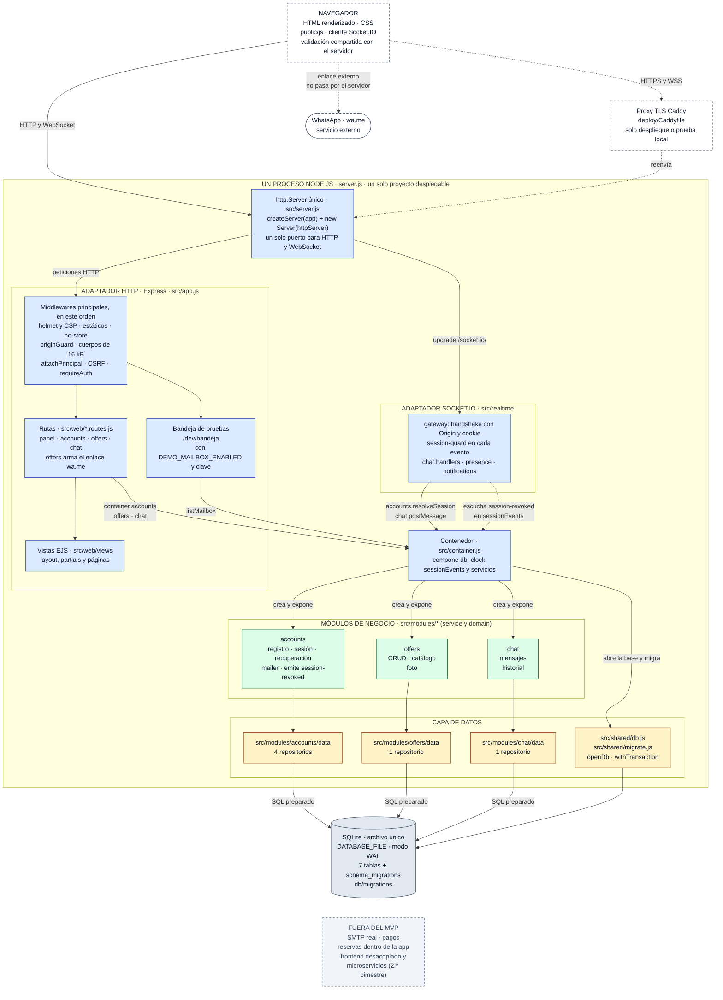

> **Actualización Supabase (noviembre de 2026):** la persistencia vigente usa PostgreSQL y Storage de Supabase. Consulta [la configuración actual](supabase.md). Las referencias a SQLite y sus evidencias en esta página describen la implementación anterior.

# Arquitectura del monolito (B3.1)

Aplicación web monolítica de turismo comunitario: **un solo proceso Node.js** con Express para las rutas y las vistas EJS, Socket.IO en el mismo `http.Server` y SQLite en un archivo. Este documento describe lo que el código tiene hoy; cada carpeta y archivo nombrado se comprueba con `test -e` (TM-ARQ-01, [evidencias](evidencias/B3.1/LEEME.md)).

- **Estado verificado:** rama bloque/B3.1-arquitectura creada sobre `main` con B2.2 integrado (`4ac9c4f`); `npm run lint` y `npm test` en verde (202 pruebas) antes de dibujar.
- **Referencias:** [`PLAN-MVP.md`](../mvp-primer-bimestre/PLAN-MVP.md) §2.2 y §2.4; [`esquema.md`](esquema.md) para los datos.
- **Lo aplazado** figura en el cuadro «Fuera del MVP» del diagrama y en la sección del mismo nombre.

## Diagrama



Lectura rápida: línea continua = llamada o petición dentro del flujo principal; línea punteada = camino opcional (proxy TLS), suscripción a un evento o enlace externo. Azul = adaptadores y composición, verde = módulos de negocio, ámbar = capa de datos, gris = base de datos. Versión PNG para diapositivas: [`docs/mvp/img/arquitectura.png`](img/arquitectura.png).

### Fuente del diagrama (Mermaid)

La imagen se genera desde este bloque; si el código cambia, se corrige aquí y se exporta de nuevo (ver [Cómo se genera la imagen](#cómo-se-genera-la-imagen)).



## Qué hace «monolítica» a esta aplicación

| Criterio del Word | Dónde se cumple |
|---|---|
| Las vistas HTML se renderizan en el servidor | EJS en `src/web/views`; `renderPage` en `src/web/render-page.js` envuelve cada página en `layout.ejs` |
| El enrutamiento se resuelve en el servidor | Routers de `src/web/*.routes.js` montados en `src/app.js` |
| Lógica, persistencia y presentación en un solo proyecto desplegable | Un único `package.json`; `server.js` compone configuración, base, contenedor, aplicación y servidor |
| El servidor WebSocket forma parte del mismo proyecto | `src/server.js` crea un `http.Server` y le adjunta Socket.IO; solo hay un `listen` (`server.js`, línea 27) |

## Componentes, carpetas y responsabilidades

| Componente | Carpeta o archivo real | Responsabilidad |
|---|---|---|
| Arranque | `server.js`, `src/config.js` | Carga y valida la configuración (`loadConfig`), crea el contenedor, la aplicación y el servidor, y cierra ordenadamente con `SIGINT` y `SIGTERM` |
| `http.Server` único | `src/server.js` | `createServer(app)` y `new Server(httpServer)`: Express y Socket.IO comparten puerto; limita el búfer de WebSocket a 16 kB |
| Navegador | `public/css/app.css`, `public/js` | Estilos y JavaScript de navegador: validación de formularios (`form-validate.js`), chat (`chat.js`, `chat-client.js`), aviso de mensajes nuevos (`notificaciones.js`, `notificaciones-contador.js`) y envío de la foto de la oferta (`oferta-foto.js`) |
| Validación compartida | `src/shared/validation` | `validate.js` lo importa el servidor y lo descarga el navegador desde `/js/shared` (`src/app.js`, línea 72) |
| Aplicación Express | `src/app.js` | Monta el orden de middlewares, los routers, el 404 y el manejador de errores; en producción no monta la guía visual de `/dev/diseno` |
| Middlewares | `src/shared/http` | `origin.js` (Origin exacto), `csrf.js` (token ligado a la sesión), `auth.js` (`attachPrincipal`, `requireAuth`, `no-store`), `error-handler.js`, `safe-next.js` |
| Rutas | `src/web/panel.routes.js`, `src/web/accounts.routes.js`, `src/web/offers.routes.js`, `src/web/chat.routes.js`, `src/web/design.routes.js` | Leen la petición, validan, llaman a **un** servicio del contenedor y responden HTML, redirección o JSON. No consultan SQLite |
| Subida de foto | `src/web/offer-photo.js` | Lee el multipart (`busboy`), comprueba tipo, tamaño y píxeles, y reencoda con `sharp` antes de llamar al servicio de ofertas |
| Vistas EJS | `src/web/views` | Plantillas por módulo (`accounts`, `offers`, `chat`, `panel`, `errors`, `partials`) y `layout.ejs`; salida escapada con `<%= %>` |
| Bandeja de pruebas | `src/web/accounts.routes.js`, `src/web/views/accounts/bandeja.ejs`, `src/modules/accounts/service/mailer.js`, `src/modules/accounts/data/mailbox.repo.js` | `GET /dev/bandeja`: solo con `DEMO_MAILBOX_ENABLED` y clave (Basic). El correo simulado se guarda en `mail_outbox`; no hay SMTP |
| Adaptador Socket.IO | `src/realtime/gateway.js`, `src/realtime/session-guard.js`, `src/realtime/chat.handlers.js`, `src/realtime/presence.js`, `src/realtime/notifications.js` | Handshake con `Origin` y cookie de sesión, revalidación en cada evento, sala `chat:general`, presencia y aviso `notification:new-message` |
| Contenedor | `src/container.js` | Único punto de composición: abre la base, aplica las migraciones y crea `accounts`, `offers` y `chat` con `db`, `clock`, `config`, `sessionEvents` y `logger` |
| Módulo `accounts` | `src/modules/accounts` | Registro, ingreso, sesiones, recuperación de contraseña y bandeja de pruebas; cuatro repositorios (`users`, `sessions`, `reset-tokens`, `mailbox`) |
| Módulo `offers` | `src/modules/offers` | CRUD de ofertas propias, catálogo público, foto y provincias; un repositorio |
| Módulo `chat` | `src/modules/chat` | Mensajes, historial por cursor y `lastMessageId`; un repositorio. Guarda una copia del nombre del autor y no consulta `users` |
| Estructura de cada módulo | `src/modules/*/index.js`, `src/modules/*/domain`, `src/modules/*/service`, `src/modules/*/data` | `index.js` es la entrada pública; `domain` = esquemas y constantes puras; `service` = reglas, propiedad y transacciones; `data` = SQL preparado |
| Capa de datos | `src/shared/db.js`, `src/shared/migrate.js`, `src/modules/*/data` | `openDb` (claves foráneas, `busy_timeout`, WAL en archivo), `withTransaction` (`BEGIN IMMEDIATE`) y migrador con checksum |
| SQLite | `db/migrations`, `./data/app.sqlite` | Migraciones `001_base`, `010_accounts`, `020_offers` y `030_chat`. El archivo `./data/app.sqlite` (configurable con `DATABASE_FILE`) se crea al arrancar y no se versiona |
| Utilidades sin dependencias de módulos | `src/shared/clock.js`, `src/shared/time.js`, `src/shared/errors.js` | Reloj inyectable, hora de Ecuador y `AppError` con catálogo de códigos |
| Scripts | `scripts/migrate.js`, `scripts/seed-demo.js`, `scripts/check-ws.js`, `scripts/perf-seed.js`, `scripts/perf-catalog.js` | Migrar, sembrar datos de demostración, comprobar WSS y medir el catálogo. `migrate.js` y `seed-demo.js` usan `src/config.js`, el contenedor y `src/shared`; `check-ws.js` solo usa `socket.io-client`; `perf-seed.js` y `perf-catalog.js` importan además archivos internos de módulos (`hasher.js`, `offers.repo.js`), algo que ESLint no vigila fuera de `src` |
| Pruebas | `tests/unit`, `tests/integration`, `tests/ws`, `tests/security`, `tests/base`, `tests/helpers` | Suites ejecutadas con `node --test` |
| Proxy TLS (solo despliegue o prueba local) | `deploy/Caddyfile` | Caddy termina TLS y reenvía HTTP y WebSocket al mismo puerto de Node; el alojamiento público sigue pendiente ([`despliegue.md`](despliegue.md)) |
| Contacto por WhatsApp | `src/web/offers.routes.js`, `src/web/views/offers/publica-detalle.ejs`, `src/config.js` | Ver la sección siguiente |

Hay un helper sin uso: `src/shared/not-implemented.js` solo se define y nada lo importa hoy. No aparece en el diagrama.

## Contacto por WhatsApp (enlace externo)

La reserva no se gestiona dentro de la aplicación. En el detalle público de una oferta, `whatsappLink` (en `src/web/offers.routes.js`) arma la URL `https://wa.me/<numero>?text=<mensaje codificado>` con el número de `WHATSAPP_BOOKING_NUMBER` y el título y la fecha de la oferta. La vista `src/web/views/offers/publica-detalle.ejs` la imprime como un enlace `<a href>` con `rel="noopener noreferrer"`. El navegador abre WhatsApp directamente: el servidor **no hace ninguna petición a WhatsApp**, no guarda reservas y no hay tabla de reservas. Si el número no está configurado, la página muestra «Contacto por WhatsApp no disponible» en lugar del enlace.

## Reglas reales de dependencia

Se cumplen hoy y se comprueban con [`comprobar-dependencias.sh`](evidencias/B3.1/comprobar-dependencias.sh). Las marcadas «ESLint» las hace cumplir `eslint.config.js` (`npm run lint`).

| # | Regla | Cómo se hace cumplir | Estado observado |
|---|---|---|---|
| 1 | `src/modules/**` no importa `express`, `socket.io` ni `ejs` | ESLint: `FRAMEWORK_PATHS` en `eslint.config.js` | Sin importaciones |
| 2 | `src/modules/**` no importa `src/web` ni `src/realtime`: los adaptadores dependen de los módulos, no al revés | ESLint: `ADAPTER_PATTERNS` | Sin importaciones |
| 3 | Un módulo importa a otro solo por su `index.js` | ESLint: `otherModulesOnlyByIndex` | Hoy ningún módulo importa a otro |
| 4 | `src/web` y `src/realtime` no importan `data`, `service` ni `domain` de un módulo: usan el servicio del contenedor o `src/modules/*/index.js` | ESLint: patrón `**/modules/*/*/**` | `src/web/accounts.routes.js` y `src/web/offers.routes.js` importan solo `index.js` (esquemas, `PROVINCES`); el resto usa `container` |
| 5 | Solo `src/shared/db.js` importa `node:sqlite` dentro de `src` | ESLint: `SQLITE` (sobre `src/**/*.js` salvo `db.js`) | Cierto. Fuera de `src`, `scripts/check-sqlite-argon2.js` también lo importa: la regla no cubre `scripts` ni `tests` |
| 6 | El SQL vive solo en `src/modules/*/data`; los servicios abren transacciones con `withTransaction` pero no preparan sentencias | Convención y revisión; no hay regla ESLint | Ninguna llamada `prepare` o `exec` de SQL fuera de `data` |
| 7 | `src/shared` no importa de `src/modules`, `src/web` ni `src/realtime` | Convención; no hay regla ESLint | Sin importaciones |
| 8 | Los módulos no importan `src/shared/http`; usan `errors`, `validation`, `db`, `time` | Convención | Solo importan `src/shared/errors.js`, `src/shared/validation/validate.js`, `src/shared/db.js` y `src/shared/time.js` |
| 9 | Dentro de un módulo: `service` → `data` y `domain`; `data` → `domain`; `domain` no importa nada del módulo | Convención | Cierto en los tres módulos |
| 10 | Sesión revocada → cierre de sockets sin acoplar módulos: `accounts` emite en `sessionEvents` (de `container.js`) y `src/realtime/gateway.js` lo escucha | Diseño | `accounts` no importa `realtime`; el gateway no importa `accounts`, recibe el servicio por el contenedor |

Sentido de las dependencias: `src/web` y `src/realtime` → contenedor o `index.js` de los módulos → `service` → `data` → `src/shared/db.js` → SQLite. `src/container.js` es la única pieza que importa los `index.js` de los tres módulos y `src/shared/db.js`.

## Modelo de datos

Siete tablas más `schema_migrations`, descritas en [`esquema.md`](esquema.md). En B3.1 se contrastó contra las migraciones reales aplicadas en memoria (columnas, tipos, PK, FK, UK, relaciones del diagrama ER, `ON DELETE`, índices y migraciones): 295 comprobaciones, **sin diferencias**, por lo que `esquema.md` no se modificó. Registro: [`esquema-contraste.txt`](evidencias/B3.1/esquema-contraste.txt).

## Fuera del MVP

No existe en el código ni se dibuja como componente: SMTP real (hay bandeja de pruebas), pagos, reservas dentro de la aplicación (se consultan por WhatsApp), más de una sala de chat (`chat_messages.room` solo admite `general`), frontend desacoplado y microservicios (segundo bimestre). `docs/planificacion/02-arquitectura-y-decisiones.md` describe otro stack (Next.js, PostgreSQL, PayPal) como propuesta previa; no se usa como fuente de este diagrama.

## Cómo se genera la imagen

El script [`generar-diagrama.sh`](evidencias/B3.1/generar-diagrama.sh) toma el **primer** bloque Mermaid de este archivo y escribe `docs/mvp/img/arquitectura.svg` y `docs/mvp/img/arquitectura.png` con Mermaid CLI. La herramienta no es una dependencia del proyecto; se instala fuera del repositorio.

```bash
# 1. Instalar Mermaid CLI en una carpeta de herramientas (versión fija).
#    Si Chrome ya está instalado, se evita descargar el de Puppeteer.
PUPPETEER_SKIP_DOWNLOAD=true npm install --prefix "$HERRAMIENTAS" @mermaid-js/mermaid-cli@11.17.0

# 2. Desde la raíz del repositorio. CHROME es opcional (ruta a chrome.exe o chromium).
MMDC="$HERRAMIENTAS/node_modules/.bin/mmdc" \
CHROME="C:/Program Files/Google/Chrome/Application/chrome.exe" \
bash docs/mvp/evidencias/B3.1/generar-diagrama.sh
```

Opciones fijas del script: tema `base`, `htmlLabels: false` (el SVG usa `<text>` y no `foreignObject`, así abre igual en navegadores, editores y Word), fondo blanco, PNG a escala 2 y 1600 px de ancho. Generado con Mermaid CLI 11.17.0 (paquete npm @mermaid-js/mermaid-cli) y Node.js 24.22.3.

## Verificación (TM-ARQ-01)

- **Rutas:** `bash docs/mvp/evidencias/B3.1/comprobar-rutas.sh` extrae todas las rutas de este documento (código en línea y bloque Mermaid) y ejecuta `test -e` sobre cada una. Termina con código 1 si falta alguna. Resultado: [`tm-arq-01-rutas.txt`](evidencias/B3.1/tm-arq-01-rutas.txt).
- **Cinco afirmaciones para el revisor:** [`afirmaciones-revision.md`](evidencias/B3.1/afirmaciones-revision.md). Las cinco quedaron **confirmadas** por el revisor en la revisión del PR #23.
- **Inspección visual de la imagen:** registrada en [`LEEME.md`](evidencias/B3.1/LEEME.md).
